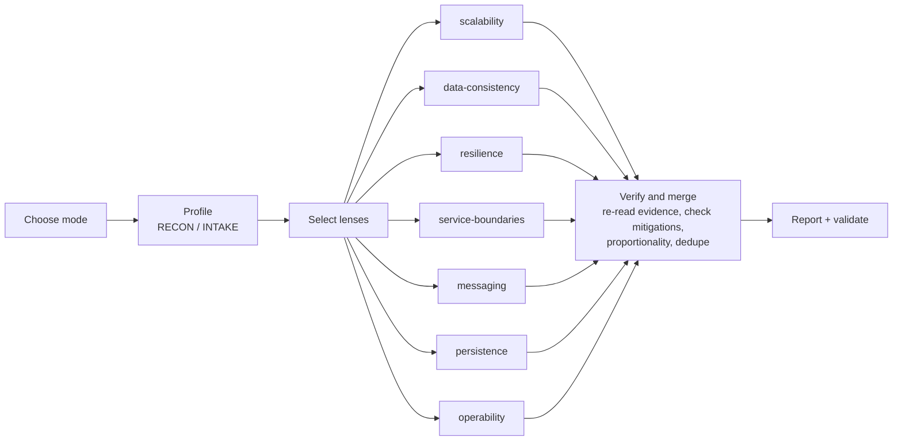

# review-architecture

An agent skill that reviews a system's architecture and recommends fixes. Point it at a codebase, or describe a project you're planning. It finds the system-design mistakes that will hurt at your scale, proves each one with evidence, and recommends the smallest pattern that fixes it.

- **Codebase mode**: run it inside a repo. It profiles the project (stack, deployables, datastores, sync and async edges, key flows), then sends parallel lens agents through the code.
- **Design mode**: describe a planned system, or hand it a brief. It asks up to five questions about the gaps (load, consistency needs, team, availability), then reviews the design before any code exists.
- **Hybrid**: code plus a stated intent (for example, "we need to handle 20× for Black Friday"). It reviews the code against that intent.

Recommendations are **proportional**. Every finding names the condition in your project that makes the fix worth its cost, so it won't push a saga onto a single-database monolith or microservices onto a three-person team.

## Install

```
/plugin install review-architecture --marketplace stohirov/review-architecture
```

Or, for one session from a local clone:

```
claude --plugin-dir /path/to/review-architecture
```

## Use

```
> Review the architecture of this repo
> Will this scale to 10x?
> Here's our design for the new booking system: … what would you change?
```

The skill writes two files:

- `architecture-review.md`: summary, architecture diagram (Mermaid), findings by severity with evidence and failure scenarios, a now/next/later roadmap, and what's already sound
- `architecture-findings.json`: the same findings, machine-readable and checked by `skills/review-architecture/scripts/validate-findings.mjs`

## How it works



The lens agents run in parallel. Each works through a checklist in `skills/review-architecture/references/lenses/`, where every rule lists its signals, why the mistake fails, the fix, when (and when not) to recommend it, and the mitigations that clear it. The parent agent then re-reads the evidence for every critical and high finding before it reaches the report.

| Lens | Looks for |
|---|---|
| scalability | instance-local session or state, local file storage, per-instance caches, schedulers running on every replica, slow work in the request path, unbounded queries, global locks, missing backpressure |
| data-consistency | HTTP/remote calls inside DB transactions, DB + broker dual writes without an outbox, multi-service flows without a saga or compensation, non-idempotent consumers and retried endpoints, XA/2PC, lost updates, transaction-boundary misuse |
| resilience | missing timeouts, missing circuit breakers, unsafe or stacked retries, long sync call chains, shared pools (no bulkheads), optional dependencies on the critical path |
| service-boundaries | shared databases, distributed-monolith signs, chatty interfaces, leaky models, premature splits |
| messaging | offsets committed before processing, no DLQ, ordering assumptions vs partition keys, unversioned event schemas, request/reply over a broker, unmonitored lag |
| persistence | N+1, missing indexes and unique constraints, Open Session in View, `ddl-auto` instead of migrations, pool sizing vs replicas, unbounded table growth, row-by-row bulk writes |
| operability | health probes, graceful shutdown, hardcoded config and secrets, tracing and correlation ids, metrics and alerts, edge or gateway, rolling-deploy compatibility |

The checklists are written for Spring Boot idioms first (the signals name `@Transactional`, `@FeignClient`, `KafkaTemplate`, ShedLock and so on), but the rules apply to any stack.

## Evals

`fixtures/` holds deliberately built Spring Boot projects, and `evals/answer-keys/` holds what a good review must find in each:

| Fixture | Mode | What it tests |
|---|---|---|
| `01-monolith-unscalable` | codebase | a monolith on 3–12 replicas with session state, local uploads, per-instance cache, unlocked scheduler, N+1, OSIV, sync email, stock races |
| `02-microservices-distributed-tx` | codebase | order/payment/inventory with HTTP in transactions, Kafka dual write, no saga, non-idempotent auto-commit consumer, no DLQ, no timeouts, retried payment POSTs, shared DB |
| `03-microservices-healthy` | codebase | **control**: the same domain built correctly (outbox, orchestrated saga with compensation and watchdog, inbox dedup, Resilience4j, DB per service). Checks for false positives: nothing above medium, and no recommendation of a pattern that's already there |
| `04-design-brief` | design | a ride-hailing brief with a shared schema, sync Stripe pre-auth inside a transaction, GPS pings as Postgres UPDATEs, single-instance in-memory matching, publish-after-commit |

Run one fixture headlessly (it copies the fixture to a temp dir first, so the reviewer never sees the answer keys):

```
evals/run.sh 02-microservices-distributed-tx
```

Score an existing result:

```
node evals/score.mjs evals/results/02-microservices-distributed-tx/architecture-findings.json \
  evals/answer-keys/02-microservices-distributed-tx.json
```

A run passes when the findings file is valid (and, with `--report` and `--brief`, the report layout and design-mode quotes check out), at least 90% of the `must_detect` keys are found, and no control finding is above the key's max severity. Control findings that name an already-implemented pattern are listed as warnings for review by hand. Findings that aren't in the key are listed too; they are often real issues the key doesn't cover.

### Results so far

Each run gave every fixture an isolated workspace and a reviewing agent that followed `SKILL.md` and fanned out lens subagents. Full outputs and summaries are in `evals/results/r*/`.

| Run | 01 monolith | 02 microservices | 03 control | 04 design |
|---|---|---|---|---|
| r1 | 9/9 | 10/11 | FAIL: 4 high | 6/6 |
| r2 | 9/9 | 11/11 | FAIL: 3 high | 6/6 |
| r3 | not run | 11/11 | PASS: 0 high | not run |
| r4 | 9/9 | 11/11 | FAIL: 1 high | 6/6 |
| r5 | not run | not run | FAIL: 1 high | 6/6 |

Every control failure was a **real defect in the "healthy" fixture**, which the review found and which was then fixed in the fixture:
- r1: the watchdog could cancel a reserved order, there was no input validation, the retry budget was shorter than the circuit-breaker window, and the payment consumer was undersized.
- r2: DLT topic name mismatch, client-supplied prices, unbounded order lines.
- r4: no authentication, so the charged customer came from the request body.
- r5: every PSP 4xx was treated as a final decline, including 401 and 429. This was a regression in the r4 fix.

r3 passed, but the fixture changed after it, so a pass on the current fixture is not yet recorded.

Severity calibration changed in r4: fixture 02 went from 10 criticals (r3) to 2, with recall unchanged.

Feedback from each run was used to tune the skill; see each run's `SUMMARY.md`. r1 outputs predate the current profile schema (`stated_intent` became required), so they no longer validate.

## Development

```
npm test
```

This runs the validator and scorer suites and checks that every answer key is well-formed. It needs Node 20 or later, with no dependencies.

## License

MIT
