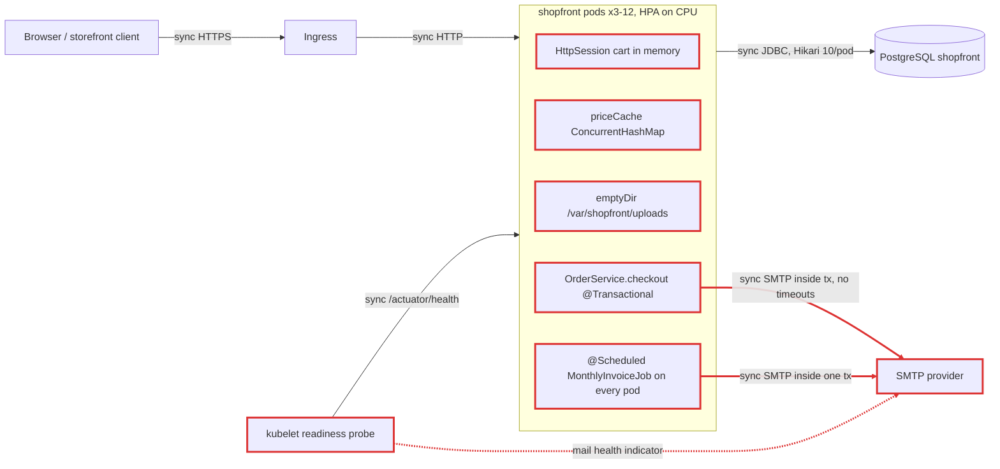
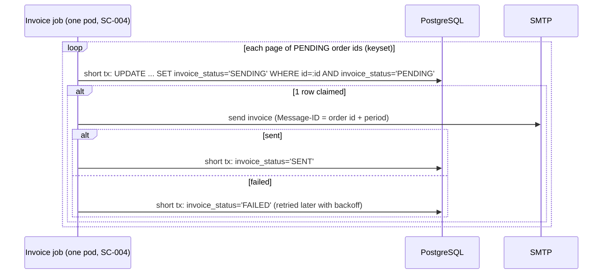

# Architecture review: Shopfront (01-monolith-unscalable)

- **Mode**: codebase. The user gave no description; the README's Black Friday target was used as stated intent in the profile.
- **Date**: 2026-10-24
- **Lenses run**: scalability, persistence, operability, data-consistency, resilience, service-boundaries.
- **Skipped**: messaging, because there is no broker or event stream, present or planned.

## Summary

Shopfront is a single Spring Boot monolith on one PostgreSQL database that already runs as 3 to 12 identical pods. It is not stateless, so it cannot actually run that way. Carts live in Tomcat session memory, images on a per-pod emptyDir, prices in a per-pod cache, and the monthly invoice job runs on every pod. On top of that, checkout oversells stock under concurrency and sends email inside its database transaction. The biggest risk for Black Friday is the combination: carts lost, wrong prices charged, stock oversold, and an SMTP slowdown taking the whole shop offline through the checkout transaction and the readiness probe. The change that buys the most is to make the pods disposable (externalize session and images, drop the price cache, run the job once), then commit checkout with an atomic stock decrement and send email after commit. None of this needs microservices.

| Severity | Count |
|---|---|
| critical | 5 |
| high | 9 |
| medium | 9 |
| low | 2 |
| info | 1 |
| **total** | **26** |

## Architecture profile

```
architecture: monolith, one Spring Boot deployable; business packages (catalog, cart, order, billing, media) with no enforced module boundaries
summary: Online store for a home-goods brand: product catalog, session cart, checkout with stock decrement, order history, product image upload/serve, monthly invoice emails.
stack: Java 17, Spring Boot 3.3.4 (web, data-jpa, mail, actuator), PostgreSQL driver, Maven; no Spring Session, no ShedLock, no Resilience4j, no Flyway/Liquibase
deployables:
  - shopfront (.): all features; db=PostgreSQL shopfront (DB_HOST=shopfront-db); calls=SMTP (smtp.mailprovider.com:587 via JavaMailSender); publishes=none; consumes=none
datastores: one PostgreSQL DB used only by shopfront; schema managed by ddl-auto=update; HttpSession in Tomcat memory (cart); product images on local disk /var/shopfront/uploads (k8s emptyDir per pod); in-process ConcurrentHashMap price cache in ProductService
messaging: none
background work: @EnableScheduling; MonthlyInvoiceJob @Scheduled(cron "0 0 2 1 * *") @Transactional, emails every un-invoiced order; no lock/leader election
runtime: k8s Deployment replicas=3, HPA 3-12 on CPU 70%; ingress (per README, manifest not in repo); readinessProbe /actuator/health only, no livenessProbe; actuator exposes health,info; no tracing, no metrics registry; no graceful-shutdown config
stated intent (README): 3 replicas normally, HPA to 12 for campaigns; Black Friday expected ~20x normal traffic, peak ~1,500 req/s; review is pre-Black-Friday. Team size and SLA unknown (assumed one team, 99.9%).
key flows:
  - add to cart: POST /api/cart/items -> HttpSession (instance memory)
  - checkout: POST /api/orders/checkout -> read cart from HttpSession -> OrderService.checkout @Transactional: per item productService.get, stock check-then-set, products.save, price from in-memory priceCache -> orders.save -> SMTP send confirmation (inside tx) -> commit -> cart.clear
  - image: POST /api/products/{id}/image -> file to local disk on one pod; GET serves from local disk of whichever pod
  - monthly invoices: scheduler on every pod -> findByInvoicedFalse (all) -> SMTP per order inside one tx -> markInvoiced on commit
```

Decisions made without the user (no one was available to ask):
- Mode is **codebase**, not hybrid, because the user gave no description. The README's scale target (20x, ~1,500 req/s, HPA to 12) is used as stated intent for grading.
- Team size and SLA are not stated. They are assumed to be one team and 99.9% availability.
- The ingress manifest and the Postgres `max_connections` setting are not in the repo, which lowers confidence on SC-001 (sticky sessions), OP-003 (auth at the ingress) and PS-001.



## Findings

---

**Critical (5)**

### SC-001 · Shopping cart lives in Tomcat HttpSession memory on a 3-12 replica deployment

**Severity** critical · **Confidence** high · **Lens** scalability · **Effort** medium

**Where**: `src/main/java/com/example/shopfront/cart/CartController.java:37`, `src/main/java/com/example/shopfront/order/OrderController.java:30`, `k8s/deployment.yaml:43`, `pom.xml:18`

**Evidence**:

```
static Cart cartOf(HttpSession session) {
    Cart cart = (Cart) session.getAttribute(CART);
    if (cart == null) { cart = new Cart(); session.setAttribute(CART, cart); }
// OrderController.checkout: Cart cart = (Cart) session.getAttribute("cart");
// pom.xml: no spring-session-*; HPA minReplicas: 3, maxReplicas: 12
```

**What goes wrong**: A shopper's cart is held in pod A's memory. The ingress (no session affinity visible in the repo) routes the next add-to-cart or the checkout to pod B, which creates an empty session: the cart vanishes or checkout fails with 'Cart is empty'. Even with sticky sessions, every rolling deploy, crash or HPA scale-in deletes the carts on the pods it removes, and scale-out cannot move existing sticky users onto new pods. On Black Friday the HPA churns pods constantly, so carts are lost at the peak.

**Fix** (`externalize-session`): Externalize the session with spring-session-jdbc on the existing Postgres (or spring-session-data-redis if Redis is available), or persist the cart as a DB row keyed by a cart-id cookie. Cart is mutated in place after getAttribute and never re-set, so with Spring Session either call session.setAttribute after each mutation or set SaveMode.ALWAYS, or changes are silently dropped. Remove any reliance on sticky sessions.

```yaml
# pom.xml: org.springframework.session:spring-session-jdbc
spring:
  session:
    jdbc:
      initialize-schema: never   # create SPRING_SESSION tables via Flyway (PS-003)
```
```java
// CartController: re-set after every mutation so Spring Session persists the change
cart.add(productId, quantity);
session.setAttribute(CART, cart);
```

**Why it's worth it here**: The Deployment always runs at least 3 replicas and autoscales to 12, and the cart must survive from browsing to checkout across pods and deploys.

### SC-002 · Product images written to a per-pod emptyDir and read back from whichever pod serves the GET

**Severity** critical · **Confidence** high · **Lens** scalability · **Effort** medium

**Where**: `src/main/java/com/example/shopfront/media/ProductImageController.java:43`, `src/main/java/com/example/shopfront/media/ProductImageController.java:51`, `k8s/deployment.yaml:32`, `src/main/resources/application.yml:18`

**Evidence**:

```
file.transferTo(new File(mediaDir, fileName));
product.setImageFile(fileName);
return products.save(product);
...
File image = new File(mediaDir, product.getImageFile());
if (!image.exists()) { return ResponseEntity.notFound().build(); }
# deployment.yaml
volumes:
  - name: uploads
    emptyDir: {}
```

**What goes wrong**: An admin uploads an image; it lands on pod A only, but the DB row now points every pod at that file name. With 3 replicas about 2 of 3 image requests return 404; at 12 replicas about 11 of 12. When pod A is restarted, rescheduled, rolled or scaled in, its emptyDir is deleted and the image is gone permanently while Product.imageFile still names it. New HPA pods start with an empty directory. Image bytes are also streamed through Tomcat request threads that checkout needs at peak. Secondary: if the DB save fails after transferTo, an orphan file is left behind, and re-uploads never delete the previous file.

**Fix** (`object-storage`): Store images in object storage (S3, GCS or MinIO) and keep only the object key in Product.imageFile. Serve images from a CDN or pre-signed URLs rather than through the app. Write the object first, then update only the image column in a short transaction; clean up superseded objects after commit or with a periodic sweep. Copy existing files off the pods before cut-over.

**Why it's worth it here**: More than one replica serves image requests and images must outlive the upload request and the pod that received it.

### SC-003 · Checkout charges a per-pod cached price that is never invalidated on other replicas

**Severity** critical · **Confidence** high · **Lens** scalability · **Effort** small

**Where**: `src/main/java/com/example/shopfront/catalog/ProductService.java:15`, `src/main/java/com/example/shopfront/catalog/ProductService.java:34`, `src/main/java/com/example/shopfront/catalog/ProductService.java:41`, `src/main/java/com/example/shopfront/order/OrderService.java:42`

**Evidence**:

```
private final Map<Long, BigDecimal> priceCache = new ConcurrentHashMap<>();
public BigDecimal currentPrice(Long productId) {
    return priceCache.computeIfAbsent(productId, id -> get(id).getPrice());
}
@Transactional public Product updatePrice(...) { ... product.setPrice(newPrice); priceCache.put(productId, newPrice); ... }
// OrderService.checkout:
order.addLine(new OrderLine(order, product, quantity, productService.currentPrice(product.getId())));
```

**What goes wrong**: Before Black Friday marketing sets a sale price with PUT /api/products/42/price. The request lands on pod A, so only A's map changes. Pods B and C cached the old price at their first checkout of that SKU and keep it until restart (no TTL). GET /api/products/42 reads the DB and shows the sale price, but checkouts routed to B or C record the old price in OrderLine.unitPrice and CustomerOrder.total, and the monthly invoice bills that wrong amount. Pods started later by the HPA load the new price, so the same SKU sells at different prices depending on the pod. updatePrice also writes the cache before commit, so a price change that fails to commit still poisons pod A. Direct DB edits are never picked up.

**Fix** (`cache-invalidation`): Remove priceCache from the checkout path and price each line from product.getPrice() on the row already loaded in the checkout transaction (OrderService line 35); this costs no extra query. If catalog reads later need caching, use a short-TTL cache for display only, or Redis with invalidation after commit, and never price an order from a cache.

```java
// OrderService.checkout: price from the row already loaded in this transaction
order.addLine(new OrderLine(order, product, quantity, product.getPrice()));
// ProductService: delete priceCache, currentPrice() and the priceCache.put in updatePrice
```

**Why it's worth it here**: Prices change for campaigns, the service runs 3-12 replicas, and the cached value is what the customer is charged and invoiced.

### SC-004 · MonthlyInvoiceJob runs on every replica, so every customer gets 3-12 copies of each invoice

**Severity** critical · **Confidence** high · **Lens** scalability · **Effort** small

**Where**: `src/main/java/com/example/shopfront/billing/MonthlyInvoiceJob.java:32`, `src/main/java/com/example/shopfront/ShopfrontApplication.java:8`, `k8s/deployment.yaml:6`

**Evidence**:

```
@Scheduled(cron = "0 0 2 1 * *")
@Transactional
public void sendInvoices() {
    List<CustomerOrder> pending = orders.findByInvoicedFalse();
    ... mailSender.send(message); order.markInvoiced();
// @EnableScheduling on ShopfrontApplication; replicas: 3 (HPA to 12); no ShedLock, @SchedulerLock, LockProvider, clustered Quartz or k8s CronJob
```

**What goes wrong**: At 02:00 on the 1st, every pod (at least 3, up to 12 after a campaign) fires the job at the same time. Each reads the same un-invoiced orders, because markInvoiced becomes visible only when each pod commits at the end of its loop. Each pod emails every customer an 'Amount due' invoice, so customers receive 3-12 identical invoices and some pay more than once. The burst can also get the sender throttled or flagged as spam by the mail provider. This happens every month without any fault, and scaling out makes it worse.

**Fix** (`distributed-lock`): Run the job exactly once: ShedLock with the JDBC provider on the existing Postgres (@SchedulerLock with lockAtMostFor sized to the run), or move it to a k8s CronJob running a one-shot profile with @Scheduled disabled in the Deployment. Combine with the per-order claim in DC-004 so that even an overlapping run cannot double-send.

```java
@Scheduled(cron = "0 0 2 1 * *")
@SchedulerLock(name = "monthlyInvoices", lockAtMostFor = "PT6H", lockAtLeastFor = "PT5M")
public void sendInvoices() { ... }   // plus @EnableSchedulerLock and a JdbcTemplateLockProvider bean
```

**Why it's worth it here**: The job has external, money-bearing side effects that must happen once, and the Deployment never runs fewer than 3 replicas.

### DC-001 · Concurrent checkouts oversell stock: check-then-set on Product.stock with no locking

**Severity** critical · **Confidence** high · **Lens** data-consistency · **Effort** small

**Where**: `src/main/java/com/example/shopfront/order/OrderService.java:35`, `src/main/java/com/example/shopfront/order/OrderService.java:37`, `src/main/java/com/example/shopfront/order/OrderService.java:40`, `src/main/java/com/example/shopfront/catalog/Product.java:21`

**Evidence**:

```
Product product = productService.get(entry.getKey());
int quantity = entry.getValue();
if (product.getStock() < quantity) { throw new OutOfStockException(product.getSku()); }
product.setStock(product.getStock() - quantity);
products.save(product);
// Product: private int stock; no @Version; ProductRepository has no @Lock or @Modifying query; Postgres default READ COMMITTED
```

**What goes wrong**: A Black Friday doorbuster has stock=1. Two checkouts on any pods both run findById and read stock=1, both pass the check, and both flush UPDATE product SET stock=0. Both commit, so two customers are sold one unit. At ~1,500 req/s concentrated on a few campaign SKUs this repeats constantly, and because stock never goes negative nothing signals the oversell. A naive pessimistic lock in today's transaction would also hold the row lock across the SMTP send (DC-003), serializing every checkout of that SKU behind the mail server.

**Fix** (`pessimistic-locking`): Decrement atomically in the database: @Modifying @Query("update Product p set p.stock = p.stock - :qty where p.id = :id and p.stock >= :qty") and throw OutOfStockException when it updates 0 rows. Process cart lines in ascending product id so multi-item carts cannot deadlock. Add CHECK (stock >= 0) as a backstop via a real migration (PS-003). Fix DC-003 first or together, so any row lock is held for milliseconds, not for an SMTP round trip.

```java
public interface ProductRepository extends JpaRepository<Product, Long> {
    @Modifying
    @Query("update Product p set p.stock = p.stock - :qty where p.id = :id and p.stock >= :qty")
    int decrementStock(@Param("id") Long id, @Param("qty") int qty);
}
// OrderService.checkout, iterating cart lines sorted by product id:
if (products.decrementStock(productId, qty) == 0) throw new OutOfStockException(sku);
```

**Why it's worth it here**: Stock is a hot shared row written by concurrent checkouts across 3-12 replicas, with heavy contention on a few SKUs expected on Black Friday.

---

**High (9)**

### DC-002 · Image upload and checkout write back stale stock and price with full-row UPDATEs

**Severity** high · **Confidence** high · **Lens** data-consistency · **Effort** small

**Where**: `src/main/java/com/example/shopfront/media/ProductImageController.java:41`, `src/main/java/com/example/shopfront/media/ProductImageController.java:45`, `src/main/java/com/example/shopfront/catalog/Product.java:10`, `src/main/java/com/example/shopfront/catalog/ProductService.java:40`

**Evidence**:

```
Product product = productService.get(productId);        // loaded at request start
file.transferTo(new File(mediaDir, fileName));             // seconds for a large file
product.setImageFile(fileName);
return products.save(product);                             // UPDATE writes every column, incl. stock and price
// Product: no @Version, no @DynamicUpdate
```

**What goes wrong**: An admin uploads an image for a product with stock=50. During the transfer, 10 checkouts commit stock=40. The upload's save then flushes UPDATE product SET stock=50, price=<old>, image_file=..., so 10 sold units become available again and are oversold later, and a price change committed in the same window is reverted. The same happens between checkout and updatePrice: a checkout that loaded the product before an admin's price change, and then waits on SMTP inside its transaction, commits a full-row UPDATE that writes the old price back while pod A's priceCache holds the new one.

**Fix** (`optimistic-locking`): Add @Version to Product so stale writes fail with an OptimisticLockException instead of silently overwriting. Make the image upload update only its column (@Modifying update Product set imageFile = :f where id = :id) in a short transaction after the file is stored, and keep stock on the atomic decrement from DC-001. @DynamicUpdate is an extra backstop.

```java
@Entity
public class Product {
    @Version private long version;   // stale full-row writes now fail instead of overwriting
    ...
}
```

**Why it's worth it here**: Product rows are written by three independent paths (checkout, price update, image upload) that run concurrently while the shop is live.

### DC-003 · Order confirmation email is sent over SMTP inside the checkout transaction

**Severity** high · **Confidence** high · **Lens** data-consistency · **Effort** small

**Where**: `src/main/java/com/example/shopfront/order/OrderService.java:31`, `src/main/java/com/example/shopfront/order/OrderService.java:45`, `src/main/java/com/example/shopfront/order/OrderService.java:58`

**Evidence**:

```
@Transactional
public CustomerOrder checkout(String customerEmail, Cart cart) {
    ...
    CustomerOrder saved = orders.save(order);
    sendConfirmation(saved);   // -> mailSender.send(message);
    return saved;
}
```

**What goes wrong**: (1) The SMTP provider throttles or rejects at 20x mail volume: send throws MailException, the whole checkout rolls back, and nobody can buy while mail is unhealthy, so a notification takes down the revenue path. (2) SMTP is slow or hangs (RS-001): each checkout holds a Tomcat thread, a Hikari connection (default pool 10) and the product row locks for the whole send; the pool drains and catalog, cart and history on that pod fail too; the HPA does not react because blocked threads use no CPU. (3) The send succeeds, then the commit fails (DB failover, pod killed with no graceful shutdown): the customer has a confirmation for an order that does not exist and the stock decrement is rolled back.

**Fix** (`after-commit-hook`): Commit the order first, then send. Publish an OrderPlaced application event and send from @TransactionalEventListener(phase = AFTER_COMMIT) on a bounded @Async executor with retry and backoff. If a confirmation must never be lost, write a notification_outbox row in the checkout transaction and have a relay send and mark it (one pod, or claim rows with FOR UPDATE SKIP LOCKED). Either way add SMTP timeouts (RS-001).

```java
@Transactional
public CustomerOrder checkout(String email, Cart cart) {
    ...
    CustomerOrder saved = orders.save(order);
    events.publishEvent(new OrderPlaced(saved.getId()));
    return saved;
}

@Async("mailExecutor")   // bounded pool
@TransactionalEventListener(phase = TransactionPhase.AFTER_COMMIT)
void onOrderPlaced(OrderPlaced e) { /* load order, send with retry/backoff */ }
```

```mermaid
sequenceDiagram
    participant C as Client
    participant S as OrderService
    participant DB as PostgreSQL
    participant W as Mail worker (bounded executor)
    participant M as SMTP
    C->>S: POST /checkout
    S->>DB: BEGIN; decrement stock; insert order
    S->>DB: COMMIT
    S-->>C: 201 Created (no SMTP wait)
    S-)W: OrderPlaced (after commit)
    W->>M: send confirmation (timeouts, retry with backoff)
```

**Why it's worth it here**: Checkout is the revenue path at a stated 1,500 req/s peak, and the confirmation email is not needed to answer the request correctly.

### DC-004 · Invoice job wraps every SMTP send in one all-or-nothing transaction, so a mid-run failure re-sends all invoices

**Severity** high · **Confidence** high · **Lens** data-consistency · **Effort** medium

**Where**: `src/main/java/com/example/shopfront/billing/MonthlyInvoiceJob.java:33`, `src/main/java/com/example/shopfront/billing/MonthlyInvoiceJob.java:35`, `src/main/java/com/example/shopfront/billing/MonthlyInvoiceJob.java:43`, `src/main/java/com/example/shopfront/billing/MonthlyInvoiceJob.java:44`, `src/main/java/com/example/shopfront/order/OrderRepository.java:11`

**Evidence**:

```
@Transactional
public void sendInvoices() {
    List<CustomerOrder> pending = orders.findByInvoicedFalse();   // no paging
    for (CustomerOrder order : pending) {
        ... mailSender.send(message);
        order.markInvoiced();
    }
}
```

**What goes wrong**: The 1 December run loads every Black Friday month order into one persistence context and holds one transaction and connection open while it emails them one by one, possibly for hours given no SMTP timeouts. At order 4,000 of 30,000 a send fails (provider rate limit, a rejected address) or the pod is terminated (scale-in, node drain, deploy). The transaction rolls back: 3,999 customers have received an invoice whose invoiced flag reverts to false, and 26,000 get nothing. The next run, manual or next month, re-sends the 3,999. One bad address blocks invoicing for everyone, and the long transaction blocks vacuum on customer_order the whole time.

**Fix** (`idempotency-key`): Make each order's invoicing its own short unit of work. Page through un-invoiced ids with keyset pagination. For each order (or chunk of a few hundred), claim it in a short transaction (UPDATE customer_order SET invoice_status='SENDING' WHERE id=:id AND invoice_status='PENDING', or SELECT ... FOR UPDATE SKIP LOCKED), send outside the transaction, then mark SENT or FAILED in another short transaction. Retry FAILED with backoff instead of aborting the run. Use the order id plus billing period as the Message-ID/idempotency key with the mail provider.



**Why it's worth it here**: Invoices are money-bearing customer communications, and the first run after Black Friday is the year's largest batch, so a mid-run failure is likely.

### DC-005 · Checkout POST is not idempotent: a retry or double-submit creates a second order

**Severity** high · **Confidence** medium · **Lens** data-consistency · **Effort** small

**Where**: `src/main/java/com/example/shopfront/order/OrderController.java:29`, `src/main/java/com/example/shopfront/order/OrderController.java:34`, `src/main/java/com/example/shopfront/order/OrderController.java:35`, `src/main/java/com/example/shopfront/cart/Cart.java:9`

**Evidence**:

```
public OrderSummary checkout(@RequestParam String email, HttpSession session) {
    Cart cart = (Cart) session.getAttribute("cart");
    ...
    CustomerOrder order = orderService.checkout(email, cart);
    cart.clear();   // only after commit
// no idempotency key, no unique constraint; Cart wraps a non-thread-safe LinkedHashMap shared by concurrent requests in one session
```

**What goes wrong**: Checkout is slow under load or while SMTP is slow (DC-003). The shopper or the frontend's HTTP client gives up and submits again on the same session. The first request has not reached cart.clear(), so the second reads the same cart and runs OrderService.checkout as well. Both commit: two orders, stock decremented twice, two confirmation emails and later two invoices. A plain double-click has the same effect, since nothing serializes checkouts per session. The frontend is not in the repo, so whether it blocks resubmission is unknown (hence medium confidence).

**Fix** (`idempotency-key`): Have the client send an Idempotency-Key (a checkout token minted when the cart is shown). Store it on customer_order with a unique constraint in the checkout transaction; on a duplicate, return the existing order instead of creating a new one. Snapshot the cart contents into the request rather than iterating the live session object.

**Why it's worth it here**: Checkout has user-visible side effects (stock, email, invoice), and slow responses at Black Friday load make retries and double-submits likely.

### RS-001 · No SMTP timeouts: a hung mail server pins request threads and DB connections indefinitely

**Severity** high · **Confidence** high · **Lens** resilience · **Effort** small

**Where**: `src/main/resources/application.yml:11`, `src/main/java/com/example/shopfront/order/OrderService.java:58`, `src/main/java/com/example/shopfront/billing/MonthlyInvoiceJob.java:43`

**Evidence**:

```
mail:
  host: ${SMTP_HOST:smtp.mailprovider.com}
  port: 587
  username: ${SMTP_USER}
  password: ${SMTP_PASSWORD}
# no spring.mail.properties.mail.smtp.connectiontimeout / timeout / writetimeout; Jakarta Mail defaults are infinite
```

**What goes wrong**: The SMTP server accepts the TCP connection and then stalls, or packets are blackholed. Each checkout blocks in mailSender.send with no deadline while holding a Hikari connection. After 10 such checkouts on a pod, every DB-backed endpoint waits 30 s for a connection and fails; the stuck threads never return. Blocked threads use no CPU, so the HPA does not scale, and there is no liveness probe to restart the pod. The mail health indicator hangs too (OP-001), so readiness probes time out and pods leave the load balancer. The store is down until someone restarts pods by hand.

**Fix** (`timeouts`): Set spring.mail.properties.mail.smtp.connectiontimeout=2000, mail.smtp.timeout=5000 and mail.smtp.writetimeout=5000. With DC-003 fixed, mail is no longer on the request path, so this protects the async sender and the invoice job; until then it is the one-line fix that bounds the damage.

```yaml
spring:
  mail:
    properties:
      mail.smtp.connectiontimeout: 2000
      mail.smtp.timeout: 5000
      mail.smtp.writetimeout: 5000
```

**Why it's worth it here**: SMTP is an external provider called on the checkout path and in the invoice job, and the calls hold pooled DB connections the rest of the app shares.

### PS-001 · Default Hikari pool times HPA maxReplicas (12 x 10 = 120) exceeds Postgres's default connection limit

**Severity** high · **Confidence** medium · **Lens** persistence · **Effort** small

**Where**: `src/main/resources/application.yml:4`, `k8s/deployment.yaml:44`

**Evidence**:

```
datasource:
  url: jdbc:postgresql://${DB_HOST:localhost}:5432/shopfront
  # no spring.datasource.hikari.* (maximumPoolSize=10, minimumIdle=10, connectionTimeout=30s)
# HPA: maxReplicas: 12
```

**What goes wrong**: Black Friday load pushes the HPA from 3 toward 12 pods, and each pod opens 10 connections at startup. Around the 10th pod, 100+ connections exceed Postgres's default max_connections of 100 (minus reserved superuser slots). New pods get 'FATAL: sorry, too many clients already', fail the DB health check and never become ready, and existing pods cannot replace recycled connections. The scale-out meant to add capacity fails at peak traffic. The DB's real max_connections is not in the repo, hence medium confidence.

**Fix** (`connection-pool-sizing`): Budget connections explicitly: maxReplicas x maximum-pool-size + admin headroom <= max_connections. Set spring.datasource.hikari.maximum-pool-size (for example 6-8) with a lower minimum-idle and a connection-timeout of 2-3 s so callers fail fast, or put PgBouncer in transaction mode in front of Postgres. Load-test at 12 replicas before Black Friday.

```yaml
spring:
  datasource:
    hikari:
      maximum-pool-size: 7      # 12 pods x 7 = 84 < max_connections 100 minus headroom
      minimum-idle: 2
      connection-timeout: 3000
```

**Why it's worth it here**: The HPA is configured to scale to 12 replicas against a single Postgres instance, and the README plans to use that headroom on Black Friday.

### OP-001 · Readiness probe includes SMTP health and there is no liveness probe: a mail outage pulls every pod out of service

**Severity** high · **Confidence** high · **Lens** operability · **Effort** small

**Where**: `k8s/deployment.yaml:23`, `pom.xml:29`, `src/main/resources/application.yml:21`

**Evidence**:

```
readinessProbe:
  httpGet:
    path: /actuator/health
    port: 8080
# no livenessProbe, no timeoutSeconds (k8s default 1 s); spring-boot-starter-mail + spring.mail.host auto-configures MailHealthIndicator, which rolls up into /actuator/health with the db indicator; management.health.mail.enabled not set
```

**What goes wrong**: The SMTP provider slows down or fails. MailHealthIndicator.testConnection() fails, or hangs past the 1 s probe timeout (no SMTP timeouts, RS-001), on every pod at the same moment. Kubernetes marks every replica NotReady, the Service has no endpoints, and the ingress returns 503 for catalog, cart and checkout: the whole shop goes dark because of a dependency that only sends email. At peak, the db indicator also waits for a Hikari connection held by checkouts stuck on SMTP, so pods flip unready one by one and load piles onto the rest. With no liveness probe, a pod whose threads are all stuck is never restarted.

**Fix** (`health-probes`): Point readiness at /actuator/health/readiness and add a livenessProbe on /actuator/health/liveness (set management.endpoint.health.probes.enabled=true). Set management.health.mail.enabled=false, or keep mail out of every probe group; include db in readiness only. Set explicit timeoutSeconds, periodSeconds and failureThreshold, plus a startupProbe.

```yaml
# application.yml
management:
  endpoint.health.probes.enabled: true
  health.mail.enabled: false
# deployment.yaml
readinessProbe:
  httpGet: { path: /actuator/health/readiness, port: 8080 }
  timeoutSeconds: 3
livenessProbe:
  httpGet: { path: /actuator/health/liveness, port: 8080 }
  timeoutSeconds: 3
```

**Why it's worth it here**: The probe gates traffic for every replica on k8s, and SMTP is not needed to serve the catalog, the cart or (once DC-003 is fixed) checkout.

### OP-002 · HPA cannot scale on CPU utilization: the container has no CPU request, and CPU is the wrong signal for this I/O-bound app

**Severity** high · **Confidence** medium · **Lens** operability · **Effort** small

**Where**: `k8s/deployment.yaml:16`, `k8s/deployment.yaml:45`

**Evidence**:

```
containers:
  - name: shopfront
    image: registry.example.com/shopfront:1.4.0
    # no resources: block
...
metrics:
  - type: Resource
    resource:
      name: cpu
      target:
        type: Utilization
        averageUtilization: 70
```

**What goes wrong**: A Utilization target is computed against resources.requests.cpu, which the container does not set. Unless a namespace LimitRange outside the repo injects a default (hence medium confidence), the HPA reports 'missing request for cpu' and never scales: the fleet stays at 3 replicas on Black Friday while the plan assumes 12. Even with requests, checkout spends its time blocked on SMTP and the DB, so CPU stays low while Tomcat threads and the Hikari pool are exhausted, and the HPA reacts only after latency has collapsed. Without requests the pods are also BestEffort QoS, first to be evicted under node pressure. There is no rate limiting either, so the service fails slowly instead of shedding load.

**Fix** (`metrics-and-alerts`): Add resources.requests (cpu, memory) and a memory limit sized from a load test, and verify with kubectl describe hpa in the target namespace. Pre-scale minReplicas for the campaign window. Once metrics exist (OP-005), consider scaling on request rate or latency, and add rate limiting for checkout and search at the ingress.

**Why it's worth it here**: The Black Friday plan relies on the HPA scaling from 3 to 12 for a ~20x traffic spike.

### OP-003 · No authentication boundary: price changes, image uploads and any customer's order history are open to anyone

**Severity** high · **Confidence** medium · **Lens** operability · **Effort** medium

**Where**: `src/main/java/com/example/shopfront/catalog/ProductController.java:37`, `src/main/java/com/example/shopfront/order/OrderController.java:39`, `src/main/java/com/example/shopfront/media/ProductImageController.java:39`, `pom.xml:18`

**Evidence**:

```
@PutMapping("/{id}/price") public Product updatePrice(@PathVariable Long id, @RequestBody BigDecimal price)
@GetMapping public List<OrderSummary> history(@RequestParam String email)
@PostMapping public Product upload(@PathVariable Long productId, @RequestParam("file") MultipartFile file)
// no spring-boot-starter-security in pom.xml; ingress manifest not in the repo
```

**What goes wrong**: Admin and customer endpoints share one surface with no authentication in the app. Anyone who can reach the ingress can PUT /api/products/42/price with 0.01 and check out at that price, read another customer's order history with GET /api/orders?email=victim@example.com, or write arbitrary files to a pod's disk. This holds unless the ingress, which is not in the repo, blocks these paths (hence medium confidence).

**Fix** (`api-gateway`): Add an authentication boundary (Spring Security, or auth at the ingress or gateway). Keep admin endpoints (price, image upload) off the public ingress or behind admin auth, and scope order history to the authenticated customer. Commission a dedicated security review for depth.

**Why it's worth it here**: A public storefront exposes admin mutations and customer PII through the same ingress.

---

**Medium (9)**

### SC-005 · Catalog list and search return unbounded result sets with full-table scans

**Severity** medium · **Confidence** medium · **Lens** scalability · **Effort** small

**Where**: `src/main/java/com/example/shopfront/catalog/ProductController.java:25`, `src/main/java/com/example/shopfront/catalog/ProductService.java:22`, `src/main/java/com/example/shopfront/catalog/ProductRepository.java:9`

**Evidence**:

```
@GetMapping public List<Product> list(@RequestParam(required = false) String q) { ... return productService.listAll(); }
// -> products.findAll()
List<Product> findByNameContainingIgnoreCase(String query);   // lower(name) like '%q%', no Pageable
```

**What goes wrong**: Browsing is likely most of the 1,500 req/s peak. Every GET /api/products reads and serializes the whole product table, descriptions included, and every search is a leading-wildcard sequential scan, all on the single Postgres primary with no HTTP caching. DB CPU grows with catalog size times request rate, and adding pods does not help because the shared DB saturates first and drags checkout latency down with it. Catalog size is unknown, hence medium confidence.

**Fix** (`pagination`): Add Pageable with a capped page size and return a lightweight DTO. Put Cache-Control or a CDN, or a short-TTL cache, in front of the read-mostly catalog list. For search, add a pg_trgm GIN index or Postgres full-text search, with a result limit.

**Why it's worth it here**: Catalog reads are the hot path at 20x traffic on one shared database, and the catalog grows over time.

### RS-002 · No JDBC socket or statement timeouts and a 30 s pool wait on the request path

**Severity** medium · **Confidence** medium · **Lens** resilience · **Effort** small

**Where**: `src/main/resources/application.yml:5`

**Evidence**:

```
url: jdbc:postgresql://${DB_HOST:localhost}:5432/shopfront
# no socketTimeout, no statement_timeout, no spring.datasource.hikari.connection-timeout (default 30 s)
```

**What goes wrong**: The Postgres primary fails over or a network path silently drops. pgjdbc's socketTimeout defaults to 0, so threads reading on dead connections block until TCP keepalive gives up (hours with Linux defaults). Under 20x load a slow query (for example the unbounded findAll in SC-005) runs with no statement timeout. Either way the pooled connections stay busy, new requests wait the full 30 s for a connection and then fail, and Tomcat threads pile up long before any error reaches the client.

**Fix** (`timeouts`): Add socketTimeout (for example 30) and options=-c statement_timeout=5000 to the JDBC URL, or set jakarta.persistence.query.timeout. Set spring.datasource.hikari.connection-timeout to about 2-3 s so callers fail fast under pool saturation (sized together with PS-001).

**Why it's worth it here**: The DB is on every key flow and peak load is expected at 20x normal.

### PS-002 · Order history is unpaginated N+1 over lazy lines and products, with no indexes on its lookup columns

**Severity** medium · **Confidence** high · **Lens** persistence · **Effort** small

**Where**: `src/main/java/com/example/shopfront/order/OrderController.java:41`, `src/main/java/com/example/shopfront/order/OrderController.java:50`, `src/main/java/com/example/shopfront/order/OrderRepository.java:9`, `src/main/java/com/example/shopfront/order/CustomerOrder.java:36`

**Evidence**:

```
return orderService.history(email).stream().map(OrderSummary::of).toList();
// OrderSummary.of:
order.getLines().stream().map(l -> new LineSummary(l.getProduct().getSku(), l.getProduct().getName(), ...))
@OneToMany(mappedBy = "order", cascade = CascadeType.ALL) private List<OrderLine> lines;   // lazy
List<CustomerOrder> findByCustomerEmailOrderByPlacedAtDesc(String customerEmail);   // no Pageable, no fetch plan
// no @Table(indexes) and no migrations anywhere
```

**What goes wrong**: A customer with 40 orders of 3 lines triggers 1 + 40 + up to 120 queries per history request, fired from the controller through open-in-view. The first query scans customer_order (no index on customer_email), and each of the 40 lines queries scans order_line, because Postgres does not index the order_line.order_id foreign key automatically. As order tables grow with every checkout, each history page costs dozens of scans of the largest tables on the same DB and pool that checkout needs, which hurts most during post-campaign 'where is my order' traffic.

**Fix** (`entity-graph`): Fetch lines and products in one query (@EntityGraph(attributePaths = {"lines", "lines.product"}) or a DTO projection), set hibernate.default_batch_fetch_size as a backstop, and paginate history. In a versioned migration (PS-003) add indexes on customer_order(customer_email, placed_at DESC), order_line(order_id) and order_line(product_id), built CONCURRENTLY.

**Why it's worth it here**: Order tables grow with every checkout, and history is a customer-facing endpoint sharing the pool with checkout.

### PS-003 · Schema managed by ddl-auto=update on every pod, with no versioned migrations

**Severity** medium · **Confidence** high · **Lens** persistence · **Effort** medium

**Where**: `src/main/resources/application.yml:10`, `pom.xml:18`

**Evidence**:

```
jpa:
  hibernate:
    ddl-auto: update
# no flyway-core or liquibase-core in pom.xml
```

**What goes wrong**: A release adds a column to product or customer_order. During the rolling deploy, each new pod runs its own schema diff; the first ALTER TABLE needs an ACCESS EXCLUSIVE lock and waits behind in-flight checkout transactions (which hold product rows during the SMTP send), and every later query on that table queues behind it, stalling checkout on all pods. A NOT NULL primitive column fails against populated tables, Hibernate logs it and starts anyway, and the new code then fails at runtime. Renames and drops are never applied, environments drift, and the indexes and constraints other findings need (PS-002, DC-001, DC-005) have no reviewed path into production.

**Fix** (`versioned-migrations`): Adopt Flyway: baseline the current schema, set ddl-auto=validate in production, set lock_timeout in migrations, and use expand-contract for renames and drops. Run migrations once (Flyway's lock-protected migrate, or a Job/initContainer) before the rollout. Ship the missing indexes and constraints as the first migrations.

**Why it's worth it here**: A production shop with 3-12 replicas and rolling deploys against one shared schema.

### PS-004 · Open Session in View left enabled on an API service

**Severity** medium · **Confidence** high · **Lens** persistence · **Effort** small

**Where**: `src/main/resources/application.yml:8`, `src/main/java/com/example/shopfront/order/OrderController.java:50`

**Evidence**:

```
jpa:
  hibernate:
    ddl-auto: update
# spring.jpa.open-in-view not set (defaults to true, with a startup warning); OrderSummary.of walks lazy associations in the controller
```

**What goes wrong**: Lazy loads in history mapping run from the controller, outside any service transaction, which hides the N+1 in PS-002. The image upload request keeps its managed Product open across the multipart disk write, which widens the stale-write window in DC-002. Under peak load, persistence work spread across whole requests adds pressure on the 10-connection pool that checkout needs.

**Fix** (`disable-open-in-view`): Set spring.jpa.open-in-view=false and build DTOs inside @Transactional(readOnly = true) service methods using the fetch plan from PS-002.

**Why it's worth it here**: A REST API service whose controllers traverse lazy associations.

### OP-004 · No graceful shutdown: every rolling deploy or HPA scale-in cuts in-flight requests

**Severity** medium · **Confidence** high · **Lens** operability · **Effort** small

**Where**: `pom.xml:9`, `src/main/resources/application.yml:1`, `k8s/deployment.yaml:15`

**Evidence**:

```
spring-boot-starter-parent 3.3.4   (server.shutdown defaults to immediate before Boot 3.4)
# application.yml: no server.shutdown, no spring.lifecycle.timeout-per-shutdown-phase
# deployment.yaml: no preStop hook, no terminationGracePeriodSeconds
```

**What goes wrong**: After the campaign peak the HPA scales 12 down to 3, or a hotfix rolls out. SIGTERM reaches a pod before its endpoint is removed from the ingress, and Tomcat stops at once: in-flight requests get connection resets or 502s, and requests still routed during endpoint propagation hit a closed port. Checkouts cut after the email but before commit leave a confirmation for a rolled-back order (until DC-003 is fixed), and a deploy during the invoice run aborts its single transaction (DC-004).

**Fix** (`graceful-shutdown`): Set server.shutdown=graceful and spring.lifecycle.timeout-per-shutdown-phase (for example 20s), add a preStop sleep of 5-10 s so endpoint removal finishes before draining, and set terminationGracePeriodSeconds above preStop plus drain time.

```yaml
server:
  shutdown: graceful
spring:
  lifecycle:
    timeout-per-shutdown-phase: 20s
# deployment.yaml: lifecycle.preStop.exec.command: ["sleep", "10"]; terminationGracePeriodSeconds: 40
```

**Why it's worth it here**: HPA autoscaling (3-12) and rolling deploys are in use during the highest-traffic window of the year.

### OP-005 · No metrics registry or alerts: Black Friday saturation will be discovered by customers

**Severity** medium · **Confidence** high · **Lens** operability · **Effort** small

**Where**: `src/main/resources/application.yml:25`, `pom.xml:18`

**Evidence**:

```
management:
  endpoints:
    web:
      exposure:
        include: health,info
# no micrometer-registry-* dependency; no alerting config in the repo
```

**What goes wrong**: At 20x traffic the Hikari pool fills because checkouts hold connections across the SMTP send; checkout p99 climbs and 5xx rise. Nothing records http.server.requests, hikaricp.connections.pending, Tomcat busy threads or mail-send errors, and no alert fires. The team learns about it from customers and has no data to tell DB, SMTP or CPU apart while it is happening.

**Fix** (`metrics-and-alerts`): Add micrometer-registry-prometheus, expose /actuator/prometheus and scrape it. Dashboard and alert on RED metrics per endpoint (checkout first), Hikari pending/active, Tomcat busy threads, JVM heap and GC, and SMTP send failures, plus business counters for orders placed and checkout failures by reason. Alert on error-rate and latency SLO burn against the assumed 99.9%.

**Why it's worth it here**: A production service heading into a known 20x peak.

### OP-006 · Default DB credential committed in config; the manifest wires no Secrets for DB or SMTP

**Severity** medium · **Confidence** medium · **Lens** operability · **Effort** small

**Where**: `src/main/resources/application.yml:7`, `k8s/deployment.yaml:20`

**Evidence**:

```
username: ${DB_USER:shop}
password: ${DB_PASSWORD:shop}
...
env:
  - name: DB_HOST
    value: shopfront-db
# no DB_USER / DB_PASSWORD / SMTP_USER / SMTP_PASSWORD, no secretKeyRef or envFrom
```

**What goes wrong**: The manifest in the repo supplies no DB password, so production either really runs on the committed shop/shop credential or receives secrets from somewhere untracked. If a Secret mount is dropped or renamed in a later change, the app does not fail fast: it silently falls back to shop/shop and either connects with a known password or fails at runtime with an unclear auth error. Credential wiring and rotation cannot be audited from the repo.

**Fix** (`secrets-manager`): Remove the credential defaults so a missing value fails at startup, keep dev defaults in a local profile, and wire DB_USER, DB_PASSWORD, SMTP_USER and SMTP_PASSWORD from a k8s Secret (secretKeyRef or envFrom) or an external secrets manager, declared in the manifest.

**Why it's worth it here**: Production credentials for the DB and the SMTP provider.

### SB-001 · Order and media modules write catalog's Product directly; no module owns the stock invariant

**Severity** medium · **Confidence** high · **Lens** service-boundaries · **Effort** medium

**Where**: `src/main/java/com/example/shopfront/order/OrderService.java:19`, `src/main/java/com/example/shopfront/order/OrderService.java:41`, `src/main/java/com/example/shopfront/media/ProductImageController.java:28`, `src/main/java/com/example/shopfront/media/ProductImageController.java:45`, `src/main/java/com/example/shopfront/billing/MonthlyInvoiceJob.java:21`, `src/main/java/com/example/shopfront/order/OrderLine.java:24`

**Evidence**:

```
// order package
private final ProductRepository products;
product.setStock(product.getStock() - quantity); products.save(product);
// media package
private final ProductRepository products;
product.setImageFile(fileName); return products.save(product);
// billing package
private final OrderRepository orders; ... order.markInvoiced();
// OrderLine: @ManyToOne(fetch = FetchType.LAZY) private Product product;
// no Spring Modulith or ArchUnit in pom.xml
```

**What goes wrong**: Catalog exposes no stock or image operation, so order and media each load and save whole Product rows themselves, and billing mutates order entities through order's repository. This is why DC-001 and DC-002 exist: three modules write the same row with no shared rule. When the team fixes stock with an atomic decrement and @Version, the next feature that injects ProductRepository directly (a returns flow, an admin stock import) bypasses the fix and reintroduces overselling, because nothing stops a module reaching into another's persistence.

**Fix** (`modular-monolith`): Keep one deployable but make it a modular monolith. Make catalog the only writer of Product: add ProductService.reserveStock(productId, qty) (the atomic decrement from DC-001) and attachImage(productId, key), and remove ProductRepository from OrderService and ProductImageController. Give order an invoicing API for billing. Store a product snapshot (productId, sku, name, unitPrice) on OrderLine instead of a cross-module @ManyToOne. Enforce it with Spring Modulith's ApplicationModules.verify() or an ArchUnit test.

**Why it's worth it here**: The monolith has five business packages (catalog, cart, order, billing, media) and three of them change another module's entities, on the stock path that must be correct at Black Friday load.

---

**Low (2)**

### OP-007 · No correlation id or structured logs; a failed checkout cannot be traced across 3-12 pods

**Severity** low · **Confidence** high · **Lens** operability · **Effort** small

**Where**: `src/main/java/com/example/shopfront/order/OrderService.java:32`, `src/main/java/com/example/shopfront/billing/MonthlyInvoiceJob.java:36`

**Evidence**:

```
log.info("Sending {} invoices", pending.size());   // the only log statement in the codebase
// no Micrometer Tracing / OpenTelemetry, no MDC request-id filter, no JSON logging config; checkout logs nothing
```

**What goes wrong**: A customer reports 'checkout failed but I got a confirmation email'. With up to 12 pods, unstructured logs, no request id and no log line in the checkout path, nobody can find which pod handled the request or whether its transaction rolled back after the mail was sent.

**Fix** (`correlation-id`): Add a request-id (or Micrometer Tracing) filter that puts an id in the MDC, use JSON structured logging (logstash encoder on Boot 3.3), and log checkout outcomes with the order id and failure reason.

**Why it's worth it here**: A single deployable with several replicas: a correlation id in logs is enough; full distributed tracing is not needed.

### SB-002 · Catalog endpoints return the Product JPA entity, exposing stock counts and internal file names

**Severity** low · **Confidence** high · **Lens** service-boundaries · **Effort** small

**Where**: `src/main/java/com/example/shopfront/catalog/ProductController.java:25`, `src/main/java/com/example/shopfront/catalog/ProductController.java:33`, `src/main/java/com/example/shopfront/media/ProductImageController.java:40`

**Evidence**:

```
public List<Product> list(...)
public Product get(@PathVariable Long id)
public Product upload(...)
// Product exposes getStock() and getImageFile() (on-disk name UUID-originalFilename); OrderController already maps to an OrderSummary record
```

**What goes wrong**: The public JSON is the table schema. Moving images to object storage (SC-002) changes what imageFile means and silently changes the storefront API; adding a lazy association to Product would trigger LazyInitializationException or extra queries during serialization. Exact stock counts and internal storage names also reach every client.

**Fix** (`api-versioning`): Return a ProductView record (id, sku, name, description, price, imageUrl, inStock) from the catalog controllers, as OrderController already does with OrderSummary. Do it together with SC-002 so the image change does not leak to clients.

**Why it's worth it here**: The image storage change in SC-002 will alter Product.imageFile, which is currently part of the public API.

---

**Info (1)**

### SB-003 · Do not split into microservices for Black Friday; the scaling blockers are per-pod state

**Severity** info · **Confidence** medium · **Lens** service-boundaries · **Effort** small

**Where**: `README.md:13`

**Evidence**:

```
"We currently run 3 replicas behind the ingress and the HPA scales to 12 for campaigns. Marketing expects roughly 20x normal traffic for Black Friday (peak around 1,500 req/s)"
```

**What goes wrong**: If the team responds to the Black Friday review by extracting catalog, order or billing into services, it adds network calls and turns the stock decrement into a distributed-consistency problem, while the real horizontal-scaling blockers (in-memory session, emptyDir images, per-pod price cache, scheduler on every pod) remain unless fixed directly.

**Fix** (`modular-monolith`): Keep one deployable. Fix the per-pod state directly (SC-001 to SC-004) and tighten module seams (SB-001), so a later split stays possible if team or scaling pressures appear.

**Why it's worth it here**: One team (assumed) and about 20 source files, with no part showing different scaling or deploy needs; 1,500 req/s is well within a stateless monolith on 12 replicas.

## Roadmap

### Now (critical and high, all small or medium effort; before Black Friday)

- **SC-003**: Price checkout lines from the loaded Product row and delete the price cache. Unblocks: correct charged prices on every pod.
- **SC-004**: Put ShedLock (JDBC) on MonthlyInvoiceJob or move it to a k8s CronJob. Unblocks: stops 3-12x invoice emails; prerequisite for DC-004.
- **RS-001**: Set SMTP connect/read/write timeouts. Unblocks: bounds the blast radius of SMTP until DC-003 lands; protects OP-001 and DC-004.
- **OP-001**: Move probes to readiness/liveness groups, drop mail from health, add liveness. Unblocks: an SMTP outage no longer takes every pod out of service.
- **DC-003**: Send the confirmation after commit on a bounded async executor. Unblocks: checkout survives SMTP failure; shortens row locks for DC-001; frees pool for PS-001.
- **DC-001**: Atomic conditional stock decrement in id order. Unblocks: no overselling; base for SB-001's reserveStock API.
- **DC-002**: Add @Version to Product; image upload updates only its column. Unblocks: no resurrected stock or reverted prices.
- **DC-005**: Idempotency key with a unique constraint on checkout. Unblocks: no duplicate orders on retry or double-submit.
- **OP-002**: Add CPU and memory requests; verify the HPA; pre-scale for the campaign. Unblocks: the planned 3 to 12 scale-out actually happens.
- **PS-001**: Size the Hikari pool against max_connections x 12 (or add PgBouncer). Unblocks: pods 10-12 can start at peak.
- **SC-001**: Spring Session JDBC (or a DB-backed cart). Unblocks: carts survive pod changes, deploys and scale-in.
- **SC-002**: Move images to object storage + CDN. Unblocks: images visible from every pod and durable; unblocks SB-002.
- **DC-004**: Per-order claim/send/mark for invoices, in pages. Unblocks: a failed run resumes instead of re-sending.
- **OP-003**: Add an auth boundary; take admin endpoints off the public ingress. Unblocks: closes free price changes and PII reads; hand to a security review.

### Next

- **PS-003**: Adopt Flyway, ddl-auto=validate. Unblocks: the CHECK, unique and index changes DC-001, DC-005 and PS-002 need.
- **OP-005**: Prometheus metrics, dashboards and SLO alerts. Unblocks: load-test evidence for OP-002/PS-001 and visibility on the day.
- **OP-004**: Graceful shutdown with preStop and grace period. Unblocks: safe HPA scale-in and deploys during the campaign.
- **RS-002**: JDBC socket/statement timeouts and a fast pool timeout. Unblocks: fast failure instead of thread pile-ups.
- **SB-001**: Make catalog the only writer of Product, enforce with Modulith/ArchUnit. Unblocks: keeps the DC-001/DC-002 fixes from being bypassed.

### Later

- **PS-002**: Entity graph, pagination and indexes for order history. Unblocks: lower DB load as order tables grow.
- **SC-005**: Paginate and cache the catalog list; trigram index for search. Unblocks: catalog reads stop scaling with table size.
- **PS-004**: Disable open-in-view. Unblocks: explicit fetch plans; surfaces hidden N+1.
- **OP-006**: Remove credential defaults; wire Secrets in the manifest. Unblocks: auditable, fail-fast credentials.
- **SB-002**: ProductView DTO for catalog endpoints. Unblocks: image storage and schema changes no longer break clients.
- **OP-007**: Request id in MDC and JSON logs. Unblocks: traceable checkout failures across pods.
- **SB-003**: Keep the monolith; no service split. Unblocks: nothing to do; guards against the wrong fix.

## What's already sound

- Single PostgreSQL database with local @Transactional checkout: stock, order and order lines commit atomically, so no saga or distributed transaction is needed. Keep it that way.
- OrderLine stores unitPrice at order time, so order totals are a price snapshot and do not change when the catalog price changes later (once SC-003 is fixed, the snapshot is also the correct price).
- Order endpoints return OrderSummary/LineSummary records instead of JPA entities, which is the pattern to copy for catalog (SB-002).
- Money is held as BigDecimal throughout.
- OrderLine's @ManyToOne associations are explicitly LAZY, avoiding eager-loading cascades.
- The container image is pinned to an immutable version tag (shopfront:1.4.0) matching the pom version.
- Environment-specific values (DB host, credentials, SMTP host) are read from environment placeholders rather than hardcoded per environment; actuator is present and a readiness probe exists to build on.
- The monolith shape fits the team and scale: nothing here argues for microservices.

## Not reviewed

- **Security in depth**: authentication design, input validation (for example the uploaded file name used in a path), CSRF and secrets handling beyond the architecture-level gaps in OP-003 and OP-006. Run a dedicated security review.
- **Infrastructure not in the repo**: the ingress (session affinity, auth, rate limits), the Postgres server configuration (`max_connections`, replicas, backups), namespace LimitRanges, and the CI/CD pipeline.
- **Frontend / clients**: whether the storefront prevents double-submit or retries checkout.
- **Tests and build**: there are no tests in the repo, and the build was not run (this review is read-only).
- **Messaging lens**: skipped because there is no broker.
