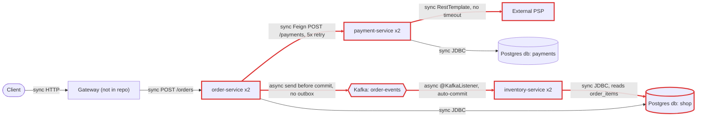
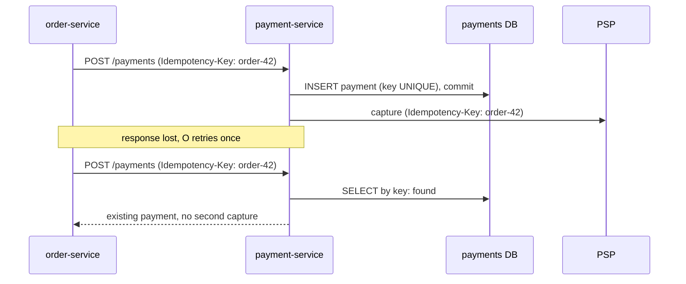
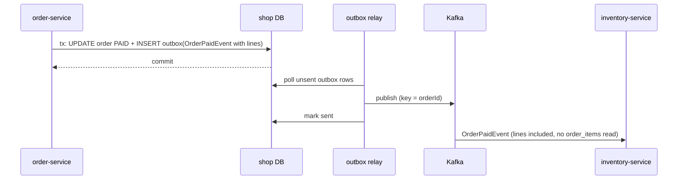
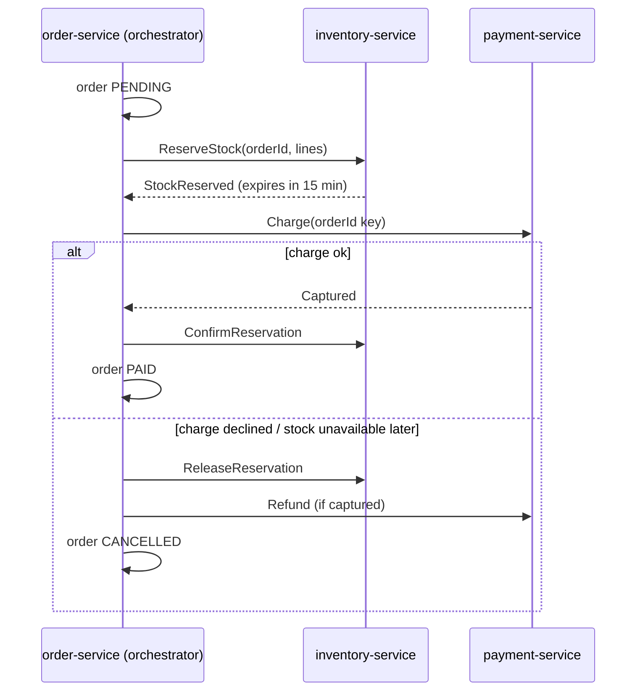
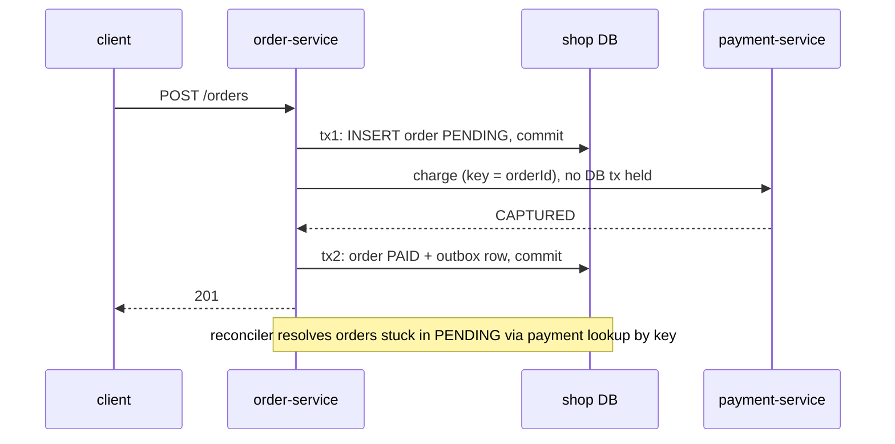
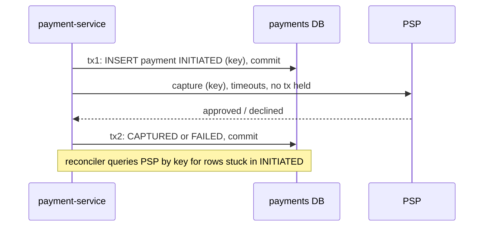
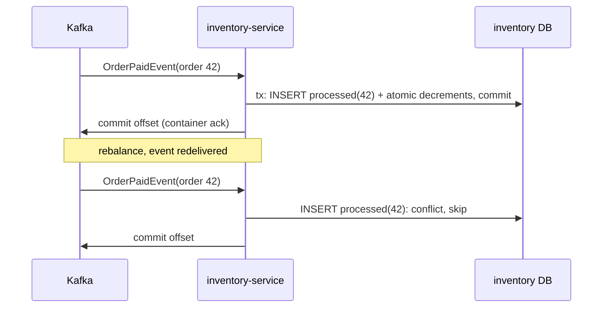
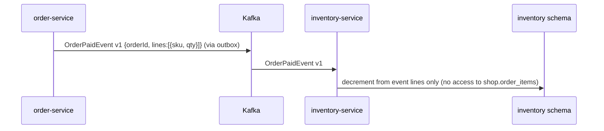
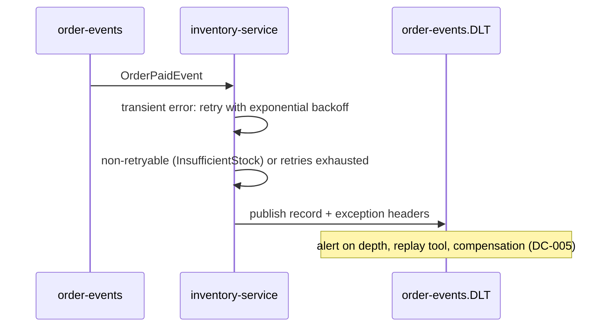

# Architecture review: 02-microservices-distributed-tx

- **Mode**: codebase. The user gave no description. The README states team ownership and target scale, and these were used as `stated intent` in the profile to grade severity. No separate plan was reviewed against the code, so hybrid mode was not used.
- **Date**: 2026-10-24
- **Lenses run**: scalability, persistence, operability, data-consistency, resilience, service-boundaries, messaging. All seven apply: three deployables, a datastore, Kafka, an external PSP. None were skipped.

## Summary

Three Spring Boot services, one per team, handle checkout. order-service charges through payment-service and an external PSP, then tells inventory-service over Kafka to decrement stock. The biggest risk is money: payment-service is slow and its PSP client has no timeouts, and in that state a global Feign retryer re-sends the non-idempotent `POST /payments` up to five times. A single order can therefore capture a customer's money several times (DC-001). Both money-moving transactions also stay open across their remote calls (DC-003, DC-004). The event that drives stock is sent before the order commits, with no outbox, and it is read against another team's uncommitted table, so stock decrements can be silently skipped (DC-002, SB-001). The change that buys the most is a commit-first checkout: commit the order as PENDING, make an idempotent charge outside any transaction, then mark the order PAID in a second transaction that also writes an outbox row carrying the order lines. That one restructuring addresses DC-001 to DC-004, SB-001 and much of RS-001.

| Severity | Count |
|---|---|
| critical | 4 |
| high | 10 |
| medium | 9 |
| low | 1 |
| info | 0 |
| **total** | **24** |

## Architecture profile

```
architecture: microservices; 3 independently deployed Spring Boot services owned by 3 teams; order-service and inventory-service share the `shop` database
summary: order-service accepts orders and charges synchronously via payment-service (which captures at an external PSP), then publishes OrderPaidEvent; inventory-service consumes it and decrements stock
stack: Java 17, Spring Boot 3.3.4, Spring Cloud 2023.0.3 (OpenFeign), Spring Kafka, Spring Data JPA/Hibernate, PostgreSQL 16, Kafka 3.7 (KRaft), Maven
deployables:
  - order-service (order-service/): orders + checkout; db=postgres shop (orders, order_items); calls=payment-service POST /payments (Feign, Retryer.Default(100,1000,5)); publishes=order-events (no key); consumes=none
  - payment-service (payment-service/): charges via PSP; db=postgres payments (payment); calls=PSP POST /v1/captures (new RestTemplate(), no timeouts); publishes=none; consumes=none
  - inventory-service (inventory-service/): stock; db=postgres shop (stock_items + reads order_items owned by order-service); calls=none; publishes=none; consumes=order-events (auto-commit, concurrency 3)
datastores: one PostgreSQL 16 instance; `shop` SHARED by order-service and inventory-service; `payments` used only by payment-service; schema via ddl-auto=update, no migrations
messaging: Kafka, one topic order-events (JSON OrderPaidEvent), topic not declared in code; no error handler / DLT
background work: none (no @Scheduled, @Async, executors)
runtime: README: 2 replicas of each on k8s, "behind our gateway"; no manifests or gateway config in repo; actuator on classpath, no management config; no tracing or metrics registry
stated intent: peak ~300 orders/min (~5/s), expected to triple next year (~15/s); 3 teams, each deploying on its own schedule; no SLA stated (assumed: checkout must not lose or double money)
key flows:
  - place order: client -> gateway -> order-service @Transactional [save order -> Feign POST /payments -> payment-service @Transactional [save payment -> PSP capture -> CAPTURED] -> markPaid -> kafka send] -> commit -> 201
  - stock decrement: order-events -> inventory-service @KafkaListener @Transactional -> read shop.order_items -> read-modify-write stock_items
  - failure paths: PSP decline -> 402 -> order rolls back; insufficient stock / unknown SKU -> listener throws -> default handler retries then skips; no refund or cancel path
```



Red nodes and edges are the ones findings touch. The Feign edge carries DC-001, DC-003 and RS-001. The PSP edge carries DC-004 and RS-001. The Kafka edges carry DC-002, MQ-001, MQ-002 and DC-007. The `order_items` read carries SB-001, PS-001 and PS-002.

## Findings

### Critical

### DC-001 · Feign retries the non-idempotent POST /payments up to 5 times, so one order can charge a customer several times

**Severity** critical · **Confidence** high · **Lens** data-consistency · **Effort** small

**Where**: `order-service/src/main/java/com/example/platform/order/config/FeignConfig.java:13`, `order-service/src/main/java/com/example/platform/order/OrderServiceApplication.java:9`, `order-service/src/main/java/com/example/platform/order/service/OrderService.java:53`, `payment-service/src/main/java/com/example/platform/payment/service/PaymentService.java:24`, `payment-service/src/main/java/com/example/platform/payment/domain/Payment.java:20`, `payment-service/src/main/java/com/example/platform/payment/psp/PspClient.java:35`

**Evidence**:

```
// FeignConfig.java (applied to every client: @EnableFeignClients(defaultConfiguration = FeignConfig.class))
/** Payment-service is occasionally slow under load; retry so checkout doesn't fail on a blip. */
return new Retryer.Default(100, 1000, 5);

// PaymentService.charge
Payment payment = payments.save(new Payment(orderId, customerId, amount));
PspClient.CaptureResponse response = psp.capture(customerId, amount);

// Payment.java: random id, nothing unique on orderId
private String id = UUID.randomUUID().toString();
private Long orderId;

// PspClient.capture: no idempotency key sent to the PSP
new HttpEntity<>(new CaptureRequest(customerId, amount, "EUR"), headers)
```

**What goes wrong**: 1. payment-service is slow, which the code comment says happens under load and which the timeout-less PSP RestTemplate makes likely (RS-001). Or a payment-service pod is killed mid-request during that team's own deploy (OP-001). 2. order-service's Feign call hits its read timeout or a connection reset. Feign turns the IOException into a RetryableException and re-POSTs /payments with the same orderId, up to 4 more times, whatever the HTTP method. 3. Each attempt inserts a new Payment row with a fresh UUID and calls PSP /v1/captures again, while the original request is often still running and completes its own capture. 4. The customer is charged 2 to 5 times. order-service stores only the last paymentId, and nothing finds or refunds the others. The retries also multiply load on a payment-service that is already slow, with backoff but no jitter and no circuit breaker (RS-002).

**Fix** (`idempotency-key`): Stop retrying a call that is not idempotent: configure PaymentClient with Retryer.NEVER_RETRY now. Then make the charge idempotent end to end. order-service sends an Idempotency-Key (the orderId, or a payment-attempt id it persists). payment-service adds a unique constraint on payment(order_id) or on the key column, and returns the existing Payment when the key repeats. payment-service passes the same key to the PSP's idempotency mechanism, so its own retries cannot double-capture either. After that, a single retry layer with capped exponential backoff and jitter is safe.

```java
// order-service: no retries on the money call
@FeignClient(name = "payment-service", url = "${clients.payment-service.url}",
             configuration = PaymentClientConfig.class)        // Retryer.NEVER_RETRY
interface PaymentClient {
    @PostMapping("/payments")
    ChargeResponse charge(@RequestHeader("Idempotency-Key") String key, @RequestBody ChargeRequest r);
}

// payment-service: the key is unique; a repeat returns the first result
@Transactional
public Payment startOrGet(String key, Long orderId, String customerId, BigDecimal amount) {
    return payments.findByIdempotencyKey(key)
        .orElseGet(() -> payments.saveAndFlush(new Payment(key, orderId, customerId, amount))); // UNIQUE(idempotency_key)
}
// ...then psp.capture(..., key) outside the transaction (DC-004)
```

Fixed flow:



**Why it's worth it here**: The call moves real money. A retryer is already configured because payment-service is known to be slow. payment-service runs 2 replicas that its team redeploys on its own schedule, so timeouts and connection resets on this call are routine.

### DC-002 · OrderPaidEvent is sent inside the open order transaction with no outbox, so stock decrements are silently skipped or lost

**Severity** critical · **Confidence** high · **Lens** data-consistency · **Effort** medium

**Where**: `order-service/src/main/java/com/example/platform/order/service/OrderService.java:47`, `inventory-service/src/main/java/com/example/platform/inventory/messaging/OrderEventsListener.java:29`, `inventory-service/src/main/java/com/example/platform/inventory/messaging/OrderEventsListener.java:37`, `order-service/src/main/resources/application.yml:14`

**Evidence**:

```
// OrderService.placeOrder, @Transactional, before commit; the returned future is ignored
kafkaTemplate.send(ORDER_EVENTS, new OrderPaidEvent(order.getId(), customerId, order.getTotal(), Instant.now()));

// OrderEventsListener.onOrderPaid: reads order-service's table, and zero rows counts as success
for (OrderLine line : orderLines.findByOrderId(event.orderId())) { ... }
log.info("Stock decremented for order {}", event.orderId());
```

**What goes wrong**: (1) Race under normal load. The record reaches the broker within milliseconds while placeOrder's transaction is still open. An idle inventory consumer reads it and runs findByOrderId under READ COMMITTED before order-service commits. It sees zero order_items, loops zero times, logs 'Stock decremented' and moves on. That paid order never reduces stock. (2) The order transaction rolls back after the send (commit failure, pod kill). Inventory gets an event for an order that does not exist, and again does nothing silently. (3) The commit succeeds but the async send fails (broker unavailable, delivery.timeout.ms). Nobody reads the future, so the event is gone and stock drifts upward. (4) When Kafka is down, send() blocks for up to max.block.ms (60 s by default) on the request thread. The customer has already been charged and the thread is still holding a DB connection, so checkout stalls.

**Fix** (`transactional-outbox`): Use a transactional outbox. In the same local transaction that marks the order PAID, insert the event into an `outbox` table. A relay publishes it, keyed by orderId, and marks the row sent. The relay can be a poller guarded by ShedLock, since there are 2 replicas, or Debezium. Put the line items (sku, quantity) in the event so inventory-service never reads order-service's tables (SB-001). Make the listener reject an event with no lines rather than log success. Consumers then need to be idempotent (DC-007). An AFTER_COMMIT listener that checks the send future is an acceptable stopgap, but it still loses the event if the pod dies between commit and publish.

```java
@Transactional
public void markPaid(Long orderId, String paymentId) {
    Order order = orders.findById(orderId).orElseThrow();
    order.markPaid(paymentId);
    outbox.save(OutboxEvent.of("order-events", order.getId().toString(),
        new OrderPaidEvent(1, order.getId(), order.getCustomerId(), order.getTotal(), lines(order), Instant.now())));
}   // a relay (poller with ShedLock, or Debezium) publishes unsent rows and marks them sent
```

Fixed flow:



**Why it's worth it here**: inventory-service's stock correctness depends entirely on this event, and today the consumer reads rows the producer has not committed yet.

### DC-005 · No saga or compensation: stock is checked only after the card is charged, and a failure leaves the customer charged for nothing

**Severity** critical · **Confidence** high · **Lens** data-consistency · **Effort** large

**Where**: `inventory-service/src/main/java/com/example/platform/inventory/messaging/OrderEventsListener.java:31`, `inventory-service/src/main/java/com/example/platform/inventory/messaging/OrderEventsListener.java:33`, `order-service/src/main/java/com/example/platform/order/domain/Order.java:22`, `order-service/src/main/java/com/example/platform/order/service/OrderService.java:44`

**Evidence**:

```
// OrderEventsListener (runs after the customer was charged)
.orElseThrow(() -> new IllegalStateException("Unknown SKU " + line.getSku()));
if (item.getAvailable() < line.getQuantity()) {
    throw new InsufficientStockException(line.getSku(), event.orderId());
}

// Order.java: CANCELLED exists but nothing ever sets it; payment-service has no refund endpoint
public enum Status { PENDING, PAID, CANCELLED }
```

**What goes wrong**: A customer orders the last unit of a SKU that another paid order has just taken, or a SKU unknown to inventory. order-service charges the card and returns 201 PAID. The listener throws InsufficientStockException, and Spring Kafka's default error handler retries it 9 times with no backoff, then logs and skips it (MQ-002). The order stays PAID, the money stays captured, and no stock is allocated. Neither order-service nor payment-service is told. Nothing records how far the flow got, so recovery means someone reading logs and issuing refunds by hand.

**Fix** (`saga-orchestration`): Model checkout as a saga that order-service orchestrates, using the Order status column it already has as the saga state (PENDING, STOCK_RESERVED, PAID, CANCELLED). 1. Reserve stock first (reservation-pattern: a reservation row with an expiry, through a command or a synchronous call). 2. Charge with an idempotency key (DC-001). 3. Confirm the reservation. If a later step fails, compensate by releasing the reservation, refunding through a new payment-service refund endpoint, and marking the order CANCELLED. Every step goes through the outbox (DC-002) and idempotent handlers (DC-007). If a full orchestrator is too much for now, a minimal choreography still closes the money gap: inventory publishes StockReservationFailed, and order-service cancels and refunds on it.

Fixed flow:



**Why it's worth it here**: The flow spans three services with separate databases and owners, and it includes an irreversible external charge. A local transaction cannot cover it.

### MQ-001 · Kafka type headers carry order-service's Java class name, which inventory-service does not have

**Severity** critical · **Confidence** medium · **Lens** messaging · **Effort** small

**Where**: `order-service/src/main/resources/application.yml:16`, `order-service/src/main/java/com/example/platform/order/events/OrderPaidEvent.java:6`, `inventory-service/src/main/resources/application.yml:19`, `inventory-service/src/main/resources/application.yml:22`, `inventory-service/src/main/java/com/example/platform/inventory/messaging/OrderPaidEvent.java:6`

**Evidence**:

```
# order-service application.yml (no spring.json.add.type.headers: false)
value-serializer: org.springframework.kafka.support.serializer.JsonSerializer
# event class: com.example.platform.order.events.OrderPaidEvent

# inventory-service application.yml (no spring.json.use.type.headers: false, no type mapping, no ErrorHandlingDeserializer)
value-deserializer: org.springframework.kafka.support.serializer.JsonDeserializer
spring.json.trusted.packages: "*"
spring.json.value.default.type: com.example.platform.inventory.messaging.OrderPaidEvent
```

**What goes wrong**: By default JsonSerializer stamps each record with the header `__TypeId__=com.example.platform.order.events.OrderPaidEvent`. JsonDeserializer gives that header precedence, and `value.default.type` is only a fallback when no header is present. inventory-service tries to load a class that is not on its classpath, so deserialization fails inside poll(), before the listener runs. No ErrorHandlingDeserializer is configured, so the failure never reaches a recoverer. The partition either stalls or the record is skipped, depending on the container's handling, and stock is not decremented for paid orders. If production has quietly overridden this, the next rename or move of the event class by the Checkout team breaks the Warehouse team's consumer in the middle of a rollout, and records already in the topic become unreadable.

**Fix** (`event-versioning`): Make the wire contract independent of Java class names. Set `spring.json.add.type.headers: false` on the producer, or `spring.json.use.type.headers: false` on the consumer, or map a logical id on both sides (`spring.json.type.mapping: orderPaid:<class>`). Wrap the consumer's deserializer in ErrorHandlingDeserializer so bad payloads reach the error handler and DLT (MQ-002). Add an explicit `eventType`/`version` field with tolerant readers. Add a contract test that pushes order-service's serialized payload through inventory-service's deserializer in both pipelines. If production is working today, find the override that makes it work and commit it to the repo.

```yaml
# order-service
spring.kafka.producer.properties:
  spring.json.add.type.headers: false
# inventory-service
spring.kafka.consumer:
  value-deserializer: org.springframework.kafka.support.serializer.ErrorHandlingDeserializer
  properties:
    spring.deserializer.value.delegate.class: org.springframework.kafka.support.serializer.JsonDeserializer
    spring.json.use.type.headers: false
    spring.json.value.default.type: com.example.platform.inventory.messaging.OrderPaidEvent
```

**Why it's worth it here**: Producer and consumer belong to different teams, deploy independently and keep separate copies of the event class in different packages.

### High

### DC-003 · The order transaction stays open across the payment call, so a failed commit after capture leaves a charge with no order

**Severity** high · **Confidence** high · **Lens** data-consistency · **Effort** medium

**Where**: `order-service/src/main/java/com/example/platform/order/service/OrderService.java:38`, `order-service/src/main/java/com/example/platform/order/service/OrderService.java:44`, `order-service/src/main/java/com/example/platform/order/service/OrderService.java:53`

**Evidence**:

```
@Transactional
public Order placeOrder(String customerId, List<Line> lines) {
    ...
    orders.save(order);
    ChargeResponse payment = takePayment(order);   // -> paymentClient.charge(...) over Feign
    order.markPaid(payment.paymentId());
    kafkaTemplate.send(ORDER_EVENTS, ...);
    ...
}
```

**What goes wrong**: payment-service captures at the PSP, commits Payment(CAPTURED) and returns. Then order-service's transaction fails to commit: the pod is killed during a deploy, the commit fails after a long-held connection, or kafkaTemplate.send throws synchronously. orders and order_items roll back, so the customer is charged and order-service has no record of the order. The two sides also wait for different lengths of time. order-service gives up after 60 s per attempt (the Feign default), while payment-service waits on the PSP indefinitely. When the PSP is slow, order-service exhausts its retries and rolls back the order, and payment-service later commits CAPTURED. The client sees a 5xx and retries, which charges a second time for a new order.

**Fix** (`move-call-outside-transaction`): Move the call outside the transaction. Transaction 1 inserts the order as PENDING and commits. Then call payment-service outside any transaction, using the idempotency key from DC-001. Transaction 2 marks the order PAID and writes the outbox row (DC-002). A reconciler finds orders stuck in PENDING and resolves them by asking payment-service for the payment by orderId; this is safe only once DC-001 is in place. Make order-service's Feign read timeout longer than payment-service's own PSP timeout (RS-001) so the caller never gives up before the callee.

```java
public Order placeOrder(String customerId, List<Line> lines) {
    Order order = tx.execute(s -> orders.save(Order.pending(customerId, lines)));   // tx 1, committed
    ChargeResponse p = paymentClient.charge(order.getId().toString(), chargeOf(order)); // no tx held
    return tx.execute(s -> markPaidWithOutbox(order.getId(), p.paymentId()));        // tx 2 (+ outbox, DC-002)
}
```

Fixed flow:



**Why it's worth it here**: The remote step moves money, and order-service runs 2 replicas that its team redeploys independently, so pods dying mid-request is routine.

### DC-004 · payment-service captures at the PSP inside its DB transaction, so a rollback after capture erases the only record of the charge

**Severity** high · **Confidence** high · **Lens** data-consistency · **Effort** medium

**Where**: `payment-service/src/main/java/com/example/platform/payment/service/PaymentService.java:22`, `payment-service/src/main/java/com/example/platform/payment/service/PaymentService.java:25`, `payment-service/src/main/java/com/example/platform/payment/psp/PspClient.java:34`

**Evidence**:

```
@Transactional
public Payment charge(Long orderId, String customerId, BigDecimal amount) {
    Payment payment = payments.save(new Payment(orderId, customerId, amount));
    PspClient.CaptureResponse response = psp.capture(customerId, amount);
    if (!"approved".equals(response.outcome())) {
        throw new PaymentDeclinedException(orderId);
    }
    payment.captured(response.reference());
    return payment;
}
```

**What goes wrong**: The PSP approves and captures. Then something throws before the commit: the pod is killed, the commit fails, or the PSP response is lost or unparseable after the capture. The INITIATED Payment row rolls back, so money has been captured at the PSP with no local row and no pspReference, and there is nothing to reconcile or refund against. Declined attempts are never stored either: the exception rolls the row back, and Status.FAILED is never written. That leaves no audit trail of payment attempts.

**Fix** (`move-call-outside-transaction`): Move the call outside the transaction. Commit Payment(INITIATED, idempotencyKey) in its own short transaction. Call the PSP outside any transaction, with the idempotency key and timeouts (RS-001). Record CAPTURED or FAILED in a second short transaction. A reconciler asks the PSP, by idempotency key, about payments stuck in INITIATED. Use `TransactionTemplate` or a separate bean so the two transactions are not self-invoked.

```java
public Payment charge(String key, Long orderId, String customerId, BigDecimal amount) {
    Payment p = tx.execute(s -> startOrGet(key, orderId, customerId, amount));   // INITIATED, committed
    if (p.isFinal()) return p;                                                   // replayed request
    CaptureResponse r = psp.capture(customerId, amount, key);                    // no tx, timeouts set
    return tx.execute(s -> payments.recordOutcome(p.getId(), r));                // CAPTURED or FAILED
}
```

Fixed flow:



**Why it's worth it here**: A PSP capture cannot be undone without an explicit refund, and payment-service is redeployed on its own schedule.

### DC-006 · The stock decrement is an unlocked check-then-write, so concurrent consumers lose updates and oversell

**Severity** high · **Confidence** medium · **Lens** data-consistency · **Effort** small

**Where**: `inventory-service/src/main/java/com/example/platform/inventory/messaging/OrderEventsListener.java:30`, `inventory-service/src/main/java/com/example/platform/inventory/messaging/OrderEventsListener.java:35`, `inventory-service/src/main/java/com/example/platform/inventory/domain/StockItem.java:14`, `inventory-service/src/main/resources/application.yml:24`

**Evidence**:

```
StockItem item = stock.findById(line.getSku()).orElseThrow(...);
if (item.getAvailable() < line.getQuantity()) { throw ... }
item.setAvailable(item.getAvailable() - line.getQuantity());

// StockItem: no @Version; StockRepository: no @Lock, no conditional UPDATE
listener:
  concurrency: 3     # x 2 replicas; events sent with no key
```

**What goes wrong**: Two paid orders for the same popular SKU land on different partitions and are consumed at the same moment by different threads or replicas. Both read available=10 and both pass the check. Hibernate writes the absolute values `available=8` and `available=7`, and under READ COMMITTED the second overwrites the first. One decrement is lost, stock is overstated, and the next orders oversell. With available=4 and two orders of 3, both pass the check and six units are sold against four. This is latent while order-events has one partition, which is the local default, but `concurrency: 3` on 2 replicas shows that parallel consumption is intended (SC-001). The production partition count is not in the repo, so confidence is medium.

**Fix** (`pessimistic-locking`): Replace the read-modify-write with an atomic conditional update, which locks the row for the length of the statement: `UPDATE stock_items SET available = available - :qty WHERE sku = :sku AND available >= :qty`. Treat 0 rows updated as insufficient stock. Add a `CHECK (available >= 0)` constraint. Alternatives are `@Lock(PESSIMISTIC_WRITE)` on the lookup, or `@Version` with a retry for low-contention SKUs. Keying events by orderId does not fix this, because the contended aggregate is the SKU. Fix this before raising the partition count.

```java
@Modifying
@Query("update StockItem s set s.available = s.available - :qty where s.sku = :sku and s.available >= :qty")
int decrement(@Param("sku") String sku, @Param("qty") int qty);   // 0 rows -> insufficient stock
```

**Why it's worth it here**: Concurrent orders share stock_items rows, and the consumer is configured for parallel consumption across 2 replicas.

### DC-007 · The stock consumer is not idempotent, so a redelivery after a rebalance or crash decrements stock twice

**Severity** high · **Confidence** high · **Lens** data-consistency · **Effort** small

**Where**: `inventory-service/src/main/java/com/example/platform/inventory/messaging/OrderEventsListener.java:35`, `inventory-service/src/main/resources/application.yml:16`

**Evidence**:

```
item.setAvailable(item.getAvailable() - line.getQuantity());   // relative effect, no processed-event check

consumer:
  enable-auto-commit: true   # offsets committed on a timer, independent of the DB transaction
```

**What goes wrong**: inventory-service commits the stock transaction for order 42. Before the next auto-commit interval (5 s by default) it is restarted, OOM-killed or rebalanced. Rebalances are routine with 6 consumer threads and three teams deploying on their own schedules. The new partition owner resumes from the last committed offset and processes order 42 again, so each SKU is decremented twice. Stock drifts below reality, and later orders fail as insufficient stock.

**Fix** (`idempotent-consumer`): Use an idempotent consumer. Add `processed_order_events(order_id PRIMARY KEY)`, or a unique key on (order_id, sku) in a stock-movement table. Insert into it in the same transaction as the decrement, and skip the decrement on a duplicate. Switch to container-managed acks (MQ-003) so the offset commit follows processing.

```java
@Transactional
public void onOrderPaid(OrderPaidEvent e) {
    if (processed.insertIfAbsent(e.orderId()) == 0) return;      // INSERT ... ON CONFLICT DO NOTHING
    for (var line : e.lines()) { if (stock.decrement(line.sku(), line.quantity()) == 0) throw new InsufficientStockException(...); }
}
```

Fixed flow:



**Why it's worth it here**: Kafka delivers at least once, and a relative stock decrement is not naturally idempotent.

### RS-001 · The PSP and payment-service calls have no timeouts and run while holding DB connections, so a slow PSP takes down checkout

**Severity** high · **Confidence** high · **Lens** resilience · **Effort** small

**Where**: `payment-service/src/main/java/com/example/platform/payment/config/HttpClientConfig.java:12`, `payment-service/src/main/java/com/example/platform/payment/psp/PspClient.java:34`, `payment-service/src/main/java/com/example/platform/payment/service/PaymentService.java:22`, `order-service/src/main/java/com/example/platform/order/client/PaymentClient.java:9`, `order-service/src/main/resources/application.yml:18`, `order-service/src/main/java/com/example/platform/order/service/OrderService.java:38`

**Evidence**:

```
// HttpClientConfig: SimpleClientHttpRequestFactory, no connect/read timeout (waits forever)
return new RestTemplate();

# order-service application.yml: no spring.cloud.openfeign.client.config.* -> Feign defaults 10 s connect / 60 s read
clients:
  payment-service:
    url: ${PAYMENT_SERVICE_URL:http://localhost:8081}

# no spring.datasource.hikari.* anywhere -> pool of 10 per instance
```

**What goes wrong**: The PSP brownouts: it accepts connections but stops answering. Each payment-service request waits on the socket indefinitely while holding one of its 10 Hikari connections. By Little's law, each order-service replica (about 2.5 orders/s at today's peak, about 7.5/s next year) runs out of its 10 connections once the end-to-end payment latency passes about 4 s today, or about 1.3 s next year. After that, new checkouts wait 30 s for a connection and fail. Each Feign attempt waits up to 60 s and is retried 5 times. GET /orders/{id}, which uses the same pool, fails too. The threads stuck on the PSP never free up, so checkout stays down after the PSP recovers, until the pods are restarted. Adding replicas does not help, because every pod blocks on the same PSP.

**Fix** (`timeouts`): Set timeouts on every client. PSP: build the RestTemplate with RestTemplateBuilder, setConnectTimeout(1 s) and setReadTimeout at the PSP's p99 plus headroom (for example 5 s), on a pooled HTTP client. Feign: `spring.cloud.openfeign.client.config.payment-service.connect-timeout: 1000` and a `read-timeout` longer than payment-service's PSP timeout plus its DB time (for example 8000). Kafka producer: `max.block.ms` and `delivery.timeout.ms` of a few seconds (or the outbox, DC-002). Then stop holding connections across the calls (DC-003, DC-004), and size Hikari explicitly with a shorter `connection-timeout` (PS-003).

```java
@Bean
RestTemplate pspRestTemplate(RestTemplateBuilder b) {
    return b.setConnectTimeout(Duration.ofSeconds(1)).setReadTimeout(Duration.ofSeconds(5)).build();
}
# order-service application.yml
spring.cloud.openfeign.client.config.payment-service:
  connect-timeout: 1000
  read-timeout: 8000      # > payment-service's PSP timeout + DB time
```

**Why it's worth it here**: These are network calls on the only revenue flow, made while holding a DB connection, and one of them goes to a third party whose latency the team does not control.

### SB-001 · inventory-service reads order-service's order_items table from the shared `shop` database

**Severity** high · **Confidence** high · **Lens** service-boundaries · **Effort** medium

**Where**: `inventory-service/src/main/java/com/example/platform/inventory/domain/OrderLine.java:14`, `inventory-service/src/main/java/com/example/platform/inventory/messaging/OrderEventsListener.java:29`, `inventory-service/src/main/resources/application.yml:5`, `order-service/src/main/resources/application.yml:5`, `docker-compose.yml:37`

**Evidence**:

```
// inventory-service OrderLine.java
@Entity @Immutable @Table(name = "order_items")
public class OrderLine { @Id private Long id; @Column(name = "order_id") private Long orderId; private String sku; private int quantity; }

# both services
url: ${SPRING_DATASOURCE_URL:jdbc:postgresql://localhost:5432/shop}

README: "Each team deploys on its own schedule."
```

**What goes wrong**: The Checkout team refactors order_items on its own schedule, for example renaming `quantity`, splitting out variants, or moving lines into a JSON column. order-service's ddl-auto applies the change, and nothing in inventory-service's build fails. After the deploy, every OrderPaidEvent either makes `findByOrderId` throw, or reads a stale column that is no longer written and decrements the wrong amount. Stock stops moving or drifts. Nobody owns the invariants of order_items: the Warehouse team depends on a table it cannot see change, and Checkout does not know it has a consumer. Because of this coupling, the event carries no lines, which causes the uncommitted-read race in DC-002.

**Fix** (`database-per-service`): Use database-per-service, with the data replicated through events. Add the lines (sku, quantity) and an event version to OrderPaidEvent, and have inventory build its decrement from the event alone. Then delete OrderLine and OrderLineRepository, and give inventory-service its own schema or database with credentials that cannot read `shop.order_items` (see OP-002). Keep the contract stable with a consumer-driven contract test owned by the Warehouse team and run in order-service's build.

Fixed flow:



**Why it's worth it here**: Two teams own order-service and inventory-service and deploy them independently. The README says so outright.

### PS-001 · Schema is managed by ddl-auto=update in every service, and two services both run DDL against order_items

**Severity** high · **Confidence** high · **Lens** persistence · **Effort** medium

**Where**: `order-service/src/main/resources/application.yml:10`, `inventory-service/src/main/resources/application.yml:10`, `payment-service/src/main/resources/application.yml:10`, `inventory-service/src/main/java/com/example/platform/inventory/domain/OrderLine.java:17`, `order-service/src/main/java/com/example/platform/order/domain/OrderItem.java:18`

**Evidence**:

```
# all three application.yml; no Flyway or Liquibase dependency or migration files
jpa:
  hibernate:
    ddl-auto: update

// order-service OrderItem (table order_items)
@Id @GeneratedValue(strategy = GenerationType.IDENTITY) private Long id;
// inventory-service OrderLine (same table; @Immutable does not exclude it from schema update)
@Id private Long id;
```

**What goes wrong**: (a) Fresh database: a new environment, a DR rebuild, a CI run, or `docker compose up` on an empty volume. Compose does not order the two services, so inventory-service can start first. Its Hibernate creates order_items with `id bigint not null` and no identity. order-service's update then only adds `unit_price` and never changes `id`. Every order insert leaves out the id, hits the NOT NULL constraint, and checkout is down until someone repairs the table by hand. (b) Rolling deploys: `update` never drops or renames anything, so a renamed field leaves the old NOT NULL column behind and inserts fail. Nothing reviews or orders schema changes across the two teams. (c) Two replicas starting together both run DDL on the same schema, which can fail one of them at startup.

**Fix** (`versioned-migrations`): Use versioned migrations: Flyway or Liquibase per service, owned by the service that owns the table, with `ddl-auto: validate` everywhere. Today set inventory-service to `none` so it never touches order_items. Use expand-contract for renames and drops (add a nullable column, deploy the readers, backfill, then drop), so that old and new versions can run side by side during rolling deploys.

**Why it's worth it here**: A production system with 2 replicas per service, three teams deploying independently, and a table shared by two of them.

### MQ-002 · No retry backoff or dead-letter topic: a failing order event is retried within milliseconds, then dropped

**Severity** high · **Confidence** high · **Lens** messaging · **Effort** medium

**Where**: `inventory-service/src/main/java/com/example/platform/inventory/messaging/OrderEventsListener.java:26`, `inventory-service/src/main/java/com/example/platform/inventory/messaging/OrderEventsListener.java:31`, `inventory-service/src/main/java/com/example/platform/inventory/messaging/OrderEventsListener.java:33`, `inventory-service/src/main/resources/application.yml:12`

**Evidence**:

```
@KafkaListener(topics = "order-events")
...orElseThrow(() -> new IllegalStateException("Unknown SKU " + line.getSku()));
throw new InsufficientStockException(line.getSku(), event.orderId());

// No CommonErrorHandler / DefaultErrorHandler bean, no DeadLetterPublishingRecoverer, no @RetryableTopic,
// no ErrorHandlingDeserializer -> Spring Kafka default: FixedBackOff(0, 9), then log and skip
```

**What goes wrong**: There are two cases. Transient failure: Postgres fails over or a lock wait times out. The 10 immediate attempts are used up within milliseconds, the record is logged and skipped, and auto-commit moves the offset past it. The decrement is lost for good. Business failure: an unknown SKU or insufficient stock is retried pointlessly, then dropped with only an ERROR log line, with no replay and no signal to order-service (DC-005). Either way, stock drifts and nobody can tell which orders were affected.

**Fix** (`dead-letter-queue`): Configure a DefaultErrorHandler with exponential backoff for transient exceptions. Mark business exceptions (InsufficientStockException, unknown SKU) as not retryable. Route exhausted or non-retryable records through DeadLetterPublishingRecoverer to `order-events.DLT`, or use @RetryableTopic with a retry topic and then the DLT. Alert on DLT depth (OP-005) and provide a replay tool. A stock shortfall should eventually produce a compensating event (DC-005), not only a DLT entry.

```java
@Bean
DefaultErrorHandler errorHandler(KafkaTemplate<Object, Object> t) {
    var h = new DefaultErrorHandler(new DeadLetterPublishingRecoverer(t), new ExponentialBackOff(500, 2.0));
    h.addNotRetryableExceptions(InsufficientStockException.class, IllegalStateException.class);
    return h;
}
```

Fixed flow:



**Why it's worth it here**: The consumer handles events that customers have already paid for, and it can fail both transiently and permanently.

### OP-001 · Immediate shutdown (the Boot 3.3 default) cuts in-flight order and payment requests on every deploy

**Severity** high · **Confidence** medium · **Lens** operability · **Effort** small

**Where**: `payment-service/src/main/resources/application.yml:1`, `order-service/src/main/resources/application.yml:1`, `inventory-service/src/main/resources/application.yml:1`, `payment-service/src/main/java/com/example/platform/payment/service/PaymentService.java:22`

**Evidence**:

```
# no server.shutdown and no spring.lifecycle.timeout-per-shutdown-phase in any application.yml
# parent: spring-boot-starter-parent 3.3.4 (graceful shutdown became the default only in 3.4)
README: "Production runs 2 replicas of each service on k8s" / "Each team deploys on its own schedule."
```

**What goes wrong**: The Payments team rolls payment-service. A pod receives SIGTERM while a request sits between the PSP capture and the commit. With immediate shutdown, the web server and the DataSource are torn down, so the capture stands and the payment row rolls back (DC-004). order-service sees a connection reset and its Feign retryer resends to the other replica, which captures again (DC-001). inventory-service consumers are also cut mid-batch at every rollout, which feeds the redelivery in DC-007. Without a preStop delay, pods can still receive new requests after SIGTERM.

**Fix** (`graceful-shutdown`): Set `server.shutdown: graceful` and `spring.lifecycle.timeout-per-shutdown-phase: 20s` in all three services. In the k8s manifests (not in the repo), add a preStop sleep so readiness flips before the drain, and set `terminationGracePeriodSeconds` above the shutdown phase. Graceful shutdown only shrinks the window. The double-charge and lost-record fixes are DC-001 and DC-004.

```yaml
server:
  shutdown: graceful
spring:
  lifecycle:
    timeout-per-shutdown-phase: 20s
```

**Why it's worth it here**: Each service runs 2 replicas with rolling deploys, and three teams deploy on independent schedules.

### OP-002 · Database superuser credentials are committed in source and shared by all three services

**Severity** high · **Confidence** medium · **Lens** operability · **Effort** small

**Where**: `order-service/src/main/resources/application.yml:6`, `payment-service/src/main/resources/application.yml:6`, `inventory-service/src/main/resources/application.yml:6`, `docker-compose.yml:5`

**Evidence**:

```
# all three application.yml, literals with no ${...} placeholder
username: platform
password: platform

# docker-compose.yml: this is the image's superuser
POSTGRES_USER: platform
POSTGRES_PASSWORD: platform

# by contrast, payment-service does this correctly:
api-key: ${PSP_API_KEY}
```

**What goes wrong**: The password is in git history for every clone. Rotating it takes a commit and a redeploy coordinated across three teams, unless every environment overrides SPRING_DATASOURCE_PASSWORD, and nothing in the repo shows that it does. All services use one superuser across both databases. A bug, a leaked credential or a compromised order or inventory pod can therefore read or modify the `payments` database, so no database permission backs the service boundaries (SB-001).

**Fix** (`secrets-manager`): Use externalized config and a secrets manager. Change the config to `username: ${DB_USERNAME}` and `password: ${DB_PASSWORD}` with no default, and inject them from k8s Secrets or Vault. Give each service its own least-privilege role that can reach only its own database or tables. Keep the compose defaults in a local profile or a `.env` file. Hand this to a dedicated security review for depth.

**Why it's worth it here**: Secrets always qualify. Here one credential is shared by three services owned by three teams.

### Medium

### DC-008 · POST /orders has no idempotency key, so a client or gateway retry of a slow checkout creates a second order and charge

**Severity** medium · **Confidence** medium · **Lens** data-consistency · **Effort** small

**Where**: `order-service/src/main/java/com/example/platform/order/api/OrderController.java:39`, `order-service/src/main/java/com/example/platform/order/service/OrderService.java:39`

**Evidence**:

```
@PostMapping
public ResponseEntity<OrderView> place(@RequestBody PlaceOrderRequest request)
// PlaceOrderRequest(String customerId, List<Line> lines): no client reference, no unique business key on orders
```

**What goes wrong**: Checkout is slow because payment-service is slow, and placeOrder can run for minutes (RS-001). The gateway or the client times out and retries, or the user clicks again. The first request still finishes, charges and commits, and the retry creates a second order with a second charge. The gateway's retry policy is not in the repo, which is why confidence is medium.

**Fix** (`idempotency-key`): Accept an Idempotency-Key header (or a client-generated order reference) and store it on orders with a unique constraint. On a repeat, return the existing order and its status. Reuse the same key downstream as the payment idempotency key from DC-001.

**Why it's worth it here**: Placing an order triggers a real-money charge, behind a gateway and clients that may retry.

### RS-002 · No circuit breaker around payment-service or the PSP

**Severity** medium · **Confidence** high · **Lens** resilience · **Effort** small

**Where**: `order-service/src/main/java/com/example/platform/order/client/PaymentClient.java:9`, `payment-service/src/main/java/com/example/platform/payment/psp/PspClient.java:31`, `order-service/pom.xml:45`

**Evidence**:

```
// no resilience4j / spring-cloud-starter-circuitbreaker in any pom; no @CircuitBreaker,
// no spring.cloud.openfeign.circuitbreaker.enabled, no mesh manifests
@FeignClient(name = "payment-service", url = "${clients.payment-service.url}")
```

**What goes wrong**: During a PSP or payment-service outage, every checkout (about 5/s now, about 15/s planned) still makes the full call: up to 5 Feign attempts, and on the payment side a wait on the PSP. Threads and connections are tied up by calls that are certain to fail, retries keep load on payment-service while it tries to recover, and customers wait minutes for an error instead of failing fast.

**Fix** (`circuit-breaker`): Wrap PaymentClient (`spring.cloud.openfeign.circuitbreaker.enabled=true` with Resilience4j) and PspClient in circuit breakers. Fail fast with a clear 'payment temporarily unavailable' response, or, once DC-005 is in place, accept the order as PENDING_PAYMENT and charge it later. Do timeouts (RS-001) and idempotency (DC-001) first; the breaker builds on them.

**Why it's worth it here**: Every checkout calls two independently failing dependencies synchronously, one of them external, at meaningful volume.

### MQ-003 · Kafka auto-commit separates offset commits from the outcome of processing

**Severity** medium · **Confidence** medium · **Lens** messaging · **Effort** small

**Where**: `inventory-service/src/main/resources/application.yml:16`, `inventory-service/src/main/java/com/example/platform/inventory/messaging/OrderEventsListener.java:27`

**Evidence**:

```
consumer:
  group-id: inventory-service
  enable-auto-commit: true
```

**What goes wrong**: With auto-commit, the Kafka client commits its position on a timer during poll(), and the Spring container cannot hold an offset back based on the outcome. Processing runs on the listener thread today, so a crash mostly means redelivery (DC-007). But a record the error handler skips is committed with no trace of the failure. If anyone later moves the work off the listener thread (@Async or an executor), offsets will be committed before the DB transaction, and a crash will lose decrements silently.

**Fix** (`manual-ack-after-processing`): Commit only after processing. Set `enable-auto-commit: false`, which is Spring Kafka's own default when unset, and use the container's AckMode.RECORD or BATCH. Offsets are then committed only after the listener's transaction commits, or after the DLT publish succeeds (MQ-002). Pair this with the idempotent consumer (DC-007).

**Why it's worth it here**: Losing an order-paid event leaves stock wrong for an order the customer paid for.

### SC-001 · order-events is never declared: with one partition, one consumer serves the whole fleet despite concurrency 3 on 2 replicas

**Severity** medium · **Confidence** medium · **Lens** scalability · **Effort** small

**Where**: `inventory-service/src/main/resources/application.yml:24`, `order-service/src/main/java/com/example/platform/order/service/OrderService.java:47`, `docker-compose.yml:11`

**Evidence**:

```
listener:
  concurrency: 3      # inventory-service, 2 replicas

// no NewTopic bean or topic config anywhere; bitnami/kafka:3.7 with no KAFKA_CFG_NUM_PARTITIONS
kafkaTemplate.send(ORDER_EVENTS, new OrderPaidEvent(...));   // no key
```

**What goes wrong**: The topic is created automatically on the first send, using the broker defaults: 1 partition, and a replication factor of 1 in this compose. Of the 6 consumer threads, exactly one receives records, so adding replicas adds no throughput, and every team's independent deploy pauses consumption with a rebalance. With a replication factor of 1, losing that broker loses paid-order events that have not been consumed yet. Because production behaviour comes from broker defaults rather than code, it can differ silently between environments.

**Fix** (`partitioning`): Declare the topic in code (a NewTopic bean or the platform's topic-as-code) with explicit partitions (for example 6 to 12), replication factor 3 and `min.insync.replicas=2`. Key records by orderId. Make the stock update safe under concurrency (DC-006) before raising the partition count.

**Why it's worth it here**: Parallel consumption is clearly intended (2 replicas x concurrency 3), and load is expected to triple.

### PS-002 · order_items.order_id has no index but is queried on every order-paid event

**Severity** medium · **Confidence** high · **Lens** persistence · **Effort** small

**Where**: `inventory-service/src/main/java/com/example/platform/inventory/domain/OrderLineRepository.java:9`, `order-service/src/main/java/com/example/platform/order/domain/OrderItem.java:21`, `inventory-service/src/main/java/com/example/platform/inventory/messaging/OrderEventsListener.java:29`

**Evidence**:

```
List<OrderLine> findByOrderId(Long orderId);

// OrderItem: @ManyToOne @JoinColumn(name = "order_id") with no @Table(indexes = ...);
// schema from ddl-auto only -> PostgreSQL gets the FK constraint but no index
```

**What goes wrong**: At a peak of 300 orders per minute, tripling next year, order_items gains hundreds of thousands of rows a day and is never pruned. Every OrderPaidEvent runs `SELECT ... WHERE order_id = ?` as a sequential scan. Within months each event costs a full table scan on the Postgres instance that also serves checkout. With a single active consumer (SC-001), throughput falls below the arrival rate and consumer lag grows without bound.

**Fix** (`add-index`): Add an index: `CREATE INDEX CONCURRENTLY idx_order_items_order_id ON order_items(order_id)`, in a migration owned by order-service (PS-001). The query disappears altogether once the event carries its lines (SB-001), so this is the stopgap if SB-001 is not done soon.

**Why it's worth it here**: order_items grows with every order line, and every paid order runs this lookup.

### OP-003 · Readiness ignores the DB and Kafka, and the probe wiring is not in the repo

**Severity** medium · **Confidence** medium · **Lens** operability · **Effort** small

**Where**: `order-service/pom.xml:41`, `payment-service/pom.xml:41`, `inventory-service/pom.xml:41`, `inventory-service/src/main/resources/application.yml:12`

**Evidence**:

```
<artifactId>spring-boot-starter-actuator</artifactId>   <!-- all three poms -->
# no management.* keys in any application.yml; no k8s manifests in the repo
```

**What goes wrong**: On k8s, Boot enables `/actuator/health/readiness` automatically, but by default it reflects only readinessState. A pod whose DB pool is exhausted (RS-001) stays Ready and keeps receiving checkout traffic that then fails. inventory-service has no Kafka health signal, so a consumer that is stuck or cannot deserialize (MQ-001) looks healthy while stock stops moving. If the unseen manifests point liveness at `/actuator/health`, which includes `db`, a Postgres blip fails liveness on all 6 pods at once and causes a restart storm.

**Fix** (`health-probes`): Set `management.endpoint.health.probes.enabled=true`. Keep liveness on livenessState only. Add `db` to `management.endpoint.health.group.readiness.include`. For inventory-service, expose listener-container state or consumer lag as a health or metric signal. Commit the k8s probe definitions next to the services, or document where they live.

**Why it's worth it here**: Each service runs 2 replicas behind a load balancer on k8s.

### OP-004 · No distributed tracing or correlation id across order, payment and inventory

**Severity** medium · **Confidence** high · **Lens** operability · **Effort** small

**Where**: `order-service/pom.xml:30`, `order-service/src/main/java/com/example/platform/order/service/OrderService.java:47`, `payment-service/src/main/java/com/example/platform/payment/service/PaymentService.java:23`, `inventory-service/src/main/java/com/example/platform/inventory/messaging/OrderEventsListener.java:37`

**Evidence**:

```
// no micrometer-tracing / OpenTelemetry dependency in any pom
kafkaTemplate.send(ORDER_EVENTS, new OrderPaidEvent(...));   // no key, no headers
// payment-service has no logger at all; default plain-text Logback everywhere
```

**What goes wrong**: A customer reports 'charged twice', 'charged but no order' or 'paid but stock not reduced'. The flow crosses 6 pods and an external PSP. payment-service logs nothing, and nothing links a Feign retry attempt to a PSP capture or to a Kafka record. On-call has to grep pods by timestamp and order id, and still cannot tell which of five attempts produced which capture (DC-001).

**Fix** (`distributed-tracing`): Add `micrometer-tracing-bridge-otel` (or Brave) with an exporter in all three services. Build the RestTemplate from RestTemplateBuilder so it is instrumented, and enable observation on KafkaTemplate and the listener container so trace context propagates through Kafka headers. Put the trace id and orderId in the MDC, and move to structured JSON logs. Log every capture request and its outcome in payment-service, with orderId, paymentId and pspReference.

**Why it's worth it here**: Every order flow spans three deployables plus an external PSP, owned by three teams.

### OP-005 · No metrics or alerts on checkout, payment, consumer lag or skipped stock decrements

**Severity** medium · **Confidence** high · **Lens** operability · **Effort** small

**Where**: `order-service/pom.xml:41`, `payment-service/pom.xml:41`, `inventory-service/pom.xml:41`, `inventory-service/src/main/java/com/example/platform/inventory/messaging/OrderEventsListener.java:31`

**Evidence**:

```
<artifactId>spring-boot-starter-actuator</artifactId>   <!-- but no micrometer-registry-*, no endpoint exposure -->
# no management.endpoints.web.exposure.include, no lag exporter, no alert rules in the repo
```

**What goes wrong**: inventory-service stops making progress, because of MQ-001, a stalled partition or skipped poison records (MQ-002). order-service keeps returning 201 and charging customers. Nothing reports consumer lag, skipped records, rising PSP latency, Feign retry storms or Hikari saturation. Stock drifts from reality until the warehouse or customers notice.

**Fix** (`metrics-and-alerts`): Add `micrometer-registry-prometheus` and expose `prometheus`. Alert on: RED metrics for POST /orders and /payments, PSP and Feign latency and errors, Kafka consumer lag for group inventory-service, listener failures and skips, DLT depth (once MQ-002 exists), and Hikari pool saturation. Add business counters (orders placed vs paid, payment declines, stock decrements failed) and a reconciliation gauge for paid orders not yet decremented.

**Why it's worth it here**: These production services handle money and stock at about 5 orders/s now and about 15/s next year.

### OP-006 · No auth boundary on any service, and the charge identity comes from the request body

**Severity** medium · **Confidence** medium · **Lens** operability · **Effort** medium

**Where**: `payment-service/src/main/java/com/example/platform/payment/api/PaymentController.java:28`, `order-service/src/main/java/com/example/platform/order/api/OrderController.java:39`, `README.md:3`

**Evidence**:

```
// no spring-security in any pom
public ChargeResponse charge(@RequestBody ChargeRequest request)   // customerId + amount straight to the PSP
public record PlaceOrderRequest(String customerId, List<OrderService.Line> lines)   // Line carries unitPrice
README: "Three Spring Boot services behind our gateway"   // gateway config not in the repo
```

**What goes wrong**: Anything that can reach payment-service on the network can capture any amount from any customer's stored payment method: another pod in the cluster, or the internet if the unseen gateway routes /payments. Through the public POST /orders, a caller can name another customer's customerId or set their own prices. The gateway cannot fix this, because identity and price come from the body, not from a token.

**Fix** (`api-gateway`): Commit or document the api-gateway or ingress routing so it can be reviewed, and keep payment-service off the public route. Require service-to-service authentication on /payments (mTLS or a service JWT). Derive customerId from the authenticated principal and prices from a catalog on the server. Hand this to a dedicated security review.

**Why it's worth it here**: External clients reach the system through a gateway, and one internal service can move money.

### Low

### PS-003 · Default Hikari pools are not sized against the shared Postgres connection limit

**Severity** low · **Confidence** medium · **Lens** persistence · **Effort** small

**Where**: `docker-compose.yml:2`, `order-service/src/main/resources/application.yml:4`, `payment-service/src/main/resources/application.yml:4`, `inventory-service/src/main/resources/application.yml:4`

**Evidence**:

```
# one postgres:16 service hosts both databases; no spring.datasource.hikari.* in any service
datasource:
  url: ${SPRING_DATASOURCE_URL:...}
```

**What goes wrong**: Today 3 services x 2 replicas x 10 connections = 60 of Postgres's default 100 max_connections. As load triples, or as one team responds to pool exhaustion (RS-001) by raising its pool size or replica count, the total passes 100, counting the surge pods during rolling deploys. New pods of any service then fail to connect, so one team's scaling decision breaks another team's service.

**Fix** (`connection-pool-sizing`): Size connection pools against the limit. Agree a connection budget per service, set `spring.datasource.hikari.maximum-pool-size` and a shorter `connection-timeout` explicitly, and leave headroom for the rolling-deploy surge. Add PgBouncer, or separate instances per team, if the services need to scale independently.

**Why it's worth it here**: Three teams scale and deploy independently against one Postgres instance. The production DB config is not in the repo.

## Roadmap

### Now

1. **DC-001**: Set `Retryer.NEVER_RETRY` on PaymentClient today, then add the idempotency key, the unique constraint and a PSP key. This stops double charges, and it makes any later retry, reconciler or saga step safe.
2. **RS-001**: Put timeouts on the PSP RestTemplate, Feign and the Kafka producer. This contains PSP brownouts and gives DC-003 and DC-004 bounded steps.
3. **MQ-001**: Disable the Kafka type headers, add ErrorHandlingDeserializer and add a contract test. inventory-service can then reliably read events at all.
4. **DC-004**: Run payment-service as INITIATED (commit), then PSP capture outside a transaction, then CAPTURED or FAILED (commit). Every capture then has a record for reconciliation and refunds.
5. **DC-003**: Run checkout as PENDING (commit), then charge, then PAID (commit). This removes charges with no order and is the base for DC-002 and DC-005.
6. **DC-002**: Add an outbox table and relay, and carry the lines in the event. Stock is then decremented for every paid order, which is what DC-007 and DC-005 need.
7. **SB-001**: Have inventory consume the lines from the event and drop OrderLine and its access to `shop`. This decouples the teams' schemas and makes PS-002 unnecessary.
8. **DC-006**: Make the stock decrement an atomic conditional UPDATE. This prevents overselling, and only then is it safe to raise partitions (SC-001).
9. **DC-007**: Add a processed-events table for the consumer. Redeliveries during deploys stop decrementing stock twice.
10. **MQ-002**: Add an error handler with backoff and a DLT. Failed events become visible and replayable, which feeds the compensation in DC-005.
11. **PS-001**: Move to Flyway with `ddl-auto: validate`, and set inventory to `none`. This removes the fresh-DB checkout outage and allows expand-contract deploys.
12. **OP-001**: Turn on graceful shutdown and a preStop delay, so deploys stop cutting in-flight charges.
13. **OP-002**: Move DB credentials to Secrets and give each service its own DB role. This backs SB-001 with real permissions.

### Next

1. **DC-005**: Build the checkout saga with stock reservation and refund or cancel compensation. Builds on DC-001 to DC-004, DC-007 and MQ-002.
2. **OP-005**: Add a metrics registry and alerts on lag, DLT depth, PSP latency and pool use. The saga cannot be operated without them.
3. **MQ-003**: Use container acks instead of auto-commit, together with DC-007.
4. **SC-001**: Declare the topic with explicit partitions and replication, after DC-006.
5. **RS-002**: Add circuit breakers on payment-service and the PSP, once RS-001 is in place.

### Later

1. **DC-008**: Add an Idempotency-Key on POST /orders and reuse it as the payment key.
2. **PS-002**: Index `order_items.order_id`. Only needed if SB-001 slips.
3. **OP-003**: Add DB to readiness, keep liveness process-only, and commit the probe definitions.
4. **OP-004**: Add tracing through Feign, RestTemplate and Kafka headers, and logging in payment-service.
5. **OP-006**: Add service-to-service auth on /payments and derive identity and prices on the server, through a security review.
6. **PS-003**: Set a per-service connection budget against `max_connections`.

## What's already sound

- spring.jpa.open-in-view is set to false in all three services, so lazy loads cannot hold connections through serialization.
- payment-service has its own `payments` database, which is database-per-service done right for the money domain.
- The PSP API key is externalized (`${PSP_API_KEY}`, no default), and service and broker URLs come from environment placeholders.
- There is no shared domain library. Each service keeps its own copy of its contract records (OrderPaidEvent, ChargeRequest), and controllers return DTOs (OrderView, ChargeResponse), not JPA entities.
- The PSP integration is wrapped in PspClient with its own request and response records, so PSP types do not leak into the domain.
- The service split matches three teams with independent release schedules. This is not a premature split.
- The services are stateless: no HTTP session state, no in-memory business maps, no local files, no local caches. Horizontal scaling needs no rework.
- There is no XA, JTA or ChainedTransactionManager, and nobody pretends to have distributed atomicity.
- Order already has a status column (PENDING, PAID, CANCELLED), the natural place to keep saga state (DC-005).

## Not reviewed

- The k8s manifests, the gateway or ingress config, and the production Kafka and Postgres settings (partition count, replication, `max_connections`) are not in the repo. Findings that depend on them say so in their confidence.
- The PSP's own API semantics, such as whether it supports idempotency keys and what its outcome values are, were inferred from the client code only.
- The repo contains no tests and no CI configuration, so there was no test suite to run and no contract tests to assess.
- Security beyond architecture-level gaps (OP-002, OP-006): authentication and authorization design, input trust (client-supplied `unitPrice`, `trusted.packages: "*"`), and PSP credential handling. Run a dedicated security review for these.
