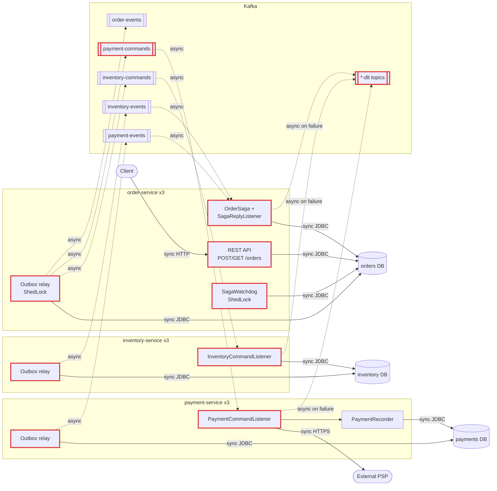
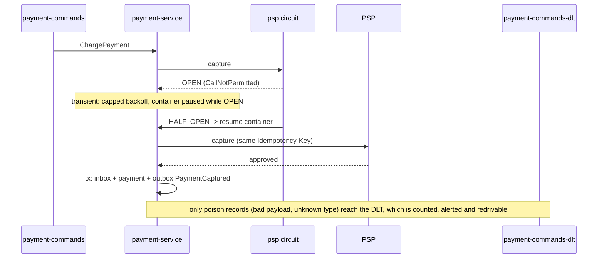
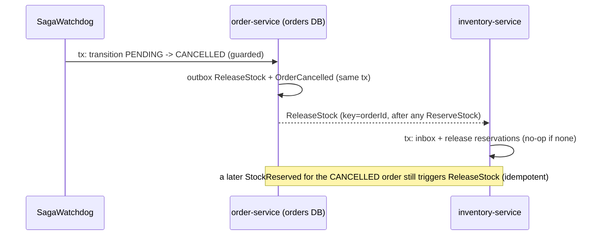

# Architecture review: 03-microservices-healthy

- **Mode:** codebase
- **Date:** 2026-10-24
- **Lenses run:** scalability, data-consistency, resilience, service-boundaries, messaging, persistence, operability (all seven; none skipped: there are three deployables, three datastores, Kafka, and an external PSP)
- **Scope:** the whole repository (`order-service`, `inventory-service`, `payment-service`, `k8s/`, `docker-compose.yml`, `db/`, `README.md`)

## Summary

This is a three-service order platform (order, inventory, payment) with a database per service and an orchestrated saga over Kafka. The building blocks are textbook and mostly done right: a transactional outbox, an idempotent inbox, a ShedLock'd relay and watchdog, an atomic stock decrement, and a PSP call outside any transaction with an idempotency key, timeouts, a circuit breaker and retries. The biggest risks sit at the edges of the saga: the timeout watchdog can cancel an order that has just moved on to payment, so customers can be charged for cancelled orders (DC-001), and every saga hop dead-letters after roughly 15 seconds of an ordinary PSP or DB outage, with no redrive and no alert, so orders strand with stock held (MQ-001). The change that buys the most is a one-line PENDING guard on the timeout plus a ReleaseStock on that path (DC-001 and DC-003), followed by classifying transient failures in the Kafka error handler and giving the DLT a redrive path (MQ-001).

| Severity | Count |
|---|---|
| critical | 0 |
| high | 4 |
| medium | 12 |
| low | 7 |
| info | 1 |
| **total** | **24** |

## Architecture profile

```
architecture: microservices, three independently deployed Spring Boot services, one database each, communicating only via Kafka
summary: Order platform. order-service accepts orders over HTTP and orchestrates a place-order saga (reserve stock, charge payment, compensate) over Kafka; inventory-service reserves stock; payment-service charges an external PSP.
stack: Java 17, Spring Boot 3.3.4, Spring Data JPA, Spring Kafka, Flyway, PostgreSQL 16, ShedLock 5.16, Resilience4j 2.2 (payment only), Micrometer Tracing (OTel bridge) + Prometheus registry
deployables:
  - order-service (order-service/): HTTP API POST/GET /orders (202 + poll), saga orchestrator (OrderSaga, SagaReplyListener, SagaWatchdog); db=orders; calls=none; publishes=inventory-commands, payment-commands, order-events (via outbox); consumes=inventory-events, payment-events
  - inventory-service (inventory-service/): stock reservation/release (atomic conditional UPDATE); db=inventory; calls=none; publishes=inventory-events (via outbox); consumes=inventory-commands
  - payment-service (payment-service/): calls PSP outside any DB tx, records result + reply in one tx; db=payments; calls=external PSP (RestClient, Idempotency-Key, 1s/3s timeouts, R4j circuit breaker + retry); publishes=payment-events (via outbox); consumes=payment-commands
datastores: PostgreSQL; separate databases orders / inventory / payments (db/init.sql). In docker-compose all three live on one Postgres server; production DB topology comes from k8s ConfigMaps not in the repo (unknown). Each service has outbox, processed_messages (inbox), shedlock tables.
messaging: Kafka (bitnami 3.7 in compose). Topics: inventory-commands, payment-commands, order-events, inventory-events, payment-events, plus <topic>-dlt via DeadLetterPublishingRecoverer. String JSON payloads; headers message-id, message-type; key = orderId. Producer acks=all, idempotence on. Consumer auto-commit off, ack-mode record. DefaultErrorHandler: 5 retries exp backoff 0.5s..10s then DLT; JsonProcessingException not retried. Per-service transactional outbox + polling relay; per-service inbox (processed_messages) dedup.
background work: per service OutboxRelay.relay every 500ms, batch 100, ShedLock "outbox-relay" lockAtMostFor 30s; OutboxRelay.purgeSent daily 03:15 (retention 7 days). order-service SagaWatchdog every 60s (ShedLock) cancels PENDING orders older than 15 min; gauge orders.saga.stuck_awaiting_payment for STOCK_RESERVED older than 30 min.
runtime: k8s Deployments, replicas: 3 per service, liveness/readiness on actuator probes, terminationGracePeriodSeconds 45, server.shutdown graceful, timeout-per-shutdown-phase 30s; config via ConfigMap/Secret envFrom; Hikari max pool 10 per instance; open-in-view false; ddl-auto validate; tracing sampling 0.1 OTLP. No Service/Ingress/HPA/PDB manifests in repo.
stated intent: README: 3 teams (Checkout, Warehouse, Payments), one service each; 3 replicas per service; peak ~300 orders/minute, expected to triple next year. No SLA stated.
key flows:
  - place order: client POST /orders (Idempotency-Key) -> order-service tx [orders row PENDING + outbox ReserveStock] -> relay -> inventory-commands -> inventory tx [inbox + tryReserve + reservations + outbox StockReserved|StockRejected] -> inventory-events -> order-service tx [inbox + STOCK_RESERVED + outbox ChargePayment] -> payment-commands -> payment-service PSP capture (no tx) -> tx [inbox + payments row + outbox PaymentCaptured|PaymentFailed] -> payment-events -> order-service tx [CONFIRMED + OrderConfirmed | CANCELLED + ReleaseStock + OrderCancelled]
  - compensation: PaymentFailed -> ReleaseStock -> inventory releases reservations (idempotent by reservation status)
  - timeout: SagaWatchdog cancels PENDING > 15 min -> OrderCancelled; a late StockReserved on a CANCELLED order emits ReleaseStock
```

Assumptions made without anyone to ask: production DB topology and Kafka partition counts are not in the repo. Compose shows one Postgres server for all three databases and broker-default topic creation; findings that depend on these (PS-002, SC-001) say so and are graded with reduced confidence.

Edges: solid arrow = synchronous, dotted arrow = asynchronous (Kafka). Red outline = touched by a finding.



## Findings

### High

### DC-001 · Saga watchdog can cancel an order that already reached STOCK_RESERVED: customer charged, order cancelled, stock never released

**Severity:** high · **Confidence:** high · **Lens:** data-consistency · **Effort:** small

**Where:** `order-service/src/main/java/com/example/platform/order/saga/SagaWatchdog.java:44`, `order-service/src/main/java/com/example/platform/order/saga/SagaWatchdog.java:45`, `order-service/src/main/java/com/example/platform/order/domain/Order.java:72`, `order-service/src/main/java/com/example/platform/order/saga/OrderSaga.java:55`, `order-service/src/main/java/com/example/platform/order/saga/OrderSaga.java:72`

**Evidence:**

```
SagaWatchdog.java:44-45
for (Order order : orders.findByStatusAndCreatedAtBefore(Order.Status.PENDING, cutoff, PageRequest.of(0, 100))) {
    tx.executeWithoutResult(status -> saga.timeOut(orders.findById(order.getId()).orElseThrow()));
}

Order.java:72-73
public boolean cancel(String reason) {
    if (status == Status.CANCELLED || status == Status.CONFIRMED) { return false; }

OrderSaga.java:55-56
public void timeOut(Order order) {
    if (order.cancel("timed out waiting for stock reservation")) {   // only OrderCancelled is published

OrderSaga.java:72
if (order.confirm(paymentId)) {   // confirm requires STOCK_RESERVED; a capture on CANCELLED is silently ignored
```

**What goes wrong:** Inventory is running about 15 minutes behind, typically while it catches up after an outage or a consumer-lag spike. The watchdog lists up to 100 orders that are still PENDING; this query runs outside any transaction. Before the watchdog's per-order transaction reaches order X, SagaReplyListener commits StockReserved for X: the status becomes STOCK_RESERVED and ChargePayment is written to the outbox. The watchdog then reloads X fresh, so its @Version matches and no optimistic-lock conflict occurs. cancel() accepts any state except CANCELLED and CONFIRMED, so X becomes CANCELLED and only OrderCancelled is emitted. The ChargePayment already in the outbox is relayed and the PSP captures the money. The PaymentCaptured reply arrives, confirm() returns false, and nothing else happens. End state: the customer is charged, the order is CANCELLED, and the reservation is never released. This breaks the invariant the watchdog's own javadoc states: "a late capture must never land on a cancelled order". The race window is the time between the list query and each reload (up to ~100 short transactions), and it opens precisely when replies arrive about 15 minutes late.

**Fix** (`saga-orchestration`): Make the timeout a guarded transition from PENDING only, so a reply that commits first wins. Add Order.timeOut() implemented as transition(PENDING, CANCELLED), or use a conditional UPDATE orders SET status='CANCELLED' WHERE id=:id AND status='PENDING', and call it from OrderSaga.timeOut. As a defence in depth, treat PaymentCaptured on a CANCELLED order as an anomaly: emit a refund/void command (or at minimum a counter plus an alert) instead of dropping it.

```java
// Order.java
public boolean timeOut() {
    if (!transition(Status.PENDING, Status.CANCELLED)) {
        return false;           // a reply got there first: leave the saga alone
    }
    this.cancelReason = "timed out waiting for stock reservation";
    return true;
}

// OrderSaga.java
@Transactional(propagation = Propagation.MANDATORY)
public void timeOut(Order order) {
    if (order.timeOut()) {
        outbox.publish(INVENTORY_COMMANDS, key(order.getId()), new ReleaseStock(order.getId())); // DC-003
        outbox.publish(ORDER_EVENTS, key(order.getId()), new OrderCancelled(order.getId(), order.getCancelReason()));
    }
}
```

Fixed flow:

```mermaid
sequenceDiagram
    participant L as SagaReplyListener
    participant W as SagaWatchdog
    participant DB as orders DB
    L->>DB: tx1: PENDING -> STOCK_RESERVED + outbox ChargePayment (commit)
    W->>DB: tx2: reload order, timeOut()
    DB-->>W: status = STOCK_RESERVED
    Note over W: transition(PENDING, CANCELLED) fails, no-op
    Note over L,DB: the saga continues to payment; the reply that commits first wins
```

**Why it's worth it here:** The watchdog and the reply listener run concurrently on 3 order-service replicas, and saga replies can arrive close to the 15-minute timeout whenever inventory or Kafka is backlogged. The fix is a few lines.

### MQ-001 · ~15s retry budget dead-letters saga messages during ordinary PSP/DB outages, with no redrive, metric or alert

**Severity:** high · **Confidence:** high · **Lens:** messaging · **Effort:** medium

**Where:** `payment-service/src/main/java/com/example/platform/payment/config/KafkaConfig.java:18`, `order-service/src/main/java/com/example/platform/order/config/KafkaConfig.java:18`, `inventory-service/src/main/java/com/example/platform/inventory/config/KafkaConfig.java:18`, `payment-service/src/main/java/com/example/platform/payment/messaging/PaymentCommandListener.java:37`, `payment-service/src/main/resources/application.yml:72`, `order-service/src/main/java/com/example/platform/order/saga/SagaWatchdog.java:17`

**Evidence:**

```
KafkaConfig.java:18-22 (identical in all three services)
ExponentialBackOffWithMaxRetries backOff = new ExponentialBackOffWithMaxRetries(5);
backOff.setInitialInterval(500); backOff.setMultiplier(2.0); backOff.setMaxInterval(10_000);
DefaultErrorHandler handler = new DefaultErrorHandler(new DeadLetterPublishingRecoverer(template), backOff);

PaymentCommandListener javadoc: "Transient PSP failures (timeouts, open circuit) propagate so the container's
error handler retries with backoff and finally dead-letters the command."

payment-service application.yml:72  wait-duration-in-open-state: 30s

No consumer, counter, alert or replay tool for any <topic>-dlt exists in the repo.
```

**What goes wrong:** (1) The PSP is down for a few minutes. The psp circuit opens for 30s, so every attempt fails fast with CallNotPermittedException: about 0.6s of Resilience4j retries, then 0.5+1+2+4+8 = 15.5s of container backoff. Each ChargePayment therefore reaches payment-commands-dlt in about 16-20s, which is shorter than a single open-state window, and each partition sheds roughly one command every 20s for the whole outage. Every one of those orders stays STOCK_RESERVED with its stock held. If the PSP captured the payment but the response timed out, the customer is charged and the order never confirms. The only signal is the orders.saga.stuck_awaiting_payment gauge after 30 minutes, and there is no tool to redrive the DLT. (2) A 30-60s orders-DB failover dead-letters StockReserved replies. The orders stay PENDING, and the watchdog cancels them 15 minutes later without releasing stock (see DC-003). Because auto-cancelled orders are normal, no alert covers this. (3) A dead-lettered ReleaseStock leaks stock silently for an order that is already CANCELLED.

**Fix** (`retry-topic`): Separate transient failures from poison messages. (a) For transient exceptions (CallNotPermittedException, ResourceAccessException, 5xx/429, DataAccessResourceFailureException / CannotCreateTransactionException) use a long, capped backoff via DefaultErrorHandler.setBackOffFunction, or non-blocking @RetryableTopic retry topics with minute-scale delays. Keep the DLT for deterministic failures. In payment-service, optionally pause the payment-commands container while the psp circuit is OPEN and resume it on HALF_OPEN, using a CircuitBreaker state-transition listener plus KafkaListenerEndpointRegistry. (b) Add a small redrive tool per service that republishes <topic>-dlt records to the source topic with their original headers. This is safe because the inbox dedups on message-id and the PSP dedups on the Idempotency-Key, once DC-004 is fixed. (c) Count DLT publishes (a recoverer wrapper incrementing kafka.dlt.published{topic,exception}) and alert on any non-zero rate. Write a one-page runbook.

```java
DefaultErrorHandler handler = new DefaultErrorHandler(recoverer, new FixedBackOff(0, 0));
handler.setBackOffFunction((record, ex) -> isTransient(ex)
        ? cappedExponential(1_000, 60_000)        // keep retrying until the dependency is back
        : new ExponentialBackOffWithMaxRetries(3)); // poison: park it quickly
// isTransient: CallNotPermittedException, ResourceAccessException, HttpServerErrorException,
//              CannotCreateTransactionException, DataAccessResourceFailureException
```

Fixed flow:



**Why it's worth it here:** Every saga hop depends on the next reply arriving. PSP incidents and DB failovers lasting tens of seconds are ordinary events, and at 300 orders/min (tripling) each incident strands dozens of orders with stock held and possibly money taken.

### SC-001 · payment-commands consumer is sized for neither the planned 3x load nor a slow PSP (1 thread per pod, undeclared partitions, max.poll.records 500)

**Severity:** high · **Confidence:** medium · **Lens:** scalability · **Effort:** small

**Where:** `payment-service/src/main/java/com/example/platform/payment/messaging/PaymentCommandListener.java:30`, `payment-service/src/main/java/com/example/platform/payment/messaging/PaymentCommandListener.java:37`, `payment-service/src/main/resources/application.yml:24`, `payment-service/src/main/resources/application.yml:30`, `k8s/payment-service.yaml:6`, `docker-compose.yml:10`

**Evidence:**

```
PaymentCommandListener.java:30  @KafkaListener(topics = "payment-commands")   // no concurrency
PaymentCommandListener.java:37  PspClient.CaptureResponse response = psp.capture(...);   // blocking, read-timeout 3s x 3 attempts
application.yml:24-31  consumer: group-id / enable-auto-commit / deserializers only; listener: ack-mode: record
                       (no concurrency, no max-poll-records, no max.poll.interval.ms)
k8s/payment-service.yaml:6  replicas: 3
No NewTopic beans or topic manifests anywhere; compose Kafka uses broker defaults (auto-create, num.partitions=1).
README: "peak ~300 orders/minute, expected to triple next year."
```

**What goes wrong:** Payment parallelism is min(partitions, 3 replicas x 1 thread). Next year's peak is ~15 ChargePayment/s. Three threads keep up only if a PSP capture takes under ~200ms; typical capture latency is 300ms-1s, so capacity falls to 3-10/s. If production topics were auto-created with one partition, a single thread serves the whole group, and that is already below today's 5/s at 300ms latency. Lag on payment-commands grows through every peak, and orders sit in STOCK_RESERVED holding stock. Once lag builds, each poll returns up to 500 records. At 0.6s+ per record that exceeds the default max.poll.interval.ms (300s), so the consumer is evicted mid-batch, its partitions are re-read from the last commit by another pod, and the group falls into a rebalance loop exactly when the PSP is degraded. The Idempotency-Key prevents double charges, but load on the PSP doubles. A further consequence of undeclared topics: if a source topic has more partitions than its auto-created -dlt, the DeadLetterPublishingRecoverer (which targets the same partition number by default) fails, and that partition blocks on its own poison record.

**Fix** (`partitioning`): Declare every topic and its -dlt explicitly (NewTopic beans via KafkaAdmin, or versioned infra manifests), with the same partition count for each and enough headroom, for example 12. In payment-service set spring.kafka.listener.concurrency so that replicas x concurrency <= partitions and covers peak rate x p99 PSP latency. Set spring.kafka.consumer.max-poll-records low (10-20) so that max-poll-records x worst-case record time stays well below max.poll.interval.ms. Consider the CooperativeStickyAssignor. Alert on consumer lag and rebalance rate for the payment-service group. Keep key = orderId.

```yaml
spring:
  kafka:
    consumer:
      max-poll-records: 20
    listener:
      concurrency: 4          # replicas(3) x 4 = 12 <= partitions(12)
```
```java
@Bean NewTopic paymentCommands()    { return TopicBuilder.name("payment-commands").partitions(12).replicas(3).build(); }
@Bean NewTopic paymentCommandsDlt() { return TopicBuilder.name("payment-commands-dlt").partitions(12).replicas(3).build(); }
```

**Why it's worth it here:** Each payment record blocks on an external call taking hundreds of milliseconds, 3 replicas are meant to share consumption, and the README plans for 3x load next year.

### DC-002 · POST /orders accepts any line values: a negative quantity increases stock and lowers the charge; a duplicate SKU dead-letters the reservation

**Severity:** high · **Confidence:** high · **Lens:** data-consistency · **Effort:** small

**Where:** `order-service/src/main/java/com/example/platform/order/api/OrderController.java:47`, `order-service/src/main/java/com/example/platform/order/api/OrderService.java:33`, `inventory-service/src/main/java/com/example/platform/inventory/domain/StockRepository.java:11`, `inventory-service/src/main/resources/db/migration/V2__stock.sql:13`

**Evidence:**

```
OrderController.java:47-48  place(@RequestHeader("Idempotency-Key") String idempotencyKey, @RequestBody PlaceOrderRequest request)
                            // no @Valid, no spring-boot-starter-validation in the pom
OrderService.java:33        lines.forEach(l -> order.addItem(l.sku(), l.quantity(), l.unitPrice()));
StockRepository.java:11-12  update StockItem s set s.available = s.available - :qty ... where s.sku = :sku and s.available >= :qty
V2__stock.sql:13            unique (order_id, sku)
```

**What goes wrong:** A client bug or a hostile caller sends {sku: A, quantity: -5}. order-service stores it, so the total drops by 5 x unitPrice. Inventory runs tryReserve(A, -5): the condition `available >= -5` holds, and available becomes available + 5. Stock now exceeds physical inventory, and ChargePayment carries a reduced or negative amount. A negative unitPrice skews the charge the same way. Separately, two lines with the same SKU both decrement successfully, and then the second reservations.save violates unique(order_id, sku). The transaction rolls back, is retried 5 times, and is dead-lettered. The order is cancelled by the watchdog 15 minutes later instead of being rejected straight away.

**Fix** (`reservation-pattern`): Validate at the order-service boundary: add spring-boot-starter-validation and @Valid on the request, with non-empty lines, quantity >= 1, unitPrice >= 0, and duplicate SKUs merged or rejected. Return 400 on failure. Inventory should not trust its commands either: add `and :qty > 0` to tryReserve, or reject non-positive quantities with StockRejected, so another producer cannot corrupt stock.

```java
public record PlaceOrderRequest(@NotBlank String customerId, @NotEmpty List<@Valid Line> lines) {}
public record Line(@NotBlank String sku, @Min(1) int quantity, @DecimalMin("0.00") BigDecimal unitPrice) {}

// inventory, defence in depth
@Query("update StockItem s set s.available = s.available - :qty, s.version = s.version + 1 "
     + "where s.sku = :sku and :qty > 0 and s.available >= :qty")
```

**Why it's worth it here:** POST /orders is the external entry point, and its body flows unchecked into stock mutations owned by another team's service and into the amount charged at the PSP.

### Medium

### DC-003 · Saga timeout cancels without ReleaseStock, so a dead-lettered StockReserved leaks inventory permanently

**Severity:** medium · **Confidence:** high · **Lens:** data-consistency · **Effort:** small

**Where:** `order-service/src/main/java/com/example/platform/order/saga/OrderSaga.java:55`, `order-service/src/main/java/com/example/platform/order/saga/OrderSaga.java:48`

**Evidence:**

```
OrderSaga.java:55-58
public void timeOut(Order order) {
    if (order.cancel("timed out waiting for stock reservation")) {
        outbox.publish(ORDER_EVENTS, key(order.getId()), new OrderCancelled(...));   // no ReleaseStock

OrderSaga.java:48-50  // stock is only returned if a late StockReserved actually arrives
} else if (order.getStatus() == Order.Status.CANCELLED) {
    outbox.publish(INVENTORY_COMMANDS, key(orderId), new ReleaseStock(orderId));
```

**What goes wrong:** Inventory reserves stock and publishes StockReserved. order-service cannot process the reply within its ~15s retry budget (orders DB failover, or the deserialization case in DC-004), so the reply goes to inventory-events-dlt. After 15 minutes the watchdog cancels the PENDING order and publishes only OrderCancelled. The compensation in the late-reply branch never runs, because the reply is parked in the DLT. The reservation and the decremented stock_items.available stay held indefinitely, and no alert fires, because timeouts are an expected outcome.

**Fix** (`compensating-action`): Publish ReleaseStock from timeOut, after the PENDING guard from DC-001. This is safe: StockService.release is idempotent and is a no-op when no reservations exist. ReleaseStock also shares the orderId key, so on inventory-commands it lands after any earlier ReserveStock. If a ReserveStock is redriven later, the existing CANCELLED branch in onStockReserved still compensates it.

Fixed flow:



**Why it's worth it here:** Saga replies can be dead-lettered (MQ-001), and the PENDING timeout is the only thing that ends a stalled saga.

### DC-004 · Checked JsonProcessingException commits the inbox row, so a dead-lettered message is silently skipped when replayed

**Severity:** medium · **Confidence:** high · **Lens:** data-consistency · **Effort:** small

**Where:** `order-service/src/main/java/com/example/platform/order/saga/SagaReplyListener.java:26`, `order-service/src/main/java/com/example/platform/order/saga/SagaReplyListener.java:28`, `inventory-service/src/main/java/com/example/platform/inventory/messaging/InventoryCommandListener.java:24`, `inventory-service/src/main/java/com/example/platform/inventory/messaging/InventoryCommandListener.java:26`, `order-service/src/main/java/com/example/platform/order/config/KafkaConfig.java:23`

**Evidence:**

```
SagaReplyListener.java:26-28
@Transactional
public void onReply(ConsumerRecord<String, String> record) throws JsonProcessingException {
    if (!inbox.firstDelivery(Headers.messageId(record))) { return; }
    ... read(record, Messages.StockReserved.class) ...   // deserialization happens after the inbox insert

KafkaConfig.java:23  handler.addNotRetryableExceptions(com.fasterxml.jackson.core.JsonProcessingException.class);
(InventoryCommandListener.java:24-30 has the same shape. Spring rolls back only on unchecked exceptions by default.)
```

**What goes wrong:** A producer deploy changes a field's type, and a StockReserved payload no longer deserializes. Jackson 2's JsonProcessingException is a checked exception, so the @Transactional listener commits: the processed_messages row is written even though nothing else happened. The error handler sends the record straight to the DLT. The team fixes the consumer and replays the DLT with the original message-id header, and the inbox reports the message as already processed, so it is dropped. The order times out and its stock leaks (DC-003). For a ReserveStock, the order is cancelled even though stock was available.

**Fix** (`idempotent-consumer`): Annotate the listener methods with @Transactional(rollbackFor = Exception.class), or deserialize before calling inbox.firstDelivery(...). A failed parse then leaves no inbox row, and the DLT record can be replayed.

```java
@KafkaListener(topics = {"inventory-events", "payment-events"})
@Transactional(rollbackFor = Exception.class)
public void onReply(ConsumerRecord<String, String> record) throws JsonProcessingException { ... }
```

**Why it's worth it here:** The DLT is the designated recovery path, and the payload schemas are hand-copied across three independently deploying teams.

### MQ-002 · Wire type is the producer's Java class name, and two consumers ack-and-drop unknown types

**Severity:** medium · **Confidence:** high · **Lens:** messaging · **Effort:** small

**Where:** `order-service/src/main/java/com/example/platform/order/outbox/Outbox.java:26`, `payment-service/src/main/java/com/example/platform/payment/messaging/PaymentCommandListener.java:33`, `order-service/src/main/java/com/example/platform/order/saga/SagaReplyListener.java:45`, `inventory-service/src/main/java/com/example/platform/inventory/messaging/InventoryCommandListener.java:32`, `order-service/src/main/java/com/example/platform/order/saga/Messages.java:8`

**Evidence:**

```
Outbox.java:26 (all services)  new OutboxEvent(topic, aggregateKey, message.getClass().getSimpleName(), json.writeValueAsString(message))
PaymentCommandListener.java:33  if (inbox.alreadyProcessed(messageId) || !"ChargePayment".equals(Headers.messageType(record))) { return; }
SagaReplyListener.java:45       default -> { /* replies this saga does not handle */ }   // inbox row already inserted at line 28
InventoryCommandListener.java:32 default -> throw new IllegalArgumentException("Unknown command " ...)   // -> DLT
order Messages.java:8           "Versioned by type name; fields are only ever added."
```

**What goes wrong:** The convention is to version by type name, and the type name is simply the Java class name. Suppose the Checkout team ships ChargePaymentV2, or just renames or moves the record class, and deploys before payment-service. Every such command is acked and skipped, its offset is committed, and it is gone. Orders sit in STOCK_RESERVED holding stock until the 30-minute gauge fires. In the other direction, payment-service emits PaymentCapturedV2 before order-service understands it. order-service records the message-id in processed_messages and acks it, so the customer is charged and the order never confirms. Upgrading order-service afterwards does not recover the message, because the inbox already marks it as processed. The three consumers handle unknown types three different ways, and no contract test exists (the repo has no src/test).

**Fix** (`event-versioning`): Decouple the wire type from Java class names: pass an explicit, stable type constant to Outbox.publish, for example "ChargePayment.v1". In command and reply consumers, which are all saga participants, send unknown types to the DLT as inventory does, and in order-service check the type before inserting into the inbox. Add message contract tests between the teams (Spring Cloud Contract or Pact for messages, or a JSON Schema per topic checked in CI). Document that consumers deploy before producers for new types.

```java
outbox.publish(PAYMENT_COMMANDS, key(orderId), "ChargePayment.v1", new ChargePayment(...));
// consumer
default -> throw new UnknownMessageTypeException(type);   // -> DLT, redrivable after the consumer upgrades
```

**Why it's worth it here:** Three teams own the producer and consumer of each topic and deploy independently, with message records duplicated by hand in each service.

### SB-001 · No anti-corruption mapping around the PSP: any outcome other than "approved" counts as a decline, and every exception is retried

**Severity:** medium · **Confidence:** medium · **Lens:** service-boundaries · **Effort:** small

**Where:** `payment-service/src/main/java/com/example/platform/payment/psp/PspClient.java:39`, `payment-service/src/main/java/com/example/platform/payment/messaging/PaymentRecorder.java:41`, `payment-service/src/main/resources/application.yml:73`, `order-service/src/main/java/com/example/platform/order/api/OrderController.java:41`

**Evidence:**

```
PspClient.java:39-41  public record CaptureResponse(String reference, String outcome) {
                          public boolean approved() { return "approved".equals(outcome); } }
PaymentRecorder.java:41  outbox.publish(PAYMENT_EVENTS, key, new Messages.PaymentFailed(command.orderId(), response.outcome()));
application.yml:73-80  resilience4j.retry.instances.psp: max-attempts 3, no retry-exceptions / ignore-exceptions
OrderController.java:41  OrderView(..., o.getCancelReason())   // carries "payment failed: <raw PSP outcome>"
```

**What goes wrong:** Suppose the PSP returns a non-final outcome such as "pending" or "requires_review", or a variant spelling such as "APPROVED". payment-service stores DECLINED and emits PaymentFailed, and order-service cancels the order and releases the stock. If the PSP later settles the capture, the customer has paid for a cancelled order whose stock has been resold, and nothing reconciles it. Conversely, a deterministic 4xx rejection is thrown as an exception, retried 3 x 6 = 18 times over about 20s, and dead-lettered instead of becoming PaymentFailed, so the saga never compensates. A burst of such 4xx responses also counts toward the circuit's 50% failure rate and can open the circuit for every customer. Raw PSP vocabulary also leaks into the customer-facing cancelReason.

**Fix** (`anti-corruption-layer`): Add a small anti-corruption layer in payment-service. Map each documented PSP outcome and HTTP status explicitly to an internal result: CAPTURED, DECLINED (a final business decline, including definitive 4xx), PENDING, or RETRYABLE (5xx, 429, I/O errors). Treat unknown outcomes as an alertable error, never as a decline. Configure Resilience4j retry-exceptions and ignore-exceptions, plus the circuit breaker's ignore-exceptions, to match. If PENDING can happen, resolve it by status poll or webhook before replying to the saga. Emit internal reason codes in PaymentFailed, and keep the raw PSP text in the payments table only.

**Why it's worth it here:** A third party controls the outcome vocabulary, and the mapping decides whether stock is released and whether a charged customer gets an order. The PSP contract is not in the repo, so confirm which outcomes and statuses it can return.

### SC-002 · Outbox relay sends one record at a time with per-row merges, capping throughput around 100 events/s, and its 30s lock can expire mid-batch

**Severity:** medium · **Confidence:** medium · **Lens:** scalability · **Effort:** small

**Where:** `order-service/src/main/java/com/example/platform/order/outbox/OutboxRelay.java:34`, `order-service/src/main/java/com/example/platform/order/outbox/OutboxRelay.java:40`, `order-service/src/main/java/com/example/platform/order/outbox/OutboxRelay.java:42`, `inventory-service/src/main/java/com/example/platform/inventory/outbox/OutboxRelay.java:36`, `payment-service/src/main/java/com/example/platform/payment/outbox/OutboxRelay.java:36`

**Evidence:**

```
OutboxRelay.java:33-43 (identical in all services, not @Transactional)
@Scheduled(fixedDelayString = "${outbox.relay-interval-ms}")
@SchedulerLock(name = "outbox-relay", lockAtMostFor = "PT30S")
public void relay() throws Exception {
    for (OutboxEvent event : events.findUnsent(PageRequest.of(0, batchSize))) {
        ...
        kafka.send(record).get(10, TimeUnit.SECONDS);
        event.markSent();
        events.save(event);   // detached entity: SELECT + UPDATE + commit per row
```

**What goes wrong:** Each service has exactly one relay at a time. Every event costs a synchronous acks=all round trip to Kafka plus a SELECT, an UPDATE and a commit, done serially, with a 500ms pause between batches of 100. That caps throughput at roughly 70-150 events/s per service regardless of replica count. order-service writes ~3 events per order: ~15/s today and ~45/s at next year's 3x, which fits. At about 10x the outbox backlog grows without bound, every saga step slows down, and the 15-minute watchdog starts cancelling orders that are only waiting on the relay. During a broker slowdown a batch can also take longer than lockAtMostFor = 30s (each send may wait up to 10s). ShedLock then lets a second pod relay the same unsent rows concurrently. The inbox dedups the duplicates, but sends for one orderId can interleave.

**Fix** (`bulk-operations`): Send the batch asynchronously: collect the futures from kafka.send, then wait on all of them, or flush once. Mark the successfully sent ids with one bulk UPDATE outbox SET sent_at = now() WHERE id IN (:ids). When a full batch comes back, loop again immediately instead of sleeping. Set lockAtMostFor above the worst-case batch time, or bound the batch by elapsed time. Revisit CDC (Debezium) or a key-hash-partitioned relay only if one relay per service stops being enough.

```java
List<OutboxEvent> batch = events.findUnsent(PageRequest.of(0, batchSize));
List<CompletableFuture<?>> sends = batch.stream().map(e -> kafka.send(toRecord(e))).toList();
CompletableFuture.allOf(sends.toArray(CompletableFuture[]::new)).get(30, TimeUnit.SECONDS);
events.markSent(batch.stream().map(OutboxEvent::getId).toList(), Instant.now()); // one UPDATE ... WHERE id IN (...)
```

**Why it's worth it here:** Every saga step passes through one relay per service, and volume is planned to triple with continued growth.

### PS-001 · processed_messages inbox tables are never purged in any service

**Severity:** medium · **Confidence:** high · **Lens:** persistence · **Effort:** small

**Where:** `order-service/src/main/resources/db/migration/V1__outbox_inbox_shedlock.sql:13`, `inventory-service/src/main/resources/db/migration/V1__outbox_inbox_shedlock.sql:13`, `payment-service/src/main/resources/db/migration/V1__outbox_inbox_shedlock.sql:13`, `order-service/src/main/java/com/example/platform/order/messaging/Inbox.java:22`, `order-service/src/main/java/com/example/platform/order/outbox/OutboxRelay.java:46`

**Evidence:**

```
V1__outbox_inbox_shedlock.sql:13-16  create table processed_messages (message_id varchar(64) primary key, processed_at timestamptz not null);
Inbox.java:22  insert into processed_messages (message_id, processed_at) values (?, now()) on conflict do nothing
OutboxRelay.java:46-50  purgeSent() -> events.deleteSentBefore(...)   // the only retention job, and it covers outbox only
No DELETE from processed_messages anywhere; processed_at is not indexed.
```

**What goes wrong:** Every consumed message adds a permanent row: about 2 per order in order-service and 1-2 in inventory and payment. At 300 orders/min that is up to ~860k rows/day in the orders database, hundreds of millions per year, and 3x that after next year's growth. The primary key is a random UUID string, so once the index outgrows memory every inbox insert, which is on every consumer transaction, touches cold B-tree pages. Consumer latency, vacuum, backups and restores degrade month by month.

**Fix** (`data-retention`): Index processed_at, and add a ShedLock-guarded daily purge next to purgeSent that deletes in chunks where processed_at < now() - N days. Choose N longer than Kafka topic retention plus the longest DLT replay window you would ever run (for example 14-30 days). The business-level guards (saga state transitions, unique reservations(order_id, sku), the payments.order_id check, the PSP Idempotency-Key) remain a backstop beyond that window.

```java
@Scheduled(cron = "0 45 3 * * *")
@SchedulerLock(name = "inbox-cleanup")
public void purgeInbox() {
    int n;
    do {
        n = jdbc.update("delete from processed_messages where message_id in (select message_id from processed_messages "
                + "where processed_at < now() - interval '30 days' limit 5000)");
    } while (n > 0);
}
```

**Why it's worth it here:** Every Kafka message consumed writes an inbox row, at hundreds of orders per minute with growth planned.

### PS-002 · Connection budget of 9 pods x 10 nearly fills one Postgres server's default max_connections

**Severity:** medium · **Confidence:** low · **Lens:** persistence · **Effort:** small

**Where:** `order-service/src/main/resources/application.yml:9`, `inventory-service/src/main/resources/application.yml:9`, `payment-service/src/main/resources/application.yml:9`, `k8s/order-service.yaml:6`, `docker-compose.yml:2`

**Evidence:**

```
application.yml:8-9 (all services)  hikari: maximum-pool-size: 10   // minimumIdle defaults to the max, so every pod holds 10
k8s/*.yaml:6  replicas: 3
docker-compose.yml:2-8  one postgres:16 hosting orders, inventory and payments, with default max_connections (100)
```

**What goes wrong:** If production mirrors compose, with one Postgres server for all three databases, 9 pods hold 90 connections in steady state. A rolling deploy surges one extra pod per Deployment (default maxSurge 25%) and adds 10 connections each. Deploying two services at once, or scaling any service to 4 or more replicas for the planned 3x load, exceeds the ~97 usable connections. New pods then fail Flyway or Hikari startup with "too many clients" and the rollout stalls. If each database has its own server, this finding does not apply.

**Fix** (`connection-pool-sizing`): Confirm the production DB topology and max_connections. Write down the budget: sum over services of replicas x (1 + surge) x pool <= max_connections - headroom. Lower minimum-idle (for example 2-5), set connection-timeout to a few seconds, and put PgBouncer (transaction mode) in front if servers are shared or replica counts will grow.

**Why it's worth it here:** The three services share Postgres capacity, and replicas will grow with the planned 3x load.

### OP-001 · Traces break at every Kafka hop (observation disabled, outbox drops trace context) and no code logs anything

**Severity:** medium · **Confidence:** high · **Lens:** operability · **Effort:** medium

**Where:** `order-service/src/main/resources/application.yml:47`, `order-service/src/main/java/com/example/platform/order/outbox/OutboxRelay.java:37`, `order-service/src/main/resources/db/migration/V1__outbox_inbox_shedlock.sql:1`, `order-service/src/main/java/com/example/platform/order/saga/SagaReplyListener.java:25`

**Evidence:**

```
application.yml:47-52  management.tracing.sampling.probability: 0.1 + OTLP endpoint only;
                       spring.kafka.template.observation-enabled / listener.observation-enabled not set (default false)
OutboxRelay.java:37-39  new ProducerRecord<>(...); headers: only message-id and message-type   // sent from a @Scheduled thread
V1__outbox_inbox_shedlock.sql:1-8  outbox table has no traceparent column
No Logger / slf4j / MDC usage in any service.
```

**What goes wrong:** A customer reports an order stuck in PENDING or STOCK_RESERVED. The HTTP trace ends at the order-service DB write. The relay publish, the inventory handling, ChargePayment and the PSP call each start an unrelated root trace, and each is sampled independently at 10%, so an end-to-end trace almost never exists. No service logs a line that mentions the orderId. On-call has to query three databases and five topics by hand to find where the saga stalled, which turns MTTR into hours.

**Fix** (`distributed-tracing`): Set spring.kafka.template.observation-enabled=true and spring.kafka.listener.observation-enabled=true. Capture the current traceparent when writing an outbox row (add a column) and set it as a record header in OutboxRelay, so consumer spans continue the original trace. Use parent-based sampling. Put orderId, the record key, into MDC in each listener, and log saga transitions and compensations at INFO with structured fields.

**Why it's worth it here:** Every order crosses three deployables owned by three teams through asynchronous outbox hops.

### OP-002 · No outbox-backlog or saga-outcome metrics and no alert rules; one unpublishable outbox row silently stalls a whole service

**Severity:** medium · **Confidence:** medium · **Lens:** operability · **Effort:** small

**Where:** `order-service/src/main/java/com/example/platform/order/outbox/OutboxRelay.java:36`, `inventory-service/src/main/java/com/example/platform/inventory/outbox/OutboxRelay.java:36`, `payment-service/src/main/java/com/example/platform/payment/outbox/OutboxRelay.java:36`, `order-service/src/main/java/com/example/platform/order/saga/SagaWatchdog.java:35`

**Evidence:**

```
OutboxRelay.java:36-40  for (OutboxEvent event : events.findUnsent(...)) { ... kafka.send(record).get(10, TimeUnit.SECONDS); ... }
                        // oldest-first; the first exception aborts the run, and the next run restarts at the same row
SagaWatchdog.java:35  Gauge.builder("orders.saga.stuck_awaiting_payment", ...)   // the only custom meter in the codebase
No Prometheus rules or alert config anywhere in the repo.
```

**What goes wrong:** In inventory-service, one outbox row fails to publish on every attempt: a record over max.request.size, a topic ACL problem, or a deleted topic. The relay reads oldest-first and throws on the first failure, so every row behind it is blocked too, and no StockReserved or StockRejected goes out. Fifteen minutes later the watchdog starts cancelling every new order as "timed out waiting for stock reservation". The first signal is customers reporting cancellations, and nothing points at the inventory outbox. The same blindness applies to consumer lag and saga cancellation rates.

**Fix** (`metrics-and-alerts`): In each service, register gauges for the unsent outbox count and the oldest unsent age (SELECT count(*), min(created_at) FROM outbox WHERE sent_at IS NULL is cheap thanks to the partial index), plus a relay-failure counter. In order-service, count saga outcomes: confirmed, and cancelled tagged by reason. Ship alert rules with the manifests: outbox oldest age > 1 min, cancellation rate by reason, the stuck-payment gauge, consumer lag (Boot already binds Kafka client metrics), and DLT publishes (MQ-001). Consider moving a row that has failed N times to a parked state, so it cannot block the rows behind it.

**Why it's worth it here:** The whole order flow is asynchronous, so a stall produces no HTTP errors, only quietly cancelled orders.

### OP-003 · No startupProbe and migrations run at pod start: a slow start or a long index build crash-loops the rollout and blocks order writes

**Severity:** medium · **Confidence:** medium · **Lens:** operability · **Effort:** small

**Where:** `k8s/order-service.yaml:26`, `k8s/inventory-service.yaml:26`, `k8s/payment-service.yaml:26`, `order-service/src/main/resources/db/migration/V3__orders_status_idx.sql:1`

**Evidence:**

```
k8s/order-service.yaml:26-29  livenessProbe: httpGet: path: /actuator/health/liveness   // no startupProbe, initialDelaySeconds or failureThreshold
V3__orders_status_idx.sql:1   create index orders_status_created_idx on orders (status, created_at);   // not CONCURRENTLY
Flyway (spring.flyway.enabled: true) runs before the web server listens.
```

**What goes wrong:** With k8s defaults the liveness probe kills a pod that has not answered for about 30s. A Boot app running JPA, Kafka and Flyway on a CPU-contended node (no resource requests are set, see OP-004) can take longer than that to start, so pods restart in a loop. Worse, next year a release ships another plain CREATE INDEX on the orders table, which then holds tens of millions of rows. The first new pod takes a SHARE lock on orders while it builds, so POST /orders and saga updates on the old pods block. The liveness probe kills the pod mid-build, Postgres rolls back, the next pod tries again, and order intake stalls on every attempt while the rollout never completes.

**Fix** (`health-probes`): Add a startupProbe on /actuator/health/liveness (for example periodSeconds 5, failureThreshold 30) so that liveness only applies after startup. Write index migrations on hot tables as CREATE INDEX CONCURRENTLY in a script marked executeInTransaction=false, or run long migrations as a pre-deploy Job instead of at pod start.

```yaml
startupProbe:
  httpGet: { path: /actuator/health/liveness, port: 8080 }
  periodSeconds: 5
  failureThreshold: 30
```

**Why it's worth it here:** Flyway runs at startup on every replica during rolling deploys, and the orders table grows with volume.

### OP-004 · Deployments declare no resource requests/limits, PodDisruptionBudget or spread constraints

**Severity:** medium · **Confidence:** medium · **Lens:** operability · **Effort:** small

**Where:** `k8s/order-service.yaml:16`, `k8s/inventory-service.yaml:16`, `k8s/payment-service.yaml:16`, `order-service/Dockerfile:3`

**Evidence:**

```
k8s/*.yaml:16-33  containers: name, image, ports, envFrom, probes only   // no resources, affinity or topologySpreadConstraints; no PDB manifest
Dockerfile:3  ENTRYPOINT ["java", "-jar", "/app.jar"]   // no heap sizing
```

**What goes wrong:** With no requests, every pod is BestEffort QoS. The scheduler may place all 3 order-service replicas on one node, and under memory pressure those pods are evicted first. During a cluster upgrade a node drain with no PDB can evict all three order-service pods at once, so POST and GET /orders are unavailable until replacements pass readiness. At the same time the inventory or payment consumer groups rebalance all at once.

**Fix** (`health-probes`): Set CPU and memory requests and a memory limit per container, and size the heap with JAVA_TOOL_OPTIONS=-XX:MaxRAMPercentage=75. Add a PodDisruptionBudget (minAvailable: 2) and a topologySpreadConstraint on kubernetes.io/hostname for each Deployment. If these settings live in another repo, note where.

**Why it's worth it here:** Three replicas per service run on shared nodes, and order-service is the customer-facing entry point.

### OP-005 · order-service has no authentication boundary and trusts customerId from the request

**Severity:** medium · **Confidence:** medium · **Lens:** operability · **Effort:** medium

**Where:** `order-service/src/main/java/com/example/platform/order/api/OrderController.java:60`, `order-service/src/main/java/com/example/platform/order/api/OrderController.java:36`, `order-service/pom.xml:19`, `order-service/src/main/resources/application.yml:46`

**Evidence:**

```
OrderController.java:60  public Page<OrderView> byCustomer(@RequestParam String customerId, ...)
OrderController.java:36  public record PlaceOrderRequest(String customerId, List<OrderService.Line> lines)
pom.xml: no spring-boot-starter-security; repo has no Ingress or gateway
application.yml:46  exposure: include: health,info,prometheus   // on the API port 8080
```

**What goes wrong:** Anyone who can reach order-service can list any customer's orders by guessing a customerId, and can place orders charged to any customer. Authenticating at a gateway alone does not fix this, because the service reads customerId from the request instead of from an authenticated principal. /actuator/prometheus is also served wherever the API is.

**Fix** (`api-gateway`): Put an authenticating edge (an ingress or API gateway) in front of order-service. Derive customerId from the token inside the service. Move actuator to management.server.port so it is not routed externally. Commission a dedicated security review for depth.

**Why it's worth it here:** order-service is the external entry point for customer orders and payments.

### Low

### SC-003 · Stock rows are locked in request line order, so overlapping multi-line orders can deadlock

**Severity:** low · **Confidence:** medium · **Lens:** scalability · **Effort:** small

**Where:** `inventory-service/src/main/java/com/example/platform/inventory/messaging/StockService.java:33`, `inventory-service/src/main/java/com/example/platform/inventory/domain/StockRepository.java:11`

**Evidence:**

```
StockService.java:33-34
for (Messages.Line line : command.lines()) {
    if (stock.tryReserve(line.sku(), line.quantity()) == 0) {   // row lock held until the listener tx commits
```

**What goes wrong:** Two inventory consumers on different partitions process order 1 with lines [A, B] and order 2 with lines [B, A]. Each locks its first SKU and waits for the other. Postgres aborts one transaction after deadlock_timeout (1s), and the error handler retries it. Stock stays correct, but popular SKUs see extra ~1.5s stalls and noisy errors at peak. A record that keeps losing goes to the DLT.

**Fix** (`consistent-lock-ordering`): Sort lines by SKU, and merge duplicate SKUs, before reserving, so every transaction takes row locks in the same order.

```java
command.lines().stream()
       .collect(Collectors.groupingBy(Line::sku, TreeMap::new, Collectors.summingInt(Line::quantity)))
       .forEach((sku, qty) -> { /* tryReserve(sku, qty) in sorted order */ });
```

**Why it's worth it here:** Orders have several lines and popular SKUs overlap across concurrent orders. The fix is a single sort.

### PS-003 · Daily outbox purge deletes a full day of rows in one unbounded DELETE

**Severity:** low · **Confidence:** medium · **Lens:** persistence · **Effort:** small

**Where:** `order-service/src/main/java/com/example/platform/order/outbox/OutboxRepository.java:20`, `order-service/src/main/java/com/example/platform/order/outbox/OutboxRelay.java:46`

**Evidence:**

```
OutboxRepository.java:18-21  @Modifying @Transactional @Query("delete from OutboxEvent e where e.sentAt < :cutoff")
OutboxRelay.java:46  @Scheduled(cron = "0 15 3 * * *")   // identical in all services
```

**What goes wrong:** Each night one transaction deletes a full day of outbox rows, payloads included: up to ~1.3M rows in order-service at peak, about 4M after 3x growth. That causes a WAL burst, lag on any replica, and a long transaction that holds back vacuum for the whole database. If the databases share a server, it affects the others too.

**Fix** (`data-retention`): Delete in bounded chunks in a loop (for example DELETE ... WHERE id IN (SELECT id ... WHERE sent_at < :cutoff LIMIT 5000)), or partition the outbox by day and drop old partitions.

**Why it's worth it here:** Outbox volume grows to millions of rows per day as load triples.

### PS-004 · Polled GET /orders/{id} fetches order items the response never uses

**Severity:** low · **Confidence:** high · **Lens:** persistence · **Effort:** small

**Where:** `order-service/src/main/java/com/example/platform/order/api/OrderController.java:55`, `order-service/src/main/java/com/example/platform/order/domain/OrderRepository.java:15`

**Evidence:**

```
OrderRepository.java:15-16  @EntityGraph(attributePaths = "items") Optional<Order> findWithItemsById(UUID id);
OrderController.java:55     orders.findWithItemsById(id).map(OrderView::of)   // OrderView has id, status, total, cancelReason only
```

**What goes wrong:** POST returns 202 and clients poll GET /orders/{id} until the saga finishes, which makes it the hottest read. Every poll joins order_items and hydrates item entities only to discard them, so the cost scales with polls x lines per order.

**Fix** (`dto-projection`): Use findById, or a projection of the four fields, for this endpoint. Keep the entity graph for callers that need items.

**Why it's worth it here:** The 202-and-poll contract makes this endpoint the highest-frequency query.

### RS-001 · No JDBC statement or lock timeout: a held stock row lock stalls the inventory consumer past max.poll.interval

**Severity:** low · **Confidence:** medium · **Lens:** resilience · **Effort:** small

**Where:** `inventory-service/src/main/resources/application.yml:4`, `inventory-service/src/main/java/com/example/platform/inventory/domain/StockRepository.java:11`

**Evidence:**

```
inventory application.yml:4-9  datasource: url/username/password, hikari.maximum-pool-size: 10   // no statement_timeout or lock_timeout
StockRepository.java:11  update StockItem s set s.available = s.available - :qty ... where s.sku = :sku and s.available >= :qty
```

**What goes wrong:** A manual stock correction, a migration, or a stuck session holds a lock on a popular SKU row. Every ReserveStock for that SKU blocks inside the listener without throwing, so the error handler never engages. After 5 minutes (max.poll.interval.ms) the consumer is evicted, and the partition moves to another pod, which blocks on the same row. The group churns until the lock is released.

**Fix** (`timeouts`): Set Postgres lock_timeout (a few seconds) and statement_timeout (for example 5s) per service role, or via JDBC options or connection-init-sql, so a blocked update fails into the existing retry path.

**Why it's worth it here:** Stock rows are hot and shared, and people or batch jobs can also write to stock_items.

### DC-005 · Concurrent duplicate POST /orders returns 500 to the loser, and the idempotency key is not scoped to the customer

**Severity:** low · **Confidence:** high · **Lens:** data-consistency · **Effort:** small

**Where:** `order-service/src/main/java/com/example/platform/order/api/OrderService.java:31`, `order-service/src/main/resources/db/migration/V2__orders.sql:3`

**Evidence:**

```
OrderService.java:31  return orders.findByRequestKey(requestKey).orElseGet(() -> { ... orders.save(order); saga.start(order); ... });
V2__orders.sql:3      request_key varchar(100) not null unique
```

**What goes wrong:** A client or gateway retries before the first request commits. Both requests miss findByRequestKey and both insert, so the second gets a DataIntegrityViolationException and a 500. The data stays correct, but the client sees an error for a request that actually succeeded. Because the key is global, a key reused by another customer returns that customer's order.

**Fix** (`idempotency-key`): Catch the unique-constraint violation on request_key, re-read, and return the existing order. Make the key unique per (customer_id, request_key).

**Why it's worth it here:** Clients are expected to retry POST /orders (it is async and returns 202).

### OP-006 · No preStop delay before graceful shutdown on order-service

**Severity:** low · **Confidence:** medium · **Lens:** operability · **Effort:** small

**Where:** `k8s/order-service.yaml:15`

**Evidence:**

```
k8s/order-service.yaml:15  terminationGracePeriodSeconds: 45   // with server.shutdown: graceful, but no lifecycle.preStop
```

**What goes wrong:** On each rolling deploy, Tomcat stops accepting connections on SIGTERM while kube-proxy or ingress still routes to the pod for a few seconds. Some POST /orders calls get connection refused or a 502. Clients that retry with the same Idempotency-Key recover; the rest see an error.

**Fix** (`graceful-shutdown`): Add lifecycle.preStop: exec: ["sleep", "5"] to order-service. This fits within 45s together with the 30s drain.

```yaml
lifecycle:
  preStop:
    exec: { command: ["sleep", "5"] }
```

**Why it's worth it here:** order-service is the HTTP entry point and is deployed with rolling updates.

### OP-007 · docker-compose cannot start the services: required env vars are missing and there are no healthchecks

**Severity:** low · **Confidence:** high · **Lens:** operability · **Effort:** small

**Where:** `docker-compose.yml:19`, `order-service/src/main/resources/application.yml:6`, `payment-service/src/main/resources/application.yml:61`

**Evidence:**

```
application.yml:6-7  username: ${DB_USER}  password: ${DB_PASSWORD}   // no defaults
payment application.yml:61  api-key: ${PSP_API_KEY}
docker-compose.yml:19-39  sets only SPRING_DATASOURCE_URL, SPRING_KAFKA_BOOTSTRAP_SERVERS, PSP_BASE_URL; depends_on without health conditions
```

**What goes wrong:** docker compose up fails every service with "Could not resolve placeholder 'DB_USER'". Even with the variables set, the services race Postgres and Kafka startup and exit without restarting, so engineers on the three teams cannot run the saga locally.

**Fix** (`externalized-config`): Add DB_USER/DB_PASSWORD (platform/platform) and a dummy PSP_API_KEY per service, healthchecks with depends_on: condition: service_healthy, and restart: on-failure.

**Why it's worth it here:** Compose is the only local environment in the repo.

### Info

### MQ-003 · README documents an OrderCreated event that is never published

**Severity:** info · **Confidence:** high · **Lens:** messaging · **Effort:** small

**Where:** `README.md:13`, `order-service/src/main/java/com/example/platform/order/saga/OrderSaga.java:38`

**Evidence:**

```
README.md:13  `POST /orders` stores the order as `PENDING` and emits `OrderCreated`.
OrderSaga.java:38-41  start() publishes only ReserveStock to inventory-commands; order-events carries only OrderConfirmed and OrderCancelled.
```

**What goes wrong:** A team that builds an order-events consumer from the README waits for an OrderCreated event that never arrives.

**Fix** (`event-versioning`): Either publish OrderCreated to order-events in OrderSaga.start (through the outbox), or correct the README.

**Why it's worth it here:** Other teams build on the documented order-events contract.

## Roadmap

### Now

- **DC-001**: Guard the timeout so it cancels only PENDING orders. Unblocks: removes charged-but-cancelled orders; prerequisite for DC-003.
- **DC-002**: Validate order lines (quantity >= 1, price >= 0, unique SKUs) and guard tryReserve. Unblocks: stops stock inflation and wrong charge amounts through the public API.
- **MQ-001**: Retry transient failures with a long backoff, add DLT redrive, counter and alert. Unblocks: turns PSP/DB outages from stranded orders into delays; DC-004 makes the redrive safe.
- **SC-001**: Declare topics/partitions and tune payment consumer concurrency and max-poll-records. Unblocks: headroom for the planned 3x load; no rebalance storms when the PSP is slow.

### Next

- **DC-004**: Roll back the inbox insert on checked exceptions. Unblocks: makes the MQ-001 DLT redrive actually reprocess messages.
- **DC-003**: Publish ReleaseStock from the timeout path. Unblocks: closes the stock leak left by dead-lettered replies (MQ-001).
- **OP-002**: Outbox backlog, saga outcome metrics and alert rules. Unblocks: lets on-call see the stalls MQ-001 and SC-001 describe.
- **MQ-002**: Stable wire type names; unknown types go to the DLT; contract tests. Unblocks: lets the three teams deploy independently without dropping messages.
- **SB-001**: Explicit PSP outcome/exception mapping. Unblocks: correct decline vs retry decisions, which feed MQ-001's transient classification.

### Later

- **SC-002** (medium): Outbox relay sends one record at a time with per-row merges, capping throughput around 100 events/s, and its 30s lock can expire mid-batch.
- **PS-001** (medium): processed_messages inbox tables are never purged in any service.
- **PS-002** (medium): Connection budget of 9 pods x 10 nearly fills one Postgres server's default max_connections.
- **OP-001** (medium): Traces break at every Kafka hop (observation disabled, outbox drops trace context) and no code logs anything.
- **OP-003** (medium): No startupProbe and migrations run at pod start: a slow start or a long index build crash-loops the rollout and blocks order writes.
- **OP-004** (medium): Deployments declare no resource requests/limits, PodDisruptionBudget or spread constraints.
- **OP-005** (medium): order-service has no authentication boundary and trusts customerId from the request.
- **SC-003** (low): Stock rows are locked in request line order, so overlapping multi-line orders can deadlock.
- **PS-003** (low): Daily outbox purge deletes a full day of rows in one unbounded DELETE.
- **PS-004** (low): Polled GET /orders/{id} fetches order items the response never uses.
- **RS-001** (low): No JDBC statement or lock timeout: a held stock row lock stalls the inventory consumer past max.poll.interval.
- **DC-005** (low): Concurrent duplicate POST /orders returns 500 to the loser, and the idempotency key is not scoped to the customer.
- **OP-006** (low): No preStop delay before graceful shutdown on order-service.
- **OP-007** (low): docker-compose cannot start the services: required env vars are missing and there are no healthchecks.
- **MQ-003** (info): README documents an OrderCreated event that is never published.

## What's already sound

Keep these. They are deliberate and correct, and several findings above depend on them. Do not "simplify" them away:

- Database per service: orders, inventory and payments are separate databases with their own Flyway history; no service reads another's tables, and there is no shared domain library (message records are duplicated per service on purpose).
- Transactional outbox in every service: Outbox.publish is propagation=MANDATORY, so an event can only be written inside the state change's transaction; a ShedLock-guarded relay publishes oldest-first with key=orderId and acks=all + idempotent producer; sent rows are purged after 7 days.
- Idempotent consumers: every listener inserts into processed_messages (on conflict do nothing) in the same transaction as its effect, and handlers are additionally state-guarded (Order.transition, Reservation.release, payments.order_id unique).
- Orchestrated saga with persisted state: Order.status drives the flow, PaymentFailed compensates with ReleaseStock, and a late StockReserved on a CANCELLED order also releases stock; stuck-payment orders are exposed as a gauge instead of being cancelled under a possible capture.
- PSP call is outside any DB transaction, carries a stable Idempotency-Key (capture-<orderId>), and has connect/read timeouts, a Resilience4j circuit breaker and retry with exponential backoff and jitter.
- Stock is decremented with an atomic conditional UPDATE plus a CHECK (available >= 0) constraint, and Order has @Version optimistic locking: no lost updates or overselling.
- POST /orders requires an Idempotency-Key backed by a unique constraint and returns 202 with a pollable status resource; no synchronous inter-service calls exist anywhere.
- Every @Scheduled job (relay, purge, watchdog) is guarded by ShedLock using DB time, so 3 replicas do not duplicate work.
- Kafka consumers commit offsets only after processing (auto-commit off, ack-mode record), with a DefaultErrorHandler, backoff and a dead-letter recoverer; deserialization failures are not retried.
- Persistence hygiene: Flyway with ddl-auto=validate, open-in-view disabled, an index or constraint behind every query (including a partial index for unsent outbox rows), and page size capped at 50.
- Operability basics are in place: actuator liveness/readiness probe groups wired to k8s probes, graceful shutdown with a 30s phase timeout inside a 45s grace period, config and secrets via ConfigMap/Secret, Prometheus and OTLP tracing dependencies.
- Boundaries match the organisation: three teams, three services, each with one clear business capability.

## Not reviewed

- **Security in depth.** Authentication, authorization, secret handling and PSP credential scope are covered only at the architecture level (OP-005). Commission a dedicated security review.
- **Infrastructure outside the repo.** Production ConfigMaps/Secrets, DB topology and `max_connections`, Kafka topic configs (partitions, retention, replication), Ingress/Service objects, alert rules and dashboards are not in the repository. Findings that depend on them say so.
- **The PSP contract.** Its outcome vocabulary, error codes and idempotency-key semantics are inferred from `PspClient` (SB-001).
- **Tests.** The repository has no `src/test`, so test coverage and contract tests could not be assessed. The project test command could not be run as part of this read-only review.
- **Runtime behaviour.** No load tests or profiling were run. The throughput figures in SC-001 and SC-002 are estimates from code paths and the stated peak load.
