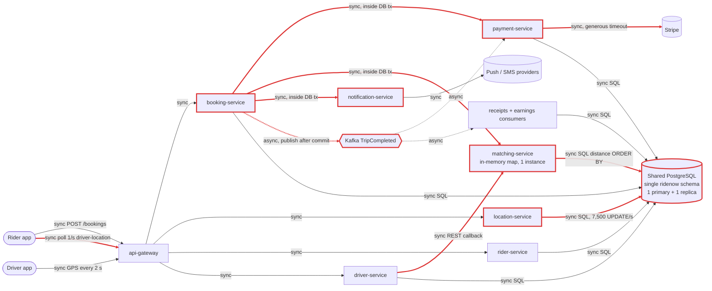
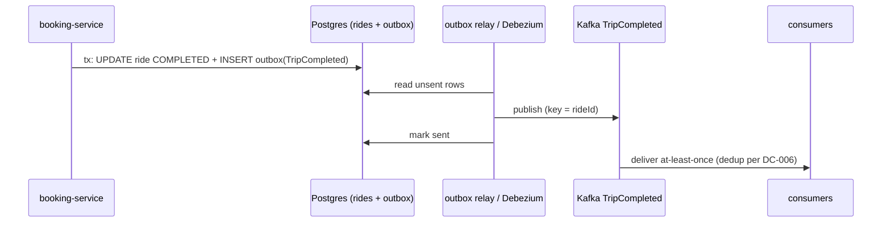
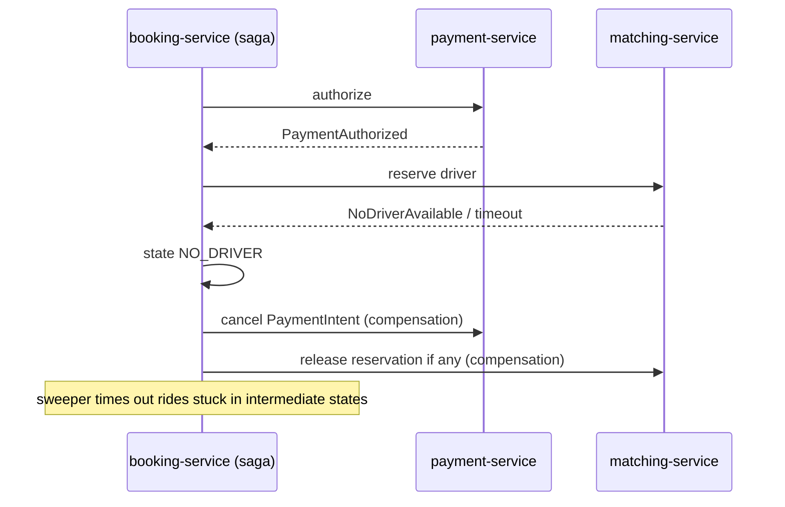
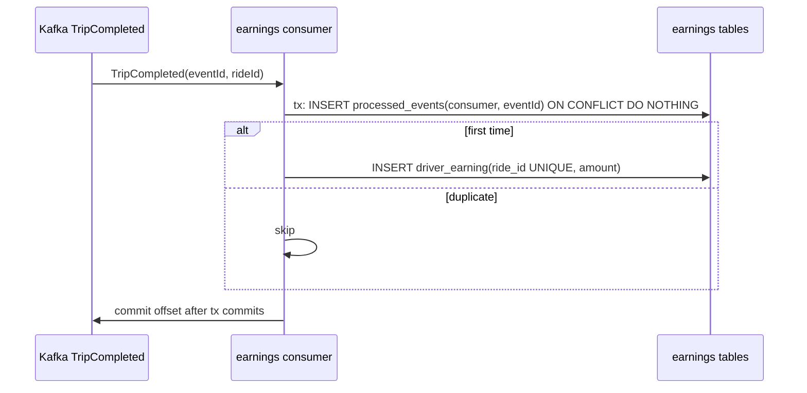
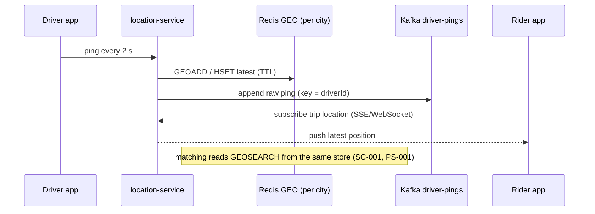
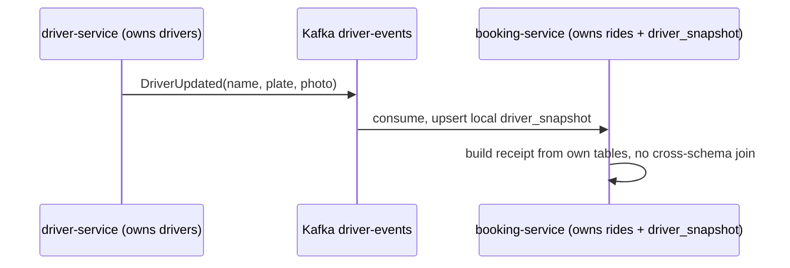

# Architecture review: RideNow (project-brief.md, draft v0.3)

- **Mode**: design (the brief is the only input; there is no code yet)
- **Date**: 2026-10-24
- **Lenses run**: scalability, persistence, operability, data-consistency, resilience, service-boundaries, messaging. None were skipped. Operability ran even though deployment and observability are "Not decided yet": the brief names a direction ("probably Kubernetes") and a 99.95% target, so those gaps are themselves findings.
- **Assumptions**: nobody was available to answer the intake questions. The assumed answers are listed under *Architecture profile* and every severity is graded against them. If any of them is wrong, re-grade the findings it affects.

## Summary

RideNow is a planned ride-hailing platform of eight microservices for three cities: 15k drivers and 120k rides a day at launch, rising to 50k drivers and 400k rides a day. The service split fits the four-squad team. The data and integration design undermines it: every service shares one Postgres schema, booking holds a database transaction open across Stripe, matching and push, trip completion publishes to Kafka with no outbox, and live GPS (about 7,500 writes/s at launch) is an UPDATE on the same shared primary. The biggest risk is money and drivers going out of sync with the ride record under ordinary failures. Examples are orphaned card holds, lost fare captures and double-matched drivers, together with a matching-service that loses every available driver whenever it restarts. The change that buys the most is to **commit locally first and drive booking and completion as an outbox-fed saga with idempotency keys** (DC-001, DC-002, DC-003). That fixes the consistency bugs, takes Stripe and push off the request path, and stops long transactions from starving the shared database.

| Severity | Count |
|---|---|
| critical | 3 |
| high | 9 |
| medium | 7 |
| low | 3 |
| info | 0 |
| **total** | **22** |

## Architecture profile

```text
architecture: microservices, 8 planned independently deployed services, all sharing one PostgreSQL schema
summary: ride-hailing for 3 cities (~4M people): request, match to nearby driver, live tracking, Stripe pre-auth at booking and capture at trip end
stack: unknown; assumed Java 17+ / Spring Boot 3.x (user default); PostgreSQL; Kafka; Stripe; Kubernetes "probably"
deployables (all planned):
  - api-gateway: routing and auth; db=none
  - rider-service: rider profiles, saved payment methods; db=shared ridenow
  - driver-service: profiles, documents, availability; db=shared ridenow; REST callback -> matching-service on online/offline
  - location-service: GPS ingest, "where is driver X"; UPDATE drivers row per ping (shared ridenow)
  - matching-service: nearest available driver; in-memory map + SQL distance ORDER BY; 1 instance at launch
  - booking-service: ride lifecycle; sync -> payment, matching, notification inside one DB tx; publishes TripCompleted
  - payment-service: Stripe pre-auth/capture; consumes TripCompleted
  - notification-service: push + SMS
  - receipts and driver-earnings consumers of TripCompleted (owner unnamed)
datastores: ONE shared PostgreSQL cluster (1 primary, 1 read replica), single `ridenow` schema, cross-service joins (SHARED)
messaging: Kafka; TripCompleted (booking -> payment, receipts, earnings); no delivery guarantee, idempotency or DLQ stated
background work: none described
runtime: undecided ("probably Kubernetes"); observability undecided; matching-service single instance
stated intent: launch 15k drivers, 120k rides/day (~5.6 bookings/s Friday peak); year two 50k drivers, 400k rides/day (~18.5/s peak), +2 cities; 99.95% for ride request; 4 squads x ~6, 2 services each, shipping independently
derived load: GPS 7,500 UPDATE/s at launch peak (~25,000/s year two); rider polling ~6,700 reads/s at launch peak (~22,000/s year two)
assumptions (not confirmed by the team): charges never lost or doubled; driver never double-matched; location may lag seconds; receipts/earnings may lag minutes; squads ship several times a week; average trip ~20 min
key flows:
  - book: app -> gateway -> booking [TX: insert REQUESTED -> payment -> Stripe -> matching -> notification -> MATCHED, COMMIT]
  - complete: driver app -> booking COMPLETED commit -> Kafka TripCompleted -> payment capture; receipts; earnings
  - track: driver app -> location UPDATE drivers every 2 s; rider polls booking GET driver-location every 1 s; matching SQL distance on drivers
```

The diagram shows the planned design. Solid arrows are synchronous calls and dotted arrows are asynchronous; red marks the nodes and edges that findings touch.



## Findings

**Critical (3)**

### DC-001 · Stripe pre-auth, matching and push run inside the booking DB transaction, which cannot roll them back

Severity **critical** · confidence high · lens data-consistency · effort medium

**Where**: `project-brief.md` > Booking flow

**Evidence**:

```text
"booking-service calls payment-service synchronously, which calls Stripe to pre-authorize the estimated fare. If Stripe is slow, the request waits; we will set a generous timeout so we don't lose bookings." ... "All of steps 2–6 run inside one database transaction in booking-service, so if anything fails the booking is rolled back cleanly."
```

**What goes wrong**: (1) The Stripe pre-auth succeeds and matching hands out driver D. (2) notification-service times out, or the booking-service pod is killed by a rolling deploy. (3) The transaction rolls back and the ride row disappears. The Stripe hold stays on the rider's card, D stays marked taken in matching memory, and both may already have had a 'driver on the way' push. (4) The rider taps again, and a second hold is placed. Also: payment-service and matching-service use their own connections, so they cannot see the uncommitted REQUESTED ride row. Any foreign key or lookup they make against it fails or blocks. Under load: each booking holds a Postgres connection and an open xid for the whole Stripe, matching and push round trip. If Stripe stalls for 30 s at Friday peak (~5.6 bookings/s), about 170 connections are pinned in booking-service. That exhausts its pool (trip completion fails too), eats into the shared cluster's max_connections, and holds back vacuum on the hot drivers table.

**Fix** (`move-call-outside-transaction`): Never hold a DB transaction across a remote call. Commit the ride as REQUESTED in a short transaction. Then drive pre-auth, driver claim and notification as separate steps from persisted ride state, committing each transition (PAYMENT_AUTHORIZED, MATCHED) in its own short transaction. Pass the ride id as the Stripe Idempotency-Key, and pass the data callees need in the request instead of letting them read uncommitted rows. Return 202 with a ride status resource so the app waits on status, not on an open HTTP request. The full state machine is DC-003.

Sketch (booking-service, Spring):

```java
@PostMapping("/bookings")
ResponseEntity<RideStatus> book(@RequestHeader("Idempotency-Key") UUID key, @RequestBody BookingRequest req) {
    Ride ride = rides.createRequestedIfAbsent(key, req);   // short @Transactional, commits REQUESTED
    outbox.enqueue(new AuthorizeFare(ride.id()));          // same tx; saga continues out of band
    return ResponseEntity.accepted().body(RideStatus.of(ride));
}
```

Fixed flow:

```mermaid
sequenceDiagram
  participant App as Rider app
  participant B as booking-service
  participant DB as booking tables
  participant P as payment-service
  participant S as Stripe
  participant M as matching-service
  App->>B: POST /bookings (Idempotency-Key)
  B->>DB: tx1: insert ride REQUESTED + outbox row
  B-->>App: 202 + ride status URL
  B->>P: authorize(rideId) [async, idempotent]
  P->>S: PaymentIntent (Idempotency-Key = rideId, short timeout)
  P-->>B: PaymentAuthorized
  B->>DB: tx2: PAYMENT_AUTHORIZED
  B->>M: reserve nearest driver (atomic claim, TTL)
  M-->>B: DriverReserved
  B->>DB: tx3: MATCHED + outbox RideMatched
  Note over B,DB: each step is its own short transaction; no remote call inside a tx
```

**Why it's worth it here**: Every booking touches money (Stripe hold) and a scarce driver. The brief targets 99.95% for this exact flow, and it runs on a database shared by all eight services.

### DC-002 · TripCompleted is published after commit with no outbox, so a crash loses the fare capture, receipt and driver earnings

Severity **critical** · confidence high · lens data-consistency · effort medium

**Where**: `project-brief.md` > Trip completion

**Evidence**:

```text
"booking-service sets the ride to COMPLETED, then publishes a TripCompleted event to Kafka right after the database commit. payment-service consumes it and captures the final fare. Receipts and driver earnings are computed by consumers of the same event."
```

**What goes wrong**: (1) The ride commits as COMPLETED. (2) Before the Kafka send is acknowledged, the booking-service pod is restarted (a routine deploy or an eviction), or Kafka is briefly unreachable and the send runs out of retries. (3) No event is ever published. The ride shows COMPLETED, but no capture happens, the Stripe authorization lapses after about 7 days and the fare is lost. The rider gets no receipt and the driver is never credited. Nothing records that the event is missing. At 120k–400k rides a day, a 0.01% loss rate is 12–40 unpaid rides and unpaid drivers every day.

**Fix** (`transactional-outbox`): Write a TripCompleted row to an outbox table in the same transaction that sets COMPLETED. A relay (polling publisher, or Debezium CDC on the existing Postgres) publishes it keyed by ride id and marks it sent. Consumers must be idempotent, because the relay delivers at least once (DC-006). Add a reconciliation query that flags COMPLETED rides with no capture after N minutes.



**Why it's worth it here**: Fare capture and driver pay depend entirely on this event, and losing a charge is unacceptable. The relay can run on the Postgres and Kafka already planned.

### SC-001 · matching-service keeps driver availability in instance memory, runs as one instance and starts empty after every restart

Severity **critical** · confidence high · lens scalability · effort medium

**Where**: `project-brief.md` > Booking flow; `project-brief.md` > Targets

**Evidence**:

```text
"matching-service keeps the list of available drivers in an in-memory map that driver-service updates through a REST callback whenever a driver goes online or offline. We'll run one matching-service instance at launch and add more later." / "Availability target for requesting a ride: 99.95%."
```

**What goes wrong**: (1) The matching squad deploys, or Kubernetes reschedules the only pod. The new process starts with an empty map. Drivers who are already online send no new online/offline callback, so they are invisible. A default readiness probe reports ready, and every POST /bookings finds no driver (and rolls back, per DC-001) until drivers happen to toggle. One such deploy can use up the ~22 minutes a month that 99.95% allows. (2) Callbacks that fail during the restart, or because of any timeout, are never replayed. Drivers whose app died without an 'offline' callback stay in the map as ghosts and keep getting matched. (3) When more replicas are added behind a load balancer, each callback reaches only one replica. The replicas disagree on who is available, and each replica can hand out the same driver (DC-004).

**Fix** (`stateless-service`): Make matching-service stateless. Keep available drivers in a shared store, for example a per-city Redis GEO set fed by location pings and availability events, where a driver drops out when no ping has arrived for N seconds (heartbeat TTL). Every matching replica reads from it. Publish driver-service's online/offline changes as Kafka events (compacted, keyed by driver id) instead of point-to-point REST callbacks, so they can be replayed. Run at least 2 replicas from launch with a PodDisruptionBudget. If any warm-up state remains, gate the readiness probe on it.

```mermaid
sequenceDiagram
  participant DS as driver-service
  participant K as Kafka driver-availability (compacted)
  participant L as location-service
  participant R as Redis GEO available set
  participant M as matching-service (N replicas)
  DS->>K: DriverOnline / DriverOffline (outbox)
  K->>L: consume availability
  L->>R: add/remove; pings refresh TTL
  M->>R: GEOSEARCH nearby available
  Note over M: stateless; restart loses nothing
```

**Why it's worth it here**: The service is on the 99.95% ride-request path, squads redeploy several times a week, and year-two load requires more than one instance.

**High (9)**

### DC-003 · The booking flow has no saga state or compensations, and is a synchronous chain across three services and Stripe

Severity **high** · confidence high · lens data-consistency · effort large

**Where**: `project-brief.md` > Booking flow; `project-brief.md` > Trip completion; `project-brief.md` > Services

**Evidence**:

```text
"booking-service: owns the ride lifecycle (requested → matched → in progress → completed)." The steps run through "calls payment-service synchronously", "calls matching-service synchronously" and "calls notification-service synchronously", relying on "if anything fails the booking is rolled back cleanly".
```

**What goes wrong**: (a) The pre-auth succeeds but matching finds no driver nearby, which is normal at Friday peak. The rollback removes the ride, but nothing cancels the PaymentIntent, so the rider's funds stay held for days. (b) The matching call times out after a driver was already reserved, and nothing releases the driver. (c) At trip end the capture fails (card declined, or the final fare is above the authorized amount). The ride is COMPLETED with no PAYMENT_FAILED state, retry or dunning path, so the debt is lost silently. (d) Availability multiplies across the chain: booking × payment × Stripe × matching × notification, each at 99.9%, gives about 99.5%, well under the 99.95% target. No persisted state shows how far a ride got, so recovery is manual.

**Fix** (`saga-orchestration`): Model the ride as a saga orchestrated by booking-service. Persist explicit states, REQUESTED → PAYMENT_AUTHORIZED → DRIVER_RESERVED → MATCHED → IN_PROGRESS → COMPLETED → CAPTURED, plus failure states NO_DRIVER, CANCELLED and PAYMENT_FAILED. Wire compensations: cancel the PaymentIntent on NO_DRIVER or CANCELLED, release the driver reservation on timeout, and retry or escalate PAYMENT_FAILED. Drive the steps through the outbox (DC-002) with idempotent handlers. Run a sweeper that times out rides stuck in intermediate states. The app tracks the ride's status, not a blocking request.

Compensation paths, added to the DC-001 flow:



**Why it's worth it here**: The flow has three or more steps with external side effects (a Stripe hold, a driver reservation, a push) that a Postgres rollback cannot undo, and it carries a 99.95% target.

### DC-004 · Driver assignment is check-then-act on per-instance memory, with no atomic claim in the database

Severity **high** · confidence high · lens data-consistency · effort small

**Where**: `project-brief.md` > Booking flow; `project-brief.md` > Live location

**Evidence**:

```text
"matching-service keeps the list of available drivers in an in-memory map ... We'll run one matching-service instance at launch and add more later." ... "matching-service also queries this table to find nearby drivers (`ORDER BY` distance computed in SQL)."
```

**What goes wrong**: Two riders on the same block book at the same moment. Both matching requests read driver D as available and both return D. Nothing atomically claims D, so both rides commit MATCHED to D, and both riders get 'driver on the way' because the push goes out before commit. With one instance this can be avoided only if pick-and-remove is synchronized, and the brief does not say it is. Once a second instance is added, double-matching is routine in dense areas at peak. A unique index added later without changing the flow would only fail the second booking at step 6, after its pre-auth and push.

**Fix** (`reservation-pattern`): Make one store the authority for driver claims, and claim atomically: `UPDATE driver_assignments SET ride_id=?, status='RESERVED', reserved_until=now()+interval '30 seconds' WHERE driver_id=? AND status='AVAILABLE'`, then check that 1 row was affected (or Redis SET NX with a TTL). On 0 rows, try the next candidate. Back it with a partial unique index on rides, `UNIQUE (driver_id) WHERE status IN ('MATCHED','IN_PROGRESS')`. Claim before notifying. The reservation expires unless the saga confirms it (DC-003). Treat the in-memory map and the SQL proximity query as candidate generators only.

```sql
UPDATE driver_assignments
   SET ride_id = :ride, status = 'RESERVED', reserved_until = now() + interval '30 seconds'
 WHERE driver_id = :driver AND status = 'AVAILABLE';
-- 0 rows -> try next candidate
CREATE UNIQUE INDEX one_active_ride_per_driver ON rides (driver_id)
  WHERE status IN ('MATCHED', 'IN_PROGRESS');
```

**Why it's worth it here**: Concurrent bookings compete for the same nearby drivers at Friday peak, a driver must never be double-matched, and the brief plans to add matching instances.

### DC-005 · POST /bookings has no idempotency key, so a client retry after the long wait creates a second ride and a second card hold

Severity **high** · confidence medium · lens data-consistency · effort small

**Where**: `project-brief.md` > Booking flow

**Evidence**:

```text
"The rider app calls `POST /bookings`." ... "If Stripe is slow, the request waits; we will set a generous timeout so we don't lose bookings."
```

**What goes wrong**: Stripe is slow, so the mobile client or api-gateway times out first, or the rider's connection drops and the rider taps 'Request' again. The first request is still running and pre-authorizes and matches driver D1. The retry pre-authorizes again and matches D2. The rider has two card holds and two drivers on the way, one driver's trip is wasted, and support has to void by hand. Retries layered at client, gateway and service multiply the duplicates.

**Fix** (`idempotency-key`): The rider app generates a request id per booking attempt and sends it as an Idempotency-Key header. booking-service stores it on the ride row with a unique constraint and returns the existing ride and its status on a repeat request. Combined with the 202-and-status response from DC-001, the client polls the ride instead of re-POSTing. Retry at one layer only.

**Why it's worth it here**: Mobile clients on flaky networks make a long-latency request that has money and driver side effects.

### DC-006 · TripCompleted consumers (capture, earnings, receipts) are not idempotent, so a redelivery double-counts

Severity **high** · confidence medium · lens data-consistency · effort medium

**Where**: `project-brief.md` > Trip completion

**Evidence**:

```text
"payment-service consumes it and captures the final fare. Receipts and driver earnings are computed by consumers of the same event." The brief states no delivery guarantee or processed-event tracking.
```

**What goes wrong**: Kafka delivers at least once, and once the DC-002 outbox exists, duplicates become routine. The earnings consumer adds a fare to a running total, then rebalances or restarts before committing its offset. On redelivery it adds the fare again and the driver is overpaid. A capture whose response timed out is retried on redelivery. If the final fare differs from the estimate and the difference is charged as a new PaymentIntent, the rider is charged twice. The receipt consumer sends duplicate receipts.

**Fix** (`idempotent-consumer`): Each consumer records processed event ids in a table with a unique (consumer, event_id) constraint, in the same transaction as its effect. Store earnings as per-trip rows unique on ride_id, never as an increment. In payment-service, guard the capture with a status transition (`UPDATE payments SET status='CAPTURING' WHERE ride_id=? AND status='AUTHORIZED'`) and call Stripe with Idempotency-Key = ride id.



**Why it's worth it here**: These consumers move money (capture and driver payouts), and the outbox makes at-least-once delivery an expected case.

### RS-001 · A "generous" Stripe timeout and no circuit breaker on the booking path let a slow Stripe take down booking

Severity **high** · confidence high · lens resilience · effort small

**Where**: `project-brief.md` > Booking flow

**Evidence**:

```text
"If Stripe is slow, the request waits; we will set a generous timeout so we don't lose bookings." The brief states no timeouts for the matching or notification calls, and no circuit breaker anywhere.
```

**What goes wrong**: Stripe degrades to 20–30 s responses on a Friday night. Every booking waits the full generous timeout, holding a gateway connection, a booking-service thread, a payment-service thread and (today) a DB connection. Request threads run out in booking-service and payment-service, so trip completion and every other endpoint on those pods queue behind Stripe. While Stripe is fully down, each request still pays the whole timeout before failing, and rider retries (DC-005) add load. A long timeout does not prevent lost bookings. It turns one slow dependency into an outage of the whole ride-request path.

**Fix** (`circuit-breaker`): Give every outbound client an explicit timeout: connect ~1 s, read from the dependency's p99 with headroom (a few seconds for Stripe), and an overall request deadline. Put a circuit breaker (Resilience4j) around Stripe, matching and notification, failing fast with a clear 'payments unavailable, retrying' state. With the async saga (DC-003), a pre-auth that times out leaves the ride in REQUESTED and is retried with the same idempotency key, so no booking is lost.

**Why it's worth it here**: Stripe is a third party on the 99.95% ride-request path at ~5.6–18.5 bookings/s peak. Provider latency spikes are ordinary events.

### RS-002 · The 'driver on the way' push is synchronous in the booking flow, so a push or SMS outage fails bookings

Severity **high** · confidence high · lens resilience · effort small

**Where**: `project-brief.md` > Booking flow

**Evidence**:

```text
"booking-service calls notification-service synchronously to push "driver on the way" to the rider and the driver." ... "if anything fails the booking is rolled back"
```

**What goes wrong**: The push provider (APNs/FCM) or the SMS gateway has an outage or a latency spike, or notification-service is mid-deploy. The call fails. The booking, which had a valid pre-auth and a matched driver, rolls back, so riders cannot get a ride because a notification could not be sent. The rider's response already shows the match, so the push is not needed to answer the request correctly.

**Fix** (`async-decoupling`): Take notification off the request path. Commit MATCHED, then emit a RideMatched event through the outbox. notification-service consumes it and retries with backoff out of band. The rider app learns the match from the booking response or status resource, not from the push.

**Why it's worth it here**: Notification is a nice-to-have side effect of a core flow with a 99.95% target, and it depends on third-party push and SMS providers.

### SC-002 · Live location is written and polled as one row in the shared Postgres, about 7,500 updates/s and 6,700 reads/s at launch peak

Severity **high** · confidence high · lens scalability · effort large

**Where**: `project-brief.md` > Live location; `project-brief.md` > Data; `project-brief.md` > Targets

**Evidence**:

```text
"Drivers' apps send a GPS ping every 2 seconds while online. location-service writes each ping as an `UPDATE drivers SET lat = ?, lng = ? WHERE id = ?` on the shared Postgres. The rider app polls `GET /bookings/{id}/driver-location` every second during a trip, which reads the same row." / "one shared PostgreSQL cluster (one primary, one read replica)" / "Year two: 50,000 active drivers"
```

**What goes wrong**: 15,000 drivers / 2 s = 7,500 UPDATE/s at launch peak, and ~25,000/s in year two, all on the one primary that also serves bookings and payments. Each UPDATE writes a new row version plus WAL. Any lat/lng index added for matching stops these being HOT updates, and long booking transactions (DC-001) hold back vacuum, so the drivers table and its indexes bloat. Replica lag grows. Polling adds ~6,700 reads/s (~22,000/s in year two) of the same rows through booking-service pods, the same pods that serve POST /bookings. The writes also contend on driver-service's profile and availability row. At Friday peak, primary IO and WAL saturate and ride requests slow or time out. Year two cannot be met by adding location-service instances, because the bottleneck is the one primary.

**Fix** (`distributed-cache`): Move live location out of the relational row. location-service writes the latest position to a per-city Redis GEO set or hash (latest-wins, TTL), and streams raw pings to a Kafka topic keyed by driver_id for trip path and billing distance. Persist to Postgres only at trip milestones. Serve rider tracking from location-service (which the brief already says answers 'where is driver X'), ideally pushed over WebSocket or SSE instead of 1 s polling, and never through booking-service. The same store feeds matching (SC-001, PS-001). Location may lag a few seconds, so none of this changes correctness.



**Why it's worth it here**: The stated peaks (7,500 writes/s at launch, 25,000/s in year two, with a similar read rate) on a single primary that also carries the 99.95% booking path.

### SB-001 · All eight services share one schema and join each other's tables, so squads cannot change or deploy independently

Severity **high** · confidence high · lens service-boundaries · effort large

**Where**: `project-brief.md` > Data; `project-brief.md` > Targets; `project-brief.md` > Live location

**Evidence**:

```text
"all eight services connect to one shared PostgreSQL cluster (one primary, one read replica) with a single `ridenow` schema. Services can join across each other's tables when they need data, for example booking-service joins `drivers` and `riders` directly to build the trip receipt." / "4 squads of about 6 engineers, each owning two services and shipping independently." / "location-service writes each ping as an `UPDATE drivers ...`"
```

**What goes wrong**: The driver-service squad renames or retypes a `drivers` column in its own release. location-service's UPDATE, matching's distance query and booking's receipt join belong to other squads and run old code, and they start failing in production. Even adding a column needs an ACCESS EXCLUSIVE lock on a table taking 7,500 UPDATE/s. The ALTER waits behind in-flight transactions and every later query queues behind it, so location, matching and polling stall together, and another squad's routine deploy becomes a ride-request outage. The `drivers` row has two writers (driver-service for profile and availability, location-service for position), so neither owns its invariants. A full-row ORM save in driver-service can overwrite a fresh position, or the reverse. The brief chose microservices 'so the squads can move independently', and the shared schema removes exactly that.

**Fix** (`database-per-service`): Each service owns its tables and is their only writer. Start with one schema and one DB role per service on the same cluster (cheap), with no cross-schema grants. Replace cross-service joins with API composition for the receipt, or a read model fed by events (booking keeps the driver and rider display fields it needs from DriverUpdated and RiderUpdated events). Move position out of `drivers` entirely (SC-002). Until the split is done, require expand/contract migrations with `lock_timeout`, run as a separate deploy step, with versioned Flyway scripts per owning service.



**Why it's worth it here**: Four squads deploy independently several times a week, and the split into services was made explicitly for that independence. The team size (~24 engineers) justifies the split itself.

### MQ-001 · TripCompleted consumers have no stated retry, dead-letter or ack-after-processing policy

Severity **high** · confidence medium · lens messaging · effort small

**Where**: `project-brief.md` > Trip completion

**Evidence**:

```text
"payment-service consumes it and captures the final fare. Receipts and driver earnings are computed by consumers of the same event." The brief says nothing about error handling, retries or offset commits.
```

**What goes wrong**: The capture for one trip keeps failing (card declined, an unexpected payload, or Stripe 5xx during an outage). With a default Kafka error handler, the record is either retried forever, blocking its partition so every later trip on that partition goes uncaptured and earnings and receipts stop too, or it is skipped after a few attempts, so the fare is silently never captured. With auto-commit on and the capture handed to another thread, a crash after the offset commit loses the capture outright.

**Fix** (`dead-letter-queue`): Commit offsets only after the side effect commits, and process on the listener thread. Add retry topics with backoff, then a dead-letter topic per consumer group, with an alert and a replay tool. Payment failures that are business outcomes (declined) become a PAYMENT_FAILED ride state (DC-003), not a DLQ entry.

**Why it's worth it here**: The consumer moves money and a stuck partition delays captures for thousands of trips. Stripe errors are routine.

**Medium (7)**

### PS-001 · The nearest-driver query sorts a computed distance over the whole drivers table

Severity **medium** · confidence medium · lens persistence · effort small

**Where**: `project-brief.md` > Live location

**Evidence**:

```text
"matching-service also queries this table to find nearby drivers (`ORDER BY` distance computed in SQL)."
```

**What goes wrong**: No B-tree index can serve a per-row distance expression, so each match scans and sorts every row of `drivers` (all registered drivers in every city, not only those online), on a table bloated by constant updates (SC-002). The scan runs inside the booking request. Match latency rises with fleet size and the two new cities. At year-two peak (~18.5 bookings/s plus re-matches) it becomes the slowest step of booking.

**Fix** (`add-index`): If SC-002 is adopted, answer this from the live-location store (Redis `GEOSEARCH ... BYRADIUS ... COUNT n` on the per-city set of available drivers), and the query goes away. If it stays in Postgres, use PostGIS `geography(Point)` with a GiST index and a KNN `ORDER BY geom <-> :p LIMIT n` query on a narrow location table filtered by city and availability. Do not put that index on the hot profile row.

**Why it's worth it here**: Matching runs on every booking, and the driver table grows from 15k to 50k+ active drivers across five cities.

### PS-002 · No connection budget or pooler for eight autoscaled services on one Postgres primary

Severity **medium** · confidence medium · lens persistence · effort small

**Where**: `project-brief.md` > Data; `project-brief.md` > Not decided yet

**Evidence**:

```text
"all eight services connect to one shared PostgreSQL cluster (one primary, one read replica)" / "How we deploy (probably Kubernetes)."
```

**What goes wrong**: With 3 pods per service and HikariCP's default pool of 10, the eight services open about 240 connections, against Postgres's default max_connections of 100. A Friday HPA scale-out, or a rolling deploy that briefly doubles pods, hits 'too many clients' and every service fails to connect at once. Idle-in-transaction connections from the booking flow (DC-001) make it worse.

**Fix** (`connection-pool-sizing`): Give each service an explicit pool size, so that the sum over services × max replicas stays below max_connections with headroom. Put PgBouncer in transaction mode in front of the primary. Set `idle_in_transaction_session_timeout` and statement timeouts. Send read-only queries (receipts, profiles) to the replica on purpose.

**Why it's worth it here**: Eight services likely on Kubernetes with autoscaling, all sharing one primary.

### SC-003 · No rate limiting or load shedding on the public booking, polling and GPS-ingest paths

Severity **medium** · confidence medium · lens scalability · effort small

**Where**: `project-brief.md` > Services; `project-brief.md` > Booking flow

**Evidence**:

```text
"api-gateway: routing and auth." / "If Stripe is slow, the request waits; we will set a generous timeout"
```

**What goes wrong**: When booking slows, rider apps time out and retry while the original requests still hold resources, so load multiplies exactly when capacity drops. After a network blip or a location-service restart, 15,000–50,000 driver apps reconnect at once and flush buffered pings. With no gateway limits, bounded queues or latest-wins coalescing, the burst goes straight to the shared primary and the stall deepens.

**Fix** (`rate-limiting`): Add per-client and global rate limits at api-gateway, and bounded concurrency with fast 503s on POST /bookings (safe because of DC-005). Have GPS ingest keep only the latest ping per driver and drop stale ones. Add client backoff with jitter on reconnect.

**Why it's worth it here**: Public mobile clients at 10^4 concurrency on shared infrastructure, with a 99.95% target on booking.

### OP-001 · Probe design is undecided, and a liveness check on the shared DB would restart all eight services together

Severity **medium** · confidence medium · lens operability · effort small

**Where**: `project-brief.md` > Not decided yet; `project-brief.md` > Data

**Evidence**:

```text
"How we deploy (probably Kubernetes)." / "all eight services connect to one shared PostgreSQL cluster (one primary, one read replica)"
```

**What goes wrong**: The Postgres primary fails over or stalls for a few seconds. If liveness is wired to a health endpoint that includes the DB check (a common default when /actuator/health is exposed), every pod of every service fails liveness and Kubernetes restarts them all. The cold starts, the reconnection storm against the recovering primary and the empty matching map (SC-001) turn a seconds-long blip into a minutes-long full outage.

**Fix** (`health-probes`): Use separate Spring Boot probe groups (`management.endpoint.health.probes.enabled=true`). Liveness checks the process only. Readiness covers the DB and any required warm state, for example the matching availability source. Pair this with PS-002 so a reconnect storm cannot exhaust max_connections.

**Why it's worth it here**: Kubernetes is the likely platform and every service depends on one DB cluster.

### OP-002 · No distributed tracing across the synchronous booking chain or the Kafka completion flow

Severity **medium** · confidence high · lens operability · effort small

**Where**: `project-brief.md` > Not decided yet; `project-brief.md` > Booking flow; `project-brief.md` > Trip completion

**Evidence**:

```text
"Observability tooling." is listed under "Not decided yet". Booking spans api-gateway → booking-service → payment-service → Stripe → matching-service → notification-service, and completion fans out over Kafka to three consumers.
```

**What goes wrong**: At Friday peak, POST /bookings p99 jumps. The cause could be Stripe, matching's distance scan, the push provider or lock contention in the shared DB. Each squad's logs show only its own hop, with no shared id. When a rider disputes a missing charge, nobody can link the TripCompleted message to the capture attempt. Triage takes hours of cross-squad grepping against a monthly budget of about 22 minutes.

**Fix** (`distributed-tracing`): Adopt OpenTelemetry (or Micrometer Tracing with an OTel exporter) in every service from the first deploy. Propagate W3C traceparent over HTTP and in Kafka record headers, start traces at api-gateway, and emit structured JSON logs with trace_id and ride_id.

**Why it's worth it here**: Eight deployables, with key flows crossing five of them plus Kafka and two third parties.

### OP-003 · No metrics, SLO alerting or consumer-lag alerts for the ride-request target or fare capture

Severity **medium** · confidence high · lens operability · effort medium

**Where**: `project-brief.md` > Not decided yet; `project-brief.md` > Targets; `project-brief.md` > Trip completion

**Evidence**:

```text
"Availability target for requesting a ride: 99.95%." alongside "Observability tooling." under "Not decided yet"
```

**What goes wrong**: payment-service's TripCompleted consumer stalls (a poison message, a Stripe outage or a rebalance loop). Trips keep completing and fares go uncaptured, and nobody notices until finance reconciles days later. Or the match rate falls to zero after a matching restart (SC-001), and riders notice first. Saturation of the shared Postgres builds silently until everything times out at once.

**Fix** (`metrics-and-alerts`): Define the ride-request SLI (successful POST /bookings over total) and alert on multi-window SLO burn rate. Collect RED metrics per endpoint and per downstream (Stripe, matching, notification), and USE metrics for DB pools and Postgres. Track business metrics: match rate, time to match, and COMPLETED trips not captured after N minutes. Alert on Kafka consumer lag per group and on DLQ depth (MQ-001). On Spring Boot, the default path is Micrometer, Prometheus and Actuator.

**Why it's worth it here**: The brief commits to 99.95% and money moves asynchronously over Kafka.

### MQ-002 · The TripCompleted contract has no versioning, though three consumers owned by other squads read it

Severity **medium** · confidence medium · lens messaging · effort small

**Where**: `project-brief.md` > Trip completion; `project-brief.md` > Targets

**Evidence**:

```text
"publishes a `TripCompleted` event to Kafka ... payment-service consumes it ... Receipts and driver earnings are computed by consumers of the same event." / "each owning two services and shipping independently"
```

**What goes wrong**: The booking squad renames `fare` to `finalFare`, or changes the money type from a decimal to integer cents, in its own release. payment-service, owned by another squad and not yet redeployed, fails to deserialize, or reads null and captures 0. Old messages still in the topic cannot be read after the consumer upgrades.

**Fix** (`event-versioning`): Publish a public event type with an explicit version field and tolerant readers, or register the schema (Avro, Protobuf or JSON Schema) with backward-compatibility checks in CI. Never serialize internal entity classes onto the topic, and carry money as integer minor units plus a currency.

**Why it's worth it here**: Producer and consumers belong to different squads that deploy independently, and the payload carries money.

**Low (3)**

### OP-004 · No graceful-shutdown plan for in-flight bookings and Kafka consumers during rolling deploys

Severity **low** · confidence medium · lens operability · effort small

**Where**: `project-brief.md` > Booking flow; `project-brief.md` > Not decided yet

**Evidence**:

```text
"If Stripe is slow, the request waits; we will set a generous timeout" / "How we deploy (probably Kubernetes)."
```

**What goes wrong**: A rolling deploy sends SIGTERM while bookings are waiting on Stripe. If the generous timeout is longer than the termination grace period (30 s by default), the pod is killed mid-flow, which produces DC-001's orphaned holds on every deploy at peak. A Kafka consumer killed mid-capture without a clean offset commit causes a redelivery (DC-006). Once DC-001 and RS-001 are fixed, in-flight work is short and this becomes routine hygiene.

**Fix** (`graceful-shutdown`): Set `server.shutdown=graceful` with `spring.lifecycle.timeout-per-shutdown-phase` below `terminationGracePeriodSeconds`, add a short preStop delay, and flip readiness to false before draining. Kafka listeners stop polling and commit offsets on shutdown.

**Why it's worth it here**: Squads roll out several times a week on Kubernetes.

### OP-005 · No plan for config and secrets, and the shared schema implies one DB credential for all services

Severity **low** · confidence low · lens operability · effort small

**Where**: `project-brief.md` > Data; `project-brief.md` > Services

**Evidence**:

```text
"all eight services connect to one shared PostgreSQL cluster ... with a single `ridenow` schema"; payment-service calls Stripe. The brief mentions no config or secrets mechanism.
```

**What goes wrong**: If every service uses one `ridenow` login, rotating it after a leak needs a coordinated redeploy of all eight services across four squads. A credential leaked from notification-service grants write access to payment and ride tables. Stripe secret keys with no designated home tend to end up committed in application.yml.

**Fix** (`secrets-manager`): Decide now on externalized config (ConfigMaps and env vars) and a secrets manager (Kubernetes Secrets backed by Vault or a cloud secret store). Use one DB role per service (as in SB-001), and keep Stripe keys only in payment-service's secret. A security review should cover this in depth.

**Why it's worth it here**: Before the first deploy, when it is cheap to set up and expensive to retrofit across eight services.

### PS-003 · The rides table grows by one row per ride, with no partitioning, archival or active-ride index plan

Severity **low** · confidence medium · lens persistence · effort small

**Where**: `project-brief.md` > Targets; `project-brief.md` > Booking flow

**Evidence**:

```text
"Launch: 15,000 active drivers at peak, 120,000 rides per day. Year two: 50,000 active drivers, 400,000 rides per day". The brief mentions no retention, partitioning or indexes.
```

**What goes wrong**: rides reaches about 44M rows in year one and about 146M a year after that, on the shared primary. Queries for 'current ride for this rider or driver' that filter on status without a partial index become large scans, and vacuum and index maintenance on one huge heap slow down month by month, on the booking and tracking paths.

**Fix** (`data-retention`): Partition rides (and payment and earnings records) by month. Add a partial index for active rides (`WHERE status IN ('REQUESTED','MATCHED','IN_PROGRESS')`) and indexes on (rider_id, created_at) and (driver_id, created_at). Archive completed rides older than N months, within finance and legal retention rules.

**Why it's worth it here**: 120k–400k rides a day on one shared primary that must keep ride-request latency low.

## Roadmap

**Now**: critical and high findings with small or medium effort.

- DC-001: commit REQUESTED first and move the Stripe, matching and push calls out of the DB transaction. Unblocks DC-003 and stops the booking path from draining the shared pool.
- DC-002: add an outbox for TripCompleted (polling relay or Debezium). Unblocks reliable capture and is the delivery channel for the DC-003 saga.
- SC-001: put driver availability in a shared store with a heartbeat TTL and run 2+ matching replicas. Unblocks horizontal scaling and safe deploys of matching.
- DC-004: claim drivers atomically with a reserved_until TTL and a partial unique index. Unblocks running more than one matching instance.
- DC-005: send an Idempotency-Key on POST /bookings. Unblocks safe client and gateway retries and SC-003's load shedding.
- DC-006: add processed-event dedup and a guarded capture with a Stripe idempotency key. Required before the outbox goes live.
- RS-001: set explicit timeouts and circuit breakers on Stripe, matching and notification. Limits the blast radius until DC-003 lands.
- RS-002: make the "driver on the way" push an outbox event. Removes push and SMS providers from the 99.95% path.
- MQ-001: add retry topics, a DLQ and ack-after-processing for the TripCompleted consumers. Stops one poison message from halting captures.

**Next**: the remaining critical and high findings, plus the medium findings that unblock them.

- DC-003: build the full ride saga with compensations and a stuck-ride sweeper. Turns the synchronous chain into a flow that can meet 99.95%.
- SC-002: move live location to a Redis GEO store plus a Kafka pings topic, and push to riders. Removes the largest write and read load from the shared primary, and is needed for year two.
- SB-001: one schema and one DB role per service, with event-fed read models instead of cross-service joins. Restores independent deploys for the four squads.
- PS-002: per-service connection budgets plus PgBouncer. Keeps the shared primary stable while SC-002 and SB-001 are in progress.
- PS-001: geo search for matching (free once SC-002 is in place). Removes full-table scans from booking.
- MQ-002: version TripCompleted and the new saga events. Needed before more squads consume events (DC-003, SB-001).
- OP-002: OpenTelemetry tracing across HTTP and Kafka. Needed to debug the async saga.
- OP-003: SLO burn alerts, business metrics and consumer-lag alerts. Needed to see stuck sagas and uncaptured fares.

**Later**

- SC-003: gateway rate limits, booking concurrency limits, GPS ping coalescing.
- OP-001: separate liveness and readiness probe groups.
- OP-004: graceful shutdown and preStop drain.
- OP-005: externalized config, a secrets manager, per-service DB roles.
- PS-003: monthly partitioning and an archival policy for rides.

## What's already sound

- Pre-authorize at booking, capture at trip end: the correct card flow for a fare that is only known after the trip.
- Trip completion fans out asynchronously over Kafka to payment, receipts and earnings, so the driver's "end trip" does not wait on Stripe or on downstream computation. Keep this shape; it needs an outbox and idempotent consumers (DC-002, DC-006), not a redesign.
- The service split follows business capabilities (rider, driver, location, matching, booking, payment, notification) and maps cleanly to 4 squads of about 6 engineers who each own two services. Location ingest also scales very differently from profiles. Microservices are justified here. The problem is the shared schema, not the split, so do not "fix" it by merging everything into a monolith.
- A single edge (api-gateway) for routing and auth is planned from day one.
- The brief states concrete, numeric targets (drivers, rides per day, 4x peak factor, 99.95% on the request flow, team shape), which made proportionate grading possible.

## Not reviewed

- **Security in depth**: authentication and authorization at the gateway, PCI scope for saved payment methods in rider-service, driver document storage and PII, and location privacy. OP-005 touches secrets only briefly. Run a dedicated security review.
- **Implementation**: there is no code yet. Every finding comes from the brief's text and the assumptions above, so re-run this review in hybrid mode once services exist.
- **Not described in the brief**: cancellations, surge pricing, driver accept/decline, the mobile apps, the receipts and earnings services (no owner named), Postgres high availability and failover, multi-region or disaster-recovery strategy, and cost.
