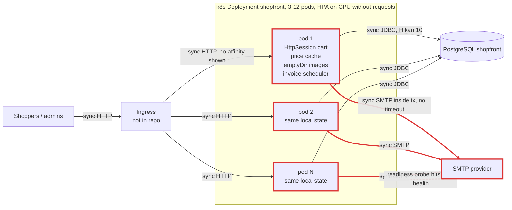
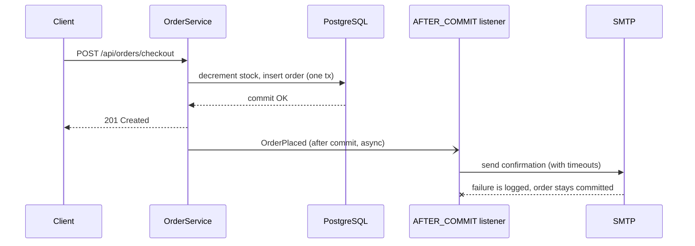
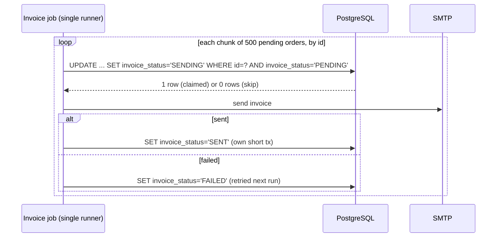

# Architecture review: Shopfront (01-monolith-unscalable)

- **Mode**: hybrid. The code was reviewed against the README's stated plan: 3 replicas, an HPA to 12, and a Black Friday peak of ~1,500 req/s.
- **Date**: 2026-10-24
- **Lenses run**: scalability, persistence, operability, data-consistency, resilience, service-boundaries. They ran as three parallel agents: data-consistency; resilience + service-boundaries; scalability + persistence + operability.
- **Lenses skipped**: messaging. There is no broker or event stream.
- **Lenses the reviewer ran directly**: none.

## Summary

Shopfront is a single Spring Boot 3.3 monolith on PostgreSQL. It runs as 3 Kubernetes replicas, with an HPA meant to scale to 12 for Black Friday. **The biggest risk is that the app is written as if there were one instance.** Carts live in each pod's memory, images on each pod's disk, prices in each pod's cache, and the invoice job runs on every pod. On top of that, stock is decremented with an unlocked read-check-write, and the manifest gives the HPA no CPU request to scale against. At the planned 20x peak, customers would lose carts, see missing images, pay prices that depend on which pod served them, and buy stock that does not exist, while the store may never scale past 3 pods. **The one change that buys the most** is making the web tier stateless: externalize the session (SC-001), move images to object storage (SC-002), and price from the DB row (SC-003), together with an atomic stock decrement (DC-001). These are all small or medium changes, and none needs a new architecture.

| Severity | Count |
|---|---|
| Critical | 7 |
| High | 6 |
| Medium | 10 |
| Low | 1 |
| Info | 0 |
| **Total** | **24** |

## Architecture profile

- **Architecture**: monolith. One Spring Boot deployable. It has feature packages (catalog, cart, order, media, billing), but nothing enforces boundaries between them: order, media and billing use other packages' repositories and entities directly.
- **Summary**: an online home-goods store. It has a product catalog and search, a session cart, and a checkout that decrements stock and emails a confirmation. It also covers order history, product image upload and download, and a monthly invoice email job.
- **Stack**: Java 17, Spring Boot 3.3.4 (web, data-jpa/Hibernate 6, mail, actuator), PostgreSQL, Maven, a Kubernetes Deployment with an HPA.
- **Deployables**: `shopfront` (`/`), the whole store. Its database is PostgreSQL `shopfront`, and it calls SMTP at `smtp.mailprovider.com:587`. There is no broker.
- **Datastores**:
  - PostgreSQL `shopfront`, used by shopfront only. The schema comes from `ddl-auto=update`, with no migrations.
  - A pod-local `emptyDir` at `/var/shopfront/uploads` for images.
  - An in-memory `HttpSession` holding the cart.
  - An in-process `ConcurrentHashMap` price cache.
- **Messaging**: none.
- **Background work**: `MonthlyInvoiceJob`, `@Scheduled(cron "0 0 2 1 * *") @Transactional`, runs on every pod. There is no ShedLock.
- **Runtime**:
  - 3 replicas, with an HPA from 3 to 12 at 70% CPU but no CPU requests.
  - A readiness probe on the aggregate `/actuator/health`. There is no liveness or startup probe, and no PDB.
  - The ingress is not in the repo.
  - Actuator exposes `health,info`. There is no metrics registry and no tracing.
  - Shutdown is immediate (the Boot 3.3 default).
- **Stated intent**: the README describes 3 replicas normally and an HPA to 12 for campaigns, with Black Friday expected at ~20x normal traffic and a peak around 1,500 req/s.
- **Derived load**:
  - Normal: ~75 req/s.
  - Peak: ~1,500 req/s, which is ~125 req/s per pod at 12 pods, or ~500 per pod if the HPA stays at 3.
  - Checkout: ~45/s at peak, each with one synchronous SMTP send.
  - Catalog list and search make up the bulk of the traffic.
- **Key flows**:
  - Checkout: client -> `CartController` (session cart) -> `OrderController.checkout` -> `OrderService.checkout`, which in one transaction loads the product, checks and decrements stock, takes the price from the local cache, saves the order and sends SMTP -> PostgreSQL and SMTP.
  - Image: upload -> pod-local file plus `Product.imageFile` -> download from any pod.
  - Invoicing: `MonthlyInvoiceJob` on every pod -> `findByInvoicedFalse` -> SMTP per order -> mark invoiced, all in one transaction.
- **Assumptions** (no one was available to ask):
  - The mode is hybrid, because the README states scale intent.
  - Ingress session affinity is unknown and assumed absent.
  - Checkout is about 3% of requests.
  - Normal load is 1,500 / 20 = ~75 req/s.
  - PostgreSQL runs with defaults (`max_connections=100`).
  - The messaging lens was skipped because there is no broker.
  - The repo has no tests, and the review changed no code.

As-is topology. Red edges and nodes are touched by critical or high findings.



## Findings

### Critical

#### DC-001 · Concurrent checkouts oversell stock, and full-row saves overwrite stock with stale values

Severity: critical · Confidence: high · Lens: data-consistency · Effort: small

**Where**: `src/main/java/com/example/shopfront/order/OrderService.java:37`, `src/main/java/com/example/shopfront/order/OrderService.java:40`, `src/main/java/com/example/shopfront/catalog/Product.java:21` (missing @Version field), `src/main/java/com/example/shopfront/catalog/ProductService.java:38`, `src/main/java/com/example/shopfront/media/ProductImageController.java:45`

**Evidence**:

```
OrderService.checkout:
  Product product = productService.get(entry.getKey());
  if (product.getStock() < quantity) { throw new OutOfStockException(product.getSku()); }
  product.setStock(product.getStock() - quantity);
  products.save(product);
Product has no @Version and no @DynamicUpdate; ProductRepository has no @Lock and no modifying query.
ProductImageController.upload: productService.get(productId) ... file.transferTo(...) ... products.save(product);
```

**What goes wrong**: On Black Friday a promoted SKU is down to stock=1. Checkouts A and B on different pods both read stock=1 under PostgreSQL's default READ COMMITTED, both pass the check, and both write stock=0. Two orders commit for one unit, and both customers get a confirmation. Separately, an admin uploads an image: the request reads stock=200, the multipart transfer takes a while, 50 checkouts take stock to 150 meanwhile, and products.save writes the whole stale row back with stock=200. That creates 50 phantom units, which are then oversold. Hibernate updates every column by default, so a checkout that overlaps a price update can also write the old price back.

**Fix** (`atomic-conditional-update`): Replace the read-check-write with one atomic conditional decrement, and treat 0 updated rows as out of stock:
  @Modifying @Query("update Product p set p.stock = p.stock - :qty where p.id = :id and p.stock >= :qty")
Decrement the cart's products in ascending id order so two carts cannot deadlock on each other's rows. Add @Version to Product so the price and image paths fail and retry instead of clobbering stock, or have them update only their own column.

```java
// ProductRepository
@Modifying
@Query("update Product p set p.stock = p.stock - :qty where p.id = :id and p.stock >= :qty")
int decrementStock(@Param("id") Long id, @Param("qty") int qty);

// OrderService.checkout, iterating cart entries sorted by product id
if (products.decrementStock(productId, qty) == 0) throw new OutOfStockException(sku);
```

**Why it's worth it here**: Stock is one hot row per SKU shared by concurrent checkouts on 3-12 replicas, and the stated ~1,500 req/s campaign peak guarantees concurrent purchases of the same SKUs.

#### DC-002 · A negative cart quantity or an unvalidated price corrupts stock and order totals

Severity: critical · Confidence: high · Lens: data-consistency · Effort: small

**Where**: `src/main/java/com/example/shopfront/cart/CartController.java:24`, `src/main/java/com/example/shopfront/cart/Cart.java:12`, `src/main/java/com/example/shopfront/order/OrderService.java:37`, `src/main/java/com/example/shopfront/catalog/ProductController.java:38`

**Evidence**:

```
public Cart add(@RequestParam Long productId, @RequestParam(defaultValue = "1") int quantity, HttpSession session)
quantities.merge(productId, quantity, Integer::sum);
if (product.getStock() < quantity) { throw ... }  product.setStock(product.getStock() - quantity);
public Product updatePrice(@PathVariable Long id, @RequestBody BigDecimal price)
```

**What goes wrong**: A client calls POST /api/cart/items?productId=7&quantity=-500 and then checks out. The check `stock < -500` is false, so stock rises by 500 (phantom inventory that is later oversold). An order line with quantity -500 is saved, the order total goes negative, and the invoice job emails 'Amount due: -4999.50'. Mixing positive and negative lines lowers a cart total to any value. A zero or negative body on PUT /api/products/{id}/price makes every later checkout charge that price.

**Fix** (`input-validation`): Validate at the boundary: @Validated on the controllers, @Positive @Max(...) on quantity, and @DecimalMin(value = "0", inclusive = false) on price. Repeat the invariant in the domain (Cart.add and OrderLine reject quantity <= 0) so every path is covered.

**Why it's worth it here**: These inputs feed stock and money directly, and the endpoints are reachable by any client (see OP-003).

#### SC-001 · Shopping cart is held in each pod's in-memory HttpSession across 3-12 replicas

Severity: critical · Confidence: high · Lens: scalability · Effort: medium

**Where**: `src/main/java/com/example/shopfront/cart/CartController.java:37`, `src/main/java/com/example/shopfront/order/OrderController.java:30`, `pom.xml` (missing spring-session dependency)

**Evidence**:

```
static Cart cartOf(HttpSession session) {
  Cart cart = (Cart) session.getAttribute(CART);
  if (cart == null) { cart = new Cart(); session.setAttribute(CART, cart); }
  return cart;
}
pom.xml: no spring-session-*; k8s: replicas: 3, HPA maxReplicas: 12
```

**What goes wrong**: A shopper adds items on pod A, so their session lives only in A's Tomcat memory. The ingress shows no affinity, so the next request lands on pod B, which sees an empty cart, and checkout throws 'Cart is empty' (a 500). Even with sticky sessions, every rolling deploy, HPA scale-in after the campaign peak, and pod reschedule wipes every cart on that pod. On Black Friday the HPA adds and removes pods repeatedly, so carts vanish mid-purchase.

**Fix** (`externalize-session`): Add spring-session-jdbc, which reuses the existing PostgreSQL so no new infrastructure is needed (its table belongs in the PS-004 migrations), or spring-session-data-redis if Redis already exists. Cart is mutated in place, so either call session.setAttribute(CART, cart) after each change or set the Spring Session save mode to ON_GET_ATTRIBUTE. Otherwise the changes are not persisted. Do not rely on ingress stickiness.

**Why it's worth it here**: The Deployment always runs at least 3 replicas, with an HPA to 12, and the cart must survive routing, deploys and scale-in.

#### SC-002 · Product images are written to a pod-local emptyDir but served by any pod

Severity: critical · Confidence: high · Lens: scalability · Effort: medium

**Where**: `src/main/java/com/example/shopfront/media/ProductImageController.java:43`, `src/main/java/com/example/shopfront/media/ProductImageController.java:51`, `k8s/deployment.yaml:31`

**Evidence**:

```
file.transferTo(new File(mediaDir, fileName));
product.setImageFile(fileName);
...
File image = new File(mediaDir, product.getImageFile());
if (!image.exists()) { return ResponseEntity.notFound().build(); }
volumes:
  - name: uploads
    emptyDir: {}
```

**What goes wrong**: An admin's upload lands on pod A, which writes the file to A's emptyDir, while the shared Product row now names that file. With 3 pods, about 2 in 3 image requests reach a pod without the file and return 404; with 12 pods it is 11 in 12. When pod A is restarted, rolled or scaled in, its emptyDir is deleted and the image is gone for good, while the DB still points at it.

**Fix** (`object-storage`): Store images in object storage (S3, GCS or MinIO) and keep only the object key on Product. Serve images through pre-signed URLs or a CDN so image bytes stop passing through app pods at peak. Copy any surviving files out of the current emptyDir volumes before switching.

**Why it's worth it here**: More than one replica serves image downloads, and uploaded images must outlive the pod that received them.

#### SC-003 · Each pod's price cache has no invalidation, so checkout charges stale prices

Severity: critical · Confidence: high · Lens: scalability · Effort: small

**Where**: `src/main/java/com/example/shopfront/catalog/ProductService.java:15`, `src/main/java/com/example/shopfront/catalog/ProductService.java:34`, `src/main/java/com/example/shopfront/catalog/ProductService.java:41`, `src/main/java/com/example/shopfront/order/OrderService.java:42`

**Evidence**:

```
private final Map<Long, BigDecimal> priceCache = new ConcurrentHashMap<>();
return priceCache.computeIfAbsent(productId, id -> get(id).getPrice());
@Transactional updatePrice: product.setPrice(newPrice); priceCache.put(productId, newPrice);
checkout: new OrderLine(order, product, quantity, productService.currentPrice(product.getId()))
```

**What goes wrong**: Marketing sets the Black Friday sale price with PUT /api/products/7/price, and the request lands on pod A, so A's cache and the DB hold the new price. Pods B and C cached the old price on earlier checkouts and never evict it. The catalog, read from the DB, shows the sale price, but a checkout on B charges and emails the old one. The amount charged depends on which pod served the request, and the mismatch lasts until that pod restarts. The cache is also written before commit, so a rolled-back price update leaves even pod A charging a price the DB does not hold. (Folds in the data-consistency pre-commit cache candidate.)

**Fix** (`drop-local-cache`): Delete the cache from the money path and price the line from product.getPrice(), the entity checkout has already loaded in the same transaction, at no extra query. If catalog reads ever need a cache, use a shared one (or a short TTL) that is evicted after commit, and never price an order from it.

**Why it's worth it here**: Prices change at runtime (campaign pricing), and several replicas serve checkout.

#### SC-004 · The monthly invoice job runs on every replica, so each customer receives one invoice per pod

Severity: critical · Confidence: high · Lens: scalability · Effort: small

**Where**: `src/main/java/com/example/shopfront/billing/MonthlyInvoiceJob.java:32`, `src/main/java/com/example/shopfront/ShopfrontApplication.java:8`

**Evidence**:

```
@EnableScheduling   // ShopfrontApplication
@Scheduled(cron = "0 0 2 1 * *")
@Transactional
public void sendInvoices() { List<CustomerOrder> pending = orders.findByInvoicedFalse(); ... }
no ShedLock / @SchedulerLock / LockProvider anywhere; replicas: 3, HPA maxReplicas: 12
```

**What goes wrong**: At 02:00 on the 1st, all 3 pods fire at once, or up to 12 if the HPA is still scaled out after a campaign. Each pod reads the same invoiced=false set in its own transaction, and none sees another's flags until commit. Every customer receives 3 to 12 identical 'Amount due' invoices every month, which leads to duplicate payments, refunds and support tickets. Scaling out for Black Friday makes the December run worse.

**Fix** (`distributed-lock`): Run the job exactly once: add ShedLock (@SchedulerLock with a JDBC LockProvider on the existing PostgreSQL), or move the job to a k8s CronJob and remove @EnableScheduling from the web pods. The lock stops duplicate runs, and DC-004 makes each run safe to repeat.

```java
@Scheduled(cron = "0 0 2 1 * *")
@SchedulerLock(name = "monthlyInvoices", lockAtMostFor = "PT6H")
public void sendInvoices() { ... }
// plus @EnableSchedulerLock(defaultLockAtMostFor = "PT6H") and a JdbcTemplateLockProvider bean
```

**Why it's worth it here**: The job has once-only side effects (customer invoices), and the Deployment never runs fewer than 3 replicas.

#### OP-001 · The CPU-utilization HPA has no CPU requests to measure against, so it cannot scale; there is also no PDB or spread

Severity: critical · Confidence: medium · Lens: operability · Effort: small

**Where**: `k8s/deployment.yaml:16` (missing resources.requests/limits, PodDisruptionBudget, topologySpreadConstraints), `k8s/deployment.yaml:46`

**Evidence**:

```
containers:
  - name: shopfront
    image: registry.example.com/shopfront:1.4.0
    (no resources: block)
HPA metrics:
  - type: Resource
    resource: { name: cpu, target: { type: Utilization, averageUtilization: 70 } }
```

**What goes wrong**: HPA Utilization is a percentage of the container's CPU request. With no request, the HPA reports FailedGetResourceMetric ('missing request for cpu') and never scales. On Black Friday the store stays at 3 pods, ~500 req/s each instead of the planned ~125, and falls over. With no memory limit, the JVM sizes its heap from node memory and risks OOM kills. With no PDB or spread, one node drain can take every replica down. Confidence is medium because the README says the HPA has scaled to 12, which implies a namespace LimitRange or a manifest that is not in the repo. Check that before trusting the 12-pod plan.

**Fix** (`resource-requests-and-disruption-budget`): Set CPU and memory requests and a memory limit from a load test, and size the heap with -XX:MaxRAMPercentage. Add a PodDisruptionBudget (minAvailable: 2) and topologySpreadConstraints across nodes and zones. Confirm with `kubectl describe hpa shopfront` that the metric resolves.

```yaml
        resources:
          requests: { cpu: "500m", memory: "768Mi" }   # size from a load test
          limits:   { memory: "768Mi" }
```

**Why it's worth it here**: The plan for the stated peak depends on a CPU-based HPA scaling from 3 to 12 pods.

### High

#### DC-003 · Checkout sends the confirmation email inside the DB transaction

Severity: high · Confidence: high · Lens: data-consistency · Effort: small

**Where**: `src/main/java/com/example/shopfront/order/OrderService.java:31`, `src/main/java/com/example/shopfront/order/OrderService.java:45`, `src/main/java/com/example/shopfront/order/OrderService.java:58`

**Evidence**:

```
@Transactional
public CustomerOrder checkout(String customerEmail, Cart cart) {
  ...
  CustomerOrder saved = orders.save(order);
  sendConfirmation(saved);   // -> mailSender.send(message);
  return saved;
}
```

**What goes wrong**: Three failure modes, one cause. (1) The provider throttles or is down at 20x traffic: mailSender.send throws a MailException (a RuntimeException), the stock decrement and order roll back, and the customer gets a 500. A nice-to-have email stops all revenue. (2) The email is sent, then the commit fails (a deadlock on the stock flush, or a dropped connection): the customer has 'We received your order #123' but order 123 does not exist. (3) Each checkout holds a Hikari connection and the stock row locks for the whole SMTP round trip (connect, EHLO, AUTH, DATA). At ~45 checkouts/s a slow provider drains the 10-connection pool, and catalog requests on the same pod queue behind it. (Folds in the resilience critical-path and scalability sync-work candidates.)

**Fix** (`after-commit-hook`): Commit the order first, then send the email after commit: publish an OrderPlaced application event and handle it with @TransactionalEventListener(phase = AFTER_COMMIT) on a bounded @Async executor that catches and logs MailException. A mail failure must never roll back an order. If a confirmation must survive a pod crash, upgrade this to a notification/outbox row written in the checkout transaction plus a scheduled relay (single-runner, see SC-004) that sends with backoff and marks it sent.

```java
// in checkout(): replace sendConfirmation(saved) with
events.publishEvent(new OrderPlaced(saved.getId(), saved.getCustomerEmail(), saved.getTotal()));

@Async("mailExecutor")   // bounded ThreadPoolTaskExecutor
@TransactionalEventListener(phase = TransactionPhase.AFTER_COMMIT)
void onOrderPlaced(OrderPlaced e) {
    try { mailSender.send(confirmation(e)); }
    catch (MailException ex) { log.warn("confirmation for order {} not sent", e.orderId(), ex); }
}
```

Fixed flow:



**Why it's worth it here**: Every checkout makes an SMTP round trip to a third party, at a projected ~45 checkouts/s peak, and the email is not needed to answer the request.

#### DC-004 · Invoice job emails every pending order inside one transaction, so any failure re-sends all invoices

Severity: high · Confidence: high · Lens: data-consistency · Effort: medium

**Where**: `src/main/java/com/example/shopfront/billing/MonthlyInvoiceJob.java:33`, `src/main/java/com/example/shopfront/billing/MonthlyInvoiceJob.java:35`, `src/main/java/com/example/shopfront/billing/MonthlyInvoiceJob.java:43`, `src/main/java/com/example/shopfront/billing/MonthlyInvoiceJob.java:44`

**Evidence**:

```
@Scheduled(cron = "0 0 2 1 * *")
@Transactional
public void sendInvoices() {
  List<CustomerOrder> pending = orders.findByInvoicedFalse();
  for (CustomerOrder order : pending) { ... mailSender.send(message); order.markInvoiced(); }
}
```

**What goes wrong**: On 1 December the batch covers all of the Black Friday orders. After 8,000 invoices have gone out, one transient SMTP error, or a pod eviction during the hours-long run, rolls back the whole transaction, and none of the 8,000 orders is marked invoiced. The next run sends those 8,000 customers a second 'Amount due' email. During the run, the job holds one DB connection and a persistence context of tens of thousands of entities on a pod with no memory limit, then flushes the invoiced flags as individual UPDATEs. It also shares the SMTP account with checkout confirmations, so a flood can trip the provider's rate limit for checkout too. (Folds in the persistence bulk-write and resilience bulkhead candidates.)

**Fix** (`atomic-conditional-update`): Drop the method-level @Transactional. Page through pending orders by id in chunks (for example 500). For each order, claim it with a conditional update in its own short transaction (`update customer_order set invoice_status = 'SENDING' where id = :id and invoice_status = 'PENDING'`, proceeding only if 1 row changed), send, then mark SENT, or FAILED for a later retry. Throttle the send rate so the batch cannot exhaust the shared SMTP quota.

Fixed flow:



**Why it's worth it here**: Invoices are money-related customer emails, the monthly batch grows with campaign volume, and a partial failure must not repeat the sends that already succeeded.

#### DC-005 · Checkout is not idempotent: a double-submit or a retry creates duplicate orders

Severity: high · Confidence: medium · Lens: data-consistency · Effort: small

**Where**: `src/main/java/com/example/shopfront/order/OrderController.java:29`, `src/main/java/com/example/shopfront/order/OrderController.java:35`

**Evidence**:

```
@PostMapping("/checkout")
public OrderSummary checkout(@RequestParam String email, HttpSession session) {
  Cart cart = (Cart) session.getAttribute("cart");
  ...
  CustomerOrder order = orderService.checkout(email, cart);
  cart.clear();
```

**What goes wrong**: Checkout is slow because it waits on SMTP (DC-003). The user double-clicks 'Place order', or the browser or ingress retries a request that looks stuck. Both requests read the same non-empty cart from the session, both run OrderService.checkout, and both commit. The result is two orders, stock decremented twice, two confirmation emails, and two invoices next month. The cart is cleared only after the whole transaction returns, so the window is the full checkout latency.

**Fix** (`idempotency-key`): Issue a checkout token when the cart is created, send it with the checkout request, and store it on CustomerOrder under a unique constraint in the same transaction. On a duplicate key, return the existing order. Moving the email after commit (DC-003) also shrinks the window.

**Why it's worth it here**: Checkout creates orders and decrements shared stock, and double-submits and retries become common when checkout latency rises under peak load.

#### RS-001 · SMTP client has no connect, read or write timeouts

Severity: high · Confidence: high · Lens: resilience · Effort: small

**Where**: `src/main/resources/application.yml:11` (missing spring.mail.properties.mail.smtp.connectiontimeout / timeout / writetimeout), `src/main/java/com/example/shopfront/order/OrderService.java:58`, `src/main/java/com/example/shopfront/billing/MonthlyInvoiceJob.java:43`

**Evidence**:

```
mail:
  host: ${SMTP_HOST:smtp.mailprovider.com}
  port: 587
  username: ${SMTP_USER}
  password: ${SMTP_PASSWORD}
(no properties block; Jakarta Mail leaves mail.smtp.connectiontimeout, mail.smtp.timeout and mail.smtp.writetimeout unset, meaning infinite)
```

**What goes wrong**: On Black Friday the mail provider stops answering on port 587 without refusing the connection. Each checkout blocks in mailSender.send() with no time limit while holding a Tomcat thread and a Hikari connection. At ~4 checkouts/s per pod, all 10 connections on a pod are taken within seconds. Catalog and cart requests then wait 30 s for a connection and fail, and the store stops responding. CPU stays idle, so the HPA adds no pods. The same hang affects the mail health check (OP-002) and can stall the invoice job indefinitely.

**Fix** (`timeouts`): Set spring.mail.properties.mail.smtp.connectiontimeout=2000, mail.smtp.timeout=5000 and mail.smtp.writetimeout=5000, or values based on the provider's p99 latency. This is the one-line stopgap before Black Friday, and it still matters after DC-003 moves the send out of the request.

```yaml
spring:
  mail:
    properties:
      mail.smtp.connectiontimeout: 2000
      mail.smtp.timeout: 5000
      mail.smtp.writetimeout: 5000
```

**Why it's worth it here**: Any synchronous SMTP send to a third party; here that is checkout at up to ~45/s plus the health check and the invoice batch.

#### OP-002 · Readiness uses the aggregate health check, which includes SMTP; there is no liveness or startup probe

Severity: high · Confidence: high · Lens: operability · Effort: small

**Where**: `k8s/deployment.yaml:23`, `src/main/resources/application.yml:21` (missing management.health.mail.enabled / probe groups)

**Evidence**:

```
readinessProbe:
  httpGet:
    path: /actuator/health
    port: 8080
spring-boot-starter-mail + actuator (Boot 3.3.4) auto-configure MailHealthIndicator (management.health.mail.enabled defaults to true), which calls JavaMailSenderImpl.testConnection() against smtp.mailprovider.com:587
```

**What goes wrong**: The mail provider has a slow minute or a short outage. On every pod, the readiness check opens an SMTP connection (with no timeout, see RS-001), exceeds the 1 s probe timeout or reports DOWN, and after 3 failures all 3 to 12 pods are NotReady together. The Service has no endpoints left, so catalog browsing, cart and history all go dark because of a dependency that only email needs. Separately, a pod whose threads are all stuck is never restarted, because there is no liveness probe. (Folds in the resilience health-routing candidate.)

**Fix** (`health-probes`): Point readiness at /actuator/health/readiness and liveness at /actuator/health/liveness, with management.endpoint.health.probes.enabled=true. Keep mail out of both groups, or set management.health.mail.enabled=false. Watch SMTP through metrics (OP-006), not routing. Add a startupProbe so the ddl-auto schema update at boot does not race the probes.

```yaml
# deployment.yaml
readinessProbe: { httpGet: { path: /actuator/health/readiness, port: 8080 } }
livenessProbe:  { httpGet: { path: /actuator/health/liveness,  port: 8080 } }
startupProbe:   { httpGet: { path: /actuator/health/liveness,  port: 8080 }, failureThreshold: 30, periodSeconds: 5 }
# application.yml
management:
  endpoint.health.probes.enabled: true
  health.mail.enabled: false
```

**Why it's worth it here**: Pods run behind a k8s Service, and a non-critical third-party dependency sits in the default health composite.

#### OP-003 · No auth boundary: price changes, image uploads and order history are open to anyone

Severity: high · Confidence: medium · Lens: operability · Effort: medium

**Where**: `src/main/java/com/example/shopfront/catalog/ProductController.java:37`, `src/main/java/com/example/shopfront/media/ProductImageController.java:39`, `src/main/java/com/example/shopfront/order/OrderController.java:39`, `pom.xml` (missing spring-boot-starter-security)

**Evidence**:

```
@PutMapping("/{id}/price") public Product updatePrice(@PathVariable Long id, @RequestBody BigDecimal price)
@PostMapping public Product upload(@PathVariable Long productId, @RequestParam("file") MultipartFile file)
@GetMapping public List<OrderSummary> history(@RequestParam String email)
(no security dependency or filter anywhere)
```

**What goes wrong**: Anyone who can reach the store can PUT a price of 0.01 on any product and then buy it at that price, replace product images, or read any customer's order history by guessing their email address. Graded high rather than critical because an ingress that is not in the repo might enforce auth; the application itself enforces none.

**Fix** (`api-gateway`): Put the admin operations (price, image upload) behind an authenticated admin role, either with Spring Security or on an admin surface not exposed through the public ingress. Tie order history to an authenticated customer instead of a free email parameter. Commission a dedicated security review.

**Why it's worth it here**: A public storefront exposes admin mutations and personal data on the same API.

### Medium

#### SC-005 · Catalog list returns the whole product table, uncached, on the hottest path

Severity: medium · Confidence: medium · Lens: scalability · Effort: medium

**Where**: `src/main/java/com/example/shopfront/catalog/ProductController.java:25`, `src/main/java/com/example/shopfront/catalog/ProductService.java:22`, `src/main/java/com/example/shopfront/catalog/ProductRepository.java:9`

**Evidence**:

```
public List<Product> list(@RequestParam(required = false) String q) { ... return productService.listAll(); }
return products.findAll();
List<Product> findByNameContainingIgnoreCase(String query);   // unpaged, leading-wildcard LIKE
```

**What goes wrong**: Catalog list and search make up most of the ~1,500 req/s peak. Every list call reads every product row, descriptions included, from the single PostgreSQL primary, and serializes it to JSON while holding a pooled connection (Open Session in View, see PS-002). Search runs `lower(name) like '%q%'` as a sequential scan at the same rate. Response size and DB CPU grow with the assortment. With a catalog of a few thousand products this saturates the DB before the 12-pod ceiling helps. Graded medium because the catalog size is not known.

**Fix** (`pagination`): Page list and search (Pageable with a capped size) and return a slim DTO without descriptions. The catalog changes rarely, so add Cache-Control/ETag on list and get and let the ingress or a CDN absorb repeat reads. Index search per PS-003. Consider a read replica only if DB read load remains after that.

**Why it's worth it here**: Catalog browsing is the bulk of a stated ~1,500 req/s peak, served from one DB primary.

#### SC-006 · No load shedding: requests queue on pool waits instead of failing fast

Severity: medium · Confidence: medium · Lens: scalability · Effort: medium

**Where**: `src/main/resources/application.yml:4` (missing hikari connection-timeout / server.tomcat limits / rate limiting)

**Evidence**:

```
No rate limiter anywhere; Tomcat defaults (200 threads, accept-count 100); Hikari defaults (10 connections, connectionTimeout 30 s); readinessProbe on /actuator/health, whose db indicator also needs a pool connection
```

**What goes wrong**: In a campaign spike, concurrency outgrows the 10-connection pool. Up to 200 threads park for up to 30 s each, and clients time out. The readiness db check waits on the same pool, misses its 1 s timeout, and k8s pulls the pod, which pushes its traffic onto pods that are in the same state. One overload turns into a rolling, cluster-wide outage instead of some requests failing fast with 503.

**Fix** (`rate-limiting`): Set spring.datasource.hikari.connection-timeout to 1-2 s. Cap server.tomcat.threads.max and accept-count to what the pool can serve. Add per-endpoint rate limits at the ingress (or Bucket4j) for search and checkout. Fix OP-002 so readiness does not amplify the overload.

**Why it's worth it here**: Public endpoints face a planned 20x burst, and every request needs one of 10 pooled connections.

#### PS-001 · Default Hikari pool times the HPA maximum can exceed PostgreSQL's connection limit

Severity: medium · Confidence: medium · Lens: persistence · Effort: small

**Where**: `src/main/resources/application.yml:4` (missing spring.datasource.hikari settings), `k8s/deployment.yaml:44`

**Evidence**:

```
No spring.datasource.hikari.*: maximumPoolSize=10, minimumIdle=10 (eager), connectionTimeout=30 s.
HPA maxReplicas: 12  -> 120 connections; PostgreSQL default max_connections=100. No PgBouncer in the repo.
```

**What goes wrong**: Black Friday pushes the HPA past about 9 pods. Each new pod's pool tries to open 10 connections, PostgreSQL answers 'too many clients already', and the new pods fail startup or readiness. Real capacity stops at about 9 pods while the plan counts on 12. Graded medium, not high, because it depends on the DB's max_connections, which is not in the repo.

**Fix** (`connection-pool-sizing`): Size the pool from the connection budget: (max_connections - reserved - admin headroom) / maxReplicas. Set maximum-pool-size explicitly and minimum-idle lower, or raise max_connections, or put PgBouncer in transaction mode in front. DC-003 and PS-002 shorten connection hold times, which lets a smaller pool serve the same load.

**Why it's worth it here**: An HPA of up to 12 replicas shares one PostgreSQL instance.

#### PS-002 · Order history is an N+1 query that only works because Open Session in View is left on

Severity: medium · Confidence: high · Lens: persistence · Effort: small

**Where**: `src/main/java/com/example/shopfront/order/OrderController.java:50`, `src/main/java/com/example/shopfront/order/OrderRepository.java:9`, `src/main/java/com/example/shopfront/order/CustomerOrder.java:36`, `src/main/resources/application.yml:8` (missing spring.jpa.open-in-view: false)

**Evidence**:

```
List<LineSummary> lines = order.getLines().stream()
    .map(l -> new LineSummary(l.getProduct().getSku(), l.getProduct().getName(), ...))
@OneToMany(mappedBy = "order", cascade = CascadeType.ALL) private List<OrderLine> lines;   // lazy
@ManyToOne(fetch = FetchType.LAZY) private Product product;
spring.jpa.open-in-view unset -> Boot 3.3.4 default true
```

**What goes wrong**: For a customer with 40 orders over 15 distinct products, one history call runs 1 + 40 + 15 queries, and without an index on order_line.order_id (PS-003) each lines query scans the growing table. These lazy loads happen during JSON rendering, outside the service method, through OSIV, which holds the request's connection until the response is written. That applies to every JPA-touching request, including the full catalog list, so it makes the pool exhaustion in DC-003 and PS-001 happen sooner. (Folds in the separate OSIV candidate.)

**Fix** (`fetch-join`): Fetch history in one query with paging (`join fetch o.lines l join fetch l.product`, or a DTO projection), or set hibernate.default_batch_fetch_size=50 as a quick win. Then set spring.jpa.open-in-view=false. Do it in that order, or OrderSummary.of throws LazyInitializationException.

**Why it's worth it here**: Order history is a list over a per-customer collection that grows with every purchase, served from a small pool.

#### PS-003 · No indexes on order lookup columns or foreign keys, product search cannot use an index, and SKU is not unique

Severity: medium · Confidence: high · Lens: persistence · Effort: small

**Where**: `src/main/java/com/example/shopfront/order/CustomerOrder.java:28`, `src/main/java/com/example/shopfront/order/OrderLine.java:20`, `src/main/java/com/example/shopfront/catalog/ProductRepository.java:9`, `src/main/java/com/example/shopfront/catalog/Product.java:17`

**Evidence**:

```
findByCustomerEmailOrderByPlacedAtDesc(String customerEmail);   // no index on customer_email
findByInvoicedFalse();   // no index on invoiced
@ManyToOne(fetch = FetchType.LAZY) private CustomerOrder order;   // PostgreSQL does not index FKs
findByNameContainingIgnoreCase(String query);   // lower(name) like '%q%'
private String sku;   // no unique constraint; no @Table(indexes=...) anywhere
```

**What goes wrong**: Every history request scans customer_order and order_line sequentially, and both tables grow with every checkout, sharply after Black Friday. Search scans the product table on every call at peak rate. Two products can be created with the same SKU, and OrderSummary then reports an ambiguous SKU.

**Fix** (`add-index`): In versioned migrations (PS-004), add indexes on customer_order(customer_email, placed_at desc), customer_order(id) where invoiced = false, order_line(order_id) and order_line(product_id), a pg_trgm GIN index on lower(product.name), and a unique constraint on product.sku.

**Why it's worth it here**: The order tables grow with every checkout, and search sits on the high-traffic catalog path.

#### PS-004 · Schema is managed by ddl-auto=update on every starting pod, with no versioned migrations

Severity: medium · Confidence: high · Lens: persistence · Effort: medium

**Where**: `src/main/resources/application.yml:10`, `pom.xml` (missing flyway-core / liquibase)

**Evidence**:

```
jpa:
  hibernate:
    ddl-auto: update
(no Flyway or Liquibase dependency, no migration scripts)
```

**What goes wrong**: A release renames imageFile to imageKey. Every new pod runs the schema update at startup, and HPA scale-out starts several at once. 'update' adds the new column and keeps the old one, but moves no data, so images vanish on new pods while old pods keep writing the old column during the rollout. Concurrent ALTERs from starting pods can block behind live traffic. None of the indexes, constraints, session table or version column these findings need can be expressed, reviewed or rolled back.

**Fix** (`versioned-migrations`): Adopt Flyway with a baseline of the current schema and set ddl-auto=validate. Write expand/contract migrations so old and new pods can run side by side during a rolling deploy. Flyway's lock table keeps concurrent pod starts safe.

**Why it's worth it here**: A production store with rolling deploys, 3-12 pods starting concurrently, and schema changes needed by SC-001, DC-001, DC-005 and PS-003.

#### OP-004 · No graceful shutdown while the HPA scales pods in and out

Severity: medium · Confidence: high · Lens: operability · Effort: small

**Where**: `src/main/resources/application.yml:1` (missing server.shutdown: graceful), `k8s/deployment.yaml:16` (missing lifecycle.preStop and terminationGracePeriodSeconds)

**Evidence**:

```
Spring Boot 3.3.4 defaults server.shutdown to immediate (graceful became the default in 3.4); the container has no preStop hook; terminationGracePeriodSeconds is the default 30
```

**What goes wrong**: As Black Friday traffic falls, the HPA removes pods, and every deploy replaces them all. On SIGTERM, Tomcat stops at once. In-flight checkouts are cut mid-transaction, some after the confirmation email has already gone out, and requests still routed during endpoint propagation get connection resets. Customers see sporadic 502s at the busiest time of the year.

**Fix** (`graceful-shutdown`): Set server.shutdown=graceful and spring.lifecycle.timeout-per-shutdown-phase=20s. Add a preStop sleep of 5-10 s so the pod leaves the Service endpoints before draining, and keep terminationGracePeriodSeconds above the sleep plus the drain.

```yaml
server:
  shutdown: graceful
spring:
  lifecycle:
    timeout-per-shutdown-phase: 20s
```

**Why it's worth it here**: HPA scale-in and rolling deploys happen during live traffic.

#### OP-005 · A DB password fallback is committed in source, and the manifest injects no secrets

Severity: medium · Confidence: medium · Lens: operability · Effort: small

**Where**: `src/main/resources/application.yml:7`, `k8s/deployment.yaml:20`

**Evidence**:

```
username: ${DB_USER:shop}
password: ${DB_PASSWORD:shop}
username: ${SMTP_USER}
password: ${SMTP_PASSWORD}
env:
  - name: DB_HOST
    value: shopfront-db   # the only env var; no secretKeyRef or envFrom
```

**What goes wrong**: As committed, the manifest makes production use the credential shop/shop that sits in the repo. The SMTP credentials reach the pod by no mechanism the repo shows. So either the manifest that actually runs lives outside the repo, and the reviewed k8s config is not the truth (drift), or every SMTP login fails, which with the current code fails checkout (DC-003) and readiness (OP-002).

**Fix** (`secrets-manager`): Remove the credential defaults from application.yml. Inject DB_USER, DB_PASSWORD, SMTP_USER and SMTP_PASSWORD from a k8s Secret or an external secrets manager via secretKeyRef, and fail fast at startup when they are missing. Keep the manifest in the repo as the source of truth.

**Why it's worth it here**: Production credentials, and a repo manifest the team relies on for Black Friday scaling decisions.

#### OP-006 · No metrics registry or alerts ahead of a 20x traffic event

Severity: medium · Confidence: high · Lens: operability · Effort: small

**Where**: `pom.xml` (missing micrometer-registry-prometheus), `src/main/resources/application.yml:25`

**Evidence**:

```
management.endpoints.web.exposure.include: health,info
(no Micrometer registry dependency, no alerting config in the repo)
```

**What goes wrong**: On Black Friday, checkout latency climbs while SMTP slows, the pool saturates and new pods are refused DB connections. Nobody can see pending connections, busy threads, p99 latency, error rate or orders per minute, so the team learns about the outage from customers and cannot tell which resource is the bottleneck. A pre-event load test would produce no usable data either.

**Fix** (`metrics-and-alerts`): Add micrometer-registry-prometheus and expose the prometheus endpoint. Alert on RED metrics for checkout, catalog and search, on hikaricp_connections_pending, Tomcat busy threads, JVM heap, SMTP send latency and failures, and orders per minute. Load-test at 1,500 req/s with these dashboards before the event.

**Why it's worth it here**: A production store preparing for a stated 20x peak.

#### SB-001 · Feature packages reach into each other's repositories and entities, and controllers expose JPA entities

Severity: medium · Confidence: high · Lens: service-boundaries · Effort: medium

**Where**: `src/main/java/com/example/shopfront/order/OrderService.java:40`, `src/main/java/com/example/shopfront/media/ProductImageController.java:45`, `src/main/java/com/example/shopfront/billing/MonthlyInvoiceJob.java:21`, `src/main/java/com/example/shopfront/order/OrderLine.java:24`, `src/main/java/com/example/shopfront/catalog/ProductController.java:25`

**Evidence**:

```
OrderService (order): private final ProductRepository products; ... product.setStock(product.getStock() - quantity); products.save(product);
ProductImageController (media): product.setImageFile(fileName); return products.save(product);
MonthlyInvoiceJob (billing): private final OrderRepository orders; ... order.markInvoiced();
ProductController: public List<Product> list(...)   // returns the @Entity, including stock and imageFile
```

**What goes wrong**: The stock rule lives in the order package and works on catalog's entity, while media saves whole Product rows on its own. That combination is what makes the DC-001 lost update possible. Fixing stock handling before Black Friday means editing order, media and catalog together, and a caller that gets missed keeps bypassing the rule. Adding or renaming a Product column silently changes the public /api/products JSON, which already leaks stock levels and internal file names.

**Fix** (`modular-monolith`): Keep one deployable; do not split into services. Make it a modular monolith: catalog exposes a small API (decrementStock(productId, qty) as the DC-001 conditional update, attachImage, priceOf) and keeps its repository package-private; billing calls an order-module API. Return DTOs from the controllers. Enforce the boundaries with Spring Modulith or ArchUnit tests.

**Why it's worth it here**: One deployable with five business packages, where the stock and order invariants are written from several packages.

### Low

#### OP-007 · No correlation id in logs

Severity: low · Confidence: high · Lens: operability · Effort: small

**Where**: `src/main/resources/application.yml:1` (missing logging pattern / tracing), `pom.xml` (missing micrometer-tracing)

**Evidence**:

```
No Micrometer Tracing or OpenTelemetry, no MDC filter, no custom log pattern; the only log line is log.info("Sending {} invoices", pending.size());
```

**What goes wrong**: A customer reports a failed checkout on Black Friday. Across 12 pods, nothing ties their request to the SMTP or DB error in the logs, so diagnosis means grepping by timestamp.

**Fix** (`correlation-id`): Add micrometer-tracing (bridge only, no exporter needed), or a servlet filter that puts a request id in MDC. Include the id in the log pattern and return it in a response header.

**Why it's worth it here**: One deployable spread across up to 12 pods.

## Roadmap

### Now: critical and high findings with small or medium effort

Every critical and high finding is small or medium effort, so all of them land here. PS-004 is medium severity, but it goes first because several of these fixes need a reviewed schema change: the session table, `@Version`, the checkout token's unique key, and the invoice status column.

1. **PS-004**: adopt Flyway with a baseline and set `ddl-auto=validate`. This unblocks SC-001, DC-001, DC-004 and DC-005 (and PS-003 later).
2. **OP-001**: add CPU and memory requests, a PDB and a spread, and confirm the HPA metric resolves. Every scale-dependent fix below relies on it.
3. **DC-001**: make the stock decrement an atomic conditional update and add `@Version` to Product.
4. **DC-002**: validate cart quantity and price at the controller and in the domain.
5. **SC-001**: move the session to Spring Session JDBC on the existing PostgreSQL.
6. **SC-002**: move images to object storage behind a CDN.
7. **SC-003**: delete the price cache and price lines from `product.getPrice()`.
8. **SC-004**: add ShedLock to the invoice job, or move it to a CronJob. This makes DC-004's single-runner relay safe.
9. **RS-001**: set SMTP connect, read and write timeouts. This is the stopgap that makes DC-003 and OP-002 less dangerous until they land.
10. **DC-003**: send the confirmation after commit, so a mail failure no longer rolls back the order. This unblocks DC-005, because it shrinks the double-submit window.
11. **OP-002**: point the probes at the readiness and liveness groups, without mail.
12. **DC-004**: claim and send invoices per order in chunks, with a throttle.
13. **DC-005**: add a checkout idempotency token with a unique constraint.
14. **OP-003**: put an auth boundary on price changes, uploads and history, and commission a security review.

### Next

There are no remaining critical or high findings, and no medium finding blocks one of them beyond PS-004, which is already first in Now.

### Later

1. **PS-001**: size the Hikari pool against `max_connections` / PgBouncer before letting the HPA reach 12. Do this right after OP-001 confirms the HPA scales.
2. **OP-006**: add a metrics registry, dashboards and alerts, and load-test at 1,500 req/s. This tells you whether SC-005 and SC-006 are needed at your catalog size.
3. **PS-003**: add the order, foreign-key and trigram search indexes and the unique SKU constraint (needs PS-004).
4. **PS-002**: fetch-join or project order history, then disable OSIV.
5. **SC-005**: page and HTTP-cache the catalog list and search.
6. **SC-006**: set a short Hikari connection timeout, Tomcat limits and ingress rate limits.
7. **OP-004**: set graceful shutdown and a preStop sleep.
8. **OP-005**: move credentials to Secrets and make the repo manifest the source of truth.
9. **SB-001**: give catalog and order module APIs and enforce them with Spring Modulith or ArchUnit. This makes DC-001 hard to regress.
10. **OP-007**: add a correlation id to the logs.

## What's already sound

- One deployable is the right shape for ~1,500 req/s and one team; nothing here justifies splitting into microservices.
- One PostgreSQL database is owned by one application. The stock decrement and the order insert share a local ACID transaction, so no saga or distributed transaction is needed.
- Money is held as BigDecimal, and each OrderLine stores unitPrice at purchase time, so later price changes do not rewrite order history.
- Packages are organized by business feature (catalog, cart, order, media, billing), which gives SB-001 a ready starting point for module boundaries.
- There are no client-side retries, no 2PC/XA, and no hidden async executors, so there is no retry stacking or unbounded queueing to unwind.
- Actuator web exposure is limited to health and info, and a readiness probe and an HPA already exist, so the fixes are configuration, not new infrastructure.

Do not "fix" these by introducing a broker, a saga, or a service split. The findings above are all solvable inside the monolith.

## Not reviewed

- **Security in depth**: authentication, authorization, upload validation and path handling for `getOriginalFilename()`, and PII exposure. OP-003 only notes that there is no auth boundary. Run a dedicated security review.
- **Infrastructure outside the repo**: the ingress (affinity, rate limits, TLS), the PostgreSQL configuration (`max_connections`, sizing, backups, HA), any namespace LimitRange, and how secrets actually reach production.
- **Front end and clients**: not in the repo.
- **Payment**: the code has no payment step. Checkout only records an order, and invoices are emailed. If a payment provider is added, review that flow (remote call in a transaction, idempotency) separately.
- **Runtime behaviour**: no load test, profiling or build was run. There are no tests in the repo.

### Candidates merged or dropped during verification

- The resilience "checkout fails when email fails" and scalability "synchronous SMTP on the request path" candidates were merged into **DC-003**. They share one root cause, a remote call inside the transaction, which data-consistency owns.
- The data-consistency "price cache written before commit" candidate was merged into **SC-003**.
- The resilience "readiness includes the mail health indicator" candidate was merged into **OP-002**.
- The persistence "invoice job writes row by row" and resilience "bulkhead between invoice and checkout mail" candidates were merged into **DC-004**.
- The persistence OSIV candidate was merged into **PS-002**, because the fix order is coupled.
- The resilience "no circuit breaker on SMTP" candidate was **dropped** as disproportionate. Once DC-003 moves the email after commit and RS-001 adds timeouts, a breaker at ~45 sends/s buys little.
- Regraded during verification:
  - PS-001 from high to medium, because it depends on a DB setting that is not in the repo.
  - SC-005 from high to medium, because the catalog size is unknown.
  - OP-005 from high to medium.
  - OP-001 kept at critical, with confidence lowered to medium, because the README's claim that the HPA scales suggests a LimitRange outside the repo.
