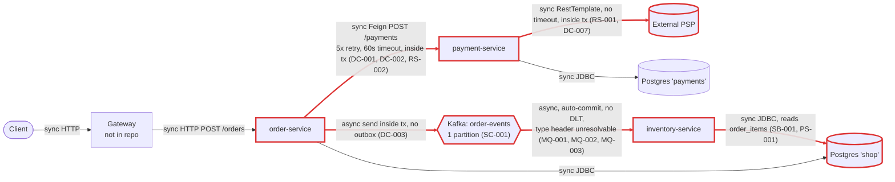
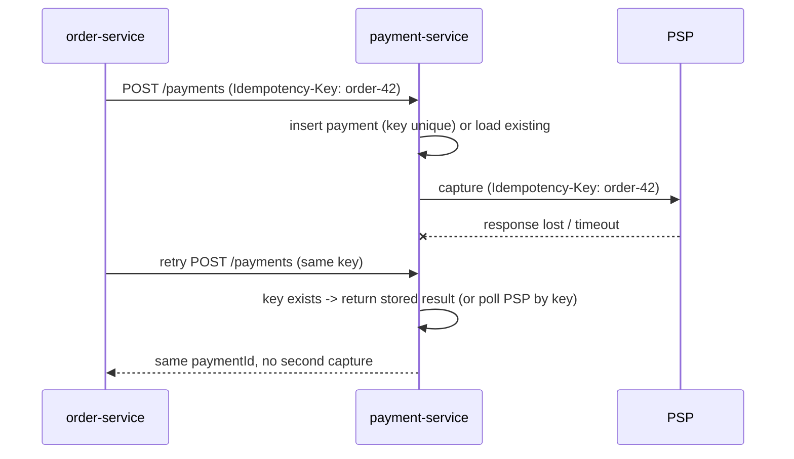
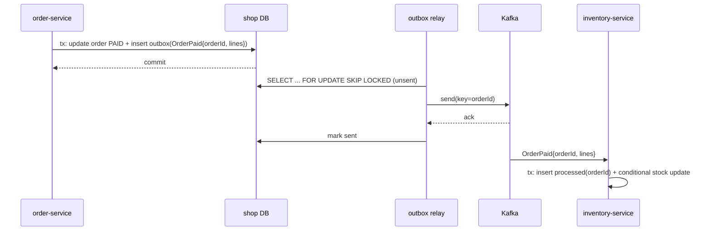
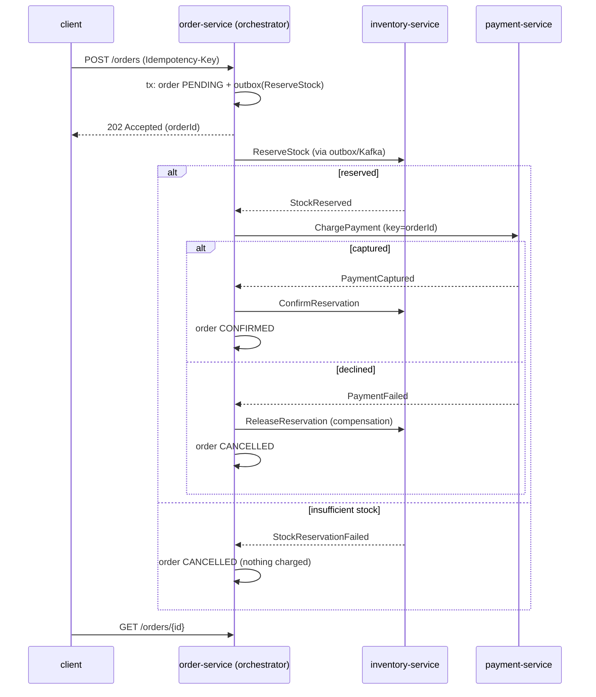
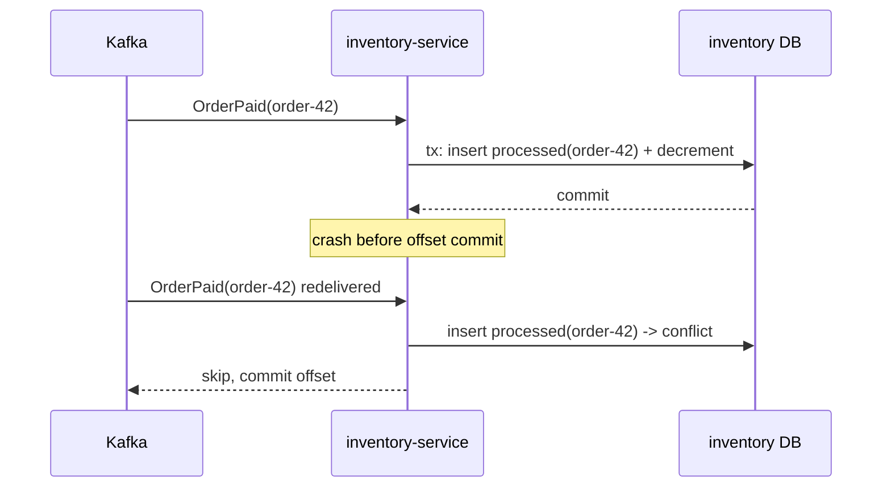

# Architecture review: order platform (02-microservices-distributed-tx)

- **Mode**: hybrid. The code was reviewed against the intent stated in the README (independent team deploys, 2 replicas per service on k8s, about 300 orders/min peak, tripling next year).
- **Date**: 2026-10-24
- **Lenses run**: scalability, persistence, operability, data-consistency, resilience, service-boundaries, messaging. None skipped: the system has datastores, a broker, network calls and three deployables.
- **How**: small codebase (37 files), so three parallel lens agents ran: data-consistency + messaging, resilience + service-boundaries, and scalability + persistence + operability. The parent re-read the evidence for every critical and high finding and merged 32 candidates into 28 findings. No lens was run by the parent.

## Summary

Three Spring Boot services (order, payment, inventory), owned by three teams, run checkout as one synchronous chain. order-service holds a database transaction open while it calls payment-service, which holds its own transaction open while it calls the external PSP. The order service then publishes a Kafka event that inventory-service uses to decrement stock. The biggest risk is money and stock going inconsistent in ordinary conditions. A global Feign retry replays the non-idempotent charge up to 5 times (DC-001). Rollbacks after a successful capture leave charges with no order or payment record (DC-002, DC-007). There is no compensation when stock runs out after payment (DC-004). The client sets its own unit price (DC-006). The Kafka path does not work at all today: the producer's class-name type header cannot be resolved by the consumer, so no paid order ever decrements stock (MQ-001). That failure hides further consumer bugs that will appear once it is fixed. The one change that buys the most: make the payment call idempotent and take it out of both DB transactions (stop the retries, add an Idempotency-Key, commit PENDING first). That closes double charges and orphan charges in one move, and it is the first step of the saga that fixes the rest.

| Severity | Count |
|---|---|
| Critical | 7 |
| High | 10 |
| Medium | 9 |
| Low | 2 |
| Info | 0 |
| **Total** | **28** |

## Architecture profile

```
architecture: microservices, three independently deployed services owned by three teams, talking over HTTP (Feign) and Kafka; order and inventory share one database
summary: Order platform of three Spring Boot services owned by three teams. order-service accepts an order and charges it synchronously through payment-service (which calls an external PSP), then publishes an OrderPaidEvent to Kafka. inventory-service consumes that event and decrements stock, reading order lines straight from order-service's table in a shared Postgres database.
stack: Java 17, Spring Boot 3.3.4, Spring Cloud 2023.0.3 (OpenFeign), spring-kafka 3.2.x (Boot-managed), Spring Data JPA / Hibernate, PostgreSQL 16, Kafka 3.7 (KRaft), Maven, Docker
deployables:
  - order-service (order-service/): POST /orders, GET /orders/{id}; db=shop (orders, order_items); calls payment-service via Feign with Retryer.Default(100,1000,5); publishes order-events
  - payment-service (payment-service/): POST /payments; db=payments (payment); calls the PSP /v1/captures via a plain RestTemplate
  - inventory-service (inventory-service/): consumes order-events and decrements stock_items; db=shop, also reads order-service's order_items table
datastores: postgres: shop (used by order-service and inventory-service; SHARED, inventory maps order-service's order_items); postgres: payments (used by payment-service)
messaging: Kafka topic order-events (auto-created, partitions undeclared): producer order-service, consumer group inventory-service (auto-commit, concurrency 3)
background work: inventory-service Kafka listener on order-events (concurrency 3 per pod); no schedulers or @Async anywhere
runtime: README: 2 replicas per service on k8s behind a gateway. Repo has no manifests, probe config, graceful-shutdown config, tracing or metrics registry. Actuator is on the classpath in all three services.
stated intent: README: each team deploys on its own schedule; production runs 2 replicas of each service on k8s behind 'our gateway'; peak about 300 orders per minute, expected to triple next year.
assumptions:
  - Mode is hybrid: code plus intent stated in the README.
  - No k8s manifests, gateway or network-policy config are in the repo, so runtime facts (replicas, gateway) come from the README only and infra-dependent findings are graded one level down.
  - The order-events topic is auto-created with the broker default of 1 partition, since nothing declares it.
  - Gateway and client retry policies are unknown; nothing in the repo shows them.
  - Production uses one Postgres instance for both databases, as docker-compose does; not confirmed.
  - Nobody was available to answer questions, so every gap above was filled with the most reasonable reading of the repo.
derived load:
  - placeOrder: about 5 orders/s at peak today, about 15 orders/s next year (2.5 to 7.5 per order-service replica).
  - Each order costs 1 Feign call, 1 PSP capture, 1 Kafka event and 1 + N stock-row reads and updates.
  - order_items grows by several hundred thousand rows per day at peak rates.
key flows:
  - place order: client -> gateway -> order-service (@Transactional: insert order -> Feign POST /payments -> payment-service @Transactional: insert payment -> PSP capture) -> mark PAID -> kafka send (inside tx) -> commit -> 201
  - stock decrement: order-events -> inventory-service listener (@Transactional: read order_items from shared shop DB -> per line read stock, check, write available - qty); insufficient stock throws with no compensation
```

Current shape. Edges are marked sync or async, and red marks the nodes and edges that findings touch.



## Findings

### Critical

#### MQ-001 · Producer type header names a class inventory-service does not have, so every OrderPaidEvent fails to deserialize

Severity: **critical** · Confidence: high · Lens: messaging · Effort: small

**Where**: `order-service/src/main/resources/application.yml:16`; `inventory-service/src/main/resources/application.yml:19`; `inventory-service/src/main/resources/application.yml:22`; `order-service/src/main/java/com/example/platform/order/events/OrderPaidEvent.java:1`; `inventory-service/src/main/java/com/example/platform/inventory/messaging/OrderPaidEvent.java:1`

**Evidence**:

```
order-service: value-serializer: org.springframework.kafka.support.serializer.JsonSerializer (spring.json.add.type.headers not set, so it defaults to true) on record com.example.platform.order.events.OrderPaidEvent.
inventory-service: value-deserializer: org.springframework.kafka.support.serializer.JsonDeserializer
  spring.json.value.default.type: com.example.platform.inventory.messaging.OrderPaidEvent
(no spring.json.use.type.headers: false, no spring.json.type.mapping)
```

**What goes wrong**: JsonSerializer writes __TypeId__=com.example.platform.order.events.OrderPaidEvent on every record. JsonDeserializer gives the type header precedence when one is present, and uses value.default.type only when there is none. It tries to load the order-service class, which is not on inventory-service's classpath, and fails with 'Class not found'. The deserializer is not wrapped in ErrorHandlingDeserializer, so the failure happens inside poll(), before the listener and outside any DLT path. No paid order ever decrements stock, under normal load, from the first event onward. Any rename of the record or its package on either side has the same effect, because the two teams deploy independently. This failure also hides the consumer bugs in DC-003, DC-005 and DC-008, which will appear as soon as it is fixed.

**Fix** (`event-versioning`): Stop using Java class names as the event contract. Set spring.json.add.type.headers: false on the producer, or map a logical id on both sides (spring.json.type.mapping: orderPaid:<class>). On the consumer, set spring.json.use.type.headers: false (or the matching mapping) and wrap the value deserializer in ErrorHandlingDeserializer. Add eventType and schemaVersion fields with tolerant readers. Add a contract test that round-trips the producer payload through the consumer configuration.

Sketch (consumer side, inventory-service `application.yml`):

```yaml
spring:
  kafka:
    consumer:
      value-deserializer: org.springframework.kafka.support.serializer.ErrorHandlingDeserializer
      properties:
        spring.deserializer.value.delegate.class: org.springframework.kafka.support.serializer.JsonDeserializer
        spring.json.use.type.headers: false
        spring.json.value.default.type: com.example.platform.inventory.messaging.OrderPaidEvent
```
On the producer, set `spring.json.add.type.headers: false` and add `eventType` and `schemaVersion` to the payload.

**Why it's worth it here**: Producer and consumer use different packages in different codebases and are deployed by different teams on their own schedules (README).

#### DC-001 · Feign retries the non-idempotent POST /payments up to 5 times, so one order can be charged several times

Severity: **critical** · Confidence: high · Lens: data-consistency · Effort: medium

**Where**: `order-service/src/main/java/com/example/platform/order/config/FeignConfig.java:13`; `order-service/src/main/java/com/example/platform/order/OrderServiceApplication.java:9`; `order-service/src/main/java/com/example/platform/order/client/PaymentClient.java:13`; `payment-service/src/main/java/com/example/platform/payment/service/PaymentService.java:24`; `payment-service/src/main/java/com/example/platform/payment/psp/PspClient.java:34`

**Evidence**:

```
// FeignConfig, applied to every client via @EnableFeignClients(defaultConfiguration = FeignConfig.class)
/** Payment-service is occasionally slow under load; retry so checkout doesn't fail on a blip. */
return new Retryer.Default(100, 1000, 5);

// PaymentService.charge
Payment payment = payments.save(new Payment(orderId, customerId, amount)); // new random UUID each call
PspClient.CaptureResponse response = psp.capture(customerId, amount);      // no idempotency key
```

**What goes wrong**: payment-service is slow, which the FeignConfig comment says happens under load, or its PSP call hangs (RS-001). Feign's 60 s read timeout fires. Feign wraps the SocketTimeoutException in a RetryableException and resends POST /payments, whatever the HTTP method. payment-service treats each attempt as new: it inserts a new Payment row and calls PSP /v1/captures again, while the first attempt is still running and can still capture. The customer is charged up to 5 times for one order. A connection reset during a payment-service rolling deploy (OP-001) triggers the same replay on the other replica. If the last attempt also fails, order-service rolls back (DC-002) and the customer has several charges for an order that does not exist.

**Fix** (`idempotency-key`): Make the charge idempotent end to end. order-service sends a stable Idempotency-Key (the orderId, or an order UUID). payment-service puts a unique constraint on it and, on a repeat, returns the existing payment's result instead of capturing again. It forwards the same key to the PSP's idempotency header. Until that ships, use Retryer.NEVER_RETRY for PaymentClient. Afterwards, keep retries at a single layer, with jittered backoff and a cap of 2 to 3, and confirm the gateway does not also retry POSTs.

Sketch (payment-service):

```java
@Transactional
public Payment begin(Long orderId, String idempotencyKey, ...) {
    return payments.findByIdempotencyKey(idempotencyKey)          // unique constraint
        .orElseGet(() -> payments.save(new Payment(orderId, idempotencyKey, ...)));
}
// then, outside the tx: psp.capture(..., idempotencyKey) -> record result in a second short tx
```



**Why it's worth it here**: A retry is configured on a call that moves money, the callee is slow under load and is redeployed by another team on its own schedule, and nothing dedupes the request.

#### DC-002 · Order transaction spans the remote payment call: a rollback after a successful charge leaves a charge with no order

Severity: **critical** · Confidence: high · Lens: data-consistency · Effort: medium

**Where**: `order-service/src/main/java/com/example/platform/order/service/OrderService.java:38`; `order-service/src/main/java/com/example/platform/order/service/OrderService.java:44`; `order-service/src/main/java/com/example/platform/order/service/OrderService.java:53`

**Evidence**:

```
@Transactional
public Order placeOrder(String customerId, List<Line> lines) {
    ...
    orders.save(order);
    ChargeResponse payment = takePayment(order);   // -> paymentClient.charge(...) (@FeignClient)
    order.markPaid(payment.paymentId());
    kafkaTemplate.send(ORDER_EVENTS, ...);
    ...
}
```

**What goes wrong**: The order and its items are inserted inside an open transaction. The Feign call reaches payment-service, which captures at the PSP and commits its Payment row. Then the response is lost (read timeout, connection reset), or something later in placeOrder fails (the Kafka send, the commit, a SIGTERM). The order transaction rolls back, so the orders and order_items rows disappear and the client gets a 5xx. The PSP charge and the payment row survive, pointing at an orderId that no longer exists, and nothing reconciles them. Meanwhile every in-flight order holds a shop-DB connection for the full payment latency, up to about 5 minutes with RS-002's defaults, so a slow payment-service exhausts order-service's 10-connection pool and GET /orders fails too.

**Fix** (`move-call-outside-transaction`): Split the flow. Transaction 1 commits the order as PENDING. The payment call happens outside any transaction, with the idempotency key from DC-001. Transaction 2 marks the order PAID and writes the outbox row (DC-003). When payment fails or its result is unknown, leave the order PENDING or PAYMENT_UNKNOWN and resolve it by querying payment-service by orderId. Never delete the order. This becomes the first step of the saga in DC-004.

Sketch:

```java
public OrderView placeOrder(...) {
    Order order = tx.execute(s -> orders.save(Order.pending(...)));          // tx 1, commits
    ChargeResponse r = paymentClient.charge(order.getId(), key);             // no tx held
    tx.executeWithoutResult(s -> { order.markPaid(r.paymentId()); outbox.add(OrderPaid.of(order)); }); // tx 2
}
```
The target flow is the saga sequence under DC-004.

**Why it's worth it here**: The remote call moves money and lives in a different database, owned by another team, from the caller's transaction.

#### DC-003 · OrderPaidEvent is sent inside the DB transaction with no outbox, and the send result is never checked

Severity: **critical** · Confidence: high · Lens: data-consistency · Effort: medium

**Where**: `order-service/src/main/java/com/example/platform/order/service/OrderService.java:47`; `inventory-service/src/main/java/com/example/platform/inventory/messaging/OrderEventsListener.java:29`; `inventory-service/src/main/java/com/example/platform/inventory/messaging/OrderEventsListener.java:37`; `order-service/src/main/resources/application.yml (missing outbox table and relay)`

**Evidence**:

```
// order-service, inside @Transactional placeOrder; the returned future is ignored
kafkaTemplate.send(ORDER_EVENTS, new OrderPaidEvent(order.getId(), customerId, order.getTotal(), Instant.now()));

// inventory-service listener; no check that any lines were found
for (OrderLine line : orderLines.findByOrderId(event.orderId())) { ... }
log.info("Stock decremented for order {}", event.orderId());
```

**What goes wrong**: There are three ways this fails. (1) Lost event: the broker is unreachable or delivery times out. The failure shows up only in the ignored future, so the order commits as PAID and returns 201 while inventory never hears about it. A pod shutdown with buffered records has the same result. (2) Phantom event: the send succeeds and then the commit fails or rolls back (for example after DC-002's failure paths), so inventory receives an event for an order that does not exist. (3) Early event: the record can reach inventory-service before order-service commits. inventory's findByOrderId on the shared table then returns no rows under READ COMMITTED, the loop does nothing, it logs 'Stock decremented', and the offset is committed. In every case stock silently diverges from paid orders. A secondary effect: on a pod that has no topic metadata yet, a broker outage also blocks send() for up to max.block.ms (60 s) inside the transaction, after the customer has been charged.

**Fix** (`transactional-outbox`): Write the event to an outbox table in the same shop-DB transaction that marks the order PAID. Publish it with a relay, either a polling publisher using SELECT ... FOR UPDATE SKIP LOCKED so both replicas can run it safely, or Debezium CDC. Key each event by orderId and mark the row sent only after the broker acks. Carry the order lines (sku, quantity) in the event so inventory does not read order-service's table (SB-001). In inventory, treat an order with zero lines as an error, not a success. Pair this with the idempotent consumer in DC-005.



**Why it's worth it here**: inventory-service depends on this event to keep stock correct, and the event drives a stock mutation for every paid order.

#### DC-004 · No saga or compensation: a failed stock decrement leaves the customer charged and the order PAID

Severity: **critical** · Confidence: high · Lens: data-consistency · Effort: large

**Where**: `inventory-service/src/main/java/com/example/platform/inventory/messaging/OrderEventsListener.java:31`; `inventory-service/src/main/java/com/example/platform/inventory/messaging/OrderEventsListener.java:33`; `order-service/src/main/java/com/example/platform/order/domain/Order.java:22`; `payment-service/src/main/java/com/example/platform/payment/api/PaymentController.java (missing refund/void endpoint)`

**Evidence**:

```
.orElseThrow(() -> new IllegalStateException("Unknown SKU " + line.getSku()));
if (item.getAvailable() < line.getQuantity()) {
    throw new InsufficientStockException(line.getSku(), event.orderId());
}
// Order: enum Status { PENDING, PAID, CANCELLED }  -- CANCELLED is never set
// payment-service exposes only POST /payments
```

**What goes wrong**: An order is placed and the PSP captures the money. Stock is checked only afterwards, in inventory-service. When a popular SKU runs out, or a SKU is unknown, the listener throws. The default error handler retries 10 times, then logs and skips the record (MQ-002). The order stays PAID and the customer stays charged, but no stock is allocated and no service learns of the failure. Nothing records how far the flow got, so recovery means someone reading logs and refunding by hand. At 300 to 900 orders per minute this happens every time a hot item sells out.

**Fix** (`saga-orchestration`): Orchestrate the flow from order-service with a persisted status: PENDING, then STOCK_RESERVED, then PAID, then CONFIRMED, with CANCELLED or REFUNDED on failure. Reserve stock before charging (reservation pattern: inventory reserves with an expiry, then confirms or releases), which removes the most common compensation. Add a refund or void command in payment-service for failures after capture. Send every step through the outbox (DC-003) with idempotent consumers (DC-005), and report failures as events (StockReservationFailed) rather than exceptions.



**Why it's worth it here**: The flow spans three services with separate databases and an external money-moving PSP, and each step is owned by a different team.

#### DC-005 · Stock-decrement consumer is not idempotent: a redelivered event decrements stock twice

Severity: **critical** · Confidence: high · Lens: data-consistency · Effort: small

**Where**: `inventory-service/src/main/java/com/example/platform/inventory/messaging/OrderEventsListener.java:35`; `inventory-service/src/main/resources/application.yml:16`

**Evidence**:

```
item.setAvailable(item.getAvailable() - line.getQuantity());
// no processed-events table, no per-order guard
# application.yml
enable-auto-commit: true
```

**What goes wrong**: A replica processes an OrderPaidEvent and its stock transaction commits. Before the offset is committed (with auto-commit, up to the 5 s auto.commit.interval of processed records), the pod is killed, OOMs, or loses its partition in a rebalance during one of the teams' rolling deploys. Another consumer receives the same records and decrements stock again, so stock reads lower than reality and blocks real sales. Once the outbox in DC-003 is in place, which is at-least-once by design, duplicates become routine.

**Fix** (`idempotent-consumer`): Insert each processed orderId (or eventId) into an inventory_processed_events table with a unique constraint, in the same transaction as the decrement, and skip the record on a duplicate-key error. Alternatively keep a reservation row keyed by orderId and apply the decrement only when that row is inserted.

Sketch:

```java
@KafkaListener(topics = "order-events")
@Transactional
public void onOrderPaid(OrderPaidEvent e) {
    if (processed.insertIfAbsent(e.orderId()) == 0) return;   // INSERT ... ON CONFLICT DO NOTHING
    for (Line l : e.lines()) {
        if (stock.decrementIfAvailable(l.sku(), l.quantity()) == 0) throw new InsufficientStockException(...);
    }
}
```



**Why it's worth it here**: The handler applies a relative decrement driven by an at-least-once Kafka topic, and pods restart on every deploy.

#### DC-006 · Client-supplied unit price and unvalidated quantities set both the charge and the stock change

Severity: **critical** · Confidence: high · Lens: data-consistency · Effort: medium

**Where**: `order-service/src/main/java/com/example/platform/order/api/OrderController.java:30`; `order-service/src/main/java/com/example/platform/order/api/OrderController.java:40`; `order-service/src/main/java/com/example/platform/order/domain/Order.java:48`; `payment-service/src/main/java/com/example/platform/payment/api/PaymentController.java:29`

**Evidence**:

```
public record Line(String sku, int quantity, BigDecimal unitPrice) { }  // from the request body
public ResponseEntity<OrderView> place(@RequestBody PlaceOrderRequest request)  // no @Valid; no validation starter on the classpath
total = total.add(unitPrice.multiply(BigDecimal.valueOf(quantity)));
```

**What goes wrong**: A caller sends unitPrice=0.01 for an expensive SKU and is charged 0.01. A caller sends quantity=-5: the order total goes negative and is sent to the PSP as the amount, and in inventory `available < -5` is false, so `available - (-5)` adds 5 phantom units to stock. Empty or null lines produce a zero-total order that is marked paid and published. Ordinary API calls can corrupt both money and stock.

**Fix** (`input-validation`): Look up prices server-side from a catalog or pricing source, and never accept a price from the client. Add bean validation (spring-boot-starter-validation, @Valid, @NotEmpty lines, @Positive quantity, @NotBlank sku) and merge duplicate SKUs into one line. In payment-service, reject non-positive amounts.

Sketch:

```java
public record Line(@NotBlank String sku, @Positive int quantity) { }   // no unitPrice from the client
public record PlaceOrderRequest(@NotBlank String customerId, @NotEmpty List<@Valid Line> lines) { }
// unit price resolved server-side: catalog.priceOf(sku)
```

**Why it's worth it here**: Request fields directly decide the charged amount and the stock change.

### High

#### DC-007 · payment-service holds its DB transaction across the PSP capture, so a capture can succeed with no payment record

Severity: **high** · Confidence: high · Lens: data-consistency · Effort: medium

**Where**: `payment-service/src/main/java/com/example/platform/payment/service/PaymentService.java:22`; `payment-service/src/main/java/com/example/platform/payment/service/PaymentService.java:25`; `payment-service/src/main/java/com/example/platform/payment/service/PaymentService.java:27`

**Evidence**:

```
@Transactional
public Payment charge(Long orderId, String customerId, BigDecimal amount) {
    Payment payment = payments.save(new Payment(orderId, customerId, amount));
    PspClient.CaptureResponse response = psp.capture(customerId, amount);
    if (!"approved".equals(response.outcome())) {
        throw new PaymentDeclinedException(orderId);
    }
    payment.captured(response.reference());
    return payment;
}
```

**What goes wrong**: The INITIATED payment row is inserted but not committed. The PSP captures the money. Then the PSP response is lost (socket reset, a timeout once RS-001 adds one), the commit fails, or the pod is killed during a deploy (OP-001). The transaction rolls back and the INITIATED row disappears. The PSP holds a capture that payment-service has no record of, so there is nothing to reconcile or refund from. Declines also roll back, so Status.FAILED is never stored and failed attempts leave no audit trail.

**Fix** (`move-call-outside-transaction`): Commit the Payment as INITIATED, with a unique orderId and idempotency key, in its own short transaction. Call the PSP outside any transaction, passing that key. Record CAPTURED or FAILED in a second transaction. Add a reconciliation job that queries the PSP by idempotency key for payments stuck in INITIATED.

**Why it's worth it here**: The call goes to an external money-moving API with its own failure domain, on every order.

#### DC-008 · Stock read-check-write has no concurrency control, so stock oversells once events are consumed in parallel

Severity: **high** · Confidence: medium · Lens: data-consistency · Effort: small

**Where**: `inventory-service/src/main/java/com/example/platform/inventory/messaging/OrderEventsListener.java:30`; `inventory-service/src/main/java/com/example/platform/inventory/domain/StockItem.java:14`

**Evidence**:

```
StockItem item = stock.findById(line.getSku())...;
if (item.getAvailable() < line.getQuantity()) throw ...;
item.setAvailable(item.getAvailable() - line.getQuantity());
// StockItem: no @Version; StockRepository: no @Lock; no conditional UPDATE
```

**What goes wrong**: order-events gets more than one partition, which SC-001 recommends for the 3x growth and which listener concurrency 3 already anticipates. Two orders for the same SKU land on different partitions and are processed at the same time. Both read available=1, both pass the check, and both write 0. One decrement is lost and the item is oversold. Today the assumed single partition serializes consumption, so this is graded one level down: it depends on a partition count the repo does not show.

**Fix** (`atomic-conditional-update`): Use an atomic conditional update: UPDATE stock_items SET available = available - :qty WHERE sku = :sku AND available >= :qty, and treat a row count of 0 as insufficient stock. When an order touches several SKUs, update them in sorted SKU order to avoid deadlocks. @Version with retry is an alternative if contention stays low.

Sketch:

```java
@Modifying
@Query("update StockItem s set s.available = s.available - :qty where s.sku = :sku and s.available >= :qty")
int decrementIfAvailable(String sku, int qty);   // 0 rows -> insufficient stock
```

**Why it's worth it here**: Stock rows are shared across orders, and consumption has to run in parallel to reach the stated 15 orders/s.

#### DC-009 · POST /orders has no idempotency key: a client or gateway retry creates a second order and a second charge

Severity: **high** · Confidence: medium · Lens: data-consistency · Effort: small

**Where**: `order-service/src/main/java/com/example/platform/order/api/OrderController.java:39`

**Evidence**:

```
@PostMapping
public ResponseEntity<OrderView> place(@RequestBody PlaceOrderRequest request)
// no Idempotency-Key header, no client order reference, no uniqueness check
```

**What goes wrong**: Checkout is slow because payment or the PSP is slow; a request can take 60 s or more under RS-002's defaults. The client or the gateway times out and retries POST /orders. The first request completes and charges the customer. The retry creates a new order and charges again. Graded high rather than critical because the client and gateway retry behaviour is not in the repo.

**Fix** (`idempotency-key`): Require an Idempotency-Key (or a client-generated order reference) on POST /orders and store it with a unique constraint in the orders table. A repeated key returns the stored order and its status instead of creating a new one. Reuse the key as the payment idempotency key in DC-001.

**Why it's worth it here**: Checkout is a slow, money-moving POST behind a gateway and clients whose retry behaviour this repo does not control.

#### RS-001 · PSP RestTemplate has no connect or read timeout, and the call runs inside a DB transaction

Severity: **high** · Confidence: high · Lens: resilience · Effort: small

**Where**: `payment-service/src/main/java/com/example/platform/payment/config/HttpClientConfig.java:12`; `payment-service/src/main/java/com/example/platform/payment/psp/PspClient.java:34`; `payment-service/src/main/java/com/example/platform/payment/service/PaymentService.java:25`

**Evidence**:

```
@Bean
public RestTemplate restTemplate() {
    return new RestTemplate();   // SimpleClientHttpRequestFactory: timeouts 0 = infinite
}
...
return restTemplate.postForObject(baseUrl + "/v1/captures", ...);
```

**What goes wrong**: The PSP degrades and stops answering without closing connections. Each charge request then holds a Tomcat thread and a Hikari connection (the transaction was opened by payments.save) with no limit. After about 10 hung charges, the default pool size, a payment-service replica stops serving. order-service's Feign calls time out at 60 s and are retried 5 times (DC-001), which piles more hung requests onto payment-service. Checkout is down until the PSP recovers or the pods are restarted, and the hung captures may still succeed later, so their outcome is unknown.

**Fix** (`timeouts`): Build the client through RestTemplateBuilder (or a pooled client factory) with a connect timeout of about 1 s and a read timeout from the PSP's documented p99 plus headroom (for example 5 to 10 s), on a dedicated bounded connection pool. Treat a timed-out capture as 'unknown' and reconcile it (DC-007), never as declined.

Sketch:

```java
@Bean
RestTemplate pspRestTemplate(RestTemplateBuilder b) {
    return b.setConnectTimeout(Duration.ofSeconds(1))
            .setReadTimeout(Duration.ofSeconds(8))   // from the PSP's p99 + headroom
            .build();
}
```

**Why it's worth it here**: Always: it is a third-party call on every checkout, it holds a DB connection, and its default wait never ends.

#### RS-002 · Feign call to payment-service uses the default 60 s read timeout, times 5 attempts, inside the order transaction

Severity: **high** · Confidence: high · Lens: resilience · Effort: small

**Where**: `order-service/src/main/resources/application.yml (missing spring.cloud.openfeign.client.config.payment-service connectTimeout/readTimeout)`; `order-service/src/main/java/com/example/platform/order/service/OrderService.java:44`

**Evidence**:

```
# order-service application.yml configures only
clients:
  payment-service:
    url: ${PAYMENT_SERVICE_URL:http://localhost:8081}
# no spring.cloud.openfeign.client.config.*, no Request.Options bean -> 10 s connect / 60 s read
// called from @Transactional placeOrder with Retryer.Default(100, 1000, 5)
```

**What goes wrong**: payment-service slows down under load, as the FeignConfig comment admits. Each POST /orders can then wait about 5 x 60 s plus backoff, roughly 5 minutes, while holding a Tomcat thread and a Hikari connection. At about 2.5 orders/s per replica, the 10-connection pool is exhausted within seconds. GET /orders/{id} and every other DB request then wait out Hikari's 30 s connection timeout and fail. The gateway or client gives up long before 5 minutes, but the server keeps working and keeps charging. A payment-service slowdown becomes a full order-service outage.

**Fix** (`timeouts`): Set spring.cloud.openfeign.client.config.payment-service.connectTimeout (about 1000 ms) and readTimeout slightly above payment-service's own bounded PSP timeout from RS-001. Keep the overall request deadline below the gateway timeout. Together with removing the retries (DC-001) and moving the call out of the transaction (DC-002), this bounds how long a thread and a connection can be held.

Sketch (order-service `application.yml`):

```yaml
spring:
  cloud:
    openfeign:
      client:
        config:
          payment-service:
            connectTimeout: 1000
            readTimeout: 10000   # just above payment-service's PSP read timeout
```

**Why it's worth it here**: A synchronous call on the main checkout path to a service that is known to slow down under load and is deployed independently by another team.

#### MQ-002 · No dead-letter handling: failed OrderPaid events are retried 10 times with no backoff, then dropped with a log line

Severity: **high** · Confidence: high · Lens: messaging · Effort: small

**Where**: `inventory-service/src/main/java/com/example/platform/inventory/messaging/OrderEventsListener.java:26`; `inventory-service/src/main/resources/application.yml (missing DefaultErrorHandler with DeadLetterPublishingRecoverer and ErrorHandlingDeserializer)`

**Evidence**:

```
@KafkaListener(topics = "order-events")   // throws InsufficientStockException / IllegalStateException("Unknown SKU")
// no CommonErrorHandler bean, no DeadLetterPublishingRecoverer, no @RetryableTopic, no ErrorHandlingDeserializer anywhere
```

**What goes wrong**: Without a configured handler, spring-kafka 3.2 uses DefaultErrorHandler with FixedBackOff(0, 9). A failing record is retried 10 times back to back, within milliseconds, so a transient DB error is never ridden out. The record is then logged and skipped, and the offset moves past it. There is no DLT to inspect or replay, so the stock decrement for that paid order is lost for good. Deserialization failures (MQ-001) never reach this handler, because the deserializer is not wrapped.

**Fix** (`dead-letter-queue`): Configure a DefaultErrorHandler with exponential backoff and a DeadLetterPublishingRecoverer to order-events.DLT (or use @RetryableTopic). Mark business failures (insufficient stock, unknown SKU) as not retryable and route them to a failure event for the saga (DC-004) rather than the DLT. Wrap the value deserializer in ErrorHandlingDeserializer, and provide a replay tool. Alerting on DLT depth is covered in OP-004.

Sketch:

```java
@Bean
DefaultErrorHandler errorHandler(KafkaTemplate<Object, Object> t) {
    var h = new DefaultErrorHandler(new DeadLetterPublishingRecoverer(t),
                                    new ExponentialBackOffWithMaxRetries(5));
    h.addNotRetryableExceptions(InsufficientStockException.class);
    return h;
}
```

**Why it's worth it here**: The consumer enforces a business invariant (stock), and losing a record breaks it.

#### SB-001 · inventory-service reads order-service's order_items table from the shared 'shop' database

Severity: **high** · Confidence: high · Lens: service-boundaries · Effort: medium

**Where**: `inventory-service/src/main/java/com/example/platform/inventory/domain/OrderLine.java:14`; `inventory-service/src/main/java/com/example/platform/inventory/messaging/OrderEventsListener.java:29`; `order-service/src/main/java/com/example/platform/order/domain/OrderItem.java:14`; `docker-compose.yml:37`; `inventory-service/src/main/resources/application.yml:5`

**Evidence**:

```
// inventory-service
@Entity @Immutable @Table(name = "order_items")
public class OrderLine { ... }
// order-service
@Entity @Table(name = "order_items")
public class OrderItem { ... }
# docker-compose: both use SPRING_DATASOURCE_URL: jdbc:postgresql://postgres:5432/shop
# README: "Each team deploys on its own schedule."
```

**What goes wrong**: The Checkout team renames or reshapes a column in order_items (quantity to qty, or lines moved to a JSON column) and ships on its own schedule. inventory-service's mapping now fails, or reads nothing, on every OrderPaidEvent. Paid orders stop decrementing stock and inventory oversells. Neither team's tests catch it, because the contract is a table nobody declared as an API. The coupling also shows at startup: in a fresh environment, if inventory-service's ddl-auto=update creates order_items first, it creates id with no identity default (OrderLine has no @GeneratedValue), and order-service's IDENTITY inserts then fail. The schema is effectively co-owned, so the services cannot deploy independently as the README intends.

**Fix** (`database-per-service`): Use database-per-service, or at minimum separate schemas and DB users with no grant on the other's tables. Put what inventory needs (orderId plus lines [{sku, quantity}]) in the event (DC-003), and delete OrderLine and OrderLineRepository from inventory-service. Version the event (MQ-001) and protect it with consumer-driven contract tests between the Checkout and Warehouse teams.

**Why it's worth it here**: The two services are owned by different teams and meant to deploy independently, and inventory needs only order-line data that fits in the event.

#### PS-001 · order_items.order_id has no index, so every stock decrement scans a table that grows with every order

Severity: **high** · Confidence: high · Lens: persistence · Effort: small

**Where**: `inventory-service/src/main/java/com/example/platform/inventory/domain/OrderLineRepository.java:9`; `order-service/src/main/java/com/example/platform/order/domain/OrderItem.java:21`; `inventory-service/src/main/java/com/example/platform/inventory/messaging/OrderEventsListener.java:29`

**Evidence**:

```
List<OrderLine> findByOrderId(Long orderId);
// OrderItem
@ManyToOne
@JoinColumn(name = "order_id")
private Order order;
// no @Table(indexes=...), no migrations; ddl-auto=update creates the FK constraint but no index, and Postgres does not index FKs
```

**What goes wrong**: At peak rates order_items gains several hundred thousand rows a day and passes 10 million rows within weeks. Each OrderPaidEvent runs SELECT ... FROM order_items WHERE order_id = ? as a full sequential scan. The listener effectively runs on one thread (SC-001), so per-event latency grows from milliseconds to seconds. Consumer throughput then drops below the 5 events/s peak (15/s next year), lag grows through every peak, and stock decrements run hours behind while orders keep being accepted.

**Fix** (`add-index`): Add an index on order_items(order_id) through a versioned migration owned by order-service (CREATE INDEX CONCURRENTLY on the existing table). The longer-term fix is to carry the lines in the event (DC-003, SB-001) so inventory stops querying this table.

**Why it's worth it here**: order_items gains rows on every order and is queried by order_id on every consumed event, at 300 to 900 orders per minute.

#### OP-001 · No graceful shutdown (Boot 3.3.4 defaults to immediate), so deploys cut in-flight charges

Severity: **high** · Confidence: high · Lens: operability · Effort: small

**Where**: `order-service/src/main/resources/application.yml (missing server.shutdown=graceful and spring.lifecycle.timeout-per-shutdown-phase)`; `payment-service/src/main/resources/application.yml (missing server.shutdown=graceful and spring.lifecycle.timeout-per-shutdown-phase)`; `inventory-service/src/main/resources/application.yml (missing server.shutdown=graceful)`

**Evidence**:

```
<version>3.3.4</version>  <!-- spring-boot-starter-parent in all three poms; server.shutdown defaults to IMMEDIATE before 3.4 -->
# no server.shutdown or spring.lifecycle settings in any application.yml
```

**What goes wrong**: A payment-service rolling deploy sends SIGTERM while requests are mid-capture. Tomcat stops immediately: the PSP has captured the money, payment-service's transaction rolls back (DC-007), and order-service gets an IOException that Feign retries on the other replica (DC-001). An order-service deploy at 5 to 15 orders/s likewise drops every checkout in flight after payment succeeded. With three teams deploying independently, this becomes a routine source of charged-but-no-order cases.

**Fix** (`graceful-shutdown`): Set server.shutdown=graceful and spring.lifecycle.timeout-per-shutdown-phase above the longest bounded request. Add a preStop sleep so the readiness flip and endpoint removal happen before the drain, and set terminationGracePeriodSeconds above both. This narrows the window; the non-atomic charge itself is fixed by DC-001, DC-002 and DC-007.

Sketch:

```yaml
server:
  shutdown: graceful
spring:
  lifecycle:
    timeout-per-shutdown-phase: 30s
```

**Why it's worth it here**: Rolling deploys on k8s by several teams on their own schedules, on a request path that moves money.

#### OP-002 · Database credentials committed in application.yml; one superuser shared by all services

Severity: **high** · Confidence: high · Lens: operability · Effort: small

**Where**: `order-service/src/main/resources/application.yml:6`; `payment-service/src/main/resources/application.yml:6`; `inventory-service/src/main/resources/application.yml:6`; `docker-compose.yml:5`

**Evidence**:

```
username: platform
password: platform        # literal, no ${...} placeholder, in all three services
# docker-compose: POSTGRES_USER: platform / POSTGRES_PASSWORD: platform (the bootstrap superuser)
# by contrast: psp.api-key: ${PSP_API_KEY} is externalized correctly
```

**What goes wrong**: The committed credential applies in every environment unless each deployment remembers to override it. It is the Postgres superuser, so anyone with repo access, or a compromised order or inventory pod, can read and write the payments database. Rotating it means rebuilding all three services, owned by three teams.

**Fix** (`secrets-manager`): Replace the literals with ${DB_USERNAME}/${DB_PASSWORD}, sourced from k8s Secrets or a secrets manager, with no defaults. Give each service its own least-privilege role scoped to its own database or schema, which also enforces SB-001. See a dedicated security review for depth.

**Why it's worth it here**: Always for secrets; the same instance also holds payment data.

### Medium

#### RS-003 · No circuit breaker around payment-service or the PSP

Severity: **medium** · Confidence: medium · Lens: resilience · Effort: medium

**Where**: `order-service/src/main/java/com/example/platform/order/client/PaymentClient.java:9`; `payment-service/src/main/java/com/example/platform/payment/psp/PspClient.java:31`; `order-service/pom.xml (missing spring-cloud-starter-circuitbreaker-resilience4j)`

**Evidence**:

```
@FeignClient(name = "payment-service", url = "${clients.payment-service.url}")  // no fallback, spring.cloud.openfeign.circuitbreaker.enabled not set
public CaptureResponse capture(String customerId, BigDecimal amount) { return restTemplate.postForObject(...); }
// no resilience4j / spring-cloud-circuitbreaker in any pom; no mesh config in the repo
```

**What goes wrong**: The PSP or payment-service is down for several minutes. Every order, about 5/s today and 15/s next year, still waits out the full timeout and its retries, holding threads and DB connections in both services. The retries keep load on the failing dependency and slow its recovery, and users get slow failures instead of a fast 'payments unavailable, try again'.

**Fix** (`circuit-breaker`): After adding timeouts (RS-001, RS-002), add Resilience4j circuit breakers on PaymentClient (spring.cloud.openfeign.circuitbreaker.enabled) and on PspClient.capture. While a breaker is open, fail fast with a clear 503, or accept the order as PENDING once checkout is asynchronous.

**Why it's worth it here**: Synchronous calls at meaningful volume to dependencies that fail independently, one of them a third party. Downgrade if a service mesh with outlier detection is confirmed in production.

#### RS-004 · Checkout blocks on a synchronous chain: order-service -> payment-service -> external PSP

Severity: **medium** · Confidence: high · Lens: resilience · Effort: large

**Where**: `order-service/src/main/java/com/example/platform/order/api/OrderController.java:41`; `order-service/src/main/java/com/example/platform/order/service/OrderService.java:44`; `payment-service/src/main/java/com/example/platform/payment/service/PaymentService.java:25`

**Evidence**:

```
OrderController.place -> orderService.placeOrder -> takePayment -> paymentClient.charge (Feign)
  -> PaymentService.charge -> psp.capture (RestTemplate) -> back -> order.markPaid -> 201
```

**What goes wrong**: Checkout availability is the product of the gateway, order-service, payment-service, the PSP and Postgres, and latency is the sum of all of them. A failure in any link fails the order, and because each team deploys on its own schedule, every payment-service rollout is a risk window for checkout. At 3x next year's volume, PSP tail latency directly sets how many threads and DB connections are tied up in two services at once. (The scalability lens raised the same root cause as slow work in the request thread; merged here.)

**Fix** (`async-decoupling`): Accept the order as PENDING and return 202 with the order id. Drive the payment step asynchronously through the saga (DC-004): a command to payment-service, with the result coming back as an event. Clients poll the existing GET /orders/{id}. If a synchronous answer is a product requirement, keep the chain bounded (RS-001, RS-002, RS-003) and outside the DB transaction (DC-002).

**Why it's worth it here**: The chain ends in a third party the user must wait for, and the three services are owned and deployed by different teams.

#### MQ-003 · Kafka auto-commit takes offset commits out of the listener container's control

Severity: **medium** · Confidence: medium · Lens: messaging · Effort: small

**Where**: `inventory-service/src/main/resources/application.yml:16`

**Evidence**:

```
consumer:
  group-id: inventory-service
  enable-auto-commit: true
```

**What goes wrong**: With auto-commit, the Kafka client commits on a 5 s timer during poll(), which bypasses Spring's AckMode (by default, commit after the listener and its @Transactional DB commit return). The offset commit is decoupled from the stock transaction. A crash redelivers up to 5 s of records that were already applied (double decrements while DC-005 stands), and error-handler skips are committed on the client's timer rather than after a recovery step such as a DLT publish. Graded medium because the client commits only records returned by the previous poll, so outright loss is not demonstrated.

**Fix** (`manual-ack-after-processing`): Set enable-auto-commit: false and keep the container's default AckMode (BATCH) or use RECORD, so offsets are committed only after the listener's DB transaction commits. Pair this with DC-005 and MQ-002.

**Why it's worth it here**: Each record drives a non-idempotent stock change.

#### PS-002 · Schema managed by ddl-auto=update in all three services, with no versioned migrations

Severity: **medium** · Confidence: high · Lens: persistence · Effort: medium

**Where**: `order-service/src/main/resources/application.yml:10`; `inventory-service/src/main/resources/application.yml:10`; `payment-service/src/main/resources/application.yml:10`

**Evidence**:

```
jpa:
  hibernate:
    ddl-auto: update
# in all three services; no Flyway or Liquibase dependency in any pom
```

**What goes wrong**: A field rename in an entity makes ddl-auto=update add a new column and leave the old one in place, because update never renames or drops. New rows get NULL in the old column, and environments silently drift apart. Two replicas of each service run unreviewed DDL concurrently at rolling startup, with no rollback and no lock coordination. On the shared shop database, this is how one team's entity change alters a table the other team reads (the coupling itself is SB-001).

**Fix** (`versioned-migrations`): Adopt Flyway per service with ddl-auto=validate. Give each table one owning service. Use expand-contract migrations for any column another deployable still reads during a rolling deploy.

**Why it's worth it here**: Production services with independently scheduled rolling deploys and 2 replicas each.

#### PS-003 · Default Hikari pools are unsized against a shared Postgres instance and the planned growth

Severity: **medium** · Confidence: medium · Lens: persistence · Effort: small

**Where**: `order-service/src/main/resources/application.yml (missing spring.datasource.hikari sizing and connection-timeout)`; `payment-service/src/main/resources/application.yml (missing spring.datasource.hikari sizing and connection-timeout)`; `inventory-service/src/main/resources/application.yml (missing spring.datasource.hikari sizing)`

**Evidence**:

```
# no spring.datasource.hikari.* in any application.yml -> maximum-pool-size 10, connection-timeout 30 s
# docker-compose: one postgres:16 instance serves both 'shop' and 'payments'
```

**What goes wrong**: 3 services x 2 replicas x 10 connections is already 60 against Postgres's default max_connections of 100. Scaling replicas for 3x traffic, plus the surge pods of rolling deploys, pushes past the limit, and new pods fail to start with 'too many clients'. Separately, the 30 s default connection timeout is longer than a reasonable gateway timeout, so pool exhaustion (DC-002, RS-002) shows up as slow hangs rather than fast errors. Graded medium because the production DB topology is not in the repo.

**Fix** (`connection-pool-sizing`): Size each pool explicitly from the replica count and the instance's max_connections, or put PgBouncer in front of the shared instance. Set connection-timeout well below the gateway timeout. The bigger lever is to stop holding connections across remote calls (DC-002, DC-007).

**Why it's worth it here**: 2 or more replicas per service on what appears to be one shared Postgres instance, with 3x growth planned.

#### SC-001 · order-events gets a single partition by default, so 5 of 6 inventory consumers sit idle and inventory cannot scale out

Severity: **medium** · Confidence: medium · Lens: scalability · Effort: small

**Where**: `inventory-service/src/main/resources/application.yml:24`; `order-service/src/main/java/com/example/platform/order/service/OrderService.java:47`; `order-service/src/main/java/com/example/platform/order/OrderServiceApplication.java (missing NewTopic bean declaring order-events partitions)`

**Evidence**:

```
listener:
  concurrency: 3
// kafkaTemplate.send(ORDER_EVENTS, ...) with no key; no NewTopic bean; docker-compose sets no KAFKA_CFG_NUM_PARTITIONS (broker default 1)
```

**What goes wrong**: Six listener threads (2 pods x 3) join group inventory-service, but only one owns the single partition, so every stock decrement runs serially on one thread in one pod. When peak rises to 15 orders/s, or one slow event stalls the partition (PS-001), lag grows and there is no way to add capacity: adding inventory replicas or raising concurrency changes nothing.

**Fix** (`consumer-concurrency`): Declare order-events in code (a NewTopic bean) or in the platform's topic manifests, with partitions >= max inventory replicas x concurrency (for example 6 to 12). Produce with orderId as the key. Fix DC-008 first: parallel consumption exposes the lost-update race on stock rows.

**Why it's worth it here**: A business-critical consumer with a blocking DB handler, 2 replicas, and 3x growth planned.

#### OP-003 · No distributed tracing or correlation across order -> payment -> PSP -> Kafka -> inventory

Severity: **medium** · Confidence: high · Lens: operability · Effort: small

**Where**: `order-service/pom.xml (missing micrometer-tracing bridge, exporter and feign-micrometer)`; `payment-service/pom.xml (missing micrometer-tracing bridge and exporter)`; `inventory-service/pom.xml (missing micrometer-tracing bridge and exporter)`

**Evidence**:

```
<!-- poms contain only web, data-jpa, actuator, openfeign / spring-kafka, postgresql -->
# no spring.kafka.template.observation-enabled / listener.observation-enabled; payment-service logs nothing
```

**What goes wrong**: A customer reports a charge with no order (DC-001, DC-002), or a paid order whose stock never moved (MQ-001, DC-003). Correlating the gateway request, up to 5 Feign retries, the PSP capture reference, the Kafka record and the inventory exception means grepping three teams' logs by hand, and payment-service logs nothing that ties a PSP reference to a request.

**Fix** (`distributed-tracing`): Add micrometer-tracing-bridge-otel and an exporter to all three services, and feign-micrometer to order-service. Enable spring.kafka.template.observation-enabled and spring.kafka.listener.observation-enabled so trace context crosses Kafka. Log in a structured format with traceId and spanId, plus orderId and the PSP reference.

**Why it's worth it here**: A business-critical flow spans three deployables owned by three teams, plus a broker and a third party.

#### OP-004 · No metrics registry or alerts: consumer lag, DLT volume, PSP latency and pool saturation are invisible

Severity: **medium** · Confidence: high · Lens: operability · Effort: small

**Where**: `order-service/pom.xml (missing micrometer-registry-prometheus)`; `payment-service/pom.xml (missing micrometer-registry-prometheus)`; `inventory-service/pom.xml (missing micrometer-registry-prometheus)`

**Evidence**:

```
<!-- actuator on the classpath, but no registry dependency; no management.* config, so only /actuator/health is exposed; no alerting config in the repo -->
```

**What goes wrong**: The failures above all happen silently: every event failing to deserialize (MQ-001), records skipped after 10 attempts (MQ-002), lag growing on the single partition (SC-001, PS-001), and Hikari pools draining during a PSP brownout (RS-001). They surface only as customer complaints or stock audits.

**Fix** (`metrics-and-alerts`): Add micrometer-registry-prometheus and expose /actuator/prometheus. Alert on: consumer-group lag for inventory-service, DLT depth, hikaricp_connections_pending, client latency and errors to payment-service and the PSP, the 5xx rate on POST /orders, and a counter of failed or skipped stock decrements.

**Why it's worth it here**: Production services on a revenue path with a business-critical broker consumer.

#### OP-005 · payment-service's charge endpoint has no service-to-service auth; protection rests on an unseen gateway and network

Severity: **medium** · Confidence: medium · Lens: operability · Effort: medium

**Where**: `payment-service/src/main/java/com/example/platform/payment/api/PaymentController.java:28`; `payment-service/pom.xml (missing spring-boot-starter-security / oauth2-resource-server)`

**Evidence**:

```
@PostMapping
public ChargeResponse charge(@RequestBody ChargeRequest request)  // any orderId, customerId, amount -> PSP capture
// no security dependency in any pom; README: "Three Spring Boot services behind our gateway"
```

**What goes wrong**: If the gateway routes /payments, or any pod in the cluster can reach payment-service, an attacker or a misbehaving client can capture arbitrary amounts against any customerId. The worst case is high; graded medium because the gateway and network-policy config are not in the repo.

**Fix** (`api-gateway`): Keep payment-service off the public route and enforce that with a k8s NetworkPolicy. Require service identity (mTLS, or an OAuth2 client-credentials JWT) on POST /payments. See a dedicated security review.

**Why it's worth it here**: An internal endpoint moves money, and the edge config is not under this repo's control.

### Low

#### PS-004 · Stock decrement does N+1 selects and per-row updates

Severity: **low** · Confidence: high · Lens: persistence · Effort: small

**Where**: `inventory-service/src/main/java/com/example/platform/inventory/messaging/OrderEventsListener.java:30`

**Evidence**:

```
for (OrderLine line : orderLines.findByOrderId(event.orderId())) {
    StockItem item = stock.findById(line.getSku())...;
    item.setAvailable(item.getAvailable() - line.getQuantity());
}
```

**What goes wrong**: Each event costs 1 + N selects plus N dirty-checked UPDATEs at flush. On the serialized single-partition consumer (SC-001), this multiplies per-event latency by the line count and lowers the lag ceiling.

**Fix** (`bulk-operations`): Replace the per-line findById and setter with one conditional UPDATE per line (the same change as DC-008), or load all SKUs at once with findAllById.

**Why it's worth it here**: The consumer is effectively single-threaded and handles every paid order.

#### OP-006 · Readiness does not reflect the DB, and there is no probe config in the repo

Severity: **low** · Confidence: medium · Lens: operability · Effort: small

**Where**: `order-service/src/main/resources/application.yml (missing management.endpoint.health.group.readiness.include)`; `payment-service/src/main/resources/application.yml (missing management.endpoint.health.group.readiness.include)`; `inventory-service/src/main/resources/application.yml (missing management.endpoint.health.group.readiness.include)`

**Evidence**:

```
# actuator present; no management.* config; no k8s manifests
# on k8s Boot auto-enables liveness/readiness groups, but readiness then includes only readinessState
```

**What goes wrong**: A pod that has lost its DB connection still reports ready, so the gateway keeps routing POST /orders to it, and every request fails after Hikari's timeout. Graded low because the k8s probe wiring is not in the repo.

**Fix** (`health-probes`): Set management.endpoint.health.group.readiness.include=readinessState,db and keep liveness on livenessState only. Wire both probes in the Deployment, plus a startupProbe while ddl-auto still runs DDL at boot (PS-002).

**Why it's worth it here**: 2 replicas per service behind a gateway on k8s.

## Roadmap

Inside each bucket, a finding comes before the findings whose fix depends on it.

### Now (critical and high, small or medium effort)

- **MQ-001** (critical): Disable class-name type headers (or map them) and wrap the deserializer in ErrorHandlingDeserializer. *Unblocks*: Makes stock decrements happen at all. Fix it together with DC-005 and DC-008, because it exposes them.
- **DC-001** (critical): Set NEVER_RETRY on PaymentClient now; add an Idempotency-Key with a unique constraint in payment-service, forwarded to the PSP. *Unblocks*: DC-002, DC-007, DC-009, RS-002 and DC-004 (each saga step needs idempotent charges).
- **RS-001** (high): Add connect and read timeouts to the PSP RestTemplate. *Unblocks*: RS-002 (its read timeout is sized from this) and RS-003.
- **RS-002** (high): Set Feign connect and read timeouts for payment-service. *Unblocks*: RS-003.
- **DC-007** (high): Commit Payment INITIATED, call the PSP outside the tx, record the result in a second tx; reconcile stuck INITIATED rows. *Unblocks*: the refund compensation in DC-004.
- **DC-002** (critical): Commit the order PENDING, call payment outside the tx, then mark PAID in a second tx. *Unblocks*: DC-003 (the outbox write goes into that second tx) and DC-004.
- **DC-006** (critical): Price server-side; add bean validation for quantities, SKUs and lines. *Unblocks*: None; independent.
- **DC-005** (critical): Add a processed-events table with a unique orderId in inventory. *Unblocks*: DC-003 (outbox delivery is at-least-once) and MQ-003.
- **DC-008** (high): Replace the stock read-check-write with a conditional UPDATE. *Unblocks*: SC-001 (parallel consumption is only safe after this).
- **DC-003** (critical): Add an outbox table and relay; carry order lines in the event; treat zero lines as an error. *Unblocks*: SB-001 (inventory stops reading order_items) and DC-004.
- **MQ-002** (high): Add DefaultErrorHandler with backoff, a DLT and not-retryable business exceptions. *Unblocks*: OP-004 (DLT alerts).
- **SB-001** (high): Split schemas and DB users; delete OrderLine from inventory once events carry lines. *Unblocks*: PS-002 (single owner per table).
- **DC-009** (high): Require an Idempotency-Key on POST /orders and reuse it for the payment. *Unblocks*: None.
- **PS-001** (high): Index order_items(order_id) with CREATE INDEX CONCURRENTLY. *Unblocks*: Needed only until SB-001 lands.
- **OP-001** (high): Turn on graceful shutdown and add a preStop drain. *Unblocks*: None.
- **OP-002** (high): Move DB credentials to Secrets; give each service its own least-privilege role. *Unblocks*: Helps enforce SB-001.

### Next (remaining critical and high, plus medium findings that unblock them)

- **PS-002** (medium): Adopt Flyway per service with ddl-auto=validate; expand-contract for shared columns. *Unblocks*: Makes the schema split in SB-001 and the outbox and processed-events tables in DC-003 and DC-005 reviewable and repeatable.
- **OP-004** (medium): Add a Prometheus registry; alert on lag, DLT depth, pool pending and PSP latency. *Unblocks*: Lets you see DC-004's saga and MQ-002's DLT in operation.
- **OP-003** (medium): Add Micrometer tracing across Feign and Kafka. *Unblocks*: Makes incidents in DC-004's saga debuggable.
- **DC-004** (critical): Orchestrate checkout as a saga: reserve stock, charge, confirm, with compensations. *Unblocks*: RS-004 (asynchronous checkout).

### Later

- **SC-001** (medium): Declare order-events with 6 to 12 partitions, keyed by orderId (after DC-008). *Unblocks*: Inventory scale-out.
- **MQ-003** (medium): Turn off auto-commit and use container-managed acks. *Unblocks*: None.
- **PS-003** (medium): Size Hikari pools against max_connections, or add PgBouncer. *Unblocks*: Replica growth.
- **RS-003** (medium): Add Resilience4j breakers on PaymentClient and PspClient. *Unblocks*: None.
- **OP-005** (medium): Network-policy and service-identity auth on POST /payments. *Unblocks*: None.
- **RS-004** (medium): Return 202 from checkout and drive payment through the saga (after DC-004). *Unblocks*: None.
- **PS-004** (low): Batch or conditional updates for stock lines (falls out of DC-008). *Unblocks*: None.
- **OP-006** (low): Include db in the readiness group; wire the probes. *Unblocks*: None.

## What's already sound

- spring.jpa.open-in-view is explicitly false in all three services, so connections are not held through response rendering and lazy loads cannot fire from serializers.
- payment-service has its own database ('payments'); payment data is not shared with the other services.
- The PSP API key is externalized (${PSP_API_KEY}, no default), and service URLs come from environment variables.
- HTTP APIs return DTO records (OrderView, ChargeResponse), not JPA entities, and PspClient has its own request and response records.
- The services are stateless: no HTTP session, no in-memory business state, no local files or caches, no schedulers. Horizontal scaling of the web tier is not blocked.
- The split into three services matches three teams with independent deploy schedules and a distinct payments domain. This is not a premature split; the fix is to cut the coupling, not to merge.
- Order already has a status enum (PENDING, PAID, CANCELLED) and GET /orders/{id} exists, which gives an asynchronous saga a natural starting point.

## Not reviewed

- **Infrastructure not in the repo**: k8s manifests (replicas, resources, PDBs, probes wiring), gateway configuration (routes, retries, timeouts, auth), Kafka topic configuration and production DB topology. Findings that depend on them say so and are graded down.
- **The PSP's contract**: whether it supports idempotency keys, and its timeout and retry semantics. DC-001 and DC-007 assume a standard idempotency-key header.
- **Tests and CI**: there are none in the repo; no build was run (the review is read-only).
- **Security in depth**: authentication of end users, authorization, PII handling and TLS. OP-002 and OP-005 note only the architecture-level gaps. Run a dedicated security review.
