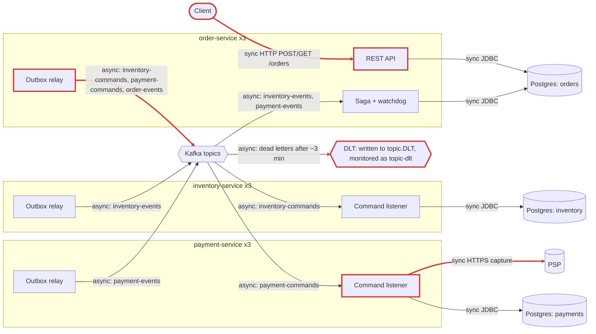
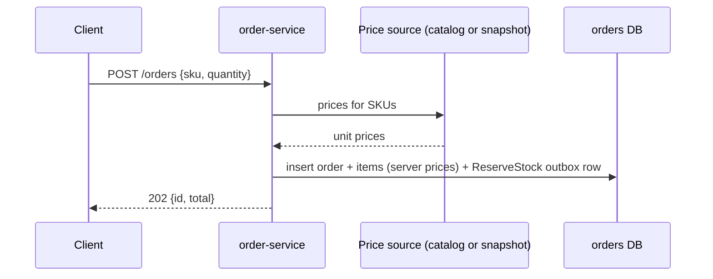
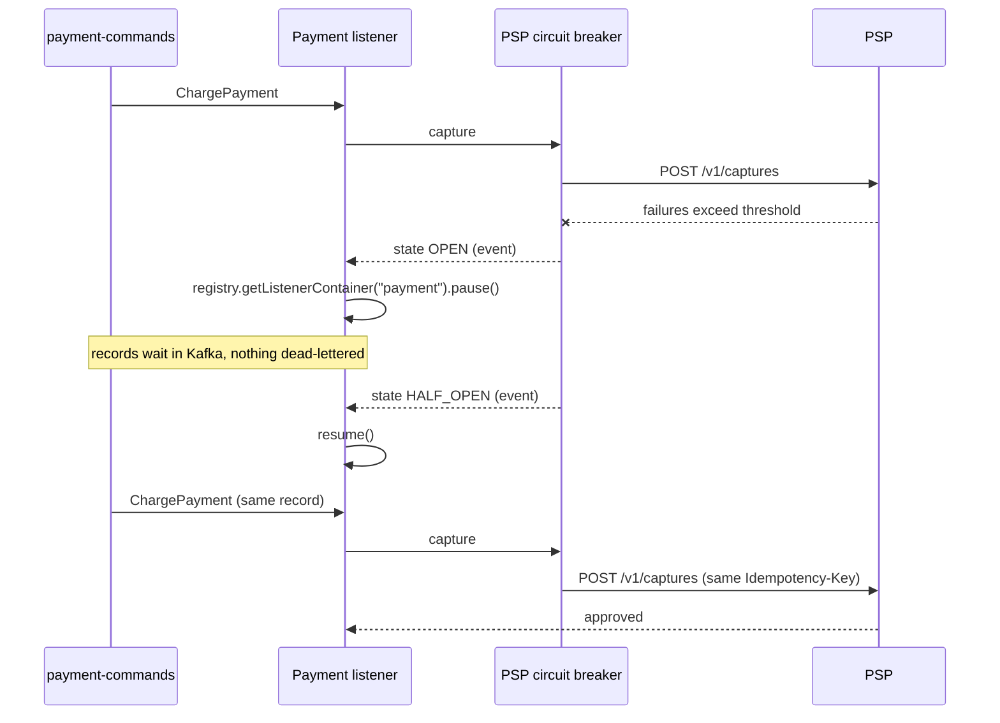
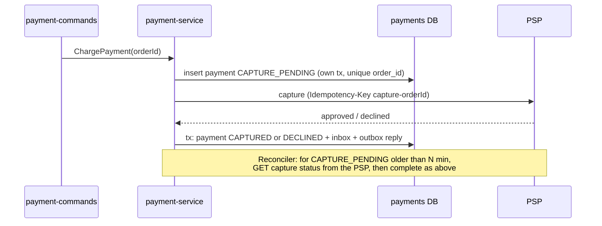

# Architecture review: order platform v2 (03-microservices-healthy)

- **Mode**: hybrid. The code was reviewed against the README's stated intent (3 replicas per service, ~300 orders/minute at peak, 3x next year).
- **Date**: 2026-10-24
- **Lenses run**: scalability, persistence, operability, data-consistency, resilience, service-boundaries, messaging. None were skipped.
- **How**: three lens agents ran in parallel (data-consistency + messaging, resilience + service-boundaries, scalability + persistence + operability). The parent ran no lens itself. It re-read the evidence for every finding and corrected line numbers, merged duplicates and re-graded severity.

## Summary

This is a three-service order platform (orders, inventory, payments) built carefully. Each service has its own database, all coordination runs over Kafka through transactional outboxes and inbox deduplication, and an orchestrated saga with compensations and a watchdog drives the order flow. Most of the classic microservice mistakes are absent. The biggest risk is in the failure path everyone relies on. Dead-lettered records go to `<topic>.DLT` (the spring-kafka default), while the topics, monitors, alert and runbook all use `<topic>-dlt`. So the "retry for 3 minutes, then page on-call" safety net silently does nothing (MQ-001). The change that buys the most is a one-line destination resolver in each service's `KafkaConfig`, plus a test. Two more high findings sit at the API edge: the charged amount comes from client-supplied prices (DC-001), and an order with unbounded lines can wedge order-service's outbox relay for every customer (SC-001).

| Severity | Count |
|---|---|
| Critical | 0 |
| High | 3 |
| Medium | 10 |
| Low | 8 |
| Info | 0 |
| **Total** | **21** |

## Architecture profile

- **Architecture**: microservices. Three independently deployed Spring Boot services, each owning a separate Postgres database, coordinating over Kafka.
- **Summary**: Order platform: order-service accepts orders and orchestrates a place-order saga (reserve stock, charge payment, confirm or cancel) over Kafka with per-service transactional outboxes; inventory-service owns stock and reservations; payment-service charges a third-party PSP.
- **Stack**: Java 17; Spring Boot 3.3.4 (web, data-jpa, actuator); spring-kafka (Boot-managed); Flyway (PostgreSQL); ShedLock 5.16.0 (JDBC); Resilience4j 2.2.0 (payment-service); Micrometer tracing + OTLP, Prometheus registry; PostgreSQL 16; Kafka 3.7 (KRaft)
- **Deployables**:
  - order-service (order-service/): REST POST/GET /orders, saga orchestrator, saga watchdog; db orders; publishes inventory-commands, payment-commands, order-events; consumes inventory-events, payment-events
  - inventory-service (inventory-service/): stock levels and reservations; db inventory; publishes inventory-events; consumes inventory-commands
  - payment-service (payment-service/): payments via PSP over HTTPS; db payments; publishes payment-events; consumes payment-commands
- **Datastores**:
  - PostgreSQL 16: orders (order-service)
  - PostgreSQL 16: inventory (inventory-service)
  - PostgreSQL 16: payments (payment-service); compose hosts all three on one server
- **Messaging**:
  - Kafka: inventory-commands, payment-commands, order-events, inventory-events, payment-events, each with a `<topic>-dlt` topic; 12 partitions, RF 3; keyed by orderId
  - Producers acks=all with idempotence; consumers manual commit, ack-mode record; DefaultErrorHandler with ~3 min exponential backoff then DeadLetterPublishingRecoverer
- **Background work**:
  - OutboxRelay every 500 ms in each service (ShedLock outbox-relay)
  - Outbox purge 03:15 and inbox purge 03:45 daily in each service (ShedLock)
  - SagaWatchdog every 60 s in order-service (ShedLock)
  - DeadLetterMonitor consumer on .*-dlt in each service
- **Runtime**: k8s Deployments with 3 replicas each, liveness/readiness on actuator probes, terminationGracePeriodSeconds 45, graceful shutdown; config via ConfigMap and Secret; OTLP tracing at 10% sampling; Prometheus metrics; no HPA, resource requests, PDB, Service, Ingress or gateway in the repo.
- **Stated intent**: README: 3 replicas per service on k8s, peak ~300 orders/minute, expected to triple next year; DLT records page on-call via kafka_dlt_records_total.
- **Derived load**:
  - place-order: ~5 orders/s at today's peak, ~15 orders/s next year
  - Kafka: ~5-6 messages per order, so ~30 msgs/s today and ~90 msgs/s next year across topics
  - PSP captures: ~5/s today, ~15/s next year
  - order-service outbox: ~3 rows per order, so ~15 rows/s today and ~45 rows/s next year
- **Key flows**:
  - POST /orders -> order-service (orders + outbox in one tx) -> relay -> inventory-commands -> inventory-service (inbox + stock + reservations + outbox) -> inventory-events -> order-service saga
  - order-service saga -> payment-commands -> payment-service (PSP HTTP outside any tx, then payments + inbox + outbox) -> payment-events -> order-service (confirm, or cancel + ReleaseStock -> inventory-service)
  - SagaWatchdog -> PENDING orders older than 15 min -> CANCELLED + ReleaseStock -> inventory-service
- **Assumptions** (nobody was available to answer questions):
  - Mode is hybrid because the README states scale and design intent; nobody was available to ask, so its numbers are taken as the target.
  - Team ownership (Checkout, Warehouse, Payments) is taken from the README.
  - The PSP honours Idempotency-Key, as the PspClient Javadoc claims.
  - Production Kafka has at least 3 brokers (topics use RF 3), although compose shows one.
  - Production Postgres topology is unknown; compose puts the three databases on one server.
  - No edge, gateway or authentication layer exists outside the repo unless shown; findings that depend on this are graded one level lower.
  - Security in depth is out of scope.

Red outlines mark the nodes and edges that findings touch. The labels say whether each edge is sync or async.



## Findings

### High

#### MQ-001 · Dead-lettered records go to `<topic>.DLT`, not the `<topic>-dlt` topics that are created, monitored and paged on

Severity: **high** · Confidence: high · Lens: messaging · Effort: small

**Where**: `order-service/src/main/java/com/example/platform/order/config/KafkaConfig.java:23`, `inventory-service/src/main/java/com/example/platform/inventory/config/KafkaConfig.java:23`, `payment-service/src/main/java/com/example/platform/payment/config/KafkaConfig.java:23`, `order-service/src/main/java/com/example/platform/order/messaging/DeadLetterMonitor.java:30`, `order-service/src/main/java/com/example/platform/order/config/TopicsConfig.java:18`

**Evidence**:

```text
KafkaConfig (all three services): `new DefaultErrorHandler(new DeadLetterPublishingRecoverer(template), backOff)`, with no destination resolver, although its Javadoc says it 'parks it on <topic>-dlt'. TopicsConfig creates `inventory-commands-dlt`, `payment-commands-dlt`, ... DeadLetterMonitor: `@KafkaListener(topicPattern = ".*-dlt", ...)`. README: 'dead-lettered to `<topic>-dlt`. Every DLT record increments `kafka_dlt_records_total`, which pages on-call.' The spring-kafka version managed by Boot 3.3.4 gives DeadLetterPublishingRecoverer a default resolver of `<topic>.DLT`, same partition. The `-dlt` suffix is only the @RetryableTopic default.
```

**What goes wrong**: A dependency (the PSP, a service DB) is down for longer than the ~3 min retry budget, so a ChargePayment, ReserveStock or reply record is recovered. The recoverer publishes to `payment-commands.DLT`. (a) If the broker auto-creates topics (the Kafka default), the record lands in an unplanned topic with broker-default partitions and replication. The `.*-dlt` pattern does not match it, so `kafka_dlt_records_total` never moves, on-call is never paged, and the redrive runbook reads the empty `-dlt` topics. The order sits in STOCK_RESERVED or PENDING (and is then cancelled by the watchdog), possibly with a capture at the PSP, and nobody knows. (b) If auto-create is off, the DLT publish fails. DefaultErrorHandler re-seeks and retries recovery, so that partition (1/12 of orders) stalls until someone intervenes.

**Fix** (`dead-letter-queue`): Give the recoverer an explicit resolver in all three services: `new DeadLetterPublishingRecoverer(template, (r, e) -> new TopicPartition(r.topic() + "-dlt", r.partition()))`. Add an integration test that dead-letters a poison record and asserts it lands on `<topic>-dlt` and increments the counter. Check production for stray `*.DLT` topics holding records nobody has seen.

```java
@Bean
public DefaultErrorHandler kafkaErrorHandler(KafkaTemplate<String, String> template) {
    var recoverer = new DeadLetterPublishingRecoverer(template,
            (record, ex) -> new TopicPartition(record.topic() + "-dlt", record.partition()));
    var handler = new DefaultErrorHandler(recoverer, backOff);
    // ...
}
```

**Why it's worth it here**: Always here: the DLT plus its page is the documented recovery path for every saga step that fails for more than ~3 minutes.

#### DC-001 · Charged amount is computed from client-supplied unit prices

Severity: **high** · Confidence: high · Lens: data-consistency · Effort: medium

**Where**: `order-service/src/main/java/com/example/platform/order/api/OrderService.java:23`, `order-service/src/main/java/com/example/platform/order/api/OrderService.java:52`, `order-service/src/main/java/com/example/platform/order/domain/Order.java:56`, `order-service/src/main/java/com/example/platform/order/saga/OrderSaga.java:47`

**Evidence**:

```text
`public record Line(String sku, int quantity, BigDecimal unitPrice)` is bound straight from the POST body. The only price check is `if (line.unitPrice() == null || line.unitPrice().signum() <= 0)`. Order.addItem: `total = total.add(unitPrice.multiply(BigDecimal.valueOf(quantity)))`. OrderSaga: `new ChargePayment(orderId, order.getCustomerId(), order.getTotal())`, which payment-service passes unchanged to `psp.capture(...)`. No service in the repo holds a price.
```

**What goes wrong**: A caller (a buggy frontend, a stale cached price, or a malicious client) posts `{"sku":"TV-55","quantity":1,"unitPrice":0.01}`. Validation passes, inventory reserves the TV, the PSP captures 0.01 EUR and the saga confirms the order. Money and stock disagree, and nothing downstream can detect it. This is graded high rather than critical only because a trusted pricing BFF might sit in front of order-service, but the repo shows none.

**Fix** (`input-validation`): Price on the server. When the order is placed, resolve unit prices from a catalog or price source that order-service trusts (a local price snapshot or a price-service lookup), and reject requests whose client price differs. Accept only sku and quantity from the client. Also bean-validate customerId and the Idempotency-Key (non-blank, at most 64 and 100 chars) so that bad input returns a 400, not a constraint-violation 500.



**Why it's worth it here**: POST /orders is reachable by clients that are not a trusted pricing component, and the repo has no edge or BFF that sets prices.

#### SC-001 · Unbounded order lines let one request poison order-service's outbox relay and stall every saga

Severity: **high** · Confidence: high · Lens: scalability · Effort: small

**Where**: `order-service/src/main/java/com/example/platform/order/api/OrderService.java:41`, `order-service/src/main/java/com/example/platform/order/saga/OrderSaga.java:39`, `order-service/src/main/java/com/example/platform/order/outbox/OutboxRelay.java:36`, `order-service/src/main/java/com/example/platform/order/outbox/OutboxRepository.java:15`

**Evidence**:

```text
validate() rejects empty lists, duplicate SKUs and per-line quantity outside 1..100, but sets no cap on `lines.size()`. OrderSaga.start serialises every line into one ReserveStock outbox row. Relay: `for (OutboxEvent event : events.findUnsent(PageRequest.of(0, batchSize))) { ... kafka.send(record).get(10, TimeUnit.SECONDS); ... }`, and findUnsent is `... where e.sentAt is null order by e.createdAt`. The producer's max.request.size is left at the 1 MB client default.
```

**What goes wrong**: A buggy or hostile client posts an order with ~15-25k distinct SKUs. Validation passes, and order-service inserts the items and a ReserveStock outbox row larger than 1 MB. On the next relay run the send fails with RecordTooLargeException, get() throws and the loop aborts. findUnsent always returns that oldest unsent row first, so every later run fails on it too. No command or event from order-service is ever published again. The watchdog cancels every PENDING order after 15 minutes, and even its ReleaseStock and OrderCancelled rows queue behind the poison row. No DLT record is produced, so nothing pages. Order placement is down until someone deletes the row by hand. The same head-of-line block follows any permanent send failure in any of the three relays.

**Fix** (`input-size-limits`): Cap order size at the boundary: a maximum number of lines per order (for example 100) in validate(), plus a request-body size limit. In all three relays, catch permanent send errors (RecordTooLargeException, SerializationException, InvalidTopicException) per row: mark the row parked (for example a `failed_at` column excluded from findUnsent), count it in a metric, and continue, so one bad row cannot block the table.

```java
private static final int MAX_LINES = 100;
if (lines.size() > MAX_LINES) throw new InvalidOrderException("at most " + MAX_LINES + " lines per order");

// OutboxRelay: park rows that can never be sent instead of aborting the batch
try {
    kafka.send(record).get(10, TimeUnit.SECONDS);
    event.markSent();
} catch (ExecutionException e) {
    if (!(e.getCause() instanceof RecordTooLargeException || e.getCause() instanceof SerializationException)) throw e;
    event.markParked(e.getCause().getMessage());   // new failed_at column, excluded from findUnsent
    parkedCounter.increment();
}
events.save(event);
```

**Why it's worth it here**: The order API is reachable by any client, and each service's outbox is drained by a single serial relay in creation order.

### Medium

#### RS-001 · An open PSP circuit does not pause the payment consumer, so a PSP outage longer than ~3 minutes dead-letters ChargePayment commands

Severity: **medium** · Confidence: high · Lens: resilience · Effort: medium

**Where**: `payment-service/src/main/java/com/example/platform/payment/messaging/PaymentCommandListener.java:30`, `payment-service/src/main/java/com/example/platform/payment/messaging/PaymentCommandListener.java:37`, `payment-service/src/main/java/com/example/platform/payment/config/KafkaConfig.java:18`, `order-service/src/main/java/com/example/platform/order/saga/SagaWatchdog.java:17`

**Evidence**:

```text
KafkaConfig: `// ~3 minutes in total: longer than a circuit-breaker open window or a DB failover.` with `ExponentialBackOffWithMaxRetries(8)`, then `DeadLetterPublishingRecoverer`. PaymentCommandListener Javadoc: 'Transient PSP failures (timeouts, open circuit) propagate so the container's error handler retries with backoff and finally dead-letters the command.' SagaWatchdog: orders stuck after stock was reserved 'are exposed as a gauge for alerting rather than cancelled'.
```

**What goes wrong**: The PSP is down for 30 minutes, which is ordinary for a third party. The breaker opens, so each attempt fails fast with CallNotPermittedException, but the listener keeps consuming. On each of the 12 partitions, the head ChargePayment uses up its 9 attempts in ~3 min and is dead-lettered, then the next one starts its own countdown. That is about 10 commands per partition, ~120 orders, dead-lettered for reasons that have nothing to do with the messages. Those orders stay STOCK_RESERVED, holding stock, until someone runs the redrive runbook. With MQ-001 unfixed, nobody is paged at all.

**Fix** (`pause-consumer-on-open-circuit`): Treat an unavailable dependency differently from a bad message. Register a CircuitBreaker state-transition listener that pauses the `payment-commands` listener container (through KafkaListenerEndpointRegistry) on OPEN and resumes it on HALF_OPEN or CLOSED. Or classify CallNotPermittedException, timeouts and 5xx as retry-with-capped-backoff without a dead-letter limit. Keep the DLT for permanent failures. The backlog then waits in Kafka and drains on its own when the PSP recovers.



**Why it's worth it here**: The payment step depends on one third-party PSP whose outages can outlast the 3-minute retry budget, and every DLT record is meant to page a human.

#### RS-002 · PSP 4xx client errors are retried up to 27 times, count as circuit-breaker failures, and end in the DLT instead of PaymentFailed

Severity: **medium** · Confidence: medium · Lens: resilience · Effort: small

**Where**: `payment-service/src/main/resources/application.yml (missing resilience4j retry/circuitbreaker ignore-exceptions for psp)`, `payment-service/src/main/java/com/example/platform/payment/psp/PspClient.java:47`, `payment-service/src/main/java/com/example/platform/payment/config/KafkaConfig.java:24`

**Evidence**:

```text
PspClient: `@CircuitBreaker(name = "psp") @Retry(name = "psp") ... .retrieve().body(CaptureResponse.class)`, where retrieve() throws HttpClientErrorException on a 4xx. application.yml: `retry.instances.psp: max-attempts: 3` and `circuitbreaker.instances.psp` with no ignore-exceptions or retry-exceptions (Resilience4j 2.2.0 defaults: retry on, and record, every exception). KafkaConfig marks only `JsonProcessingException` as not retryable.
```

**What goes wrong**: The PSP rejects a capture with a permanent 4xx (validation error, unknown customer, or a card decline sent as 402 rather than in the `outcome` body). Resilience4j retries 3 times inside each of the error handler's 9 attempts: 27 identical calls over ~3 minutes, while that partition's other charges wait. The command is then dead-lettered and no PaymentFailed is published, so the order stays STOCK_RESERVED, holding stock, until a manual redrive. The watchdog cancels only PENDING orders. If a whole class of requests starts returning 4xx after a contract change, they push the breaker past 50% failures and it opens, failing healthy captures too.

**Fix** (`retry-with-backoff`): In resilience4j, set `retry.instances.psp.ignore-exceptions` and `circuitbreaker.instances.psp.ignore-exceptions` to `org.springframework.web.client.HttpClientErrorException`, but keep 409 and 429 retryable if the PSP uses them for an in-flight idempotency key or rate limiting. In PaymentCommandListener, map a permanent 4xx to a DECLINED record through PaymentRecorder, so the saga gets PaymentFailed and releases the stock. Add HttpClientErrorException to the Kafka error handler's not-retryable list as a backstop.

```yaml
resilience4j:
  retry:
    instances:
      psp:
        ignore-exceptions:
          - org.springframework.web.client.HttpClientErrorException
  circuitbreaker:
    instances:
      psp:
        ignore-exceptions:
          - org.springframework.web.client.HttpClientErrorException
```

**Why it's worth it here**: The PSP can signal a permanent rejection with an HTTP 4xx, and the in-process retry is stacked under a 9-attempt Kafka error handler.

#### DC-002 · PSP capture attempt is not recorded before the call; recovery relies on the PSP's idempotency-key retention and a manual redrive

Severity: **medium** · Confidence: medium · Lens: data-consistency · Effort: medium

**Where**: `payment-service/src/main/java/com/example/platform/payment/messaging/PaymentCommandListener.java:37`, `payment-service/src/main/java/com/example/platform/payment/messaging/PaymentRecorder.java:30`

**Evidence**:

```text
`PspClient.CaptureResponse response = psp.capture("capture-" + command.orderId(), ...); recorder.record(messageId, command, response);`. Nothing is written before the PSP call; the payments and inbox rows are written only after a response. PspClient Javadoc: 'Captures are idempotent at the PSP by Idempotency-Key'.
```

**What goes wrong**: The PSP captures the money, then the response is lost or the payments DB is unavailable for longer than ~3 minutes, so ChargePayment is dead-lettered. payment-service has no record that a capture was attempted, and the order stays STOCK_RESERVED. If the redrive happens after the PSP's idempotency-key retention (often 24 hours, so a weekend is enough), the PSP treats the same key as new and charges the customer again. If nobody redrives (more likely while MQ-001 is open), a charge exists at the PSP with no local payment and no reconciliation. This is graded medium because it needs a lost response or DB outage plus a late or missing redrive.

**Fix** (`idempotency-key`): Insert a `payments` row with status CAPTURE_PENDING, keyed on order_id, in its own transaction before calling the PSP. A reconciliation job takes pending rows older than N minutes, asks the PSP for the status of that idempotency key, completes the row and writes PaymentCaptured or PaymentFailed to the outbox. On redelivery or redrive, a pending row means query the PSP, not capture again.



**Why it's worth it here**: Captures move real money, and the DLT redrive is manual, so it can run after the PSP's key-retention window.

#### SC-002 · Outbox relay is a serial single-instance pipe: a blocking send plus a per-row merge for every record caps throughput and drain rate

Severity: **medium** · Confidence: medium · Lens: scalability · Effort: small

**Where**: `order-service/src/main/java/com/example/platform/order/outbox/OutboxRelay.java:34`, `order-service/src/main/java/com/example/platform/order/outbox/OutboxRelay.java:40`, `inventory-service/src/main/java/com/example/platform/inventory/outbox/OutboxRelay.java:40`, `payment-service/src/main/java/com/example/platform/payment/outbox/OutboxRelay.java:40`

**Evidence**:

```text
`@Scheduled(fixedDelayString = "${outbox.relay-interval-ms}") @SchedulerLock(name = "outbox-relay", lockAtMostFor = "PT30S")` ... `kafka.send(record).get(10, TimeUnit.SECONDS); event.markSent(); events.save(event);`. relay() has no transaction, so each save() merges a detached entity (SELECT + UPDATE + commit). The batch is 100, with 500 ms between runs.
```

**What goes wrong**: One pod per service relays, and every record pays an acks=all round trip plus two statements and a commit (~10-20 ms), so the ceiling is roughly 50-100 messages/s per service. order-service writes about 3 rows per order: ~15 rows/s at today's peak and ~45/s at next year's. After a Kafka or relay outage the backlog drains at that capped rate while new orders keep arriving, and saga latency stretches toward the 15-minute watchdog cutoff, which then cancels orders. If the broker is slow, a batch can outlast the 30 s lockAtMostFor (worst case 100 x 10 s). A second pod then relays the same rows and doubles the publish load at the worst moment. The inbox absorbs the duplicates, but the capacity is wasted.

**Fix** (`bulk-operations`): Send the batch asynchronously (collect the futures, flush, await all), then mark the sent ids with one bulk `update outbox set sent_at = now() where id in (...)` in a single transaction. Keep lockAtMostFor above the worst-case batch time, or use ShedLock's KeepAliveLockProvider. If more throughput is ever needed, partition the relay by a hash of aggregate_key under several locks rather than adding pods.

```java
List<CompletableFuture<SendResult<String, String>>> sends = batch.stream().map(e -> kafka.send(toRecord(e))).toList();
kafka.flush();
CompletableFuture.allOf(sends.toArray(CompletableFuture[]::new)).get(30, TimeUnit.SECONDS);
tx.executeWithoutResult(s -> events.markSent(batch.stream().map(OutboxEvent::getId).toList())); // one UPDATE ... WHERE id IN (...)
```

**Why it's worth it here**: Volume is expected to triple, and recovery after an outage depends on how fast the outbox drains before the 15-minute watchdog fires.

#### SC-003 · Payment consumer parallelism is fixed at 12 (partitions = 3 pods x 4 threads) while the handler blocks on the PSP

Severity: **medium** · Confidence: medium · Lens: scalability · Effort: small

**Where**: `payment-service/src/main/java/com/example/platform/payment/messaging/PaymentCommandListener.java:30`, `order-service/src/main/java/com/example/platform/order/config/TopicsConfig.java:19`, `payment-service/src/main/resources/application.yml:66`

**Evidence**:

```text
`@KafkaListener(topics = "payment-commands", concurrency = "4")`; `TopicBuilder.name("payment-commands").partitions(12)`; comment: '12 partitions leave room for 3 replicas x 4 consumer threads'. Per record: psp.capture with `read-timeout: 3s`, retry `max-attempts: 3` with backoff.
```

**What goes wrong**: Throughput is at most 12 divided by the PSP latency. At ~0.5 s that is ~24 captures/s against ~15/s at next year's peak, so headroom is under 2x. If the PSP slows to ~1 s, capacity (~12/s) falls below next year's peak. With 3 s timeouts and 3 retries it falls below today's 5/s. Lag then grows through the whole peak, and orders sit STOCK_RESERVED holding stock. Adding payment pods does not help: every partition already has a consumer, so extra consumers sit idle.

**Fix** (`consumer-concurrency`): Raise payment-commands partitions while volume is low (for example to 36-48; this remaps keys, so do it on a drained topic or accept a short reorder window, which the state guards tolerate). Make the listener concurrency configurable, so pods x threads can grow with load. Alert on the payment group's consumer lag (OP-001).

**Why it's worth it here**: Traffic is expected to triple, and the handler's latency is set by a third party.

#### PS-001 · Connection budget (3 services x 3 pods x 10) reaches a single Postgres server's default limit; a rollout surge exceeds it

Severity: **medium** · Confidence: low · Lens: persistence · Effort: small

**Where**: `order-service/src/main/resources/application.yml:9`, `inventory-service/src/main/resources/application.yml:9`, `payment-service/src/main/resources/application.yml:9`, `docker-compose.yml:2`, `db/init.sql:1`

**Evidence**:

```text
`hikari: maximum-pool-size: 10` in each service, with minimum-idle unset (it defaults to the maximum, so every pod opens 10 connections). k8s `replicas: 3` for each service. db/init.sql creates orders, inventory and payments on one Postgres 16 server, whose max_connections defaults to 100.
```

**What goes wrong**: If production mirrors compose and puts the three databases on one server, steady state holds 90 connections. A rolling deploy surges one extra pod and adds 10 more, past the ~97 usable. Scaling out for next year's 3x traffic does the same. New pods cannot fill their pools and fail with 'too many clients', and listeners and the API time out after Hikari's 30 s connection-timeout. Severity is lowered one level, and confidence is low, because the production DB topology is not in the repo.

**Fix** (`connection-pool-sizing`): Write down a connection budget per DB server (pods x pool x surge). Set minimum-idle low, and size each pool to the service's real concurrency; these services need about 5-6. If the three databases share a server, raise max_connections or put PgBouncer in front.

**Why it's worth it here**: The three services' databases share one Postgres server in production as they do in compose, and replica counts are expected to grow.

#### OP-001 · No outbox-backlog, watchdog or consumer-lag alerting: a stalled relay silently cancels every order

Severity: **medium** · Confidence: high · Lens: operability · Effort: small

**Where**: `order-service/src/main/java/com/example/platform/order/outbox/OutboxRelay.java (missing outbox backlog / oldest-unsent-age gauge)`, `k8s/order-service.yaml (missing alert rules for DLT, consumer lag, outbox age, watchdog cancellations)`, `order-service/src/main/java/com/example/platform/order/messaging/DeadLetterMonitor.java:30`

**Evidence**:

```text
The only operational meters are `kafka.dlt.records` (DeadLetterMonitor) and `orders.saga.stuck_awaiting_payment` (STOCK_RESERVED only). README: 'Every DLT record increments kafka_dlt_records_total, which pages on-call', but there is no alert rule in the repo. Each service runs `@KafkaListener(topicPattern = ".*-dlt", groupId = "<service>-dlt-monitor")`.
```

**What goes wrong**: order-service's relay stops (a poison row as in SC-001, a topic or ACL error, a stuck ShedLock row). Commands stop flowing, but nothing reaches a DLT. The watchdog moves every PENDING order to CANCELLED after 15 minutes without emitting a metric, and the stuck gauge covers only STOCK_RESERVED. Customers notice before on-call does. Payment consumer lag building through a peak is not alerted either. Separately, every DLT record is consumed by all three services' monitors, so it is counted and logged three times, which muddies who gets paged.

**Fix** (`metrics-and-alerts`): Add per-service gauges for unsent outbox count and oldest-unsent age (cheap with the existing partial index), and a counter for watchdog timeouts. Alert on outbox age (for example > 60 s), consumer-group lag per topic (Boot already binds the Kafka client metrics), the DLT counter and the timeout rate. Keep the alert rules versioned next to the manifests. Have each service's DLT monitor subscribe only to the DLTs of the topics it consumes.

**Why it's worth it here**: The saga depends on three asynchronous relays, and the watchdog turns any stall into silent cancellations.

#### OP-002 · Traces break at every Kafka hop: no trace context is stored in the outbox, and Kafka observation is off

Severity: **medium** · Confidence: high · Lens: operability · Effort: medium

**Where**: `order-service/src/main/java/com/example/platform/order/outbox/OutboxRelay.java:37`, `order-service/src/main/resources/db/migration/V1__outbox_inbox_shedlock.sql:1`, `order-service/src/main/resources/application.yml (missing spring.kafka.template.observation-enabled / spring.kafka.listener.observation-enabled)`

**Evidence**:

```text
The relay builds `new ProducerRecord<>(event.getTopic(), event.getAggregateKey(), event.getPayload())` with only `message-id` and `message-type` headers, on a @Scheduled thread. The outbox table has no trace column. Boot 3.3 defaults spring.kafka.template.observation-enabled and spring.kafka.listener.observation-enabled to false. Sampling is `probability: 0.1`.
```

**What goes wrong**: A customer reports an order stuck or cancelled. The POST trace ends at the DB commit. The relay send, inventory handling, the saga step and the PSP call each start unrelated root traces, if they are traced at all, and each is sampled independently at 10%, so a complete trace of one order essentially never exists. Engineers grep three services' logs by orderId, which is not in the MDC either.

**Fix** (`distributed-tracing`): Capture the current W3C traceparent into an outbox column when the event is written, and send it as a header from the relay. Enable Kafka template and listener observation so consumers continue the trace. Put orderId (the record key) in the MDC in each listener. Use parent-based sampling so downstream hops follow the original sampling decision.

**Why it's worth it here**: Every order flow crosses three deployables owned by three teams, all over asynchronous hops.

#### OP-003 · Deployments have no resource requests or limits, no PodDisruptionBudget, no topology spread and no startupProbe

Severity: **medium** · Confidence: high · Lens: operability · Effort: small

**Where**: `k8s/order-service.yaml (missing resources, startupProbe, PodDisruptionBudget, topologySpreadConstraints)`, `k8s/inventory-service.yaml (missing resources, startupProbe, PodDisruptionBudget, topologySpreadConstraints)`, `k8s/payment-service.yaml (missing resources, startupProbe, PodDisruptionBudget, topologySpreadConstraints)`

**Evidence**:

```text
The container specs contain only image, ports, envFrom, livenessProbe and readinessProbe, with default probe timings. `spring.flyway.enabled: true` migrates during startup, before /actuator/health/liveness is served.
```

**What goes wrong**: (1) Nothing stops all three replicas of a service landing on one node, and there is no PDB. A routine node drain evicts them together: order-service's API goes down, or a consumer group stops entirely. (2) With no CPU request, a pod on a busy node, or one running a slow migration, can miss the default ~30 s liveness budget. It is killed mid-start and crash-loops, and the rollout stalls. (3) With no memory limit, the JVM sizes its heap from node RAM, so the scheduler packs pods badly and memory pressure evicts them unpredictably. An HPA cannot be added later without CPU requests.

**Fix** (`resource-requests-and-disruption-budget`): Set CPU and memory requests and limits (with -XX:MaxRAMPercentage), a PDB with maxUnavailable: 1 per service, topologySpreadConstraints across nodes and zones, and a startupProbe on /actuator/health/liveness with a generous failureThreshold to cover migrations.

**Why it's worth it here**: Every service runs 3 replicas on k8s and migrates its schema at boot.

#### OP-004 · Order API has no edge or auth boundary in the repo: any caller can list any customer's orders or order on their behalf

Severity: **medium** · Confidence: medium · Lens: operability · Effort: medium

**Where**: `order-service/src/main/java/com/example/platform/order/api/OrderController.java:59`, `k8s/order-service.yaml (missing Service / Ingress / gateway with authentication)`

**Evidence**:

```text
`@GetMapping public Page<OrderView> byCustomer(@RequestParam String customerId, ...)` and `PlaceOrderRequest(String customerId, ...)`: the customer identity comes from the caller. There is no security dependency in the poms, and no Service, Ingress or gateway manifest in k8s/.
```

**What goes wrong**: However order-service ends up exposed, the API trusts a caller-supplied customerId. Anyone who can reach it can enumerate other customers' order history and place orders as them, and nothing rate-limits the oversized orders of SC-001. Severity is lowered one level because an edge may exist outside this repo.

**Fix** (`api-gateway`): Put an ingress or API gateway in front of order-service that authenticates callers and enforces rate and body-size limits. Keep inventory and payment off the public network. Derive customerId from the authenticated principal, not from parameters. Have a dedicated security review cover the details.

**Why it's worth it here**: order-service is client-facing and serves customer-scoped data.

### Low

#### PS-002 · Index migrations on the hot orders table run without CONCURRENTLY during rolling deploys

Severity: **low** · Confidence: high · Lens: persistence · Effort: small

**Where**: `order-service/src/main/resources/db/migration/V3__orders_status_idx.sql:1`

**Evidence**:

```text
`create index orders_status_created_idx on orders (status, created_at);` is run by Flyway when the first new pod starts, inside Flyway's transaction.
```

**What goes wrong**: A plain CREATE INDEX takes a SHARE lock on `orders` for the whole build. While the new pod builds it, the old pods' POST /orders inserts and the saga's status updates block, and the 10-connection pools and Tomcat threads fill up. V3 has probably already run, so the risk is the next index added the same way, on a table that grows by up to ~400k rows a day at peak rates and so takes longer to index with every month.

**Fix** (`expand-contract-migration`): Make it the rule for orders, outbox and reservations: `CREATE INDEX CONCURRENTLY` in a dedicated migration with Flyway's `executeInTransaction=false` script config, and a lock_timeout. Use expand/contract for column changes.

```sql
-- V4__orders_example_idx.sql, with V4__orders_example_idx.sql.conf containing: executeInTransaction=false
SET lock_timeout = '5s';
CREATE INDEX CONCURRENTLY IF NOT EXISTS orders_example_idx ON orders (...);
```

**Why it's worth it here**: Migrations run at pod startup while the previous version keeps serving traffic.

#### PS-003 · Daily outbox purge is one unchunked DELETE, unlike the chunked inbox purge

Severity: **low** · Confidence: high · Lens: persistence · Effort: small

**Where**: `order-service/src/main/java/com/example/platform/order/outbox/OutboxRepository.java:20`, `inventory-service/src/main/java/com/example/platform/inventory/outbox/OutboxRepository.java:20`, `payment-service/src/main/java/com/example/platform/payment/outbox/OutboxRepository.java:20`

**Evidence**:

```text
`@Modifying @Transactional @Query("delete from OutboxEvent e where e.sentAt < :cutoff") int deleteSentBefore(Instant cutoff);`, compared with Inbox.purgeOld: 'Deleted in chunks to keep locks short' (a `limit 5000` loop).
```

**What goes wrong**: order-service writes several hundred thousand outbox rows a day at peak rates. Deleting a whole day's rows in one statement is a long transaction with a WAL burst, and it holds back vacuum for the database while it runs. That bloats the outbox table and the partial unsent index the relay polls every 500 ms. A retention backlog, for example after the job failed for several days, makes it worse.

**Fix** (`data-retention`): Purge in bounded chunks, as Inbox.purgeOld does: `delete from outbox where id in (select id from outbox where sent_at < ? limit 5000)` in a loop. At much higher volume, time-partition the outbox and drop old partitions.

```java
@Modifying @Transactional
@Query(value = "delete from outbox where id in (select id from outbox where sent_at < :cutoff limit 5000)", nativeQuery = true)
int deleteSentBeforeChunk(Instant cutoff);
// purgeSent(): while (events.deleteSentBeforeChunk(cutoff) > 0) {}
```

**Why it's worth it here**: The outbox receives several rows per order, and volume is set to triple.

#### DC-003 · Concurrent retries with the same Idempotency-Key get a 500, and the key is not scoped to the customer or payload

Severity: **low** · Confidence: high · Lens: data-consistency · Effort: small

**Where**: `order-service/src/main/java/com/example/platform/order/api/OrderService.java:32`, `order-service/src/main/resources/db/migration/V2__orders.sql:3`

**Evidence**:

```text
`return orders.findByRequestKey(requestKey).orElseGet(() -> { ... orders.save(order); saga.start(order); ... })` and `request_key varchar(100) not null unique`.
```

**What goes wrong**: A client or gateway times out and retries while the first request is still in flight. Both transactions miss in findByRequestKey and both insert. The second fails on the unique constraint, and the client gets a 500 instead of the original order. No duplicate order is created. Separately, the key is global, so a different customer who reuses a key, or a retry with a different body, gets the first order back instead of an error.

**Fix** (`idempotency-key`): Catch DataIntegrityViolationException on request_key and return the existing order, or use `insert ... on conflict do nothing`. Scope the key per customer with `unique (customer_id, request_key)`, and return 409 or 422 when the stored request's customer or lines differ.

```java
try {
    return orderService.placeOrder(key, customerId, lines);
} catch (DataIntegrityViolationException duplicateKey) {
    return orders.findByRequestKey(key).orElseThrow(() -> duplicateKey);  // concurrent retry won the race
}
```

**Why it's worth it here**: Clients or gateways retry POST /orders on timeout, which is why the header exists.

#### DC-004 · Stock rows are locked in client-supplied line order, so concurrent multi-SKU reservations can deadlock

Severity: **low** · Confidence: medium · Lens: data-consistency · Effort: small

**Where**: `inventory-service/src/main/java/com/example/platform/inventory/messaging/StockService.java:33`

**Evidence**:

```text
`for (Messages.Line line : command.lines()) { if (stock.tryReserve(line.sku(), line.quantity()) == 0) { ...`. Each `update StockItem ... where s.sku = :sku and s.available >= :qty` holds its row lock until commit, and the lines arrive in whatever order the client sent them. Three inventory replicas consume in parallel.
```

**What goes wrong**: Order A reserves [X, Y] while order B, on another partition and pod, reserves [Y, X]. Each takes its first row lock and waits on the other. Postgres aborts one after deadlock_timeout, and the error handler retries it. The outcome is correct, but popular SKUs see extra latency and retries, more so at 3x load or in a flash sale.

**Fix** (`consistent-lock-ordering`): Sort the lines by SKU before reserving, in StockService.reserve or when order-service builds ReserveStock.

```java
List<Messages.Line> lines = command.lines().stream().sorted(Comparator.comparing(Messages.Line::sku)).toList();
for (Messages.Line line : lines) { ... }
```

**Why it's worth it here**: Multi-line orders share hot SKUs, and inventory consumes on more than one thread or pod.

#### MQ-002 · The message-type contract is the producer's Java class name, and order-service silently drops reply types it does not know

Severity: **low** · Confidence: high · Lens: messaging · Effort: small

**Where**: `order-service/src/main/java/com/example/platform/order/saga/SagaReplyListener.java:45`, `inventory-service/src/main/java/com/example/platform/inventory/outbox/Outbox.java:26`

**Evidence**:

```text
Outbox: `new OutboxEvent(topic, aggregateKey, message.getClass().getSimpleName(), ...)`, which becomes the `message-type` header. SagaReplyListener: `default -> { /* replies this saga does not handle */ }`, reached after `inbox.firstDelivery(...)` has already marked the message processed.
```

**What goes wrong**: The Payments team renames `PaymentCaptured` (a refactor, or a V2) and deploys on its own schedule. order-service consumes the reply, records it in the inbox, matches no case and commits. The customer is charged, the order stays STOCK_RESERVED, nothing is dead-lettered, and the only signal is the stuck-awaiting-payment gauge after 30 minutes.

**Fix** (`event-versioning`): Make each message type an explicit, stable string constant rather than getSimpleName(), and document the contract. In order-service, throw on unknown types from payment-events and inventory-events so they dead-letter, or at least count and log them. Add a consumer-driven contract test per message type.

**Why it's worth it here**: Producer and consumer services are owned and deployed by different teams.

#### MQ-003 · Deterministic failures (missing header, unknown command, unknown order) are retried for ~3 minutes, blocking their partition

Severity: **low** · Confidence: high · Lens: messaging · Effort: small

**Where**: `order-service/src/main/java/com/example/platform/order/config/KafkaConfig.java:24`, `order-service/src/main/java/com/example/platform/order/messaging/Headers.java:24`, `inventory-service/src/main/java/com/example/platform/inventory/messaging/InventoryCommandListener.java:32`, `order-service/src/main/java/com/example/platform/order/saga/OrderSaga.java:89`

**Evidence**:

```text
Only `JsonProcessingException` is registered as not retryable. `Headers.value` throws `IllegalArgumentException("Missing header ...")`, InventoryCommandListener throws `IllegalArgumentException("Unknown command ...")`, and OrderSaga.load throws `IllegalStateException("Unknown order ...")`. All of them are retried 8 times with exponential backoff.
```

**What goes wrong**: A record without a message-id header, or with a command type the consumer does not know yet (for example during a rolling deploy), blocks its partition for about 3 minutes before it is dead-lettered. Every order hashed to that partition, about 1/12 of traffic, stalls for that time. Repeated bad records produce rolling stalls.

**Fix** (`dead-letter-queue`): Throw a dedicated exception type for permanent contract errors and register it (or IllegalArgumentException and IllegalStateException) with `addNotRetryableExceptions`, so these records go straight to the DLT. Do this together with RS-002, which classifies PSP errors in the same handler.

**Why it's worth it here**: Producers and consumers deploy independently, so contract mismatches are realistic.

#### RS-003 · No DB statement timeout and a 30-second pool wait on the POST /orders request path

Severity: **low** · Confidence: medium · Lens: resilience · Effort: small

**Where**: `order-service/src/main/resources/application.yml (missing spring.datasource.hikari.connection-timeout and a statement/query timeout)`

**Evidence**:

```text
order-service application.yml sets only `hikari: maximum-pool-size: 10`. Hikari's connection-timeout defaults to 30000 ms, there is no statement or query timeout, and Tomcat defaults to 200 request threads. OrderService.placeOrder is `@Transactional` and runs findByRequestKey, the inserts and the outbox insert.
```

**What goes wrong**: Postgres stalls during a failover, a long purge lock or a storage hiccup. Each POST /orders holds a Tomcat thread for up to 30 s waiting for one of 10 connections, and the query itself then has no bound. Clients time out first and retry. The Idempotency-Key keeps the retries safe, but they add load, the pod's threads fill up, and GET /orders and the health endpoints slow down with them.

**Fix** (`timeouts`): Set `spring.datasource.hikari.connection-timeout` to about 2-3 s, and a statement timeout of a few seconds for the API's queries (Postgres `statement_timeout` through the connection options, or `jakarta.persistence.query.timeout`), so the request path fails fast with a 503. Give the purge jobs their own, longer limit.

**Why it's worth it here**: POST /orders is synchronous against Postgres at ~5 requests/s, rising to ~15, with 10 connections per pod and no edge timeout in the repo.

#### OP-005 · No preStop delay, so order-service refuses requests during the SIGTERM and endpoint-removal race on every rollout

Severity: **low** · Confidence: medium · Lens: operability · Effort: small

**Where**: `k8s/order-service.yaml (missing lifecycle.preStop)`

**Evidence**:

```text
`terminationGracePeriodSeconds: 45`, `server.shutdown: graceful`, `timeout-per-shutdown-phase: 30s`, and no `lifecycle.preStop`.
```

**What goes wrong**: On a rollout or scale-in, SIGTERM arrives while endpoint removal is still propagating to kube-proxy and the load balancer. Graceful shutdown stops Tomcat accepting connections at once, so requests routed to the pod in that window are refused or reset. POST is idempotent by key, so clients that retry recover, but clients that don't see sporadic errors on every deploy.

**Fix** (`graceful-shutdown`): Add `lifecycle.preStop: exec sleep 5-10` to order-service, the only HTTP-facing service, keeping the sleep plus the 30 s shutdown phase inside the 45 s grace period.

```yaml
lifecycle:
  preStop:
    exec:
      command: ["sh", "-c", "sleep 10"]
```

**Why it's worth it here**: order-service serves HTTP traffic and is rolled out without downtime.

## Roadmap

**Now**: critical and high findings with small or medium effort.

1. MQ-001: give the dead-letter recoverer a `-dlt` resolver in all three services and test it. This unblocks RS-001, RS-002, MQ-003 and DC-002, whose recovery paths all end in a DLT that pages.
2. SC-001: cap lines per order and park permanently unsendable outbox rows. This unblocks SC-002, because a relay that can be wedged by one row is not worth tuning.
3. DC-001: price orders on the server and accept only sku and quantity from clients. This unblocks nothing.

**Next**: the remaining critical and high findings, plus medium findings that unblock them. None. All three high findings fit in Now, and no medium finding blocks them.

**Later**: everything else, ordered so that a finding comes before the ones that depend on it, then by severity.

1. OP-001: add outbox-age, watchdog-timeout and consumer-lag metrics and alert rules, and scope each DLT monitor to its own topics. This unblocks SC-002 and SC-003 (the lag and backlog signals size them).
2. RS-002: stop retrying PSP 4xx and map permanent rejections to PaymentFailed. This unblocks RS-001 (it settles which errors count as an outage).
3. RS-001: pause the payment consumer while the PSP circuit is open. This unblocks nothing.
4. DC-002: record CAPTURE_PENDING before the PSP call and reconcile pending rows. This unblocks nothing.
5. SC-002: batch and async the relay sends, mark rows sent in bulk, and fix lockAtMostFor. This unblocks nothing.
6. SC-003: raise payment-commands partitions and make listener concurrency configurable. This unblocks nothing.
7. OP-002: propagate traceparent through the outbox and enable Kafka observation. This unblocks nothing.
8. OP-003: add resources, PDB, topology spread and a startupProbe. This unblocks nothing.
9. OP-004: put an authenticating, rate-limiting edge in front of order-service. This unblocks nothing.
10. PS-001: write down a per-server connection budget and lower minimum-idle. This unblocks nothing.
11. MQ-003: mark contract errors not-retryable (in the same change as RS-002). This unblocks nothing.
12. DC-003: return the existing order on a concurrent duplicate key, and scope keys per customer. This unblocks nothing.
13. DC-004: sort reservation lines by SKU. This unblocks nothing.
14. MQ-002: use stable message-type constants, and dead-letter unknown reply types. This unblocks nothing.
15. PS-002: adopt CREATE INDEX CONCURRENTLY for future migrations. This unblocks nothing.
16. PS-003: purge the outbox in chunks. This unblocks nothing.
17. RS-003: set a Hikari connection-timeout and a statement timeout for the API. This unblocks nothing.
18. OP-005: add a preStop sleep to order-service. This unblocks nothing.

## What's already sound

These patterns are done right. Keep them, and don't "fix" them:

- Transactional outbox in all three services: Outbox.publish is propagation MANDATORY, so every event is written in the state change's transaction, and a ShedLock-guarded relay publishes it.
- Idempotent consumers: every listener inserts into processed_messages (on conflict do nothing) in the same transaction as its effect; payment adds a unique order_id and a findByOrderId guard.
- Orchestrated saga with Order.status as saga state, state-guarded transitions, ReleaseStock compensation on payment failure, a watchdog for missing stock replies, and release of stock when a StockReserved arrives late for a cancelled order.
- The PSP call runs outside any DB transaction, with an Idempotency-Key per order, connect/read timeouts, a tuned circuit breaker and jittered retry.
- Stock uses an atomic conditional UPDATE plus a check (available >= 0) constraint; Order has @Version.
- Every scheduled job is guarded by a JDBC ShedLock that uses DB time, so 3 replicas do not run it three times.
- Kafka records are keyed by orderId, consumers commit manually per record after the transaction, and listener transactions use rollbackFor = Exception.class.
- Database per service, with Flyway migrations and ddl-auto validate per service; Open Session in View is disabled.
- POST /orders returns 202 and clients poll, with an Idempotency-Key, so no request blocks on the saga; customer listing is paged and capped at 50.
- Message contracts are per-service copies of records, additive only, with no shared library, and the service split matches the three teams.
- Graceful shutdown with actuator liveness/readiness probes, config and secrets from ConfigMap/Secret, and Prometheus plus OTLP wired in.

## Not reviewed

- **Security in depth**: authentication, authorization, PSP API-key handling and secret rotation. OP-004 notes only the missing edge and auth boundary. Run a dedicated security review.
- **Infrastructure outside the repo**: the production Kafka and Postgres topology, the gateway or ingress, Prometheus alert rules, the dlt-redrive runbook and the PSP's actual idempotency-key retention. Findings that depend on these are flagged and graded down.
- **Behaviour at runtime**: no builds, tests or services were run. Framework defaults (the spring-kafka DLT naming, Boot's observation flags, the Resilience4j exception defaults) were taken from the versions the poms pin, not checked against a running system.
- **Tests**: the repo has none, so test coverage was not assessed.
