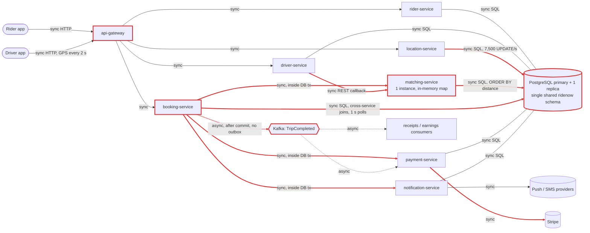
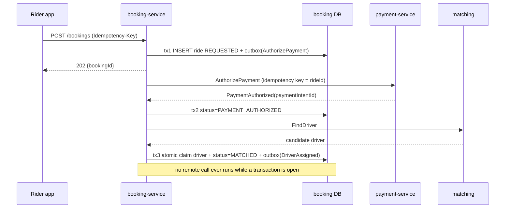
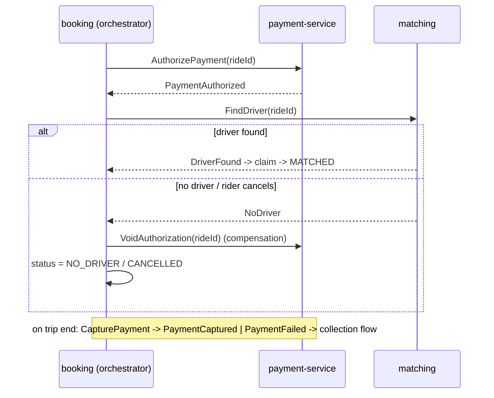
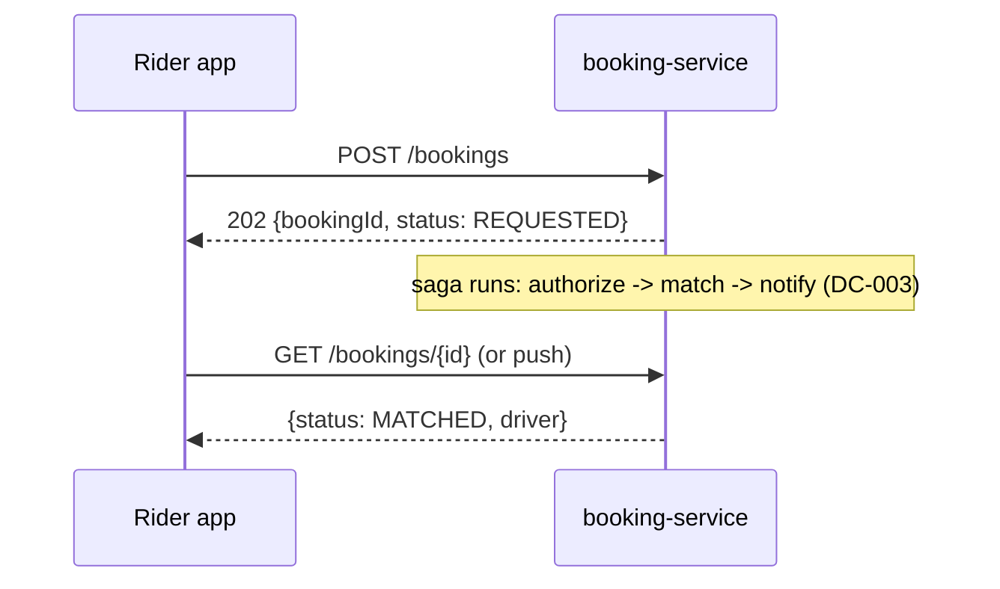

# Architecture review: RideNow (architecture brief draft v0.3)

- **Mode**: design (reviewing `project-brief.md`; there is no code yet)
- **Date**: 2026-10-24
- **Lenses run**: scalability, persistence, operability, data-consistency, resilience, service-boundaries, messaging (all seven). Operability normally needs a described deployment. It ran here because the brief names deployment ("probably Kubernetes") and observability as open decisions, so those findings are graded as gaps.
- **How it ran**: three parallel lens agents (data-consistency + messaging, resilience + service-boundaries, scalability + persistence + operability). The parent ran no lens itself. Every candidate was re-checked against the brief text, merged by root cause, and re-graded. 34 candidates became 30 findings.
- **Intake**: no one was available to answer the intake questions. The gaps were filled with the assumptions listed in the profile below, and severities are graded against them.

## Summary

RideNow is a ride-hailing platform for three cities, planned as eight microservices for four squads. Its targets are 15k concurrent drivers and 120k rides a day at launch, growing to 50k drivers and 400k rides, with 99.95% availability for requesting a ride. The biggest risk is the booking flow. It wraps a Stripe pre-authorization, matching and a push notification in one database transaction. A rollback cannot undo any of those three steps, and the long synchronous chain cannot meet 99.95%. Two other structural problems would cause outages or lose money in normal operation. Driver availability lives in the memory of a single matching instance, so every deploy empties it. TripCompleted is published after commit with no outbox, so a crash between the two loses the capture. **The change that buys the most**: commit the ride as `REQUESTED` first, return 202, and drive pre-auth, matching and notification as an orchestrated saga through an outbox (DC-001, DC-003, DC-002). That one redesign fixes or unblocks about a third of the findings.

| Severity | Count |
|---|---|
| Critical | 3 |
| High | 12 |
| Medium | 14 |
| Low | 1 |
| Info | 0 |
| **Total** | **30** |

## Architecture profile

```
architecture: microservices, 8 planned independently deployed services, but all share one PostgreSQL schema
summary: ride-hailing for 3 cities (~4M people): request, match to a nearby driver, live tracking, card charge (Stripe pre-auth at booking, capture at trip end)
stack: not stated (Postgres, Kafka, Stripe, push/SMS named; Java 17 / Spring Boot 3.x assumed for sketches only)
deployables (all planned):
  - api-gateway: routing and auth
  - rider-service: rider profiles, saved payment methods
  - driver-service: profiles, documents, availability; REST callback -> matching on online/offline
  - location-service: GPS pings every 2 s -> UPDATE drivers; "where is driver X"
  - matching-service: nearest available driver from in-memory map + SQL ORDER BY distance; ONE instance at launch
  - booking-service: ride lifecycle; sync calls payment, matching, notification inside one DB tx; publishes TripCompleted
  - payment-service: Stripe pre-auth and capture; consumes TripCompleted
  - notification-service: push and SMS
datastores: one PostgreSQL cluster (primary + read replica), single `ridenow` schema SHARED by all 8, cross-service joins allowed
messaging: Kafka TripCompleted (consumers: capture, receipts, earnings); published after commit; no outbox/key/DLQ stated
background work: TripCompleted consumers; no schedulers stated
runtime: unknown; "probably Kubernetes"; observability undecided
stated intent: launch 15k drivers at peak, 120k rides/day; year 2 50k drivers, 400k rides/day, +2 cities; peak hour 4x daily average; 99.95% for requesting a ride; 4 squads x ~6, each owning 2 services, shipping independently
derived load:
  - GPS writes: 7,500 UPDATE/s at launch peak, 25,000/s year 2 (single primary)
  - bookings: ~5.6/s peak (18.5/s year 2)
  - concurrent trips at peak: ~6,700 (22,000 year 2) -> ~6,700 location polls/s (22,000/s)
  - matching: >= 1 distance sort over `drivers` per booking
  - Stripe: ~5.6 pre-auths/s + ~5.6 captures/s at launch peak
key flows:
  - book: app -> gateway -> booking [tx open] -> payment -> Stripe; -> matching; -> notification -> push/SMS; -> commit MATCHED
  - complete: booking commit COMPLETED -> Kafka TripCompleted -> payment capture / receipts / earnings
  - location: driver app -> location -> UPDATE drivers <- rider polls 1/s <- matching distance query
  - availability: driver-service -> REST callback -> matching in-memory map
```

**Assumptions made in place of asking**

- All "active drivers at peak" are online and pinging at the same time.
- The average trip, including pickup, is about 20 minutes. This drives the concurrent-trip and polling numbers.
- These must never be lost or doubled: card pre-auth, capture, ride state, and driver assignment (one driver per ride, one ride per driver). Location may lag by a few seconds.
- The stack is not stated. Java 17 / Spring Boot 3.x is assumed only for code sketches and framework defaults.
- `GET /bookings/{id}/driver-location` is served by booking-service, going by its path.
- The operability lens ran, because the brief lists deployment and observability as open decisions.



Red nodes and edges are the ones the findings touch: the transaction-wrapped booking calls, the callback-fed in-memory matching map, the after-commit publish, and the hot paths into the shared primary.

## Findings

### Critical

#### DC-001 · Stripe pre-auth, matching and push run inside the booking DB transaction, and a rollback cannot undo them

Severity critical · confidence high · lens data-consistency · effort medium

**Where**: `project-brief.md` § Booking flow

**Evidence**
```
3. booking-service calls payment-service synchronously, which calls Stripe to pre-authorize the
   estimated fare. If Stripe is slow, the request waits; we will set a generous timeout so we
   don't lose bookings.
...
All of steps 2–6 run inside one database transaction in booking-service, so if anything fails
the booking is rolled back cleanly.
```

**What goes wrong**: The rollback is not clean, because three of the steps have effects outside the database.
1. The pre-auth succeeds, then matching finds no driver nearby, which is a normal outcome at peak. The ride row rolls back, but the card hold stays for up to ~7 days with nothing referencing it. When the rider taps again, they get a second hold.
2. The push has already told a driver to head to the pickup when the commit fails. The driver drives to a ride that does not exist.
3. booking-service crashes mid-flow. No `REQUESTED` row was ever committed, so nothing can reconcile the orphaned PaymentIntent.
4. While Stripe is slow, every booking holds a connection on the shared primary for the whole generous timeout (5.6/s × 30 s ≈ 170 connections), which starves every other service on the cluster.

**Fix** (`move-call-outside-transaction`): split the flow into short local transactions.
- Insert the ride as `REQUESTED`, commit, and return 202 with the booking id.
- Pre-authorize outside any transaction, with Stripe idempotency key `rideId:preauth`, then commit `PAYMENT_AUTHORIZED` together with the PaymentIntent id.
- Claim the driver atomically (DC-006), then commit `MATCHED`.
- Send notifications from an outbox row, never inside the transaction.
- A failed step triggers its compensation (DC-003).



**Why it's worth it here**: every booking performs side effects that a database rollback cannot reverse (a Stripe hold, push/SMS, a dispatched driver), on a database that all eight services share.

#### DC-002 · TripCompleted is published after commit with no outbox, so one crash loses the capture, receipt and earnings

Severity critical · confidence high · lens data-consistency · effort medium

**Where**: `project-brief.md` § Trip completion

**Evidence**
```
When the driver ends the trip, booking-service sets the ride to `COMPLETED`, then publishes a
`TripCompleted` event to Kafka right after the database commit. payment-service consumes it and
captures the final fare. Receipts and driver earnings are computed by consumers of the same event.
```

**What goes wrong**: booking-service commits `COMPLETED`. Before the send succeeds, one of three things happens: a rolling deploy kills the pod, Kafka is briefly unavailable, or an `acks=1` send is lost in a leader failover. The event is never published. The ride shows COMPLETED, the fare is never captured, and the pre-auth lapses after ~7 days. The rider gets no receipt and the driver gets no earnings credit. Nothing retries. At 120k rides a day, a 0.01% loss rate is ~12 uncollected fares a day, and nobody can see them.

**Fix** (`transactional-outbox`):
- Insert the event into an `outbox` table in the same transaction that sets COMPLETED.
- A relay (a polling publisher, or Debezium CDC) publishes the row with `acks=all` and `enable.idempotence=true`, keyed by rideId, then marks the row sent.
- Consumers become idempotent (DC-005).
- Add a reconciliation check for rides that are COMPLETED with no capture after N minutes.

```mermaid
sequenceDiagram
  participant D as Driver app
  participant B as booking-service
  participant DB as booking DB
  participant R as outbox relay
  participant K as Kafka
  participant P as payment-service
  D->>B: end trip
  B->>DB: tx: UPDATE ride SET COMPLETED WHERE status=IN_PROGRESS; INSERT outbox(TripCompleted)
  B-->>D: 200
  loop until acked
    R->>DB: read unsent outbox rows
    R->>K: publish key=rideId (acks=all)
    R->>DB: mark sent
  end
  K->>P: TripCompleted (at least once)
```

**Why it's worth it here**: payment capture, receipts and driver earnings all depend on this one event to stay correct.

#### SC-001 · Driver availability lives in one matching instance's memory, fed by best-effort REST callbacks

Severity critical · confidence high · lens scalability · effort medium

**Where**: `project-brief.md` § Booking flow; § Targets

**Evidence**
```
matching-service keeps the list of available drivers in an in-memory map that driver-service
updates through a REST callback whenever a driver goes online or offline. We'll run one
matching-service instance at launch and add more later.
...
Availability target for requesting a ride: 99.95%.
```

**What goes wrong**:
1. A deploy, crash, OOM or node drain restarts the only matching pod, and the map comes back empty. Callbacks fire only on online or offline transitions, so the ~15,000 drivers who are already online are never re-registered. Every booking gets "no driver available" until drivers toggle their status. A routine deploy becomes a ride-request outage against a 22-minute monthly budget.
2. A callback is lost, because matching is mid-deploy or the call timed out. An offline driver keeps being matched, or an online driver never gets a ride, and nothing reconciles the two. This angle was merged in from the data-consistency lens.
3. When a second replica is added "later", each callback reaches only one replica, so each replica sees a different subset of drivers.

**Fix** (`stateless-service`):
- Run matching-service statelessly, with at least 2 replicas from day one.
- Keep availability and position in a shared geo index, either Redis GEO per city or a PostGIS table in location-service's own store.
- Feed position from pings with a heartbeat TTL. A driver counts as available only if their status is available and they pinged in the last ~10 s.
- Publish status changes as `DriverAvailabilityChanged` events through an outbox, on a compacted topic keyed by driverId that any replica can replay.
- Gate readiness on a warm index (OP-002), and keep DC-006's atomic claim as the last line of defence.

```mermaid
sequenceDiagram
  participant DS as driver-service
  participant K as Kafka (compacted, key=driverId)
  participant L as location-service
  participant G as geo index (Redis GEO)
  participant M as matching (N replicas)
  DS->>K: DriverAvailabilityChanged (via outbox)
  K->>L: consume -> set status in index
  L->>G: GEOADD + TTL on every ping
  M->>G: GEOSEARCH radius, COUNT k, status=available
  Note over M: restart = re-read the index; nothing lives in local memory
```

**Why it's worth it here**: ride requests carry a 99.95% target, and the brief already plans more matching replicas. Any restart or scale-out breaks the current design.

### High

#### DC-003 · Ride lifecycle has no saga state or compensations: nothing voids a pre-auth on no-match or cancel, and failed captures have no path

Severity high · confidence high · lens data-consistency · effort large

**Where**: `project-brief.md` § Services; § Booking flow; § Trip completion

**Evidence**
```
booking-service: owns the ride lifecycle (requested → matched → in progress → completed).
... pre-authorize the estimated fare ...
payment-service consumes it and captures the final fare.
```
The brief has no CANCELLED or FAILED state, no void or refund step, and no handling for a failed capture.

**What goes wrong**:
- **Cancel or no-show**: when a rider cancels or the driver never arrives, nothing voids the hold or releases the driver.
- **Capture fails**: when the final fare exceeds the estimate that was pre-authorized, or the card declines, the capture fails. The ride is still COMPLETED, and earnings have already been credited from the same event, so RideNow pays out money it never collected.
- **No visibility**: nobody can list the rides that are completed but unpaid.

**Fix** (`saga-orchestration`): booking-service becomes the orchestrator, with persisted saga state on the ride.
- **States**: `REQUESTED → PAYMENT_AUTHORIZED → MATCHED → IN_PROGRESS → COMPLETED → PAYMENT_CAPTURED`, plus terminal `CANCELLED`, `NO_DRIVER` and `PAYMENT_FAILED`.
- **Compensations**: void the PaymentIntent on NO_DRIVER or CANCELLED, release the driver on cancel, and re-authorize or flag for collection when a capture fails.
- **Fares and earnings**: fares are computed server-side. Earnings are driven by `PaymentCaptured`, or by an explicit policy, rather than by `TripCompleted`.
- **Reconciliation**: reconcile Stripe PaymentIntents against ride states every day.



**Why it's worth it here**: the flow spans Stripe and several services, and has cancel and no-match branches. A flow with three or more steps that moves money justifies an orchestrator, and booking-service already owns the lifecycle.

#### DC-004 · POST /bookings has no idempotency key, so a client retry creates a second ride and a second card hold

Severity high · confidence high · lens data-consistency · effort small

**Where**: `project-brief.md` § Booking flow

**Evidence**
```
1. The rider app calls `POST /bookings`.
...
If Stripe is slow, the request waits; we will set a generous timeout so we don't lose bookings.
```

**What goes wrong**: a slow booking outlasts the app's or the gateway's timeout. The app retries, or the rider taps again, while the first request is still running. Both complete: two rides, two holds, and two drivers sent to one rider.

**Fix** (`idempotency-key`):
- Require an `Idempotency-Key` header, stored on the ride under a unique constraint. Return the existing ride on a repeat.
- Derive the Stripe idempotency key from the ride id.
- Add a partial unique index allowing one active ride per rider.

```sql
CREATE UNIQUE INDEX rides_idem ON rides (idempotency_key);
CREATE UNIQUE INDEX rides_one_active_per_rider ON rides (rider_id)
  WHERE status IN ('REQUESTED','PAYMENT_AUTHORIZED','MATCHED','IN_PROGRESS');
```

**Why it's worth it here**: the endpoint places a card hold and dispatches a driver, and mobile clients on flaky networks call it.

#### DC-005 · TripCompleted consumers and end-trip are not idempotent, so a redelivery pays earnings twice

Severity high · confidence medium · lens data-consistency · effort medium

**Where**: `project-brief.md` § Trip completion

**Evidence**
```
payment-service consumes it and captures the final fare. Receipts and driver earnings are
computed by consumers of the same event.
```
The brief mentions no dedup and no state guard on the COMPLETED transition.

**What goes wrong**:
- **Earnings consumer**: it credits the fare, then crashes or hits a rebalance before committing its offset. Kafka redelivers the event, and the driver is credited twice.
- **Receipts**: the receipt goes out twice.
- **End-trip retry**: a retried "end trip" from the driver app publishes a second TripCompleted. The second capture fails as already captured, and the error handler then retries or dead-letters it, which buries real failures.

**Fix** (`idempotent-consumer`):
- Each consumer records `(consumer, rideId)` in a processed table with a unique constraint, in the same transaction as its effect.
- Earnings become a ledger row keyed by rideId, not a balance increment.
- The Stripe capture uses idempotency key `capture-<rideId>`, and "already captured" counts as success.
- The COMPLETED transition is conditional, and the event is emitted only when one row changed.

```mermaid
sequenceDiagram
  participant K as Kafka
  participant E as earnings consumer
  participant DB as earnings DB
  K->>E: TripCompleted(eventId, rideId)
  E->>DB: tx: INSERT processed(consumer, rideId) [unique]; INSERT ledger(rideId, amount)
  alt duplicate key
    DB-->>E: conflict -> skip, ack
  else new
    DB-->>E: ok -> ack offset
  end
```

**Why it's worth it here**: Kafka delivers at least once, and these handlers move money.

#### DC-006 · Driver assignment is check-then-act with no atomic claim, so two bookings can get the same driver

Severity high · confidence medium · lens data-consistency · effort small

**Where**: `project-brief.md` § Booking flow; § Live location

**Evidence**
```
matching-service keeps the list of available drivers in an in-memory map that driver-service
updates through a REST callback whenever a driver goes online or offline.
...
matching-service also queries this table to find nearby drivers (`ORDER BY` distance computed in SQL).
```

**What goes wrong**: two requests 200 ms apart near a venue both pick the same nearest "available" driver, and both commit MATCHED. The map changes only when a driver goes online or offline, so a driver who is already assigned can keep being offered to later requests too. With more matching replicas, each holding its own map, the race becomes certain. The lens graded this critical. It was lowered to high here, because the wrong assignment can be recovered from and DC-003's void covers the money.

**Fix** (`atomic-conditional-update`):
```sql
UPDATE drivers SET status = 'ASSIGNED', current_ride_id = :ride
 WHERE id = :driver AND status = 'AVAILABLE';   -- 0 rows -> try next candidate
CREATE UNIQUE INDEX one_active_ride_per_driver ON rides (driver_id)
 WHERE status IN ('MATCHED','IN_PROGRESS');
```
Release the driver on completion, and as a compensation on cancel. The matching index stays a candidate list only.

**Why it's worth it here**: bookings in dense areas run concurrently, and "one ride per driver" must hold.

#### RS-001 · Ride request is an 8-link synchronous chain ending in Stripe and push/SMS, below the 99.95% target

Severity high · confidence high · lens resilience · effort large

**Where**: `project-brief.md` § Booking flow; § Targets

**Evidence**
```
3. booking-service calls payment-service synchronously, which calls Stripe ...
4. booking-service calls matching-service synchronously ... We'll run one matching-service instance at launch ...
5. booking-service calls notification-service synchronously ...
6. booking-service updates the ride to `MATCHED` and returns the result to the rider app.
Availability target for requesting a ride: 99.95%.
```

**What goes wrong**: a booking succeeds only if eight links are all up at once: the gateway, booking, payment, Stripe, a single matching instance, notification, the push/SMS provider and the primary. Eight links in series at 99.95% each give about 99.6%, which is roughly 3 hours a month of failed ride requests against a 22-minute budget. Latencies also add up, and each waiting request holds a thread. A Stripe slowdown to 20–30 s pins 110–170 of Tomcat's default 200 threads. This thread-exhaustion angle was merged in from the scalability lens's slow-work finding.

**Fix** (`async-decoupling`):
- Shorten the synchronous path to gateway → booking → its own DB.
- Return 202, and let the saga (DC-003) progress the ride. The app follows progress by push or a status poll.
- Run matching with at least 2 replicas (SC-001), and use bounded executors.



**Why it's worth it here**: the core flow has a 99.95% target and depends on four internal services and two third parties whose latency the team does not control.

#### RS-002 · A notification failure rolls back an otherwise successful booking

Severity high · confidence high · lens resilience · effort medium

**Where**: `project-brief.md` § Booking flow

**Evidence**
```
5. booking-service calls notification-service synchronously to push "driver on the way" to the rider and the driver.
All of steps 2–6 run inside one database transaction in booking-service, so if anything fails the booking is rolled back cleanly.
```

**What goes wrong**: the push or SMS provider times out at peak, or notification-service is mid-deploy. By then the card is authorized and a driver has been found, but the whole booking rolls back and the rider sees "booking failed". An outage of a non-essential channel becomes an outage of ride requests.

**Fix** (`async-decoupling`): after MATCHED commits, write a `DriverAssigned` outbox event. notification-service consumes it and retries delivery out of band. Both apps also read the assignment from the booking status.

```mermaid
sequenceDiagram
  participant B as booking-service
  participant K as Kafka
  participant N as notification-service
  participant X as push/SMS provider
  B->>B: tx: MATCHED + outbox(DriverAssigned)
  B->>K: relay publishes DriverAssigned
  K->>N: consume
  N->>X: send (retry with backoff on failure)
  Note over B,N: a provider outage delays a message; it never fails a booking
```

**Why it's worth it here**: notification is not needed to answer POST /bookings correctly, yet its exception currently fails the core flow.

#### RS-003 · A "generous" Stripe timeout, and no stated timeouts on matching or notification

Severity high · confidence high · lens resilience · effort small

**Where**: `project-brief.md` § Booking flow

**Evidence**
```
If Stripe is slow, the request waits; we will set a generous timeout so we don't lose bookings.
```
The brief states no timeout for the matching call (step 4) or the notification call (step 5).

**What goes wrong**: Stripe slows to 20–30 s on a Friday. Every booking waits the full timeout while holding threads in both booking-service and payment-service. Riders re-tap (DC-004), and both thread pools run out. The long timeout loses more bookings than it saves, because the rider has left long before it expires.

**Fix** (`timeouts`):
- Every outbound client gets a connect timeout of ~1 s, and a read timeout set from the dependency's p99 plus headroom (for example 3–5 s for the Stripe pre-auth).
- Propagate an overall deadline from the gateway.
- To avoid losing bookings, persist `REQUESTED` first (DC-001).

```yaml
# Spring Boot 3 / Resilience4j sketch
resilience4j.timelimiter.instances.stripe.timeout-duration: 5s
spring.cloud.openfeign.client.config.matching: { connect-timeout: 1000, read-timeout: 800 }
```

**Why it's worth it here**: Stripe and internal services are called synchronously on the ride-request path, which has a 99.95% target.

#### SC-002 · GPS pings become 7,500–25,000 single-row UPDATEs/s on the shared primary's `drivers` table

Severity high · confidence medium · lens scalability · effort large

**Where**: `project-brief.md` § Live location; § Data

**Evidence**
```
Drivers' apps send a GPS ping every 2 seconds while online. location-service writes each ping as an
`UPDATE drivers SET lat = ?, lng = ? WHERE id = ?` on the shared Postgres.
... one shared PostgreSQL cluster (one primary, one read replica)
```

**What goes wrong**: the primary takes 7,500 commits/s at launch peak and 25,000/s in year two, and it is the same primary that runs bookings and payments. Each update writes a new version of the whole `drivers` row plus its WAL. If lat/lng are indexed for matching, HOT updates stop and every index on the table is rewritten. Row locks collide with availability and assignment updates on the same rows, and the WAL volume drives replica lag. A well-provisioned primary can probably absorb the launch volume. At year-two volume on a shared primary, the Friday peak saturates it, and all eight services fail together. The lens graded this critical. It was lowered to high here, because launch scale is probably survivable and the stated year-two scale is not.

**Fix** (`ephemeral-state-store`, a pattern name coined for this review):
- Write the latest position to an in-memory geo store (Redis `GEOADD` per city, with a TTL).
- Append pings to a Kafka topic keyed by driverId, for trails and analytics.
- Persist per-trip breadcrumbs in batches.
- **Launch-only fallback**: a narrow `driver_locations` table separate from `drivers`, with fillfactor ~50 and no index on lat/lng, written as one coalesced multi-row UPDATE per second per pod.

**Why it's worth it here**: these are thousands of ephemeral writes per second, growing ~3.3× in year two, for data the business accepts as a few seconds stale.

#### SC-003 · 1 Hz rider location polling reads the hot `drivers` row through booking-service and the primary

Severity high · confidence medium · lens scalability · effort medium

**Where**: `project-brief.md` § Live location

**Evidence**
```
The rider app polls `GET /bookings/{id}/driver-location` every second during a trip, which reads the same row.
```

**What goes wrong**: polling runs at ~6,700 GETs/s at launch peak and ~22,000/s in year two, through booking-service (assumed from the path) and onto the primary. Pings arrive only every 2 s, so half of the polls return unchanged data. booking-service ends up sized by polling traffic, and shares its threads and connections with POST /bookings. A polling surge, or an app bug that keeps polling after the trip ends, therefore degrades ride requests.

**Fix** (`cqrs-read-model`):
- Serve location from the location store (SC-002) through location-service, with its own replicas.
- Prefer WebSocket or SSE push.
- If polling stays, poll every 2–3 s with ETag/304, and authorize once per trip with a scoped token.
- **First step**: point any Postgres read at the read replica.

**Why it's worth it here**: read traffic matches the write traffic on the same hot rows, and the data tolerates seconds of staleness.

#### SB-001 · All 8 services share one schema and join each other's tables

Severity high · confidence high · lens service-boundaries · effort large

**Where**: `project-brief.md` § Data; § Live location

**Evidence**
```
all eight services connect to one shared PostgreSQL cluster (one primary, one read replica) with a single
`ridenow` schema. Services can join across each other's tables when they need data, for example
booking-service joins `drivers` and `riders` directly to build the trip receipt.
Team: 4 squads of about 6 engineers, each owning two services and shipping independently.
```

**What goes wrong**:
1. The driver squad renames a `drivers` column. Other squads' location UPDATE, matching query and receipt join break at runtime, and old pods fail during the rolling deploy. Schema changes become cross-squad releases, which defeats "shipping independently".
2. location-service's write load sits on the same primary as booking and payment.
3. No service owns the invariants of a `drivers` row: three services write it.

**Fix** (`database-per-service`):
- At minimum, give each service its own schema and DB role, with no cross-schema grants. This is cheap on the same cluster at first.
- Expose data through APIs or events (`data-replication-via-events`). booking-service snapshots the rider and driver details it needs at booking time, and receipts are built from event data.
- Live position moves to location-service's own store (SC-002).
- Migrate table by table: assign each table an owner first (PS-003), then revoke cross-schema access.

**Why it's worth it here**: the services are explicitly meant to be deployed independently by four squads, and one service's write load is orders of magnitude above the others.

#### MQ-001 · No DLQ or retry topic for TripCompleted, so a failing capture blocks its partition or is silently skipped

Severity high · confidence medium · lens messaging · effort small

**Where**: `project-brief.md` § Trip completion

**Evidence**
```
payment-service consumes it and captures the final fare. Receipts and driver earnings are
computed by consumers of the same event.
```
The brief says nothing about retries, dead-lettering or poison messages.

**What goes wrong**: a payload is malformed after a producer change, a card_declined is thrown as an exception, or a PaymentIntent is missing. The message either retries forever and blocks every later capture on its partition, or, with Spring Kafka's `DefaultErrorHandler`, it is retried a few times and then logged and skipped. In that case the fare is never captured and nobody is told.

**Fix** (`retry-topic` → `dead-letter-queue`):
- Retry topics with backoff for transient errors.
- A dead-letter topic with an alert (OP-004) and a replay tool.
- Business outcomes such as card_declined become saga states (`PaymentFailed`, DC-003), not exceptions.

**Why it's worth it here**: these consumers capture money and credit driver earnings.

#### PS-001 · No connection budget for 8 services on one primary, with booking holding connections across remote calls

Severity high · confidence medium · lens persistence · effort medium

**Where**: `project-brief.md` § Data; § Booking flow

**Evidence**
```
all eight services connect to one shared PostgreSQL cluster (one primary, one read replica)
All of steps 2–6 run inside one database transaction in booking-service
```

**What goes wrong**:
- **The defaults don't add up**: Postgres defaults to `max_connections=100`. Eight services × 2–3 replicas × HikariCP's default pool of 10 asks for 160–240 connections, before location-service's needs at 7,500 commits/s are counted. Pods added during a Friday surge cannot open their pools.
- **booking-service drains the rest**: it holds connections idle in transaction through Stripe (~170 connections when Stripe is slow, DC-001). Every other service then hits connection timeouts.

**Fix** (`connection-pool-sizing`):
- Write down a budget: the sum of replicas × pool size stays below `max_connections` minus headroom.
- Put PgBouncer in transaction mode in front of the primary.
- Give each service a DB role with a `CONNECTION LIMIT`.
- Set `idle_in_transaction_session_timeout` and `statement_timeout`.

**Why it's worth it here**: several independently scaled services share one primary, and one of them holds long transactions.

### Medium

#### RS-004 · No circuit breaker or fast-fail around Stripe, matching and notification

Severity medium · confidence medium · lens resilience · effort small

**Where**: `project-brief.md` § Booking flow; § Not decided yet

**Evidence**
```
Steps 3–5: synchronous calls to payment-service (Stripe), matching-service, notification-service (push/SMS).
Not decided yet: How we deploy (probably Kubernetes).
```
The brief describes no breaker, fallback, or mesh outlier detection.

**What goes wrong**: during a 10-minute Stripe or SMS brownout, every request still waits the full timeout before failing. That wastes threads and delays the dependency's recovery, and the backlog of retried requests hits it all at once when it comes back.

**Fix** (`circuit-breaker`):
- Put a breaker around each dependency.
- **Notification**: skip and retry out of band.
- **Stripe**: hold the booking in `PAYMENT_PENDING` and retry, or fail fast with a clear message.
- **Matching**: fail fast and queue the request for re-matching.

**Why it's worth it here**: several dependencies that fail independently sit on the booking path at peak volume.

#### RS-005 · Booking path shares threads and gateway capacity with unrelated dependencies and ~14k/s of location traffic

Severity medium · confidence medium · lens resilience · effort medium

**Where**: `project-brief.md` § Booking flow; § Live location

**Evidence**
```
The rider app polls `GET /bookings/{id}/driver-location` every second during a trip, which reads the same row.
```
booking-service also makes the synchronous Stripe, matching and notification calls.

**What goes wrong**: bookings stuck on a slow Stripe fill booking-service's shared pools, so location polls and end-trip calls queue behind them. Riders see a frozen driver, and drivers cannot end trips. In the other direction, a surge of pings or polls crowds POST /bookings out of the gateway.

**Fix** (`bulkhead`):
- Give booking-service a separate bounded client pool per dependency (or Resilience4j bulkheads).
- Give the telemetry routes at the gateway their own concurrency limit or a separate ingress.
- Moving the location read out of booking-service is SC-003.

**Why it's worth it here**: ~5.6 bookings/s share threads and the gateway with ~14k/s of location traffic and with unreliable third parties.

#### SC-004 · TripCompleted capture consumer is not sized for Stripe-blocking work at peak

Severity medium · confidence medium · lens scalability · effort small

**Where**: `project-brief.md` § Trip completion

**Evidence**
```
publishes a `TripCompleted` event to Kafka right after the database commit. payment-service consumes it and captures the final fare.
```
The brief states no partition count or consumer concurrency.

**What goes wrong**: the defaults are `num.partitions=1` and one listener thread. A handler that blocks on Stripe for 0.3–1 s does 1–3 captures/s, against 5.6/s at peak (18.5/s in year two). Lag builds all evening. A slow 500-record batch overruns `max.poll.interval.ms`, and the resulting rebalance loop redelivers captures.

**Fix** (`consumer-concurrency`):
- Declare partitions sized for year two (24–48).
- Keep concurrency × replicas ≤ partitions.
- Set `max.poll.records` to 10–50 for this handler.
- Alert on lag (OP-004).

**Why it's worth it here**: a consumer that moves money blocks on a third party, and volume peaks at 4× the average.

#### SC-005 · No rate limiting or load shedding at the gateway for booking, polling and ping traffic

Severity medium · confidence medium · lens scalability · effort small

**Where**: `project-brief.md` § Services; § Targets

**Evidence**
```
api-gateway: routing and auth.
Peak hour (Friday night) is about 4× the daily average.
```

**What goes wrong**: at a Friday 4× peak, three sources of extra traffic reach the services and the shared primary with no limit:
- riders re-tapping slow bookings;
- apps that keep polling after the trip ends;
- driver apps flushing buffered pings after reconnecting.

Nothing sheds cheap traffic to protect bookings, so the system collapses instead of degrading.

**Fix** (`rate-limiting`): set per-client limits:
- bookings per rider;
- at most 1 ping per driver per second;
- at most 1 location poll per 2 s per trip.

Use bounded queues, and shed polls before bookings.

**Why it's worth it here**: public mobile clients generate thousands of requests per second against a shared backend with a 99.95% target.

#### SB-002 · Driver supply state is split across driver-, location- and matching-service, which must change together

Severity medium · confidence medium · lens service-boundaries · effort medium

**Where**: `project-brief.md` § Services; § Booking flow; § Live location

**Evidence**
```
driver-service: driver profiles, documents, availability status.
location-service: receives driver GPS pings and answers "where is driver X".
matching-service keeps the list of available drivers in an in-memory map that driver-service updates through a REST callback ...
matching-service also queries this table to find nearby drivers
```

**What goes wrong**: adding an "on break" state, or filtering by vehicle type, means changing driver-service's callback, matching's map, location's table and booking's joins. Up to three squads would have to ship those changes in lockstep. The microservices costs are paid without independent deploys on the part of the domain that changes most.

**Fix** (`bounded-context`):
- Create a "dispatch" context that owns availability, live position, the geo index and matching, run by one squad.
- driver-service keeps profiles and documents.
- Put consumer-driven contracts on the remaining seams.

This is a redraw of the boundaries, not a merge: four squads do justify separate services.

**Why it's worth it here**: matching needs availability and position at high rates, and the squads are meant to ship independently.

#### MQ-002 · Capture consumer's offset policy is unspecified, and committing before the Stripe capture lands loses fares

Severity medium · confidence medium · lens messaging · effort small

**Where**: `project-brief.md` § Trip completion

**Evidence**
```
payment-service consumes it and captures the final fare.
```
The brief states no delivery guarantee. The plain Kafka client defaults to `enable.auto.commit=true`, while Spring Kafka defaults to false.

**What goes wrong**: with auto-commit, or with the Stripe call handed off to an async executor, the offset is committed before the capture finishes. If the pod is killed in that window, the fare is never captured. This is graded medium, down from high, because the outcome depends on an implementation choice the brief has not yet made.

**Fix** (`manual-ack-after-processing`):
- Turn auto-commit off and process on the listener thread.
- Commit the offset only after the capture and its local record commit.
- Pair this with DC-005, so redelivery is safe.

**Why it's worth it here**: one lost message is one uncollected fare.

#### MQ-003 · TripCompleted has no schema or versioning, though its producer and consumers deploy independently

Severity medium · confidence medium · lens messaging · effort medium

**Where**: `project-brief.md` § Trip completion; § Targets

**Evidence**
```
Team: 4 squads of about 6 engineers, each owning two services and shipping independently.
```
TripCompleted has three consumers, and the brief mentions no schema, version or registry.

**What goes wrong**:
- **Rename**: the booking squad renames `fare`, and payment-service stops deserializing new events, so captures stop until a coordinated fix ships.
- **Thin events**: consumers have to re-read the fare from the shared tables. If the fare is adjusted between completion and consumption, capture and earnings use different amounts.

**Fix** (`schema-registry`): make TripCompleted a public contract with versioning:
- Avro, Protobuf or JSON Schema in a registry, with backward-compatibility checks in CI.
- The event carries `eventId, schemaVersion, rideId, riderId, driverId, finalFareCents, currency, paymentIntentId, completedAt`.

**Why it's worth it here**: the producer and its three consumers belong to different squads.

#### PS-002 · Matching sorts the whole hot `drivers` table by a computed distance

Severity medium · confidence medium · lens persistence · effort medium

**Where**: `project-brief.md` § Live location

**Evidence**
```
matching-service also queries this table to find nearby drivers (`ORDER BY` distance computed in SQL).
```

**What goes wrong**:
- **Full scan**: a computed-distance sort cannot use an index, so every match scans and sorts every driver in every city, dead tuples included.
- **A plain index backfires**: adding a plain lat/lng index disables HOT updates on the ping path (SC-002).
- **Two sources of truth**: the in-memory map is a second source for "available nearby".

**Fix** (`add-index`): use a bounded geo query on the separate location store, with one source of truth (SC-001):
```sql
-- PostGIS variant, on a location table separate from `drivers`
CREATE INDEX ON driver_locations USING gist (geom);
SELECT driver_id FROM driver_locations
 WHERE city = :city AND available AND updated_at > now() - interval '10 seconds'
 ORDER BY geom <-> :pickup LIMIT 10;
```
Alternatively, use Redis `GEOSEARCH ... BYRADIUS ... COUNT 10`.

**Why it's worth it here**: matching runs on every booking, over a table that grows with the fleet and is updated thousands of times a second.

#### PS-003 · Shared schema has no migration ownership and no lock-safe DDL rule across 4 squads

Severity medium · confidence medium · lens persistence · effort medium

**Where**: `project-brief.md` § Data; § Targets

**Evidence**
```
with a single `ridenow` schema. Services can join across each other's tables when they need data
... each owning two services and shipping independently.
```

**What goes wrong**: a squad ships an `ALTER TABLE drivers` that takes an ACCESS EXCLUSIVE lock. The lock waits behind long booking transactions, and the 7,500/s updates queue behind the lock. `drivers` freezes and ride requests fail. Several services' migration histories also compete over one schema. The lens graded this high. It was lowered to medium, because migration practice is not yet decided. Cross-squad breakage from renames is SB-001.

**Fix** (`expand-contract-migration`):
- Give each table one owning service with a versioned migration history.
- Use expand-contract for any column that other services read.
- Set `lock_timeout` to 2–5 s, and build indexes `CONCURRENTLY`.
- Add a CI check against destructive DDL in the same release as the code change.

**Why it's worth it here**: several squads deploy independently against one schema that contains a hot table.

#### PS-004 · Ride, notification and payment tables grow with every ride, with no partitioning or retention

Severity medium · confidence medium · lens persistence · effort medium

**Where**: `project-brief.md` § Targets; § Data

**Evidence**
```
Launch: 15,000 active drivers at peak, 120,000 rides per day.
Year two: 50,000 active drivers, 400,000 rides per day ...
```

**What goes wrong**: rides alone add ~44M rows a year, rising to ~146M in year two. Each ride also adds several notification, payment, receipt and earnings rows, all on the shared primary. Active-ride queries, vacuum, backups and restores slow down month by month.

**Fix** (`data-retention`):
- Partition by month (pg_partman).
- Add a partial index on the active ride states.
- Keep notifications for 90 days.
- Archive completed rides to a warehouse.

**Why it's worth it here**: several tables gain one or more rows per ride, at 120k–400k rides a day.

#### OP-001 · Deploys cut in-flight bookings that hold Stripe pre-auths and open transactions

Severity medium · confidence medium · lens operability · effort small

**Where**: `project-brief.md` § Booking flow; § Not decided yet

**Evidence**
```
we will set a generous timeout so we don't lose bookings.
How we deploy (probably Kubernetes).
```

**What goes wrong**: SIGTERM arrives between the pre-auth and the commit, and the card is left holding funds for a ride that does not exist. Kubernetes' default 30 s grace period is shorter than a "generous" timeout. Graded high, then lowered one level, because the orchestrator is not chosen yet. DC-001 also removes most of the damage.

**Fix** (`graceful-shutdown`):
- Flip readiness, add a preStop delay, then drain.
- Set `server.shutdown=graceful` and `spring.lifecycle.timeout-per-shutdown-phase`.
- Set `terminationGracePeriodSeconds` above the longest request (bounded by RS-003).
- Stop Kafka listeners and commit offsets before exit.

**Why it's worth it here**: frequent, independent deploys of services whose requests span payment calls.

#### OP-002 · Probe design is undecided: matching would report ready with an empty map, and DB-checking liveness risks restart storms

Severity medium · confidence medium · lens operability · effort small

**Where**: `project-brief.md` § Not decided yet

**Evidence**
```
How we deploy (probably Kubernetes).
```

**What goes wrong**:
- **False ready**: a restarted matching pod reports ready with an empty map, and answers "no driver" to every booking.
- **Restart storm**: liveness probes that include the DB (Spring Boot's default health does) fail on all eight services during one blip on the primary, and Kubernetes restarts them all together.

**Fix** (`health-probes`):
- Liveness checks only the process.
- Readiness checks what the instance needs to serve, and matching's readiness waits for a warm index.
- Add a startupProbe.
- On Spring Boot, set `management.endpoint.health.probes.enabled=true`.

**Why it's worth it here**: services run behind an orchestrator and share one database.

#### OP-003 · No distributed tracing or correlation id across the booking and trip-completion flows

Severity medium · confidence medium · lens operability · effort small

**Where**: `project-brief.md` § Not decided yet

**Evidence**
```
Not decided yet: ... Observability tooling.
```

**What goes wrong**: a rider is charged with no ride, or a capture never happens. The path crosses five or more services owned by four squads, plus a Kafka fan-out. With no trace id, finding where it broke takes hours of grepping logs.

**Fix** (`distributed-tracing`):
- Use OpenTelemetry (Micrometer Tracing), with W3C `traceparent` propagated through HTTP and Kafka headers.
- Write JSON logs that carry the trace id and ride id.
- Log the Stripe idempotency key and PaymentIntent id next to the ride id.

**Why it's worth it here**: money-moving flows cross several deployables owned by different squads.

#### OP-004 · The 99.95% ride-request SLO has no SLI, burn-rate alerts, or saturation and lag metrics

Severity medium · confidence medium · lens operability · effort medium

**Where**: `project-brief.md` § Targets; § Not decided yet

**Evidence**
```
Availability target for requesting a ride: 99.95%.
Not decided yet: ... Observability tooling.
```

**What goes wrong**: the budget is ~22 minutes a month. The likely failures are all silent until riders complain:
- an empty matching map;
- capture consumer lag;
- replica lag;
- vacuum falling behind on `drivers`;
- connection saturation on the shared primary.

**Fix** (`metrics-and-alerts`):
- Define an SLI on POST /bookings, with multi-window burn-rate alerts.
- Add RED metrics per endpoint and per dependency.
- Track Postgres connections, replica lag and dead tuples.
- Alert on consumer lag and DLT depth per TripCompleted group.
- Page when a city's available-driver count drops to 0.

**Why it's worth it here**: there is a stated SLO, several services share one DB, and asynchronous consumers move money.

### Low

#### MQ-004 · No partition key for ride events; key by rideId before adding cancel or fare-adjust events

Severity low · confidence medium · lens messaging · effort small

**Where**: `project-brief.md` § Trip completion

**Evidence**
```
publishes a `TripCompleted` event to Kafka right after the database commit.
```
The brief states no key. TripCompleted is the only ride event today.

**What goes wrong**: once the saga (DC-003) adds TripCancelled, FareAdjusted or PaymentFailed with a null key, a FareAdjusted can be consumed before its TripCompleted, and capture uses the wrong amount.

**Fix** (`partition-by-aggregate-key`): key every ride event by rideId, and use state-guarded handlers.

**Why it's worth it here**: the saga will publish more than one event type per ride.

## Roadmap

**Now** (critical and high, small or medium effort)

1. **DC-001**: commit `REQUESTED` first, and make the Stripe, matching and push calls after commit with idempotency keys. Unblocks RS-002, RS-003, DC-004, PS-001 and OP-001, and is the base for DC-003.
2. **DC-002**: add a transactional outbox and relay for TripCompleted. Unblocks DC-005, MQ-001 and MQ-004.
3. **SC-001**: make matching stateless (2+ replicas) over a shared geo index fed by an availability event stream. Unblocks DC-006 (one source of truth), OP-002 and PS-002.
4. **DC-006**: claim drivers with an atomic conditional UPDATE, backed by a partial unique index.
5. **DC-004**: require an Idempotency-Key on POST /bookings, plus one active ride per rider.
6. **RS-003**: set connect and read timeouts and a request deadline on every client, with Stripe at ~5 s. Unblocks OP-001's grace-period sizing.
7. **RS-002**: move "driver on the way" to a DriverAssigned outbox event consumed by notification-service.
8. **DC-005**: add processed-event dedup and a ledger keyed by rideId in every TripCompleted consumer, plus a guarded COMPLETED transition.
9. **MQ-001**: add retry topics, a DLT and a replay tool for each TripCompleted consumer.
10. **PS-001**: write a connection budget, put PgBouncer in front of the primary, and set per-service role connection limits and idle-in-transaction timeouts.
11. **SC-003**: move the driver-location read to location-service on the read replica; switch to the location store once SC-002 lands.

**Next** (remaining critical and high, plus the findings that unblock them)

1. **DC-003**: build the booking saga orchestrator with persisted states, void/release compensations and Stripe reconciliation. Unblocks RS-001.
2. **MQ-004**: key ride events by rideId before the saga adds new event types. This low-severity item is placed here because DC-003 depends on it.
3. **RS-001**: return 202 from POST /bookings and progress the ride through the saga, so the sync path is gateway → booking → DB.
4. **SB-002**: redraw a "dispatch" bounded context (availability, position, matching). Unblocks SC-002 and SB-001.
5. **SC-002**: move live position to an ephemeral geo store and a ping stream, out of `drivers`. Unblocks PS-002's final form and SC-003's final form.
6. **PS-003**: assign one owning service per table, with versioned, lock-safe, expand-contract migrations. Unblocks SB-001.
7. **SB-001**: give each service its own schema and DB role, and replace cross-service joins with snapshots and events.

**Later**

1. **OP-004**: SLI and burn-rate alerts; consumer-lag, DLT, connection and replica-lag metrics.
2. **OP-003**: OpenTelemetry tracing through HTTP and Kafka; JSON logs carrying ride ids.
3. **OP-002**: process-only liveness, dependency-aware readiness, matching readiness gated on a warm index.
4. **OP-001**: graceful shutdown, a preStop readiness flip, and a grace period sized to RS-003's deadline.
5. **RS-004**: circuit breakers with fallbacks around Stripe, matching and notification.
6. **RS-005**: per-dependency client pools in booking-service; gateway concurrency limits on telemetry routes.
7. **SC-005**: per-client rate limits at the gateway; shed polls before bookings.
8. **SC-004**: size TripCompleted partitions and consumer concurrency for year two; small poll batches.
9. **MQ-002**: auto-commit off; commit offsets only after the capture is recorded.
10. **MQ-003**: a versioned TripCompleted contract in a schema registry with CI compatibility checks.
11. **PS-002**: bounded KNN or radius geo query with a LIMIT on the location store.
12. **PS-004**: monthly partitions, retention for notifications, and archiving of completed rides.

## What's already sound

- **Pre-auth then capture**: Stripe pre-authorization at booking, with capture at trip end, is the right card model for a fare known only at the end of the trip. Keep it, and add the void and re-authorize paths (DC-003).
- **One lifecycle owner**: booking-service owns the ride lifecycle with explicit states, which makes it the natural saga orchestrator. Extend its state set rather than spreading ownership.
- **Async post-trip work**: capture, receipts and earnings already go through Kafka, so slow consumers do not hold up the driver ending the trip. This needs an outbox (DC-002), not a synchronous replacement.
- **One gateway**: a single api-gateway handles routing and auth, so internal services can stay off the public network, and cross-cutting policy (SC-005) has one home.
- **Concrete targets**: the brief states scale, peak factor, availability and team size, which made every severity in this review gradable. The four-squad, independent-shipping structure does justify separate services, so this review does **not** recommend collapsing to a monolith.
- **Replica and staleness tolerance**: a read replica is already planned, and the brief tolerates seconds of staleness for location, which gives SC-003 a cheap first step.

## Not reviewed

- **Security in depth**: authentication and authorization design at the gateway, PCI scope of "saved payment methods" in rider-service, secrets handling for the Stripe keys, and driver document storage and PII. These need a dedicated security review.
- **Mobile app behaviour**: client retry, backoff and offline buffering for pings beyond what the brief states.
- **Infrastructure choices**: Kubernetes, the mesh and observability vendors are undecided, so only gaps are reported in those areas.
- **Pricing, surge and fare calculation**, and **driver payouts** beyond the earnings event: the brief does not describe them.
- **Multi-city and multi-region topology** for the two year-two cities (data residency, per-city partitioning), beyond the growth numbers.
