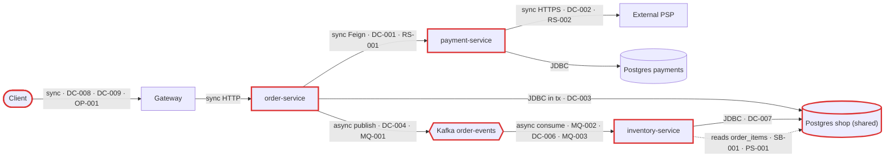
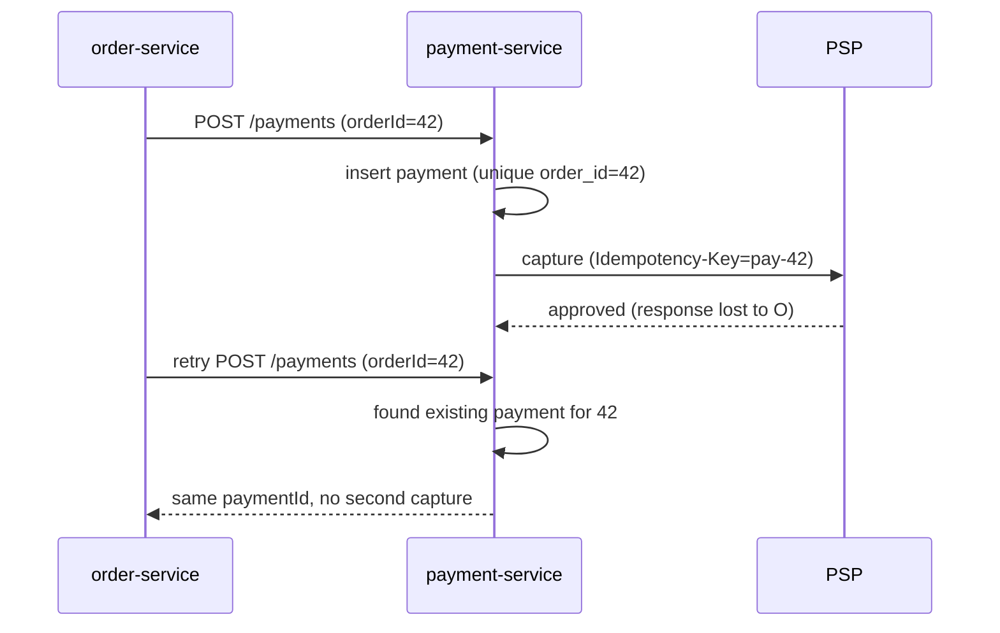
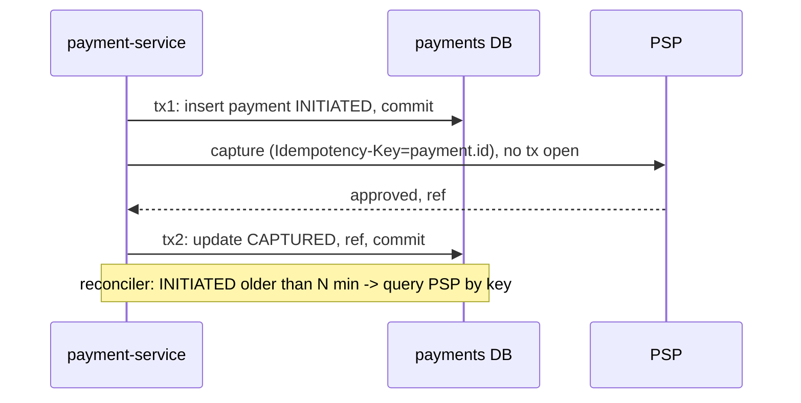
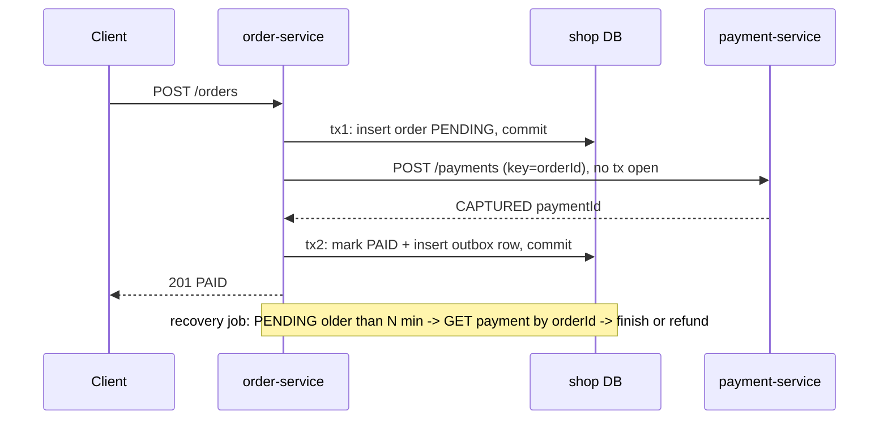
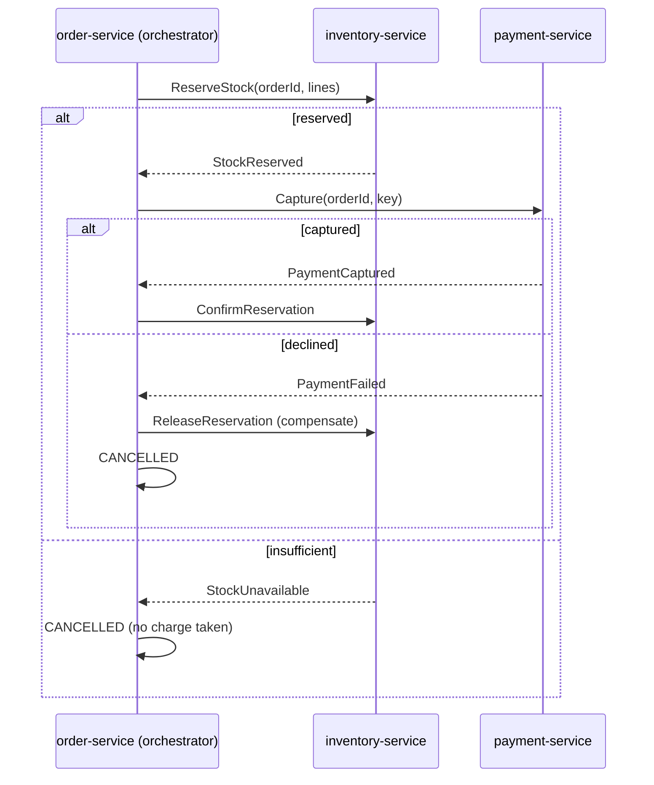
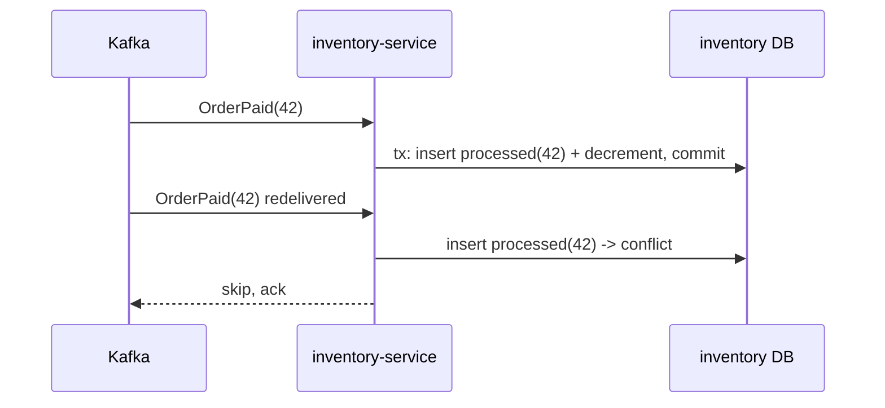

# Architecture review: 02-microservices-distributed-tx (order platform)

- **Mode**: hybrid. Code was reviewed against the README's stated intent (3 teams deploying independently, 2 replicas per service on k8s, ~300 orders/min peak, tripling next year).
- **Date**: 2026-10-24
- **Lenses run**: scalability, data-consistency, resilience, service-boundaries, messaging, persistence, operability. None were skipped. The codebase is small (25 Java files), so the lenses ran as three grouped agents: data-consistency + messaging, resilience + service-boundaries, and scalability + persistence + operability. The parent did not run any lens itself.

## Summary

The platform is three Spring Boot services. order-service charges an order synchronously through payment-service, which captures through an external PSP. order-service then publishes an order-paid event that inventory-service consumes to decrement stock. The biggest risk is that this one business flow spans an HTTP chain, three local transactions and a Kafka publish with no atomicity, no idempotency and no compensation. Under ordinary events (a slow payment-service, a rolling deploy, a consumer rebalance) customers get charged twice or charged with no order, and stock drifts or is never decremented. One defect is worse than the rest: the Kafka event is very likely never deserialized by inventory at all (MQ-001). The change that buys the most is making the money step safe: an idempotency key on the charge, remote calls moved out of DB transactions, and an outbox for the event (DC-001, DC-002, DC-003, DC-004). On its stated intent: at 5 to 15 orders/s the load is easy for this design, but its consistency and failure handling do not yet fit three teams deploying independently on 2 replicas.

| Severity | Count |
|---|---|
| Critical | 10 |
| High | 7 |
| Medium | 8 |
| Low | 2 |
| Info | 0 |

## Architecture profile

- **Architecture**: microservices. Three independently deployed services owned by three teams, talking over HTTP (Feign, RestTemplate) and Kafka. order-service and inventory-service share the Postgres `shop` database.
- **Stack**: Java 17, Spring Boot 3.3.4, Spring Cloud 2023.0.3 (OpenFeign), Spring Data JPA/Hibernate (`ddl-auto: update`), spring-kafka 3.2.x, PostgreSQL 16, Kafka 3.7.
- **Deployables**:
  - `order-service` (order-service/): places and reads orders. db=`shop` (orders, order_items). Calls payment-service POST /payments over Feign with a global `Retryer.Default(100,1000,5)`. Publishes `order-events`.
  - `payment-service` (payment-service/): charges customers via the PSP. db=`payments` (payment). Calls PSP POST /v1/captures through a bare `new RestTemplate()`.
  - `inventory-service` (inventory-service/): stock. db=`shop` (stock_items, plus a read-only mapping of order-service's `order_items`). Consumes `order-events` with auto-commit, concurrency 3.
- **Datastores**: one PostgreSQL server. `shop` is **shared** by order-service and inventory-service. `payments` is used by payment-service only. All services log in with the same DB user. There are no migrations.
- **Messaging**: Kafka topic `order-events` (JSON with type headers, no key). No DLT or retry topics.
- **Background work**: the inventory-service Kafka listener only. No schedulers.
- **Runtime**: k8s with 2 replicas per service and a gateway, according to the README. Neither the manifests nor the gateway config are in the repo. Actuator runs with defaults, and there is no tracing or metrics registry.
- **Stated intent**: independent team deploys, 2 replicas each, ~300 orders/min peak, 3x next year.
- **Derived load**: about 5 orders/s at peak today (about 2.5/s per order-service replica) and about 15/s next year. Each order makes 1 Feign call (up to 5 attempts), 1 PSP capture, 1 Kafka record and N stock-row updates. `order_items` grows by tens of millions of rows a year.
- **Key flows**:
  - place order: client -> gateway -> order-service [one tx: insert order -> Feign /payments -> payment-service tx: insert payment -> PSP capture -> commit -> mark PAID -> send `order-events`] -> commit
  - decrement stock: `order-events` -> inventory listener tx: select `order_items` (order-service's table) -> read-modify-write `stock_items` -> commit, with offsets auto-committed
  - read order: client -> order-service GET /orders/{id}
- **Assumptions** (nobody was available to ask):
  - Mode is hybrid, because the README states scale and deploy intent.
  - The k8s manifests and gateway are out of repo. Where they could mitigate a finding, the severity is kept and the confidence lowered.
  - Money and stock must never be lost or doubled.
  - The PSP supports an idempotency key on captures.
  - The availability target is 99.9%.
  - The production partition count of `order-events` is unknown; the repo implies 1.
  - An outcome of money or stock inconsistency is graded critical when the trigger is the happy path or a routine event at this scale (deploys, timeouts the code anticipates, rebalances).



## Findings

### Critical

#### DC-001 · Global Feign `Retryer.Default(100,1000,5)` retries the non-idempotent POST `/payments`: one order can be charged up to 5 times

Severity: critical · Confidence: high · Lens: data-consistency · Effort: medium

**Where**
- order-service/src/main/java/com/example/platform/order/config/FeignConfig.java:13
- order-service/src/main/java/com/example/platform/order/OrderServiceApplication.java:9
- payment-service/src/main/java/com/example/platform/payment/service/PaymentService.java:24
- payment-service/src/main/java/com/example/platform/payment/psp/PspClient.java:34

**Evidence**
```java
// FeignConfig, applied via @EnableFeignClients(defaultConfiguration = FeignConfig.class)
/** Payment-service is occasionally slow under load; retry so checkout doesn't fail on a blip. */
@Bean
public Retryer feignRetryer() { return new Retryer.Default(100, 1000, 5); }

// PaymentService.charge: no dedupe on orderId, no idempotency key to the PSP
Payment payment = payments.save(new Payment(orderId, customerId, amount));
PspClient.CaptureResponse response = psp.capture(customerId, amount);
```

**What goes wrong**: payment-service is slow, which is the case the comment anticipates. The PSP captures the money, but order-service's Feign read times out. Feign turns the IOException into a RetryableException and re-POSTs. payment-service saves a fresh Payment and captures again, up to 5 attempts in all. The customer is charged several times, and order-service keeps only the last paymentId. The same retryer also multiplies load on an already overloaded payment-service, with no jitter or deadline, and every Feign client added later inherits it.

**Fix** (`idempotency-key`): add a unique constraint on `payment.order_id`, or on an `Idempotency-Key`, and return the existing payment on a repeat request. Send a stable key to the PSP. Make `Retryer.NEVER_RETRY` the default. For this client, allow at most one jittered retry, on connect failures only, inside one deadline. Keep retries in one layer only.

```java
@Transactional
public Payment charge(Long orderId, String customerId, BigDecimal amount) {
    return payments.findByOrderId(orderId)            // unique index on order_id
        .orElseGet(() -> startAndCapture(orderId, customerId, amount)); // see DC-002
}
// PspClient: headers.set("Idempotency-Key", payment.getId());
```



**Why it's worth it here**: charging is retried over HTTP by design, and money must never be doubled.

#### DC-002 · PSP capture runs inside payment-service's `@Transactional charge`: a captured charge can be left with no payment record

Severity: critical · Confidence: high · Lens: data-consistency · Effort: medium

**Where**
- payment-service/src/main/java/com/example/platform/payment/service/PaymentService.java:22
- payment-service/src/main/java/com/example/platform/payment/service/PaymentService.java:25

**Evidence**
```java
@Transactional
public Payment charge(Long orderId, String customerId, BigDecimal amount) {
    Payment payment = payments.save(new Payment(orderId, customerId, amount));
    PspClient.CaptureResponse response = psp.capture(customerId, amount);
    if (!"approved".equals(response.outcome())) {
        throw new PaymentDeclinedException(orderId);
    }
    payment.captured(response.reference());
    return payment;
}
```

**What goes wrong**: the PSP captures. Then, before the commit, the pod is killed in a deploy, the connection drops during the slow call, or the response fails to parse. The rollback erases the payment row and its pspReference. The PSP keeps the money and there is nothing to reconcile or refund it against. Declines roll back too, so `FAILED` is never recorded. Each charge holds a DB connection for the full PSP latency.

**Fix** (`move-call-outside-transaction`): (1) commit INITIATED in a short transaction; (2) call the PSP with no transaction open, keyed by the payment id; (3) in a second short transaction, mark CAPTURED or FAILED. A reconciliation job resolves stale INITIATED rows by querying the PSP.



**Why it's worth it here**: a third-party money movement cannot be rolled back with the local transaction.

#### DC-003 · `placeOrder` holds one DB transaction across the Feign charge and the Kafka send: a rollback after capture leaves a paid charge with no order

Severity: critical · Confidence: high · Lens: data-consistency · Effort: medium

**Where**
- order-service/src/main/java/com/example/platform/order/service/OrderService.java:38
- order-service/src/main/java/com/example/platform/order/service/OrderService.java:44
- order-service/src/main/java/com/example/platform/order/service/OrderService.java:53

**Evidence**
```java
@Transactional
public Order placeOrder(String customerId, List<Line> lines) {
    ...
    orders.save(order);
    ChargeResponse payment = takePayment(order);   // -> paymentClient.charge(...) (Feign)
    order.markPaid(payment.paymentId());
    kafkaTemplate.send(ORDER_EVENTS, new OrderPaidEvent(...));
    ...
}
```

**What goes wrong**: payment-service captures and returns 200. Then something fails before order-service commits. Kafka metadata may be unavailable, in which case `send` blocks for up to 60 s (`max.block.ms` default) and throws. The commit may fail, or the pod may be terminated mid-deploy. The order rolls back and the client gets a 500 (and probably retries, see DC-009). payment-service is left holding a CAPTURED payment for an order that no longer exists, and nothing refunds it. The transaction also holds a Hikari connection through every Feign attempt and the Kafka block. A slow payment-service or broker therefore drains the 10-connection pool within seconds at 2.5 orders/s per replica, and GET /orders fails too. (The resilience lens's Kafka-blocking finding is folded in here.)

**Fix** (`move-call-outside-transaction`): commit the order as PENDING first. Charge with no transaction open, passing the order id as the idempotency key (DC-001). Mark it PAID and write the event to the outbox (DC-004) in a second short transaction. A recovery job finishes, or cancels and refunds, PENDING orders older than N minutes. Until the outbox exists, set `spring.kafka.producer.properties.max.block.ms: 2000`.



**Why it's worth it here**: the remote charge cannot be undone by a local rollback, and the same transaction holds a pooled DB connection on the checkout path.

#### DC-004 · `order-events` is sent inside the DB transaction with no outbox: events are lost, or arrive before commit so inventory decrements nothing

Severity: critical · Confidence: high · Lens: data-consistency · Effort: medium

**Where**
- order-service/src/main/java/com/example/platform/order/service/OrderService.java:47
- order-service/src/main/java/com/example/platform/order/service/OrderService.java (missing transactional outbox)
- inventory-service/src/main/java/com/example/platform/inventory/messaging/OrderEventsListener.java:29

**Evidence**
```java
// order-service, inside @Transactional placeOrder; returned future ignored
kafkaTemplate.send(ORDER_EVENTS, new OrderPaidEvent(order.getId(), customerId, order.getTotal(), Instant.now()));

// inventory-service: loads lines from order-service's table, empty result = success
for (OrderLine line : orderLines.findByOrderId(event.orderId())) { ... }
log.info("Stock decremented for order {}", event.orderId());
```

**What goes wrong**:
- (a) The send is buffered and the order commits. The broker then fails the batch or the pod dies before the flush, and the event is silently lost.
- (b) The record goes out, then the commit fails. Inventory receives an event for an order that does not exist.
- (c) The record reaches inventory before order-service commits. With `linger.ms=0` that takes a few ms. Under READ COMMITTED, `findByOrderId` returns zero rows, the loop does nothing, the handler logs "Stock decremented" and the offset commits. The order is charged and PAID, stock never moves, and nothing errors. (The data-consistency lens reported case (c) as a separate candidate; it is merged here because the root cause is the same.)

**Fix** (`transactional-outbox`): write the event to an `outbox` table in the same transaction that marks the order PAID, and relay it with a poller or Debezium. Put the lines (sku, quantity) into the event so inventory never reads order-service's rows (SB-001). Treat an event with zero lines as an error.

```mermaid
sequenceDiagram
  participant O as order-service
  participant DB as shop DB
  participant R as outbox relay
  participant K as Kafka
  participant I as inventory-service
  O->>DB: tx: update order PAID + insert outbox(event with lines), commit
  R->>DB: poll unsent outbox rows
  R->>K: publish OrderPaid (key=orderId)
  K-->>R: ack
  R->>DB: mark row sent
  K->>I: deliver (at least once; I dedupes, DC-006)
```

**Why it's worth it here**: inventory correctness depends on every order-paid event being delivered, and only after the order is committed.

#### DC-005 · Order, payment and stock form a saga with no compensation: an insufficient-stock failure leaves the customer charged for an order that can't ship

Severity: critical · Confidence: high · Lens: data-consistency · Effort: large

**Where**
- inventory-service/src/main/java/com/example/platform/inventory/messaging/OrderEventsListener.java:33
- order-service/src/main/java/com/example/platform/order/domain/Order.java:22
- payment-service/src/main/java/com/example/platform/payment/api/PaymentController.java (missing refund/cancel endpoint)

**Evidence**
```java
if (item.getAvailable() < line.getQuantity()) {
    throw new InsufficientStockException(line.getSku(), event.orderId());
}
// Order:   public enum Status { PENDING, PAID, CANCELLED }   -- CANCELLED never assigned
// Payment: public enum Status { INITIATED, CAPTURED, FAILED } -- FAILED never assigned
```

**What goes wrong**: two customers buy the last unit. Both are charged and both orders become PAID. Inventory decrements stock for the first order. The second order throws, is retried, and is then dropped by the default error handler (MQ-002). That customer stays charged for an order that shows PAID and can never ship, and nothing triggers a refund. An unknown SKU takes the same path. Stock is first checked after the money has moved.

**Fix** (`saga-orchestration`): orchestrate checkout in order-service with persisted states: PENDING -> STOCK_RESERVED -> PAID -> CONFIRMED, plus CANCELLED and REFUNDED. Reserve stock before capturing payment (reservation pattern), and add a refund command to payment-service as the compensating action. Drive the steps through the outbox (DC-004) and idempotent handlers (DC-006).



**Why it's worth it here**: the flow spans three services owned by three teams, and a later step can fail after money has moved.

#### DC-006 · `onOrderPaid` decrements stock with no processed-event check: every redelivery decrements again

Severity: critical · Confidence: high · Lens: data-consistency · Effort: small

**Where**
- inventory-service/src/main/java/com/example/platform/inventory/messaging/OrderEventsListener.java:35
- inventory-service/src/main/java/com/example/platform/inventory/messaging/OrderEventsListener.java (missing processed-events table / status guard)

**Evidence**
```java
item.setAvailable(item.getAvailable() - line.getQuantity());
// no event id, no processed_events table; consumer has enable-auto-commit: true
```

**What goes wrong**: the handler commits its stock transaction. The next 5 s auto-commit then never happens, because of a rolling deploy kill or a rebalance across 2 replicas x 3 threads. The new partition owner replays up to 5 s of events and decrements stock again for each one. Stock under-counts, which produces false out-of-stock and failed orders.

**Fix** (`idempotent-consumer`):
```java
@KafkaListener(topics = "order-events")
@Transactional
public void onOrderPaid(OrderPaidEvent event) {
    if (processed.insertIfAbsent(event.orderId()) == 0) return; // INSERT ... ON CONFLICT DO NOTHING
    ... decrement ...
}
```



**Why it's worth it here**: Kafka delivers at least once, and the effect is a non-idempotent stock decrement.

#### DC-007 · `stock_items.available` is updated by unlocked read-modify-write: concurrent orders for one SKU lose decrements and oversell

Severity: critical · Confidence: medium · Lens: data-consistency · Effort: small

**Where**
- inventory-service/src/main/java/com/example/platform/inventory/messaging/OrderEventsListener.java:30
- inventory-service/src/main/java/com/example/platform/inventory/domain/StockItem.java:14
- inventory-service/src/main/resources/application.yml:24

**Evidence**
```java
StockItem item = stock.findById(line.getSku()).orElseThrow(...);
if (item.getAvailable() < line.getQuantity()) { throw ... }
item.setAvailable(item.getAvailable() - line.getQuantity());
// StockItem: no @Version; StockRepository: no @Lock / @Modifying; listener concurrency: 3, 2 replicas; no message key
```

**What goes wrong**: two orders for SKU X run at once on different partitions. Both read 5, one writes 4, the other writes 3, and one decrement is lost. The check-then-act also lets stock oversell. Confidence is medium because the race needs more than one partition, and the repo only implies 1 (SC-001). The `concurrency: 3` setting shows more partitions are intended, though, and scaling out exposes the race at once.

**Fix** (`atomic-conditional-update`):
```java
@Modifying
@Query("update StockItem s set s.available = s.available - :q where s.sku = :sku and s.available >= :q")
int decrement(@Param("sku") String sku, @Param("q") int q);   // 0 rows => insufficient stock
```
Process an order's SKUs in sorted order to avoid deadlocks.

**Why it's worth it here**: stock rows are shared by concurrent consumer threads across replicas.

#### DC-008 · POST `/orders` trusts client-supplied `unitPrice` and `quantity` unvalidated: callers set their own charge and can add phantom stock

Severity: critical · Confidence: medium · Lens: data-consistency · Effort: medium

**Where**
- order-service/src/main/java/com/example/platform/order/api/OrderController.java:40
- order-service/src/main/java/com/example/platform/order/service/OrderService.java:35
- order-service/src/main/java/com/example/platform/order/domain/Order.java:48

**Evidence**
```java
public ResponseEntity<OrderView> place(@RequestBody PlaceOrderRequest request)   // no @Valid
public record Line(String sku, int quantity, BigDecimal unitPrice)
total = total.add(unitPrice.multiply(BigDecimal.valueOf(quantity)));              // becomes the PSP amount
```

**What goes wrong**:
- `unitPrice: 0.01`, or a negative line that cancels out another, means the caller chooses what they pay.
- `quantity: -50` passes `available < quantity`, and inventory then adds 50 phantom units.
- Empty `lines` produce a 0.00 charge.
- A null price throws an NPE.

Confidence is medium only because a gateway or BFF outside the repo might set prices. Nothing in the repo shows one.

**Fix** (`input-validation`): validate at the boundary with `@Valid`, `@NotEmpty` lines, `@Positive` quantity and a non-null sku. Price on the server from an authoritative catalog and never accept `unitPrice` from the client. payment-service should reject amounts that are not positive.

**Why it's worth it here**: request fields flow straight into the amount charged and the stock count.

#### MQ-001 · Producer `__TypeId__` header names `com.example.platform.order.events.OrderPaidEvent`, a class inventory cannot load: every event fails to deserialize

Severity: critical · Confidence: high · Lens: messaging · Effort: small

**Where**
- order-service/src/main/resources/application.yml:16
- inventory-service/src/main/resources/application.yml:19
- inventory-service/src/main/resources/application.yml:22

**Evidence**
```yaml
# order-service
value-serializer: org.springframework.kafka.support.serializer.JsonSerializer
# inventory-service
value-deserializer: org.springframework.kafka.support.serializer.JsonDeserializer
properties:
  spring.json.trusted.packages: "*"
  spring.json.value.default.type: com.example.platform.inventory.messaging.OrderPaidEvent
```

**What goes wrong**: JsonSerializer adds a `__TypeId__` header with the producer's class name, because type headers are on by default. With type headers enabled, JsonDeserializer resolves the type from that header rather than from `value.default.type`. `trusted.packages: "*"` lets the header through, and class loading fails with "Class not found". There is no ErrorHandlingDeserializer, so this fails on poll for every record: the partition either stalls or the records are skipped. Either way, stock is never decremented. The `*` trust setting also lets a producer name any class on inventory's classpath.

**Fix** (`event-versioning`):
```yaml
# inventory-service
spring.kafka.consumer.properties:
  spring.json.use.type.headers: false
  spring.json.trusted.packages: com.example.platform.inventory.messaging
spring.kafka.consumer.value-deserializer: org.springframework.kafka.support.serializer.ErrorHandlingDeserializer
spring.kafka.consumer.properties.spring.deserializer.value.delegate.class: org.springframework.kafka.support.serializer.JsonDeserializer
```
Or map a logical type id on both sides with `spring.json.type.mapping`. Add a contract test that deserializes a record serialized by the producer.

**Why it's worth it here**: producer and consumer are separate codebases whose event classes live in different packages.

#### MQ-002 · `order-events` has no DLT or backoff: the default `DefaultErrorHandler` retries 9 times in milliseconds, then logs and drops the event

Severity: critical · Confidence: high · Lens: messaging · Effort: small

**Where**
- inventory-service/src/main/java/com/example/platform/inventory/messaging/OrderEventsListener.java:26
- inventory-service/src/main/resources/application.yml (missing error handler / DeadLetterPublishingRecoverer / ErrorHandlingDeserializer)

**Evidence**
```java
@KafkaListener(topics = "order-events")   // throws IllegalStateException("Unknown SKU ...") and InsufficientStockException
// no DefaultErrorHandler bean, no DeadLetterPublishingRecoverer, no @RetryableTopic anywhere
```

**What goes wrong**: the default handler uses FixedBackOff(0 ms, 9 retries). A DB blip of more than a few milliseconds, an unknown SKU or insufficient stock burns all 10 attempts almost instantly. The record is then logged and committed past. A paid order's stock decrement is gone, with no copy to replay.

**Fix** (`dead-letter-queue`):
```java
@Bean
DefaultErrorHandler errorHandler(KafkaTemplate<Object, Object> t) {
    var h = new DefaultErrorHandler(new DeadLetterPublishingRecoverer(t),
                                    new ExponentialBackOffWithMaxRetries(6)); // 1s .. 30s
    h.addNotRetryableExceptions(InsufficientStockException.class);
    return h;
}
```
Business failures should go to the DLT, or become a compensation event once DC-005 exists. Provide a DLT replay tool and alerting (OP-005).

**Why it's worth it here**: every event is a must-not-lose stock decrement for a paid order.

### High

#### DC-009 · POST `/orders` has no idempotency key: a client or gateway retry after a timeout creates a second order and a second charge

Severity: high · Confidence: medium · Lens: data-consistency · Effort: small

**Where**
- order-service/src/main/java/com/example/platform/order/api/OrderController.java:39
- order-service/src/main/java/com/example/platform/order/api/OrderController.java (missing Idempotency-Key handling)

**Evidence**
```java
@PostMapping
public ResponseEntity<OrderView> place(@RequestBody PlaceOrderRequest request)
// each call: new Order(customerId) with an IDENTITY id; no key, no unique client reference
```

**What goes wrong**: the chain is slow, so the client or gateway times out and retries, or the user clicks again. Each attempt gets a new order id, so dedupe by orderId (DC-001) cannot catch it, and each attempt charges the customer. Confidence is medium because the gateway and client retry behaviour are not in the repo.

**Fix** (`idempotency-key`): require an `Idempotency-Key` header with a unique constraint per customer, and return the existing order on a repeat. With the PENDING-first flow (DC-003), a retry resumes the existing order.

**Why it's worth it here**: a user-facing POST moves money behind a gateway over a slow synchronous chain.

#### RS-001 · Feign call to `payment-service` has no timeouts configured (10 s connect / 60 s read defaults, x5 attempts) on the checkout path

Severity: high · Confidence: high · Lens: resilience · Effort: small

**Where**
- order-service/src/main/resources/application.yml (missing spring.cloud.openfeign.client.config.payment-service connectTimeout/readTimeout)
- order-service/src/main/java/com/example/platform/order/service/OrderService.java:53

**Evidence**
```java
return paymentClient.charge(new ChargeRequest(order.getId(), order.getCustomerId(), order.getTotal()));
// application.yml: no spring.cloud.openfeign block -> Request.Options defaults (10 s connect, 60 s read)
```

**What goes wrong**: when payment-service slows down, each order waits up to about 5 minutes across 5 attempts while holding a thread and a DB connection. At 2.5 orders/s per replica, the 10-connection pool is gone in about 4 s, and every endpoint on that replica fails. A slow payment-service (or PSP) becomes an order-service outage.

**Fix** (`timeouts`):
```yaml
spring.cloud.openfeign.client.config.payment-service:
  connectTimeout: 1000
  readTimeout: 4000     # > payment-service's PSP timeout + DB work
```
Add an overall deadline across retries. DC-003 removes the coupling to the DB pool.

**Why it's worth it here**: payment-service is called synchronously on every order on the main checkout path.

#### RS-002 · PSP client is a bare `new RestTemplate()` with infinite connect/read timeouts

Severity: high · Confidence: high · Lens: resilience · Effort: small

**Where**
- payment-service/src/main/java/com/example/platform/payment/config/HttpClientConfig.java:12
- payment-service/src/main/java/com/example/platform/payment/psp/PspClient.java:34

**Evidence**
```java
@Bean
public RestTemplate restTemplate() { return new RestTemplate(); }   // SimpleClientHttpRequestFactory, no timeouts
return restTemplate.postForObject(baseUrl + "/v1/captures", ...);
```

**What goes wrong**: during a PSP brownout, every charge thread blocks forever while holding a `payments` connection. Feign retries from order-service pile more hung requests on top. Both replicas run out of threads and connections, and they stay stuck after the PSP recovers, until the pods restart.

**Fix** (`timeouts`):
```java
@Bean
RestTemplate pspRestTemplate(RestTemplateBuilder b) {
    return b.setConnectTimeout(Duration.ofSeconds(1)).setReadTimeout(Duration.ofSeconds(3)).build();
}
```
Keep this timeout below order-service's Feign read timeout. Using `RestTemplateBuilder` also enables tracing (OP-004).

**Why it's worth it here**: every order synchronously captures through a third-party PSP on the request path.

#### SB-001 · inventory-service reads, and its Hibernate `ddl-auto` manages, order-service's `order_items` table in the shared `shop` database

Severity: high · Confidence: high · Lens: service-boundaries · Effort: medium

**Where**
- inventory-service/src/main/java/com/example/platform/inventory/domain/OrderLine.java:14
- inventory-service/src/main/java/com/example/platform/inventory/domain/OrderLineRepository.java:9
- inventory-service/src/main/resources/application.yml:5
- order-service/src/main/resources/application.yml:5
- order-service/src/main/java/com/example/platform/order/domain/OrderItem.java:14

**Evidence**
```java
@Entity @Immutable @Table(name = "order_items")
public class OrderLine { @Id private Long id; @Column(name = "order_id") private Long orderId; private String sku; private int quantity; ... }
```
```yaml
# both order-service and inventory-service
url: ${SPRING_DATASOURCE_URL:jdbc:postgresql://localhost:5432/shop}
username: platform
ddl-auto: update
```

**What goes wrong**:
- (1) The Checkout team refactors `order_items` on its own schedule. inventory-service then breaks, or silently decrements nothing.
- (2) On a fresh database where inventory-service starts first, its `ddl-auto` creates `order_items` with a plain `id bigint not null` and no identity. Every order insert then fails and checkout is down.
- (3) One DB user and one server shared by both teams means inventory queries compete with checkout.

**Fix** (`database-per-service`): give each service its own database or schema and user. Carry the lines in the event (DC-004), delete `OrderLine` and `OrderLineRepository`, and revoke access to the table. Protect the event contract with a contract test (MQ-004).

**Why it's worth it here**: the two services are owned by different teams that deploy independently, as the README states.

#### PS-001 · No index on `order_items.order_id`, yet inventory-service queries by it for every `order-events` message

Severity: high · Confidence: high · Lens: persistence · Effort: small

**Where**
- order-service/src/main/java/com/example/platform/order/domain/OrderItem.java:21
- inventory-service/src/main/java/com/example/platform/inventory/domain/OrderLineRepository.java:9

**Evidence**
```java
@ManyToOne
@JoinColumn(name = "order_id")
private Order order;                                  // no @Table(indexes = ...)
List<OrderLine> findByOrderId(Long orderId);          // called once per event
```

**What goes wrong**: `ddl-auto` creates the foreign key but no index, and Postgres does not index foreign keys automatically. The table grows by tens of millions of rows a year. Every event does a full sequential scan, so consumer lag and stock staleness grow with the table, and the scans compete with checkout on the shared server.

**Fix** (`add-index`):
```sql
CREATE INDEX CONCURRENTLY order_items_order_id_idx ON order_items(order_id);
```
Ship it as an order-service migration (PS-002). It becomes moot once inventory stops reading the table (SB-001).

**Why it's worth it here**: `order_items` grows with every order and is queried by `order_id` on every event, on a shared DB server.

#### PS-002 · Production schema is managed by Hibernate `ddl-auto: update` in all three services, with no versioned migrations

Severity: high · Confidence: medium · Lens: persistence · Effort: medium

**Where**
- order-service/src/main/resources/application.yml:10
- inventory-service/src/main/resources/application.yml:10
- payment-service/src/main/resources/application.yml:10

**Evidence**
```yaml
jpa:
  hibernate:
    ddl-auto: update        # all three services; no Flyway/Liquibase in any pom
```

**What goes wrong**: a deploy that adds a field runs `ALTER TABLE orders ...` at startup. That needs an ACCESS EXCLUSIVE lock, which waits behind in-flight `placeOrder` transactions held open by Feign retries and an un-timed PSP call. All later queries on `orders` queue behind the ALTER, and checkout stops. Update mode never renames or drops anything, and replicas that start together can race on the same DDL. Confidence is medium because production might override `ddl-auto` through env vars.

**Fix** (`versioned-migrations`): Flyway per owning service, with `ddl-auto: validate` (or `none` in inventory until SB-001 is done). Set `SET lock_timeout` in migrations, and use expand-contract for renames and drops.

**Why it's worth it here**: three teams deploy independently onto shared production databases at 2 replicas each.

#### OP-001 · No authenticated identity reaches the services: order-service charges whatever `customerId` the body names, and `/payments` is open

Severity: high · Confidence: medium · Lens: operability · Effort: medium

**Where**
- order-service/src/main/java/com/example/platform/order/api/OrderController.java:40
- payment-service/src/main/java/com/example/platform/payment/api/PaymentController.java:28
- order-service/pom.xml (missing spring-boot-starter-security / oauth2-resource-server)

**Evidence**
```java
public record PlaceOrderRequest(String customerId, List<OrderService.Line> lines)
Order order = orderService.placeOrder(request.customerId(), request.lines());
// payment-service
@PostMapping public ChargeResponse charge(@RequestBody ChargeRequest request)
```

**What goes wrong**: even behind an authenticating gateway, any logged-in client can name another customer and have the PSP capture against them. Anything inside the cluster can POST `/payments` with any customer and amount.

**Fix** (`api-gateway`): the gateway forwards a verified JWT. order-service becomes a resource server and takes `customerId` from the token. payment-service requires service-to-service auth (mTLS or client credentials) and a NetworkPolicy. Commission a dedicated security review.

**Why it's worth it here**: external clients reach a service that triggers real money movement.

### Medium

#### MQ-003 · `enable-auto-commit: true` commits offsets on a 5 s timer, independently of the stock transaction

Severity: medium · Confidence: high · Lens: messaging · Effort: small

**Where**
- inventory-service/src/main/resources/application.yml:16

**Evidence**
```yaml
consumer:
  group-id: inventory-service
  enable-auto-commit: true
```

**What goes wrong**: offsets are committed on the consumer's own timer, which bypasses the container's AckMode. After a crash or rebalance, up to 5 s of applied events are replayed and, without DC-006, decremented again.

**Fix** (`manual-ack-after-processing`): remove the line, so spring-kafka's default of false applies, and use AckMode RECORD or BATCH so offsets are committed after the DB transaction.

**Why it's worth it here**: each message drives a must-not-double stock change.

#### MQ-004 · `OrderPaidEvent` is hand-copied into two independently deployed services with no version field or contract check

Severity: medium · Confidence: high · Lens: messaging · Effort: medium

**Where**
- order-service/src/main/java/com/example/platform/order/events/OrderPaidEvent.java:6
- inventory-service/src/main/java/com/example/platform/inventory/messaging/OrderPaidEvent.java:6

**Evidence**
```java
public record OrderPaidEvent(Long orderId, String customerId, BigDecimal total, Instant paidAt) {}   // in both services
```

**What goes wrong**: the checkout team renames `orderId` and deploys. Inventory receives null, `findByOrderId(null)` returns nothing, the handler logs success, and stock silently stops moving.

**Fix** (`event-versioning`): an explicit, versioned contract (`eventType` and `version` fields, or JSON Schema/Avro with compatibility checks), rejection of events with missing fields, and a consumer-driven contract test in the producer's build.

**Why it's worth it here**: producer and consumer are owned by different teams that deploy on their own schedules.

#### RS-003 · No circuit breaker around `payment-service` or the PSP: an outage costs every order a full timeout

Severity: medium · Confidence: medium · Lens: resilience · Effort: medium

**Where**
- order-service/pom.xml (missing spring-cloud-starter-circuitbreaker-resilience4j)
- payment-service/src/main/java/com/example/platform/payment/psp/PspClient.java:31

**Evidence**
```java
public CaptureResponse capture(String customerId, BigDecimal amount) {   // direct call, no breaker anywhere in the repo
```

**What goes wrong**: during a multi-minute PSP or payment-service outage, every order waits out the full timeout and retry sequence, and the calls keep loading the struggling dependency. A mesh outside the repo could cover payment-service, but it would not cover the external PSP.

**Fix** (`circuit-breaker`): after RS-001 and RS-002, wrap `PspClient.capture` in a Resilience4j breaker that fails fast with a retryable "payment unavailable" response, and enable the OpenFeign circuit breaker for `PaymentClient`.

**Why it's worth it here**: two remote dependencies, one a third party, sit on the checkout path at about 5 calls/s that will triple.

#### RS-004 · Checkout is a 3-deep synchronous chain: client -> order-service -> payment-service -> external PSP

Severity: medium · Confidence: high · Lens: resilience · Effort: large

**Where**
- order-service/src/main/java/com/example/platform/order/service/OrderService.java:44
- payment-service/src/main/java/com/example/platform/payment/service/PaymentService.java:25

**Evidence**
```java
ChargeResponse payment = takePayment(order);                          // order-service -> payment-service
PspClient.CaptureResponse response = psp.capture(customerId, amount); // payment-service -> PSP
```

**What goes wrong**: checkout needs order-service, payment-service, the PSP, Postgres and Kafka all up at once. That gives about 99.5% at 99.9% each, before retries. Every payment-service deploy or incident lowers checkout availability, which works against the README's goal of independent deploys.

**Fix** (`async-decoupling`): short term, bound the one synchronous hop (RS-001 to RS-003) and return PENDING on timeout. Once DC-004 and DC-005 exist, consider asynchronous payment: accept the order as PENDING and return 202, then publish the payment outcome.

**Why it's worth it here**: the chain ends in a third party the user waits on, three teams own the links, and volume will triple.

#### OP-002 · No graceful shutdown on Boot 3.3.4: every rolling deploy cuts in-flight checkout and payment requests

Severity: medium · Confidence: high · Lens: operability · Effort: small

**Where**
- order-service/src/main/resources/application.yml (missing server.shutdown / spring.lifecycle.timeout-per-shutdown-phase)
- payment-service/src/main/resources/application.yml (missing server.shutdown / spring.lifecycle.timeout-per-shutdown-phase)
- inventory-service/src/main/resources/application.yml (missing server.shutdown / spring.lifecycle.timeout-per-shutdown-phase)

**Evidence**
```
# none of the three application.yml files sets server.shutdown; Boot 3.3.4 defaults to "immediate"
ENTRYPOINT ["java", "-jar", "/app.jar"]
```

**What goes wrong**: SIGTERM closes the context and the Hikari pool while a charge is waiting on the PSP. The capture succeeds but the payment's transaction fails, and that triggers DC-001 or DC-003. Three teams deploying independently make this routine. It is graded medium because the money loss belongs to DC-001 to DC-003. Once those are fixed, what remains is failed requests on every deploy.

**Fix** (`graceful-shutdown`):
```yaml
server.shutdown: graceful
spring.lifecycle.timeout-per-shutdown-phase: 20s   # > worst-case request time once RS-001/RS-002 bound it
```
Add a preStop sleep and set `terminationGracePeriodSeconds` above preStop plus the drain time.

**Why it's worth it here**: frequent independent rolling deploys of services that hold money-moving requests in flight.

#### OP-003 · DB credentials `platform`/`platform` committed in all three services, one login for both `shop` and `payments`

Severity: medium · Confidence: medium · Lens: operability · Effort: small

**Where**
- order-service/src/main/resources/application.yml:6
- payment-service/src/main/resources/application.yml:6
- inventory-service/src/main/resources/application.yml:6

**Evidence**
```yaml
username: platform
password: platform        # literal in all three; compare  api-key: ${PSP_API_KEY}
```

**What goes wrong**: anyone with repo access has a working DB credential. Every service can read and write the `payments` database. Rotating the password needs a coordinated redeploy across three teams. Production may override these through env vars, hence medium confidence.

**Fix** (`secrets-manager`): inject `SPRING_DATASOURCE_USERNAME` and `SPRING_DATASOURCE_PASSWORD` from k8s Secrets, and give each service a least-privilege role. Drop the sandbox fallback for `psp.base-url`, so a missing prod variable fails at startup.

**Why it's worth it here**: production services handling payment data share one Postgres server.

#### OP-004 · No distributed tracing or correlation id across order-, payment- and inventory-service (HTTP and Kafka)

Severity: medium · Confidence: high · Lens: operability · Effort: small

**Where**
- order-service/pom.xml (missing micrometer-tracing bridge / feign-micrometer)
- payment-service/src/main/java/com/example/platform/payment/config/HttpClientConfig.java:12
- inventory-service/pom.xml (missing micrometer-tracing bridge)

**Evidence**
```java
return new RestTemplate();   // bypasses RestTemplateBuilder, so it stays uninstrumented
log.info("Order {} placed and paid ({})", order.getId(), payment.paymentId());   // no trace id
```

**What goes wrong**: when a customer is charged with no order, or stock never moves, support has to grep three services' logs by timestamp and cannot follow a retry, a PSP call or a Kafka record to its outcome.

**Fix** (`distributed-tracing`): `micrometer-tracing-bridge-otel` plus an exporter in all three, `feign-micrometer`, a PSP client built from `RestTemplateBuilder`, Kafka observation enabled on the template and the listener, and traceId and orderId in the log pattern.

**Why it's worth it here**: three deployables owned by different teams take part in one money-moving flow.

#### OP-005 · No metrics or alerts on consumer lag, skipped `order-events` records, pool saturation or payment outcomes

Severity: medium · Confidence: high · Lens: operability · Effort: small

**Where**
- inventory-service/pom.xml (missing micrometer-registry-prometheus)
- payment-service/src/main/java/com/example/platform/payment/service/PaymentService.java:26

**Evidence**
```java
if (!"approved".equals(response.outcome())) { throw new PaymentDeclinedException(orderId); }   // no counter
// actuator default exposure (health only), no registry in any pom
```

**What goes wrong**: skipped stock decrements, consumer lag, pool exhaustion and PSP slowdowns produce at most a log line. The first signal is customer complaints.

**Fix** (`metrics-and-alerts`): Prometheus registry and exposure in all three. Alerts on consumer-group lag, DLT depth (after MQ-002), Hikari pending connections, 5xx and p99, and PSP latency and decline rate. Business counters.

**Why it's worth it here**: production services on a money and stock flow with an assumed 99.9% target.

### Low

#### SC-001 · `order-events` partition count is undeclared, so `concurrency: 3` x 2 replicas likely leaves 5 of 6 consumer threads idle

Severity: low · Confidence: medium · Lens: scalability · Effort: small

**Where**
- inventory-service/src/main/resources/application.yml:24
- order-service/src/main/java/com/example/platform/order/service/OrderService.java:23
- docker-compose.yml (missing KAFKA_CFG_NUM_PARTITIONS / NewTopic declaration for order-events)

**Evidence**
```yaml
listener:
  concurrency: 3
```
```java
static final String ORDER_EVENTS = "order-events";   // auto-created; broker default num.partitions=1
```

**What goes wrong**: one thread does all the stock work, and extra replicas add nothing. Once PS-001 is fixed, one thread comfortably handles 15 msg/s, so this is low. Adding partitions before DC-007 opens the lost-update race.

**Fix** (`consumer-concurrency`): declare the topic with partitions >= replicas x concurrency (6 to 12), keyed by orderId. Do this after DC-006 and DC-007.

**Why it's worth it here**: the stock consumer will be scaled for growth, and the 2-replica setup should actually add capacity.

#### OP-006 · k8s runtime contract (probes, requests and limits, PDB, JVM memory) cannot be checked; the image uses JVM defaults

Severity: low · Confidence: low · Lens: operability · Effort: small

**Where**
- order-service/Dockerfile:3
- order-service/src/main/resources/application.yml (missing management.endpoint.health.probes config)

**Evidence**
```dockerfile
ENTRYPOINT ["java", "-jar", "/app.jar"]   # no -XX:MaxRAMPercentage, so the heap is 25% of the container limit
```

**What goes wrong**: without a PDB, a node drain can evict both replicas at once. If liveness points at `/actuator/health` (which includes the db indicator), a Postgres blip restarts all six pods together.

**Fix** (`resource-requests-and-disruption-budget`): versioned manifests with liveness and readiness on the probe groups, requests and limits, `minAvailable: 1`, and `-XX:MaxRAMPercentage=75`. Close this if the infra repo already has them.

**Why it's worth it here**: k8s with 2 replicas per service and no manifests reviewable here.

## Roadmap

**Now**
- MQ-001: stop the `__TypeId__` coupling and add ErrorHandlingDeserializer. Unblocks nothing.
- DC-001: make POST /payments and the PSP capture idempotent; make `NEVER_RETRY` the default. Unblocks DC-003.
- DC-002: split payment-service's charge into commit, then capture, then commit, plus a reconciler. Unblocks nothing.
- DC-006: add a processed-events guard in the inventory listener. Unblocks DC-004, SC-001.
- DC-004: transactional outbox for `order-events`, carrying lines in the event. Unblocks DC-003, SB-001, DC-005.
- DC-003: PENDING-first `placeOrder` with the charge outside the transaction, plus a recovery job. Unblocks DC-005.
- DC-007: atomic conditional stock decrement. Unblocks SC-001.
- DC-008: validate order input and price on the server. Unblocks nothing.
- MQ-002: DefaultErrorHandler with backoff and a DLT. Unblocks DC-005, OP-005.
- DC-009: Idempotency-Key on POST /orders. Unblocks nothing.
- RS-002: timeouts on the PSP RestTemplate. Unblocks RS-001, RS-003, OP-002.
- RS-001: Feign timeouts for payment-service plus an overall deadline. Unblocks RS-003, OP-002.
- PS-002: Flyway per owning service, `ddl-auto: validate`. Unblocks PS-001.
- PS-001: index `order_items(order_id)`. Unblocks nothing.
- SB-001: remove inventory's access to `order_items`; database per service. Unblocks nothing.
- OP-001: take the identity from the token, and add service-to-service auth on `/payments`. Unblocks nothing.

**Next**
- DC-005: orchestrated checkout saga with stock reservation and refund compensation. Unblocks RS-004.
- RS-003: circuit breakers on PaymentClient and PspClient. Unblocks nothing.
- RS-004: bound the sync chain now; make payment asynchronous after the saga. Unblocks nothing.
- MQ-003: drop `enable-auto-commit`, ack after processing. Unblocks nothing.
- MQ-004: versioned event contract plus a contract test. Unblocks nothing.
- OP-002: graceful shutdown plus preStop. Unblocks nothing.
- OP-003: move DB credentials to Secrets, with per-service roles. Unblocks nothing.
- OP-004: distributed tracing across HTTP and Kafka. Unblocks nothing.
- OP-005: Prometheus metrics, plus lag, DLT and pool alerts. Unblocks nothing.

**Later**
- SC-001: declare `order-events` partitions sized for replicas x concurrency. Unblocks nothing.
- OP-006: version or confirm the k8s probes, resources, PDB and JVM memory flags. Unblocks nothing.

## What's already sound

- `open-in-view: false` is set in all three services, so no lazy loading leaks into the web layer or holds connections through rendering.
- There is no XA/2PC or ChainedTransactionManager. The services do not try to span a distributed transaction with a coordinator.
- The REST APIs return DTOs (`OrderView`, `ChargeResponse`), not JPA entities, and no shared domain library forces lockstep releases.
- payment-service has its own `payments` database, separate from the order and stock data.
- The PSP API key is externalized (`${PSP_API_KEY}`), not committed.
- The services are stateless: no session state, local files, in-process caches or per-replica schedulers, so horizontal scaling is not blocked by instance-local state.
- Inventory is updated asynchronously over Kafka, not as another synchronous hop on the checkout path.
- The three-service split matches real forces: three teams with independent deploy schedules, and payments isolated around a third party. It is not a premature split.
- Reads are bounded: GET /orders/{id} is a primary-key lookup, and there are no unbounded list endpoints.

## Not reviewed

- **k8s manifests, gateway and ingress configuration**: not in the repo. Probe, resource, PDB, retry-at-gateway and edge-auth conclusions are hedged accordingly.
- **Production Kafka topic configuration** (partitions, replication, retention): only the compose broker's defaults were visible.
- **The PSP's API contract**: the idempotency-key support and timeout characteristics are assumed.
- **Tests**: the repo contains none, so behaviour was traced from code and framework defaults only.
- **Security in depth**: OP-001 and OP-003 touch authentication and secrets only from the architecture angle. Run a dedicated security review for authn/authz, the JSON deserialization trust settings (`spring.json.trusted.packages: "*"`), PCI scope and the PSP integration.
