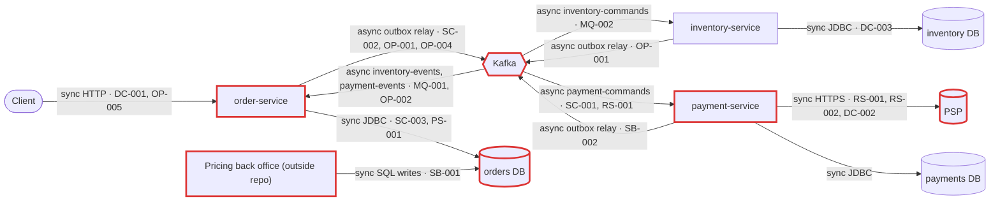
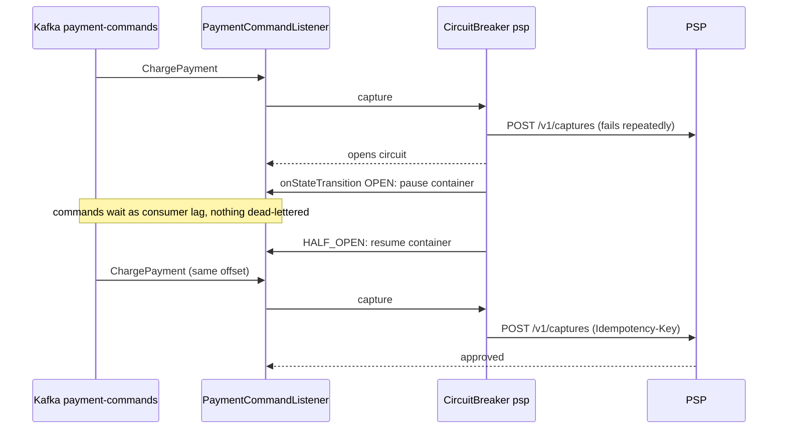
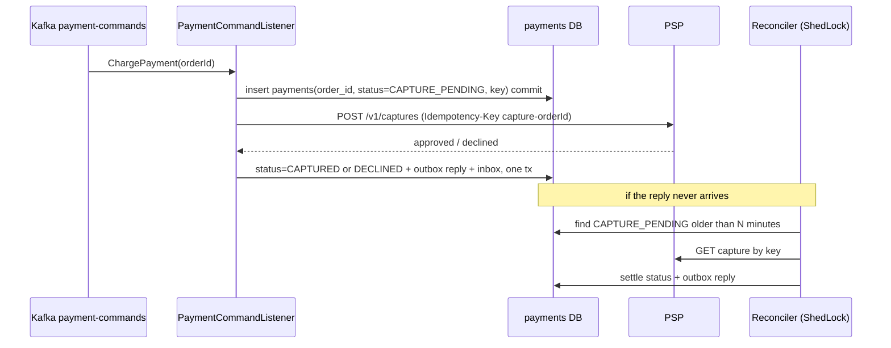

# Architecture review: 03-microservices-healthy

- **Mode**: hybrid (code plus the README's stated scale, team split and DLT/alerting design)
- **Date**: 2026-10-24
- **Lenses run**: scalability, persistence, operability, data-consistency, resilience, service-boundaries, messaging. Every lens applies to this system and none was skipped. They ran as three parallel agents (data-consistency + messaging, resilience + service-boundaries, scalability + persistence + operability) because the repo is small (about 70 source files). The parent ran no lens itself.
- **Run**: headless, so nobody answered questions. Each decision made in place of asking is listed under Assumptions.

## Summary

The platform is three Spring Boot services (order, inventory, payment), each with its own Postgres database, coordinated only through Kafka by an orchestrated saga in order-service. The core consistency design is sound: transactional outboxes, inbox deduplication, state-guarded saga transitions, compensations, atomic stock decrements and an idempotent PSP call made outside any transaction. **The review found no critical or high findings.** The biggest remaining risk is operational. A PSP outage or a stalled relay turns into dead-lettered orders or mass watchdog cancellations, and the only paging signal (the DLT counter) can miss them (RS-001, OP-001, OP-002). The change that buys the most is to pause the payment consumer while the PSP circuit is open (RS-001), together with outbox-age alerting (OP-001). The system can meet its stated intent of ~300 orders/min tripling within a year. The ceilings to raise before then are the 12-partition `payment-commands` topic (SC-001) and the single serial outbox relay (SC-002).

| Severity | Count |
|---|---|
| Critical | 0 |
| High | 0 |
| Medium | 12 |
| Low | 8 |
| Info | 0 |

## Architecture profile

- **Architecture**: microservices. Three independently deployed services, each with its own database, communicating only over Kafka.
- **Summary**: Order platform of three Spring Boot services, each with its own Postgres database, coordinated only through Kafka. order-service accepts orders over HTTP and orchestrates a place-order saga; inventory-service reserves and releases stock; payment-service captures payments at an external PSP.
- **Stack**: Java 17, Spring Boot 3.3.4, Spring Data JPA / Hibernate, Spring Kafka, Flyway, ShedLock 5.16 (JDBC), Resilience4j 2.2 (payment-service), Micrometer Tracing (OTel bridge, OTLP), Micrometer Prometheus, PostgreSQL 16, Kafka 3.7
- **Deployables**:
  - order-service (order-service/): POST/GET /orders, saga orchestrator and watchdog; consumes inventory-events and payment-events; publishes inventory-commands, payment-commands and order-events through its outbox
  - inventory-service (inventory-service/): stock levels and reservations; consumes inventory-commands; publishes inventory-events through its outbox
  - payment-service (payment-service/): payment capture at the PSP; consumes payment-commands (concurrency 4); publishes payment-events through its outbox
- **Datastores**:
  - PostgreSQL: orders (used by order-service; `price_list` is also written by an outside pricing back office)
  - PostgreSQL: inventory (used by inventory-service)
  - PostgreSQL: payments (used by payment-service)
  - docker-compose puts all three databases on one Postgres server; that setup is local development only.
- **Messaging**: Kafka: inventory-commands, payment-commands, order-events, inventory-events, payment-events, each with a `<topic>-dlt`; 12 partitions, RF 3, key = orderId. DefaultErrorHandler retries with ~3 min of exponential backoff, then dead-letters to the same partition. ack-mode record with auto-commit off; producer acks=all with idempotence.
- **Background work**:
  - OutboxRelay.relay every 500 ms in each service (ShedLock, lockAtMostFor 30 s, batch 100)
  - Outbox purge 03:15 and inbox purge 03:45 in each service (ShedLock, 7-day retention)
  - SagaWatchdog every 60 s in order-service (ShedLock, page of 100) plus the gauge `orders.saga.stuck_awaiting_payment`
  - DeadLetterMonitor `.*-dlt` consumer in each service
- **Runtime**: k8s with 3 replicas per service; liveness and readiness probe groups; terminationGracePeriodSeconds 45; graceful shutdown; ConfigMap/Secret envFrom; no resources, startupProbe, PDB or HPA; no ingress in the repo; 10% trace sampling to OTLP; Prometheus endpoint.
- **Stated intent**: README: production runs 3 replicas per service on k8s, peak ~300 orders/minute, expected to triple next year. Three teams each own one service. Failed messages retry for ~3 minutes, then go to `<topic>-dlt`, and every DLT record pages on-call.
- **Derived load**:
  - Place order: 5 orders/s peak now, ~15/s next year.
  - Kafka: ~5 messages per order, so ~25 msg/s peak now and ~75 msg/s next year.
  - order-service outbox: ~15 msg/s peak now, ~45 msg/s next year.
  - PSP captures: 5/s peak now, ~15/s next year.
- **Key flows**:
  - client -> order-service (orders + outbox) -> inventory-commands -> inventory-service (reserve + outbox) -> inventory-events -> order-service (STOCK_RESERVED + outbox) -> payment-commands -> payment-service -> PSP -> payment-service (payments + outbox) -> payment-events -> order-service (CONFIRMED, or CANCELLED + ReleaseStock)
  - SagaWatchdog -> PENDING older than 15 min -> CANCELLED + ReleaseStock + OrderCancelled -> inventory-service
  - client -> order-service GET /orders/{id} and GET /orders?customerId= (page size capped at 50)
- **Assumptions**:
  - Mode is hybrid, because the README states scale and design intent.
  - docker-compose.yml is local development only. Production Kafka has at least 3 brokers (topics declare RF 3), and the production Postgres topology is unknown.
  - Prometheus alert rules, ingress or gateway, and authentication live outside this repo. Their absence is not a finding unless the repo itself shows a gap.
  - The 'pricing back office' named in PriceList.java is a separate system, not in this repo, that writes directly to order-service's database.
  - The repo contains no tests and no test command, so none was run.
  - Nobody was available to answer questions, so every choice that would have been asked was made here and listed above.



## Findings

### Medium

#### RS-001 · A PSP outage longer than ~3 minutes dead-letters the head `ChargePayment` of every partition every ~3 minutes; the open circuit breaker does not pause consumption

Severity: **medium** · Confidence: high · Lens: resilience · Effort: small

**Where**: `payment-service/src/main/java/com/example/platform/payment/config/KafkaConfig.java:19`, `payment-service/src/main/java/com/example/platform/payment/messaging/PaymentCommandListener.java:37`, `payment-service/src/main/resources/application.yml:75`

**Evidence**:

```text
KafkaConfig: `// ~3 minutes in total: longer than a circuit-breaker open window or a DB failover.` `new ExponentialBackOffWithMaxRetries(8)` (1s, x2, max 60s). PaymentCommandListener javadoc: "Transient PSP failures (timeouts, open circuit) propagate so the container's error handler retries with backoff and finally dead-letters the command." application.yml: `wait-duration-in-open-state: 30s`. No circuit-breaker state listener and no pause/resume of the `payment-commands` container anywhere.
```

**What goes wrong**: The PSP has a 20-30 minute incident. The breaker opens and every attempt fails fast with CallNotPermittedException. The blocking DefaultErrorHandler retries the head record of each of the 12 partitions for ~183 s, then publishes it to `payment-commands-dlt`, and the next record starts the same cycle. About 4 orders per minute (80-120 in total) are dead-lettered. Each one pages on-call and sits in STOCK_RESERVED holding stock until someone runs the redrive runbook. The orders that happened to be queued behind them go through normally once the PSP recovers. An ordinary third-party outage becomes a manual cleanup of orders picked at random.

**Fix** (`circuit-breaker`): Couple the breaker to the consumer. Register a Resilience4j `onStateTransition` listener for `psp` that pauses the `payment-commands` listener container (via `KafkaListenerEndpointRegistry`) on OPEN and resumes it on HALF_OPEN/CLOSED. While the circuit is open, commands then wait as consumer lag rather than landing on the DLT. Keep the DLT for errors that are not transient (see RS-002).

```java
@Bean
ApplicationRunner pauseOnOpenCircuit(CircuitBreakerRegistry breakers, KafkaListenerEndpointRegistry listeners) {
    return args -> breakers.circuitBreaker("psp").getEventPublisher().onStateTransition(e -> {
        MessageListenerContainer c = listeners.getListenerContainer("payment-commands");
        switch (e.getStateTransition().getToState()) {
            case OPEN, FORCED_OPEN -> c.pause();
            case HALF_OPEN, CLOSED -> c.resume();
            default -> { }
        }
    });
}
// and: @KafkaListener(id = "payment-commands", topics = "payment-commands", concurrency = "4")
```

Fixed flow:



**Why it's worth it here**: The PSP is a single third-party dependency whose outages can outlast the ~3 minute retry budget, and every DLT record pages on-call and needs a manual redrive.

#### DC-001 · `Idempotency-Key` on `POST /orders` is global and not checked against customer or payload, and a concurrent duplicate returns 500 for an order that was placed

Severity: **medium** · Confidence: high · Lens: data-consistency · Effort: small

**Where**: `order-service/src/main/java/com/example/platform/order/api/OrderService.java:38`, `order-service/src/main/java/com/example/platform/order/api/OrderController.java:47`, `order-service/src/main/resources/db/migration/V2__orders.sql:3`

**Evidence**:

```text
`return orders.findByRequestKey(requestKey).orElseGet(() -> { Order order = new Order(requestKey, customerId); ... orders.save(order); saga.start(order); return order; });` with `request_key varchar(100) not null unique`. The stored order is never compared with the caller's `customerId` or lines, and the unique violation is not handled.
```

**What goes wrong**: (a) A client times out and retries while the first attempt is still in flight. Both transactions miss in `findByRequestKey`, both insert, and the second fails with an unhandled DataIntegrityViolationException. The client receives 500 for an order that exists. The UI reports a failure, the shopper submits again with a new key, and a second order is placed and charged. (b) A reused key (a cart-scoped key after the cart changed, or a client bug) silently returns the earlier order's 202. If keys collide across customers, that 202 carries another customer's order.

**Fix** (`idempotency-key`): Scope the key per customer: make the unique constraint `(customer_id, request_key)` and look up on both columns. Store a hash of the request body and return 422 when a replayed key comes with a different payload. Catch the unique violation on insert, re-read the existing order and return it, so concurrent duplicates get the same 202. Validate key length and a non-blank `customerId` at the boundary.

```sql
alter table orders drop constraint orders_request_key_key;
alter table orders add constraint orders_customer_request_key unique (customer_id, request_key);
alter table orders add column request_hash varchar(64);
```
```java
try {
    return placeNew(requestKey, customerId, lines);           // REQUIRES_NEW or outer retry
} catch (DataIntegrityViolationException dup) {
    return orders.findByCustomerIdAndRequestKey(customerId, requestKey)
                 .filter(o -> o.getRequestHash().equals(hash(lines)))
                 .orElseThrow(() -> new IdempotencyConflictException(requestKey));  // 422
}
```

**Why it's worth it here**: Clients and gateways retry `POST /orders`, and the response decides what the shopper is told about an order that will be charged.

#### OP-001 · No metric for outbox backlog or age, or for watchdog timeouts, so a stalled relay cancels every order after 15 minutes without paging anyone

Severity: **medium** · Confidence: high · Lens: operability · Effort: small

**Where**: `inventory-service/src/main/java/com/example/platform/inventory/outbox/OutboxRelay.java:36`, `order-service/src/main/java/com/example/platform/order/outbox/OutboxRelay.java` (missing outbox unsent-count / oldest-unsent-age gauge), `order-service/src/main/java/com/example/platform/order/saga/SagaWatchdog.java:44`

**Evidence**:

```text
`for (OutboxEvent event : events.findUnsent(PageRequest.of(0, batchSize))) { ... kafka.send(record).get(10, TimeUnit.SECONDS); ... }`: an exception on the oldest event ends the run, and the next run retries that same event first. The only custom meters in the repo are `kafka.dlt.records` (DeadLetterMonitor) and `orders.saga.stuck_awaiting_payment` (SagaWatchdog).
```

**What goes wrong**: inventory-service's relay stops making progress: Kafka rejects the head event, an ACL or credential is broken, or the broker is unreachable from that namespace. Nothing is dead-lettered, so nothing pages. StockReserved replies pile up in the inventory outbox. After 15 minutes SagaWatchdog starts cancelling every order as "timed out waiting for stock reservation", and checkout is effectively down. `orders.saga.stuck_awaiting_payment` stays flat, because no order reaches STOCK_RESERVED.

**Fix** (`metrics-and-alerts`): In each service, expose gauges for the unsent outbox count and the age of the oldest unsent row (the partial index `outbox_unsent_idx` makes both cheap), and alert when the age exceeds a few seconds. Add a counter for watchdog timeouts and alert on its rate.

```java
Gauge.builder("outbox.oldest_unsent_age_seconds", () -> jdbc.queryForObject(
        "select coalesce(extract(epoch from now() - min(created_at)), 0) from outbox where sent_at is null",
        Double.class)).register(meters);
```

**Why it's worth it here**: Every saga step depends on three outbox relays, and DLT records are currently the only paging signal for the flow.

#### OP-002 · `kafka.dlt.records` is registered on its first increment, so `rate`/`increase` alerts miss the first dead letter per pod and topic

Severity: **medium** · Confidence: medium · Lens: operability · Effort: small

**Where**: `order-service/src/main/java/com/example/platform/order/messaging/DeadLetterMonitor.java:32`, `inventory-service/src/main/java/com/example/platform/inventory/messaging/DeadLetterMonitor.java:32`, `payment-service/src/main/java/com/example/platform/payment/messaging/DeadLetterMonitor.java:32`

**Evidence**:

```text
`Counter.builder("kafka.dlt.records").tag("topic", record.topic()).register(meters).increment();` inside `onDeadLetter`. README: "Every DLT record increments `kafka_dlt_records_total`, which pages on-call."
```

**What goes wrong**: Pods restart on every deploy, so a fresh pod has no `kafka_dlt_records_total{topic="inventory-commands-dlt"}` series. A ReleaseStock is dead-lettered, and the series is created already at 1. Prometheus has no earlier sample, so `increase()`/`rate()` evaluate to 0 and nobody is paged. That stock stays reserved for a cancelled order with no other detection: the stuck-order gauge covers only STOCK_RESERVED orders. Each of the three services' monitors consumes every `.*-dlt` topic, so all three miss it together. If the alert is instead written as `> 0`, it fires and cannot clear until the pod restarts.

**Fix** (`metrics-and-alerts`): Pre-register the counter at 0 for each known DLT topic at startup, or alert on DLT topic end offsets or consumer-group lag, which do not depend on pod lifetime. Let one service own the DLT monitor (or tag the counter with the service) so one record does not page three times.

```java
@EventListener(ApplicationReadyEvent.class)
void preRegister() {
    List.of("inventory-commands-dlt", "payment-commands-dlt", "order-events-dlt",
            "inventory-events-dlt", "payment-events-dlt")
        .forEach(t -> Counter.builder("kafka.dlt.records").tag("topic", t).register(meters));
}
```

**Why it's worth it here**: DLT records are the documented paging signal, and rolling deploys restart pods regularly. Confidence is medium because the alert rule itself is not in the repo.

#### MQ-001 · DLT topics use the broker's default retention, so parked saga steps can be deleted before anyone redrives them

Severity: **medium** · Confidence: medium · Lens: messaging · Effort: small

**Where**: `order-service/src/main/java/com/example/platform/order/config/TopicsConfig.java:18`, `inventory-service/src/main/java/com/example/platform/inventory/config/TopicsConfig.java:18`, `payment-service/src/main/java/com/example/platform/payment/config/TopicsConfig.java:18`

**Evidence**:

```text
`TopicBuilder.name("inventory-commands-dlt").partitions(12).replicas(3).build()`. No `-dlt` topic sets `retention.ms`. DeadLetterMonitor: "Records stay on the DLT; ops replays them with the dlt-redrive runbook once the cause is fixed."
```

**What goes wrong**: A code bug dead-letters PaymentCaptured or ChargePayment records, and the fix takes longer than the broker retention (Kafka's default `log.retention.hours` is 168). The DLT segments are deleted. For a lost PaymentCaptured, the customer has been charged and the order is never confirmed. The redrive runbook has nothing left to replay, and recovery means reconstructing messages by hand from three databases.

**Fix** (`dead-letter-queue`): Give the `-dlt` topics an explicit long retention (for example `.config(TopicConfig.RETENTION_MS_CONFIG, String.valueOf(Duration.ofDays(30).toMillis()))`), or have DeadLetterMonitor copy each DLT record into a `dead_letters` table that the redrive tool reads. Keep inbox retention at least as long as the redrive horizon.

```java
TopicBuilder.name("payment-commands-dlt").partitions(12).replicas(3)
        .config(TopicConfig.RETENTION_MS_CONFIG, String.valueOf(Duration.ofDays(30).toMillis()))
        .build()
```

**Why it's worth it here**: DLT records are the only copy of failed saga steps, and redrive is manual with no time bound. Confidence is medium because production broker settings are not in the repo.

#### DC-002 · payment-service records nothing before calling the PSP, so a capture whose `ChargePayment` dead-letters is recoverable only while the PSP still honours `capture-<orderId>`

Severity: **medium** · Confidence: medium · Lens: data-consistency · Effort: medium

**Where**: `payment-service/src/main/java/com/example/platform/payment/messaging/PaymentCommandListener.java:37`, `payment-service/src/main/java/com/example/platform/payment/messaging/PaymentRecorder.java:30`

**Evidence**:

```text
PaymentCommandListener: `PspClient.CaptureResponse response = psp.capture("capture-" + command.orderId(), command.customerId(), command.amount()); recorder.record(messageId, command, response);`. The `payments` row and the inbox row are written only in `PaymentRecorder.record`, after the PSP has answered.
```

**What goes wrong**: 1. The PSP captures the charge, but the response is lost (3 s read timeout) and the PSP keeps failing. 2. The in-process retries and ~3 minutes of container retries are exhausted, and ChargePayment goes to `payment-commands-dlt`. 3. The customer has been charged, but `payments` has no row and the order sits in STOCK_RESERVED. 4. The record is redriven after the PSP's idempotency-key window (commonly 24 h). The PSP treats the key as new and charges a second time, while payment-service records one payment. Until then, nothing locally shows that a capture was attempted, so nobody can reconcile it. Graded medium because this needs three things together: a lost response, an outage that outlasts the retries, and a late redrive.

**Fix** (`idempotency-key`): Before calling the PSP, commit a `payments` row in status `CAPTURE_PENDING` that holds the idempotency key (the unique `order_id` already prevents duplicates). Move it to CAPTURED or DECLINED in the same transaction as the outbox reply. Add a ShedLock job that looks up stale CAPTURE_PENDING rows at the PSP by key. Put the PSP's key-retention window into the redrive runbook.

Fixed flow:



**Why it's worth it here**: Captures go to an external PSP with a finite idempotency window, and failed captures are recovered by a manual DLT redrive with no time bound.

#### OP-003 · Deployments declare no resource requests or limits, PodDisruptionBudget, spread constraints or startupProbe, while Flyway migrates at boot

Severity: **medium** · Confidence: medium · Lens: operability · Effort: small

**Where**: `k8s/order-service.yaml` (missing resources, startupProbe, topologySpreadConstraints, PodDisruptionBudget), `k8s/inventory-service.yaml` (missing resources, startupProbe, topologySpreadConstraints, PodDisruptionBudget), `k8s/payment-service.yaml` (missing resources, startupProbe, topologySpreadConstraints, PodDisruptionBudget)

**Evidence**:

```text
Each container declares only `ports`, `envFrom`, `livenessProbe` and `readinessProbe` (no `resources`, no `startupProbe`, no `initialDelaySeconds`). k8s/ holds no PodDisruptionBudget or affinity. application.yml: `flyway: enabled: true`.
```

**What goes wrong**: (1) The pods are BestEffort QoS, so they are the first evicted under node memory pressure, and the JVM sizes its heap from node memory. With no PDB or spread constraint, a `kubectl drain` of a node that holds two or three replicas of one service evicts them together, and that service is down until it reschedules. (2) Liveness probing starts at container start (period 10 s, failureThreshold 3). If a Spring Boot + JPA + Flyway + Kafka start runs past ~30 s on a contended node, or while a migration runs, the pod is killed mid-start and crash-loops.

**Fix** (`resource-requests-and-disruption-budget`): Add CPU and memory requests and limits, and size the heap with `-XX:MaxRAMPercentage`. Add a PodDisruptionBudget (`minAvailable: 2`) and `topologySpreadConstraints` across nodes or zones. Add a startupProbe on `/actuator/health/liveness` with a generous failureThreshold.

```yaml
resources:
  requests: { cpu: 500m, memory: 768Mi }
  limits:   { memory: 768Mi }
startupProbe:
  httpGet: { path: /actuator/health/liveness, port: 8080 }
  periodSeconds: 5
  failureThreshold: 36
---
apiVersion: policy/v1
kind: PodDisruptionBudget
metadata: { name: order-service }
spec:
  minAvailable: 2
  selector: { matchLabels: { app: order-service } }
```

**Why it's worth it here**: Three replicas per service on k8s, with no LimitRange, default PDB or admission policy visible in the repo. If the cluster provides such defaults, the risk is lower.

#### SB-001 · An outside pricing back office writes directly to `price_list` in order-service's database, whose schema order-service's Flyway owns

Severity: **medium** · Confidence: medium · Lens: service-boundaries · Effort: medium

**Where**: `order-service/src/main/java/com/example/platform/order/domain/PriceList.java:11`, `order-service/src/main/resources/db/migration/V4__price_list.sql:1`, `order-service/src/main/resources/application.yml` (missing statement_timeout / lock_timeout on the datasource)

**Evidence**:

```text
PriceList.java: "Current selling prices. The pricing back office writes {@code price_list}; order-service only reads it." V4__price_list.sql: `create table price_list (sku varchar(64) primary key, unit_price numeric(12, 2) not null check (unit_price > 0), active boolean not null default true, ...)`. OrderService.priceOf: `orElseThrow(() -> new InvalidOrderException("unknown SKU " + sku))`. The datasource sets only `hikari.maximum-pool-size: 10`, with no statement or lock timeout.
```

**What goes wrong**: The schema is now a contract between two teams, but it is written down nowhere. If Checkout changes `price_list` in a migration (a new NOT NULL column, a currency split), the back office's writes break at runtime. If the back office changes how it loads prices (truncate-and-reload, deactivate-then-insert), every POST /orders in that window gets 400 "unknown SKU". A TRUNCATE or LOCK TABLE blocks the price lookup inside `placeOrder` with no timeout, and order-service exhausts its 10-connection pool, which the saga listener, relay and watchdog share. The back office also holds write credentials on the `orders` database, so it can reach `orders`, `outbox` and `processed_messages`.

**Fix** (`data-replication-via-events`): Make pricing the owner of prices and replicate them into order-service. The back office publishes `PriceChanged` events, or exposes a pricing API, and order-service maintains its own `price_list` read model from them. As a minimum step, give the back office a database role limited to that one table (or a staging table that order-service copies from), document the contract, and set `statement_timeout`/`lock_timeout` on order-service's connections (for example through `spring.datasource.hikari.connection-init-sql`).

**Why it's worth it here**: The repo's stated design is one database per service with independent teams, and the back office is run outside the Checkout team.

#### SC-001 · `payment-commands` caps payment throughput at 12 concurrent PSP calls (12 partitions = 3 replicas x 4 threads), so extra replicas cannot add capacity for next year's load

Severity: **medium** · Confidence: medium · Lens: scalability · Effort: small

**Where**: `payment-service/src/main/java/com/example/platform/payment/messaging/PaymentCommandListener.java:30`, `order-service/src/main/java/com/example/platform/order/config/TopicsConfig.java:19`

**Evidence**:

```text
`@KafkaListener(topics = "payment-commands", concurrency = "4")`; TopicsConfig: "12 partitions leave room for 3 replicas x 4 consumer threads." and `TopicBuilder.name("payment-commands").partitions(12)`. PSP `read-timeout: 3s`, retry `max-attempts: 3`.
```

**What goes wrong**: Every handler thread blocks on the PSP, and replicas x threads already equals the partition count, so throughput is at most 12 / PSP latency. At next year's ~15 captures/s peak, any PSP slow spell above ~0.8 s per call makes lag grow through the peak. A fourth replica or more threads would sit idle. Adding partitions later remaps orderId keys while traffic is live, which breaks per-order ordering during the change.

**Fix** (`consumer-concurrency`): Increase `payment-commands` partitions now, while load is low and before the tripling (for example to 48). Raise concurrency to match, sized against measured PSP p95, and alert on payment-service consumer lag.

**Why it's worth it here**: The README expects peak orders to triple next year, and each order makes one blocking PSP call on this topic.

#### SC-002 · The outbox relay is a single cluster-wide thread that sends one event at a time and commits each separately, and its 30 s lock lease can expire mid-run

Severity: **medium** · Confidence: medium · Lens: scalability · Effort: small

**Where**: `order-service/src/main/java/com/example/platform/order/outbox/OutboxRelay.java:34`, `order-service/src/main/java/com/example/platform/order/outbox/OutboxRelay.java:40`, `inventory-service/src/main/java/com/example/platform/inventory/outbox/OutboxRelay.java:40`, `payment-service/src/main/java/com/example/platform/payment/outbox/OutboxRelay.java:40`

**Evidence**:

```text
`@Scheduled(fixedDelayString = "${outbox.relay-interval-ms}") @SchedulerLock(name = "outbox-relay", lockAtMostFor = "PT30S")` ... `kafka.send(record).get(10, TimeUnit.SECONDS); event.markSent(); events.save(event);`. `relay()` is not transactional, so each save commits on its own. The config sets `batch-size: 100` and `relay-interval-ms: 500`.
```

**What goes wrong**: ShedLock allows one relay per service, and each event costs an acks=all round trip plus a commit, followed by a 500 ms pause after every batch. That caps each service at roughly 100 events/s however many replicas run. At next year's ~45 msg/s, the backlog left by a 10-minute Kafka outage drains at only ~55/s net, and the watchdog's 15-minute clock keeps running meanwhile. At ~10x today's load the relay cannot keep up at all. When Kafka is slow, a batch can also outlast `lockAtMostFor = PT30S`. A second replica then starts on the same unsent rows and publishes them twice, adding load to a struggling broker. The inbox absorbs the duplicates.

**Fix** (`bulk-operations`): Send the whole batch asynchronously, wait for all the futures, then mark the sent ids with one bulk `update outbox set sent_at = now() where id in (...)`. Re-run immediately when a batch comes back full. Stop each run on a time budget well under `lockAtMostFor`.

```java
List<OutboxEvent> batch = events.findUnsent(PageRequest.of(0, batchSize));
List<CompletableFuture<?>> sends = batch.stream().map(e -> kafka.send(toRecord(e))).toList();
CompletableFuture.allOf(sends.toArray(CompletableFuture[]::new)).get(10, TimeUnit.SECONDS);
events.markSent(batch.stream().map(OutboxEvent::getId).toList());   // one bulk update
```

**Why it's worth it here**: The outbox carries every saga step, and the README expects load to triple.

#### OP-004 · Trace context stops at the outbox: no `traceparent` is stored or sent as a Kafka header, and Kafka observation is off, so a saga cannot be followed across services

Severity: **medium** · Confidence: high · Lens: operability · Effort: medium

**Where**: `order-service/src/main/java/com/example/platform/order/outbox/Outbox.java:26`, `order-service/src/main/java/com/example/platform/order/outbox/OutboxRelay.java:38`, `order-service/src/main/resources/application.yml` (missing spring.kafka.listener.observation-enabled / spring.kafka.template.observation-enabled)

**Evidence**:

```text
`events.save(new OutboxEvent(topic, aggregateKey, message.getClass().getSimpleName(), json.writeValueAsString(message)));`. The relay adds only `message-id` and `message-type` headers, and the `outbox` table has no trace column. No `observation-enabled` property is set in any service, and Spring Boot 3.3 defaults both to false.
```

**What goes wrong**: A customer reports an order stuck in PENDING or cancelled for no clear reason. The HTTP span in order-service ends at the outbox insert. The relay publishes from a scheduler thread with no parent context, and inventory-service and payment-service handle the command with no trace id in their spans or logs. On-call ends up grepping three services by orderId, even though their listeners log nothing on the success path.

**Fix** (`distributed-tracing`): In `Outbox.publish`, capture the current `traceparent` into a new outbox column, and have `OutboxRelay` send it as a Kafka header. Set `spring.kafka.listener.observation-enabled=true` and `spring.kafka.template.observation-enabled=true` so consumer spans continue the trace. Put `orderId` in the MDC in each listener so unsampled flows can still be correlated in logs.

**Why it's worth it here**: Every place-order flow crosses three deployables owned by three teams, and the tracing libraries are already on the classpath.

#### OP-005 · order-service takes `customerId` from the client on `POST` and `GET /orders`; no authenticated principal is consulted

Severity: **medium** · Confidence: low · Lens: operability · Effort: medium

**Where**: `order-service/src/main/java/com/example/platform/order/api/OrderController.java:36`, `order-service/src/main/java/com/example/platform/order/api/OrderController.java:60`

**Evidence**:

```text
`public record PlaceOrderRequest(String customerId, List<OrderService.Line> lines)` and `public Page<OrderView> byCustomer(@RequestParam String customerId, ...)`. No spring-security dependency appears in any pom.
```

**What goes wrong**: Even behind an authenticating gateway (not in this repo), any authenticated caller can list another customer's orders with `GET /orders?customerId=<victim>`. Unless the gateway rewrites the body, that caller can also place orders, and so PSP charges, under another customer's id. Gateways rarely validate JSON body fields.

**Fix** (`api-gateway`): Derive `customerId` from a verified identity, either a JWT through a Spring Security resource server or a gateway-signed header, and stop accepting it from the client. Follow up with a dedicated security review.

**Why it's worth it here**: order-service is reachable by external clients. Confidence is low because the gateway and auth layer are outside the repo.

### Low

#### RS-002 · PSP retries stack across Resilience4j (3 attempts) and the Kafka error handler (9 deliveries) and do not distinguish error types, so permanent 4xx errors are tried 27 times before dead-lettering

Severity: **low** · Confidence: high · Lens: resilience · Effort: small

**Where**: `payment-service/src/main/java/com/example/platform/payment/psp/PspClient.java:46`, `payment-service/src/main/resources/application.yml:79`, `payment-service/src/main/java/com/example/platform/payment/config/KafkaConfig.java:28`

**Evidence**:

```text
`@CircuitBreaker(name = "psp") @Retry(name = "psp")` on `capture`. `resilience4j.retry.instances.psp` sets `max-attempts: 3` with no `retry-exceptions` or `ignore-exceptions`. The Kafka handler marks only `JsonProcessingException` as not retryable.
```

**What goes wrong**: The PSP returns a permanent 4xx, such as a 422 for a malformed customer reference or a 401 after a key rotation. Resilience4j retries every exception by default, and each failure counts against the breaker. The DefaultErrorHandler then redelivers 8 more times over ~3 minutes, holding up that partition (1/12 of payments). Finally the command is dead-lettered instead of producing PaymentFailed, so the order waits in STOCK_RESERVED with stock held until the 30-minute gauge alerts and someone acts. Once the breaker is open, CallNotPermittedException is retried too, which accomplishes nothing.

**Fix** (`retry-with-backoff`): Retry only transient errors (`ResourceAccessException`, 5xx) in Resilience4j, and ignore `CallNotPermittedException`. Add `HttpClientErrorException` to the breaker's `ignore-exceptions`. Map a permanent 4xx to a DECLINED payment plus `PaymentFailed`, so the saga compensates immediately.

**Why it's worth it here**: The PSP can return deterministic 4xx errors, and blocking retries stall a whole partition while they run.

#### MQ-002 · Permanently malformed messages (a missing `message-id`/`message-type` header, an unknown command) are retried for ~3 minutes before dead-lettering, stalling their partition

Severity: **low** · Confidence: high · Lens: messaging · Effort: small

**Where**: `inventory-service/src/main/java/com/example/platform/inventory/messaging/Headers.java:24`, `inventory-service/src/main/java/com/example/platform/inventory/messaging/InventoryCommandListener.java:32`, `inventory-service/src/main/java/com/example/platform/inventory/config/KafkaConfig.java:28`

**Evidence**:

```text
`throw new IllegalArgumentException("Missing header " + name + ...)` and `default -> throw new IllegalArgumentException("Unknown command " + Headers.messageType(record));`, while only `JsonProcessingException` is passed to `addNotRetryableExceptions`. The same Headers and KafkaConfig code exists in all three services.
```

**What goes wrong**: During a rolling deploy, order-service emits a new command type before inventory-service has been upgraded, or a producer omits a header. Each such record blocks its partition for ~183 s of pointless retries before reaching the DLT. A run of them pushes the orders queued behind toward the 15-minute watchdog cancellation.

**Fix** (`dead-letter-queue`): Throw a dedicated `PoisonMessageException` for missing headers and unknown types, and register it with `handler.addNotRetryableExceptions(...)` in all three `KafkaConfig` classes, so such records go to the DLT immediately.

```java
handler.addNotRetryableExceptions(JsonProcessingException.class, PoisonMessageException.class);
```

**Why it's worth it here**: Commands and replies sit on a saga with a 15-minute timeout, and the services deploy independently.

#### DC-003 · `StockService.reserve` locks `stock_items` rows in the client's line order, so two orders with overlapping SKUs in opposite order can deadlock

Severity: **low** · Confidence: high · Lens: data-consistency · Effort: small

**Where**: `inventory-service/src/main/java/com/example/platform/inventory/messaging/StockService.java:33`

**Evidence**:

```text
`for (Messages.Line line : command.lines()) { if (stock.tryReserve(line.sku(), line.quantity()) == 0) { ... } }`. Each `tryReserve` is a row-locking UPDATE, and `lines` keep the order of the original HTTP request.
```

**What goes wrong**: Order 1 [A, B] and order 2 [B, A] land on different partitions and are processed at the same moment by two inventory consumers. Each locks its first SKU and waits for the other. Postgres aborts one transaction after `deadlock_timeout`, and the error handler retries it 1 s later. Data stays consistent, but latency and error noise rise on popular SKUs as load triples.

**Fix** (`consistent-lock-ordering`): Sort lines by SKU before reserving: `command.lines().stream().sorted(Comparator.comparing(Messages.Line::sku))`.

```java
for (Messages.Line line : command.lines().stream().sorted(Comparator.comparing(Messages.Line::sku)).toList()) {
```

**Why it's worth it here**: Multi-line orders share popular SKUs, and inventory runs several concurrent consumers.

#### SC-003 · `SagaWatchdog` times out at most 100 orders per minute while orders arrive at up to 300/min (900/min next year)

Severity: **low** · Confidence: high · Lens: scalability · Effort: small

**Where**: `order-service/src/main/java/com/example/platform/order/saga/SagaWatchdog.java:44`

**Evidence**:

```text
`@Scheduled(fixedDelay = 60_000)` ... `orders.findByStatusAndCreatedAtBefore(Order.Status.PENDING, cutoff, PageRequest.of(0, 100))`. README: "Orders with no reply after 15 minutes are cancelled by the saga watchdog".
```

**What goes wrong**: inventory-service or its relay is down for 30 minutes at peak. About 9,000 orders are PENDING now, or about 27,000 next year. The watchdog clears 100 per minute, so customers see PENDING for hours instead of the documented 15 minutes. Some of those orders are confirmed late, when inventory recovers before the watchdog reaches them. State stays consistent (`@Version` and the status guards), but the timeout contract is not met.

**Fix** (`work-queue`): Loop over pages until none remain or a time budget (for example 40 s, under the `PT1M` lock) runs out, or size the page to at least the peak arrival rate per interval.

**Why it's worth it here**: The peak arrival rate (300-900 orders/min) exceeds the watchdog's fixed drain rate of 100/min.

#### PS-001 · Index migrations use plain `CREATE INDEX` on the hot `orders` table, which blocks writes while Flyway runs at pod boot

Severity: **low** · Confidence: medium · Lens: persistence · Effort: small

**Where**: `order-service/src/main/resources/db/migration/V3__orders_status_idx.sql:1`

**Evidence**:

```text
`create index orders_status_created_idx on orders (status, created_at);`
```

**What goes wrong**: V3 itself has presumably already been applied at 2.0.0, but it sets the pattern for the next index migration. Once `orders` holds tens of millions of rows (about 300 orders/min, tripling), a plain CREATE INDEX takes a SHARE lock that blocks POST /orders inserts and saga status updates for the length of the build. Without a startupProbe (OP-003), the migrating pod can also be liveness-killed, which rolls the migration back and repeats it on the next start.

**Fix** (`expand-contract-migration`): Write index migrations as `CREATE INDEX CONCURRENTLY` in Flyway scripts that set `executeInTransaction=false`, and consider running migrations from a pre-deploy Job.

**Why it's worth it here**: `orders` is a growing hot table, and migrations run during rolling deploys.

#### PS-002 · The outbox purge deletes a whole day of sent rows in one statement, unlike the chunked inbox purge

Severity: **low** · Confidence: medium · Lens: persistence · Effort: small

**Where**: `order-service/src/main/java/com/example/platform/order/outbox/OutboxRepository.java:20`

**Evidence**:

```text
`@Modifying @Transactional @Query("delete from OutboxEvent e where e.sentAt < :cutoff") int deleteSentBefore(Instant cutoff);`. Compare Inbox.purgeOld: "Deleted in chunks to keep locks short."
```

**What goes wrong**: At next year's volume, order-service writes on the order of a million outbox rows a day. The 03:15 purge deletes them in one long transaction. That causes a WAL burst and holds back vacuum for the whole database while the outbox is still being polled every 500 ms.

**Fix** (`data-retention`): Delete in chunks of about 5,000 ids per statement in a loop, as `Inbox.purgeOld` already does. Alternatively, partition the outbox by day and drop old partitions.

**Why it's worth it here**: Outbox volume grows with order volume, which the README expects to triple.

#### SB-002 · The PSP's raw `outcome` string passes unmapped into `PaymentFailed`, `OrderCancelled` and the public `GET /orders` response

Severity: **low** · Confidence: high · Lens: service-boundaries · Effort: small

**Where**: `payment-service/src/main/java/com/example/platform/payment/messaging/PaymentRecorder.java:41`, `order-service/src/main/java/com/example/platform/order/saga/OrderSaga.java:82`, `order-service/src/main/java/com/example/platform/order/api/OrderController.java:41`

**Evidence**:

```text
`outbox.publish(PAYMENT_EVENTS, key, new Messages.PaymentFailed(command.orderId(), response.outcome()));`, then `order.cancel("payment failed: " + reason)`, then `new OrderView(o.getId(), o.getStatus().name(), o.getTotal(), o.getCancelReason())`.
```

**What goes wrong**: When the PSP renames its outcome codes, or Payments switches provider, the values change on `payment-events`, on `order-events` and in the customer-facing API without any change to order-service. Consumers that branch on the reason break, and provider-internal codes such as fraud flags reach customers. A long provider string can exceed `cancel_reason varchar(200)`. The saga update then fails, and the PaymentFailed reply is dead-lettered.

**Fix** (`anti-corruption-layer`): Map PSP outcomes to a platform enum (DECLINED, INSUFFICIENT_FUNDS, FRAUD_SUSPECTED, UNKNOWN) in payment-service. Keep the raw code only in `payments`, and expose a customer-safe reason in `OrderView`.

**Why it's worth it here**: Three teams own these contracts, and `order-events` and the GET API are consumed outside the Payments team.

#### OP-006 · No `preStop` delay: graceful shutdown starts refusing connections before k8s removes the pod from its endpoints

Severity: **low** · Confidence: medium · Lens: operability · Effort: small

**Where**: `k8s/order-service.yaml` (missing lifecycle.preStop)

**Evidence**:

```text
`terminationGracePeriodSeconds: 45` with `server.shutdown: graceful` and no `lifecycle.preStop`.
```

**What goes wrong**: On each rolling deploy, SIGTERM reaches order-service while the endpoint removal is still propagating. Tomcat stops accepting connections at once, but kube-proxy or the ingress keeps routing new requests to the pod for a few seconds. Those clients get connection refused or 502.

**Fix** (`graceful-shutdown`): Add `lifecycle.preStop: exec: command: ["sleep", "10"]`, keeping the sleep plus the 30 s shutdown phase under the 45 s grace period.

```yaml
lifecycle:
  preStop:
    exec: { command: ["sleep", "10"] }
```

**Why it's worth it here**: order-service serves external HTTP clients and deploys by rolling update.

## Roadmap

**Now** (critical and high findings with small or medium effort, plus their dependencies)
- Nothing. There are no critical or high findings.

**Next** (medium findings, the ones whose fixes others depend on first, then by payoff)
- RS-001: pause the `payment-commands` container while the `psp` circuit is open. Unblocks: nothing.
- OP-001: add outbox oldest-unsent-age gauges and a watchdog-timeout counter, with alerts. Unblocks: nothing.
- OP-002: pre-register the DLT counters, or alert on DLT offsets, so the first dead letter pages. Unblocks: nothing.
- DC-001: scope `Idempotency-Key` per customer, check the payload hash, and return the existing order on a unique violation. Unblocks: nothing.
- MQ-001: set explicit long retention on every `-dlt` topic. Unblocks: nothing.
- DC-002: write a `CAPTURE_PENDING` payment row before the PSP call and reconcile stale ones. Unblocks: nothing.
- OP-003: add resources, PDB, spread constraints and a startupProbe to the three Deployments. Unblocks: PS-001 (its liveness-kill risk goes away).
- SB-001: give the back office a table-scoped role and statement/lock timeouts now, and move to price events later. Unblocks: nothing.
- SC-001: raise `payment-commands` partitions before the tripling, and match consumer concurrency. Unblocks: nothing.
- SC-002: batch the outbox relay sends with one bulk mark-sent, and time-bound each run. Unblocks: nothing.
- OP-004: propagate `traceparent` through the outbox and enable Kafka observation. Unblocks: nothing.
- OP-005: derive `customerId` from an authenticated principal (also hand to a security review). Unblocks: nothing.

**Later** (low findings)
- RS-002: retry only transient PSP errors and map permanent 4xx to `PaymentFailed`. Unblocks: nothing.
- MQ-002: mark poison-message exceptions as not retryable. Unblocks: nothing.
- DC-003: sort reservation lines by SKU. Unblocks: nothing.
- SC-003: let the watchdog drain multiple pages per run. Unblocks: nothing.
- PS-001: use `CREATE INDEX CONCURRENTLY` for future index migrations. Unblocks: nothing.
- PS-002: chunk the outbox purge. Unblocks: nothing.
- SB-002: map PSP outcomes to a platform enum. Unblocks: nothing.
- OP-006: add a `preStop` sleep. Unblocks: nothing.

## What's already sound

These patterns are done right. Keep them, and don't "fix" them:

- Transactional outbox in all three services: every event is written to `outbox` in the same transaction as the state change (`Outbox.publish` with `propagation = MANDATORY`), and a ShedLocked relay publishes it.
- Idempotent consumers: `processed_messages` is written in the handler's own transaction (`Inbox.firstDelivery`, MANDATORY), and saga transitions are state-guarded (`transition(from, to)`), so redelivery is harmless.
- Orchestrated saga with persisted state (`Order.status`) and compensation on every failure branch: ReleaseStock on PaymentFailed, on watchdog timeout, and on a StockReserved that arrives after the order was cancelled.
- The PSP call runs outside any DB transaction, with an Idempotency-Key, 1 s/3 s timeouts, a circuit breaker and jittered exponential retry. The result is recorded together with its reply in one local transaction.
- Stock uses an atomic conditional decrement (`update ... where available >= :qty`) backed by `check (available >= 0)`, reservations are all-or-nothing, and release is idempotent.
- Optimistic locking (`@Version`) on `Order` makes the watchdog and the reply listener safe against each other. The watchdog only cancels PENDING orders, so a late capture never lands on a cancelled order.
- Server-side pricing and input validation (1-50 lines, quantity 1-100, no duplicate SKUs), so clients cannot set prices or corrupt reservations.
- Every scheduled job carries `@SchedulerLock` with a JDBC ShedLock provider that uses database time.
- Kafka offsets are committed only after processing (auto-commit off, `ack-mode: record`, work stays on the listener thread). The producer uses `acks=all` with idempotence, and every key is the orderId.
- Dead-letter topics route to the same partition, declared with matching partition counts, together with a DLT counter, a redrive runbook and a stuck-saga gauge.
- Message contracts are owned per service with tolerant readers (additive fields, simple type names in a header, Boot's lenient ObjectMapper). No shared domain library exists.
- Database per service, with Flyway versioned migrations, `ddl-auto: validate`, `open-in-view: false`, an index on every query path, and page size capped at 50.
- No synchronous calls between services. POST /orders returns 202 and the flow continues asynchronously, so no service's availability depends on another's.
- Liveness and readiness probe groups, graceful shutdown with a grace period longer than the shutdown phase, and config and secrets supplied through ConfigMap/Secret.
- Service boundaries match team ownership (Checkout, Warehouse, Payments). The split is justified by the organisation, not premature.
- Outbox and inbox tables have retention purges, and the inbox purge runs in chunks.

## Not reviewed

- **Security in depth**: authentication, authorization, PSP credential handling and network policy. OP-005 flags the one architecture-level gap visible here. Run a dedicated security review.
- **Infrastructure outside the repo**: Prometheus alert rules, the ingress or API gateway, the production Kafka broker configuration (retention, broker count) and the production Postgres topology. Several findings (OP-002, OP-003, MQ-001) carry medium confidence because these were not visible.
- **Connection-pool sizing against `max_connections`**: dropped as a candidate. It only matters if production puts all three databases on one Postgres server, as docker-compose does locally, and that is unknown. Worth checking: 3 services x (3 replicas + surge) x 10 connections = 90-120.
- **The pricing back office**: its code and write patterns are not in this repo (see SB-001).
- **Tests**: the repo contains no test sources or test command, so none was run.
