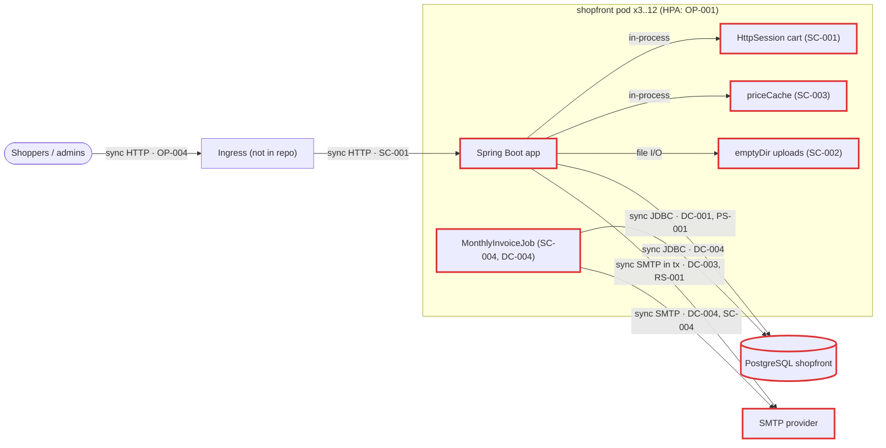
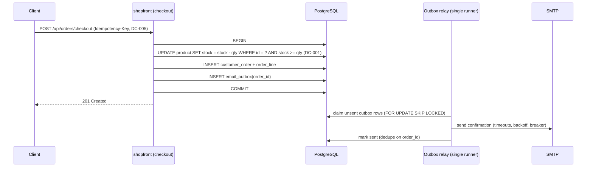
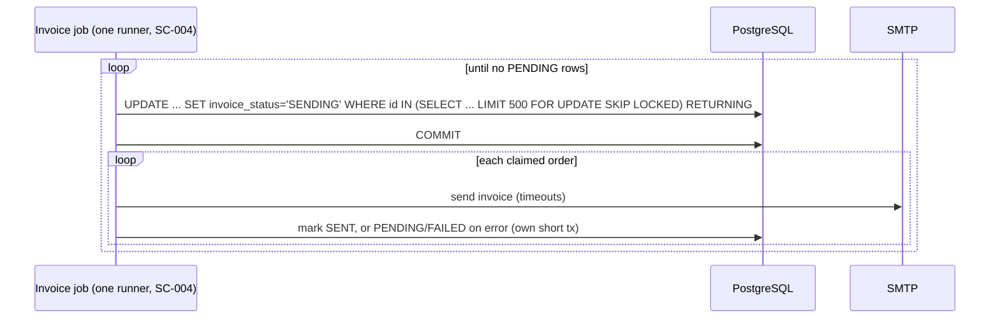

# Architecture review: shopfront (01-monolith-unscalable)

- **Mode**: hybrid. The code was reviewed against the README's stated target: 3 to 12 replicas, Black Friday at about 20x normal traffic, peak around 1,500 req/s.
- **Date**: 2026-10-24
- **Lenses run**: scalability, persistence, operability, data-consistency, resilience, service-boundaries. Three parallel lens agents ran them in the small-codebase groups (data-consistency; resilience + service-boundaries; scalability + persistence + operability). The parent ran no lens itself.
- **Skipped**: messaging, because the repo has no broker or event stream.

## Summary

Shopfront is a single Spring Boot 3.3 monolith over one PostgreSQL database, deployed to Kubernetes at 3 replicas with an HPA up to 12. Its biggest risk is that it keeps business state inside each pod: carts in `HttpSession`, product images on a per-pod `emptyDir`, prices in a per-pod cache, and an invoice scheduler that fires on every replica. Behind a load balancer that means lost carts, 404 images, wrong prices charged and duplicate invoices today, and it gets worse with every pod the HPA adds. Checkout has two more problems: its stock decrement can oversell, and it sends the confirmation e-mail inside its transaction. The change that buys the most is making the pods stateless (SC-001, SC-002, SC-003, SC-004) together with taking SMTP out of the checkout transaction (DC-003). **Against its stated intent the system cannot meet the Black Friday target as built**: the HPA cannot scale without CPU requests (OP-001), extra pods make the state problems worse, and 12 pods would exceed Postgres's default connection limit (PS-001).

| Severity | Count |
|---|---|
| Critical | 6 |
| High | 10 |
| Medium | 10 |
| Low | 2 |
| Info | 1 |
| **Total** | **29** |

## Architecture profile

```
architecture: monolith, one Spring Boot deployable; catalog/cart/order/media/billing are packages with no enforced boundaries
summary: Online store for a home-goods brand: product catalog and search, session cart, checkout that decrements stock and emails a confirmation, order history, product image upload/download, and a monthly invoice e-mail job. One Spring Boot deployable on Kubernetes (3 to 12 replicas) over one PostgreSQL database.
stack: Java 17, Spring Boot 3.3.4 (web, data-jpa, mail, actuator), Hibernate with ddl-auto=update, PostgreSQL, Maven, Kubernetes Deployment + HPA
deployables:
  - shopfront (/): the whole store: catalog, cart, checkout, order history, product images, monthly invoices; db=PostgreSQL shopfront; calls SMTP (smtp.mailprovider.com:587)
datastores:
  - PostgreSQL: shopfront (used by shopfront only)
  - Pod-local emptyDir volume /var/shopfront/uploads: product images (one per pod)
  - Pod memory: HttpSession carts and ProductService.priceCache (one per pod)
messaging: none
background work: MonthlyInvoiceJob: @Scheduled(cron "0 0 2 1 * *") @Transactional, runs in every replica (@EnableScheduling, no ShedLock)
runtime: k8s Deployment replicas=3, HPA 3..12 on CPU 70% (no CPU requests declared); readinessProbe on aggregate /actuator/health, no liveness or startup probe; no resources, PDB or graceful shutdown; actuator exposes health,info only; no tracing or metrics registry; ingress referenced in README but not in repo.
stated intent: README: 3 replicas behind the ingress, HPA scales to 12 for campaigns; Black Friday expected at about 20x normal traffic, peak around 1,500 req/s; the team is reviewing the architecture before then.
assumptions:
  - Mode is hybrid: the code plus the README's stated scale target (nobody was available to confirm the mode).
  - No sticky sessions and no external session store exist outside the repo (no spring-session dependency; the ingress manifest is not in the repo).
  - Checkouts are 2-5% of requests; the real share is unknown.
  - Money and stock must never be lost or doubled.
  - One team owns the whole store.
  - Postgres runs with its default max_connections (100); its config is not in the repo.
  - No namespace LimitRange injects default CPU requests (not in the repo).
  - SMTP credentials reach the pod through infrastructure not shown in the repo, since mail would otherwise fail on every checkout.
derived load:
  - Normal load about 75 req/s (1,500 / 20); Black Friday peak about 1,500 req/s, which is about 125 req/s per pod at 12 pods.
  - Checkout at peak about 30-75/s (assumed 2-5% share), concentrated on a few hot campaign SKUs.
key flows:
  - checkout: client -> ingress -> shopfront pod (HttpSession cart) -> OrderService.checkout @Transactional [read Product, decrement stock, price from pod-local priceCache, save order] -> SMTP confirmation (inside the tx) -> commit
  - image: admin -> ProductImageController.upload -> pod-local emptyDir file + Product.imageFile in Postgres; client -> download from whichever pod answers
  - invoicing: MonthlyInvoiceJob on every pod -> findByInvoicedFalse (all rows) -> SMTP per order -> markInvoiced, one transaction
lenses run: scalability, persistence, operability, data-consistency, resilience, service-boundaries (messaging skipped: no broker)
```



## Findings

### Critical

#### DC-001 · Checkout stock decrement is an unguarded read-modify-write, so concurrent checkouts oversell hot SKUs

Severity: critical · Confidence: high · Lens: data-consistency · Effort: small · Also reported by: scalability

**Where**: `src/main/java/com/example/shopfront/order/OrderService.java:35`, `src/main/java/com/example/shopfront/order/OrderService.java:37`, `src/main/java/com/example/shopfront/order/OrderService.java:40`, `src/main/java/com/example/shopfront/catalog/Product.java:21`

**Evidence**:

```
Product product = productService.get(entry.getKey());   // plain findById, no lock
if (product.getStock() < quantity) { throw new OutOfStockException(product.getSku()); }
product.setStock(product.getStock() - quantity);
products.save(product);
// Product: private int stock;  -- no @Version; ProductRepository has no @Lock or @Modifying query.
// Hibernate flushes UPDATE product SET ... stock=? (absolute value) at commit, which comes after the SMTP send (OrderService.java:45).
```

**What goes wrong**: Two checkouts for the same SKU run on different pods. Both read stock=3 and pass the check. Both flush an absolute stock value at commit; under PostgreSQL READ COMMITTED the second UPDATE waits for the first row lock and then overwrites it. Both orders are placed but stock drops by one order's quantity: the store oversells. The read-to-commit window includes the synchronous SMTP round trip (DC-003), so it is hundreds of milliseconds long and is hit by ordinary concurrent checkouts of any popular SKU, and routinely at the campaign peak of 30-75 checkouts/s. Multi-line carts that touch the same products in different orders can also deadlock.

**Fix** (`atomic-conditional-update`): Replace the Java-side decrement with an atomic conditional update and treat 0 rows as out of stock (which rolls back the whole order). Process cart lines sorted by product id so multi-line checkouts lock rows in the same order. The UPDATE takes a row lock until commit, so ship DC-003 first (or at least issue the UPDATE after every remote call): otherwise every checkout of a hot SKU queues behind the previous one's e-mail (folded in from the scalability lens).

```
@Modifying
@Query("update Product p set p.stock = p.stock - :qty where p.id = :id and p.stock >= :qty")
int decrementStock(@Param("id") Long id, @Param("qty") int qty);

// OrderService.checkout, lines sorted by productId:
if (products.decrementStock(productId, qty) == 0) throw new OutOfStockException(sku);
```

**Why it's worth it here**: Stock is shared by concurrent requests across 3-12 replicas, campaign traffic concentrates checkouts on a few SKUs, and stock must never be wrong.

#### SC-001 · Cart stored in `HttpSession` on 3..12 replicas with no shared session store

Severity: critical · Confidence: high · Lens: scalability · Effort: medium

**Where**: `src/main/java/com/example/shopfront/cart/CartController.java:38`, `src/main/java/com/example/shopfront/order/OrderController.java:30`, `pom.xml` (missing spring-session dependency)

**Evidence**:

```
Cart cart = (Cart) session.getAttribute(CART);
if (cart == null) { cart = new Cart(); session.setAttribute(CART, cart); }
// OrderController.checkout:
Cart cart = (Cart) session.getAttribute("cart");
// pom.xml: no spring-session-*; k8s/deployment.yaml: replicas: 3, HPA maxReplicas: 12
```

**What goes wrong**: A shopper adds items on pod A; the ingress routes the next request to pod B, where that session does not exist. The cart looks empty, or checkout fails with "Cart is empty". Sticky sessions (not in the repo) would only narrow this: every rolling deploy, HPA scale-in after a peak, eviction or OOM wipes every cart held on that pod. During Black Friday the HPA moves between 3 and 12 pods repeatedly, so lost carts track every scaling event.

**Fix** (`externalize-session`): Externalize the session (spring-session-data-redis, or spring-session-jdbc on the existing Postgres), or make the cart a DB row keyed by a cart-id cookie or customer id. Do not rely on ingress stickiness.

**Why it's worth it here**: The Deployment runs at least 3 replicas and autoscales to 12 for campaigns.

#### SC-002 · Product images written to a per-pod `emptyDir` and served from whichever pod answers

Severity: critical · Confidence: high · Lens: scalability · Effort: medium

**Where**: `src/main/java/com/example/shopfront/media/ProductImageController.java:43`, `src/main/java/com/example/shopfront/media/ProductImageController.java:51`, `k8s/deployment.yaml:32`

**Evidence**:

```
file.transferTo(new File(mediaDir, fileName));
product.setImageFile(fileName);
...
File image = new File(mediaDir, product.getImageFile());
if (!image.exists()) { return ResponseEntity.notFound().build(); }
# k8s/deployment.yaml
      volumes:
        - name: uploads
          emptyDir: {}
```

**What goes wrong**: An admin uploads an image; it lands on pod A's emptyDir while the file name is stored in Postgres for every pod to see. With 3 pods about two thirds of image downloads hit a pod without the file and return 404 (eleven twelfths at 12 pods). When pod A is replaced (every rolling deploy, scale-in or reschedule) the emptyDir is deleted and the image is lost for good, while Product.imageFile still points at it.

**Fix** (`object-storage`): Store images in object storage (S3, GCS or MinIO), keep only the object key on Product, and serve them through a CDN or pre-signed URLs instead of streaming through the app. Remove the emptyDir mount.

**Why it's worth it here**: More than one replica serves image requests, and images must survive pod replacement.

#### SC-003 · Per-pod `priceCache` with no TTL makes other replicas charge stale prices at checkout

Severity: critical · Confidence: high · Lens: scalability · Effort: small

**Where**: `src/main/java/com/example/shopfront/catalog/ProductService.java:15`, `src/main/java/com/example/shopfront/catalog/ProductService.java:34`, `src/main/java/com/example/shopfront/catalog/ProductService.java:41`, `src/main/java/com/example/shopfront/order/OrderService.java:42`

**Evidence**:

```
private final Map<Long, BigDecimal> priceCache = new ConcurrentHashMap<>();
...
return priceCache.computeIfAbsent(productId, id -> get(id).getPrice());
...
product.setPrice(newPrice);
priceCache.put(productId, newPrice);
// OrderService.checkout:
order.addLine(new OrderLine(order, product, quantity, productService.currentPrice(product.getId())));
```

**What goes wrong**: Pods B and C have cached SKU X at 30.00. Marketing sets the Black Friday price to 20.00; the PUT lands on pod A, which updates Postgres and its own cache only. The catalog (read from the DB) shows 20.00, yet about two thirds of checkouts charge 30.00 until B and C restart, and the reverse happens when the sale ends. The put also runs before commit, so a rolled-back price change leaves a wrong price in pod A's cache.

**Fix** (`drop-local-cache`): Drop the cache and use `product.getPrice()` from the entity checkout already loaded (it is in the persistence context, so no extra query). If a cache is ever needed, use a short TTL or a shared cache invalidated after commit.

```
order.addLine(new OrderLine(order, product, quantity, product.getPrice()));
```

**Why it's worth it here**: Prices change at runtime (campaign pricing), more than one replica runs, and the charged price must match the advertised one.

#### SC-004 · `MonthlyInvoiceJob` runs on every replica, sending each invoice 3-12 times

Severity: critical · Confidence: high · Lens: scalability · Effort: small

**Where**: `src/main/java/com/example/shopfront/billing/MonthlyInvoiceJob.java:32`, `src/main/java/com/example/shopfront/ShopfrontApplication.java:8`

**Evidence**:

```
@EnableScheduling   // ShopfrontApplication
...
@Scheduled(cron = "0 0 2 1 * *")
@Transactional
public void sendInvoices() {
    List<CustomerOrder> pending = orders.findByInvoicedFalse();
// no ShedLock, @SchedulerLock, LockProvider or clustered Quartz anywhere; CustomerOrder has no @Version
```

**What goes wrong**: At 02:00 on the 1st every running pod (at least 3) starts the job at the same moment. Each reads the same invoiced=false rows before any commits (the loop takes one SMTP round trip per order, so the runs overlap), each e-mails every customer an "Amount due" invoice, and each commits invoiced=true without conflict. Every customer gets 3 or more identical invoices every month (up to 12 if the HPA is scaled out), inviting double payment and support load.

**Fix** (`distributed-lock`): Make the job run once: ShedLock (`@SchedulerLock` with a JDBC LockProvider on the existing Postgres), or move it to a k8s CronJob. The per-order claim in DC-004 additionally makes overlapping runs harmless.

```
@Scheduled(cron = "0 0 2 1 * *")
@SchedulerLock(name = "monthlyInvoices", lockAtMostFor = "PT2H")
public void sendInvoices() { ... }
```

**Why it's worth it here**: The job has external side effects (invoice e-mails) and the Deployment always runs at least 3 replicas.

#### OP-001 · HPA on CPU `Utilization` cannot scale because the container declares no CPU request

Severity: critical · Confidence: medium · Lens: operability · Effort: small

**Where**: `k8s/deployment.yaml` (missing resources.requests/limits on container shopfront), `k8s/deployment.yaml:50`

**Evidence**:

```
containers:
  - name: shopfront
    image: registry.example.com/shopfront:1.4.0
    ports: ...
    env: ...
    readinessProbe: ...
    volumeMounts: ...      # no resources: block
...
        target:
          type: Utilization
          averageUtilization: 70
```

**What goes wrong**: A CPU Utilization target is a percentage of the pod's CPU request. With no request the HPA reports `<unknown>` (FailedGetResourceMetric) and never scales. On Black Friday the store stays at 3 pods, about 500 req/s each instead of 125, and saturates. With no memory requests or limits the scheduler can also overpack nodes and trigger OOM evictions.

**Fix** (`resource-requests-and-disruption-budget`): Set CPU and memory requests (and a memory limit) from load-test numbers, and confirm `kubectl get hpa` shows real utilization before the campaign.

```
resources:
  requests: { cpu: "500m", memory: "768Mi" }
  limits:   { memory: "1Gi" }
```

**Why it's worth it here**: The README relies on the HPA to scale from 3 to 12 for campaigns. Confidence is medium only because a namespace LimitRange with defaultRequest (not in the repo) would inject requests.

### High

#### DC-003 · Order confirmation SMTP send runs inside the checkout transaction and on its critical path

Severity: high · Confidence: high · Lens: data-consistency · Effort: medium · Also reported by: resilience, scalability

**Where**: `src/main/java/com/example/shopfront/order/OrderService.java:31`, `src/main/java/com/example/shopfront/order/OrderService.java:45`, `src/main/java/com/example/shopfront/order/OrderService.java:58`

**Evidence**:

```
@Transactional
public CustomerOrder checkout(String customerEmail, Cart cart) {
    ...
    CustomerOrder saved = orders.save(order);
    sendConfirmation(saved);
    return saved;
}
private void sendConfirmation(CustomerOrder order) { ... mailSender.send(message); }
// no @TransactionalEventListener, @Async, outbox or circuit breaker anywhere
```

**What goes wrong**: (1) The mail provider has an outage or throttles submissions at peak volume (each send opens a new authenticated SMTP session): `send` throws MailException, the transaction rolls back, and no order can be placed for as long as the provider is impaired, although the e-mail does nothing to fulfil the order. (2) SMTP accepts the message but the reply times out, or the commit-time flush fails afterwards: the order and stock roll back while the customer already holds a "We received your order" e-mail for an order that does not exist. (3) Every checkout holds a DB connection and a request thread for the full SMTP round trip, so slow mail drains the pool and takes catalog and cart down too.

**Fix** (`transactional-outbox`): Commit the order first and send the e-mail after commit. Insert an `email_outbox` row in the checkout transaction; a single-runner relay (ShedLock, or a SKIP LOCKED claim) sends it with bounded timeouts, retry with backoff and a circuit breaker, and marks it sent using the order id as the dedupe key. A smaller first step is `@TransactionalEventListener(phase = AFTER_COMMIT)` plus `@Async` on a bounded executor that logs failures, which loses the e-mail on a crash. Either way checkout success must not depend on SMTP. Merged here: resilience's critical-path finding and scalability's slow-work-in-request finding, which share this fix.

**Why it's worth it here**: Checkout is the revenue flow and SMTP is a third party whose latency and availability the store does not control, especially at 20x campaign volume.

Fixed flow (shared with DC-001 and DC-005):



#### RS-001 · SMTP client has no connect/read/write timeouts, so a hung mail server blocks checkout threads, DB connections and the invoice job indefinitely

Severity: high · Confidence: high · Lens: resilience · Effort: small

**Where**: `src/main/resources/application.yml` (missing spring.mail.properties.mail.smtp.connectiontimeout / timeout / writetimeout), `src/main/java/com/example/shopfront/order/OrderService.java:58`, `src/main/java/com/example/shopfront/billing/MonthlyInvoiceJob.java:43`

**Evidence**:

```
  mail:
    host: ${SMTP_HOST:smtp.mailprovider.com}
    port: 587
    username: ${SMTP_USER}
    password: ${SMTP_PASSWORD}
# no properties block. Framework default, Jakarta Mail via Spring Boot 3.3.4, from memory (not checked in source):
# mail.smtp.connectiontimeout, mail.smtp.timeout and mail.smtp.writetimeout default to infinite.
```

**What goes wrong**: During the peak the mail provider accepts TCP connections but stalls. Every checkout (3-6/s per pod) blocks in `mailSender.send` holding a Tomcat thread and, because it is inside the transaction, a Hikari connection. The default pool of 10 per pod is gone within seconds; catalog, search and history then wait 30 s for a connection and fail, so the whole store is down. The mail health check behind the readiness probe hangs too (OP-002). On the 1st of the month the invoice job can hang forever on one recipient, keeping a transaction open.

**Fix** (`timeouts`): Set explicit SMTP timeouts sized to the provider's p99. This bounds the damage immediately; the lasting fix is DC-003.

```
spring:
  mail:
    properties:
      mail.smtp.connectiontimeout: 2000
      mail.smtp.timeout: 5000
      mail.smtp.writetimeout: 5000
```

**Why it's worth it here**: Any synchronous SMTP call on the checkout path or inside a transaction, which is the case today at every load level.

#### DC-002 · Admin image upload and price update write back a stale full `Product` row, overwriting live stock

Severity: high · Confidence: high · Lens: data-consistency · Effort: small · Also reported by: service-boundaries

**Where**: `src/main/java/com/example/shopfront/media/ProductImageController.java:41`, `src/main/java/com/example/shopfront/media/ProductImageController.java:45`, `src/main/java/com/example/shopfront/catalog/ProductService.java:39`, `src/main/java/com/example/shopfront/catalog/Product.java` (missing @Version / @DynamicUpdate)

**Evidence**:

```
Product product = productService.get(productId);
String fileName = UUID.randomUUID() + "-" + file.getOriginalFilename();
file.transferTo(new File(mediaDir, fileName));
product.setImageFile(fileName);
return products.save(product);
// Product has no @Version and no @DynamicUpdate: Hibernate's UPDATE writes every column,
// including the stock value loaded before the file transfer (Hibernate 6 default, from memory).
```

**What goes wrong**: During a sale an admin uploads a new image for a hot product. The upload reads stock=100; the multipart transfer takes a few seconds, during which 40 checkouts commit and stock drops to 60. The upload then saves the entity with stock=100, restoring 40 units that were already sold, and they get sold again. A price change during a sale does the same over its own read-to-commit window, and a checkout flushing a stale row can revert a concurrent price or image change.

**Fix** (`optimistic-locking`): Add `@Version` to Product so a stale write fails with OptimisticLockException instead of overwriting, and make admin writes targeted (`update Product p set p.imageFile = :f where p.id = :id`, the same for price, or `@DynamicUpdate`). With DC-001, stock is then written only by the conditional UPDATE.

**Why it's worth it here**: Admin catalog edits happen while checkouts decrement stock on the same rows (campaign merchandising during Black Friday).

#### DC-004 · Monthly invoice job loads every un-invoiced order and e-mails them in one transaction, so one failure re-sends every invoice next run

Severity: high · Confidence: high · Lens: data-consistency · Effort: medium · Also reported by: scalability, persistence

**Where**: `src/main/java/com/example/shopfront/billing/MonthlyInvoiceJob.java:33`, `src/main/java/com/example/shopfront/billing/MonthlyInvoiceJob.java:35`, `src/main/java/com/example/shopfront/billing/MonthlyInvoiceJob.java:43`, `src/main/java/com/example/shopfront/billing/MonthlyInvoiceJob.java:44`

**Evidence**:

```
@Transactional
public void sendInvoices() {
    List<CustomerOrder> pending = orders.findByInvoicedFalse();
    ...
    for (CustomerOrder order : pending) {
        ...
        mailSender.send(message);
        order.markInvoiced();
    }
}
```

**What goes wrong**: After Black Friday the job has tens of thousands of un-invoiced orders. It materializes all of them in one persistence context and makes one SMTP round trip each, for hours, inside one open transaction. Halfway through, the provider rejects one message (rate limit, bad address, timeout) or the pod is redeployed or OOM-killed. Every markInvoiced rolls back while the invoices already sent stay sent, so on the next run those customers get a second "Amount due" e-mail and may pay twice. The long transaction also holds a connection and stalls autovacuum on customer_order. Merged here: scalability's unbounded-result finding and persistence's row-by-row-write finding, which share this fix.

**Fix** (`idempotent-consumer`): Make each invoice its own unit of work and keep SMTP out of transactions: claim a bounded chunk atomically (`UPDATE customer_order SET invoice_status='SENDING' WHERE id IN (SELECT id ... WHERE invoice_status='PENDING' ORDER BY id LIMIT 500 FOR UPDATE SKIP LOCKED) RETURNING ...`), commit, send each e-mail, then mark each order SENT (or back to PENDING/FAILED) in its own short transaction. The status guard also makes concurrent runs safe.

**Why it's worth it here**: The batch e-mails money-due notices and grows with order volume, so a failure somewhere in a run is likely.

Fixed flow:



#### DC-005 · Checkout POST has no idempotency guard; a double-submit creates two orders and decrements stock twice

Severity: high · Confidence: medium · Lens: data-consistency · Effort: medium

**Where**: `src/main/java/com/example/shopfront/order/OrderController.java:27`, `src/main/java/com/example/shopfront/order/OrderController.java:34`, `src/main/java/com/example/shopfront/order/OrderController.java:35`

**Evidence**:

```
@PostMapping("/checkout")
@ResponseStatus(HttpStatus.CREATED)
public OrderSummary checkout(@RequestParam String email, HttpSession session) {
    Cart cart = (Cart) session.getAttribute("cart");
    ...
    CustomerOrder order = orderService.checkout(email, cart);
    cart.clear();
```

**What goes wrong**: Checkout is slow because SMTP runs inside it. The shopper double-clicks "Place order", or the client retries after its own timeout. Both requests read the same non-empty cart before either clears it (the cart is cleared only after the transaction and the SMTP send), and both commit an order: stock is decremented twice and the customer gets two confirmations and later two invoices. If the first request committed but its response was lost, the retry gets "Cart is empty" instead of the original order. Today both requests must reach the pod holding the session; once sessions are shared (SC-001) this becomes routine.

**Fix** (`idempotency-key`): Have the client send an Idempotency-Key (or embed a checkout token in the cart) stored in a unique column on customer_order; on a duplicate, return the existing order. Consume the cart atomically: with a DB-backed cart, transition OPEN to CHECKED_OUT guarded by `WHERE status='OPEN'`.

**Why it's worth it here**: Checkout is a non-idempotent money and stock operation exposed to browsers and apps that double-submit or retry, and its latency rises at peak.

#### DC-006 · Negative cart quantity and negative price are accepted, so stock goes up and order totals go negative

Severity: high · Confidence: high · Lens: data-consistency · Effort: small

**Where**: `src/main/java/com/example/shopfront/cart/CartController.java:24`, `src/main/java/com/example/shopfront/order/OrderService.java:37`, `src/main/java/com/example/shopfront/catalog/ProductController.java:38`

**Evidence**:

```
public Cart add(@RequestParam Long productId, @RequestParam(defaultValue = "1") int quantity, HttpSession session)
// OrderService.checkout:
if (product.getStock() < quantity) { throw new OutOfStockException(product.getSku()); }
product.setStock(product.getStock() - quantity);
// ProductController:
public Product updatePrice(@PathVariable Long id, @RequestBody BigDecimal price)
// no spring-boot-starter-validation, no @Positive, no domain checks
```

**What goes wrong**: Any anonymous shopper calls `POST /api/cart/items?productId=7&quantity=-50` alongside a normal line and checks out. The check `stock < -50` passes, stock rises by 50 phantom units that are later oversold, and the -50 line lowers the order total, possibly below zero; the invoice job then bills a negative amount. A negative or zero price on the (unauthenticated, see OP-004) price endpoint makes every later order of that product wrong.

**Fix** (`input-validation`): Add spring-boot-starter-validation with `@Positive @Max(...)` on cart quantity and `@Positive` on price, and repeat the invariant in the domain (`Cart.add`, `OrderService.checkout` and `Product.setPrice` reject non-positive values) so no other entry point can bypass it.

```
public void add(Long productId, int quantity) {
    if (quantity <= 0) throw new IllegalArgumentException("quantity must be positive");
    quantities.merge(productId, quantity, Integer::sum);
}
```

**Why it's worth it here**: Cart quantities and prices feed stock, order totals and invoices directly, and the cart endpoint is public.

#### PS-001 · Hikari default pool of 10 per pod exceeds Postgres's default 100 connections at 12 pods

Severity: high · Confidence: medium · Lens: persistence · Effort: small

**Where**: `src/main/resources/application.yml` (missing spring.datasource.hikari pool sizing), `k8s/deployment.yaml:44`

**Evidence**:

```
  datasource:
    url: jdbc:postgresql://${DB_HOST:localhost}:5432/shopfront
    username: ${DB_USER:shop}
    password: ${DB_PASSWORD:shop}
# no hikari block: maximumPoolSize 10, minimumIdle = max, connectionTimeout 30 s (HikariCP 5 defaults, from memory)
# k8s/deployment.yaml:  maxReplicas: 12
```

**What goes wrong**: During the Black Friday scale-out, pods 10 to 12 each try to open 10 connections, taking the total to 120 against about 97 usable connections. The new pods get `FATAL: too many connections`; their requests wait 30 s and fail although they pass readiness. Capacity is added exactly when it is needed, and part of it cannot serve. Within each pod, SMTP inside the transaction (DC-003) and Open Session in View (PS-002) hold connections for seconds, so 10 connections saturate well below 125 req/s.

**Fix** (`connection-pool-sizing`): Set `maximum-pool-size` explicitly from `max_connections / maxReplicas` with headroom (or put PgBouncer in front), lower `connection-timeout` to a few seconds so overload fails fast, and export Hikari metrics (OP-006).

**Why it's worth it here**: The HPA scales to 12 pods against a single Postgres. Not needed if the DB already allows at least 130 connections or sits behind PgBouncer, neither of which the repo shows.

#### OP-002 · Readiness on aggregate `/actuator/health` includes the SMTP health check, and there is no liveness probe

Severity: high · Confidence: high · Lens: operability · Effort: small · Also reported by: resilience

**Where**: `k8s/deployment.yaml:23`, `pom.xml:29`, `src/main/resources/application.yml` (missing management.endpoint.health.probes / readiness group)

**Evidence**:

```
          readinessProbe:
            httpGet:
              path: /actuator/health
              port: 8080
# no livenessProbe, no timeoutSeconds (default 1 s)
# pom.xml: spring-boot-starter-mail + spring-boot-starter-actuator => MailHealthIndicator is auto-configured
# and management.health.mail.enabled defaults to true (Spring Boot 3.3, from memory)
```

**What goes wrong**: The mail provider degrades or throttles, which is likely at Black Friday volume. Every readiness probe on every pod runs an SMTP connect, STARTTLS and AUTH, gets DOWN or exceeds the 1 s probe timeout, and every pod is removed from the Service at once. Catalog, cart and checkout all go down because a non-essential dependency is slow. With no liveness probe, a JVM wedged on SMTP calls without timeouts (RS-001) is never restarted.

**Fix** (`health-probes`): Enable the probe groups, point readiness at `/actuator/health/readiness` (readinessState plus db) and liveness at `/actuator/health/liveness` (livenessState only), keep mail out of both, and set explicit probe timeouts.

```
management:
  endpoint.health.probes.enabled: true
  health.mail.enabled: false
# readinessProbe.httpGet.path: /actuator/health/readiness
# livenessProbe.httpGet.path:  /actuator/health/liveness
```

**Why it's worth it here**: Running on Kubernetes behind a Service, with SMTP as an optional dependency.

#### OP-003 · No graceful shutdown: every deploy and HPA scale-in cuts in-flight checkouts

Severity: high · Confidence: high · Lens: operability · Effort: small

**Where**: `src/main/resources/application.yml` (missing server.shutdown=graceful and spring.lifecycle.timeout-per-shutdown-phase), `k8s/deployment.yaml` (missing preStop hook / terminationGracePeriodSeconds)

**Evidence**:

```
# application.yml has no server.shutdown; Spring Boot 3.3.4 defaults to immediate
# (graceful became the default in 3.4; from memory).
# k8s/deployment.yaml has no lifecycle.preStop and no terminationGracePeriodSeconds.
```

**What goes wrong**: During a campaign the HPA scales in and out repeatedly, and every rolling deploy terminates pods. On SIGTERM Tomcat stops at once while the endpoint is still being removed from the Service. Requests routed in that window are refused, and in-flight checkouts are cut mid-transaction: the order rolls back, possibly after the confirmation e-mail has gone out, and the client sees a 5xx and may retry (DC-005). A running invoice job is killed and its single transaction rolls back (DC-004).

**Fix** (`graceful-shutdown`): Set `server.shutdown: graceful` and `spring.lifecycle.timeout-per-shutdown-phase: 20s`, add a preStop sleep of 5-10 s so the endpoint is deregistered before the drain, and set `terminationGracePeriodSeconds` above the drain time plus the longest request.

**Why it's worth it here**: Rolling deploys and HPA scale-in are routine (3..12 pods).

#### OP-004 · Admin and personal-data endpoints have no auth boundary: anyone can set prices or read any customer's orders

Severity: high · Confidence: medium · Lens: operability · Effort: medium

**Where**: `src/main/java/com/example/shopfront/catalog/ProductController.java:37`, `src/main/java/com/example/shopfront/media/ProductImageController.java:39`, `src/main/java/com/example/shopfront/order/OrderController.java:39`, `pom.xml` (missing spring-boot-starter-security)

**Evidence**:

```
@PutMapping("/{id}/price")
public Product updatePrice(@PathVariable Long id, @RequestBody BigDecimal price)
...
@PostMapping
public Product upload(@PathVariable Long productId, @RequestParam("file") MultipartFile file)
...
@GetMapping
public List<OrderSummary> history(@RequestParam String email)
// no security dependency or filter; ingress manifest not in repo
```

**What goes wrong**: Anyone who can reach the ingress sends `PUT /api/products/42/price` with `0.01` and checks out at that price, corrupting revenue. Anyone can overwrite product images, or enumerate `GET /api/orders?email=...` to read other customers' order histories.

**Fix** (`api-gateway`): Put admin operations behind authentication and an admin role (Spring Security, or an internal-only admin path blocked at the ingress), and tie order history and checkout to an authenticated customer instead of a request parameter. Commission a dedicated security review, which should also cover path traversal through `getOriginalFilename()` in upload.

**Why it's worth it here**: The store is internet-facing. Confidence is medium because an auth proxy or ingress path rules not in the repo could already block these routes.

### Medium

#### PS-005 · Schema managed by `ddl-auto: update` on every starting pod, with no versioned migrations

Severity: medium · Confidence: high · Lens: persistence · Effort: medium

**Where**: `src/main/resources/application.yml:10`, `pom.xml` (missing flyway-core or liquibase-core)

**Evidence**:

```
  jpa:
    hibernate:
      ddl-auto: update
# no Flyway or Liquibase dependency or migration directory
```

**What goes wrong**: Each rolling deploy and each HPA scale-out starts pods that inspect the schema and run ALTERs concurrently against the live database. A field rename adds a new column while old pods keep writing the old one, so data splits silently across columns. Drops, renames, indexes and constraints cannot be expressed, environments drift, and there is no review or rollback.

**Fix** (`versioned-migrations`): Adopt Flyway with a baseline of the current schema, set `ddl-auto: validate`, run migrations once per release (an init job or Flyway's lock) rather than racing in each pod, and use expand/contract for renames and drops.

**Why it's worth it here**: Production store on rolling deploys with 3-12 pods, and several findings here (PS-004, DC-002, DC-004, DC-005) need schema changes.

#### PS-004 · No indexes on order lookup and foreign-key columns, and no unique SKU constraint

Severity: medium · Confidence: high · Lens: persistence · Effort: small

**Where**: `src/main/java/com/example/shopfront/order/OrderRepository.java:9`, `src/main/java/com/example/shopfront/order/CustomerOrder.java:28`, `src/main/java/com/example/shopfront/order/OrderLine.java:21`, `src/main/java/com/example/shopfront/catalog/Product.java:17`

**Evidence**:

```
List<CustomerOrder> findByCustomerEmailOrderByPlacedAtDesc(String customerEmail);
// CustomerOrder: private String customerEmail;   (no @Table(indexes=...))
// OrderLine: @ManyToOne(fetch = FetchType.LAZY) private CustomerOrder order;   (Postgres does not index FKs)
// Product: private String sku;   (no unique constraint)
```

**What goes wrong**: customer_order and order_line grow with every checkout, faster at 20x. Every history request sequentially scans customer_order by e-mail, then order_line once per order. Each table eventually reaches millions of rows, history becomes multi-second while holding pool connections, and duplicate SKUs can be inserted.

**Fix** (`add-index`): In a versioned migration (PS-005): index `customer_order(customer_email, placed_at DESC)`, `order_line(order_id)` and `order_line(product_id)`, a partial index for un-invoiced orders, and a unique constraint on `product(sku)`.

**Why it's worth it here**: The order tables grow with every checkout and are read on the customer history path.

#### PS-002 · Open Session in View left on: connections held during image streaming and lazy loads

Severity: medium · Confidence: medium · Lens: persistence · Effort: small

**Where**: `src/main/resources/application.yml` (missing spring.jpa.open-in-view=false), `src/main/java/com/example/shopfront/media/ProductImageController.java:55`, `src/main/java/com/example/shopfront/order/OrderController.java:41`

**Evidence**:

```
  jpa:
    hibernate:
      ddl-auto: update
# no open-in-view => Spring Boot 3.3 defaults it to true
return ResponseEntity.ok().contentType(MediaType.IMAGE_JPEG).body(new FileSystemResource(image));
...
return orderService.history(email).stream().map(OrderSummary::of).toList();
```

**What goes wrong**: With OSIV the JDBC connection acquired by the first query is held until the request ends (Spring's delayed-acquisition-and-hold mode; framework default, from memory). An image download keeps a pool connection while bytes stream to a slow mobile client, and order history keeps one across its N+1 lazy loads (PS-003). At peak this multiplies connection demand against a pool of 10 and starves checkout. Graded medium because its worst effect needs image streaming through the app (SC-002) and SMTP inside transactions (DC-003) to coincide.

**Fix** (`disable-open-in-view`): Set `spring.jpa.open-in-view: false`, fetch what each use case needs inside the service (fetch join or DTO for history), and resolve the image key before streaming (or serve from object storage per SC-002).

**Why it's worth it here**: An API service at about 125 req/s per pod with image traffic going through the app.

#### PS-003 · Order history triggers N+1 lazy loads of lines and products

Severity: medium · Confidence: high · Lens: persistence · Effort: small

**Where**: `src/main/java/com/example/shopfront/order/OrderController.java:50`, `src/main/java/com/example/shopfront/order/CustomerOrder.java:36`

**Evidence**:

```
List<LineSummary> lines = order.getLines().stream()
        .map(l -> new LineSummary(l.getProduct().getSku(), l.getProduct().getName(),
                l.getQuantity(), l.getUnitPrice()))
// CustomerOrder: @OneToMany(mappedBy = "order", cascade = CascadeType.ALL) private List<OrderLine> lines
// OrderLine: @ManyToOne(fetch = FetchType.LAZY) private Product product;
```

**What goes wrong**: A returning customer with 20 orders of 3 lines each costs 1 + 20 + up to 60 queries per history request, each per-order query scanning order_line by an unindexed foreign key (PS-004), all while holding a connection through OSIV.

**Fix** (`entity-graph`): Load history with one query using `@EntityGraph(attributePaths = {"lines", "lines.product"})` or a DTO projection, paginate it, and set `hibernate.default_batch_fetch_size` as a backstop.

**Why it's worth it here**: Order history grows with every repeat purchase.

#### SB-001 · order, media and billing use catalog's `ProductRepository`/`Product` entity (and order's repository) directly; nothing owns the stock and image invariants

Severity: medium · Confidence: high · Lens: service-boundaries · Effort: medium

**Where**: `src/main/java/com/example/shopfront/order/OrderService.java:40`, `src/main/java/com/example/shopfront/media/ProductImageController.java:44`, `src/main/java/com/example/shopfront/order/OrderLine.java:24`, `src/main/java/com/example/shopfront/billing/MonthlyInvoiceJob.java:21`

**Evidence**:

```
// OrderService
product.setStock(product.getStock() - quantity);
products.save(product);
// ProductImageController
product.setImageFile(fileName);
return products.save(product);
// OrderLine
@ManyToOne(fetch = FetchType.LAZY)
private Product product;
// MonthlyInvoiceJob
private final OrderRepository orders;
```

**What goes wrong**: Catalog cannot enforce its own invariants because any module can load a Product and save the whole row; that is what makes DC-002's stale stock write possible. Any change to catalog's entity (for example moving stock into an inventory table to relieve hot-row contention before Black Friday) means touching order, media and the OrderLine mapping together, because there is no catalog API to change behind.

**Fix** (`modular-monolith`): Move to a modular monolith; do not split into services. Give catalog a small API (`reserveStock(productId, qty)`, `attachImage(productId, key)`, `priceOf(productId)`), each a targeted update catalog owns; make the repositories package-private; have OrderLine keep productId plus a sku/name snapshot; enforce the rules with Spring Modulith or ArchUnit tests.

**Why it's worth it here**: One deployable with five business modules where three of them write or read another module's entities directly.

#### SC-005 · `GET /api/products` returns the whole catalog, and search is an unpaged `%q%` scan

Severity: medium · Confidence: medium · Lens: scalability · Effort: small

**Where**: `src/main/java/com/example/shopfront/catalog/ProductService.java:22`, `src/main/java/com/example/shopfront/catalog/ProductRepository.java:9`, `src/main/java/com/example/shopfront/catalog/ProductController.java:25`

**Evidence**:

```
public List<Product> listAll() { return products.findAll(); }
List<Product> findByNameContainingIgnoreCase(String query);
public List<Product> list(@RequestParam(required = false) String q)
```

**What goes wrong**: Catalog browsing and search are the hottest read paths at a 1,500 req/s peak. Every unfiltered list call serializes every product including its description, and every search runs `upper(name) like upper('%q%')`, a sequential scan with no LIMIT. A short query such as "a" returns nearly the whole table. Response size, DB CPU and serialization cost grow with the catalog on every request.

**Fix** (`pagination`): Add Pageable with a capped page size, return a slim DTO projection, back search with a pg_trgm GIN index, and cache catalog pages at a CDN or HTTP cache if seconds of staleness are acceptable.

**Why it's worth it here**: The catalog grows beyond a few hundred SKUs and is browsed at campaign peak.

#### SC-006 · No rate limiting or load shedding on expensive public endpoints ahead of a 20x campaign

Severity: medium · Confidence: medium · Lens: scalability · Effort: small

**Where**: `src/main/resources/application.yml` (missing rate limiting / request limits), `src/main/java/com/example/shopfront/catalog/ProductController.java:25`, `src/main/java/com/example/shopfront/order/OrderController.java:27`

**Evidence**:

```
README: "We currently run 3 replicas behind the ingress" -- the ingress manifest is not in the repo;
no Bucket4j, Resilience4j RateLimiter or gateway config in the code.
```

**What goes wrong**: Bots or a spike hammer full-catalog lists, %q% searches and checkouts. Nothing sheds load: Tomcat's 200 threads and the 10-connection pool per pod fill, requests wait up to Hikari's 30 s connection timeout, and the store slows to a halt instead of rejecting the excess with 429/503.

**Fix** (`rate-limiting`): Rate-limit at the ingress (per-IP and global limits on search and checkout) and lower Hikari's connection-timeout so overload fails fast.

**Why it's worth it here**: Public storefront endpoints facing a planned 20x peak; not needed if the ingress (not in the repo) already enforces limits.

#### OP-005 · DB credentials fall back to committed defaults, and the manifest injects no secrets

Severity: medium · Confidence: medium · Lens: operability · Effort: small

**Where**: `src/main/resources/application.yml:7`, `k8s/deployment.yaml:20`

**Evidence**:

```
    username: ${DB_USER:shop}
    password: ${DB_PASSWORD:shop}
# k8s/deployment.yaml
          env:
            - name: DB_HOST
              value: shopfront-db
# no secretKeyRef / envFrom for DB or SMTP credentials
```

**What goes wrong**: As deployed from this repo, the production pod authenticates to Postgres as shop/shop, a password published in source control. Either production really uses it, or credentials arrive by a path nobody can see in the repo; rotating any credential means touching code or undocumented infrastructure. Graded medium (lowered from high by the parent): the damage is exposure rather than a scale failure, and working mail suggests credentials are injected elsewhere.

**Fix** (`secrets-manager`): Remove credential defaults from application.yml, reference DB and SMTP credentials from a Kubernetes Secret (or a secret manager) via secretKeyRef/envFrom, rotate the `shop` password, and fail startup when credentials are missing.

**Why it's worth it here**: A production deployment with a real database and SMTP account.

#### OP-006 · No metrics or alerts on latency, pool saturation or checkout health before a 20x peak

Severity: medium · Confidence: high · Lens: operability · Effort: small

**Where**: `src/main/resources/application.yml:25`, `pom.xml` (missing micrometer-registry-prometheus (or OTLP))

**Evidence**:

```
management:
  endpoints:
    web:
      exposure:
        include: health,info
# actuator present, but no Micrometer registry and no alerting config
```

**What goes wrong**: On Black Friday, Hikari pool waits, SMTP latency, out-of-stock 409s or checkout errors climb and nobody sees them until customers complain. The HPA problem (OP-001) and pool exhaustion (PS-001) stay invisible, and capacity cannot be checked in a load test beforehand.

**Fix** (`metrics-and-alerts`): Add micrometer-registry-prometheus and expose `prometheus`; track per-endpoint RED metrics, Hikari active/pending, Tomcat threads and business counters (checkouts, out-of-stock, mail failures); alert on error rate, p99 latency and pool pending.

**Why it's worth it here**: A production store preparing for a 20x campaign.

#### OP-007 · No PodDisruptionBudget or topology spread for the storefront

Severity: medium · Confidence: high · Lens: operability · Effort: small

**Where**: `k8s/deployment.yaml` (missing PodDisruptionBudget and topologySpreadConstraints)

**Evidence**:

```
k8s/deployment.yaml holds only a Deployment and a HorizontalPodAutoscaler: no PodDisruptionBudget, no topologySpreadConstraints, no anti-affinity.
```

**What goes wrong**: The scheduler may place the replicas on one node. A node drain (cluster upgrade, autoscaler consolidation) or a node failure then takes down every replica at once, and with in-memory carts and pod-local images that state goes with it.

**Fix** (`resource-requests-and-disruption-budget`): Add a PDB (`maxUnavailable: 1`) and zone and hostname topologySpreadConstraints; freeze cluster maintenance during the campaign.

**Why it's worth it here**: A replicated, revenue-critical service on a shared cluster.

### Low

#### SB-002 · Public product API returns the JPA `Product` entity, exposing `stock` and `imageFile` as the contract

Severity: low · Confidence: high · Lens: service-boundaries · Effort: small

**Where**: `src/main/java/com/example/shopfront/catalog/ProductController.java:25`, `src/main/java/com/example/shopfront/catalog/ProductController.java:33`, `src/main/java/com/example/shopfront/media/ProductImageController.java:40`

**Evidence**:

```
public List<Product> list(@RequestParam(required = false) String q)
public Product get(@PathVariable Long id)
public Product upload(@PathVariable Long productId, @RequestParam("file") MultipartFile file)
```

**What goes wrong**: Every entity change is a public API change: moving `imageFile` to an object-store key (SC-002) or `stock` to an inventory table silently changes the JSON clients receive. Exact stock counts and internal file names are visible to any browser.

**Fix** (`dto-boundary`): Return a `ProductView` record with an availability flag and an image URL, mapped inside the catalog module.

**Why it's worth it here**: The entity is about to change (images leaving emptyDir, stock reworked for the peak) and the API is consumed by browsers.

#### OP-008 · No request or correlation id in logs

Severity: low · Confidence: high · Lens: operability · Effort: small

**Where**: `src/main/resources/application.yml` (missing logging pattern with correlation id)

**Evidence**:

```
No Micrometer Tracing or OpenTelemetry dependency, no MDC filter and no logging.pattern; the only log line in the code is
log.info("Sending {} invoices", pending.size());
```

**What goes wrong**: A customer reports a failed checkout on Black Friday. Across 12 pods' interleaved logs there is no way to tie their request to the SMTP error or DB timeout that caused it.

**Fix** (`correlation-id`): Add micrometer-tracing (or a simple MDC request-id filter) and put the trace id in a structured log pattern.

**Why it's worth it here**: Debugging production incidents across several pods of one monolith.

### Info

#### SB-003 · Keep one deployable: the Black Friday problems do not call for splitting into microservices

Severity: info · Confidence: medium · Lens: service-boundaries · Effort: small

**Where**: `README.md:3`, `README.md:13`

**Evidence**:

```
Online store for our home-goods brand. Spring Boot monolith: catalog, cart, checkout, order history, product images, monthly invoices.
...
We currently run 3 replicas behind the ingress and the HPA scales to 12 for campaigns.
```

**What goes wrong**: If the team answers the 20x target by splitting catalog, order and media into services, checkout becomes a synchronous chain (order -> catalog for stock and price) and the stock decrement becomes a cross-service consistency problem, while the real blockers (session carts, pod-local images and caches, the scheduler on every replica, SMTP inside the transaction) stay unfixed.

**Fix** (`modular-monolith`): Fix instance-local state and the request path inside the monolith, and enforce module seams (SB-001) so a later split is cheap if separate teams or scaling ever justify one.

**Why it's worth it here**: One team, one deployable, every module scaling with the same traffic, and a fixed deadline.

## Roadmap

### Now

- **DC-003**: Move the confirmation e-mail out of the checkout transaction via an outbox row and a single-runner relay. Unblocks: DC-001 (the atomic stock UPDATE holds a row lock until commit, so the e-mail must be gone from the transaction first).
- **DC-001**: Replace the Java-side stock decrement with an atomic conditional UPDATE, lines sorted by product id. Unblocks: nothing.
- **SC-001**: Externalize the cart (Spring Session on Redis/JDBC or a DB-backed cart). Unblocks: nothing (ship DC-005 alongside: shared sessions make double-submits reach the same cart from any pod).
- **SC-002**: Move product images to object storage and serve via CDN or pre-signed URLs; drop the emptyDir. Unblocks: nothing.
- **SC-003**: Delete `priceCache` and use `product.getPrice()` in checkout. Unblocks: nothing.
- **SC-004**: Add ShedLock (or a k8s CronJob) so the invoice job runs once. Unblocks: nothing.
- **OP-001**: Declare CPU/memory requests so the HPA can actually scale; verify with `kubectl get hpa`. Unblocks: nothing.
- **RS-001**: Set SMTP connect/read/write timeouts (stopgap until DC-003 lands). Unblocks: nothing.
- **DC-002**: Add `@Version` to Product and make admin image/price writes targeted updates. Unblocks: nothing.
- **DC-004**: Rework the invoice job into chunked claims with one short transaction per invoice. Unblocks: nothing.
- **DC-005**: Add an idempotency key on checkout and consume the cart atomically. Unblocks: nothing.
- **DC-006**: Validate quantity and price as positive at the API and in the domain. Unblocks: nothing.
- **PS-001**: Size the Hikari pool against max_connections / 12 (or add PgBouncer) and shorten connection-timeout. Unblocks: nothing.
- **OP-002**: Split readiness/liveness probe groups and keep the mail health check out of them. Unblocks: nothing.
- **OP-003**: Enable graceful shutdown plus a preStop delay and a matching termination grace period. Unblocks: nothing.
- **OP-004**: Put price, image and order-history endpoints behind authentication; commission a security review. Unblocks: nothing.

### Next

- **PS-005**: Adopt Flyway with a baseline and switch Hibernate to `ddl-auto: validate`. Unblocks: PS-004 (indexes and the SKU constraint need versioned migrations).
- **PS-004**: Add order/FK indexes, a partial un-invoiced index and a unique SKU constraint. Unblocks: nothing.
- **PS-002**: Disable Open Session in View and fetch per use case. Unblocks: nothing.
- **PS-003**: Load order history with an entity graph or DTO projection, paginated. Unblocks: nothing.
- **SB-001**: Give catalog a small module API and enforce module boundaries with Spring Modulith or ArchUnit. Unblocks: nothing.
- **SC-005**: Paginate the catalog list and back search with a trigram index. Unblocks: nothing.
- **SC-006**: Rate-limit search and checkout at the ingress; fail fast on pool exhaustion. Unblocks: nothing.
- **OP-005**: Move DB and SMTP credentials into a Secret and remove the committed defaults. Unblocks: nothing.
- **OP-006**: Export Prometheus metrics and alert on error rate, p99 and pool pending. Unblocks: nothing.
- **OP-007**: Add a PodDisruptionBudget and topology spread constraints. Unblocks: nothing.

### Later

- **SB-002**: Return a `ProductView` DTO instead of the entity (do it with SC-002, when `imageFile` becomes an image URL). Unblocks: nothing.
- **OP-008**: Add a correlation or trace id to structured logs. Unblocks: nothing.

SB-003 (info) needs no action. It is a recommendation not to split the monolith.

## What's already sound

- All business state lives in one PostgreSQL database, so checkout can stay a single local ACID transaction: no XA/2PC and no saga is needed (dc.distributed-2pc and dc.no-saga clear). Keep it that way.
- One deployable for one team (sb.premature-split clear): the scaling problems found here are instance-local state, not boundaries, and are fixable without a split.
- No blind client-side retries anywhere (rs.unsafe-retries clear), so nothing amplifies load on a struggling SMTP provider or database.
- Order lines snapshot the unit price at purchase time (OrderLine.unitPrice) and money is BigDecimal throughout, so later price changes do not rewrite past orders.
- Order history is returned through an OrderSummary/LineSummary DTO rather than the JPA entity, which is the boundary pattern the product API should copy (SB-002).
- Only business records grow (orders, order lines); there are no unbounded log, session or outbox tables yet (ps.unbounded-growth clear).
- No unbounded executors or @Async pools; Tomcat's bounded thread pool is the only request concurrency, which keeps overload behaviour predictable once rate limits and pool timeouts are set.

## Not reviewed

- **Ingress, cluster and database configuration**: the ingress manifest, any namespace LimitRange, the Postgres server settings (`max_connections`) and any secret-injection mechanism are not in the repo. OP-001, OP-004, OP-005, PS-001 and SC-006 carry medium confidence for this reason.
- **Security in depth**: authentication design, path traversal through `getOriginalFilename()`, multipart size limits and PII handling were only noted where they touch the architecture (OP-004). Run a dedicated security review.
- **Tests and build pipeline**: the repo has no tests and no CI config, so neither was reviewed.
- **Messaging**: not applicable; there is no broker.
- **Runtime behaviour**: nothing was load-tested or run. Framework defaults marked "from memory" (Jakarta Mail timeouts, Hikari defaults, the OSIV connection hold, Boot 3.3's shutdown default, MailHealthIndicator) should be confirmed against the pinned versions.
