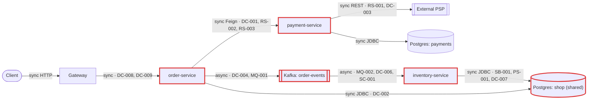
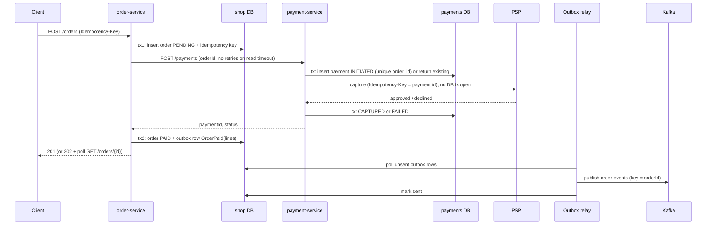
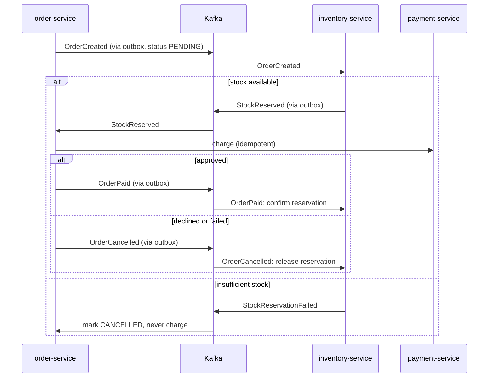
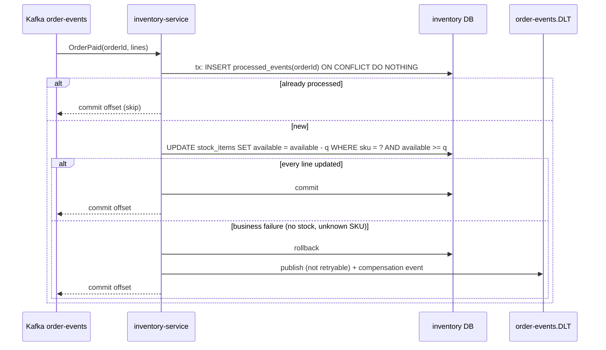

# Architecture review: 02-microservices-distributed-tx (order platform)

Mode: hybrid (code reviewed against the README's stated scale and deploy model) · Date: 2026-10-24 · Lenses run: scalability, persistence, operability, data-consistency, resilience, service-boundaries, messaging (none skipped). The codebase is small (24 Java files, 3 deployables), so the lenses ran in three grouped agents: data-consistency + messaging, resilience + service-boundaries, and scalability + persistence + operability. The parent did not have to run any lens itself.

## Summary

The order platform is three Spring Boot microservices: order-service charges each order synchronously through payment-service and an external PSP, then publishes `OrderPaidEvent` to Kafka for inventory-service to decrement stock. The biggest risk is money: the order flow holds database transactions open across remote calls and retries a non-idempotent charge up to 5 times, so slow payments or routine deploys charge customers twice or charge them for orders that roll back (DC-001, DC-002, OP-001). Stock is also not being decremented at all, because inventory-service cannot deserialize any event the producer sends (MQ-001). The change that buys the most is making the charge idempotent end to end (unique order id on the payment, PSP idempotency key, and no Feign retries until then), followed by committing the order as `PENDING` before charging and publishing through an outbox. On its stated intent: throughput (5 orders/s today, 15 next year) is not the constraint, but the system cannot yet support three teams deploying independently, because a shared table, immediate shutdown and blind retries turn ordinary deploys into data and money errors.

| Severity | Count |
|---|---|
| Critical | 2 |
| High | 16 |
| Medium | 9 |
| Low | 2 |
| Info | 0 |

## Architecture profile

- **Architecture**: microservices. Three services deployed independently by three teams; order-service and inventory-service share the `shop` database.
- **Stack**: Java 17, Spring Boot 3.3.4, Spring Cloud 2023.0.3 (OpenFeign), Spring Kafka 3.2.x, Spring Data JPA / Hibernate 6.5, PostgreSQL 16, Kafka 3.7 (KRaft), Maven.
- **Deployables**:
  - order-service (`order-service/`): POST /orders and GET /orders/{id}; owns `orders` and `order_items` in `shop`; calls payment-service over Feign with `Retryer.Default(100, 1000, 5)`; publishes `order-events` with no key.
  - payment-service (`payment-service/`): charges through the external PSP over a plain `RestTemplate`; owns the `payment` table in `payments`.
  - inventory-service (`inventory-service/`): consumes `order-events` (group `inventory-service`, auto-commit, concurrency 3) and decrements `stock_items` in `shop`; reads order-service's `order_items` table directly.
- **Datastores**: one PostgreSQL 16 server. `shop` is **shared** by order-service and inventory-service; `payments` is used by payment-service only. Schema by `ddl-auto: update` everywhere, with one DB user for all three.
- **Messaging**: Kafka 3.7, topic `order-events` (JSON with type headers, no key, partition count undeclared, no DLT).
- **Background work**: the inventory-service Kafka listener; no schedulers or `@Async`.
- **Runtime**: k8s with 2 replicas per service behind a gateway (README); no manifests or gateway config in the repo; actuator present but unconfigured; no tracing or metrics registry.
- **Stated intent**: three teams deploying on their own schedules; peak ~300 orders/min, expected to triple next year.
- **Derived load**: 5 orders/s peak today (2.5/s per replica), ~15 orders/s next year (7.5/s per replica). Each order makes 1 Feign call (up to 5 attempts), 1 PSP capture per attempt, 1 Kafka event, and 1 order_items query plus 1 stock row update per line in inventory.
- **Key flows**:
  - place order: client -> gateway -> order-service [tx on shop] -> Feign POST /payments (inside the tx, retried) -> payment-service [tx on payments] -> PSP capture (inside the tx, no timeout) -> order-service marks PAID -> `kafkaTemplate.send` (inside the tx) -> commit
  - decrement stock: `order-events` -> inventory-service -> SELECT `order_items` in the shared DB -> read-modify-write `stock_items`
- **Assumptions** (nobody was available to answer questions):
  - Mode is hybrid because the README states scale, replica and deploy intent.
  - k8s manifests and gateway config live outside this repo, so their probes, resources, timeouts, retries and network policies are unknown.
  - The PSP capture endpoint is treated as non-idempotent, because no idempotency key is sent.
  - The `order-events` partition count is assumed to be the broker default of 1 (auto-created).
  - Money and stock are treated as must-never-be-lost-or-doubled.
  - The repo has no tests, so there is no project test command to run for this read-only review.



## Findings

### Critical

#### MQ-001 · inventory-service cannot deserialize any `OrderPaidEvent`: the producer's type header names a class the consumer does not have

Severity: critical · Confidence: high · Lens: messaging · Effort: small

**Where**: `order-service/src/main/resources/application.yml:16`, `inventory-service/src/main/resources/application.yml:19`, `inventory-service/src/main/resources/application.yml:22`, `order-service/src/main/java/com/example/platform/order/events/OrderPaidEvent.java:6`, `inventory-service/src/main/java/com/example/platform/inventory/messaging/OrderPaidEvent.java:6`

**Evidence**:

```text
order-service: `value-serializer: org.springframework.kafka.support.serializer.JsonSerializer` sending `com.example.platform.order.events.OrderPaidEvent`. inventory-service: `value-deserializer: org.springframework.kafka.support.serializer.JsonDeserializer` with `spring.json.value.default.type: com.example.platform.inventory.messaging.OrderPaidEvent` and no `spring.json.use.type.headers: false` or `spring.json.type.mapping`. Framework default, Spring Kafka 3.2, from memory: JsonSerializer adds a `__TypeId__` header with the producer's class name, and JsonDeserializer gives that header precedence over the default type when type headers are enabled (the default).
```

**What goes wrong**: Every order publishes OrderPaidEvent with `__TypeId__=com.example.platform.order.events.OrderPaidEvent`. On every record, inventory-service tries to load that class, which does not exist in its classpath, and deserialization fails. With no ErrorHandlingDeserializer, the container either retries the same offset forever (partition blocked, lag unbounded) or skips the record. Either way no paid order ever decrements stock, and stock_items drifts further from reality with every sale. It also hides DC-006 and DC-007 until it is fixed.

**Fix** (`event-versioning`): Stop using class names as the wire contract. Either set `spring.json.add.type.headers: false` on the producer or `spring.json.use.type.headers: false` on the consumer, or map logical names on both sides (`spring.json.type.mapping: orderPaid:<class>`). Wrap the consumer's value deserializer in `ErrorHandlingDeserializer` (see MQ-002). Add a contract test that serializes with the producer's config and deserializes with the consumer's. Roll out after MQ-002 and DC-006, because the fix will release a backlog of events.

```yaml
# inventory-service/src/main/resources/application.yml
spring:
  kafka:
    consumer:
      value-deserializer: org.springframework.kafka.support.serializer.ErrorHandlingDeserializer
      properties:
        spring.deserializer.value.delegate.class: org.springframework.kafka.support.serializer.JsonDeserializer
        spring.json.use.type.headers: false
        spring.json.value.default.type: com.example.platform.inventory.messaging.OrderPaidEvent
        spring.json.trusted.packages: com.example.platform.inventory.messaging
```

**Why it's worth it here**: Producer and consumer are separate deployables with separate event classes, and stock correctness depends on every OrderPaidEvent being consumed.

#### DC-001 · Feign retries the non-idempotent POST `/payments` up to 5 times, and each attempt makes a new PSP capture

Severity: critical · Confidence: high · Lens: data-consistency · Effort: medium

**Where**: `order-service/src/main/java/com/example/platform/order/config/FeignConfig.java:13`, `order-service/src/main/java/com/example/platform/order/OrderServiceApplication.java:9`, `payment-service/src/main/java/com/example/platform/payment/service/PaymentService.java:24`, `payment-service/src/main/java/com/example/platform/payment/psp/PspClient.java:34`, `payment-service/src/main/java/com/example/platform/payment/domain/Payment.java:20`

**Evidence**:

```text
`/** Payment-service is occasionally slow under load; retry so checkout doesn't fail on a blip. */ ... return new Retryer.Default(100, 1000, 5);` registered as `@EnableFeignClients(defaultConfiguration = FeignConfig.class)`. payment-service: `payments.save(new Payment(orderId, customerId, amount));` with `private String id = UUID.randomUUID().toString();` and a plain `private Long orderId;` (no unique constraint, no lookup), then `restTemplate.postForObject(baseUrl + "/v1/captures", new HttpEntity<>(new CaptureRequest(customerId, amount, "EUR"), headers), ...)` with no Idempotency-Key header. Framework default, OpenFeign 2023.0.x, from memory: any IOException (read timeout, connection reset) becomes a RetryableException and is retried whatever the HTTP method.
```

**What goes wrong**: payment-service is slow, which the code's own comment says happens under load, or a payment-service pod is killed mid-request during a routine deploy (OP-001). The PSP has already captured the money, but order-service's Feign call times out or gets a connection reset. Retryer.Default sends POST /payments again. payment-service inserts a new Payment row with a new UUID and captures again with no idempotency key. The customer is charged 2 to 5 times for one order.

**Fix** (`idempotency-key`): Make the charge idempotent end to end. Add a unique constraint on `payment.order_id` (or a caller-supplied idempotency key). In `charge`, return the existing payment for that order instead of creating a new one. Send a stable key derived from the order (`order-<id>`) as the PSP's Idempotency-Key header. Until both exist, remove the global retryer (RS-003).

```java
// payment-service: one payment per order, one PSP capture per payment
@Transactional
public Payment startCharge(Long orderId, String customerId, BigDecimal amount) {
    return payments.findByOrderId(orderId)                     // unique constraint on order_id
            .orElseGet(() -> payments.save(new Payment(orderId, customerId, amount)));
}
// PspClient.capture(...): headers.set("Idempotency-Key", "payment-" + payment.getId());
```

**Why it's worth it here**: Every order goes through a retried call that moves money.

### High

#### DC-002 · `placeOrder` holds the order transaction open across the payment call, so a customer can be charged for an order that rolled back

Severity: high · Confidence: high · Lens: data-consistency · Effort: medium

**Where**: `order-service/src/main/java/com/example/platform/order/service/OrderService.java:38`, `order-service/src/main/java/com/example/platform/order/service/OrderService.java:44`, `order-service/src/main/java/com/example/platform/order/service/OrderService.java:53`

**Evidence**:

```text
`@Transactional public Order placeOrder(String customerId, List<Line> lines) { ... orders.save(order); ChargeResponse payment = takePayment(order); order.markPaid(payment.paymentId()); kafkaTemplate.send(...); ... }` and `takePayment` calls `paymentClient.charge(new ChargeRequest(order.getId(), ...))`.
```

**What goes wrong**: The PSP is degraded. payment-service captures, but order-service's attempts all time out, or payment-service returns 5xx after capturing. The FeignException propagates out of `placeOrder` and the order and order_items inserts roll back. The customer has been charged, and the shop database has no order and no PENDING row to reconcile against: GET /orders/{id} returns 404 for money already taken. The same happens if the commit fails after a successful charge, or if the pod is killed mid-request (OP-001). The open transaction also holds a `shop` connection for the whole remote call.

**Fix** (`move-call-outside-transaction`): Split the flow. Transaction 1 commits the order as `PENDING`. The charge happens after commit and uses the order id as its idempotency key (DC-001). Transaction 2 marks the order PAID or PAYMENT_FAILED and writes the event to the outbox (DC-004). A reconciliation job, or a status query to payment-service, resolves orders stuck in PENDING. If checkout may complete asynchronously, return 202 with the status resource.

**Why it's worth it here**: The remote call has an irreversible money side effect, and the local row is the only record that the order exists.

Fixed checkout flow for DC-001, DC-002, DC-003 and DC-004 (shared diagram):



#### DC-003 · payment-service calls the PSP inside the transaction that creates the payment row, so a capture can leave no local record

Severity: high · Confidence: high · Lens: data-consistency · Effort: medium

**Where**: `payment-service/src/main/java/com/example/platform/payment/service/PaymentService.java:22`, `payment-service/src/main/java/com/example/platform/payment/service/PaymentService.java:25`, `payment-service/src/main/java/com/example/platform/payment/service/PaymentService.java:27`

**Evidence**:

```text
`@Transactional public Payment charge(Long orderId, String customerId, BigDecimal amount) { Payment payment = payments.save(new Payment(orderId, customerId, amount)); PspClient.CaptureResponse response = psp.capture(customerId, amount); if (!"approved".equals(response.outcome())) { throw new PaymentDeclinedException(orderId); } payment.captured(response.reference()); return payment; }`
```

**What goes wrong**: The `INITIATED` row is not committed before the PSP call, so it records nothing. If payment-service crashes or is killed after the PSP captures but before commit, or the commit fails, the payments table has no row for a capture the PSP made, and nobody can reconcile or refund it from local data. Any outcome other than `approved` also throws and rolls back, which erases the record of the attempt even if the PSP settles it later.

**Fix** (`move-call-outside-transaction`): Commit the `INITIATED` payment (with a unique order_id, DC-001) in its own short transaction before calling the PSP. Call the PSP outside any transaction, using an idempotency key derived from the payment id. Update the row to CAPTURED or FAILED in a second transaction. Add a reconciliation job that queries the PSP for rows stuck in INITIATED. Mark declines FAILED instead of rolling them back.

**Why it's worth it here**: The PSP capture is irreversible and treated as non-idempotent.

#### DC-004 · `OrderPaidEvent` is sent inside the uncommitted order transaction with no outbox: events can be lost or arrive early, and a broker outage blocks checkout

Severity: high · Confidence: high · Lens: data-consistency · Effort: medium · Also reported by: resilience

**Where**: `order-service/src/main/java/com/example/platform/order/service/OrderService.java:47`, `inventory-service/src/main/java/com/example/platform/inventory/messaging/OrderEventsListener.java:29`

**Evidence**:

```text
`kafkaTemplate.send(ORDER_EVENTS, new OrderPaidEvent(order.getId(), customerId, order.getTotal(), Instant.now()));` inside `@Transactional placeOrder`. The returned future is never checked, and there is no transactional producer, outbox table or CDC config. The consumer runs `for (OrderLine line : orderLines.findByOrderId(event.orderId()))` against the shared DB and logs "Stock decremented" without checking that any lines were found. The producer config sets only serializers, so `max.block.ms` is the Kafka client default of 60 s (from memory).
```

**What goes wrong**: (1) Kafka is slow or down. send() is asynchronous, the transaction commits the order as PAID, delivery then fails and nobody reads the future, so the event is lost and stock is never decremented. (2) The event goes out before the shop commit. If the commit then fails, inventory receives an event for an order that does not exist. (3) Even on the happy path, inventory can consume the event before the commit is visible: `findByOrderId` returns an empty list, the handler logs success, and the paid order never decrements stock. (4) While the broker is unreachable, `send()` blocks for up to 60 s waiting for metadata, holding a Tomcat thread and a `shop` connection after the customer has been charged, so order-service stops taking orders.

**Fix** (`transactional-outbox`): Insert the event into an `outbox` table in the same transaction that marks the order PAID, and publish it from a relay (a polling publisher, or Debezium on the shop DB) that marks rows sent. This takes the broker off the request path as well. Put the line items in the event (SB-001). Consumers must then be idempotent (DC-006). Until the outbox exists, lower `max.block.ms` to 1 to 2 s.

**Why it's worth it here**: inventory-service depends on every OrderPaidEvent to keep stock correct, and the broker can fail independently of the order flow.

#### DC-005 · No compensation when inventory fails after payment: customers are charged for out-of-stock or unknown items

Severity: high · Confidence: high · Lens: data-consistency · Effort: large

**Where**: `inventory-service/src/main/java/com/example/platform/inventory/messaging/OrderEventsListener.java:31`, `inventory-service/src/main/java/com/example/platform/inventory/messaging/OrderEventsListener.java:33`, `order-service/src/main/java/com/example/platform/order/domain/Order.java:22`, `payment-service/src/main/java/com/example/platform/payment/api/PaymentController.java` (missing refund/cancel endpoint)

**Evidence**:

```text
`.orElseThrow(() -> new IllegalStateException("Unknown SKU " + line.getSku()));` and `throw new InsufficientStockException(line.getSku(), event.orderId());`, with no failure event or callback. `public enum Status { PENDING, PAID, CANCELLED }`, but nothing sets CANCELLED. payment-service exposes only `@PostMapping charge`, with no refund. Stock is checked only after the money is captured.
```

**What goes wrong**: An SKU sells out. order-service charges the customer and marks the order PAID. inventory-service throws InsufficientStockException, the default error handler retries and then skips the record, and nothing reverses the earlier steps. The customer is charged, the order shows PAID, no stock is allocated, and nothing records that the flow failed, so recovery is manual and depends on someone reading logs. A mistyped SKU in a request has the same outcome.

**Fix** (`saga-choreography`): Model checkout as a saga with persisted state on the order (PENDING -> STOCK_RESERVED -> PAID -> CONFIRMED or CANCELLED). Reserve stock before capturing payment (reserve, then confirm or expire), and reject the order before charging if the reservation fails. When a later step fails, compensate: release the reservation, refund through a new payment-service refund operation, and set the order CANCELLED. With three steps, choreography with failure events (`StockReservationFailed`, `PaymentFailed`) is enough. Every step needs the outbox (DC-004) and idempotent handlers (DC-006).

**Why it's worth it here**: The flow spans three services with separate data ownership and moves money before checking stock.

Fixed flow with reservation and compensation (choreography):



#### DC-006 · The stock decrement is not idempotent, so a redelivered `OrderPaidEvent` decrements twice

Severity: high · Confidence: high · Lens: data-consistency · Effort: small

**Where**: `inventory-service/src/main/java/com/example/platform/inventory/messaging/OrderEventsListener.java:35`, `inventory-service/src/main/resources/application.yml:16`

**Evidence**:

```text
`item.setAvailable(item.getAvailable() - line.getQuantity());`, with no processed-event table, no unique key on order id and no status guard. `enable-auto-commit: true` commits offsets on a timer (Kafka default auto.commit.interval.ms 5000, from memory), independently of the listener's DB commit.
```

**What goes wrong**: The listener commits the decrement for order 42, and the pod is killed (deploy, OOM, node drain) before the next auto-commit. After the rebalance the other replica receives order 42 again and subtracts the quantities a second time. Stock is under-counted, so sellable items show as out of stock. At-least-once delivery makes this happen on every unclean consumer exit, and replaying the backlog once MQ-001 is fixed makes it far more likely.

**Fix** (`idempotent-consumer`): Add a `processed_events(order_id PRIMARY KEY)` table (or `stock_movements(order_id, sku)` with a unique constraint), insert into it in the same transaction as the decrement, and skip the event on a duplicate key. Switch to container-managed commits (MQ-004).

```java
@KafkaListener(topics = "order-events")
@Transactional
public void onOrderPaid(OrderPaidEvent event) {
    if (processed.insertIfAbsent(event.orderId()) == 0) return;   // INSERT ... ON CONFLICT DO NOTHING
    event.lines().stream().sorted(comparing(Line::sku)).forEach(line -> {
        int updated = stock.decrementIfAvailable(line.sku(), line.quantity());
        if (updated == 0) throw new InsufficientStockException(line.sku(), event.orderId());
    });
}
```

**Why it's worth it here**: The handler decrements stock, which must never be applied twice.

Fixed consumer flow for DC-006, DC-007 and MQ-002 (shared diagram):



#### DC-007 · The check-then-decrement on `stock_items` has no lock or version, so concurrent orders lose updates and oversell

Severity: high · Confidence: medium · Lens: data-consistency · Effort: small

**Where**: `inventory-service/src/main/java/com/example/platform/inventory/messaging/OrderEventsListener.java:30`, `inventory-service/src/main/java/com/example/platform/inventory/messaging/OrderEventsListener.java:32`, `inventory-service/src/main/java/com/example/platform/inventory/domain/StockItem.java:14`, `inventory-service/src/main/resources/application.yml:24`

**Evidence**:

```text
`StockItem item = stock.findById(line.getSku())...; if (item.getAvailable() < line.getQuantity()) { throw ... } item.setAvailable(item.getAvailable() - line.getQuantity());`. `private int available;` has no `@Version`, and `StockRepository` has no `@Lock` or conditional update. `listener: concurrency: 3` on 2 replicas, and events are sent with no key, so orders for the same SKU land on any partition.
```

**What goes wrong**: Two paid orders for SKU A (available = 1) are consumed in parallel on different partitions. Both read 1, both pass the check, and both write 0: two units sold, one decremented. Confidence is medium because the partition count is not in the repo. With one partition (assumed today) only one consumer is active and the race is limited to rebalance overlaps, but raising partitions (SC-001), which the configured concurrency and the planned 3x load call for, makes it routine.

**Fix** (`atomic-conditional-update`): Replace the read-modify-write with `UPDATE stock_items SET available = available - :q WHERE sku = :sku AND available >= :q` and treat 0 rows updated as insufficient stock. Process lines sorted by SKU to avoid deadlocks on multi-line orders.

```java
@Modifying
@Query("update StockItem s set s.available = s.available - :q where s.sku = :sku and s.available >= :q")
int decrementIfAvailable(@Param("sku") String sku, @Param("q") int q);
```

**Why it's worth it here**: Stock rows are shared by concurrent consumers, and stock must never oversell.

#### DC-008 · POST `/orders` takes unit price and quantity from the client unvalidated, so callers set their own charge and can inflate stock

Severity: high · Confidence: high · Lens: data-consistency · Effort: small

**Where**: `order-service/src/main/java/com/example/platform/order/api/OrderController.java:30`, `order-service/src/main/java/com/example/platform/order/api/OrderController.java:40`, `order-service/src/main/java/com/example/platform/order/service/OrderService.java:35`, `order-service/src/main/java/com/example/platform/order/domain/Order.java:48`

**Evidence**:

```text
`public record Line(String sku, int quantity, BigDecimal unitPrice)` is bound by `place(@RequestBody PlaceOrderRequest request)` with no `@Valid`, `@Positive`, `@NotEmpty` or catalog lookup. `total = total.add(unitPrice.multiply(BigDecimal.valueOf(quantity)));` is what gets charged.
```

**What goes wrong**: A buggy or malicious client sends `unitPrice: 0.01`, and the PSP captures one cent for a full-price order. With `quantity: -5`, inventory computes `available - (-5)`: the `available < quantity` check passes and stock grows by 5. An empty `lines` list creates a zero-value PAID order. Null fields throw NPEs inside the transaction.

**Fix** (`input-validation`): Price lines on the server from the catalog and ignore client prices. Validate at the boundary (`@Valid`, `@NotEmpty lines`, `@Positive quantity`, `@NotBlank sku`), merge duplicate SKUs, and enforce the same checks in `Order.addItem`. Reject non-positive quantities in inventory as well.

**Why it's worth it here**: The input directly sets the amount charged and the stock movement.

#### DC-009 · POST `/orders` has no idempotency key, so a client or gateway retry creates a second order and a second charge

Severity: high · Confidence: medium · Lens: data-consistency · Effort: small

**Where**: `order-service/src/main/java/com/example/platform/order/api/OrderController.java:40`

**Evidence**:

```text
`@PostMapping public ResponseEntity<OrderView> place(@RequestBody PlaceOrderRequest request)` reads no `Idempotency-Key` header and stores no request key. Each call does `new Order(customerId)` with an IDENTITY id. README: services run "behind our gateway", whose retry policy is not in the repo.
```

**What goes wrong**: Checkout takes several seconds (a synchronous PSP capture behind up to 5 Feign attempts). The browser, app or gateway times out and resubmits. order-service creates a second order with a new id, payment-service sees a different orderId, and the PSP captures again: two PAID orders and two charges. Confidence is medium because whether clients or the gateway retry POSTs is not visible here.

**Fix** (`idempotency-key`): Require an `Idempotency-Key` header on POST /orders, store it with a unique constraint next to the order, and return the existing order's result on a repeat. Carry the order id on as the payment and PSP idempotency key (DC-001).

**Why it's worth it here**: POST /orders is a slow, money-moving call behind a gateway and clients that may retry.

#### MQ-002 · No DLT or error handler on `order-events`, so a failing paid-order event is dropped after 10 immediate retries

Severity: high · Confidence: high · Lens: messaging · Effort: small

**Where**: `inventory-service/src/main/resources/application.yml` (missing DefaultErrorHandler with DeadLetterPublishingRecoverer / ErrorHandlingDeserializer), `inventory-service/src/main/java/com/example/platform/inventory/messaging/OrderEventsListener.java:26`

**Evidence**:

```text
`@KafkaListener(topics = "order-events")` throws `IllegalStateException("Unknown SKU ...")` and `InsufficientStockException`. There is no `CommonErrorHandler` bean, `DeadLetterPublishingRecoverer`, `@RetryableTopic` or `ErrorHandlingDeserializer` anywhere. Framework default, Spring Kafka 3.2, from memory: `DefaultErrorHandler` with `FixedBackOff(0, 9)` makes 10 attempts with no delay, then logs and skips the record.
```

**What goes wrong**: An event fails because of an unknown SKU, insufficient stock, or a DB failover longer than a few milliseconds. It fails 10 times almost instantly, then the offset moves past it. The paid order's stock is never decremented, nobody is told, and the event survives only as a log line. Deserialization failures (MQ-001) either block the partition or are skipped the same way.

**Fix** (`dead-letter-queue`): Configure a `DefaultErrorHandler` with exponential backoff for transient errors and a `DeadLetterPublishingRecoverer` to `order-events.DLT`. Mark business exceptions (insufficient stock, unknown SKU) as not retryable so they go straight to the DLT or to a compensation event (DC-005). Wrap the value deserializer in `ErrorHandlingDeserializer`. Provide a DLT replay tool, and alert on DLT depth (OP-005).

```java
@Bean
DefaultErrorHandler errorHandler(KafkaTemplate<Object, Object> template) {
    var handler = new DefaultErrorHandler(new DeadLetterPublishingRecoverer(template),
            new ExponentialBackOffWithMaxRetries(5));
    handler.addNotRetryableExceptions(InsufficientStockException.class, IllegalStateException.class);
    return handler;
}
```

**Why it's worth it here**: This is a business consumer, and a skipped message leaves a paid order unfulfilled.

#### RS-001 · The PSP capture uses `new RestTemplate()` with no connect or read timeout, inside a `@Transactional` charge

Severity: high · Confidence: high · Lens: resilience · Effort: small

**Where**: `payment-service/src/main/java/com/example/platform/payment/config/HttpClientConfig.java:12`, `payment-service/src/main/java/com/example/platform/payment/psp/PspClient.java:34`, `payment-service/src/main/java/com/example/platform/payment/service/PaymentService.java:22`

**Evidence**:

```text
`return new RestTemplate();` then `restTemplate.postForObject(baseUrl + "/v1/captures", ...)` called from `@Transactional public Payment charge(...)`. A bare RestTemplate uses SimpleClientHttpRequestFactory, whose unset timeouts leave HttpURLConnection at 0, which means infinite (framework default, Spring Framework 6.1, from memory). No timeout is configured in payment-service's application.yml.
```

**What goes wrong**: The PSP stalls instead of refusing connections (a brownout, half-open TCP). Each charge thread blocks forever while holding a `payments` connection (Hikari default pool 10 per replica). At 2.5 charges/s per replica the pool is gone in about 4 s. Later charges wait 30 s for a connection and fail, and order-service's retries (RS-003) pin more threads. Stuck threads do not recover when the PSP does, so payment-service stays down until its pods restart, and every POST /orders fails meanwhile.

**Fix** (`timeouts`): Build the PSP client with explicit timeouts (for example `RestTemplateBuilder.setConnectTimeout(Duration.ofSeconds(1)).setReadTimeout(<PSP p99 plus headroom>)`, or a pooled HttpComponents factory with a connection-request timeout). Keep payment-service's total budget below order-service's Feign read timeout (RS-002). Moving the call out of the transaction is DC-003.

```java
@Bean
public RestTemplate pspRestTemplate(RestTemplateBuilder builder) {
    return builder.setConnectTimeout(Duration.ofSeconds(1))
                  .setReadTimeout(Duration.ofSeconds(8))   // PSP p99 plus headroom
                  .build();
}
```

**Why it's worth it here**: Every order passes synchronously through this call to an external PSP, money is on the path, and there are only 2 replicas.

#### RS-002 · The Feign client to payment-service runs on default timeouts (10 s connect, 60 s read) inside the order transaction

Severity: high · Confidence: high · Lens: resilience · Effort: small

**Where**: `order-service/src/main/resources/application.yml` (missing spring.cloud.openfeign.client.config connectTimeout/readTimeout), `order-service/src/main/java/com/example/platform/order/client/PaymentClient.java:9`, `order-service/src/main/java/com/example/platform/order/service/OrderService.java:38`

**Evidence**:

```text
`@FeignClient(name = "payment-service", url = "${clients.payment-service.url}")` with no `spring.cloud.openfeign.client.config` and no `Request.Options` bean, so OpenFeign's defaults of 10 s connect and 60 s read apply (framework default, Spring Cloud OpenFeign 4.1, from memory). The call runs inside `@Transactional public Order placeOrder(...)` with `Retryer.Default(100, 1000, 5)`.
```

**What goes wrong**: payment-service slows down, or is itself stuck on the PSP (RS-001). Each POST /orders holds a Tomcat thread and a `shop` connection for up to 60 s per attempt, about 5 minutes across 5 attempts. At 2.5 orders/s per replica, all 10 connections are pinned within about 4 s. New orders and GET /orders/{id} wait 30 s for a connection and return 500. The gateway probably times out sooner, so clients retry (DC-009) while order-service keeps working on abandoned requests.

**Fix** (`timeouts`): Set `spring.cloud.openfeign.client.config.payment-service.connectTimeout: 1000` and a `readTimeout` of payment-service's p99 plus headroom (a few seconds, above the PSP timeout). Make attempts times timeout fit within the gateway's request timeout. Taking the call out of the transaction is DC-002.

```yaml
spring:
  cloud:
    openfeign:
      client:
        config:
          payment-service:
            connectTimeout: 1000
            readTimeout: 10000   # above the PSP read timeout, below the gateway timeout
```

**Why it's worth it here**: Every order makes this call, and retries multiply the worst-case wait.

#### RS-003 · The global Feign `Retryer.Default(100, 1000, 5)` retries timeouts against an overloaded payment-service, multiplying its load up to 5x

Severity: high · Confidence: high · Lens: resilience · Effort: small

**Where**: `order-service/src/main/java/com/example/platform/order/config/FeignConfig.java:12`, `order-service/src/main/java/com/example/platform/order/OrderServiceApplication.java:9`

**Evidence**:

```text
`/** Payment-service is occasionally slow under load; retry so checkout doesn't fail on a blip. */ @Bean public Retryer feignRetryer() { return new Retryer.Default(100, 1000, 5); }` registered through `@EnableFeignClients(defaultConfiguration = FeignConfig.class)`. Retryer.Default backs off from 100 ms by 1.5x up to 1 s, with no jitter (from memory).
```

**What goes wrong**: payment-service is slow because it is under load, the case the comment names. Calls time out and are retried, but the original requests keep running on the server (PSP capture plus a DB connection). Each retry adds concurrent work to a service that is already struggling, up to 5 copies per order, in unjittered waves from both replicas, which turns the slowdown into an outage. If the gateway also retries POST /orders, the multipliers stack (3 x 5 = 15 attempts per click). The double charge from the same retries is DC-001.

**Fix** (`retry-with-backoff`): Remove the global retryer now (Spring Cloud's default is `Retryer.NEVER_RETRY`), or limit it to connection failures where the request never left. Once DC-001 is in place, at most 2 to 3 attempts with jittered exponential backoff at one layer only, and confirm the gateway does not retry POST /orders.

```java
@Bean
public Retryer feignRetryer() {
    return Retryer.NEVER_RETRY;   // until DC-001 makes POST /payments idempotent
}
```

**Why it's worth it here**: The retried call is a slow, money-moving operation on the main order flow, and load is expected to triple.

#### SB-001 · inventory-service reads order-service's `order_items` table from the shared `shop` database through an `@Immutable` entity

Severity: high · Confidence: high · Lens: service-boundaries · Effort: medium

**Where**: `inventory-service/src/main/java/com/example/platform/inventory/domain/OrderLine.java:12`, `inventory-service/src/main/java/com/example/platform/inventory/messaging/OrderEventsListener.java:29`, `inventory-service/src/main/resources/application.yml:5`, `order-service/src/main/resources/application.yml:5`, `order-service/src/main/java/com/example/platform/order/domain/OrderItem.java:14`

**Evidence**:

```text
inventory `OrderLine`: `@Entity @Immutable @Table(name = "order_items") ... @Column(name = "order_id") private Long orderId; private String sku; private int quantity;`, queried by `orderLines.findByOrderId(event.orderId())`. Both services use `url: ${SPRING_DATASOURCE_URL:jdbc:postgresql://localhost:5432/shop}` and `username: platform`. README: order-service is owned by the Checkout team, inventory-service by the Warehouse team, and "Each team deploys on its own schedule." The event carries no line items, which is why inventory reads the table.
```

**What goes wrong**: The Checkout team renames or reshapes an `order_items` column (for example `sku` to `product_sku`) and deploys on its own schedule. inventory-service's query fails on every OrderPaidEvent, stock stops being decremented, and the shop oversells. Nothing in either repo signals the dependency. Both services also use one DB user, so nothing stops inventory from writing to order tables. The publish-before-commit race in DC-004 exists only because inventory reads this table.

**Fix** (`database-per-service`): Put the lines (`sku`, `quantity`) in OrderPaidEvent, versioned per MQ-003, and delete `OrderLine` and `OrderLineRepository`, so inventory no longer touches `order_items`. Then separate ownership: a database, or at least a schema and DB user, per service, with grants limited to its own tables. Add a consumer-driven contract test on the event between the two teams.

**Why it's worth it here**: The two services belong to different teams that deploy independently, and stock correctness depends on the shared schema.

#### PS-001 · inventory-service runs `ddl-auto: update` against order-service's `order_items` table and can create it with the wrong shape

Severity: high · Confidence: high · Lens: persistence · Effort: small · Also reported by: service-boundaries

**Where**: `inventory-service/src/main/resources/application.yml:10`, `inventory-service/src/main/java/com/example/platform/inventory/domain/OrderLine.java:12`, `order-service/src/main/java/com/example/platform/order/domain/OrderItem.java:17`, `docker-compose.yml:34`

**Evidence**:

```text
inventory-service: `ddl-auto: update` against the `shop` database, with entity `@Entity @Immutable @Table(name = "order_items") ... @Id private Long id;` (no `@GeneratedValue`). order-service: `@Table(name = "order_items") ... @Id @GeneratedValue(strategy = GenerationType.IDENTITY) private Long id;`. Both connect as `username: platform`. `@Immutable` blocks entity updates, not schema DDL. docker-compose declares no start order between the two services.
```

**What goes wrong**: In a fresh environment (a new env, a DR restore, or `docker compose up` on an empty volume) inventory-service boots first. Hibernate creates `order_items(id bigint not null primary key, order_id bigint, quantity integer not null, sku varchar)` with no identity default. order-service boots next, and `update` adds `unit_price` and the FK but never turns `id` into an identity column. Every order insert omits `id` and fails with a NOT NULL violation, so every POST /orders returns 500. Independent deploys open a second path: when the Warehouse team adds a field to `OrderLine`, inventory's `update` alters the Checkout team's table.

**Fix** (`versioned-migrations`): Set `spring.jpa.hibernate.ddl-auto: none` (or `validate`) in inventory-service now, so only the owning service changes `order_items`. Give inventory-service its own DB user with SELECT-only rights on `order_items`. SB-001 removes the table read entirely.

```yaml
# inventory-service/src/main/resources/application.yml
spring:
  jpa:
    hibernate:
      ddl-auto: none   # order_items belongs to order-service
```

**Why it's worth it here**: Two independently deployed services map the same table and both run schema auto-update.

#### OP-001 · No graceful shutdown, so deploys kill in-flight checkouts and charges

Severity: high · Confidence: medium · Lens: operability · Effort: small

**Where**: `order-service/src/main/resources/application.yml` (missing server.shutdown: graceful and spring.lifecycle.timeout-per-shutdown-phase), `payment-service/src/main/resources/application.yml` (missing server.shutdown: graceful and spring.lifecycle.timeout-per-shutdown-phase), `inventory-service/src/main/resources/application.yml` (missing server.shutdown: graceful and spring.lifecycle.timeout-per-shutdown-phase)

**Evidence**:

```text
No `server.shutdown` in any application.yml. Spring Boot 3.3.4 defaults to `immediate` (graceful became the default in 3.4, from memory). `@Transactional placeOrder` holds its transaction across `paymentClient.charge(...)`, and `@Transactional charge` holds its transaction across `psp.capture(...)`.
```

**What goes wrong**: Each team deploys on its own schedule. k8s sends SIGTERM to an order-service pod with one or two POST /orders in flight at peak. Tomcat stops at once and the context closes the datasource: payment has already been captured, but the order rolls back, so the customer is charged with no order (DC-002). On a payment-service deploy, the capture completes, the payment transaction never commits, and order-service's Feign call gets a connection reset and retries onto the other replica, charging again (DC-001). Graded high rather than critical because it needs a request in flight in that window; confidence is medium because a preStop hook in the external manifests would narrow it.

**Fix** (`graceful-shutdown`): Set `server.shutdown: graceful` and `spring.lifecycle.timeout-per-shutdown-phase` above the longest request (bounded once RS-001 and RS-002 set timeouts). In the manifests add a `preStop` sleep so endpoints are removed before SIGTERM, with `terminationGracePeriodSeconds` above preStop plus drain. This closes the deploy trigger only; crashes still need DC-001 and DC-002.

```yaml
server:
  shutdown: graceful
spring:
  lifecycle:
    timeout-per-shutdown-phase: 30s
```

**Why it's worth it here**: Rolling deploys of 2 replicas per service on k8s, with a money-moving call in the request path.

#### OP-002 · One shared DB credential `platform/platform` is committed in every service's application.yml

Severity: high · Confidence: medium · Lens: operability · Effort: small

**Where**: `order-service/src/main/resources/application.yml:6`, `payment-service/src/main/resources/application.yml:6`, `inventory-service/src/main/resources/application.yml:6`, `payment-service/src/main/resources/application.yml:14`

**Evidence**:

```text
`username: platform` / `password: platform` as literals in all three files, with no `${...}` placeholder. payment-service: `base-url: ${PSP_BASE_URL:https://sandbox.psp.example.com}`. By contrast `api-key: ${PSP_API_KEY}` is externalized correctly.
```

**What goes wrong**: Anyone with repo access holds a DB credential, and because all three services share one user, that credential, or any one compromised service, can read and write both `shop` and `payments`. The same shared user is what lets inventory-service run DDL on order-service's tables (PS-001). Rotating it means a coordinated rebuild and redeploy by three teams. Separately, a production pod missing `PSP_BASE_URL` silently points at the PSP sandbox instead of failing at startup. Confidence is medium because production may already override these values through environment variables.

**Fix** (`secrets-manager`): Use `${SPRING_DATASOURCE_USERNAME}` and `${SPRING_DATASOURCE_PASSWORD}` with no defaults, from k8s Secrets or a secrets manager. Give each service its own least-privilege DB user. Drop the sandbox default for `psp.base-url` so a missing value fails at startup.

**Why it's worth it here**: These are secrets guarding payment data, shared across three teams' services.

### Medium

#### MQ-003 · `OrderPaidEvent` is shared between independently deployed teams only as a duplicated class, with no version field or schema

Severity: medium · Confidence: high · Lens: messaging · Effort: medium

**Where**: `order-service/src/main/java/com/example/platform/order/events/OrderPaidEvent.java:6`, `inventory-service/src/main/java/com/example/platform/inventory/messaging/OrderPaidEvent.java:6`

**Evidence**:

```text
`public record OrderPaidEvent(Long orderId, String customerId, BigDecimal total, Instant paidAt)` is duplicated in both services, with no version field, schema registry or contract test. README: "Each team deploys on its own schedule."
```

**What goes wrong**: The Checkout team renames `orderId` or changes `paidAt` to a string and deploys. inventory-service binds a null orderId, `findByOrderId(null)` returns nothing, the handler logs "Stock decremented", and the event is silently lost. Old events left in the topic become unreadable after a consumer-side change. The planned change in SB-001 (adding line items) is exactly this kind of change.

**Fix** (`event-versioning`): Publish an explicit event contract with a `version` field and tolerant readers, keyed by a logical type name rather than a class name. Add a consumer-driven contract test in CI, or a schema registry with backward-compatibility checks. Validate required fields in the consumer and dead-letter events that fail validation.

**Why it's worth it here**: Producer and consumer belong to different teams that deploy independently.

#### RS-004 · No circuit breaker around payment-service or the PSP on the order flow

Severity: medium · Confidence: medium · Lens: resilience · Effort: small

**Where**: `order-service/pom.xml` (missing spring-cloud-starter-circuitbreaker-resilience4j), `payment-service/pom.xml` (missing spring-cloud-starter-circuitbreaker-resilience4j)

**Evidence**:

```text
No circuit-breaker dependency in either pom, no `@CircuitBreaker` or `CircuitBreakerFactory` in code, and no `spring.cloud.openfeign.circuitbreaker.enabled`. Mesh config such as Istio `outlierDetection` is not in the repo and cannot be ruled out.
```

**What goes wrong**: The PSP or payment-service is down for a few minutes. Every order still waits out the full timeout (and today the retries too), tying up threads and connections in both services and pressing on a dependency that is trying to recover. When it returns, the backlog of retries and resubmissions arrives at once and can knock it over again.

**Fix** (`circuit-breaker`): Wrap the Feign client (`spring.cloud.openfeign.circuitbreaker.enabled: true` with Resilience4j) and the PSP client in circuit breakers that fail fast with a clear 'payment unavailable' response. Size thresholds from today's 5 orders/s and next year's 15. Skip this if the mesh already ejects failing upstreams.

**Why it's worth it here**: The order flow makes synchronous calls on every order to two dependencies that fail independently, one of them a third party.

#### RS-005 · Order placement is a synchronous chain order-service -> payment-service -> external PSP, so any link down or deploying fails checkout

Severity: medium · Confidence: high · Lens: resilience · Effort: large

**Where**: `order-service/src/main/java/com/example/platform/order/service/OrderService.java:44`, `payment-service/src/main/java/com/example/platform/payment/service/PaymentService.java:25`

**Evidence**:

```text
`ChargeResponse payment = takePayment(order); order.markPaid(payment.paymentId());` -> Feign POST /payments -> `psp.capture(customerId, amount)` -> `restTemplate.postForObject(baseUrl + "/v1/captures", ...)`. README: "Each team deploys on its own schedule."
```

**What goes wrong**: Checkout availability is the product of the gateway, order-service, payment-service and the PSP, and their latencies add up. With independent deploys and no graceful shutdown (OP-001), every payment-service rollout fails or retries in-flight orders, and a PSP incident stops all order intake. Held at medium because synchronous payment authorization is often a business requirement.

**Fix** (`async-decoupling`): Agree with the business whether orders may be accepted as PENDING and charged asynchronously. If so, POST /orders persists and returns 202, payment proceeds through events in the saga (DC-005), and the client polls GET /orders/{id}. If synchronous charging must stay, keep the chain at this depth and make it tightly timed, retry-safe and circuit-broken (RS-001 to RS-004).

**Why it's worth it here**: Three services owned by different teams deploy independently, with a third party at the end of the main order flow.

#### PS-002 · All three services manage their schema with `ddl-auto: update`, with no Flyway or Liquibase

Severity: medium · Confidence: high · Lens: persistence · Effort: medium

**Where**: `order-service/src/main/resources/application.yml:10`, `payment-service/src/main/resources/application.yml:10`, `inventory-service/src/main/resources/application.yml:10`, `order-service/pom.xml` (missing flyway-core dependency)

**Evidence**:

```text
`jpa: hibernate: ddl-auto: update` in every application.yml, and no `flyway` or `liquibase` dependency in any pom.xml.
```

**What goes wrong**: The Checkout team renames the primitive `OrderItem.quantity` and deploys. `update` adds the new column but never drops or relaxes the old NOT NULL column, so every insert from the new version fails, while the old replica still running in the rolling update writes only the old column. Both replicas also run DDL at startup at the same time, and constraint changes lock live tables. Schemas drift between environments with no review or rollback. Unique constraints the other fixes need (DC-001, DC-006, DC-009) have no reviewed place to live.

**Fix** (`versioned-migrations`): Adopt Flyway per service with a baseline taken from the current production schema, set `ddl-auto: validate`, and use expand and contract steps for renames and drops so versions N and N-1 can run side by side.

**Why it's worth it here**: Production runs 2 replicas per service with rolling deploys, and teams deploy on independent schedules.

#### PS-003 · `order_items.order_id` has no index, but inventory-service queries it on every `OrderPaidEvent`

Severity: medium · Confidence: high · Lens: persistence · Effort: small

**Where**: `inventory-service/src/main/java/com/example/platform/inventory/domain/OrderLineRepository.java:9`, `order-service/src/main/java/com/example/platform/order/domain/OrderItem.java:21`

**Evidence**:

```text
`List<OrderLine> findByOrderId(Long orderId);` runs for every event. The column comes only from `@ManyToOne @JoinColumn(name = "order_id") private Order order;` under `ddl-auto: update`, and nothing creates an index. Hibernate emits only the FK constraint, and PostgreSQL does not index FK columns.
```

**What goes wrong**: Each order adds a few rows to `order_items` and nothing deletes them. Within months at the stated volume the table holds tens of millions of rows, and every event runs a sequential scan on the Postgres server that also hosts the order and payment databases. With a single effective consumer thread (SC-001), handler time passes the ~200 ms per event that 5 events/s allows, lag grows through every peak, and the scans take IO from checkout transactions.

**Fix** (`add-index`): Add `CREATE INDEX order_items_order_id_idx ON order_items(order_id)` in a migration owned by order-service (PS-002), or `@Table(indexes = @Index(columnList = "order_id"))` on `OrderItem` until then. SB-001 removes this query altogether.

**Why it's worth it here**: `order_items` grows with every order and is read by key on every event at the stated, tripling load.

#### SC-001 · The `order-events` partition count is never declared, so 5 of the 6 configured consumer threads probably sit idle

Severity: medium · Confidence: medium · Lens: scalability · Effort: small

**Where**: `inventory-service/src/main/resources/application.yml:24`, `order-service/src/main/java/com/example/platform/order/service/OrderService.java:47`

**Evidence**:

```text
`listener: concurrency: 3` on 2 replicas makes 6 consumers in group `inventory-service`. The topic is only used as `kafkaTemplate.send(ORDER_EVENTS, ...)`, with no `NewTopic` or `TopicBuilder` bean and no partition settings in docker-compose. Broker defaults are `auto.create.topics.enable=true` and `num.partitions=1` (from memory).
```

**What goes wrong**: The topic is auto-created with one partition, so one thread on one pod handles every stock decrement, and adding pods or threads changes nothing. As `order_items` grows (PS-003) and load triples, lag builds through every peak and stock updates arrive late.

**Fix** (`consumer-concurrency`): Declare the topic in code (`TopicBuilder.name("order-events").partitions(12)`) or in the platform's topic manifests, with partitions at least max replicas times concurrency, plus headroom for the planned 3x. Key events by `orderId`. Fix DC-007 first, because more partitions turn the stock race into a routine event. Alert on consumer lag (OP-005).

**Why it's worth it here**: The README plans 3x growth, and the configured concurrency assumes parallelism the topic does not provide.

#### OP-003 · payment-service `POST /payments` is unauthenticated and charges any `customerId` and amount

Severity: medium · Confidence: medium · Lens: operability · Effort: medium

**Where**: `payment-service/src/main/java/com/example/platform/payment/api/PaymentController.java:28`, `payment-service/pom.xml` (missing service-to-service auth (spring-boot-starter-oauth2-resource-server or mesh mTLS))

**Evidence**:

```text
`@PostMapping public ChargeResponse charge(@RequestBody ChargeRequest request)` passes `request.customerId(), request.amount()` to `psp.capture(customerId, amount)`. No security dependency in any pom. Gateway and network-policy config are not in the repo.
```

**What goes wrong**: The README puts the services behind a gateway, but nothing in the repo keeps payment-service off it. A misrouted gateway path, an ingress for payment-service, or any compromised pod in the cluster can POST charges against any customer. Lowered one level because exposure must also exist; confidence is capped at medium because a NetworkPolicy admitting only order-service would prevent it.

**Fix** (`api-gateway`): Confirm and codify that only order-service can reach payment-service (a k8s NetworkPolicy, no gateway route), and add service-to-service authentication (mesh mTLS or client-credentials JWTs). Follow up with a dedicated security review.

**Why it's worth it here**: An internal endpoint moves money and its network isolation lives outside the repo.

#### OP-004 · No distributed tracing or correlation id across the order -> payment -> PSP -> Kafka -> inventory flow

Severity: medium · Confidence: high · Lens: operability · Effort: small

**Where**: `order-service/pom.xml` (missing micrometer-tracing-bridge-otel dependency), `payment-service/pom.xml` (missing micrometer-tracing-bridge-otel dependency), `inventory-service/pom.xml` (missing micrometer-tracing-bridge-otel dependency)

**Evidence**:

```text
The only observability dependency is `spring-boot-starter-actuator`. Logs are plain `log.info("Order {} placed and paid ({})", ...)` and `log.info("Stock decremented for order {}", ...)` with no trace id, and payment-service logs nothing.
```

**What goes wrong**: A customer reports a double charge or a paid order with no stock movement. The trail spans several Feign attempts across two payment-service replicas, a PSP call, an unkeyed Kafka event and a consumer on another pod, and nothing ties the log lines together. Diagnosis means grepping six pods by timestamp, and a PSP reference cannot be traced back to a request.

**Fix** (`distributed-tracing`): Add `micrometer-tracing-bridge-otel` (Boot 3.3 propagates over RestTemplate and Feign, and over Kafka headers with `spring.kafka.template.observation-enabled` and `spring.kafka.listener.observation-enabled`), export to the platform's tracing backend, and put `traceId` in the log pattern. Log `orderId` and `pspReference` in payment-service.

**Why it's worth it here**: Three deployables and a broker take part in one money-moving flow.

#### OP-005 · No metrics registry or alerts, so consumer lag, skipped stock decrements and payment failures are invisible

Severity: medium · Confidence: high · Lens: operability · Effort: small · Also reported by: messaging

**Where**: `inventory-service/pom.xml` (missing micrometer-registry-prometheus), `order-service/pom.xml` (missing micrometer-registry-prometheus), `payment-service/pom.xml` (missing micrometer-registry-prometheus)

**Evidence**:

```text
No `micrometer-registry-*` dependency and no `management:` block in any application.yml (Boot's default web exposure is `health` only). Listener failures (`InsufficientStockException`, `IllegalStateException("Unknown SKU ...")`) are only logged by the default error handler.
```

**What goes wrong**: Every OrderPaidEvent fails today (MQ-001) and nothing alerts. In general, stock decrements fail, the default handler logs and moves on, consumer lag builds as `order_items` grows, and nobody sees it until the warehouse notices stock mismatches. A PSP slowdown or rising decline rate shows up first as customer complaints.

**Fix** (`metrics-and-alerts`): Add `micrometer-registry-prometheus` and expose `prometheus`. Alert on consumer-group lag for `inventory-service` on `order-events`, listener error and skip rate, DLT depth once MQ-002 lands, Feign and PSP latency and error rate, Hikari pending connections, and a business check of paid orders against stock-decremented orders.

**Why it's worth it here**: Production services on a money- and stock-critical, event-driven flow.

### Low

#### MQ-004 · The inventory consumer sets `enable-auto-commit: true`, so offsets are committed on a timer instead of after processing

Severity: low · Confidence: medium · Lens: messaging · Effort: small

**Where**: `inventory-service/src/main/resources/application.yml:16`

**Evidence**:

```text
`enable-auto-commit: true` overrides Spring Kafka's default of false. Processing is synchronous on the listener thread, so records are processed before the next poll's auto-commit.
```

**What goes wrong**: Messages are not lost, because processing is synchronous. But offsets are committed on Kafka's interval rather than right after the listener's DB commit, which widens the redelivery window on a crash (feeding DC-006). It also stops the container from committing a recovered record's offset once a DLT recoverer is added (MQ-002).

**Fix** (`manual-ack-after-processing`): Remove `enable-auto-commit: true` so the container commits after each listener invocation.

**Why it's worth it here**: The DLT and idempotent-consumer fixes need container-managed commits to behave predictably.

#### OP-006 · No probe configuration in the repo, so the external k8s probes may restart every pod on a DB blip or route to pods that cannot serve

Severity: low · Confidence: low · Lens: operability · Effort: small

**Where**: `order-service/src/main/resources/application.yml` (missing management.endpoint.health.probes / group config), `payment-service/src/main/resources/application.yml` (missing management.endpoint.health.probes / group config), `inventory-service/src/main/resources/application.yml` (missing management.endpoint.health.probes / group config)

**Evidence**:

```text
Actuator is on every classpath but no `management:` config exists. README: "Production runs 2 replicas of each service on k8s", and no manifests are in the repo.
```

**What goes wrong**: If the external manifests point liveness at the aggregate `/actuator/health`, which includes the `db` indicator, a blip on the single shared Postgres server fails liveness on all 6 pods at once and k8s restarts them together. If they use Boot's default readiness group, a pod whose DB pool is exhausted stays ready and keeps taking traffic. The real outcome depends on manifests not in the repo.

**Fix** (`health-probes`): Set `management.endpoint.health.probes.enabled: true`, keep liveness on `livenessState` only, choose readiness contents on purpose (for example include `db` for order and payment), wire the manifests to `/actuator/health/liveness` and `/readiness`, and add a `startupProbe` while `ddl-auto` runs DDL at boot.

**Why it's worth it here**: Running on k8s behind a load balancer with one shared DB server.


## Roadmap

### Now

1. MQ-004: remove `enable-auto-commit: true` so the container commits offsets after processing. Unblocks MQ-002, DC-006.
2. MQ-002: add `DefaultErrorHandler` with backoff, `DeadLetterPublishingRecoverer` to `order-events.DLT`, and `ErrorHandlingDeserializer`. Unblocks MQ-001 (bad records go to the DLT instead of blocking or vanishing).
3. DC-006: add a `processed_events` table and skip duplicates in the listener. Unblocks MQ-001 (the backlog released by the fix can be replayed safely).
4. MQ-001: stop resolving event classes from type headers (`spring.json.use.type.headers: false` or logical type mappings). Unblocks MQ-003, SB-001.
5. RS-003: replace the global Feign retryer with `Retryer.NEVER_RETRY`. Unblocks DC-001 (stops repeat charges today while the idempotency work lands).
6. DC-001: unique `order_id` on payments, return the existing payment on repeat, PSP Idempotency-Key. Unblocks DC-002, DC-009.
7. RS-001: set connect and read timeouts on the PSP RestTemplate. Unblocks RS-002, OP-001.
8. RS-002: set Feign connect and read timeouts for payment-service, above the PSP timeout. Unblocks OP-001.
9. DC-002: commit the order as `PENDING`, charge after commit, then mark PAID in a second transaction. Unblocks DC-005.
10. DC-003: commit the `INITIATED` payment before the PSP call and update it afterwards; reconcile stuck rows. Unblocks DC-005.
11. DC-004: write `OrderPaidEvent` to an outbox table and publish from a relay. Unblocks DC-005.
12. DC-007: replace the stock read-modify-write with an atomic conditional `UPDATE`. Unblocks SC-001.
13. DC-008: price lines on the server and validate quantities and SKUs at the boundary. Unblocks nothing.
14. DC-009: require an `Idempotency-Key` on POST /orders. Unblocks nothing.
15. MQ-003: add a version field and a contract test for `OrderPaidEvent`. Unblocks SB-001 (the event payload change must be compatible).
16. SB-001: put line items in the event and stop reading `order_items` from inventory-service. Unblocks PS-003 (removes the query).
17. PS-001: set `ddl-auto: none` in inventory-service and give it a read-only DB user. Unblocks nothing.
18. OP-001: `server.shutdown: graceful`, a shutdown timeout, and a `preStop` hook. Unblocks nothing.
19. OP-002: move DB credentials to secrets, one least-privilege user per service, no sandbox default for the PSP URL. Unblocks nothing.

### Next

1. DC-005: reservation-first checkout saga with compensation (release, refund, cancel). Unblocks RS-005.
2. PS-002: adopt Flyway per service with `ddl-auto: validate`. Unblocks PS-003 (the index belongs in a migration).
3. PS-003: index `order_items.order_id` if SB-001 has not yet removed the query. Unblocks nothing.
4. RS-004: circuit breakers around the Feign client and the PSP client. Unblocks nothing.
5. RS-005: decide with the business whether checkout can complete asynchronously (202 plus status) on top of the saga. Unblocks nothing.
6. SC-001: declare `order-events` with enough partitions and key by `orderId`. Unblocks nothing.
7. OP-003: restrict payment-service to order-service (NetworkPolicy) and add service-to-service auth. Unblocks nothing.
8. OP-004: add Micrometer Tracing with propagation over HTTP and Kafka. Unblocks nothing.
9. OP-005: add a Prometheus registry and alerts on lag, DLT depth, payment errors and pool saturation. Unblocks nothing.

### Later

1. OP-006: configure liveness and readiness groups explicitly and align the external manifests. Unblocks nothing.

## What's already sound

- Stateless services: no HTTP session, static business maps, local files or in-process caches, so every service can run as N identical replicas.
- `spring.jpa.open-in-view: false` in all three services, so lazy loads cannot hold connections through serialization.
- Controllers return DTO records (`OrderView`, `ChargeResponse`) rather than JPA entities, and `PspClient` has its own request and response records as a thin anti-corruption layer around the PSP.
- No shared domain library: each service defines its own event record, so there is no common jar forcing lockstep releases.
- The split into three services follows three named teams with independent deploy schedules, so it is not a premature split.
- payment-service has its own `payments` database.
- No XA, JTA or `ChainedTransactionManager`: the code does not attempt two-phase commit.
- The Kafka listener processes on its own thread with no `@Async` hand-off, so offsets are never committed before the work is done.
- `psp.api-key` comes from `${PSP_API_KEY}` with no default, so the PSP secret is not in the repo.
- No request/reply over Kafka, and no unbounded executors.

## Not reviewed

- k8s manifests, Helm charts and gateway configuration: not in the repo. Probes, resources, PodDisruptionBudgets, gateway timeouts and retries, and NetworkPolicies are unknown and could change OP-001, OP-003, OP-006, RS-004 and DC-009.
- Production Kafka broker and topic configuration (partition count, retention, `auto.create.topics.enable`).
- The PSP's real API semantics (whether it supports idempotency keys, async outcomes, refunds).
- Security in depth (authentication at the gateway, authorization, PII handling, card data scope): beyond the architecture-level gaps in OP-002 and OP-003, run a dedicated security review.
- Tests: the repo has none, so behaviour was traced from source and framework defaults (each such default is marked "from memory" in the evidence).
