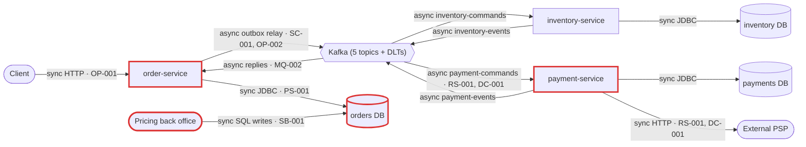
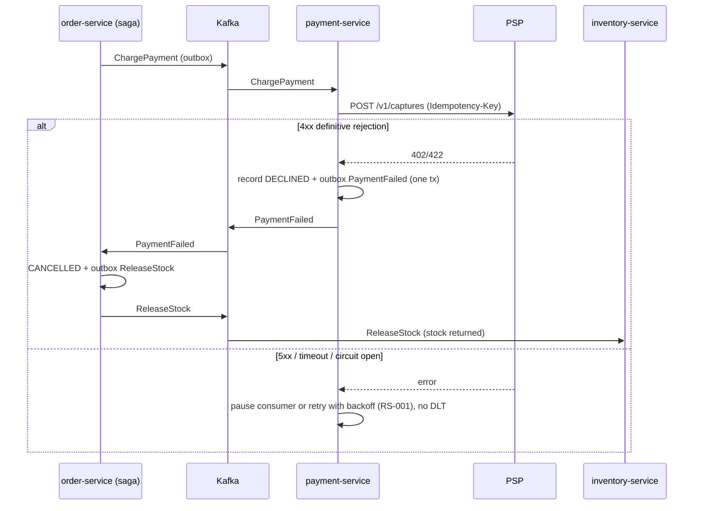

# Architecture review: order platform (v2), `03-microservices-healthy`

- **Mode**: hybrid. The code was reviewed against the README's stated intent: 3 replicas per service, a peak of ~300 orders/min that triples next year, and the saga, DLT and watchdog behaviour the README describes.
- **Date**: 2026-10-24
- **Lenses run**: scalability, persistence, operability, data-consistency, resilience, service-boundaries, messaging. None were skipped. The codebase is small (~65 source files), so three grouped lens agents ran them: data-consistency + messaging, resilience + service-boundaries, and scalability + persistence + operability. The parent ran no lens itself.
- **Dropped in verification**: one persistence candidate about building indexes without `CONCURRENTLY` (V3 is already applied, so nothing in the current code would fail). Overlapping PSP error-handling candidates from three lenses were merged into DC-001 and RS-001.

## Summary

The system is three Spring Boot services: orders, inventory and payments, each with its own Postgres database. They run an orchestrated place-order saga over Kafka, using transactional outboxes and idempotent inboxes. Payment-service charges an external PSP. The consistency core is unusually solid: outbox and inbox everywhere, the PSP call kept outside DB transactions with an idempotency key, optimistic locking, and atomic stock updates.

The biggest risk is at the edge (OP-001). Nothing in the repo authenticates callers, and the client-supplied `customerId` is the customer the PSP charges. Whether this is live depends on a gateway that is not in the repo. Inside the code, the change that buys the most is classifying PSP errors (DC-001 together with RS-001). Today a definitive PSP rejection, or an outage longer than ~3 minutes, dead-letters the charge and strands the order in `STOCK_RESERVED` with stock held.

Against its stated intent, the platform can carry 3× growth. The only scale limits found are the single-threaded outbox relay, which would run at 50–70% of its ceiling at next year's peak (SC-001), and the watchdog's fixed drain rate of 100 cancellations per minute (SC-002).

| Severity | Count |
|---|---|
| Critical | 0 |
| High | 1 |
| Medium | 10 |
| Low | 10 |
| Info | 0 |

## Architecture profile

- **Architecture**: microservices. Three independently deployed Spring Boot services (k8s Deployments), each with its own Postgres database, coordinating over Kafka.
- **Summary**: order-service takes orders over REST and orchestrates reserve stock, then charge payment, then confirm, compensating with `ReleaseStock`. Every step goes over Kafka through per-service outboxes and inboxes.
- **Stack**: Java 17, Spring Boot 3.3.4, Spring Kafka, Spring Data JPA, Flyway, ShedLock 5.16.0, Micrometer tracing (OTel bridge, OTLP), Prometheus registry, Resilience4j 2.2.0 (payment only), PostgreSQL 16, Kafka 3.7.
- **Deployables**:
  - `order-service` (`order-service/`): REST `POST`/`GET /orders`, the saga orchestrator and the saga watchdog. Database `orders`. Publishes `inventory-commands`, `payment-commands` and `order-events`; consumes `inventory-events` and `payment-events`.
  - `inventory-service` (`inventory-service/`): stock and reservations. Database `inventory`. Publishes `inventory-events`; consumes `inventory-commands`.
  - `payment-service` (`payment-service/`): payments, plus PSP capture over HTTP with a circuit breaker and retry. Database `payments`. Publishes `payment-events`; consumes `payment-commands` (concurrency 4).
- **Datastores**: three Postgres databases, one per service, on one server in docker-compose. The production topology is unknown. `price_list` in `orders` is also written by an external pricing back office (SB-001).
- **Messaging**: Kafka. Five topics plus a `<topic>-dlt` for each, with 12 partitions and replication factor 3. JSON payloads keyed by orderId, with `message-id` and `message-type` headers. ~3 minutes of blocking exponential retry, then dead-letter.
- **Background work**: the outbox relay every 500 ms, a nightly outbox purge (03:15) and inbox purge (03:45) in every service, and the saga watchdog every 60 s in order-service, all under ShedLock. A DLT monitor listener runs in every service.
- **Runtime**: 3 replicas per service, actuator liveness and readiness probes, graceful shutdown with a 45 s grace period, config and secrets through ConfigMap and Secret, tracing sampled at 10% to OTLP, Prometheus. No resource requests or limits, no PodDisruptionBudget, no startupProbe, and no Service, Ingress or gateway in the repo.
- **Stated intent**: peak ~300 orders/min, tripling next year. DLT records page on-call. The watchdog cancels orders after 15 minutes without a stock reply.
- **Derived load**: ~5 orders/s now and ~15/s next year. ~25 Kafka messages/s now and ~75/s next year; order-service's outbox handles ~15/s now and ~45/s next year. ~5 PSP captures/s now and ~15/s next year.
- **Key flows**:
  - client → order-service (order `PENDING` plus outbox `ReserveStock` in one transaction) → relay → `inventory-commands` → inventory-service (atomic reserve plus outbox `StockReserved`) → `inventory-events` → saga.
  - saga (outbox `ChargePayment`) → `payment-commands` → payment-service (PSP capture outside the transaction, then the payment row plus outbox reply) → `payment-events` → saga (`CONFIRMED`, or `CANCELLED` plus `ReleaseStock`).
  - watchdog: `PENDING` for more than 15 min → `CANCELLED` plus `ReleaseStock`.
- **Assumptions**:
  - The mode is hybrid, because the README states scale and the intended flow.
  - Nobody was available to answer questions, so no extra scope limits were applied.
  - ~5 Kafka messages per order on the happy path, 3 of them from order-service.
  - Infrastructure that is not in the repo (ingress and auth, Kafka cluster sizing, Postgres HA and `max_connections`, alert rules, LimitRanges) is unknown. Findings it could prevent are capped at medium confidence.
  - The fan-out was sized as small, so three grouped lens agents ran.



## Findings

### High

#### OP-001 · No auth boundary: `POST /orders` and `GET /orders` trust a client-supplied `customerId`, which is the customer the PSP charges

Severity: high · Confidence: medium · Lens: operability · Effort: medium

**Where**:
- `order-service/src/main/java/com/example/platform/order/api/OrderController.java:47`
- `order-service/src/main/java/com/example/platform/order/api/OrderController.java:60`
- `order-service/src/main/java/com/example/platform/order/saga/OrderSaga.java:47`
- `payment-service/src/main/java/com/example/platform/payment/psp/PspClient.java:51`
- `order-service/pom.xml` (missing spring-boot-starter-security / authentication)
- `k8s/order-service.yaml` (missing ingress or gateway with authentication)

**Evidence**:
```java
public ResponseEntity<OrderView> place(@RequestHeader("Idempotency-Key") String idempotencyKey,
                                       @RequestBody PlaceOrderRequest request)   // record PlaceOrderRequest(String customerId, ...)
public Page<OrderView> byCustomer(@RequestParam String customerId, ...)
// OrderSaga
outbox.publish(PAYMENT_COMMANDS, key(orderId), new ChargePayment(orderId, order.getCustomerId(), order.getTotal()));
// PspClient
.body(new CaptureRequest(customerId, amount, "EUR"))
```
No pom declares spring-security. `k8s/` holds only Deployments.

**What goes wrong**: A client that can reach order-service posts an order naming another customer's `customerId`. The saga reserves stock, and payment-service captures that customer's money at the PSP. The same client can read any customer's order history with `GET /orders?customerId=...`. Even behind an authenticating gateway, the service accepts a body `customerId` that differs from the token, unless the gateway rewrites it.

**Fix** (`api-gateway`): Put order-service behind an authenticating ingress or API gateway. In the service, take `customerId` from the authenticated principal, not from the request:
```java
@PostMapping
public ResponseEntity<OrderView> place(@AuthenticationPrincipal Jwt jwt,
                                       @RequestHeader("Idempotency-Key") String key,
                                       @RequestBody PlaceOrderRequest request) {
    Order order = orderService.placeOrder(key, jwt.getSubject(), request.lines());
    ...
}
```
Add rate limiting on `POST /orders` at the edge. Commission a dedicated security review for depth.

**Why it's worth it here**: order-service accepts orders from external clients, and payment-service charges whichever customer the order names.

### Medium

#### DC-001 · A definitive PSP rejection (HTTP 4xx) never produces `PaymentFailed`: it is retried ~27 times, dead-lettered, and the order stays `STOCK_RESERVED` with stock held

Severity: medium · Confidence: medium · Lens: data-consistency · Effort: small · Also reported by: resilience, messaging

**Where**:
- `payment-service/src/main/java/com/example/platform/payment/psp/PspClient.java:52`
- `payment-service/src/main/java/com/example/platform/payment/messaging/PaymentCommandListener.java:37`
- `payment-service/src/main/java/com/example/platform/payment/messaging/PaymentRecorder.java:34`
- `payment-service/src/main/resources/application.yml:76`
- `payment-service/src/main/java/com/example/platform/payment/config/KafkaConfig.java:28`
- `order-service/src/main/java/com/example/platform/order/saga/SagaWatchdog.java:17`

**Evidence**:
```java
// PspClient: RestClient's default status handler throws HttpClientErrorException on 4xx
.retrieve()
.body(CaptureResponse.class);
// PaymentCommandListener: no catch
PspClient.CaptureResponse response = psp.capture("capture-" + command.orderId(), ...);
recorder.record(messageId, command, response);
// KafkaConfig
handler.addNotRetryableExceptions(com.fasterxml.jackson.core.JsonProcessingException.class);
```
```yaml
retry:
  instances:
    psp:
      max-attempts: 3   # no retry-exceptions / ignore-exceptions; breaker has no ignore-exceptions
```
`PaymentRecorder` publishes `PaymentFailed` only from a 2xx response whose outcome is not "approved". SagaWatchdog: "Orders stuck after stock was reserved are waiting on payment ... exposed as a gauge for alerting rather than cancelled".

**What goes wrong**: The PSP answers a capture with a deterministic 4xx: a validation error, an idempotency conflict, or a decline reported as 402. Resilience4j retries it 3 times. The Kafka error handler then redelivers it 8 more times over ~3 minutes, about 27 PSP calls while the partition is blocked. The burst counts toward the circuit breaker's 50% failure threshold and can open it for every payment. The record then lands on `payment-commands-dlt`. No `PaymentFailed` is recorded, so the order stays `STOCK_RESERVED`, the watchdog leaves it alone by design, and the stock is never released. Redriving fails the same way, so recovery needs hand-written SQL plus a hand-published `ReleaseStock`.

**Fix** (`compensating-action`): Classify PSP errors once. Treat 4xx other than 408 and 429 as a definitive rejection, record it as DECLINED, and publish `PaymentFailed` so the saga compensates. Retry and trip the breaker only on transport errors and 5xx:
```java
PspClient.CaptureResponse response;
try {
    response = psp.capture("capture-" + command.orderId(), command.customerId(), command.amount());
} catch (HttpClientErrorException e) {
    if (e.getStatusCode().value() == 408 || e.getStatusCode().value() == 429) throw e;  // transient
    response = new PspClient.CaptureResponse(null, "rejected:" + e.getStatusCode().value());
}
recorder.record(messageId, command, response);
```
```yaml
resilience4j:
  retry.instances.psp.retry-exceptions:
    - org.springframework.web.client.ResourceAccessException
    - org.springframework.web.client.HttpServerErrorException
  circuitbreaker.instances.psp.ignore-exceptions:
    - org.springframework.web.client.HttpClientErrorException
```
Add an operator path (an admin command or runbook) that fails a stuck `STOCK_RESERVED` order through the saga.

**Why it's worth it here**: The PSP can answer a capture with a non-2xx status for a definitive rejection, and the saga depends on a `PaymentFailed` reply to release reserved stock. A check of the PSP API docs settles how declines arrive. If they arrive as 4xx, this becomes high.



#### RS-001 · A PSP outage longer than ~3 minutes dead-letters `ChargePayment` commands, because an open circuit is retried and dead-lettered like a poison message

Severity: medium · Confidence: high · Lens: resilience · Effort: small · Also reported by: messaging

**Where**:
- `payment-service/src/main/java/com/example/platform/payment/config/KafkaConfig.java:20`
- `payment-service/src/main/java/com/example/platform/payment/messaging/PaymentCommandListener.java:11`
- `payment-service/src/main/resources/application.yml:75`

**Evidence**:
```java
// ~3 minutes in total: longer than a circuit-breaker open window or a DB failover.
ExponentialBackOffWithMaxRetries backOff = new ExponentialBackOffWithMaxRetries(8);
...
 * Transient PSP failures (timeouts, open circuit) propagate so the container's error handler retries with
 * backoff and finally dead-letters the command.
```
```yaml
wait-duration-in-open-state: 30s
```

**What goes wrong**: The PSP is down for 15 minutes at peak. The circuit opens and each delivery fails fast with `CallNotPermittedException`, which is also retried 3 times in-process. On each of the 12 `payment-commands` partitions, the head record is retried for ~3 minutes and then dead-lettered. About 60 charges land on the DLT, each paging on-call. Their orders sit in `STOCK_RESERVED` holding stock until someone redrives them by hand, even after the PSP has recovered.

**Fix** (`circuit-breaker`): Treat "dependency unavailable" as backpressure, not as a poison message. Pause the consumer while the circuit is open:
```java
circuitBreakerRegistry.circuitBreaker("psp").getEventPublisher().onStateTransition(e -> {
    MessageListenerContainer c = registry.getListenerContainer("payment-commands");
    switch (e.getStateTransition().getToState()) {
        case OPEN -> c.pause();
        case HALF_OPEN, CLOSED -> c.resume();
        default -> { }
    }
});
```
Alternatively, give `CallNotPermittedException`, `ResourceAccessException` and 5xx an unbounded backoff through `DefaultErrorHandler.setBackOffFunction`. Add `CallNotPermittedException` to the Resilience4j retry's `ignore-exceptions`. The fixed flow is the bottom branch of the DC-001 diagram.

**Why it's worth it here**: The PSP is a third party whose outages can outlast the 3-minute retry budget, and each dead-lettered charge strands an order with reserved stock until a human redrives it.

#### SB-001 · `price_list` lives in order-service's database and Flyway, but an external pricing back office writes it directly

Severity: medium · Confidence: medium · Lens: service-boundaries · Effort: medium

**Where**:
- `order-service/src/main/java/com/example/platform/order/domain/PriceList.java:11`
- `order-service/src/main/resources/db/migration/V4__price_list.sql:1`

**Evidence**:
```java
/**
 * Current selling prices. The pricing back office writes {@code price_list}; order-service only reads it.
 */
```
```sql
create table price_list (
    sku        varchar(64)    primary key,
    unit_price numeric(12, 2) not null check (unit_price > 0),
```

**What goes wrong**: Another system writes into a table whose schema order-service's migrations own. When order-service evolves `price_list`, the back office's writes fail at runtime. When the back office changes how it writes, order-service prices orders wrongly or rejects them as `unknown SKU`. Neither side can deploy without coordinating. The back office also needs write credentials to the `orders` database, and its bulk updates contend with order placement.

**Fix** (`data-replication-via-events`): Let pricing own its data. The back office publishes price-change events (or exposes a price API), and order-service maintains `price_list` as a local read model through a consumer. At minimum, move the table to its own schema with a documented contract and a dedicated write role.

**Why it's worth it here**: The pricing back office is a separate system owned outside the Checkout team, and order-service is meant to deploy independently. This rests on the code comment, because the back office's code is not in the repo.

#### SC-001 · Single-threaded outbox relay sends and commits one record at a time, capping each service at roughly 65–100 messages/s regardless of replicas

Severity: medium · Confidence: medium · Lens: scalability · Effort: small

**Where**:
- `order-service/src/main/java/com/example/platform/order/outbox/OutboxRelay.java:40`
- `inventory-service/src/main/java/com/example/platform/inventory/outbox/OutboxRelay.java:40`
- `payment-service/src/main/java/com/example/platform/payment/outbox/OutboxRelay.java:40`

**Evidence**:
```java
@Scheduled(fixedDelayString = "${outbox.relay-interval-ms}")
@SchedulerLock(name = "outbox-relay", lockAtMostFor = "PT30S")
public void relay() throws Exception {
    for (OutboxEvent event : events.findUnsent(PageRequest.of(0, batchSize))) {
        ...
        kafka.send(record).get(10, TimeUnit.SECONDS);
        event.markSent();
        events.save(event);
    }
}
```

**What goes wrong**: Only the replica holding the ShedLock relays. Each record costs an acks=all round trip plus a merge and commit, about 5–10 ms. A full batch therefore takes 0.5–1 s and is followed by a fixed 500 ms sleep, even when more rows are waiting. order-service would need ~45 messages/s at next year's peak, 50–70% of that ceiling. A burst after a Kafka blip, or growth beyond ~4–5× today, makes the backlog grow and slows every saga hop. Adding replicas does not help.

**Fix** (`bulk-operations`):
```java
List<OutboxEvent> batch = events.findUnsent(PageRequest.of(0, batchSize));
List<CompletableFuture<?>> sends = batch.stream().map(e -> kafka.send(toRecord(e))).toList();
CompletableFuture.allOf(sends.toArray(CompletableFuture[]::new)).get(10, TimeUnit.SECONDS);
events.markSent(batch.stream().map(OutboxEvent::getId).toList());   // one bulk UPDATE
// loop again immediately while batch.size() == batchSize
```

**Why it's worth it here**: Peak load is expected to triple next year, and the relay is the only path from each service to Kafka.

#### SC-002 · Saga watchdog cancels at most 100 orders per minute, below the stated 300–900 orders/minute peak

Severity: medium · Confidence: high · Lens: scalability · Effort: small

**Where**:
- `order-service/src/main/java/com/example/platform/order/saga/SagaWatchdog.java:40`
- `order-service/src/main/java/com/example/platform/order/saga/SagaWatchdog.java:44`

**Evidence**:
```java
@Scheduled(fixedDelay = 60_000)
@SchedulerLock(name = "saga-watchdog")
public void cancelUnreservedOrders() {
    ...
    for (Order order : orders.findByStatusAndCreatedAtBefore(Order.Status.PENDING, cutoff, PageRequest.of(0, 100))) {
```

**What goes wrong**: inventory-service, or its relay, is down for more than 15 minutes at peak. Timed-out orders accumulate at 300/min (900/min next year), but each run cancels one page of 100 and then sleeps 60 s. After a one-hour outage, the timeouts take 3–9 hours to drain, and customers see `PENDING` orders long past the promised 15 minutes.

**Fix** (`work-queue`): Within one locked run, keep fetching pages until a page comes back short or a time budget (below the lock's `lockAtMostFor`) is spent. Expose a gauge of `PENDING` orders past the cutoff.

**Why it's worth it here**: The stated peak inflow (300/min, rising to 900/min) exceeds the watchdog's fixed drain rate of 100/min.

#### OP-002 · No outbox backlog or relay-health metric: a stalled relay surfaces only as mass watchdog cancellations

Severity: medium · Confidence: high · Lens: operability · Effort: small

**Where**:
- `order-service/src/main/java/com/example/platform/order/outbox/OutboxRelay.java` (missing outbox backlog / oldest-unsent-age gauge)
- `inventory-service/src/main/java/com/example/platform/inventory/outbox/OutboxRelay.java` (missing outbox backlog / oldest-unsent-age gauge)
- `payment-service/src/main/java/com/example/platform/payment/outbox/OutboxRelay.java` (missing outbox backlog / oldest-unsent-age gauge)

**Evidence**:
```java
// the only custom meters in the repo
Counter.builder("kafka.dlt.records")...                 // DeadLetterMonitor
Gauge.builder("orders.saga.stuck_awaiting_payment", ...) // SagaWatchdog
```

**What goes wrong**: A relay stalls: the broker is unreachable, the ShedLock row is stuck, or the oldest row keeps failing. In order-service, `ReserveStock` stops flowing, and 15 minutes later the watchdog starts cancelling orders, whose `OrderCancelled` events are stuck too. Nobody is paged until customers, or the 30-minute stuck-payment gauge, notice.

**Fix** (`metrics-and-alerts`):
```java
Gauge.builder("outbox.oldest_unsent_age_seconds", () -> jdbc.queryForObject(
    "select coalesce(extract(epoch from now() - min(created_at)), 0) from outbox where sent_at is null", Double.class))
    .register(meters);
```
Add an unsent-count gauge and a relay success/failure counter. Alert when the oldest unsent row is older than about a minute, and on consumer lag.

**Why it's worth it here**: Every saga step in all three services depends on the relay, and the watchdog turns relay stalls into customer-visible cancellations.

#### OP-003 · Lazily registered `kafka.dlt.records` counter hides the first DLT record per pod and topic from rate-based alerts

Severity: medium · Confidence: medium · Lens: operability · Effort: small

**Where**:
- `order-service/src/main/java/com/example/platform/order/messaging/DeadLetterMonitor.java:32`
- `inventory-service/src/main/java/com/example/platform/inventory/messaging/DeadLetterMonitor.java:32`
- `payment-service/src/main/java/com/example/platform/payment/messaging/DeadLetterMonitor.java:32`

**Evidence**:
```java
Counter.builder("kafka.dlt.records").tag("topic", record.topic()).register(meters).increment();
```
README: "Every DLT record increments `kafka_dlt_records_total`, which pages on-call."

**What goes wrong**: A single `ReleaseStock` is dead-lettered. The monitor pod creates the series with its first sample already at 1. Prometheus `increase()` and `rate()` don't count a series appearing as an increase, so an alert such as `increase(kafka_dlt_records_total[5m]) > 0` stays silent. Every restart resets this. Stock stays reserved and nobody is paged.

**Fix** (`metrics-and-alerts`): Pre-register the counter at 0 for every known `<topic>-dlt` at startup, so the first record produces a 0→1 increase. Or alert on DLT end offsets from a Kafka exporter. Commit the alert rule next to the code.

**Why it's worth it here**: The DLT page is the only signal for dead-lettered compensations, and isolated DLT records are the common case.

#### OP-004 · Trace context is not carried through the outbox or Kafka, so every saga hop starts a separate trace

Severity: medium · Confidence: high · Lens: operability · Effort: medium

**Where**:
- `order-service/src/main/resources/application.yml` (missing `spring.kafka.template.observation-enabled` / `spring.kafka.listener.observation-enabled`)
- `order-service/src/main/java/com/example/platform/order/outbox/OutboxRelay.java:38`

**Evidence**:
```java
record.headers().add("message-id", event.getId().toString().getBytes(StandardCharsets.UTF_8));
record.headers().add("message-type", event.getType().getBytes(StandardCharsets.UTF_8));
```
No Kafka observation settings, and no traceparent column in `outbox`.

**What goes wrong**: An order is stuck or cancelled unexpectedly. The `POST /orders` trace ends at the outbox insert. The inventory, saga and payment hops each start unrelated traces, each sampled independently at 10%, so whole-flow traces practically never exist.

**Fix** (`distributed-tracing`): Store `traceparent` in an outbox column when the event is written, and send it as a Kafka header from the relay. Enable `spring.kafka.template.observation-enabled` and `spring.kafka.listener.observation-enabled`. Keep a parent-based sampler.

**Why it's worth it here**: Three deployables take part in every order through an asynchronous saga.

#### OP-005 · Deployments declare no resource requests or limits, no PodDisruptionBudget and no topology spread

Severity: medium · Confidence: medium · Lens: operability · Effort: small

**Where**:
- `k8s/order-service.yaml` (missing resources requests/limits, PodDisruptionBudget, topologySpreadConstraints)
- `k8s/inventory-service.yaml` (missing resources requests/limits, PodDisruptionBudget, topologySpreadConstraints)
- `k8s/payment-service.yaml` (missing resources requests/limits, PodDisruptionBudget, topologySpreadConstraints)

**Evidence**:
```yaml
containers:
  - name: order-service
    image: registry.example.com/order-service:2.0.0
    ports: ...
    envFrom: ...
    livenessProbe: ...
    readinessProbe: ...      # no resources: block
```

**What goes wrong**: The pods run as BestEffort, are packed onto busy nodes and are evicted first under memory pressure. During a node drain, all three order-service replicas can be evicted together, which takes `POST /orders` down. A namespace LimitRange would supply defaults, but none is in the repo.

**Fix** (`resource-requests-and-disruption-budget`):
```yaml
resources:
  requests: { cpu: 250m, memory: 768Mi }
  limits:   { memory: 768Mi }
---
apiVersion: policy/v1
kind: PodDisruptionBudget
metadata: { name: order-service }
spec: { maxUnavailable: 1, selector: { matchLabels: { app: order-service } } }
```
Also set `-XX:MaxRAMPercentage` in the image, and add topologySpreadConstraints.

**Why it's worth it here**: Every service runs 3 replicas on k8s and is expected to scale for 3× load.

#### PS-001 · Hikari pool of 10 per pod is not sized against Postgres `max_connections` for 9 pods plus deploy surge

Severity: medium · Confidence: low · Lens: persistence · Effort: small

**Where**:
- `order-service/src/main/resources/application.yml:9`
- `inventory-service/src/main/resources/application.yml:9`
- `payment-service/src/main/resources/application.yml:9`
- `docker-compose.yml:2`

**Evidence**:
```yaml
hikari:
  maximum-pool-size: 10
```
One `postgres:16` server with default settings hosts all three databases in compose.

**What goes wrong**: Suppose production mirrors compose, with one server at the default `max_connections` of 100. Then 3 services × 3 replicas × 10 = 90 connections. A rolling-deploy surge pod (+10), or a scale-out for next year's load, exceeds the limit. New pods get `too many clients`, and the deploy stalls.

**Fix** (`connection-pool-sizing`): Document the production DB topology. Size `maximum-pool-size` × maximum pods (including surge) under `max_connections`. Lower `minimum-idle`; 5–8 connections per pod is likely enough. Add PgBouncer if replica counts grow.

**Why it's worth it here**: The three databases share one Postgres server and replica counts are expected to grow. The production topology is not in the repo, hence the low confidence.

### Low

#### RS-002 · Outbox relay shares Spring Boot's default single-thread `TaskScheduler` with the watchdog and the nightly purges

Severity: low · Confidence: high · Lens: resilience · Effort: small

**Where**:
- `order-service/src/main/resources/application.yml` (missing `spring.task.scheduling.pool.size`)
- `order-service/src/main/java/com/example/platform/order/outbox/OutboxRelay.java:33`
- `order-service/src/main/java/com/example/platform/order/messaging/Inbox.java:26`
- `order-service/src/main/java/com/example/platform/order/saga/SagaWatchdog.java:40`

**Evidence**:
```java
@Scheduled(fixedDelayString = "${outbox.relay-interval-ms}")   // relay
@Scheduled(cron = "0 15 3 * * *")                              // outbox purge
@Scheduled(cron = "0 45 3 * * *")                              // inbox purge
```
No `TaskScheduler` bean and no pool size (the Boot 3.3 default is 1 thread).

**What goes wrong**: While the nightly purges run on the replica that holds the relay lock, that service publishes no saga commands or replies. A relay blocked on Kafka likewise delays the watchdog.

**Fix** (`bulkhead`): Set `spring.task.scheduling.pool.size: 4` in all three services, or give the relay a dedicated scheduler.

**Why it's worth it here**: The relay is on the critical path of every saga step, and the purges run nightly in all three services.

#### MQ-001 · Deterministic consumer errors are retried with blocking backoff for ~3 minutes, stalling the partition, because only `JsonProcessingException` is not-retryable

Severity: low · Confidence: high · Lens: messaging · Effort: small

**Where**:
- `order-service/src/main/java/com/example/platform/order/config/KafkaConfig.java:28`
- `inventory-service/src/main/java/com/example/platform/inventory/config/KafkaConfig.java:28`
- `payment-service/src/main/java/com/example/platform/payment/config/KafkaConfig.java:28`
- `order-service/src/main/java/com/example/platform/order/messaging/Headers.java:24`
- `inventory-service/src/main/java/com/example/platform/inventory/messaging/InventoryCommandListener.java:32`
- `order-service/src/main/java/com/example/platform/order/saga/OrderSaga.java:89`

**Evidence**:
```java
handler.addNotRetryableExceptions(com.fasterxml.jackson.core.JsonProcessingException.class);
throw new IllegalArgumentException("Missing header " + name + ...);
default -> throw new IllegalArgumentException("Unknown command " + Headers.messageType(record));
```

**What goes wrong**: A record with a missing header or an unknown command is retried in place for ~3 minutes before it is dead-lettered anyway. Every later order on that partition waits behind it.

**Fix** (`dead-letter-queue`):
```java
handler.addNotRetryableExceptions(JsonProcessingException.class,
        IllegalArgumentException.class, IllegalStateException.class);
```
In payment-service, also add the PSP 4xx type from DC-001.

**Why it's worth it here**: It is cheap: one line in each of three identical configs.

#### MQ-002 · payment-service and order-service silently drop unknown `message-type` values and commit the offset

Severity: low · Confidence: medium · Lens: messaging · Effort: small

**Where**:
- `payment-service/src/main/java/com/example/platform/payment/messaging/PaymentCommandListener.java:33`
- `order-service/src/main/java/com/example/platform/order/saga/SagaReplyListener.java:45`

**Evidence**:
```java
if (inbox.alreadyProcessed(messageId) || !"ChargePayment".equals(Headers.messageType(record))) {
    return;
}
default -> { /* replies this saga does not handle */ }
```

**What goes wrong**: A new type name (the stated versioning strategy) arrives during a rolling deploy, before the consumer is upgraded. The old consumer returns normally, the offset is committed and the message is lost, leaving the saga stuck. In order-service the inbox row is already written, so a redrive would be ignored too.

**Fix** (`event-versioning`): Treat an unknown `message-type` on command and reply topics as a not-retryable error, so it goes to `<topic>-dlt` and can be redriven once consumers catch up. Deploy consumers before producers when adding a type.

**Why it's worth it here**: The three services are owned by different teams and deploy independently.

#### DC-002 · `POST /orders` check-then-insert returns 500 on a concurrent retry, and the `Idempotency-Key` is not bound to the request body

Severity: low · Confidence: high · Lens: data-consistency · Effort: small

**Where**:
- `order-service/src/main/java/com/example/platform/order/api/OrderService.java:38`
- `order-service/src/main/java/com/example/platform/order/api/OrderController.java:47`
- `order-service/src/main/resources/db/migration/V2__orders.sql:3`

**Evidence**:
```java
return orders.findByRequestKey(requestKey).orElseGet(() -> { ... orders.save(order); saga.start(order); return order; });
```
```sql
request_key     varchar(100) not null unique,
```

**What goes wrong**: Two concurrent attempts with the same key both miss the lookup. The second fails on the unique constraint and returns 500, although the order exists. A reused key with a different basket silently returns the first order. No duplicate order or charge results.

**Fix** (`idempotency-key`): Catch `DataIntegrityViolationException` on `request_key` and return the existing order. Store a hash of customerId plus lines with the key, and return 422 on a mismatch. Validate the key's length.

**Why it's worth it here**: Clients and gateways retry `POST /orders` on timeout, which is why the header exists.

#### SC-003 · Outbox relay `lockAtMostFor = PT30S` is shorter than its worst-case run, so two replicas can relay at once

Severity: low · Confidence: high · Lens: scalability · Effort: small

**Where**:
- `order-service/src/main/java/com/example/platform/order/outbox/OutboxRelay.java:34`
- `inventory-service/src/main/java/com/example/platform/inventory/outbox/OutboxRelay.java:34`
- `payment-service/src/main/java/com/example/platform/payment/outbox/OutboxRelay.java:34`

**Evidence**:
```java
@SchedulerLock(name = "outbox-relay", lockAtMostFor = "PT30S")
... kafka.send(record).get(10, TimeUnit.SECONDS);   // up to 100 per run
```

**What goes wrong**: Under broker degradation a batch outlasts 30 s, the lock expires, and a second replica relays the same rows. Duplicates are deduplicated by the inboxes, but Kafka load doubles exactly when the broker is degraded.

**Fix** (`distributed-lock`): Bound the loop by elapsed time, stopping well before `lockAtMostFor`, or raise `lockAtMostFor` above batch size × send timeout. SC-001's batched sends also shorten the run.

**Why it's worth it here**: The relay runs on 3 replicas, with ShedLock as the only mutual exclusion.

#### PS-002 · Placing an order runs one price query and one IDENTITY insert per line, up to ~100 round trips

Severity: low · Confidence: high · Lens: persistence · Effort: small

**Where**:
- `order-service/src/main/java/com/example/platform/order/api/OrderService.java:40`
- `order-service/src/main/java/com/example/platform/order/domain/PriceList.java:24`
- `order-service/src/main/java/com/example/platform/order/domain/OrderItem.java:19`

**Evidence**:
```java
lines.forEach(l -> order.addItem(l.sku(), l.quantity(), priceOf(l.sku())));
"select unit_price from price_list where sku = ? and active"
@GeneratedValue(strategy = GenerationType.IDENTITY)
```

**What goes wrong**: A 50-line order makes 50 lookups and 50 unbatched inserts inside the request transaction. That holds a pooled connection, and latency grows with line count.

**Fix** (`bulk-operations`): Fetch prices in one query (`where sku = any(?)`). Switch to SEQUENCE ids with `hibernate.jdbc.batch_size` and `order_inserts`.

**Why it's worth it here**: Orders can carry up to 50 lines, and volume is expected to triple.

#### PS-003 · Outbox purge deletes a whole day of week-old sent rows in one transaction

Severity: low · Confidence: medium · Lens: persistence · Effort: small

**Where**:
- `order-service/src/main/java/com/example/platform/order/outbox/OutboxRepository.java:20`
- `order-service/src/main/java/com/example/platform/order/outbox/OutboxRelay.java:46`

**Evidence**:
```java
@Query("delete from OutboxEvent e where e.sentAt < :cutoff")
int deleteSentBefore(Instant cutoff);
```

**What goes wrong**: At next year's volume, the nightly purge deletes hundreds of thousands of rows in one statement. That means a long transaction, a WAL burst and many dead tuples on the table the relay polls every 500 ms, and per RS-002 the relay waits for it.

**Fix** (`data-retention`): Delete in 5,000-row chunks, as `Inbox.purgeOld` already does, or partition the outbox by day and drop old partitions.

**Why it's worth it here**: The outbox gets a row per saga step, and volume is set to triple.

#### OP-006 · No startupProbe: Flyway and KafkaAdmin run before the liveness endpoint exists, with ~30 s before kubelet restarts the pod

Severity: low · Confidence: medium · Lens: operability · Effort: small

**Where**:
- `k8s/order-service.yaml:26`
- `k8s/inventory-service.yaml:26`
- `k8s/payment-service.yaml:26`

**Evidence**:
```yaml
livenessProbe:
  httpGet:
    path: /actuator/health/liveness
    port: 8080          # k8s defaults: period 10s, failureThreshold 3; no startupProbe
```

**What goes wrong**: A pod starts on a contended node during a deploy with a slow migration. Startup exceeds ~30 s, kubelet kills the pod mid-migration, and the rollout crash-loops.

**Fix** (`startup-probe`): Add a `startupProbe` on the same path with `failureThreshold: 30` and `periodSeconds: 5`. Run long migrations as a pre-deploy Job.

**Why it's worth it here**: Migrations run at boot on every rolling deploy.

#### OP-007 · No preStop delay: order-service stops accepting connections before endpoints stop routing to it

Severity: low · Confidence: medium · Lens: operability · Effort: small

**Where**:
- `k8s/order-service.yaml:15`

**Evidence**:
```yaml
terminationGracePeriodSeconds: 45     # no lifecycle.preStop
```

**What goes wrong**: During a rolling deploy, new `POST /orders` requests reach a pod that has already stopped accepting connections, for the few seconds before endpoints update. Retries are safe but noisy.

**Fix** (`graceful-shutdown`): Add `lifecycle: { preStop: { exec: { command: ["sh", "-c", "sleep 10"] } } }`.

**Why it's worth it here**: order-service serves external HTTP traffic and is deployed with rolling updates.

#### OP-008 · docker-compose stack cannot run as committed: `DB_USER`, `DB_PASSWORD` and `PSP_API_KEY` are missing, and topics need 3 replicas on one broker

Severity: low · Confidence: high · Lens: operability · Effort: small

**Where**:
- `docker-compose.yml:19`
- `order-service/src/main/java/com/example/platform/order/config/TopicsConfig.java:17`

**Evidence**:
```yaml
order-service:
  environment:
    SPRING_DATASOURCE_URL: jdbc:postgresql://postgres:5432/orders
    SPRING_KAFKA_BOOTSTRAP_SERVERS: kafka:9092     # no DB_USER / DB_PASSWORD
```
```java
TopicBuilder.name("inventory-commands").partitions(12).replicas(3).build(),   // compose has one broker
```

**What goes wrong**: `docker compose up` fails on unresolved placeholders, and KafkaAdmin cannot create replication-factor-3 topics on a single broker. Nobody can reproduce saga issues locally.

**Fix** (`externalized-config`): Add dev-only values for the missing variables (or an `.env` file). Make topic replicas configurable (`${kafka.topic-replicas:3}`), set to 1 in compose.

**Why it's worth it here**: The compose file is the repo's only local environment.

## Roadmap

**Now**
- OP-001: put an authenticating edge in front of order-service and take `customerId` from the token. Unblocks: nothing.

**Next**
- DC-001: map definitive PSP 4xx to `PaymentFailed`, and limit retry and breaker counting to transient errors. Unblocks: MQ-001 (its payment-service not-retryable list includes the PSP 4xx type).
- RS-001: pause the `payment-commands` consumer while the PSP circuit is open, instead of dead-lettering. Unblocks: nothing.
- OP-003: pre-register the DLT counter at 0 and commit the alert rule. Unblocks: nothing.
- OP-002: add outbox backlog and oldest-unsent-age gauges with an alert. Unblocks: SC-001 (gives its change a success measure).
- SC-002: drain all timed-out `PENDING` orders in each watchdog run. Unblocks: nothing.
- SC-001: batch and send relay records asynchronously, with a bulk mark-sent. Unblocks: nothing.
- OP-005: add resource requests and limits, a PDB and topology spread. Unblocks: nothing.
- PS-001: document the DB topology and size the Hikari pools under `max_connections`. Unblocks: nothing.
- OP-004: propagate `traceparent` through the outbox and enable Kafka observation. Unblocks: nothing.
- SB-001: move `price_list` ownership to the pricing system, with an event-fed read model. Unblocks: nothing.

**Later**
- MQ-001: add `IllegalArgumentException` and `IllegalStateException` to the not-retryable exceptions. Unblocks: nothing.
- RS-002: set `spring.task.scheduling.pool.size`. Unblocks: nothing.
- PS-003: chunk the outbox purge. Unblocks: nothing.
- SC-003: time-bound the relay loop under `lockAtMostFor`. Unblocks: nothing.
- MQ-002: dead-letter unknown message types instead of dropping them. Unblocks: nothing.
- DC-002: handle the concurrent idempotency-key race and bind the key to the payload. Unblocks: nothing.
- PS-002: batch price lookups and item inserts. Unblocks: nothing.
- OP-006: add a startupProbe. Unblocks: nothing.
- OP-007: add a preStop sleep. Unblocks: nothing.
- OP-008: fix the docker-compose env vars and topic replicas. Unblocks: nothing.

## What's already sound

These are deliberate and correct. Don't "fix" them.

- **Transactional outbox** in all three services. `Outbox.publish` is `Propagation.MANDATORY`, so each event commits with its state change, and a ShedLock-guarded relay publishes it with a stable `message-id`.
- **Idempotent consumers**. Every listener inserts into `processed_messages` (`on conflict do nothing`) in the same transaction as its effects. `payments.order_id` is unique, and the PSP is called with idempotency key `capture-<orderId>`.
- **PSP call outside any DB transaction**. `PaymentCommandListener` is deliberately non-transactional, and `PaymentRecorder` opens a short transaction after the call returns.
- **Orchestrated saga** with state-guarded transitions, `ReleaseStock` compensation, a watchdog for missing stock replies, and a late-reply branch that releases stock for orders already timed out.
- **Race safety**. `Order` has `@Version`. Stock is reserved with an atomic `update ... where available >= :qty`, backed by `check (available >= 0)`. Reservation is all-or-nothing, with `unique (order_id, sku)`.
- **Idempotent `POST /orders`** on a unique `request_key`, with server-side pricing and input validation.
- **Asynchronous edge**. `POST /orders` returns 202, so no synchronous call chain crosses services.
- **Kafka hygiene**. Manual offset commit with record ack mode, an idempotent producer with acks=all, orderId keys for per-order ordering, backoff then dead-letter to the same partition, and a DLT monitor.
- **PSP client resilience**. 1 s connect and 3 s read timeouts, a circuit breaker, and capped, jittered exponential retry.
- **Database per service**, and per-service message records with no shared domain library.
- **Every scheduled job is ShedLock-guarded** using DB time, and outbox and inbox rows have 7-day retention.
- **Persistence basics**. OSIV is off, Flyway runs with `ddl-auto: validate`, every query has an index behind it, and the customer listing is capped at 50 per page.
- **Operability basics**. Liveness and readiness probes, graceful shutdown, secrets in k8s Secrets, Prometheus, and OTLP tracing.
- **Capacity headroom**. 12 partitions per topic allow 3 replicas × 4 consumer threads.

## Not reviewed

- **Infrastructure outside the repo**: ingress or gateway, network policies, Kafka cluster sizing and broker config, Postgres HA, backups and `max_connections`, Prometheus alert rules, and LimitRanges. Findings that depend on them are marked medium or low confidence.
- **The pricing back office and the external PSP**: no code is in the repo. SB-001 rests on a code comment, and DC-001 on how the PSP reports declines.
- **The `dlt-redrive` runbook** referenced in `DeadLetterMonitor`: not in the repo.
- **Security in depth**: authentication design, authorization, secret rotation, PII handling, dependency CVEs and transport security. OP-001 flags only the missing auth boundary. Run a dedicated security review.
- **Tests and build pipeline**: no tests or CI config are present; none were run.
