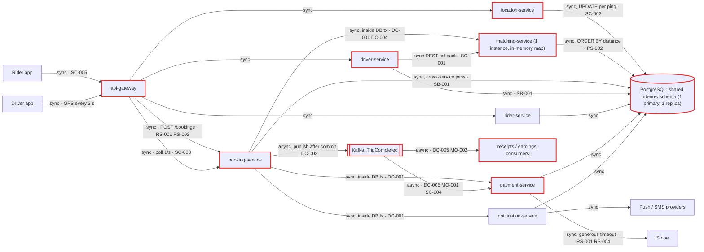

# Architecture review: RideNow architecture brief (draft v0.3)

- **Mode**: design (only `project-brief.md` exists; no code yet)
- **Date**: 2026-10-24
- **Lenses run**: scalability, persistence, operability, data-consistency, resilience, service-boundaries, messaging. None were skipped. Operability ran because the brief names Kubernetes as the likely platform.
- **How it ran**: three parallel lens agents (data-consistency + messaging, resilience + service-boundaries, scalability + persistence + operability). The parent then checked every candidate against the brief and merged them. The parent ran no lens itself.
- **No intake answers**: nobody was available to answer the intake questions, so every gap was filled with the most conservative reading of the brief. Each of those choices is listed under *Assumptions* below, and severities are graded against them.

## Summary

RideNow is a planned set of eight microservices for ride-hailing in three cities: 15,000 drivers and 120,000 rides a day at launch, growing to 50,000 drivers and 400,000 rides a day. All eight services share one PostgreSQL schema.

The biggest risk is the booking flow. It wraps a Stripe card pre-authorization, a matching call and a push notification in one database transaction. A routine "no driver found" at peak therefore rolls back the ride but leaves the card hold on the rider's card, with nothing in the system pointing at it (DC-001). Matching's in-memory, single-instance driver map adds a second risk: every deploy of matching-service takes booking down.

The change that buys the most is to turn booking into short, status-driven local transactions with an outbox: persist `REQUESTED`, pre-authorize outside the transaction, claim the driver atomically, and send notifications asynchronously. The outbox and idempotency work behind that also closes the lost-`TripCompleted` and double-earnings risks.

The second-biggest lever is to settle table ownership before writing code, while it is still cheap (SB-001), and to take the 7,500 GPS writes per second off the shared primary (SC-002).

| Severity | Count |
|---|---|
| Critical | 2 |
| High | 11 |
| Medium | 13 |
| Low | 1 |
| Info | 0 |
| **Total** | **27** |

## Architecture profile

- **Architecture**: microservices. Eight planned, independently deployed services owned by four squads. All of them share one PostgreSQL schema.
- **Summary**: riders request a ride, matching-service picks a nearby driver, the trip is tracked live, and the rider's card is pre-authorized at booking and captured through Stripe when the trip ends.
- **Stack**: not stated. Assumed Java 17 / Spring Boot 3.x. The brief names PostgreSQL (1 primary, 1 read replica), Kafka and Stripe, with Kubernetes as the probable platform.
- **Deployables (all planned)**:
  - api-gateway: routing and auth.
  - rider-service: rider profiles and saved payment methods.
  - driver-service: driver profiles, documents and availability. Sends a REST callback to matching-service when a driver goes online or offline.
  - location-service: receives driver GPS pings every 2 s.
  - matching-service: one instance at launch. Uses an in-memory map plus a SQL distance query.
  - booking-service: owns the ride lifecycle. Calls payment, matching and notification synchronously, and publishes `TripCompleted`.
  - payment-service: Stripe pre-auth (synchronous) and capture (consumes `TripCompleted`).
  - notification-service: push notifications and SMS.
  - Receipts and driver-earnings consumers: no owner named.
- **Datastores**: one PostgreSQL cluster with a single `ridenow` schema, **shared by all eight services**. Cross-service joins are allowed.
- **Messaging**: Kafka, carrying `TripCompleted`. Partitioning and delivery guarantees are not stated.
- **Background work**: `TripCompleted` consumers for payment capture, receipts and earnings.
- **Runtime**: undecided ("probably Kubernetes"). Observability is undecided. matching-service has 1 replica.
- **Stated intent**:
  - Launch: 15,000 drivers at peak and 120,000 rides/day.
  - Year two: 50,000 drivers, 400,000 rides/day and five cities.
  - Peak hour is about 4× the daily average.
  - 99.95% availability for requesting a ride.
  - 4 squads of about 6 engineers, each squad owning two services and shipping independently.

**Assumptions** (made in place of asking):
1. Mode is design. Intake gaps were filled conservatively because nobody was available to answer.
2. Card pre-auth and capture, bookings and driver assignment must never be lost or doubled. Driver location may lag a few seconds. Receipts and earnings may lag minutes, but must not be lost or doubled.
3. All active drivers are online and pinging during the peak hour.
4. An average trip lasts about 20 minutes.
5. Deployment is Kubernetes, with several replicas per stateless service.
6. The stack is Java 17 / Spring Boot 3.x. Framework defaults are cited from memory, and marked as such where used.
7. The 99.95% target covers the whole `POST /bookings` flow.

**Derived load**:

| Flow | Launch peak | Year-two peak |
|---|---|---|
| GPS ping `UPDATE`s on the primary | 7,500/s | 25,000/s |
| Booking requests | ~5.6/s (20,000 rides/h) | ~18.5/s (67,000 rides/h) |
| Concurrent trips | ~6,700 | ~22,000 |
| Rider location polls | ~6,700/s | ~22,000/s |
| Matching queries (full distance sort) | ~5.6/s over 15,000 rows | ~18.5/s over 50,000 rows |
| `TripCompleted` events (blocking Stripe capture) | ~5.6/s | ~18.5/s |

**Key flows**:
- **Book ride**: rider app → api-gateway → booking-service. Inside one DB transaction: insert `REQUESTED` → payment-service → Stripe pre-auth → matching-service → notification-service → update `MATCHED`. Then respond to the rider app.
- **Trip completion**: driver app → booking-service (`COMPLETED`, commit) → Kafka `TripCompleted` → payment-service capture, receipts and earnings.
- **Live location**:
  - driver app → location-service → `UPDATE drivers` every 2 s.
  - The rider app polls booking-service every 1 s, which reads the same row.
  - matching-service sorts `drivers` by distance in SQL.

**Planned architecture as described in the brief** (red outline = touched by a finding):



## Findings

### Critical

#### DC-001 · Stripe pre-auth, matching and the push run inside the booking DB transaction, so a rollback strands card holds and dispatched drivers

Severity: critical · Confidence: high · Lens: data-consistency · Effort: medium · Also reported by: resilience

**Where**: project-brief.md, "Booking flow"

**Evidence**:
```text
"booking-service calls payment-service synchronously, which calls Stripe to pre-authorize the estimated fare." ...
"booking-service calls matching-service synchronously to get a driver." ...
"booking-service calls notification-service synchronously to push" ...
"All of steps 2–6 run inside one database transaction in booking-service, so if anything fails the booking is rolled back cleanly."
```

**What goes wrong**:
- **Stranded card holds.** At Friday peak, Stripe pre-authorizes the fare, and then matching finds no free driver (routine at peak) or the notification call times out. The transaction rolls back and the ride row vanishes. The Stripe authorization stays on the card for up to about 7 days, nothing references it, and nothing ever voids it. When the rider taps again, a second hold is placed.
- **Drivers sent to rides that don't exist.** If the push "driver on the way" has already gone out when a later step fails, the driver drives to a ride that no longer exists.
- **A notification outage takes booking down.** A push or SMS provider outage alone makes every booking roll back, so an optional notification becomes a total booking outage.
- **Orphaned writes.** payment-service and notification-service use their own connections and cannot see the uncommitted ride row. Any row they write that references it fails or is orphaned.
- **Pinned connections.** Every booking pins a DB connection for the whole Stripe latency.

**Fix** (`move-call-outside-transaction`): use short local transactions driven by a persisted ride status.
1. Insert `REQUESTED` and commit.
2. Call Stripe outside any transaction, with an Idempotency-Key derived from the ride id, then commit `PAYMENT_AUTHORIZED` with the PaymentIntent id.
3. Claim a driver atomically (DC-004) and commit `MATCHED`.
4. In that same commit, write a `RideMatched` outbox row. notification-service sends the pushes out of band, so a push outage never fails a booking.

When a step fails, compensate (void the PaymentIntent, release the driver; see DC-006) instead of rolling back. Do not use XA/2PC.

**Why it's worth it here**: every booking places a real card hold through an external API, and the steps after the hold (no driver found, push failure) fail routinely at peak.

#### SC-001 · matching-service holds available drivers in an instance-local map fed by REST callbacks, so it cannot scale out and loses all state on restart

Severity: critical · Confidence: high · Lens: scalability · Effort: medium · Also reported by: data-consistency

**Where**: project-brief.md, "Booking flow"

**Evidence**:
```text
"matching-service keeps the list of available drivers in an in-memory map that driver-service updates through a REST callback whenever a driver goes online or offline. We'll run one matching-service instance at launch and add more later."
```

**What goes wrong**:
1. **Every deploy is a booking outage.** A deploy, crash or node drain restarts the single pod, and the map comes back empty. It refills only as drivers toggle online or offline, so until then every booking gets "no driver". With one replica, neither a rolling deploy nor a disruption budget can cover this.
2. **The map drifts from the database.** driver-service commits a change in availability, but the callback times out or lands during a restart. The database and the map drift apart, and nothing reconciles them. The result is "available" drivers who went home, and idle drivers who never appear.
3. **Replicas diverge.** With a second replica, each callback reaches only one instance through the load balancer, so the replicas' maps diverge.
4. **Silent drivers stay matchable.** A driver whose app crashes never sends "offline" and stays matchable forever.

**Fix** (`stateless-service`):
- Keep the available-driver set in a shared store, with a per-driver TTL that the GPS ping refreshes (for example, a Redis set or GEO set per city). Silent drivers then expire on their own, and every replica sees the same set.
- driver-service writes availability to that store, or publishes it through an outbox to a compacted topic that matching replays on startup. This replaces the REST callback.
- Gate readiness on the store being reachable.
- Run at least two replicas with a PodDisruptionBudget.

**Why it's worth it here**: ride requests carry a 99.95% target, and the brief already plans more matching instances.

### High

#### DC-002 · `TripCompleted` is published after the commit with no outbox, so a crash or broker blip loses the fare capture, receipt and earnings

Severity: high · Confidence: high · Lens: data-consistency · Effort: medium

**Where**: project-brief.md, "Trip completion"

**Evidence**:
```text
"booking-service sets the ride to `COMPLETED`, then publishes a `TripCompleted` event to Kafka right after the database commit. payment-service consumes it and captures the final fare. Receipts and driver earnings are computed by consumers of the same event."
```

**What goes wrong**: the ride commits `COMPLETED`, and then the pod dies before the publish (rolling deploy, OOM, node drain), or the Kafka send fails during a leader election. The event is gone for good:
- No capture happens. The authorization expires after about 7 days and the fare is lost.
- The rider gets no receipt, and the driver is not credited.
- Nothing records which rides were affected.

**Fix** (`transactional-outbox`):
- Write the event to an `outbox` table in the same transaction that sets `COMPLETED`.
- A relay (a polling publisher with `FOR UPDATE SKIP LOCKED`, or Debezium CDC) publishes it, keyed by ride id, with `acks=all` and idempotence on.
- Consumers must dedupe (DC-005).
- Reuse the same outbox for `RideMatched` (DC-001) and for availability (SC-001).

**Why it's worth it here**: fare capture and driver pay depend on this event, so every lost event is lost revenue or an unpaid driver.

#### DC-003 · `POST /bookings` and the driver's end-trip request have no idempotency key or state guard

Severity: high · Confidence: medium · Lens: data-consistency · Effort: small

**Where**: project-brief.md, "Booking flow"; "Trip completion"

**Evidence**:
```text
"The rider app calls `POST /bookings`." ...
"If Stripe is slow, the request waits; we will set a generous timeout so we don't lose bookings." ...
"When the driver ends the trip, booking-service sets the ride to `COMPLETED`, then publishes a `TripCompleted` event"
(no idempotency key, unique constraint or status-guarded transition is mentioned)
```

**What goes wrong**:
- **Duplicate bookings.** The generous Stripe timeout outlasts the client's or gateway's timeout. The rider sees an error and taps again while the first request is still running. The result is two rides, two card holds and two drivers dispatched.
- **Duplicate trip completion.** A driver on a flaky connection re-sends end-trip. The duplicate produces a second `TripCompleted`, with a second capture attempt, a second receipt and a second earnings credit.

**Fix** (`idempotency-key`):
- The rider app sends an Idempotency-Key per booking attempt. Store it on the ride under a unique constraint, and on a replay return the stored result.
- Pass a ride-scoped key to Stripe.
- Guard end-trip with a status check, and write the outbox event only when one row changed:

```sql
UPDATE rides SET status = 'COMPLETED'
WHERE id = :id AND status = 'IN_PROGRESS';
```

**Why it's worth it here**: mobile clients on cellular networks retry, and each retry creates a card hold, a dispatch or a payout.

#### DC-004 · No atomic claim on a driver, so concurrent bookings can be matched to the same driver

Severity: high · Confidence: medium · Lens: data-consistency · Effort: small

**Where**: project-brief.md, "Booking flow"; "Live location"

**Evidence**:
```text
"booking-service calls matching-service synchronously to get a driver." ...
"matching-service also queries this table to find nearby drivers (`ORDER BY` distance computed in SQL)." ...
"We'll run one matching-service instance at launch and add more later."
(no reservation, lock or conditional status update on the chosen driver)
```

**What goes wrong**: two riders outside a stadium book in the same second, and both are nearest to driver D. Both lookups return D before either booking commits, so both rides are assigned to D, and one rider waits for a driver who never comes. With more than one matching instance, the two requests no longer even have to arrive at the same moment for this to happen.

**Fix** (`atomic-conditional-update`): treat matching results as candidates only, and claim the chosen driver with a conditional update:

```sql
UPDATE drivers SET status = 'ASSIGNED', current_ride_id = :ride
WHERE id = :driver AND status = 'AVAILABLE';
-- 0 rows -> try the next candidate
```

- Back the claim with a partial unique index on `rides(driver_id) WHERE status IN ('MATCHED','IN_PROGRESS')`.
- Release the claim on completion, cancellation or no-match.

**Why it's worth it here**: drivers are a contended resource in dense zones at peak, at about 6–19 bookings per second.

#### DC-005 · `TripCompleted` consumers (capture, receipts, driver earnings) do not dedupe redelivered events

Severity: high · Confidence: high · Lens: data-consistency · Effort: small

**Where**: project-brief.md, "Trip completion"

**Evidence**:
```text
"payment-service consumes it and captures the final fare. Receipts and driver earnings are computed by consumers of the same event."
(nothing about processed-event tracking, unique keys or idempotent handlers)
```

**What goes wrong**: a rolling deploy, or a crash after the side effect but before the offset commit, redelivers a batch of events. Earnings are credited twice, and riders get duplicate receipts.

Stripe refuses a second capture of an already-captured PaymentIntent, so capture is safe only if it always targets the ride's original PaymentIntent. A capture written as a new charge would bill the rider twice. The outbox relay (DC-002) adds duplicates from the producer side as well.

**Fix** (`idempotent-consumer`):
- Record `(consumer, event_id)` under a unique constraint, in the same transaction as the effect, or make the effect naturally idempotent (one earnings row per `ride_id`, not an increment).
- Capture only the existing PaymentIntent, with Idempotency-Key = ride id, guarded by `UPDATE payments SET status='CAPTURED' WHERE ride_id=:id AND status='AUTHORIZED'`.
- Commit offsets only after the effect has committed.

**Why it's worth it here**: Kafka delivers at least once, and each handler moves money or credits a payout.

```mermaid
sequenceDiagram
  participant D as Driver app
  participant B as booking-service
  participant DB as booking DB
  participant R as Outbox relay
  participant K as Kafka
  participant P as payment-service
  participant DLT as retry / DLT topics
  D->>B: end trip (ride id)
  B->>DB: BEGIN; UPDATE rides SET COMPLETED WHERE status=IN_PROGRESS; INSERT outbox(TripCompleted); COMMIT
  B-->>D: 200 (replay returns same result)
  R->>DB: SELECT unsent outbox rows FOR UPDATE SKIP LOCKED
  R->>K: publish TripCompleted (key = ride id)
  R->>DB: mark sent
  K->>P: TripCompleted
  P->>P: BEGIN; INSERT processed_events(consumer, event_id) (dup -> skip)
  P->>P: capture existing PaymentIntent (Idempotency-Key = ride id)
  P->>P: UPDATE payments SET CAPTURED WHERE status=AUTHORIZED; COMMIT; commit offset
  P-->>DLT: transient Stripe error -> retry topic with backoff, then DLT
```
*Fixed trip-completion flow for DC-002, DC-005 and MQ-001.*

#### DC-006 · Ride lifecycle has no failure states or compensations for no-match, cancellation or capture failure

Severity: high · Confidence: medium · Lens: data-consistency · Effort: large

**Where**: project-brief.md, "Services"; "Trip completion"

**Evidence**:
```text
"owns the ride lifecycle (requested → matched → in progress → completed)."
"payment-service consumes it and captures the final fare."
(no cancelled, no-driver or payment-failed state; no void, refund or release step)
```

**What goes wrong**:
- **Cancellations and no-match strand holds and assignments.** When a rider or driver cancels, or nobody accepts, nothing voids the pre-auth or releases the driver.
- **Failed captures go unrecorded.** At trip end the final fare can exceed the authorized amount, the authorization can have expired, or the card can be declined. Capture then fails after the ride is already `COMPLETED` and the driver has been credited. The fare is never collected, and no state records it.

**Fix** (`saga-orchestration`):
- Model the ride as an orchestrated saga in booking-service, with states `REQUESTED`, `PAYMENT_AUTHORIZED`, `MATCHED`, `IN_PROGRESS`, `COMPLETED` and `CAPTURED`, plus the terminal states `NO_DRIVER`, `CANCELLED` and `PAYMENT_FAILED`.
- Give each state its compensation: void the PaymentIntent, release the driver, and re-authorize the difference or flag the ride for collection.
- Drive the steps through the outbox (DC-002) and idempotent handlers (DC-005).
- Add a sweeper for rides stuck in an intermediate state.

**Why it's worth it here**: a ride spans an external payment provider, a driver reservation and notifications, and cancellations and declines are routine in ride-hailing.

```mermaid
sequenceDiagram
  participant A as Rider app
  participant B as booking-service
  participant DB as booking DB
  participant P as payment-service / Stripe
  participant M as matching (dispatch)
  participant O as Outbox -> notification-service
  A->>B: POST /bookings (Idempotency-Key)
  B->>DB: INSERT ride REQUESTED (unique key); COMMIT
  B-->>A: 202 ride id (replay returns same ride)
  B->>P: pre-authorize (Idempotency-Key = ride id), outside any tx, short timeout
  P-->>B: PaymentIntent id
  B->>DB: UPDATE ride PAYMENT_AUTHORIZED; COMMIT
  B->>M: nearby candidates
  M-->>B: [D1, D2, ...]
  B->>DB: UPDATE drivers SET ASSIGNED WHERE id=D1 AND status=AVAILABLE
  B->>DB: UPDATE ride MATCHED + INSERT outbox(RideMatched); COMMIT
  O-->>A: push "driver on the way" (async, retried)
  Note over B,P: no driver / cancel -> void PaymentIntent, release claim, ride NO_DRIVER or CANCELLED
```
*Fixed booking flow for DC-001, DC-003, DC-004, DC-006 and RS-002.*

#### RS-001 · Stripe pre-auth gets a deliberately generous timeout and `POST /bookings` has no overall deadline

Severity: high · Confidence: high · Lens: resilience · Effort: small

**Where**: project-brief.md, "Booking flow"

**Evidence**:
```text
"If Stripe is slow, the request waits; we will set a generous timeout so we don't lose bookings."
(no timeouts stated for payment, matching or notification calls; no end-to-end deadline)
```

**What goes wrong**: at about 5.6 bookings/s, Stripe slows to tens of seconds. At a 30 s timeout that is about 170 bookings in flight, each holding threads in two services and a connection to the shared primary. Pools fill. The gateway or the app gives up first, so riders retry while the abandoned requests keep running. Booking fails for everyone, although Stripe is only slow.

**Fix** (`timeouts`):
- Set explicit timeouts on every hop: about 1 s to connect, and a read timeout from each dependency's p99 (seconds for Stripe, hundreds of milliseconds internally).
- Set one deadline at the gateway, shorter than the client's own timeout, and pass the remaining budget downstream.
- Get "don't lose bookings" from persisting `REQUESTED` first (DC-001), not from waiting longer.

**Why it's worth it here**: every synchronous call on the booking path carries a 99.95% target and holds connections to a primary shared by all eight services.

#### RS-002 · A six-hop synchronous booking chain, including Stripe and a single-instance service, cannot meet 99.95%

Severity: high · Confidence: medium · Lens: resilience · Effort: large

**Where**: project-brief.md, "Booking flow"; "Targets"

**Evidence**:
```text
"Availability target for requesting a ride: 99.95%."
payment-service "calls Stripe"; matching-service and notification-service are each called "synchronously";
"We'll run one matching-service instance at launch and add more later."
```

**What goes wrong**: a booking succeeds only if seven components are all up at once: gateway, booking, payment, Stripe, matching, notification and the Postgres primary. At 99.95% each, the product is about 99.65%, roughly 7× the downtime budget (about 22 min/month). Latencies add up too.

**Fix** (`async-decoupling`): accept the booking (persist `REQUESTED`, return 202), then drive pre-auth, matching and notification through the saga (DC-006) and push the result to the app. At minimum, take notification off the path (DC-001) and make matching redundant (SC-001). Budget availability per hop.

**Why it's worth it here**: there is a stated 99.95% target on a flow that crosses seven components, including a third party and a single-replica service.

#### SB-001 · All eight services share one `ridenow` schema with cross-service joins, so squads cannot deploy or fail independently

Severity: high · Confidence: high · Lens: service-boundaries · Effort: medium · Also reported by: persistence

**Where**: project-brief.md, "Data"; "Live location"

**Evidence**:
```text
"all eight services connect to one shared PostgreSQL cluster (one primary, one read replica) with a single `ridenow` schema. Services can join across each other's tables when they need data, for example booking-service joins `drivers` and `riders` directly to build the trip receipt."
"4 squads of about 6 engineers, each owning two services and shipping independently."
```

**What goes wrong**: `drivers` is written by driver-service and location-service, and read by matching and booking. No squad owns it.
- **A routine migration breaks other services.** A column rename, or a migration that locks the table, breaks or blocks matching's query, booking's receipt join and the driver-location poll on deploy.
- **Shared migration history.** If each service runs Flyway against the same schema, they share one history table: versions collide, validation fails, and pods fail to start.
- **No failure isolation.** location's write load, or one squad's heavy query, degrades booking and payment for everyone.

**Fix** (`database-per-service`):
- Decide table ownership now, before building.
- Give each service (or bounded context, SB-002) its own schema, DB role and migration history, with no cross-schema access.
- Share data through APIs and events: location-service serves positions, booking builds receipts from snapshots on the ride or the event, and matching keeps its own read model.
- Use expand/contract for any column another service reads during a transition.
- Merge services that prove inseparable instead of sharing tables.

**Why it's worth it here**: the four squads are explicitly meant to ship independently, and workloads with very different load profiles share one primary. Nothing is built yet, so separating schemas now is cheap.

#### SC-002 · Every driver GPS ping is a single-row `UPDATE drivers` on the shared primary: 7,500/s at launch, 25,000/s in year two

Severity: high · Confidence: medium · Lens: scalability · Effort: large

**Where**: project-brief.md, "Live location"

**Evidence**:
```text
"Drivers' apps send a GPS ping every 2 seconds while online. location-service writes each ping as an `UPDATE drivers SET lat = ?, lng = ? WHERE id = ?` on the shared Postgres."
"Year two: 50,000 active drivers, 400,000 rides per day, plus two more cities."
```

**What goes wrong**:
- **Write volume.** That is 7,500 separate commits per second at launch peak, and 25,000 in year two, on the primary that also serves booking and payment. Each one flushes WAL and replicates.
- **Bloat.** Every row is rewritten every 2 s, so dead tuples outpace autovacuum.
- **Index conflict.** The lat/lng index that matching needs disables HOT updates.
- **Outcome.** Replica lag grows and the primary saturates on Friday nights. `POST /bookings` slows or times out, breaking 99.95%, at the latest in year two.

**Fix** (`in-memory-geo-store`; coined, since no listed pattern fits):
- location-service writes the latest position to a Redis GEO key per city, with a TTL.
- Matching (GEOSEARCH) and rider tracking read from that store.
- If trip trails are needed, publish the pings to Kafka (keyed by driver id) and persist them in batches elsewhere.
- Postgres keeps only durable driver data.

**Why it's worth it here**: ping volume is three orders of magnitude above booking volume, and it shares one primary with the flows the 99.95% target covers.

```mermaid
sequenceDiagram
  participant DA as Driver app
  participant L as location-service
  participant G as Redis GEO (per city, TTL)
  participant M as matching
  participant RA as Rider app
  DA->>L: GPS ping every 2 s
  L->>G: GEOADD city:drivers lng lat driverId; refresh TTL
  M->>G: GEOSEARCH city:drivers FROMLONLAT ... BYRADIUS ... COUNT 20 (available only)
  RA->>L: driver location (push via WebSocket/SSE, or poll every 3-5 s)
  L->>G: GEOPOS driverId
  Note over L,G: Postgres keeps durable driver data only; silent drivers expire by TTL
```
*Fixed live-location flow for SC-002, SC-001, SC-003 and PS-002.*

#### PS-001 · No connection budget for eight services sharing one primary while booking transactions hold connections across Stripe calls

Severity: high · Confidence: medium · Lens: persistence · Effort: small

**Where**: project-brief.md, "Data"

**Evidence**:
```text
"all eight services connect to one shared PostgreSQL cluster (one primary, one read replica)"
"All of steps 2–6 run inside one database transaction in booking-service"
(no pool sizes, max_connections or connection pooler stated)
```

**What goes wrong**: eight services × several replicas × a default pool of 10 (HikariCP default, from memory) quickly exceeds Postgres's default `max_connections` of 100. When pods scale out for the Friday peak, or surge during a rolling deploy, the new pods get "too many clients" and crash-loop. The long booking transactions make it worse.

**Fix** (`connection-pool-sizing`):
- Set an explicit connection budget per service and replica.
- Put PgBouncer in transaction mode in front of the primary.
- Size booking-service's pool for short transactions (after DC-001).
- Use a short acquire timeout, and alert on pool saturation.

**Why it's worth it here**: several replicas of eight services share one primary and scale out at a 4× peak.

#### MQ-001 · No retry topic or dead-letter topic for `TripCompleted` consumers that call Stripe

Severity: high · Confidence: medium · Lens: messaging · Effort: small

**Where**: project-brief.md, "Trip completion"

**Evidence**:
```text
"publishes a `TripCompleted` event to Kafka right after the database commit. payment-service consumes it and captures the final fare."
(no error handling, retry or dead-letter topic, or replay process)
```

**What goes wrong**: Stripe returns 5xx or 429 for a few minutes, or an event refers to an expired PaymentIntent. The assumed Spring Kafka default (`DefaultErrorHandler`: about 10 immediate attempts, then log and skip; from memory, not checked in source) skips every capture in that window and commits the offsets. Those fares are never collected, and nothing records which ones. An infinite retry instead would block the partition.

**Fix** (`retry-topic`):
- Use retry topics with exponential backoff, then a `trip-completed-<consumer>-dlt` that keeps the payload and the error, plus a replay tool.
- Treat a card decline as `PAYMENT_FAILED` in the saga (DC-006), not as a poison message.
- Alert on DLT depth (OP-004).

**Why it's worth it here**: the side effect depends on an external API with outages, and each skipped event is an uncollected fare.

### Medium

#### RS-003 · booking-service shares its threads and pool between Stripe-bound bookings, trip completion and location polls (no bulkhead)

Severity: medium · Confidence: medium · Lens: resilience · Effort: medium

**Where**: project-brief.md, "Booking flow"; "Live location"

**Evidence**:
```text
"If Stripe is slow, the request waits; we will set a generous timeout" ...
"When the driver ends the trip, booking-service sets the ride to `COMPLETED`" ...
"The rider app polls `GET /bookings/{id}/driver-location` every second during a trip"
```

**What goes wrong**: slow Stripe calls fill booking-service's shared threads and pool. Location polls and end-trip calls then queue behind them and time out, so tracking and trip completion stall too.

This is graded medium rather than high: once RS-001 and DC-001 are fixed, the pile-up at this scale is tens of requests, not hundreds.

**Fix** (`bulkhead`): give each outbound client its own bounded pool and put a concurrency limit on `POST /bookings`. Move location reads to location-service (SC-003).

**Why it's worth it here**: one deployable serves a third-party-bound write path alongside high-rate reads and trip writes.

#### RS-004 · No circuit breaker or fast-fail around payment/Stripe, matching or notification on the booking path

Severity: medium · Confidence: medium · Lens: resilience · Effort: small

**Where**: project-brief.md, "Booking flow"

**Evidence**:
```text
Steps 3–5 call payment-service (which "calls Stripe"), matching-service and notification-service "synchronously";
no circuit breakers, fallbacks or fail-fast behaviour are mentioned.
```

**What goes wrong**: during an outage, every attempt waits out the full timeout. Retries keep the services saturated, and when the dependency recovers, the backlog hits it all at once.

**Fix** (`circuit-breaker`): put a circuit breaker (Resilience4j, or mesh outlier detection) on Stripe/payment and on matching, each with a defined fast-fail response. Notification needs none once it is asynchronous.

**Why it's worth it here**: synchronous calls go to independently failing dependencies at several requests per second.

#### SB-002 · Driver availability, live location and matching are one bounded context split across three services and squads

Severity: medium · Confidence: medium · Lens: service-boundaries · Effort: medium

**Where**: project-brief.md, "Services"; "Booking flow"; "Live location"

**Evidence**:
```text
"**driver-service**: driver profiles, documents, availability status."
"**location-service**: receives driver GPS pings and answers" (where is driver X)
"matching-service keeps the list of available drivers in an in-memory map that driver-service updates through a REST callback"
"matching-service also queries this table to find nearby drivers"
```

**What goes wrong**: "available drivers near here" spans three services. When one squad adds an "on break" state, matching misreads it until the other squads ship matching changes, so dispatch goes wrong. Every dispatch feature needs a coordinated release.

**Fix** (`bounded-context`): make one dispatch context, owned by one squad, that owns availability, position and matching. Either merge location-service and matching-service, or feed matching a read model through events. Keep driver-service for profiles and documents, and add consumer-driven contracts on the seam to booking.

**Why it's worth it here**: otherwise several squads each own part of one business rule on the core path.

#### SC-003 · Rider app polls `GET /bookings/{id}/driver-location` every second through booking-service and Postgres (6,700 to 22,000 req/s)

Severity: medium · Confidence: medium · Lens: scalability · Effort: medium

**Where**: project-brief.md, "Live location"

**Evidence**:
```text
"The rider app polls `GET /bookings/{id}/driver-location` every second during a trip, which reads the same row."
```

**What goes wrong**: that is about 6,700 requests/s at launch peak and 22,000/s in year two, over 1,000× the booking rate, all competing with bookings in booking-service. Reads from the replica go stale as lag grows, and reads from the primary add to its saturation.

**Fix** (`cqrs-read-model`): serve location from location-service, out of the geo store (SC-002). Push positions over WebSocket or SSE, or poll every 3–5 s with a per-rider rate limit.

**Why it's worth it here**: the read volume scales with concurrent trips and currently shares a deployable and database with the SLO-bound booking flow.

#### PS-002 · Nearest-driver query sorts every `drivers` row by a distance computed in SQL, with no spatial index

Severity: medium · Confidence: high · Lens: persistence · Effort: medium

**Where**: project-brief.md, "Live location"

**Evidence**:
```text
"matching-service also queries this table to find nearby drivers (`ORDER BY` distance computed in SQL)."
(no PostGIS, GiST index, geohash or city filter mentioned)
```

**What goes wrong**: every match scans and sorts all 15,000 (later 50,000) rows of a bloated table. Adding a plain lat/lng index disables HOT updates for the ping writes.

**Fix** (`add-index`): use Redis GEOSEARCH once SC-002 lands. Otherwise, use a PostGIS geography column with a GiST index and KNN `<->` with LIMIT, filtered by city and availability, in a narrow `driver_positions` table.

**Why it's worth it here**: matching is on the booking critical path, and the table grows to 50,000 drivers across five cities.

#### SC-004 · `TripCompleted` consumers make blocking Stripe captures, with partition count and consumer concurrency unstated

Severity: medium · Confidence: medium · Lens: scalability · Effort: small

**Where**: project-brief.md, "Trip completion"

**Evidence**:
```text
"payment-service consumes it and captures the final fare. Receipts and driver earnings are computed by consumers of the same event."
(no partition count, consumer concurrency or replica count)
```

**What goes wrong**: at 5.6–18.5 events/s, with 0.3–1 s per capture, one consumer thread falls behind. Captures land hours late, and slow batches can trigger rebalance loops.

**Fix** (`consumer-concurrency`): use 24 or more partitions keyed by ride id, set payment-service consumer concurrency to match, keep `max.poll.records` small, and alert on lag.

**Why it's worth it here**: capture blocks on a third party, at rates above what one thread can handle.

#### SC-005 · No rate limiting or load shedding at the gateway for a 4x peak on expensive bookings and high-volume pings and polls

Severity: medium · Confidence: medium · Lens: scalability · Effort: small

**Where**: project-brief.md, "Services"; "Targets"

**Evidence**:
```text
"**api-gateway**: routing and auth."
"Peak hour (Friday night) is about 4× the daily average."
```

**What goes wrong**: on a surge, or when riders re-submit bookings stuck behind a slow Stripe, requests queue without bound. The services fail together instead of shedding the excess.

**Fix** (`rate-limiting`): add per-rider and per-driver limits at the gateway, bounded queues that reject fast with 429 or 503, and a booking concurrency limit.

**Why it's worth it here**: the endpoints are public, the peak is 4× the average, and each booking request is expensive.

#### MQ-002 · `TripCompleted` contract crosses independently shipping squads with no schema, version or named consumer owner

Severity: medium · Confidence: medium · Lens: messaging · Effort: small

**Where**: project-brief.md, "Trip completion"

**Evidence**:
```text
"Receipts and driver earnings are computed by consumers of the same event."
"each owning two services and shipping independently."
(no payload, version field, schema registry or consumer owner)
```

**What goes wrong**: the booking squad renames a fare field and deploys. Consumers owned by other squads fail to deserialize, and captures stop.

**Fix** (`event-versioning`):
- Put the schema in a registry, with compatibility checks in CI (or use a version field and tolerant readers).
- Carry consumer-needed fields on the event: ride, rider, driver, fare, currency and PaymentIntent id.
- Name an owner for the receipts and earnings consumers.

**Why it's worth it here**: the producer and the consumers deploy on independent schedules.

#### DC-007 · The brief does not say where the estimated and final fares are computed, while the driver app ends the trip

Severity: medium · Confidence: low · Lens: data-consistency · Effort: small

**Where**: project-brief.md, "Booking flow"; "Trip completion"

**Evidence**:
```text
"calls Stripe to pre-authorize the estimated fare"
"When the driver ends the trip" ... "captures the final fare."
(which service computes either amount, and from what inputs, is not stated)
```

**What goes wrong**: if the amounts, or the distance and duration they are based on, come from the client, a modified rider app can pre-authorize a tiny amount, and a modified driver app can inflate the captured fare and the payout.

**Fix** (`input-validation`): compute both fares on the server, from pricing rules and the recorded GPS trace. Cap capture at the authorized amount plus a margin, and route any overage through re-authorization (DC-006).

**Why it's worth it here**: the amounts drive card charges and driver payouts.

#### OP-001 · No probe design: matching needs readiness on its state, and DB-checking liveness would restart all eight services on a shared-DB blip

Severity: medium · Confidence: medium · Lens: operability · Effort: small

**Where**: project-brief.md, "Not decided yet"

**Evidence**:
```text
"How we deploy (probably Kubernetes)."
(no liveness, readiness or startup checks defined)
```

**What goes wrong**:
- A matching pod restarted with an empty map is marked ready and answers "no driver".
- If liveness includes the DB check (the Spring Boot default aggregate, from memory), a blip on the shared primary fails liveness for every pod of all eight services, and the whole fleet restarts together.

**Fix** (`health-probes`): liveness checks the process only. Readiness checks the dependencies each instance needs. Add startup probes for slow boots.

**Why it's worth it here**: this is a Kubernetes deployment with every service on one database.

#### OP-002 · No graceful-shutdown design for long booking requests and in-flight Stripe captures

Severity: medium · Confidence: medium · Lens: operability · Effort: small

**Where**: project-brief.md, "Not decided yet"

**Evidence**:
```text
"If Stripe is slow, the request waits; we will set a generous timeout so we don't lose bookings."
"payment-service consumes it and captures the final fare."
(no draining or shutdown behaviour on deploy)
```

**What goes wrong**: frequent rolling deploys SIGTERM pods mid-booking or mid-capture, leaving partial outcomes on every deploy.

**Fix** (`graceful-shutdown`):
- Set `server.shutdown=graceful` and flip readiness before draining.
- Set the termination grace period above the request deadline (RS-001).
- Let Kafka listeners finish and commit the current record before exit.

**Why it's worth it here**: four independent squads make frequent rolling deploys of services that touch payments.

#### OP-003 · No distributed tracing or correlation id across the sync booking chain and the `TripCompleted` fan-out

Severity: medium · Confidence: high · Lens: operability · Effort: medium

**Where**: project-brief.md, "Not decided yet"

**Evidence**:
```text
"Observability tooling." (listed under "Not decided yet")
```

**What goes wrong**: a failed booking or a missing capture crosses five services and a Kafka hop, owned by four squads. With nothing to tie the logs together, debugging is timestamp grepping while the error budget burns.

**Fix** (`distributed-tracing`): adopt OpenTelemetry in every service before launch. Propagate W3C trace context over HTTP and in Kafka headers, and log the trace id and ride id.

**Why it's worth it here**: eight deployables owned by four squads take part in each core flow.

#### OP-004 · No SLO metrics or alerts for the 99.95% target, consumer lag, DLT depth, Stripe latency or primary saturation

Severity: medium · Confidence: high · Lens: operability · Effort: medium

**Where**: project-brief.md, "Targets"; "Not decided yet"

**Evidence**:
```text
"Availability target for requesting a ride: 99.95%."
"Observability tooling." (listed under "Not decided yet")
```

**What goes wrong**: capture lag or a stuck consumer goes unnoticed until finance reconciles. Stripe latency or primary saturation is first reported by riders. Burn against the SLO is never measured.

**Fix** (`metrics-and-alerts`):
- Track RED metrics per endpoint and per dependency.
- Track saturation for DB pools, the primary (connections, WAL, replica lag, autovacuum) and Kafka.
- Alert on SLO burn rate, consumer lag, DLT depth and stuck rides.

**Why it's worth it here**: there is an explicit availability target and an asynchronous money flow.

### Low

#### PS-003 · No retention or partitioning plan for rides and the outbox and dedupe tables (44M to 146M ride rows a year)

Severity: low · Confidence: medium · Lens: persistence · Effort: medium

**Where**: project-brief.md, "Targets"; "Data"

**Evidence**:
```text
"120,000 rides per day" rising to "400,000 rides per day"
(no archival, partitioning or retention in the Data section)
```

**What goes wrong**: `rides` grows by 44M to 146M rows a year. Status- and time-filtered queries and index maintenance slow month by month, and the outbox and dedupe tables grow the same way.

**Fix** (`data-retention`): partition `rides` monthly, archive completed rides, and prune outbox and processed-event rows past the replay window.

**Why it's worth it here**: these tables gain a row per ride or event at 120,000 to 400,000 a day.

## Roadmap

**Now** (critical and high with small or medium effort, plus what they depend on):

| # | Finding | Action | Unblocks |
|---|---|---|---|
| 1 | DC-005 | Make `TripCompleted` consumers idempotent (processed-events table, earnings keyed by ride, capture only the original PaymentIntent) | DC-002, MQ-001 |
| 2 | DC-002 | Add a transactional outbox and relay for `TripCompleted`, reusable for other events | DC-001, DC-006 |
| 3 | DC-001 | Split booking into short status-driven transactions; Stripe outside the tx; notification through the outbox | PS-001, DC-006, RS-002, RS-003 |
| 4 | SC-001 | Move the available-driver set to a shared TTL store; run 2+ matching replicas with a PDB | nothing |
| 5 | DC-003 | Add an Idempotency-Key on `POST /bookings`; status-guarded end-trip | nothing |
| 6 | DC-004 | Claim drivers with a conditional update, plus a partial unique index on active rides | nothing |
| 7 | SB-001 | Assign table ownership; one schema, role and migration history per service; no cross-service joins | SB-002 |
| 8 | RS-001 | Set per-hop timeouts and one gateway deadline for `POST /bookings` | RS-004 |
| 9 | MQ-001 | Add retry topics with backoff and a DLT plus replay for `TripCompleted` consumers | nothing |
| 10 | PS-001 | Set a per-service connection budget and PgBouncer in front of the primary | nothing |

**Next** (remaining critical and high, then medium):

| # | Finding | Action | Unblocks |
|---|---|---|---|
| 11 | DC-006 | Make the ride lifecycle a saga with failure states, compensations and a stuck-ride sweeper | RS-002 |
| 12 | RS-002 | Accept bookings asynchronously (202) and drive the saga; budget availability per hop | nothing |
| 13 | SC-002 | Move live positions out of Postgres into a per-city Redis GEO store | SC-003, PS-002 |
| 14 | RS-003 | Bulkhead the outbound clients and the booking endpoint | nothing |
| 15 | RS-004 | Add circuit breakers on Stripe/payment and matching | nothing |
| 16 | SB-002 | Form one dispatch context for availability, position and matching | nothing |
| 17 | SC-003 | Serve driver location from location-service; push, or slower polling | nothing |
| 18 | PS-002 | Use geo-indexed nearest-driver search (GEOSEARCH or PostGIS KNN) | nothing |
| 19 | SC-004 | Size `TripCompleted` partitions and consumer concurrency for year two | nothing |
| 20 | SC-005 | Add gateway rate limits and load shedding | nothing |
| 21 | MQ-002 | Add a versioned `TripCompleted` schema with a registry, and name the consumer owners | nothing |
| 22 | DC-007 | Compute and cap fares on the server | nothing |
| 23 | OP-001 | Split liveness and readiness probes; readiness reflects each service's dependencies | nothing |
| 24 | OP-002 | Graceful shutdown and listener drain | nothing |
| 25 | OP-003 | OpenTelemetry tracing across HTTP and Kafka | nothing |
| 26 | OP-004 | SLO, lag, DLT and saturation metrics and alerts | nothing |

**Later**:

| # | Finding | Action | Unblocks |
|---|---|---|---|
| 27 | PS-003 | Partition `rides` by month; set retention for rides, outbox and processed-event tables | nothing |

## What's already sound

- **Single edge.** One api-gateway owns routing and auth, so there is a single controlled entry point to add rate limits and deadlines to.
- **Asynchronous fan-out at trip end.** Capture, receipts and earnings are fanned out over Kafka instead of booking-service calling each one, and Kafka is not misused for request/reply. Keep this shape and add the outbox and idempotent consumers.
- **No XA or 2PC.** None is proposed across services or Stripe. Do not add it as the fix for DC-001.
- **The split itself is justified.** Four squads ship independently, and the load profiles differ widely (thousands of pings per second against a few bookings per second). The problem is where the boundaries and data sit, not that the system is split.
- **No chatty interfaces.** No per-item cross-service loops are described.

## Not reviewed

- **Security in depth**: auth design at the gateway, rider and driver identity, Stripe key and webhook handling, PCI scope of "saved payment methods", and location-data privacy. Run a dedicated security review.
- **Not described in the brief**: driver documents storage, rider-service internals, pricing and surge logic, and the driver-earnings and payout flow beyond the `TripCompleted` consumer.
- **Deployment and observability tooling**: both are undecided, so the operability findings cover only what must be designed in, not specific manifests or tools.
- **Capacity numbers**: they are derived from the brief's targets and the assumptions above (all drivers online at peak, 20-minute trips). They are not measured.
