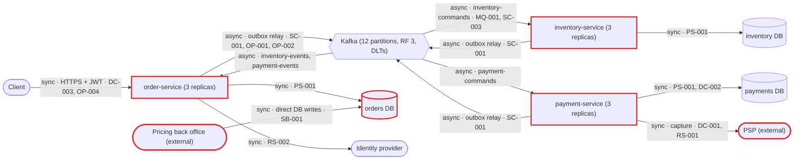
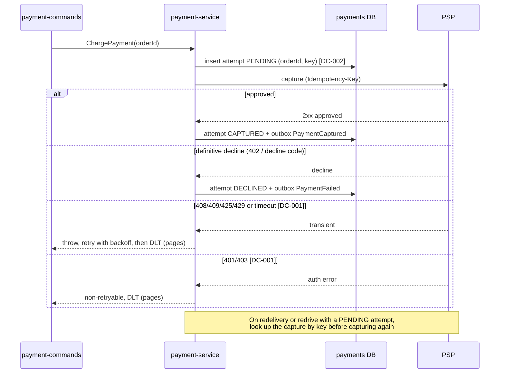

# Architecture review: Order platform (v2)

- **Mode**: hybrid (code plus the README's stated scale and operational intent)
- **Date**: 2026-10-24
- **Lenses run**: scalability, persistence, operability, data-consistency, resilience, service-boundaries, messaging. None skipped. They ran as three parallel agents: data-consistency + messaging, resilience + service-boundaries, and scalability + persistence + operability. The parent did not run any lens itself.
- **Candidates**: 20 received. One was merged: the resilience angle on PSP 4xx handling became part of DC-001. One was downgraded: SC-002 went from medium to low. None were dropped. 19 findings remain.

## Summary

The platform is three Spring Boot services (order, inventory, payment). Each owns its own Postgres database, and they run an orchestrated place-order saga over Kafka through per-service transactional outboxes and inboxes. The core distributed-transaction design is sound: outbox, inbox, guarded saga state, compensation, ShedLock, DLTs and orderId keying are all in place. The biggest risk is in payment-service. It treats every PSP 4xx as a final decline. A bad API key or PSP rate limiting would then cancel every order without a page, and a retried capture that gets 409 can charge a customer for an order that was cancelled (DC-001). The change that buys the most is a small one: classify PSP 4xx responses into decline, transient and configuration errors. The platform can meet its stated intent of ~300 orders/min, tripling next year. The headroom is thin in two places, the one-row-at-a-time outbox relay (SC-001) and the connection budget (PS-001), and both are small fixes.

| Severity | Count |
|---|---|
| Critical | 0 |
| High | 1 |
| Medium | 7 |
| Low | 11 |
| Info | 0 |

## Architecture profile

- **Architecture**: microservices. Three independently deployed services, each with its own database, coordinating over Kafka.
- **Stack**: Java 17, Spring Boot 3.3.4, Spring Data JPA, Spring Kafka, Flyway, PostgreSQL 16, Kafka 3.7 (KRaft), ShedLock 5.16, Resilience4j (payment), Micrometer tracing (OTel/OTLP), Prometheus, OAuth2 resource server (order).
- **Deployables**:
  - `order-service`: REST `/orders` (JWT), saga orchestrator, saga watchdog. Uses db `orders`. Publishes `inventory-commands`, `payment-commands`, `order-events`. Consumes `inventory-events`, `payment-events`.
  - `inventory-service`: stock and reservations. Uses db `inventory`. Publishes `inventory-events`. Consumes `inventory-commands`.
  - `payment-service`: payments and PSP capture over HTTPS (1 s/3 s timeouts, circuit breaker, retry). Uses db `payments`. Publishes `payment-events`. Consumes `payment-commands` (concurrency 4).
- **Datastores**: one Postgres database per service. All three share one server in docker-compose; the production layout is not in the repo. An external pricing back office writes `price_list` in `orders` (SB-001).
- **Messaging**: Kafka, 12 partitions and RF 3 per topic, a `<topic>-dlt` per topic, keyed by orderId, String JSON payloads with `message-id` and `message-type` headers.
- **Background work**:
  - an outbox relay every 500 ms in each service (ShedLock)
  - nightly outbox and inbox purges
  - the saga watchdog every 60 s (ShedLock)
  - a DLT monitor in each service
- **Runtime**:
  - k8s, 3 replicas per service
  - actuator liveness and readiness probes
  - graceful shutdown with a 45 s grace period
  - ConfigMap and Secret for configuration
  - no resource requests or limits, PDB or startupProbe
  - 10% trace sampling
- **Stated intent**: peak ~300 orders/min, tripling next year. Retry for ~3 minutes, then DLT. Each DLT record pages on-call. Orders with no stock reply are cancelled after 15 minutes.
- **Derived load**:
  - ~5 orders/s today and ~15 orders/s next year
  - ~45 outbox rows/s in order-service next year
  - ~100 Kafka msgs/s platform-wide next year
- **Key flows**:
  - client -> order-service (order + outbox, one tx) -> `inventory-commands` -> inventory-service -> `inventory-events` -> order-service saga
  - saga -> `payment-commands` -> payment-service -> PSP -> `payment-events` -> order-service (confirm, or cancel + `ReleaseStock`)
  - watchdog: PENDING > 15 min -> cancel + `ReleaseStock`
- **Assumptions**:
  - The mode is hybrid.
  - The review has no user-imposed scope limits, because nobody was available to ask.
  - Infrastructure not in the repo is assumed to exist as the README describes, but is unverified: ingress, production Postgres sizing, Kafka cluster settings and alert rules. Findings that depend on it are capped at medium confidence.
  - The PSP is assumed to behave like a typical PSP (Stripe-style codes and idempotency-key retention), because its contract is not in the repo.



## Findings

### High

#### DC-001 · Every PSP 4xx (including 401/403/408/409/429) is recorded as a final decline, so throttling, a bad API key or an in-flight retry cancels orders silently, and a capture can land on a cancelled order

Severity: high · Confidence: medium · Lens: data-consistency · Effort: small · Also reported by: resilience

**Where**:
- `payment-service/src/main/java/com/example/platform/payment/messaging/PaymentCommandListener.java:41`
- `payment-service/src/main/java/com/example/platform/payment/psp/PspClient.java:46`
- `payment-service/src/main/resources/application.yml:76`
- `payment-service/src/main/resources/application.yml:86`
- `order-service/src/main/java/com/example/platform/order/saga/OrderSaga.java:82`

**Evidence**:
```java
// PaymentCommandListener.java:39-45
try {
    response = psp.capture("capture-" + command.orderId(), command.customerId(), command.amount());
} catch (HttpClientErrorException rejected) {
    // A 4xx is the PSP's final answer (card declined, invalid request): fail the payment, don't retry.
    response = new PspClient.CaptureResponse(null, "rejected_" + rejected.getStatusCode().value());
}
recorder.record(messageId, command, response);
```
```yaml
# payment-service application.yml (circuit breaker and retry)
        ignore-exceptions:
          - org.springframework.web.client.HttpClientErrorException
```

**What goes wrong**:
- **Throttling or a bad key.** The PSP API key expires or is rotated out of order (401/403), or the PSP rate-limits as traffic triples (429). Every `ChargePayment` gets a 4xx. Resilience4j neither retries nor counts it, so the breaker stays closed. payment-service records DECLINED and emits `PaymentFailed`, and order-service cancels the order and releases the stock. Nothing throws, so nothing reaches a DLT and the README's only page never fires. Every order in the window is silently cancelled, and the unique `payments.order_id` row blocks a later redrive.
- **A slow capture.** A capture runs past the 3 s read timeout while the PSP is still processing it. The Resilience4j retry reuses the same `Idempotency-Key` and gets 409 ("request in progress", as Stripe-style PSPs answer). The 409 is recorded as a decline and the order is cancelled, but the original capture then completes at the PSP. The customer is charged for a cancelled order, and no message or record shows it.

**Fix** (`compensating-action`): classify the PSP's answer in `PspClient`. Don't let the exception type stand in for the business outcome.
- Only definitive declines become `PaymentFailed`.
- 408/409/425/429 are transient: Resilience4j and the Kafka backoff retry them, honouring `Retry-After`, and the breaker counts them.
- 401/403 are configuration errors that dead-letter and page.
- Narrow both `ignore-exceptions` lists to the decline exception.
- As a backstop for unknown outcomes:
  - query the PSP by idempotency key before recording a decline;
  - alert, or issue a refund command, when the PSP shows a capture for a CANCELLED order.

```java
} catch (HttpClientErrorException e) {
    int s = e.getStatusCode().value();
    if (s == 401 || s == 403) throw new PspConfigurationException(e);        // not retryable -> DLT -> page
    if (s == 408 || s == 409 || s == 425 || s == 429) throw new PspTransientException(e); // retried
    throw new PspDeclinedException(e);                                          // final decline
}
```

**Why it's worth it here**: payment-service drives the saga's compensation path from the PSP's HTTP status. It retries captures with the same idempotency key under a 3 s read timeout. The README relies on the DLT page as the failure signal, and money is involved on every order.



### Medium

#### DC-002 · No payment-attempt row is written before the PSP call, so a `ChargePayment` redriven from the DLT after the PSP's idempotency window can capture twice

Severity: medium · Confidence: medium · Lens: data-consistency · Effort: medium

**Where**:
- `payment-service/src/main/java/com/example/platform/payment/messaging/PaymentCommandListener.java:40`
- `payment-service/src/main/java/com/example/platform/payment/messaging/PaymentRecorder.java:30`
- `payment-service/src/main/java/com/example/platform/payment/messaging/DeadLetterMonitor.java:17`

**Evidence**:
```java
// PaymentCommandListener.java:40 (before anything is persisted)
response = psp.capture("capture-" + command.orderId(), command.customerId(), command.amount());
// PaymentRecorder.java:30 (the only local guard, after the PSP call)
if (!inbox.firstDelivery(messageId) || payments.findByOrderId(command.orderId()).isPresent()) {
// DeadLetterMonitor.java:17
// Records stay on the DLT; ops replays them with the dlt-redrive runbook once the cause is fixed.
```

**What goes wrong**: the double charge needs this sequence:
1. The PSP approves a capture.
2. The payments DB stays down through the ~3 min of retries, so the command is dead-lettered with no payment row.
3. Ops redrives it after the PSP's idempotency-key retention has expired, often 24 h.
4. The PSP treats the key as new and captures again.
5. Nothing local detects it, and the customer is charged twice.

Two independent failures must coincide (a DB outage in that window and a late redrive), hence medium.

**Fix** (`idempotency-key`):
- Commit a PENDING attempt row (orderId, key) in its own transaction before calling the PSP.
- On redelivery or redrive, if an attempt is PENDING, look the capture up at the PSP instead of capturing again.
- Add the PSP's key-retention window to the redrive runbook.

The sequence diagram under DC-001 shows the fixed flow.

**Why it's worth it here**: dead-lettered `ChargePayment` commands are redriven by hand, possibly long after the PSP's idempotency window, and the payment is real money.

#### SB-001 · An external pricing back office writes `price_list` directly in order-service's `orders` database

Severity: medium · Confidence: medium · Lens: service-boundaries · Effort: medium

**Where**:
- `order-service/src/main/java/com/example/platform/order/domain/PriceList.java:11`
- `order-service/src/main/resources/db/migration/V4__price_list.sql:1`

**Evidence**:
```java
/**
 * Current selling prices. The pricing back office writes {@code price_list}; order-service only reads it.
 */
```
```sql
create table price_list (
    sku        varchar(64)    primary key,
    unit_price numeric(12, 2) not null check (unit_price > 0),
    active     boolean        not null default true,
    updated_at timestamptz    not null default now()
);
```

**What goes wrong**: a separately owned system holds write credentials to the checkout database, on a table whose schema order-service's Flyway controls. When order-service reshapes `price_list` (currency, validity ranges), either back-office writes fail and prices go stale, or they write rows that order-service misreads and orders are priced wrongly. A back-office bulk update or bug also runs directly against the checkout database.

**Fix** (`data-replication-via-events`): either have pricing publish `PriceChanged` events, with order-service maintaining `price_list` as its own read model, or expose a narrow price-write API owned by order-service. At minimum:
- give the back office a database role limited to `price_list`;
- treat the schema as a versioned contract that changes expand-then-contract.

**Why it's worth it here**: the comment implies the pricing back office is a separately owned system, while the README promises one database per service and the teams ship independently.

#### SC-001 · `OutboxRelay` publishes one record at a time with a blocking `send().get()` and a per-row merge, capping each service at roughly 50-100 messages/s

Severity: medium · Confidence: medium · Lens: scalability · Effort: small

**Where**:
- `order-service/src/main/java/com/example/platform/order/outbox/OutboxRelay.java:40`
- `inventory-service/src/main/java/com/example/platform/inventory/outbox/OutboxRelay.java:40`
- `payment-service/src/main/java/com/example/platform/payment/outbox/OutboxRelay.java:40`
- `order-service/src/main/resources/application.yml:63`

**Evidence**:
```java
@Scheduled(fixedDelayString = "${outbox.relay-interval-ms}")
@SchedulerLock(name = "outbox-relay", lockAtMostFor = "PT30S")
public void relay() throws Exception {
    for (OutboxEvent event : events.findUnsent(PageRequest.of(0, batchSize))) {
        ...
        kafka.send(record).get(10, TimeUnit.SECONDS);
        event.markSent();
        events.save(event);
    }
}
```

**What goes wrong**:
- **Cost per row.** Each row takes an acks=all broker round trip plus a SELECT, UPDATE and commit for the detached merge, about 5-15 ms. A batch of 100 then takes 0.5-1.5 s, followed by a 500 ms sleep.
- **No replica scaling.** ShedLock allows one publisher per service, so each service drains about 50-100 rows/s whatever the replica count.
- **Thin headroom.** order-service needs ~45 rows/s at next year's 15 orders/s, which is under 2× headroom.
- **Outcome.** A peak beyond that backs up every saga hop. Orders sit in PENDING, and after 15 minutes the watchdog cancels orders that were only queued.

**Fix** (`bulk-operations`): send the batch asynchronously, wait once, and mark it sent in one statement:
```java
List<OutboxEvent> batch = events.findUnsent(PageRequest.of(0, batchSize));
CompletableFuture.allOf(batch.stream().map(e -> kafka.send(toRecord(e))).toArray(CompletableFuture[]::new))
        .get(10, TimeUnit.SECONDS);
jdbc.update("update outbox set sent_at = now() where id = any(?)", ids(batch));
```
Shard the relay by `hash(aggregate_key) % n`, one lock per shard, only if more throughput is ever needed.

**Why it's worth it here**: the README states growth to ~15 orders/s, and one serialized relay per service sits on the critical path of every saga step.

#### PS-001 · Eagerly filled Hikari pools of 10 across 3 services x 3 replicas hold 90 connections against Postgres's default `max_connections` of 100

Severity: medium · Confidence: medium · Lens: persistence · Effort: small

**Where**:
- `order-service/src/main/resources/application.yml:9`
- `inventory-service/src/main/resources/application.yml:9`
- `payment-service/src/main/resources/application.yml:9`
- `docker-compose.yml:3`

**Evidence**:
```yaml
    hikari:
      maximum-pool-size: 10   # all three services; no minimum-idle, so 10 opened per pod
```
```yaml
  postgres:
    image: postgres:16        # one server for orders, inventory, payments; no max_connections override
```

**What goes wrong**:
- **Steady state.** The pods hold 90 connections out of 97 usable (Postgres 16 defaults to 100, with 3 reserved for superusers).
- **Deploys.** Any rolling deploy surges one pod (+10). Two services deploying together reach 110.
- **Scale-out.** Going to 4 replicas each for the tripled load needs 120.
- **Outcome.** The newest pods cannot connect, so Flyway fails at startup or threads wait out Hikari's 30 s timeout, and orders and saga steps fail during the deploy. This applies only if production mirrors compose (one server, default settings).

**Fix** (`connection-pool-sizing`):
- Budget connections per server: (replicas + surge) × pool must fit under `max_connections` with headroom.
- Set `minimum-idle: 2-4` and keep the pools small.
- Document the budget next to the manifests.
- Add PgBouncer if replica counts grow.

**Why it's worth it here**: several services may share one Postgres server, and replica counts are expected to grow with the stated tripling of load.

#### OP-001 · Each saga hop starts a new trace: Kafka observation is off and the outbox neither stores nor forwards trace context

Severity: medium · Confidence: high · Lens: operability · Effort: medium

**Where**:
- `order-service/src/main/resources/application.yml:16`
- `order-service/src/main/java/com/example/platform/order/outbox/OutboxRelay.java:38`
- `order-service/src/main/resources/db/migration/V1__outbox_inbox_shedlock.sql:1`

**Evidence**:
```java
record.headers().add("message-id", event.getId().toString().getBytes(StandardCharsets.UTF_8));
record.headers().add("message-type", event.getType().getBytes(StandardCharsets.UTF_8));
// no traceparent; outbox table: id, topic, aggregate_key, type, payload, created_at, sent_at
// no spring.kafka.{template,listener}.observation-enabled in any application.yml
// (default false in Spring Boot 3.3; framework default, from memory)
```

**What goes wrong**:
- **The trace stops at the outbox.** For a stuck or unexpectedly cancelled order, the POST trace ends at the outbox insert.
- **The hops are disconnected.** The relay, inventory, saga, payment and PSP steps each start their own trace, or none at all, and each is sampled independently at 10%.
- **Outcome.** A full picture of one order almost never exists, and on-call has to join three databases and the DLTs by orderId by hand.

**Fix** (`distributed-tracing`):
- Add a `trace_parent` column to `outbox`, filled from the current span in `Outbox.publish`.
- Have the relay send it as a `traceparent` header.
- Enable `spring.kafka.listener.observation-enabled` and `spring.kafka.template.observation-enabled`.
- Put `orderId` in the MDC in the listeners and the controller.

**Why it's worth it here**: every order crosses three deployables and four broker hops, and the outbox breaks the thread-local trace context by design.

#### OP-002 · Nothing measures outbox backlog or age, or counts watchdog cancellations, so a stalled relay cancels orders without paging anyone

Severity: medium · Confidence: medium · Lens: operability · Effort: small

**Where**:
- `order-service/src/main/java/com/example/platform/order/outbox/OutboxRelay.java:33`
- `inventory-service/src/main/java/com/example/platform/inventory/outbox/OutboxRelay.java:33`
- `order-service/src/main/java/com/example/platform/order/saga/SagaWatchdog.java:35`

**Evidence**:
```java
// The only custom meters in the repo:
Counter.builder("kafka.dlt.records").tag("topic", record.topic()).register(meters).increment();
Gauge.builder("orders.saga.stuck_awaiting_payment", () ->
        orders.countByStatusAndCreatedAtBefore(Order.Status.STOCK_RESERVED, ...))
```

**What goes wrong**:
- **The trigger.** A relay stops publishing: an ACL or certificate change, broker throttling, or one row that always fails at the head of the `order by createdAt` queue.
- **No signal.** Rows pile up, consumer lag stays at zero, and nothing reaches a DLT.
- **Outcome.** Every new order is cancelled by the watchdog 15 minutes later. The core flow is down, and the only signals are log lines and customer complaints.

**Fix** (`metrics-and-alerts`):
- Add a gauge per service for unsent outbox rows and for the age of the oldest unsent row. The partial index makes both cheap.
- Add a counter for watchdog timeouts.
- Alert on oldest-unsent age over about 1 minute, on the timeout rate, and on consumer lag.
- Keep the alert rules in the repo.

**Why it's worth it here**: every saga step depends on three scheduler-driven relays, and their failure modes produce neither consumer lag nor DLT records.

#### OP-003 · The k8s Deployments have no resource requests or limits, no PodDisruptionBudget, no topology spread and no startupProbe, although Flyway runs at boot

Severity: medium · Confidence: medium · Lens: operability · Effort: small

**Where**:
- `k8s/order-service.yaml:16`
- `k8s/inventory-service.yaml:16`
- `k8s/payment-service.yaml:16`
- `k8s/order-service.yaml` (missing PodDisruptionBudget, resources, topologySpreadConstraints, startupProbe)

**Evidence**:
```yaml
      containers:
        - name: order-service
          image: registry.example.com/order-service:2.0.0
          ports: [...]
          envFrom: [...]
          livenessProbe: { httpGet: { path: /actuator/health/liveness, port: 8080 } }
          readinessProbe: { httpGet: { path: /actuator/health/readiness, port: 8080 } }
          # no resources, no startupProbe; no PDB or spread constraints anywhere under k8s/
```

**What goes wrong**:
- **Node drains.** A drain can evict every order-service replica at once.
- **No memory limits.** Without limits, the JVMs size their heaps from node RAM, and pods get OOM-evicted together.
- **Slow starts.** A start slower than ~30 s (Flyway, or a CPU-starved node) is killed by liveness before Tomcat listens, so the rollout crash-loops.

A cluster LimitRange or default spread constraints would soften the first two, but none appear in the repo.

**Fix** (`resource-requests-and-disruption-budget`):
- Set requests and limits, and size the heap with `-XX:MaxRAMPercentage`.
- Add a PDB with `minAvailable: 2`.
- Add hostname and zone spread constraints.
- Add a `startupProbe` whose failure threshold covers migrations.

**Why it's worth it here**: there are three replicas per service on k8s, node drains are routine, and Flyway migrations run at startup.

### Low

#### DC-003 · Concurrent retries of `POST /orders` with the same `Idempotency-Key` return 500 instead of the original order

Severity: low · Confidence: high · Lens: data-consistency · Effort: small

**Where**:
- `order-service/src/main/java/com/example/platform/order/api/OrderService.java:39`
- `order-service/src/main/resources/db/migration/V2__orders.sql:3`

**Evidence**:
```java
return orders.findByRequestKey(scopedKey).orElseGet(() -> { ... orders.save(order); saga.start(order); return order; });
// V2__orders.sql: request_key varchar(200) not null unique
```

**What goes wrong**: two in-flight attempts both miss the lookup. The second fails on the unique index with DataIntegrityViolationException, and the client gets a 500 instead of the original order. No duplicate is created. An over-long key also returns a 500.

**Fix** (`idempotency-key`): catch the violation, re-read in a new transaction and return the existing order, or use `on conflict (request_key) do nothing`. Validate the key length.

**Why it's worth it here**: clients and gateways retry POST on timeout, which is exactly what the Idempotency-Key header invites.

#### MQ-001 · Permanent failures (unknown message type, missing header) are retried for ~3 minutes before `<topic>-dlt`, stalling the partition the whole time

Severity: low · Confidence: high · Lens: messaging · Effort: small

**Where**:
- `inventory-service/src/main/java/com/example/platform/inventory/messaging/InventoryCommandListener.java:32`
- `inventory-service/src/main/java/com/example/platform/inventory/config/KafkaConfig.java:28`
- `order-service/src/main/java/com/example/platform/order/messaging/Headers.java:24`

**Evidence**:
```java
default -> throw new IllegalArgumentException("Unknown command " + Headers.messageType(record));
throw new IllegalArgumentException("Missing header " + name + " on " + record.topic() + "@" + record.offset());
handler.addNotRetryableExceptions(com.fasterxml.jackson.core.JsonProcessingException.class); // only this one
```

**What goes wrong**: a producer can ship a new command type ahead of its consumer, or a record can arrive without headers. Each such record is retried 8 times over ~3 minutes, and the saga steps behind it on that partition (1/12 of orders) wait the whole time.

**Fix** (`dead-letter-queue`): throw an `UnknownMessageException` for these cases and register it as not retryable in all three `KafkaConfig` classes.

**Why it's worth it here**: different teams own the producers and consumers, and they deploy independently.

#### RS-001 · Retries stack on the PSP: the Resilience4j `psp` retry (3 attempts) runs inside the Kafka error handler (9 deliveries), up to 27 capture calls per command

Severity: low · Confidence: high · Lens: resilience · Effort: small

**Where**:
- `payment-service/src/main/java/com/example/platform/payment/psp/PspClient.java:46`
- `payment-service/src/main/java/com/example/platform/payment/config/KafkaConfig.java:20`
- `payment-service/src/main/resources/application.yml:81`

**Evidence**:
```java
@CircuitBreaker(name = "psp")
@Retry(name = "psp")            // max-attempts: 3
public CaptureResponse capture(...)
// KafkaConfig: new ExponentialBackOffWithMaxRetries(8)
```

**What goes wrong**: while the PSP is degraded but below the breaker threshold, each failing command makes up to 27 calls of up to 3 s each. The shared idempotency key prevents double charges, but the retries add load to a struggling PSP and hold the partition longer.

**Fix** (`retry-with-backoff`): keep one retry layer, or document the combined budget. Revisit this when DC-001 makes 408/409/429 retryable.

**Why it's worth it here**: the PSP call already sits behind a Kafka error handler with its own exponential backoff.

#### RS-002 · order-service's JWT decoder fetches OIDC discovery and JWKS from `AUTH_ISSUER_URI` with no configured timeouts

Severity: low · Confidence: medium · Lens: resilience · Effort: small

**Where**:
- `order-service/src/main/java/com/example/platform/order/config/SecurityConfig.java:22`
- `order-service/src/main/resources/application.yml:41`

**Evidence**:
```java
.oauth2ResourceServer(oauth -> oauth.jwt(Customizer.withDefaults()))
// issuer-uri: ${AUTH_ISSUER_URI}; no custom JwtDecoder/RestOperations
// (Spring Security 6.3 default RestTemplate has no timeouts; framework default, from memory)
```

**What goes wrong**: an identity provider that hangs while a pod starts, or during a key-rotation refetch, blocks the token-validating request threads, and the pod stops serving `/orders`.

**Fix** (`timeouts`): define a `JwtDecoder` with `NimbusJwtDecoder.withIssuerLocation(...).restOperations(...)`, using ~1 s connect and ~2 s read timeouts and a JWK cache.

**Why it's worth it here**: order-service validates a JWT on every request against a remote issuer.

#### SC-002 · `SagaWatchdog` times out at most 100 PENDING orders per minute, below the 300 orders/minute peak, so the 15-minute cancellation slips after an outage

Severity: low · Confidence: high · Lens: scalability · Effort: small

**Where**: `order-service/src/main/java/com/example/platform/order/saga/SagaWatchdog.java:44`

**Evidence**:
```java
@Scheduled(fixedDelay = 60_000)
@SchedulerLock(name = "saga-watchdog")
public void cancelUnreservedOrders() {
    for (Order order : orders.findByStatusAndCreatedAtBefore(Order.Status.PENDING, cutoff, PageRequest.of(0, 100))) {
```

**What goes wrong**: after a 30-minute inventory outage at peak, ~9,000 orders are PENDING. Most complete once inventory catches up. The ones whose reply was dead-lettered wait up to ~90 minutes (4.5 h at next year's rate) to be cancelled, and any stock reserved for them stays held that long.

**Fix** (`work-queue`): loop over pages within a time budget inside the lock, and export a gauge of PENDING orders past the cutoff.

**Why it's worth it here**: the stated peak intake (300/min, rising to 900/min) already exceeds the fixed drain rate of 100/min.

#### SC-003 · `StockService.reserve` locks `stock_items` rows in the order the client sent the lines, so concurrent reservations of overlapping SKUs can deadlock

Severity: low · Confidence: medium · Lens: scalability · Effort: small

**Where**: `inventory-service/src/main/java/com/example/platform/inventory/messaging/StockService.java:33`

**Evidence**:
```java
for (Messages.Line line : command.lines()) {
    if (stock.tryReserve(line.sku(), line.quantity()) == 0) {   // row lock held until commit
```

**What goes wrong**: orders [A, B] and [B, A] reserved concurrently on different partitions deadlock. Postgres aborts one after 1 s and it is retried, which adds latency and noise and pushes records toward the DLT if it repeats.

**Fix** (`consistent-lock-ordering`): sort the lines by SKU before reserving, in `StockService.reserve` or in `OrderSaga.start`.

**Why it's worth it here**: several consumer threads across 3 pods reserve multi-line orders that share popular SKUs.

#### PS-002 · The nightly outbox purge deletes a day's sent rows in one unbounded `DELETE`, unlike the chunked inbox purge

Severity: low · Confidence: high · Lens: persistence · Effort: small

**Where**:
- `order-service/src/main/java/com/example/platform/order/outbox/OutboxRepository.java:20`
- `inventory-service/src/main/java/com/example/platform/inventory/outbox/OutboxRepository.java:20`
- `payment-service/src/main/java/com/example/platform/payment/outbox/OutboxRepository.java:20`

**Evidence**:
```java
@Modifying
@Transactional
@Query("delete from OutboxEvent e where e.sentAt < :cutoff")
int deleteSentBefore(Instant cutoff);
```

**What goes wrong**: at the tripled load, one nightly transaction deletes hundreds of thousands of rows. That means a WAL burst, replication lag, held-back vacuum, and index bloat on the table the relay polls every 500 ms.

**Fix** (`data-retention`): delete in chunks of about 5,000, one transaction per chunk, as `Inbox.purgeOld` already does.

**Why it's worth it here**: the outbox gets a row for every saga step, and order volume is expected to triple.

#### OP-004 · order-service pods have no preStop delay, so endpoint removal races SIGTERM and some POST /orders fail on every rollout

Severity: low · Confidence: medium · Lens: operability · Effort: small

**Where**: `k8s/order-service.yaml:15`

**Evidence**:
```yaml
      terminationGracePeriodSeconds: 45   # server.shutdown: graceful, but no lifecycle.preStop
```

**What goes wrong**: Tomcat stops accepting connections on SIGTERM while the Service and ingress still route to the pod for a few seconds. Those requests fail on every deploy.

**Fix** (`graceful-shutdown`): add `lifecycle.preStop` with `sleep 10`, and keep the total shutdown within the grace period.

**Why it's worth it here**: order-service serves external HTTP behind a k8s Service with rolling deploys.

#### OP-005 · Every service's `DeadLetterMonitor` reads all `.*-dlt` topics in its own group, so each DLT record is counted, logged and paged three times

Severity: low · Confidence: high · Lens: operability · Effort: small

**Where**:
- `order-service/src/main/java/com/example/platform/order/messaging/DeadLetterMonitor.java:30`
- `inventory-service/src/main/java/com/example/platform/inventory/messaging/DeadLetterMonitor.java:30`
- `payment-service/src/main/java/com/example/platform/payment/messaging/DeadLetterMonitor.java:30`

**Evidence**:
```java
@KafkaListener(topicPattern = ".*-dlt", groupId = "order-service-dlt-monitor")   // same in inventory and payment
```

**What goes wrong**:
- Each DLT record pages all three teams and triples the count.
- A renamed monitor group re-reads every DLT from the beginning (`auto-offset-reset: earliest`) and fires false pages.

**Fix** (`metrics-and-alerts`): have each service monitor only the DLTs of the topics it consumes, and set `auto-offset-reset: latest` for the monitor groups.

**Why it's worth it here**: DLT records page on-call, and the three services belong to separate teams.

#### OP-006 · order-service serves `/actuator/prometheus` unauthenticated on the same port as the public API

Severity: low · Confidence: medium · Lens: operability · Effort: small

**Where**: `order-service/src/main/java/com/example/platform/order/config/SecurityConfig.java:20`

**Evidence**:
```java
.requestMatchers("/actuator/health/**", "/actuator/prometheus").permitAll()   // no management.server.port
```

**What goes wrong**: if the ingress forwards all paths, anyone can scrape business volumes and internals.

**Fix** (`api-gateway`): move actuator to an internal `management.server.port`, or block `/actuator/**` at the ingress.

**Why it's worth it here**: order-service is the internet-facing entry point.

#### OP-007 · docker-compose cannot start the stack as committed: required env vars are missing and topics demand replication factor 3 on one broker

Severity: low · Confidence: medium · Lens: operability · Effort: small

**Where**: `docker-compose.yml:19`

**Evidence**:
```yaml
  order-service:
    environment:
      SPRING_DATASOURCE_URL: jdbc:postgresql://postgres:5432/orders
      SPRING_KAFKA_BOOTSTRAP_SERVERS: kafka:9092
      # DB_USER, DB_PASSWORD, AUTH_ISSUER_URI (and PSP_API_KEY for payment) unset; TopicsConfig uses .replicas(3) on 1 broker
```

**What goes wrong**: `docker compose up` fails on unresolved placeholders, and topic creation fails on the single broker, so local and CI runs never exercise the real configuration.

**Fix** (`externalized-config`): add a compose `.env` or local defaults, and make the topic replication factor a property.

**Why it's worth it here**: developers and CI use docker-compose to run the platform.

## Roadmap

**Now**
- DC-001: classify PSP 4xx into decline, transient (408/409/425/429) and configuration (401/403) errors, and alert on a capture for a cancelled order. Unblocks: nothing (RS-001 should be revisited after it).
- OP-002: stopgap for DC-001 and SC-001. Add outbox-backlog and age gauges and a watchdog-timeout counter, with alerts. Unblocks: nothing.

**Next**
- DC-002: write a PENDING payment-attempt row before the PSP call, and look the capture up on redrive. Unblocks: nothing.
- SC-001: batch the outbox relay (async sends, one bulk `sent_at` update). Unblocks: nothing.
- PS-001: budget DB connections per server, lower `minimum-idle`, and consider PgBouncer. Unblocks: nothing.
- OP-001: carry `traceparent` through the outbox and enable Kafka observation. Unblocks: nothing.
- OP-003: add resources, PDB, spread constraints and a startupProbe to the k8s manifests. Unblocks: nothing.
- SB-001: replace direct back-office writes to `price_list` with events or an owned API, or at least a limited role. Unblocks: nothing.

**Later**
- RS-001: collapse to one PSP retry layer after DC-001 lands. Unblocks: nothing.
- MQ-001: make unknown-type and missing-header errors non-retryable. Unblocks: nothing.
- DC-003: return the existing order on an idempotency-key unique violation. Unblocks: nothing.
- RS-002: bound the JWT decoder's discovery and JWKS fetches with timeouts. Unblocks: nothing.
- SC-002: let the watchdog drain multiple pages per run. Unblocks: nothing.
- SC-003: reserve SKUs in sorted order. Unblocks: nothing.
- PS-002: purge the outbox in chunks. Unblocks: nothing.
- OP-004: add a preStop sleep to order-service. Unblocks: nothing.
- OP-005: scope each DLT monitor to its own topics. Unblocks: nothing.
- OP-006: move actuator to an internal management port. Unblocks: nothing.
- OP-007: make docker-compose runnable (env defaults, configurable replication factor). Unblocks: nothing.

## What's already sound

These are deliberate, correct choices. Keep them.

- **Transactional outbox** in all three services. `Outbox.publish` is `Propagation.MANDATORY`, so every event is written in the same transaction as its state change, and a ShedLock-guarded relay publishes it.
- **Idempotent consumers.** The inbox insert (`on conflict do nothing`) runs in the same transaction as the handler's effects, with `rollbackFor = Exception.class`.
- **Orchestrated saga with an explicit state machine.**
  - `Order.status` is the saga state, and transitions are guarded by `transition(from, to)`.
  - Redelivered replies are no-ops.
  - `ReleaseStock` compensates both failed payments and watchdog timeouts.
- **Late replies are handled.**
  - A `StockReserved` that arrives for a CANCELLED order releases the stock.
  - The watchdog never cancels STOCK_RESERVED orders, so a late capture cannot land on a cancelled order through that path.
- **The PSP call** runs outside any DB transaction, with connect and read timeouts, a circuit breaker and a stable idempotency key per order.
- **ShedLock** with database time guards every scheduled job.
- **Kafka consumers** use manual record acks with auto-commit off, a DLT per topic on the same partition, and non-retryable handling for JSON errors. Producers use acks=all with idempotence.
- **orderId keying** keeps each order's commands and replies ordered.
- **Stock reservation** is an atomic conditional UPDATE plus a `check (available >= 0)` constraint. Order has `@Version` for optimistic locking.
- **POST /orders**:
  - is idempotent per customer;
  - takes the customer from the JWT subject;
  - takes prices from the server-side price list;
  - validates line counts and quantities;
  - returns 202, and the client polls.
- **Service boundaries.** Each service has its own database. Message records are per service with add-only evolution, and no service calls another synchronously.
- **Persistence hygiene.**
  - Open Session in View is off, and Flyway runs with `ddl-auto: validate`.
  - Every query path has an index, including a partial unsent-outbox index.
  - Reads are paged and capped at 50.
  - Outbox and inbox tables have retention.
- **Operational basics.**
  - Actuator liveness and readiness probes.
  - Graceful shutdown.
  - Secrets come from k8s Secrets.
  - OTel tracing and Prometheus metrics.
  - A DLT counter is wired to paging.

## Not reviewed

- **Outside the repo**:
  - the pricing back office;
  - the identity provider;
  - the PSP's API contract (which codes it returns, how long it keeps idempotency keys);
  - ingress or gateway configuration;
  - production Postgres and Kafka settings;
  - alert rules and the dlt-redrive runbook.

  Findings that depend on these are marked medium confidence.
- **Security in depth** (JWT validation details, secret handling, PSP credential scope, network policy) was not reviewed. Run a dedicated security review for that.
- **Tests and CI** were not examined; there are none in the repo.
- **Dropped candidates**: none. One candidate was merged: the resilience lens's "PSP 4xx treated as final decline" became part of DC-001. One was regraded: SC-002 went from medium to low, because most PENDING orders complete on their own once inventory recovers.
