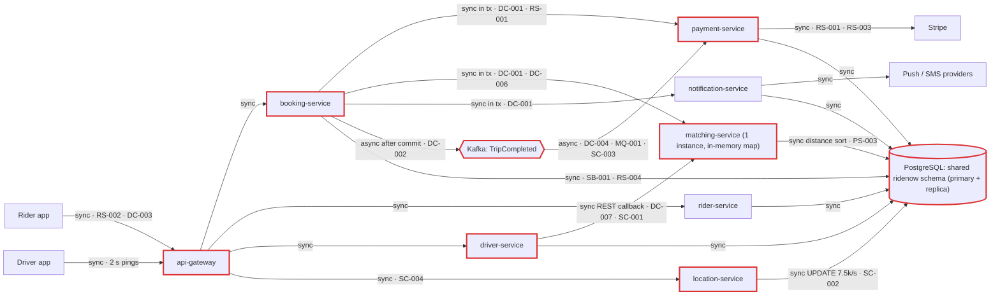
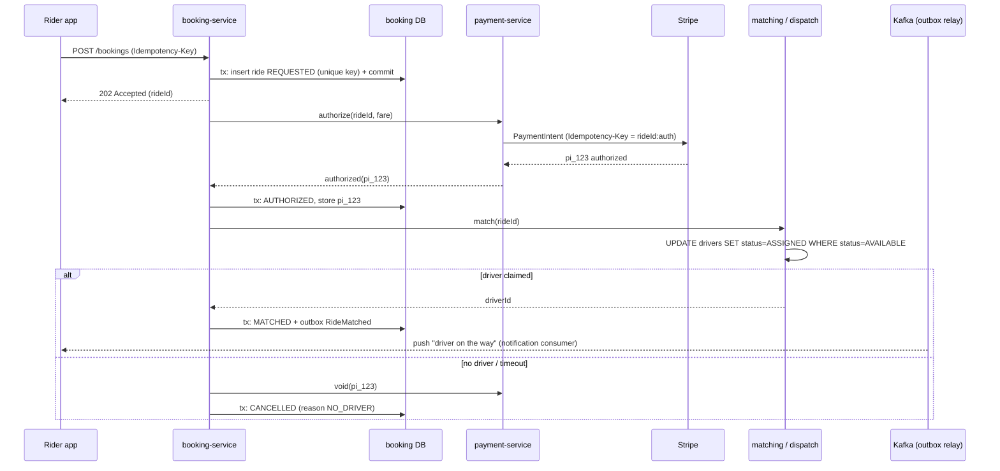
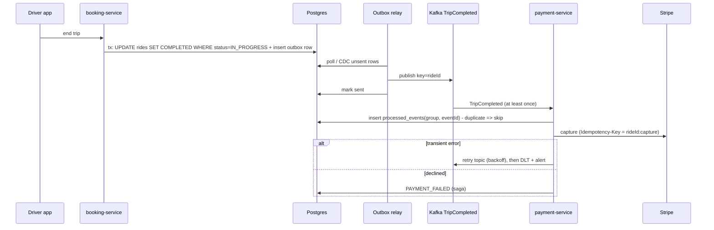
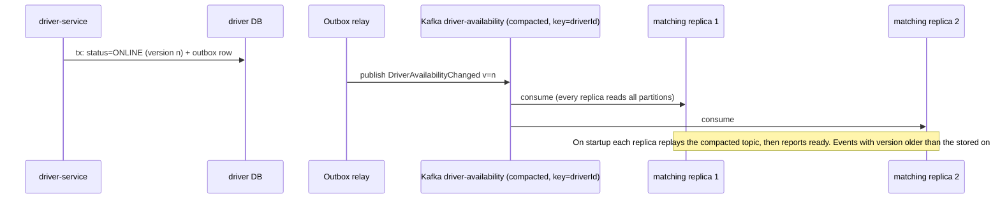
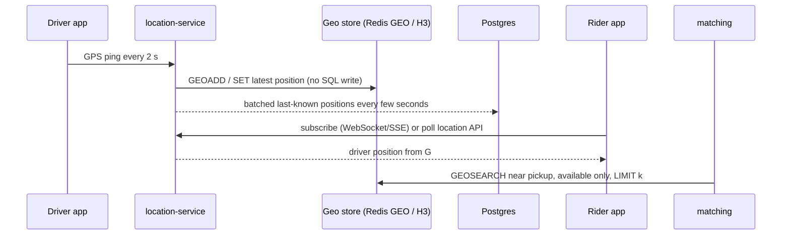

# Architecture review: RideNow

- **Mode**: design (review of `project-brief.md`, draft v0.3; no code exists yet)
- **Date**: 2026-10-24
- **Lenses run**: scalability, persistence, operability, data-consistency, resilience, service-boundaries, messaging. None were skipped. Operability ran because the brief names a likely platform ("probably Kubernetes").
- **How**: three parallel lens agents (data-consistency + messaging; resilience + service-boundaries; scalability + persistence + operability). The parent ran no lens itself.
- **Candidates**: 29 raised, 27 kept as findings, 2 merged into DC-001. Three were regraded down (PS-002 from high to medium; PS-004 and OP-004 from medium to low), and DC-001's effort was re-rated from large to medium. Before reporting, the lens agents had already folded 6 rule hits into other candidates. All of these are listed under "Not reviewed".

## Summary

RideNow is a planned 8-service ride-hailing platform for three cities, with a 99.95% target for ride requests, about 20k bookings in the launch peak hour and 7,500 to 25,000 GPS pings per second. The service split fits the four-squad team, but the design keeps monolith-style coupling underneath: one shared schema, the whole booking inside one database transaction, and live location written to the same Postgres primary as payments. The biggest risk is DC-001: Stripe pre-auth, matching and push run inside that transaction, so a routine "no driver available" rolls back the ride and leaves an untracked hold on the rider's card, while the single in-memory matching instance (SC-001) makes every deploy a ride-request outage. The change that buys the most is to commit the ride first and drive the remaining steps as persisted, idempotent saga steps with an outbox (DC-001, then DC-005 and RS-002). That one redesign closes the orphaned holds, takes Stripe and notification latency off the request path, and makes the 99.95% target reachable.

| Severity | Count |
|---|---|
| Critical | 2 |
| High | 14 |
| Medium | 9 |
| Low | 2 |
| Info | 0 |
| **Total** | **27** |

## Architecture profile

- **Architecture**: microservices. 8 planned, independently deployed services that share one Postgres schema; the sharing is reported as SB-001.
- **Summary**: RideNow: a ride-hailing app for three cities (about 4M people). Riders request a ride, are matched to a nearby driver, track the trip live, and are charged by card through Stripe when the trip ends. The plan is 8 services from day one, all sharing one PostgreSQL schema, with Kafka for trip completion.
- **Stack**: unknown; assumed Java 17 + Spring Boot 3.x; PostgreSQL (1 primary + 1 read replica); Kafka; Stripe; Kubernetes (probable)
- **Deployables** (all planned):
  - api-gateway (planned): routing and auth
  - rider-service (planned): rider profiles and saved payment methods; db=shared ridenow
  - driver-service (planned): driver profiles, documents, availability; db=shared ridenow; REST callback to matching-service on online/offline
  - location-service (planned): GPS ping ingest and 'where is driver X'; db=shared ridenow (UPDATE drivers lat/lng)
  - matching-service (planned): nearest available driver; in-memory available-driver map plus SQL distance query on drivers; 1 instance at launch
  - booking-service (planned): ride lifecycle REQUESTED -> MATCHED -> IN_PROGRESS -> COMPLETED; sync calls to payment, matching and notification inside one DB transaction; publishes TripCompleted; serves the rider location poll
  - payment-service (planned): Stripe pre-auth and capture; consumes TripCompleted
  - notification-service (planned): push notifications and SMS
- **Datastores**: PostgreSQL: one cluster, single `ridenow` schema (SHARED by all 8 services, cross-service joins allowed)
- **Messaging**: Kafka: TripCompleted (consumers: payment-service capture, receipts, driver earnings)
- **Background work**: Kafka consumers: payment-service (capture), plus receipt and driver-earnings consumers whose owner is unspecified
- **Runtime**: Undecided: "probably Kubernetes". Observability tooling undecided. matching-service runs as a single instance at launch. api-gateway handles routing and auth.
- **Stated intent**: Launch: 15,000 active drivers at peak, 120,000 rides/day. Year two: 50,000 drivers, 400,000 rides/day, plus two more cities. Friday peak hour is about 4x the daily average. 99.95% availability for requesting a ride. Team: 4 squads of about 6 engineers, each owning two services and shipping independently.
- **Assumptions** (no one was available to answer intake questions):
  - Mode is design: the input is a brief with no code. Nobody was available for intake questions, so the gaps were filled as below.
  - Consistency: rider charges (pre-auth and capture), bookings and driver earnings must never be lost or doubled. Driver location may lag by a few seconds.
  - Average trip length is about 20 minutes (the brief does not say). This is used to derive concurrent trips.
  - Stack is assumed to be Java 17 / Spring Boot 3.x (the team default), and deployment Kubernetes with several replicas per service (the brief says "probably Kubernetes").
  - "Peak hour about 4x the daily average" is read as: the peak-hour rate is 4x the 24-hour average rate.
  - Postgres and Hikari defaults (max_connections 100, pool size 10) are assumed where the brief gives no sizing.
- **Derived load**:
  - GPS ping writes: 7,500 UPDATE/s at launch peak (15,000 drivers / 2 s), 25,000 UPDATE/s in year two, all on the shared Postgres primary
  - Ride requests: 1.4/s average and about 5.6/s at peak (about 20k/hour) at launch; 4.6/s average and about 18.5/s at peak in year two
  - Concurrent trips at peak: about 6,700 at launch, about 22,000 in year two
  - Rider location polls (1/s per active trip): about 6,700 reads/s at launch peak, about 22,000 reads/s in year two, against the same drivers rows
  - Matching geo-queries: at least 1 per booking, about 6/s at launch peak and about 19/s in year two, each sorting drivers by a distance computed in SQL
  - TripCompleted events: about 5.6/s at launch peak, about 18.5/s in year two
- **Key flows**:
  - Book: rider app -> api-gateway -> booking-service [one DB tx: insert REQUESTED -> payment-service -> Stripe pre-auth -> matching-service -> notification-service -> update MATCHED] -> commit
  - Complete: booking-service update COMPLETED -> commit -> publish TripCompleted (Kafka) -> payment-service capture via Stripe; receipts; driver earnings
  - Location: driver app ping every 2 s -> location-service -> UPDATE drivers (shared primary); rider app poll 1/s -> booking-service read of the same row; matching-service distance query on the same table
- **Lenses run**: scalability, persistence, operability, data-consistency, resilience, service-boundaries, messaging



## Findings

### Critical

#### DC-001 · Stripe pre-auth, matching and push run inside the booking DB transaction, so a rollback leaves orphaned card holds and phantom dispatches

Severity: critical · Confidence: high · Lens: data-consistency · Effort: medium · Also reported by: resilience

**Where**: `project-brief.md` > Booking flow

**Evidence**:

```text
"booking-service calls payment-service synchronously, which calls Stripe to pre-authorize the estimated fare." ... "booking-service calls notification-service synchronously" ... "All of steps 2–6 run inside one database transaction in booking-service, so if anything fails the booking is rolled back cleanly."
```

**What goes wrong**: On a Friday peak, step 3 succeeds and Stripe places a hold on the rider's card. Step 4 then finds no available driver, which is a routine outcome at peak, or step 5 hits a push/SMS provider error. The transaction rolls back and the ride row disappears, but the Stripe authorisation stays on the card for days. RideNow has no record of the PaymentIntent, so nothing ever voids it. The rider retries and a second hold is placed. If step 5 succeeds and the commit then fails, the rider and the driver have both been told "driver on the way" for a ride that does not exist. Two more consequences follow. First, a push/SMS outage alone fails every ride request, even though notification is not needed to answer the request. Second, callees on the shared schema cannot see the uncommitted REQUESTED row: an FK from `payments` to `rides`, or a join on `rides`, fails. Every booking also pins a DB connection for the whole Stripe + matching + notification latency (about 170 connections at 5.6 bookings/s with a 30 s Stripe stall).

**Fix** (`move-call-outside-transaction`): Commit `REQUESTED` in its own short transaction before any remote call. Drive the remaining steps as persisted state transitions (`AUTHORIZING` -> `AUTHORIZED` -> `MATCHING` -> `MATCHED`), making each remote call outside any DB transaction. Persist the Stripe PaymentIntent id as soon as it is returned. Call Stripe with an `Idempotency-Key` derived from rideId + step. Void the PaymentIntent and release the driver if a later step fails. Send "driver on the way" only after `MATCHED` commits, through an outbox row or an after-commit hook, so a notification failure never fails the booking. Pass callees the data they need in the request instead of having them read uncommitted rows. The full lifecycle is DC-005.

**Why it's worth it here**: The booking flow makes irreversible external side effects (a Stripe authorisation, driver dispatch, push/SMS) that a local Postgres rollback cannot undo, at about 20k bookings in the peak hour.

Fixed booking flow, shared by DC-001, DC-003, DC-005, DC-006 and RS-002:



#### SC-001 · matching-service keeps the available-driver map in one instance's memory, fed by REST callbacks: every restart empties it, and a second replica sees only some updates

Severity: critical · Confidence: high · Lens: scalability · Effort: medium · Also reported by: operability

**Where**: `project-brief.md` > Booking flow

**Evidence**:

```text
"matching-service keeps the list of available drivers in an in-memory map that driver-service updates through a REST callback whenever a driver goes online or offline. We'll run one matching-service instance at launch and add more later."
```

**What goes wrong**: On every routine deploy, crash or reschedule of matching-service, the new process starts with an empty map. Drivers who are already online send no new callback, so every `POST /bookings` finds no driver until drivers toggle. While the only instance is down, the synchronous booking call fails, so every deploy is a ride-request outage, and 99.95% allows about 22 minutes a month. A single replica also cannot be protected by a PodDisruptionBudget. When a second replica is added, the load balancer delivers each callback to only one replica, so each holds a different partial view: riders get 'no drivers' or are matched to drivers who are offline.

**Fix** (`stateless-service`): Make matching-service stateless with respect to availability. Rebuild its view from a shared source: the compacted `DriverAvailabilityChanged` topic (DC-007) that every replica consumes in full, or a shared geo store such as Redis GEO keyed by city. Report ready only after the view is loaded. Run at least 2 replicas from launch, with a PDB and topology spread.

**Why it's worth it here**: Matching sits on the synchronous ride-request path, which has a 99.95% target, so it must survive deploys and run as more than one instance.

The fixed flow is shown in the sequence diagram under DC-007.

### High

#### DC-002 · `TripCompleted` is published after commit with no outbox, so a crash or broker error loses the fare capture, receipt and driver earnings

Severity: high · Confidence: high · Lens: data-consistency · Effort: medium

**Where**: `project-brief.md` > Trip completion

**Evidence**:

```text
"booking-service sets the ride to `COMPLETED`, then publishes a `TripCompleted` event to Kafka right after the database commit. payment-service consumes it and captures the final fare. Receipts and driver earnings are computed by consumers of the same event."
```

**What goes wrong**: booking-service commits `COMPLETED`. Before the Kafka send is acknowledged, the pod is killed by a rolling deploy, an OOM or a node drain, or the send fails because a broker is unavailable. The ride is already COMPLETED, so nothing retries the event. The fare is never captured and the authorisation expires, so the revenue is lost. The rider gets no receipt and the driver is not paid for the trip, and nothing flags the gap.

**Fix** (`transactional-outbox`): Insert the `TripCompleted` event into an `outbox` table in the same transaction as the status update. Publish it with a relay (Debezium CDC, or a single-active polling publisher) keyed by `rideId`, and mark rows sent. Consumers must be idempotent (DC-004), because the relay delivers at least once.

**Why it's worth it here**: Payment capture, receipts and driver earnings depend entirely on this event reaching Kafka, and four squads deploy independently, so restarts are frequent.

Fixed trip-completion flow, shared by DC-002, DC-004 and MQ-001:



#### DC-003 · `POST /bookings` has no idempotency key, so a client retry during a slow Stripe call creates a second ride, a second card hold and a second dispatch

Severity: high · Confidence: medium · Lens: data-consistency · Effort: small

**Where**: `project-brief.md` > Booking flow

**Evidence**:

```text
"The rider app calls `POST /bookings`." ... "If Stripe is slow, the request waits; we will set a generous timeout so we don't lose bookings." The brief does not mention an idempotency key or deduplication of booking requests.
```

**What goes wrong**: Stripe slows down. The server keeps waiting past the mobile client's timeout, or the rider's connection drops and the response is lost. The app or the rider retries `POST /bookings` while the first request is still running, and that first request still commits. The result is two MATCHED rides, two Stripe authorisations and two drivers heading to the same pickup.

**Fix** (`idempotency-key`): Have the app send an `Idempotency-Key` header (a UUID per booking intent). Store it on the ride under a unique constraint, and return the existing ride when a key repeats. Derive the Stripe idempotency key from it. Add a partial unique index allowing one active ride per rider (`WHERE status IN ('REQUESTED','MATCHED','IN_PROGRESS')`).

**Why it's worth it here**: Mobile clients retry over unreliable networks, and the server deliberately waits on a slow third party.

The fixed flow is shown in the sequence diagram under DC-001.

#### DC-004 · `TripCompleted` consumers and trip completion are not idempotent, so a redelivery or a double-tap doubles driver earnings and receipts

Severity: high · Confidence: medium · Lens: data-consistency · Effort: medium

**Where**: `project-brief.md` > Trip completion

**Evidence**:

```text
"payment-service consumes it and captures the final fare. Receipts and driver earnings are computed by consumers of the same event." The brief mentions no processed-event tracking, unique keys or status guard on completion.
```

**What goes wrong**: The earnings consumer adds the fare to the driver's balance, then crashes or loses its partition in a rebalance before committing the offset. Kafka redelivers the event and the earnings are added twice, and the receipt is sent twice. If capture is implemented as a new charge, the rider pays twice. If the driver double-taps 'End trip', an unguarded status update publishes two TripCompleted events. Once DC-002's outbox is in place, duplicate delivery becomes normal behaviour, not an edge case.

**Fix** (`idempotent-consumer`): In each consumer, record `(consumer_group, event_id)` in a processed-events table with a unique constraint, in the same transaction as the effect. Model earnings as ledger inserts with a unique `ride_id`, not increments. Capture with Stripe `Idempotency-Key = rideId`, and treat 'already captured' as success. Guard completion with `UPDATE rides SET status='COMPLETED' WHERE id=? AND status='IN_PROGRESS'`, and write the outbox row only when exactly one row changed.

**Why it's worth it here**: Kafka delivers at least once, and these consumers move money (capture, driver earnings).

The fixed flow is shown in the sequence diagram under DC-002.

#### DC-005 · The ride-payment lifecycle has no cancel or failure states and no compensations for no-match, cancellation, capture failure or a fare above the authorised amount

Severity: high · Confidence: medium · Lens: data-consistency · Effort: large

**Where**: `project-brief.md` > Services; `project-brief.md` > Trip completion

**Evidence**:

```text
"**booking-service**: owns the ride lifecycle (requested → matched → in progress → completed)." and "**payment-service**: card pre-authorization and capture through Stripe." The brief has no cancelled or failed states, no void or release step, and no handling for a failed capture.
```

**What goes wrong**: A rider cancels after being matched, or the driver does not show up. The lifecycle has no CANCELLED state, so nothing voids the pre-auth or releases the driver: the card hold lingers and the driver may stay assigned. At trip end the capture is declined, or the final fare (a detour, traffic) exceeds the estimated authorisation, which Stripe will not capture beyond. RideNow then under-collects or collects nothing, and there is no PAYMENT_FAILED state to drive a retry or collections. Cancellations and fare overruns are routine in ride-hailing.

**Fix** (`saga-orchestration`): Make booking-service a saga orchestrator. Persist a ride state machine (`REQUESTED`, `AUTHORIZED`, `MATCHED`, `IN_PROGRESS`, `COMPLETED`, `CANCELLED`, `PAYMENT_FAILED`) with a timeout on each state. Compensations: void the PaymentIntent on cancel, no-match or timeout, and release the driver claim (DC-006). At capture, use incremental authorisation or re-authorise for the difference, retry transient errors (MQ-001), and move declines to PAYMENT_FAILED. Compute fares server-side. Drive every step through the outbox with idempotent handlers.

**Why it's worth it here**: The flow spans Stripe, driver assignment and notifications, none of which one Postgres transaction can cover, and every step involves money.

The fixed flow is shown in the sequence diagram under DC-001.

#### DC-006 · Nothing claims a driver atomically, so two concurrent bookings can both be matched to the same nearest driver

Severity: high · Confidence: medium · Lens: data-consistency · Effort: medium

**Where**: `project-brief.md` > Booking flow; `project-brief.md` > Live location

**Evidence**:

```text
"booking-service calls matching-service synchronously to get a driver." ... "matching-service also queries this table to find nearby drivers (`ORDER BY` distance computed in SQL)." The brief describes no step that reserves or claims the chosen driver.
```

**What goes wrong**: Two riders leaving the same stadium book within the same second. Both matching calls read the same map or the same ORDER BY distance result and pick the same nearest driver. No atomic check-and-set marks the driver as taken, so both rides become MATCHED to one driver and one rider waits for a car that never comes. Once matching-service runs more than one instance, each with its own map, collisions become routine. If matching marks the driver busy in memory and the booking then rolls back, the driver stays busy with no ride.

**Fix** (`atomic-conditional-update`): Claim the driver in a short transaction of its own: `UPDATE drivers SET status='ASSIGNED', current_ride_id=:ride WHERE id=:driver AND status='AVAILABLE'`. If exactly one row is not updated, try the next candidate. Treat the claim as a reservation with an expiry, and release it as a compensation (DC-005) when the booking fails or is cancelled.

**Why it's worth it here**: At peak, concurrent requests in dense pickup areas compete for the same few nearby drivers.

The fixed flow is shown in the sequence diagram under DC-001.

#### DC-007 · Driver availability is written to Postgres and also pushed to matching-service by a REST callback, so the two copies diverge whenever a callback fails

Severity: high · Confidence: high · Lens: data-consistency · Effort: medium

**Where**: `project-brief.md` > Booking flow

**Evidence**:

```text
"matching-service keeps the list of available drivers in an in-memory map that driver-service updates through a REST callback whenever a driver goes online or offline."
```

**What goes wrong**: A driver goes offline. driver-service commits OFFLINE, then the callback fails because the single matching-service instance is redeploying or the call times out. The map still lists the driver, so new rides are matched to someone who has logged off. In the other direction, a driver who comes online during a matching deploy is never added and earns nothing until they toggle. Retried callbacks can also arrive out of order (online, then offline), which leaves the map in the wrong final state. Every matching-service deploy opens this window.

**Fix** (`transactional-outbox`): In the same transaction as the availability change, have driver-service write an outbox row. Publish `DriverAvailabilityChanged` to a compacted topic keyed by `driverId`, with a monotonic version. matching-service consumes the topic, rebuilds its view from it on startup (this closes SC-001), and ignores stale versions.

**Why it's worth it here**: Matching decisions depend on a second copy of availability that is updated by a separate, fallible call after the DB write.

Fixed driver-availability flow, shared by DC-007 and SC-001:



#### RS-001 · The Stripe pre-auth on the booking path has a deliberately "generous" timeout, and no deadline is set for the payment, matching or notification calls

Severity: high · Confidence: high · Lens: resilience · Effort: small

**Where**: `project-brief.md` > Booking flow

**Evidence**:

```text
"If Stripe is slow, the request waits; we will set a generous timeout so we don't lose bookings." The brief gives no timeout for the booking -> payment-service, booking -> matching-service or booking -> notification-service hops, and no overall deadline at api-gateway.
```

**What goes wrong**: On a Friday peak, Stripe latency climbs to the generous timeout (say 30 s). At 5.6 bookings/s that is about 170 bookings in flight at launch, and about 550 in year two. Each holds a request thread and, because of DC-001, a connection to the Postgres primary that every service shares. booking-service's pools run out first, then the primary's connections, and rider, driver, location and payment calls start failing. Riders whose apps time out tap again and add load. A Stripe slowdown becomes a platform outage.

**Fix** (`timeouts`): Give every outbound client an explicit timeout: connect around 1 s, and a read timeout set from each dependency's p99 with headroom (a few seconds for Stripe pre-auth, well under 1 s for internal calls). Set an overall deadline for `POST /bookings` at the gateway (for example 8-10 s) and propagate it so inner calls use the remaining budget. If the goal is not losing bookings, persist the booking and finish the pre-auth asynchronously (RS-002) rather than waiting longer.

**Why it's worth it here**: Booking depends synchronously on a third-party payment API, with a 99.95% target and a 4x Friday peak.

#### RS-002 · A ride request is a seven-component synchronous chain that cannot meet the 99.95% target

Severity: high · Confidence: high · Lens: resilience · Effort: large

**Where**: `project-brief.md` > Booking flow; `project-brief.md` > Targets

**Evidence**:

```text
"Availability target for requesting a ride: 99.95%." and "booking-service calls matching-service synchronously to get a driver." ... "booking-service updates the ride to `MATCHED` and returns the result to the rider app."
```

**What goes wrong**: A ride request succeeds only if api-gateway, booking-service, payment-service, Stripe, matching-service (a single instance), notification-service and the Postgres primary are all up at that moment. Even at 99.95% each, 0.9995^7 is about 99.65%: roughly 30 hours a year of failed requests against a 4.4-hour budget. Latencies add up while the rider watches a spinner, and every matching-service deploy is a booking outage.

**Fix** (`async-decoupling`): Shorten the synchronous path. `POST /bookings` validates the request, persists REQUESTED (with its idempotency key, DC-003) and returns 202 with the ride id. Pre-auth, matching and notification then run as saga steps (DC-005), and the app follows status by push or poll. The synchronous path is then gateway + booking + DB. Run matching with at least 2 replicas (SC-001).

**Why it's worth it here**: There is a stated 99.95% availability target for ride requests across an independently deployed multi-service topology.

The fixed flow is shown in the sequence diagram under DC-001.

#### RS-003 · No circuit breaker or fast-fail around Stripe, the single-instance `matching-service`, or `notification-service` on the booking path

Severity: high · Confidence: medium · Lens: resilience · Effort: medium

**Where**: `project-brief.md` > Booking flow; `project-brief.md` > Not decided yet

**Evidence**:

```text
"We'll run one matching-service instance at launch and add more later." and "How we deploy (probably Kubernetes)." The brief mentions no circuit breaker, fallback or outlier detection.
```

**What goes wrong**: The single matching-service pod restarts for a deploy, an OOM or a node drain. Every booking in that window still pre-authorises the card through Stripe, then waits the full timeout on matching before failing, piling up threads and shared-DB connections. When matching comes back it is flooded with queued calls while it is still warming up. A Stripe or SMS-provider outage plays out the same way: every request burns a full timeout instead of failing in milliseconds.

**Fix** (`circuit-breaker`): Put a separate circuit breaker around each dependency (Resilience4j, or mesh outlier detection once Kubernetes is decided). When a breaker is open, fail fast with 'try again shortly' for Stripe and matching, and skip-and-queue for notification. Check matching's breaker before calling Stripe, so riders are not pre-authorised for a booking that is bound to fail.

**Why it's worth it here**: Booking calls three independently failing dependencies synchronously, one of them a single instance, at meaningful peak volume.

#### RS-004 · `booking-service` serves the 1/s rider location poll and the Stripe-blocked `POST /bookings` from the same threads and DB connections

Severity: high · Confidence: medium · Lens: resilience · Effort: medium

**Where**: `project-brief.md` > Live location; `project-brief.md` > Booking flow

**Evidence**:

```text
"The rider app polls `GET /bookings/{id}/driver-location` every second during a trip, which reads the same row." and "All of steps 2–6 run inside one database transaction in booking-service". The brief plans no separate pools or deployments for the two workloads.
```

**What goes wrong**: At launch peak, about 6,700 concurrent trips each poll once a second through booking-service. When Stripe or matching slows, `POST /bookings` requests hold booking-service's request threads and connection pool while they wait. Location polls and trip-completion calls queue behind them and time out. A payment-provider slowdown therefore also freezes live tracking for every rider already in a car, and stops drivers from completing trips.

**Fix** (`bulkhead`): Isolate the workloads. Serve the location read from location-service, which already owns 'where is driver X' (see SC-002), or at least from a separate booking-service deployment or pool. Give each outbound dependency a bounded client pool or bulkhead (Resilience4j `@Bulkhead` or separate executors).

**Why it's worth it here**: A read path running thousands of requests per second shares a service with a write path that blocks on a third party.

#### SB-001 · All 8 independently shipping services share one `ridenow` schema with cross-service joins, so no service owns its tables

Severity: high · Confidence: high · Lens: service-boundaries · Effort: large

**Where**: `project-brief.md` > Data; `project-brief.md` > Targets

**Evidence**:

```text
"all eight services connect to one shared PostgreSQL cluster (one primary, one read replica) with a single `ridenow` schema. Services can join across each other's tables when they need data, for example booking-service joins `drivers` and `riders` directly to build the trip receipt." and "Team: 4 squads of about 6 engineers, each owning two services and shipping independently."
```

**What goes wrong**: Three things go wrong. (1) The driver-service squad renames or splits a column on `drivers` and deploys. booking-service's receipt join, matching-service's distance query and location-service's UPDATE then break at runtime, and no other squad's CI caught it. Independent shipping, the reason for going microservices, turns into coordinated releases. (2) The `drivers` row is written by driver-service and location-service and read by booking and matching, so no service owns its invariants. (3) GPS ingest load (7,500 to 25,000 writes/s) competes on the one primary with booking and payment writes, so ingest volume decides whether riders can book.

**Fix** (`database-per-service`): Use database-per-service: at minimum, one schema and one DB role per service with no cross-schema grants. Expose data through APIs or events. For example, build the receipt from `TripCompleted` carrying rider and driver snapshots, or from a local read model (`data-replication-via-events`), not from joins. Move live location to its own store (SC-002). Separate payment, booking and rider data first, since their invariants matter most. If two services cannot be separated, merge them rather than share tables.

**Why it's worth it here**: 4 squads intend to deploy 8 services independently, and one workload (GPS ingest) runs orders of magnitude hotter than the rest.

#### MQ-001 · `TripCompleted` consumers have no retry topic or DLT, so a failed capture is silently skipped or blocks the partition

Severity: high · Confidence: medium · Lens: messaging · Effort: medium

**Where**: `project-brief.md` > Trip completion

**Evidence**:

```text
"payment-service consumes it and captures the final fare." The brief has no retry, dead-letter or failure handling for these consumers. The default is from memory and was not checked in source: Spring Kafka 3.x DefaultErrorHandler retries about 10 times with no backoff, then logs and commits.
```

**What goes wrong**: Stripe returns a 5xx or times out during a capture. With the default error handler, the retries are used up within milliseconds and the offset is committed. The capture never happens and the ride looks finished, so the revenue is lost. If a custom handler retries forever instead, one bad event blocks its partition, and every later trip on that partition goes uncaptured, with receipts and earnings stalled behind it.

**Fix** (`retry-topic`): For each consumer group, add a non-blocking retry topic with exponential backoff for transient errors, then a DLT with a replay tool and an alert (OP-002). Treat card declines as non-retryable business outcomes and route them to the saga's PAYMENT_FAILED state (DC-005), not to the DLT. Retries redeliver, so this depends on DC-004.

**Why it's worth it here**: The consumer makes a money-moving call to an external API that fails both transiently and for business reasons.

The fixed flow is shown in the sequence diagram under DC-002.

#### SC-002 · All driver GPS writes, rider location polls and matching scans hit the same `drivers` rows on one Postgres primary

Severity: high · Confidence: high · Lens: scalability · Effort: large · Also reported by: persistence

**Where**: `project-brief.md` > Live location; `project-brief.md` > Data

**Evidence**:

```text
"Drivers' apps send a GPS ping every 2 seconds while online. location-service writes each ping as an `UPDATE drivers SET lat = ?, lng = ? WHERE id = ?` on the shared Postgres." and "one shared PostgreSQL cluster (one primary, one read replica)"
```

**What goes wrong**: At launch peak there are 7,500 single-row UPDATE transactions per second (25,000/s in year two). On top of them come about 6,700 to 22,000 rider polls/s against the same rows, matching's full-table distance sorts, and the other services' OLTP traffic. Every UPDATE leaves a dead tuple and generates WAL. Autovacuum falls behind on `drivers`, the table and its indexes bloat, matching slows down, WAL volume causes replica lag, and commit latency rises for every service, including booking. The primary can only scale vertically. At year-two scale on a Friday peak, ride requests and tracking time out together.

**Fix** (`cqrs-read-model`): Move live location off the relational primary. Ingest pings into Kafka keyed by driverId, or straight into an in-memory geo store (Redis GEO or an H3 grid) that holds only the latest position per driver. Serve 'where is driver X', rider tracking and nearest-driver search from that store. Persist last-known positions or trip breadcrumbs to Postgres in coalesced batches. Push location to riders over WebSocket/SSE, or serve polls from the location store, instead of polling booking-service against Postgres.

**Why it's worth it here**: Ping and poll volume (7.5k to 25k writes/s, 6.7k to 22k reads/s) runs orders of magnitude above booking volume (about 6 to 19/s), and location may lag by a few seconds.

Fixed live-location flow for SC-002:



#### PS-001 · No migration ownership or process for one schema that four squads change, and DDL on hot tables stalls every service

Severity: high · Confidence: medium · Lens: persistence · Effort: medium · Also reported by: operability

**Where**: `project-brief.md` > Data

**Evidence**:

```text
"a single `ridenow` schema. Services can join across each other's tables when they need data". The brief says nothing about migrations, tooling or which service owns each table.
```

**What goes wrong**: A squad ships an `ALTER TABLE drivers`, which needs an ACCESS EXCLUSIVE lock. The ALTER queues behind a long transaction, such as a booking waiting on Stripe (DC-001) or a matching scan. Every later query on `drivers` (7,500 pings/s, rider polls, matching) queues behind the ALTER, so the whole platform stalls. Separately, a rename or drop shipped in one step breaks other squads' services that join that table, during their rolling deploy and after it.

**Fix** (`expand-contract-migration`): Give each table one owning service and one migration pipeline: Flyway per owner, with `ddl-auto=validate`. Require expand-contract for renames and drops. Set `lock_timeout` and `statement_timeout` on migration sessions, and retry. Until SB-001 removes cross-service joins, run contract tests on the columns that other services read. This is the stopgap for SB-001.

**Why it's worth it here**: Several squads deploy independently against one shared schema that includes tables written thousands of times a second.

### Medium

#### SB-002 · Dispatch state (availability, position, matching) is split across `driver-service`, `location-service` and `matching-service`, coupled through the `drivers` row and a REST callback

Severity: medium · Confidence: medium · Lens: service-boundaries · Effort: large

**Where**: `project-brief.md` > Services; `project-brief.md` > Live location

**Evidence**:

```text
"**location-service**: receives driver GPS pings and answers "where is driver X"." and "**driver-service**: driver profiles, documents, availability status." and "The rider app polls `GET /bookings/{id}/driver-location` every second during a trip, which reads the same row."
```

**What goes wrong**: One capability, finding an available driver near a point and knowing where that driver is now, is implemented in four places. Availability lives in driver-service and in matching's map. Position lives in the shared `drivers` row. 'Where is driver X' is answered by both location-service and booking-service. Any dispatch change, such as an 'on trip' state or a geo index, needs coordinated releases from up to three squads. Availability and position can also disagree, so matching picks offline or distant drivers.

**Fix** (`bounded-context`): Form one dispatch bounded context that owns driver availability, live position and the geo index, with matching as its query API: merge location-service and matching-service, and move the online/offline state into it. driver-service keeps profiles and documents and publishes availability changes as events. booking-service asks dispatch for a driver and for that driver's location, and never reads `drivers`. Put consumer-driven contracts on the booking-dispatch seam.

**Why it's worth it here**: Squads are meant to ship independently, yet one capability currently needs three services to change together. The merge also leaves each squad with a coherent two-service portfolio.

#### MQ-002 · The `TripCompleted` contract is undefined across consumers deployed by different squads

Severity: medium · Confidence: medium · Lens: messaging · Effort: small

**Where**: `project-brief.md` > Trip completion

**Evidence**:

```text
"Receipts and driver earnings are computed by consumers of the same event." The brief defines no event schema, version or registry, and names no owner for the receipt and earnings consumers.
```

**What goes wrong**: The booking squad renames the fare field or changes its unit (for example from major to minor currency units) and deploys. payment-service, owned by another squad, reads a null or wrong amount and captures the wrong fare. Or deserialization fails for every event, if default type headers name producer classes.

**Fix** (`schema-registry`): Define a public `TripCompleted` schema with `eventId`, `rideId`, `schemaVersion`, the amount in minor units plus currency, and timestamps. Register it with backward-compatibility checks in CI. Never serialize internal entities. Name an owning squad for the receipt and earnings consumers.

**Why it's worth it here**: Producer and consumers belong to different squads that deploy independently, and the payload carries money amounts.

#### SC-003 · The `TripCompleted` capture consumer blocks on Stripe, and no partition count or consumer concurrency is planned

Severity: medium · Confidence: medium · Lens: scalability · Effort: small

**Where**: `project-brief.md` > Trip completion

**Evidence**:

```text
"publishes a `TripCompleted` event to Kafka right after the database commit. payment-service consumes it and captures the final fare." The brief mentions no partition count, consumer concurrency or owner for the receipt and earnings consumers.
```

**What goes wrong**: Peak hour produces about 5.6 events/s at launch and 18.5/s in year two. A capture handler that spends 0.3 to 1 s in Stripe, running at concurrency 1 on an undersized topic, handles about 1 to 3 events/s. Lag grows through the Friday peak, so captures, receipts and earnings arrive hours late, and slow polls can exceed max.poll.interval.ms and trigger rebalance loops.

**Fix** (`consumer-concurrency`): Declare the partition count with year-two headroom (for example 24 or more). Set listener concurrency per pod, use a small max.poll.records for the Stripe-bound handler, and tune max.poll.interval.ms. Give the receipt and earnings consumers named owners and separate consumer groups. Alert on lag (OP-002).

**Why it's worth it here**: Capture is money-critical, and each event's handler blocks on an external API.

#### SC-004 · No rate limiting or load shedding at the gateway, and rider location polling is fixed at 1/s per trip

Severity: medium · Confidence: medium · Lens: scalability · Effort: medium

**Where**: `project-brief.md` > Services; `project-brief.md` > Live location

**Evidence**:

```text
"**api-gateway**: routing and auth." and "The rider app polls `GET /bookings/{id}/driver-location` every second during a trip". The brief mentions no rate limits, admission control or server-controlled poll interval.
```

**What goes wrong**: On a Friday peak, 6,700 to 22,000 polls/s plus retries from apps whose requests are hanging all reach the service that also handles `POST /bookings`. Nothing sheds or slows the load, so when a dependency slows down, queued work grows until booking-service stops answering and ride requests miss the 99.95% target.

**Fix** (`rate-limiting`): Add per-client and per-route rate limits and concurrency caps at api-gateway, with ride requests prioritised over tracking. Return a server-controlled poll interval or Retry-After header, or replace polling with push from the location store (SC-002). Use bounded executors that reject work instead of queueing it without limit.

**Why it's worth it here**: Public mobile clients generate high fixed-rate traffic on the service that carries the availability-critical booking flow.

#### PS-002 · No connection budget for eight services on one Postgres primary, and no pooler

Severity: medium · Confidence: medium · Lens: persistence · Effort: small

**Where**: `project-brief.md` > Data

**Evidence**:

```text
"all eight services connect to one shared PostgreSQL cluster (one primary, one read replica)". The brief does not mention pool sizing, max_connections or a connection pooler.
```

**What goes wrong**: Assume Hikari's default pool of 10 per pod and about 3 replicas per service: 8 x 3 x 10 = 240 connections against Postgres's default max_connections of 100. During a rolling deploy with surge, or an autoscale-out, new pods cannot connect and crash-loop, and because the primary is shared, every service is affected at once. (Connections held across remote calls are covered by DC-001.)

**Fix** (`connection-pool-sizing`): Size each service's pool against a total budget: the sum of replicas x pool size must stay at or below max_connections minus headroom. Put PgBouncer in transaction mode in front of the primary and the replica. Set connection timeouts explicitly, and route read-only work such as receipts to the replica.

**Why it's worth it here**: Eight independently scaled services share one primary on Kubernetes with several replicas each.

#### PS-003 · The nearest-driver query sorts by a distance computed in SQL, with no spatial index or bounding filter

Severity: medium · Confidence: high · Lens: persistence · Effort: medium · Also reported by: scalability

**Where**: `project-brief.md` > Live location

**Evidence**:

```text
"matching-service also queries this table to find nearby drivers (`ORDER BY` distance computed in SQL)."
```

**What goes wrong**: An ORDER BY on a computed expression cannot use a B-tree index. Every match evaluates the distance for every `drivers` row, offline drivers included, and sorts the result, 6 to 19 or more times a second at peak, on a table bloated by ping updates. Match latency and primary CPU grow with fleet size. Adding a GiST index on lat/lng to the ping-updated table would end HOT updates, so every one of the 7,500 to 25,000 updates per second would also write index entries.

**Fix** (`add-index`): Run nearest-driver search in the live-location store (Redis GEOSEARCH, or an H3/geohash cell lookup filtered to available drivers, with a LIMIT); see SC-002. If the search must stay in Postgres, use PostGIS `ST_DWithin` plus a KNN `<->` with LIMIT on a GiST index, on a table that is not updated by every ping.

**Why it's worth it here**: Matching runs on every booking against a table that grows with the fleet and is updated continuously.

#### OP-001 · No tracing or correlation id planned across the multi-service booking and completion flows

Severity: medium · Confidence: high · Lens: operability · Effort: small

**Where**: `project-brief.md` > Not decided yet

**Evidence**:

```text
"Observability tooling." is listed under "Not decided yet", while the booking flow chains booking-service, payment-service, Stripe, matching-service and notification-service.
```

**What goes wrong**: A rider gets a failed booking but sees a card hold, or a completed trip is never captured. Four squads grep the logs of six services and three Kafka consumers with nothing joining them, and recovery takes hours while the issue repeats under peak load.

**Fix** (`distributed-tracing`): Choose OpenTelemetry (or Micrometer Tracing) before the first service ships. Propagate W3C trace context through the gateway, every REST hop and Kafka record headers. Emit structured JSON logs that carry the trace id, ride id and driver id.

**Why it's worth it here**: Six or more deployables take part in one booking, and completion is asynchronous.

#### OP-002 · No SLO metrics or alerts for the 99.95% ride-request target, consumer lag, DLTs or replica lag

Severity: medium · Confidence: high · Lens: operability · Effort: medium

**Where**: `project-brief.md` > Targets; `project-brief.md` > Not decided yet

**Evidence**:

```text
"Availability target for requesting a ride: 99.95%." and "Observability tooling." listed under "Not decided yet".
```

**What goes wrong**: Several failures reach riders and drivers before any squad notices: TripCompleted lag growing through a Friday peak, the matching map emptied by a deploy, replica lag or autovacuum falling behind on `drivers`, and Stripe latency climbing. Nobody can tell how much of the 99.95% error budget has been spent.

**Fix** (`metrics-and-alerts`): Define the ride-request SLI (successful `POST /bookings` within N s) and alert on error-budget burn. Collect RED metrics per endpoint and per dependency, and USE metrics for connection pools and the Postgres primary (connections, replica lag, dead tuples on `drivers`). Alert on TripCompleted consumer lag and on any DLT message. Track business signals: matches per minute, available drivers per city, and captures pending.

**Why it's worth it here**: The project states an availability SLO and has money-critical asynchronous consumers.

#### OP-003 · No graceful-shutdown plan for the long synchronous booking request during rolling deploys

Severity: medium · Confidence: medium · Lens: operability · Effort: small

**Where**: `project-brief.md` > Booking flow; `project-brief.md` > Not decided yet

**Evidence**:

```text
"we will set a generous timeout so we don't lose bookings." and "How we deploy (probably Kubernetes)." The brief does not mention draining or termination grace periods.
```

**What goes wrong**: Four squads deploying independently means frequent rolling restarts of booking-service and payment-service. A booking still waiting on a generous Stripe timeout outlives the default 30 s Kubernetes grace period, so the pod is killed after Stripe pre-authorised the fare but before the booking commits. The rider is left with a card hold and a connection reset. DC-001 owns the orphaned-hold root cause; graceful shutdown makes it a rare event instead of a per-deploy one.

**Fix** (`graceful-shutdown`): Enable graceful shutdown (`server.shutdown=graceful`, which is the default from Spring Boot 3.4 per memory, not verified) and `spring.lifecycle.timeout-per-shutdown-phase`. Flip readiness to failing before draining, using a preStop hook. Set terminationGracePeriodSeconds above the bounded booking deadline from RS-001. Stop Kafka listeners cleanly.

**Why it's worth it here**: Independent rolling deploys hit services that handle multi-second synchronous requests involving money.

### Low

#### PS-004 · No retention or archival policy for per-ride and per-event tables

Severity: low · Confidence: medium · Lens: persistence · Effort: small

**Where**: `project-brief.md` > Data

**Evidence**:

```text
The brief targets "120,000 rides per day" and then "400,000 rides per day", and the Data section sets no retention, archival or partitioning for rides, notifications, receipts or earnings.
```

**What goes wrong**: `rides` grows by about 44M rows a year at launch and about 146M a year in year two, and notification logs grow faster. Indexed Postgres handles that for years, but vacuum, backups and index maintenance on the shared primary get slower, and data is kept past its legal or business need.

**Fix** (`data-retention`): Decide retention per table now: keep ride and payment records for the legal period, then archive them, and expire notification logs on a TTL. Design `rides` so it can be range-partitioned by month later, without adopting partitioning at launch.

**Why it's worth it here**: Several tables gain one row per ride or per notification at 120k to 400k rides a day.

#### OP-004 · No health-probe design yet. A DB-checking liveness probe on eight services sharing one Postgres would restart them all together

Severity: low · Confidence: medium · Lens: operability · Effort: small

**Where**: `project-brief.md` > Not decided yet

**Evidence**:

```text
"How we deploy (probably Kubernetes)." The brief plans no liveness, readiness or startup checks, and "all eight services connect to one shared PostgreSQL cluster".
```

**What goes wrong**: If a team points liveness at the full `/actuator/health` (which includes the DB check), a brief stall on the shared primary marks every pod of all eight services unhealthy, and Kubernetes restarts them all at once, which turns a DB blip into a full outage. A matching-service that reports ready before its driver view is loaded serves 'no drivers'. Spring Boot's Kubernetes probe groups avoid the first problem by default, so this is mostly about not overriding them.

**Fix** (`health-probes`): Use Spring Boot's liveness and readiness probe groups. Liveness checks only the process. Readiness checks what each service needs to serve: the DB, and for matching-service its loaded driver view (SC-001). Add a startupProbe for services that warm up at boot.

**Why it's worth it here**: Kubernetes deployment is planned, and all services share one database.

## Roadmap

### Now

1. **DC-001**: Commit REQUESTED first, make Stripe, matching and notification calls outside the transaction, persist the PaymentIntent id, void it on failure, notify after commit. Unblocks: DC-005, RS-002.
2. **DC-007**: Publish driver availability changes through an outbox to a compacted topic keyed by driverId. Unblocks: SC-001.
3. **SC-001**: Make matching rebuild its availability view from the shared topic or store, gate readiness on it, run 2+ replicas with a PDB. Unblocks: nothing.
4. **DC-004**: Make TripCompleted consumers idempotent (processed-events table, earnings ledger, Stripe idempotency key) and guard completion with a status check. Unblocks: DC-002, MQ-001.
5. **DC-002**: Write TripCompleted to an outbox in the completion transaction and publish it through a relay. Unblocks: nothing.
6. **MQ-001**: Add a retry topic with backoff and a DLT to each TripCompleted consumer; route declines to PAYMENT_FAILED. Unblocks: nothing.
7. **RS-001**: Set explicit connect and read timeouts on every client and a gateway deadline for POST /bookings. Unblocks: OP-003.
8. **DC-003**: Require an Idempotency-Key on POST /bookings, with a unique constraint and one active ride per rider. Unblocks: RS-002.
9. **DC-006**: Claim drivers with an atomic conditional UPDATE, as a reservation with an expiry. Unblocks: DC-005.
10. **RS-003**: Put a circuit breaker around Stripe, matching and notification, and check matching before pre-auth. Unblocks: nothing.
11. **RS-004**: Move the location poll off booking-service, or into its own pool or deployment, and bulkhead outbound clients. Unblocks: nothing.
12. **PS-001**: Assign one owning service and one Flyway pipeline per table; use expand-contract and lock_timeout (stopgap for SB-001). Unblocks: nothing.

### Next

1. **DC-005**: Implement the ride saga state machine with CANCELLED and PAYMENT_FAILED, compensations and incremental authorisation. Unblocks: RS-002.
2. **RS-002**: Return 202 from POST /bookings and run pre-auth, matching and notification as saga steps. Unblocks: nothing.
3. **SB-001**: Move to a schema and role per service, replacing cross-service joins with APIs and event-fed read models. Unblocks: nothing.
4. **SC-002**: Move live location to a stream plus geo store, with batched persistence and push to riders. Unblocks: PS-003.
5. **SB-002**: Merge location and matching into one dispatch context that owns availability and position. Unblocks: nothing.
6. **MQ-002**: Publish a versioned TripCompleted schema with compatibility checks, and name consumer owners. Unblocks: nothing.
7. **SC-003**: Size TripCompleted partitions and consumer concurrency for year two. Unblocks: nothing.
8. **SC-004**: Add gateway rate limits with priority for ride requests, and a server-controlled poll interval. Unblocks: nothing.
9. **PS-002**: Set a connection budget per service and put PgBouncer in front of Postgres. Unblocks: nothing.
10. **PS-003**: Run nearest-driver search in the geo store, or with PostGIS KNN plus LIMIT. Unblocks: nothing.
11. **OP-001**: Adopt OpenTelemetry with trace context through HTTP and Kafka headers, plus structured logs. Unblocks: nothing.
12. **OP-002**: Define the ride-request SLI and burn alerts, plus lag, DLT, pool and replica-lag alerts. Unblocks: nothing.
13. **OP-003**: Configure graceful shutdown, a preStop readiness flip and a grace period above the booking deadline. Unblocks: nothing.

### Later

1. **PS-004**: Set a retention and archival policy per table, and keep rides partition-ready. Unblocks: nothing.
2. **OP-004**: Use Spring Boot liveness and readiness groups; matching's readiness waits for its loaded view. Unblocks: nothing.

## What's already sound

- The service split matches the team: 4 squads of about 6 engineers each own two services, and location and matching have very different scaling needs from profiles and payments. Microservices are a proportionate choice here (sb.premature-split clear). The problems are in data ownership, not in the decision to split.
- Payment uses pre-authorise at booking and capture at completion, the right model for a variable final fare, and Stripe is isolated behind payment-service, so no other service touches the provider directly (sb.leaky-boundary clear).
- Trip-completion side effects (capture, receipts, driver earnings) run asynchronously through Kafka, off the driver's end-trip request, so a slow Stripe capture does not block completing a trip.
- TripCompleted is published after the commit, not inside the transaction, so consumers never act on a completion that rolled back. DC-002's outbox closes the remaining crash window.
- A single api-gateway owns routing and auth at the edge, so services sit behind one authenticated entry point (op.no-edge clear).
- Location writes are column-specific `UPDATE ... SET lat, lng` statements rather than read-modify-write of the whole row, so concurrent pings and availability changes do not overwrite each other (dc.lost-update clear for location).
- The brief states numeric targets, a peak factor and an availability goal per flow. That made it possible to grade every finding against real rates instead of guesses.

## Not reviewed

- **Security in depth**: authentication and authorisation design, PCI scope for saved payment methods in rider-service, secret handling for the Stripe key, and driver document storage. Run a dedicated security review for these.
- **Unstated parts of the system**: driver document storage, the pricing and fare estimation source, surge pricing, driver acceptance and decline flow, and multi-region or disaster recovery. The brief does not describe them.
- **Deployment and observability details**: both are listed as undecided in the brief. Operability findings are graded against the likely Kubernetes platform.
- **Candidates merged, folded or regraded in verification**:
  - data-consistency: Services called mid-transaction cannot see or reference the uncommitted REQUESTED ride (merged into DC-001: same root cause and same fix, commit REQUESTED before remote calls)
  - resilience: Push/SMS failure fails the ride request because notification-service is called inside the booking transaction (merged into DC-001; data-consistency owns it because moving the call after commit closes the failure; listed in also_reported_by)
  - persistence: Booking holds DB connections across remote calls (folded into DC-001; PS-002 keeps only the total connection budget, regraded from high to medium because it depends on defaults the team has not chosen and shows up in the first load test)
  - scalability: sc.sync-heavy-work, remote calls in the request path (left to DC-001 and RS-002 by the lens agent; not a separate finding)
  - scalability: sc.unbounded-results, matching sorts every driver row (merged into PS-003)
  - persistence: ps.row-by-row-writes, one transaction per GPS ping (merged into SC-002)
  - operability: op.no-resource-policy, no PDB possible for a single matching instance (merged into SC-001)
  - operability: op.unsafe-rolling-deploy, shared-schema migrations break other squads' old versions (merged into PS-001)
  - messaging: mq.no-lag-visibility, no consumer-lag alerting (owned by operability; covered by OP-002)
  - persistence: Retention and partitioning for per-ride tables (regraded from medium to low: about 44M to 146M rows a year is comfortable for indexed Postgres; partitioning at launch is premature, so only a retention policy is recommended)
  - operability: Health-probe design (regraded from medium to low: Spring Boot's Kubernetes probe groups keep the DB out of liveness by default, so the risk exists only if teams override them)
