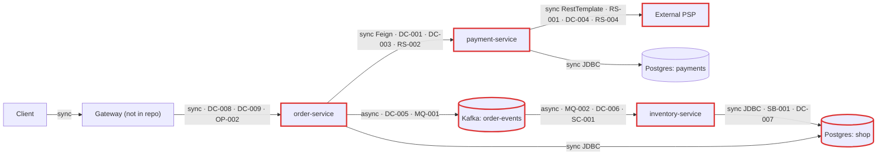
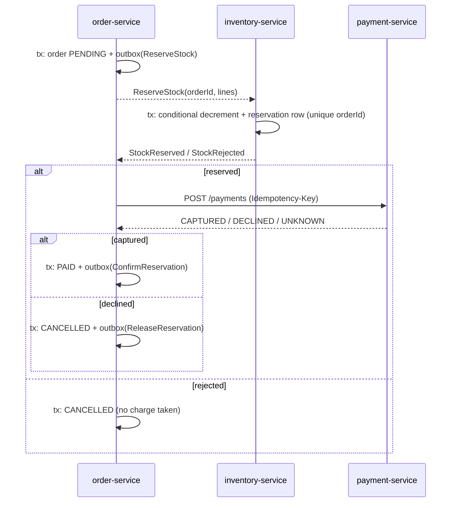
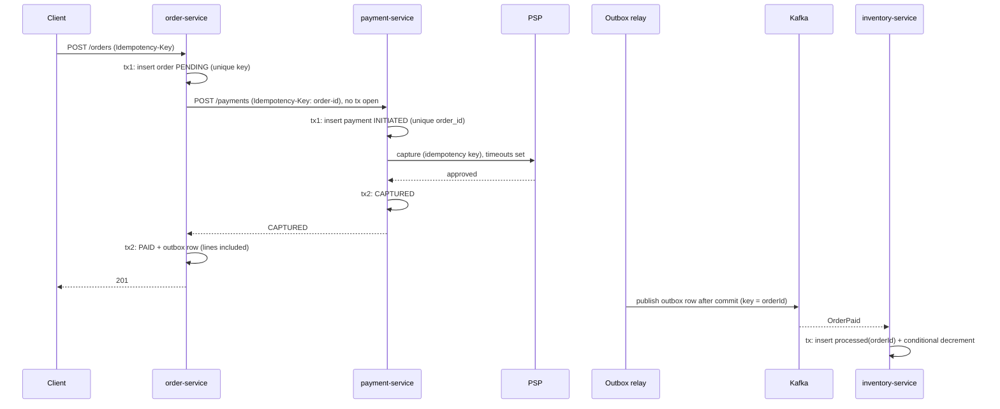

# Architecture review: Order platform (order-service, payment-service, inventory-service)

- **Mode:** hybrid (code plus the README's stated intent: 2 replicas per service, about 300 orders/min peak, 3x growth expected, teams deploy independently)
- **Date:** 2026-10-25
- **Lenses run:** scalability, persistence, operability, data-consistency, messaging, resilience, service-boundaries. None skipped. The codebase is small (25 Java files), so three grouped lens agents ran in parallel; the parent ran no lens itself.
- **Triage:** 31 candidates; 3 merged, 1 re-graded, 1 dropped, 27 findings kept (see `triage` in `architecture-findings.json` and [Not reviewed](#not-reviewed)).

## Summary

This is three Spring Boot microservices: order-service charges each order synchronously through payment-service (which calls an external PSP), then publishes `order-events` to Kafka for inventory-service, which decrements stock by reading order lines out of order-service's table in a shared database. The biggest risk is money and stock going wrong on the normal path: Feign retries the non-idempotent charge up to five times (DC-001), and checkout charges before checking stock with no compensation (DC-002). Today no stock event even deserializes, because the Kafka type header names a class only the producer has (MQ-001). The change that buys the most is restructuring checkout into short local transactions with an idempotent payment, an outbox and an idempotent stock consumer (DC-001, DC-003 to DC-006), which closes most of the high findings. The stated load (5 to 15 orders/s) poses no throughput problem, so the system can meet its scale target, but only after these correctness fixes, because each extra order is another chance to double-charge or lose a stock update.

| Severity | Count |
|---|---|
| Critical | 3 |
| High | 13 |
| Medium | 11 |
| Low | 0 |
| Info | 0 |

## Architecture profile

- **Architecture:** microservices. There are three independently deployed services, owned by three teams, that talk over HTTP (Feign) and Kafka. order-service and inventory-service share the `shop` database.
- **Stack:** Java 17, Spring Boot 3.3.4, Spring Cloud 2023.0.3 (OpenFeign), Spring Kafka (3.2 line), Spring Data JPA / Hibernate 6.5, PostgreSQL 16, Kafka 3.7 (KRaft).
- **Deployables:**
  - `order-service` (order-service/) places and reads orders. It uses db `shop` (orders, order_items), calls payment-service POST /payments via Feign with `Retryer.Default(100, 1000, 5)`, and publishes `order-events`.
  - `payment-service` (payment-service/) charges via the external PSP. It uses db `payments` and calls PSP POST /v1/captures through a bare `RestTemplate`.
  - `inventory-service` (inventory-service/) tracks stock. It uses db `shop` (stock_items, and **reads order-service's `order_items`**) and consumes `order-events` (concurrency 3, auto-commit).
- **Datastores:** one PostgreSQL 16 instance. `shop` is **shared** by order-service and inventory-service. `payments` is used by payment-service only. All three services use the same `platform` login, and schema comes from Hibernate `ddl-auto: update` everywhere.
- **Messaging:** Kafka topic `order-events` carries JSON `OrderPaidEvent{orderId, customerId, total, paidAt}`. Events are sent without a key. There is no DLT and no custom error handler.
- **Background work:** an inventory `@KafkaListener` (3 threads per pod, 2 pods). There are no schedulers or async executors.
- **Runtime:** 2 replicas per service on k8s behind a gateway, according to the README; neither is in the repo. Actuator is present but not configured. There is no tracing, no metrics registry and no graceful shutdown.
- **Stated intent:** independent team deploys; peak about 300 orders/min, tripling next year.
- **Derived load:** about 5 orders/s at today's peak, about 15 orders/s next year. Each order is 1 Feign call, 1 PSP capture and 1 Kafka message. Under payment slowness the retryer can push up to about 25 payment calls/s.
- **Key flows:**
  - Place order: client -> gateway -> order-service, all inside one `@Transactional`: insert order -> Feign -> payment-service, inside its own `@Transactional`: insert payment -> PSP capture -> commit. Back in order-service: mark PAID -> `kafkaTemplate.send` -> commit.
  - Decrement stock: `order-events` -> inventory-service -> read `order_items` from shared `shop` -> read-modify-write `stock_items`.
- **Assumptions** (nobody was available to ask):
  - Mode is hybrid because the README states intent.
  - The k8s manifests, gateway config and production Kafka topic settings live outside the repo. Production uses the docker-compose database topology.
  - The PSP's idempotency-key support and its intermediate outcomes are unknown.
  - The gateway does not rewrite `customerId` or prices.
  - The production `order-events` partition count is unknown. Locally it auto-creates with 1 partition.



## Findings

### Critical

#### MQ-001 · Every `OrderPaidEvent` fails to deserialize in inventory-service: the `__TypeId__` header names a class only order-service has

Severity: critical · Confidence: high · Lens: messaging · Effort: small

**Where:**
- `order-service/src/main/resources/application.yml:16`
- `inventory-service/src/main/resources/application.yml:19`
- `order-service/src/main/java/com/example/platform/order/events/OrderPaidEvent.java:6`
- `inventory-service/src/main/java/com/example/platform/inventory/messaging/OrderPaidEvent.java:6`

**Evidence:**
```yaml
# order-service
value-serializer: org.springframework.kafka.support.serializer.JsonSerializer
# inventory-service
value-deserializer: org.springframework.kafka.support.serializer.JsonDeserializer
properties:
  spring.json.trusted.packages: "*"
  spring.json.value.default.type: com.example.platform.inventory.messaging.OrderPaidEvent
```
The producer class is `com.example.platform.order.events.OrderPaidEvent` and the consumer class is `com.example.platform.inventory.messaging.OrderPaidEvent`. By default, JsonSerializer writes the producer's class name into `__TypeId__`, and JsonDeserializer resolves that header ahead of `value.default.type` (Spring Kafka 3.2, from memory).

**What goes wrong:** Every event carries `__TypeId__=com.example.platform.order.events.OrderPaidEvent`. inventory-service trusts the header because `trusted.packages` is `*`, tries to load that class, and throws, because the class is not on its classpath. No `ErrorHandlingDeserializer` is configured, so no record ever reaches `onOrderPaid`. The consumer either loops on the poison record or skips it. This happens on every order: stock is never decremented, and only the logs show it.

**Fix:** Stop putting Java class names on the wire (`event-versioning`). Then wrap the deserializer in `ErrorHandlingDeserializer` so a bad record reaches the DLT (MQ-002). Narrow `trusted.packages`, and add a producer/consumer contract test (MQ-003).
```yaml
# inventory-service
spring.kafka.consumer.properties:
  spring.json.use.type.headers: false
  spring.json.value.default.type: com.example.platform.inventory.messaging.OrderPaidEvent
```

**Why it's worth it here:** Producer and consumer are separate deployables, owned by different teams, and each has its own copy of the event class in a different package.

#### DC-001 · Feign retries the non-idempotent POST `/payments` up to 5 times; each attempt creates a new Payment and a new PSP capture

Severity: critical · Confidence: high · Lens: data-consistency · Effort: medium

**Where:**
- `order-service/src/main/java/com/example/platform/order/config/FeignConfig.java:13`
- `payment-service/src/main/java/com/example/platform/payment/service/PaymentService.java:24`
- `payment-service/src/main/java/com/example/platform/payment/psp/PspClient.java:34`
- `payment-service/src/main/java/com/example/platform/payment/domain/Payment.java:18`

**Evidence:**
```java
/** Payment-service is occasionally slow under load; retry so checkout doesn't fail on a blip. */
return new Retryer.Default(100, 1000, 5);
// payment-service
Payment payment = payments.save(new Payment(orderId, customerId, amount)); // id = UUID.randomUUID()
return restTemplate.postForObject(baseUrl + "/v1/captures",
        new HttpEntity<>(new CaptureRequest(customerId, amount, "EUR"), headers), ...); // no idempotency key
```
Feign turns a read timeout into a RetryableException and retries it whatever the HTTP method (OpenFeign 4.1, from memory). Nothing enforces uniqueness on `payment.order_id`, and nothing looks it up.

**What goes wrong:** payment-service is slow, which is exactly the case the code comment describes, and its PSP call has no timeout (RS-001). Feign's first attempt times out while payment-service carries on and the PSP captures the money. Feign re-sends up to 4 more times. Each attempt inserts a new Payment with a new UUID and makes another PSP capture. The customer is charged up to five times for one order, and nothing links the extra charges together. Any timeout under ordinary load triggers this.

**Fix:** `idempotency-key`. order-service sends `Idempotency-Key: order-<orderId>`. payment-service adds a unique constraint on `payment.order_id` (or on the key), returns the existing payment on a repeat, and forwards the key to the PSP if the PSP supports one. Until then, RS-002 sets `Retryer.NEVER_RETRY`. See the fixed-flow diagram under DC-005.

**Why it's worth it here:** A client-side retry is configured on a call that moves money, and the callee is known to be slow under load.

#### DC-002 · Checkout charges the card before stock is checked, and an out-of-stock or unknown SKU leaves the order `PAID` with no refund, release or cancel

Severity: critical · Confidence: high · Lens: data-consistency · Effort: large · Also reported by: resilience

**Where:**
- `inventory-service/src/main/java/com/example/platform/inventory/messaging/OrderEventsListener.java:32`
- `order-service/src/main/java/com/example/platform/order/service/OrderService.java:44`
- `order-service/src/main/java/com/example/platform/order/domain/Order.java:22`
- `payment-service/src/main/java/com/example/platform/payment/service/PaymentService.java:25`

**Evidence:**
```java
// inventory-service
if (item.getAvailable() < line.getQuantity()) {
    throw new InsufficientStockException(line.getSku(), event.orderId());
}
// order-service: charge first, never check stock
ChargeResponse payment = takePayment(order);
order.markPaid(payment.paymentId());
public enum Status { PENDING, PAID, CANCELLED }   // CANCELLED is never set
```
No service has a refund endpoint, a failure event or a compensation handler.

**What goes wrong:** A customer orders a SKU that has sold out, which is routine at peak. order-service charges the card, marks the order PAID and publishes the event. inventory-service throws, the default error handler retries and then drops the event (MQ-002), and the customer has paid for goods that were never allocated. Nothing records the failure and nothing refunds it. Because the chain is fully synchronous, any PSP incident or payment-service deploy also fails every checkout for its duration (this angle came from the resilience lens).

**Fix:** `saga-orchestration` owned by order-service:
1. Persist the order as PENDING.
2. Reserve stock in inventory-service (a reservation row per order/SKU, with an expiry).
3. Capture payment.
4. Confirm the reservation and mark the order PAID.

On a failed step, release the reservation or refund through a new payment-service refund endpoint, then set CANCELLED. Drive the steps with outbox events (DC-005) and idempotent consumers (DC-006). If the product needs a synchronous answer, keep a bounded synchronous charge, but fall back to "pending" instead of failing when the PSP is slow.



**Why it's worth it here:** Payment and stock live in separately owned services and databases (`payments` and `shop`), so no local transaction can span them, and stock-outs are a normal business event.

### High

#### DC-003 · `placeOrder` holds one DB transaction across the payment call; a later rollback leaves a captured charge with no order

Severity: high · Confidence: high · Lens: data-consistency · Effort: medium

**Where:**
- `order-service/src/main/java/com/example/platform/order/service/OrderService.java:38`
- `order-service/src/main/java/com/example/platform/order/service/OrderService.java:44`

**Evidence:**
```java
@Transactional
public Order placeOrder(String customerId, List<Line> lines) {
    ...
    orders.save(order);
    ChargeResponse payment = takePayment(order);   // Feign call inside the transaction
    order.markPaid(payment.paymentId());
    kafkaTemplate.send(ORDER_EVENTS, ...);
```

**What goes wrong:** payment-service commits and the PSP captures. Then order-service fails before its own commit. The cause can be a Feign timeout while the capture is still running, `kafkaTemplate.send` blocking and throwing during a broker outage, a failed commit, or a pod killed mid-request (OP-001). The order rolls back and the client gets a 500. The customer is charged for an order that does not exist, and will likely retry and create a second one (DC-008). The transaction also holds a `shop` connection for the whole Feign chain, up to 5 x 60 s (RS-002).

**Fix:** `move-call-outside-transaction`:
1. Commit the order as PENDING.
2. Call payment outside any transaction, with the idempotency key from DC-001.
3. In a second transaction, mark the order PAID and write the outbox row (DC-005).

Add a reconciler that re-queries payment-service by orderId for orders stuck in PENDING.

**Why it's worth it here:** The remote call has a money side effect that the local rollback cannot undo.

#### DC-004 · payment-service captures at the PSP inside the transaction that records the attempt; a rollback erases the only local trace of the charge

Severity: high · Confidence: high · Lens: data-consistency · Effort: medium

**Where:**
- `payment-service/src/main/java/com/example/platform/payment/service/PaymentService.java:22`
- `payment-service/src/main/java/com/example/platform/payment/service/PaymentService.java:25`

**Evidence:**
```java
@Transactional
public Payment charge(Long orderId, String customerId, BigDecimal amount) {
    Payment payment = payments.save(new Payment(orderId, customerId, amount));
    PspClient.CaptureResponse response = psp.capture(customerId, amount);
    if (!"approved".equals(response.outcome())) {
        throw new PaymentDeclinedException(orderId);
    }
    payment.captured(response.reference());
    return payment;
}
```

**What goes wrong:** The PSP captures, and then something fails before commit:
- the response is lost to a connection reset;
- an empty body makes `response.outcome()` throw a NullPointerException;
- the commit fails;
- the pod dies.

The INITIATED Payment row rolls back with everything else. The PSP holds a charge that payment-service has no record of, so reconciliation has nothing to match against. Declines roll back too, so declined attempts leave no record either.

**Fix:** `move-call-outside-transaction`:
1. Commit the Payment as INITIATED, keyed by orderId, in its own transaction.
2. Call the PSP outside any transaction.
3. Record CAPTURED or FAILED in a second transaction.

Reconcile rows left INITIATED against the PSP. See the diagram under DC-005.

**Why it's worth it here:** The external PSP charge cannot be rolled back and must be reconcilable.

#### DC-005 · Dual write: `kafkaTemplate.send` runs inside the JPA transaction with no outbox, its result is ignored, and the event can arrive before the order commits

Severity: high · Confidence: high · Lens: data-consistency · Effort: medium

**Where:**
- `order-service/src/main/java/com/example/platform/order/service/OrderService.java:47`
- `inventory-service/src/main/java/com/example/platform/inventory/messaging/OrderEventsListener.java:29`

**Evidence:**
```java
kafkaTemplate.send(ORDER_EVENTS, new OrderPaidEvent(order.getId(), customerId, order.getTotal(), Instant.now()));
// returned CompletableFuture discarded; still inside @Transactional placeOrder
// inventory-service
for (OrderLine line : orderLines.findByOrderId(event.orderId())) { ... }   // empty result treated as success
log.info("Stock decremented for order {}", event.orderId());
```

**What goes wrong:**
- **(a) Lost event.** The broker is down after the DB commits. The order is PAID and charged, but the event is lost and stock never moves.
- **(b) Phantom event.** The send succeeds and the commit then fails. inventory-service receives an event for an order that does not exist.
- **(c) Event before commit.** The event is sent before the commit, so a fast consumer queries `order_items` before the rows are visible. It reads nothing, logs "Stock decremented", and commits the offset. The decrement is silently skipped.

**Fix:** `transactional-outbox`. Insert the event into an `outbox` table in the same transaction as `markPaid`, and publish it after commit with a polling relay or Debezium, keyed by orderId. Carry the order lines in the event (SB-001), and treat an empty line set as an error.


This flow covers DC-001, DC-003, DC-004, DC-005, DC-006, DC-007 and DC-008.

**Why it's worth it here:** inventory-service is only correct if every paid order's event is delivered, and delivered after the order is durable.

#### DC-006 · The inventory listener is not idempotent: a redelivered `OrderPaidEvent` decrements stock twice

Severity: high · Confidence: high · Lens: data-consistency · Effort: small

**Where:**
- `inventory-service/src/main/java/com/example/platform/inventory/messaging/OrderEventsListener.java:35`
- `inventory-service/src/main/resources/application.yml:16`

**Evidence:**
```java
item.setAvailable(item.getAvailable() - line.getQuantity());   // no processed-event guard
```
```yaml
enable-auto-commit: true   # commits every 5 s by default
```

**What goes wrong:** A pod processes events and commits the decrements, then is killed before the next auto-commit. A rebalance hands its partitions to another consumer, which resumes from the last committed offset and decrements the same orders again. Stock reads lower than reality.

**Fix:** `idempotent-consumer`. Insert `processed_order_events(order_id PRIMARY KEY)` in the same transaction as the decrement, and skip the work on a duplicate key. Set `enable-auto-commit: false` so offsets are committed after processing.

**Why it's worth it here:** Kafka delivers at least once, and the handler applies a non-idempotent decrement.

#### DC-007 · Lost update on `stock_items.available`: read-modify-write in Java with no lock, version or conditional update

Severity: high · Confidence: medium · Lens: data-consistency · Effort: small

**Where:**
- `inventory-service/src/main/java/com/example/platform/inventory/messaging/OrderEventsListener.java:30`
- `inventory-service/src/main/java/com/example/platform/inventory/domain/StockItem.java:14`
- `inventory-service/src/main/resources/application.yml:24`

**Evidence:**
```java
StockItem item = stock.findById(line.getSku())...;
if (item.getAvailable() < line.getQuantity()) { throw ... }
item.setAvailable(item.getAvailable() - line.getQuantity());   // no @Version, no lock
```
The listener runs with `concurrency: 3` on 2 pods, and events are sent without a key.

**What goes wrong:** Two orders for the same SKU land on different partitions. Two threads each read available=10, each subtract their own quantity, and each write back an absolute value. One decrement is lost, and the SKU oversells. Confidence is medium because the production partition count is unknown. With 1 partition (SC-001) the race cannot happen, so fixing SC-001 turns it on.

**Fix:** `atomic-conditional-update`. Treat 0 rows updated as insufficient stock, and process lines in sorted SKU order.
```java
@Modifying
@Query("update StockItem s set s.available = s.available - :q where s.sku = :sku and s.available >= :q")
int decrement(@Param("sku") String sku, @Param("q") int q);
```

**Why it's worth it here:** Stock rows are hot rows, updated by several consumer threads across 2 replicas at 5 to 15 orders/s.

#### DC-008 · POST `/orders` has no idempotency key: a client or gateway retry creates a second order and a second charge

Severity: high · Confidence: medium · Lens: data-consistency · Effort: small

**Where:** `order-service/src/main/java/com/example/platform/order/api/OrderController.java:39`

**Evidence:**
```java
@PostMapping
public ResponseEntity<OrderView> place(@RequestBody PlaceOrderRequest request) {
    Order order = orderService.placeOrder(request.customerId(), request.lines());
```

**What goes wrong:** Checkout is slow (minutes under Feign retries, RS-002), so the gateway times out or the user double-submits. Each retry creates a new order with a new id, so even DC-001's payment-side key does not catch it. The customer is charged twice. Confidence is medium because the gateway's retry policy is not in the repo.

**Fix:** `idempotency-key`. Store an `Idempotency-Key` header or client order reference on the order, with a unique constraint, and return the existing order on a repeat.

**Why it's worth it here:** The endpoint triggers a charge, and it sits behind clients and a gateway that can retry.

#### DC-009 · Price and quantity come from the client unvalidated: the caller sets its own charge, and a negative quantity adds stock

Severity: high · Confidence: medium · Lens: data-consistency · Effort: medium

**Where:**
- `order-service/src/main/java/com/example/platform/order/api/OrderController.java:30`
- `order-service/src/main/java/com/example/platform/order/service/OrderService.java:35`
- `order-service/src/main/java/com/example/platform/order/domain/Order.java:46`

**Evidence:**
```java
public record PlaceOrderRequest(String customerId, List<OrderService.Line> lines) {}   // no @Valid
public record Line(String sku, int quantity, BigDecimal unitPrice) {}
total = total.add(unitPrice.multiply(BigDecimal.valueOf(quantity)));   // becomes the PSP amount
```

**What goes wrong:** A caller sends `unitPrice: 0.01`, a negative quantity, or an empty `lines` list. The card is charged whatever total that produces. A negative quantity passes the stock check, and the decrement then adds stock. Confidence is medium because a gateway or BFF outside the repo might reprice requests.

**Fix:** `input-validation`. Use `@Valid`, `@NotEmpty` lines, `@Positive` quantity and `@NotBlank` sku, and price on the server from a catalog instead of trusting `unitPrice`.

**Why it's worth it here:** The request values feed both the amount charged to the card and the stock arithmetic.

#### MQ-002 · No DLT or error handler on `order-events`: a failed event is retried 10 times with no delay, then dropped

Severity: high · Confidence: high · Lens: messaging · Effort: small

**Where:**
- `inventory-service/src/main/resources/application.yml` (missing DefaultErrorHandler / DeadLetterPublishingRecoverer / ErrorHandlingDeserializer)
- `inventory-service/src/main/java/com/example/platform/inventory/messaging/OrderEventsListener.java:26`

**Evidence:**
```java
@KafkaListener(topics = "order-events")
```
The repo has no `DefaultErrorHandler` bean, no `DeadLetterPublishingRecoverer`, no `@RetryableTopic` and no `ErrorHandlingDeserializer`. The Boot default is `FixedBackOff(0, 9)`, then log and skip (Spring Kafka 3.2, from memory).

**What goes wrong:** A Postgres failover or a pool exhaustion makes all 10 attempts fail within milliseconds. The record is skipped and its offset committed, so that order's stock never moves and there is nothing to replay. Business failures (insufficient stock, unknown SKU) take the same path and leave no durable record to drive compensation.

**Fix:** `dead-letter-queue`. Configure a `DefaultErrorHandler` with exponential backoff and a `DeadLetterPublishingRecoverer` to `order-events.DLT`. Mark business exceptions as not retryable. Provide a replay tool, and alert on DLT depth (OP-004).

**Why it's worth it here:** Each event is a business-critical stock change with no other recovery path.

#### RS-001 · The PSP `RestTemplate` has no connect or read timeout; a hung PSP pins payment-service's threads and DB connections until restart

Severity: high · Confidence: high · Lens: resilience · Effort: small

**Where:**
- `payment-service/src/main/java/com/example/platform/payment/config/HttpClientConfig.java:12`
- `payment-service/src/main/java/com/example/platform/payment/psp/PspClient.java:34`
- `payment-service/src/main/java/com/example/platform/payment/service/PaymentService.java:22`

**Evidence:**
```java
@Bean
public RestTemplate restTemplate() {
    return new RestTemplate();   // SimpleClientHttpRequestFactory, timeouts unset: waits forever
}
```

**What goes wrong:** The PSP accepts connections but stalls. Each charge blocks forever while holding a thread and one of 10 Hikari connections (the call runs inside `@Transactional`). The pool is pinned within seconds, new charges fail after 30 s, and payment-service stays down until its pods restart. Checkout is down with it.

**Fix:** `timeouts`. Keep the PSP timeout below order-service's Feign read timeout, which in turn stays below the gateway timeout. Treat a read timeout as an unknown outcome (RS-004).
```java
@Bean
RestTemplate restTemplate(RestTemplateBuilder b) {
    return b.setConnectTimeout(Duration.ofSeconds(1)).setReadTimeout(Duration.ofSeconds(8)).build();
}
```

**Why it's worth it here:** This applies always: the PSP call is on the only revenue path, on a request thread that holds a DB connection.

#### RS-002 · order-service's Feign client uses the 60 s read-timeout default and 5 unjittered retries, holding a connection up to about 5 minutes and multiplying load on a degraded payment-service

Severity: high · Confidence: high · Lens: resilience · Effort: small

**Where:**
- `order-service/src/main/resources/application.yml` (missing `spring.cloud.openfeign.client.config.payment-service` connectTimeout/readTimeout)
- `order-service/src/main/java/com/example/platform/order/config/FeignConfig.java:13`
- `order-service/src/main/java/com/example/platform/order/OrderServiceApplication.java:9`
- `order-service/src/main/java/com/example/platform/order/service/OrderService.java:38`

**Evidence:**
```java
@EnableFeignClients(defaultConfiguration = FeignConfig.class)
...
return new Retryer.Default(100, 1000, 5);
```
`application.yml` sets only `clients.payment-service.url`. The defaults are 10 s connect and 60 s read (OpenFeign 4.1, from memory), and the backoff has no jitter.

**What goes wrong:** payment-service hangs, for example in the RS-001 scenario. Each POST /orders waits up to about 5 minutes while holding a thread and a `shop` connection. The pool fills in seconds, and GET /orders/{id} fails too. Every timed-out call is re-sent, so payment-service and the PSP get up to 5x the in-flight work, in synchronized waves from both replicas. The gateway gives up first, so the client sees a 504 while charging continues (DC-001), and then the client retries (DC-008).

**Fix:** `timeouts` and `retry-with-backoff`. Set `Retryer.NEVER_RETRY` now (stopgap for DC-001). Once POST /payments is idempotent, allow 2 to 3 attempts with jittered backoff behind a circuit breaker (RS-003), and retry at one layer only.
```yaml
spring.cloud.openfeign.client.config.payment-service:
  connectTimeout: 1000
  readTimeout: 10000   # above payment-service's PSP timeout, below the gateway timeout
```

**Why it's worth it here:** A synchronous call on the order path holds a DB connection behind a gateway with its own timeout, and its retry has side effects.

#### SB-001 · inventory-service maps and reads order-service's `order_items` table in the shared `shop` database, and runs schema updates against it

Severity: high · Confidence: high · Lens: service-boundaries · Effort: medium · Also reported by: persistence

**Where:**
- `inventory-service/src/main/java/com/example/platform/inventory/domain/OrderLine.java:14`
- `inventory-service/src/main/resources/application.yml:5`
- `inventory-service/src/main/resources/application.yml:10`
- `order-service/src/main/resources/application.yml:5`
- `order-service/src/main/java/com/example/platform/order/domain/OrderItem.java:18`
- `inventory-service/src/main/java/com/example/platform/inventory/messaging/OrderEventsListener.java:29`
- `docker-compose.yml:34`

**Evidence:**
```java
@Entity @Immutable @Table(name = "order_items")
public class OrderLine { @Id private Long id; @Column(name = "order_id") private Long orderId; ... }
// order-service OrderItem
@Id @GeneratedValue(strategy = GenerationType.IDENTITY) private Long id;
```
```yaml
url: ${SPRING_DATASOURCE_URL:jdbc:postgresql://localhost:5432/shop}   # both services
ddl-auto: update                                                    # both services
```
The README assigns `order-service` to the Checkout team and `inventory-service` to the Warehouse team, and says "Each team deploys on its own schedule."

**What goes wrong:**
- **Schema change by Checkout.** The Checkout team changes `order_items` (renames `quantity`, moves lines to JSONB). After their deploy, inventory's query fails on every event, each event is dropped (MQ-002), and stock stops moving until the Warehouse team ships a matching mapping.
- **Inventory writes DDL.** inventory's own `ddl-auto: update` alters a table it does not own.
- **Fresh environment.** In a new environment where inventory-service boots first, Hibernate creates `order_items.id` with no identity. Every order insert then fails with a NOT NULL violation, so checkout is down (this angle came from the persistence lens).

**Fix:** `database-per-service`. Carry what inventory needs in the event (`lines: [{sku, quantity}]`) and delete `OrderLine` and `OrderLineRepository`. Then give inventory its own database or schema and credentials, with no grants on order-service's tables. Stopgap today: set inventory-service to `ddl-auto: validate`.

**Why it's worth it here:** The two services are owned by different teams that deploy on independent schedules, as the README states.

#### OP-001 · No graceful shutdown (Boot 3.3 defaults to immediate), so every rolling deploy can cut in-flight orders after the PSP has captured

Severity: high · Confidence: medium · Lens: operability · Effort: small

**Where:**
- `order-service/src/main/resources/application.yml` (missing `server.shutdown=graceful`)
- `payment-service/src/main/resources/application.yml` (missing `server.shutdown=graceful`)
- `order-service/Dockerfile:3`

**Evidence:**
```dockerfile
ENTRYPOINT ["java", "-jar", "/app.jar"]
```
No application.yml sets `server.shutdown` or a lifecycle timeout. Boot 3.3.4 defaults to `immediate`; graceful became the default only in 3.4 (from memory). The README says "Production runs 2 replicas of each service on k8s."

**What goes wrong:** A rollout sends SIGTERM to a pod with orders in flight. At peak, a few always are. The capture has already succeeded, but the payment and order rows roll back and the client gets a connection reset. The customer is charged with no order. Three teams deploying independently repeat this many times a week. Confidence is medium because a preStop hook outside the repo would narrow the window.

**Fix:** `graceful-shutdown`. Also add a preStop sleep and a `terminationGracePeriodSeconds` above the drain timeout. This narrows the window; DC-003 and DC-004 close it.
```yaml
server.shutdown: graceful
spring.lifecycle.timeout-per-shutdown-phase: 30s
```

**Why it's worth it here:** These are rolling deploys on k8s with 2 replicas, by three teams on independent schedules, on a flow that moves money.

#### OP-002 · Order and payment endpoints trust a caller-supplied `customerId`, and POST `/payments` has no service authentication

Severity: high · Confidence: medium · Lens: operability · Effort: medium

**Where:**
- `order-service/src/main/java/com/example/platform/order/api/OrderController.java:30`
- `payment-service/src/main/java/com/example/platform/payment/api/PaymentController.java:28`
- `payment-service/src/main/java/com/example/platform/payment/service/PaymentService.java:25`

**Evidence:**
```java
public record PlaceOrderRequest(String customerId, List<OrderService.Line> lines) {}
@PostMapping
public ChargeResponse charge(@RequestBody ChargeRequest request)   // customerId and amount go straight to psp.capture
```
No pom.xml includes Spring Security.

**What goes wrong:** If the gateway does not overwrite `customerId` from the token, any logged-in user can charge another customer's stored payment method. If anything can reach payment-service directly, an unauthenticated caller can trigger real PSP captures for any customer and amount. Confidence is medium because the gateway routes and NetworkPolicies are outside the repo.

**Fix:** `api-gateway`. Derive `customerId` from the authenticated principal. Keep payment-service off the gateway, restrict it with a NetworkPolicy, and add service-to-service authentication (mTLS or signed tokens). Follow up with a security review.

**Why it's worth it here:** These endpoints move money based on an identity taken from the request body, and the auth boundary lives outside the repo.

### Medium

#### RS-003 · No circuit breaker around payment-service or the PSP; during an outage every order waits out the full timeout

Severity: medium · Confidence: medium · Lens: resilience · Effort: medium

**Where:** `order-service/pom.xml` (missing spring-cloud-starter-circuitbreaker-resilience4j), `payment-service/pom.xml` (missing resilience4j circuit breaker around PspClient)

**Evidence:**
```text
No Resilience4j / Spring Cloud CircuitBreaker dependency, no @CircuitBreaker,
spring.cloud.openfeign.circuitbreaker.enabled not set, no mesh config in the repo.
```

**What goes wrong:** During a PSP outage lasting minutes, even with timeouts every order ties up threads and connections for the full timeout. The PSP keeps getting full traffic while it tries to recover, and users wait instead of getting a fast "payments unavailable".

**Fix:** `circuit-breaker`. Add Resilience4j around PspClient and on the Feign PaymentClient, with failure-rate and slow-call thresholds, and fail fast with a typed error while the breaker is open. Skip this if a mesh outlier-detection policy already exists outside the repo.

**Why it's worth it here:** Two independent synchronous dependencies sit on the order path at 5 to 15 orders/s.

#### RS-004 · Payment outcomes are unclassified: every non-`approved` result is a decline, and declines reach the client as HTTP 500

Severity: medium · Confidence: medium · Lens: resilience · Effort: medium

**Where:**
- `payment-service/src/main/java/com/example/platform/payment/service/PaymentService.java:26`
- `payment-service/src/main/java/com/example/platform/payment/psp/PspClient.java:34`
- `order-service/src/main/java/com/example/platform/order/service/OrderService.java:44`

**Evidence:**
```java
if (!"approved".equals(response.outcome())) {
    throw new PaymentDeclinedException(orderId);   // 402
}
// order-service: ChargeResponse payment = takePayment(order);  // no handling: 402 and 500 both become a 500
```

**What goes wrong:** If the PSP returns an intermediate outcome such as pending (its API is not in the repo), payment-service reports a decline and erases the attempt, while the charge may still complete later. A real decline reaches the client as a 500, so the client retries a declined card, and genuine transient failures carry no retry signal.

**Fix:** `graceful-degradation`. Map PSP responses to APPROVED, DECLINED or UNKNOWN, and persist UNKNOWN as PENDING_CONFIRMATION for reconciliation (this builds on DC-004). In order-service, map a decline to 402 or 422 and "payment unavailable" to 503 with Retry-After.

**Why it's worth it here:** Money moves through an external PSP whose responses can be lost or intermediate, and clients act on the HTTP status.

#### SB-002 · order-service marks orders PAID without reading `ChargeResponse.status`, and no contract test guards the payment API between two teams

Severity: medium · Confidence: medium · Lens: service-boundaries · Effort: small

**Where:**
- `order-service/src/main/java/com/example/platform/order/service/OrderService.java:45`
- `order-service/src/main/java/com/example/platform/order/client/PaymentClient.java:18`

**Evidence:**
```java
ChargeResponse payment = takePayment(order);
order.markPaid(payment.paymentId());           // payment.status() never read
record ChargeResponse(String paymentId, String status) {}   // hand-copied from payment-service
```

**What goes wrong:** The Payments team starts returning 200 with status INITIATED or FAILED (for 3DS or async flows). order-service keeps marking those orders PAID, and inventory allocates stock for unpaid orders. Nothing fails at build time.

**Fix:** `consumer-driven-contracts`. Treat only `CAPTURED` as paid, and add Spring Cloud Contract or Pact tests for POST /payments, verified in the Payments pipeline.

**Why it's worth it here:** Two teams deploy the caller and the callee of a money-moving API on independent schedules.

#### MQ-003 · The `OrderPaidEvent` contract is unversioned and hand-copied into each independently deployed service

Severity: medium · Confidence: high · Lens: messaging · Effort: medium

**Where:**
- `order-service/src/main/java/com/example/platform/order/events/OrderPaidEvent.java:6`
- `inventory-service/src/main/java/com/example/platform/inventory/messaging/OrderPaidEvent.java:6`

**Evidence:**
```java
public record OrderPaidEvent(Long orderId, String customerId, BigDecimal total, Instant paidAt) {}   // both services
```

**What goes wrong:** After MQ-001 is fixed, the Checkout team renames or retypes a field and deploys first. inventory-service then fails on the new payload or reads the changed field as null. One team's deploy breaks the other team's stock processing.

**Fix:** `event-versioning`. Add `eventType` and `version` fields, use tolerant readers and additive changes only, and publish a JSON Schema or Avro schema with compatibility checks in CI.

**Why it's worth it here:** The producer and consumer belong to different teams that deploy independently.

#### PS-001 · Schema managed by Hibernate `ddl-auto: update` in all three services, with no Flyway or Liquibase

Severity: medium · Confidence: high · Lens: persistence · Effort: medium

**Where:**
- `order-service/src/main/resources/application.yml:10`
- `payment-service/src/main/resources/application.yml:10`
- `inventory-service/src/main/resources/application.yml:10`
- `order-service/pom.xml` (missing flyway-core / liquibase dependency)

**Evidence:**
```yaml
jpa:
  hibernate:
    ddl-auto: update
```

**What goes wrong:** A field rename adds a new column and leaves the old one, so environments drift apart with no reviewed change. The constraints and indexes that other fixes need (unique `payment.order_id`, an index on `order_items.order_id`) cannot be managed reliably. Both replicas run DDL on every deploy, and there is no rollback.

**Fix:** `versioned-migrations`. Add Flyway per service with a baseline, switch to `ddl-auto: validate`, and use expand/contract for renames.

**Why it's worth it here:** These are production services holding money and stock data, deployed by separate teams on their own schedules.

#### PS-002 · `order_items.order_id` has no index, so every `order-events` message scans a table that grows with every order

Severity: medium · Confidence: high · Lens: persistence · Effort: small

**Where:**
- `inventory-service/src/main/java/com/example/platform/inventory/domain/OrderLineRepository.java:9`
- `order-service/src/main/java/com/example/platform/order/domain/OrderItem.java:21`

**Evidence:**
```java
List<OrderLine> findByOrderId(Long orderId);
@ManyToOne @JoinColumn(name = "order_id") private Order order;   // no index; Postgres doesn't index FKs
```

**What goes wrong:** `order_items` grows by millions of rows a year. Each event does a sequential scan, handler latency rises month by month, and on a single partition (SC-001) consumer lag builds through every peak.

**Fix:** `add-index`. Run `CREATE INDEX CONCURRENTLY ON order_items(order_id)` in an order-service migration.

**Why it's worth it here:** The lookup runs for every paid order, against a table that grows with order volume.

#### PS-003 · Default Hikari pool of 10 per pod is sized against neither the shared Postgres connection limit nor transactions held across remote calls

Severity: medium · Confidence: medium · Lens: persistence · Effort: small

**Where:** `order-service/src/main/resources/application.yml` and `payment-service/src/main/resources/application.yml` (missing `spring.datasource.hikari` sizing), `docker-compose.yml:2`

**Evidence:**
```yaml
postgres:
  image: postgres:16     # default max_connections 100; no spring.datasource.hikari.* anywhere (pool 10, timeout 30 s)
```

**What goes wrong:** Scaling toward 6 replicas per service for the expected 3x load asks for 180 connections against about 97 usable, so new pods fail during scale-out or deploy surges. Within a pod, transactions held across PSP calls (DC-003, DC-004) mean any PSP slowdown at 15 orders/s exhausts the 10-connection pool. Confidence is medium because the production database limits are not in the repo.

**Fix:** `connection-pool-sizing`. Set an explicit pool size and timeout from a connection budget, use one DB user per service with a connection limit, and add PgBouncer before scaling replicas.

**Why it's worth it here:** Several replicated services share one Postgres instance, and load is expected to triple.

#### SC-001 · `order-events` is never declared and auto-creates with 1 partition, so 5 of the 6 listener threads sit idle

Severity: medium · Confidence: medium · Lens: scalability · Effort: small

**Where:**
- `inventory-service/src/main/resources/application.yml:24`
- `order-service/src/main/java/com/example/platform/order/service/OrderService.java:47`
- `docker-compose.yml:10`

**Evidence:**
```yaml
listener:
  concurrency: 3     # no NewTopic bean or topic manifest; broker default num.partitions=1
```

**What goes wrong:** Only one consumer thread across both pods ever gets work. Its latency grows with `order_items` (PS-002), and as volume triples it falls behind at peak. Adding pods does not help. Confidence is medium because the production topic settings are not in the repo.

**Fix:** `consumer-concurrency`. Declare the topic with 6 to 12 partitions and key messages by orderId, after DC-007 is fixed.

**Why it's worth it here:** The configured concurrency is meant to give parallelism on the stock flow while load triples.

#### OP-003 · No distributed tracing or correlation id across order -> payment -> PSP -> Kafka -> inventory

Severity: medium · Confidence: high · Lens: operability · Effort: small

**Where:** `order-service/pom.xml`, `payment-service/pom.xml`, `inventory-service/pom.xml` (missing micrometer-tracing / OpenTelemetry dependency)

**Evidence:**
```java
log.info("Order {} placed and paid ({})", order.getId(), payment.paymentId());   // no trace id; no tracing dependency
```

**What goes wrong:** A "charged but no order" or "stock never moved" report (DC-001 to DC-005) means grepping three services' logs by timestamp. Retries, rollbacks and redeliveries cannot be reconstructed, and recovery takes hours.

**Fix:** `distributed-tracing`. Add Micrometer Tracing with an OTel exporter to all three services, enable Kafka template and listener observation, and put trace ids in the logs.

**Why it's worth it here:** Three deployables, owned by three teams, take part in every order.

#### OP-004 · No metrics registry or alerts: consumer lag, PSP latency and errors, and pool saturation are invisible

Severity: medium · Confidence: high · Lens: operability · Effort: small

**Where:** `order-service/pom.xml`, `payment-service/pom.xml` (missing micrometer-registry-prometheus), `inventory-service/src/main/resources/application.yml` (missing management.endpoints / metrics config)

**Evidence:**
```text
spring-boot-starter-actuator present; no micrometer-registry-*; no management.* config (only /actuator/health exposed)
```

**What goes wrong:** PSP slowness, pool saturation, a stalled consumer (MQ-001) or dropped events (MQ-002) page nobody. Customers find these problems as failed checkouts or oversold stock.

**Fix:** `metrics-and-alerts`. Add Prometheus, and alert on RED metrics for /orders and /payments, PSP latency and error rate, Hikari pending connections, consumer lag and DLT depth. Add a counter of orders paid versus stock decremented.

**Why it's worth it here:** These production services carry a money and stock flow, and load is expected to triple.

#### OP-005 · One shared datasource login, `platform/platform`, committed in every service's `application.yml`

Severity: medium · Confidence: medium · Lens: operability · Effort: small

**Where:**
- `order-service/src/main/resources/application.yml:6`
- `payment-service/src/main/resources/application.yml:6`
- `inventory-service/src/main/resources/application.yml:6`

**Evidence:**
```yaml
username: platform
password: platform     # literal; compare api-key: ${PSP_API_KEY}
```

**What goes wrong:** Unless production overrides these (not visible), anyone with repo access holds a superuser login for `shop` and `payments`. Even with overrides, one login shared by three teams lets any service write another team's tables, which is what makes SB-001 possible, and rotating it needs a coordinated deploy.

**Fix:** `secrets-manager`. Take credentials from k8s Secrets, use one least-privilege user per service, and rotate the current password.

**Why it's worth it here:** The credential reaches payment and customer data and is shared by three teams.

## Roadmap

**Now**
1. MQ-001: stop resolving the `__TypeId__` header on the consumer and add `ErrorHandlingDeserializer`. Unblocks nothing (but ship it together with DC-006 and MQ-002, since stock processing starts working again).
2. RS-002: set Feign connect and read timeouts and `Retryer.NEVER_RETRY` (stopgap for DC-001). Unblocks nothing.
3. DC-004: record the payment attempt in its own transaction and call the PSP outside it. Unblocks DC-001.
4. DC-001: add an idempotency key on POST /payments, with a unique `payment.order_id`. Unblocks nothing.
5. DC-003: split `placeOrder` into PENDING -> charge -> PAID local transactions. Unblocks DC-005 and DC-002.
6. DC-005: add a transactional outbox for `order-events`, keyed by orderId and carrying the lines. Unblocks DC-002.
7. DC-006: add an idempotent consumer (processed-event table) and container-managed offset commits. Unblocks DC-002.
8. DC-007: use an atomic conditional stock decrement. Unblocks SC-001.
9. RS-001: add PSP connect and read timeouts. Unblocks nothing.
10. MQ-002: add `DefaultErrorHandler` with backoff and a DLT, and make business exceptions non-retryable. Unblocks nothing.
11. DC-008: add an idempotency key on POST /orders. Unblocks nothing.
12. DC-009: validate order input and price on the server. Unblocks nothing.
13. SB-001: set inventory `ddl-auto: validate` today, then move lines into the event and drop the `order_items` mapping. Unblocks nothing.
14. OP-001: enable graceful shutdown and add a preStop drain. Unblocks nothing.
15. OP-002: take `customerId` from the principal and lock down payment-service. Unblocks nothing.

**Next**
1. DC-002: build the checkout saga with stock reservation and compensation (refund or release, CANCELLED). Unblocks nothing.
2. PS-001: add Flyway migrations and switch to `ddl-auto: validate`. Unblocks PS-002.
3. PS-002: index `order_items(order_id)` concurrently. Unblocks nothing.
4. RS-003: add Resilience4j circuit breakers on PaymentClient and PspClient. Unblocks nothing.
5. RS-004: classify payment outcomes, persist UNKNOWN for reconciliation, and map declines to 402/422. Unblocks nothing.
6. SB-002: check `ChargeResponse.status` and add consumer-driven contract tests. Unblocks nothing.
7. MQ-003: version the event schema and add a CI compatibility check. Unblocks nothing.
8. PS-003: size the connection budget per service and add PgBouncer before scaling. Unblocks nothing.
9. SC-001: declare `order-events` with 6 to 12 partitions. Unblocks nothing.
10. OP-003: add Micrometer Tracing / OTel across HTTP and Kafka. Unblocks nothing.
11. OP-004: add a Prometheus registry and alerts on lag, DLT, PSP and pool. Unblocks nothing.
12. OP-005: externalize DB credentials and use one least-privilege user per service. Unblocks nothing.

**Later**
- Nothing.

## What's already sound

- Open Session in View is disabled (`open-in-view: false`) in all three services, so no lazy loading leaks into the web layer.
- payment-service has its own `payments` database; money data is not shared with the other services.
- The PSP API key is externalized (`api-key: ${PSP_API_KEY}`), not committed.
- Controllers return purpose-built DTOs (`OrderView`, `ChargeResponse`), and the topic carries a record, not JPA entities, so internal models do not leak across the HTTP or event boundaries.
- The stock decrement is already asynchronous over Kafka, so warehouse slowness never blocks checkout.
- No XA/2PC or chained transaction manager is attempted across services.
- The service split matches three teams with independent deploy schedules. It is not a premature split.
- Services hold no instance-local state, files or caches, and there are no schedulers, so state does not limit horizontal scaling.
- Money is modelled as `BigDecimal` end to end, not floating point.

## Not reviewed

- **Outside the repo:** the k8s manifests (probes, resources, PDBs, preStop, replica counts), the gateway configuration (auth, retries, timeouts, price handling), the production Kafka topic configuration, and production database limits. Findings that depend on them carry medium confidence and say what would have to exist.
- **The PSP's API contract:** idempotency-key support and intermediate outcomes.
- **Security in depth:** authentication, authorization, secrets handling and supply chain were reviewed only where they shape the architecture (OP-002, OP-005). Run a dedicated security review.
- **Tests:** there are none in the repo, so no test command could be run.
- **Merged candidates** (folded into another finding):
  - resilience "Feign `Retryer.Default(100, 1000, 5)` multiplies load 5x..." went into RS-002 (same client config and fix).
  - resilience "Order placement blocks on a synchronous chain..." went into DC-002 (same fix: the saga).
  - persistence "Two services run `ddl-auto: update` against the shared `order_items` table..." went into SB-001 (closed by removing inventory's mapping; the stopgap is in SB-001).
- **Re-graded:** resilience "Payment outcomes are unclassified..." went from high to medium as RS-004. Its money-loss scenario is closed by DC-004; what remains depends on the PSP API or is a wrong signal rather than wrong money.
- **Dropped:** operability "No liveness or readiness probe configuration...". It had low confidence, the failure depends entirely on manifests that are not in the repo, and Spring Boot auto-enables separate liveness and readiness groups on k8s. Check the manifests: liveness should target `/actuator/health/liveness`, not the aggregate `/actuator/health`.
