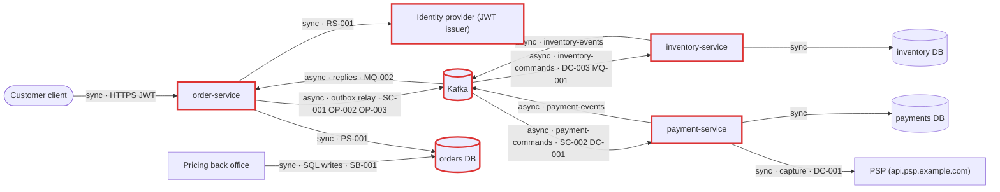
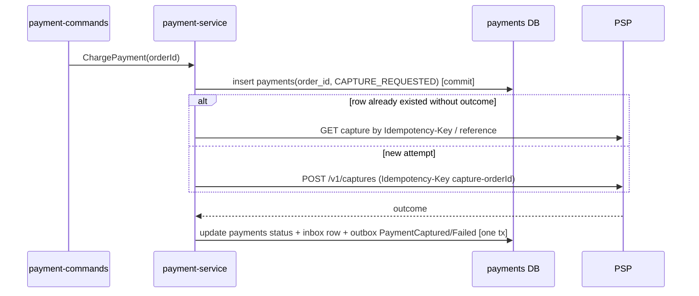

# Architecture review: Order platform (v2)

- **Mode**: hybrid (the code, checked against the README's stated scale and team ownership)
- **Date**: 2026-10-25
- **Lenses run**: scalability, persistence, operability, data-consistency, messaging, resilience, service-boundaries. None were skipped: there are three deployables, three datastores, a Kafka broker and a third-party PSP.
- **Execution**: three parallel lens agents (data-consistency + messaging, resilience + service-boundaries, scalability + persistence + operability). The parent ran no lens itself.
- **Triage**: 21 candidates; 1 merged, 1 dropped, 0 re-graded. One confidence was lowered (PS-001, from medium to low).

## Summary

The platform is three Spring Boot services, each with its own Postgres database: order-service (an orchestrator), inventory-service and payment-service. They run a place-order saga over Kafka through per-service transactional outboxes and idempotent inboxes. The core consistency design is sound: outbox, inbox, state-guarded saga transitions, compensation, the PSP call outside transactions, atomic stock decrements and idempotent order creation are all in place. The review found no critical issues. The biggest risk is order-service's JWT validation: the issuer and JWKS fetch run without HTTP timeouts on the request thread, so an identity-provider stall can hang every pod and its health probes. The change that buys the most is one small bean, a `JwtDecoder` with timeouts and a direct `jwk-set-uri` (RS-001). The system can meet its stated intent (3 replicas, ~5 orders/s today and ~15/s next year). The tightest margins at 3x load are the single-threaded outbox relay (SC-001) and the 12-way `payment-commands` concurrency (SC-002), and both are cheap to widen ahead of time.

| Severity | Count |
|---|---|
| Critical | 0 |
| High | 1 |
| Medium | 9 |
| Low | 9 |
| Info | 0 |

## Architecture profile

- **Architecture**: microservices. Three independently deployed Spring Boot services, each with its own Postgres database, coordinating over Kafka.
- **Summary**: order-service takes customer orders and orchestrates reserve stock, charge payment and compensate, with inventory-service (stock, reservations) and payment-service (captures through an external PSP).
- **Stack**: Java 17, Spring Boot 3.3.4, Spring Data JPA, Spring Kafka on Kafka 3.7, PostgreSQL 16 with Flyway, ShedLock 5.16.0, Resilience4j 2.2.0 (payment-service), Micrometer Tracing (OTel) and Prometheus, Spring Security OAuth2 resource server (order-service).
- **Deployables**:
  - order-service (`order-service/`): REST `POST/GET /orders` behind JWT; saga orchestrator (`OrderSaga`, `SagaReplyListener`, `SagaWatchdog`); outbox relay. db=orders. Publishes inventory-commands, payment-commands and order-events; consumes inventory-events and payment-events.
  - inventory-service (`inventory-service/`): stock and reservations. db=inventory. Publishes inventory-events; consumes inventory-commands.
  - payment-service (`payment-service/`): PSP captures through a RestClient with a circuit breaker, retry and Idempotency-Key. db=payments. Publishes payment-events; consumes payment-commands (concurrency 4).
- **Datastores**: Postgres databases `orders`, `inventory` and `payments`, one per service, on one server in docker-compose. `price_list` in `orders` is also written by an external pricing back office.
- **Messaging**: Kafka topics inventory-commands, payment-commands, order-events, inventory-events and payment-events, each with a `<topic>-dlt`. 12 partitions, RF 3, keyed by orderId, JSON payloads with `message-id` and `message-type` headers.
- **Background work**: in each service, an outbox relay every 500 ms plus outbox and inbox purges nightly, all under ShedLock. order-service also runs `SagaWatchdog` every 60 s under ShedLock. A DLT monitor listener runs in each service.
- **Runtime**: k8s with 3 replicas per service, liveness and readiness probes, graceful shutdown (45 s grace), ConfigMap and Secret, OTel at 10% sampling, Prometheus. There is no HPA, PDB, resource requests or limits, or ingress in the repo.
- **Stated intent**: 3 replicas per service; peak ~300 orders/min, tripling next year; three owning teams; failed messages retried for ~3 min, then dead-lettered and paged.
- **Derived load**: ~5 orders/s now and ~15/s next year. That is ~25-30 Kafka msgs/s now and ~75-90/s next year; order-service's outbox handles ~15 events/s now and ~45/s next year; the PSP sees ~5-15 captures/s.
- **Key flows**:
  - client → order-service (order and outbox in one transaction, 202) → inventory-commands → inventory-service → inventory-events → order-service → payment-commands → payment-service → PSP → payment-events → order-service (confirm, or cancel and `ReleaseStock`)
  - watchdog → cancel PENDING orders older than 15 min → `ReleaseStock`
  - pricing back office → `price_list` → order-service
- **Assumptions**:
  - Hybrid mode, with the README taken as the real load.
  - The ingress, alert rules, broker config and production Postgres layout are outside the repo.
  - Production Postgres is assumed to mirror compose (one server, default `max_connections` 100).
  - The PSP's idempotency-key retention is assumed to be about 24 h.



## Findings

### High

#### RS-001 · JWT issuer discovery and JWKS fetch run on a `RestTemplate` with no timeouts, on the request thread of every authenticated call

Severity: high · Confidence: medium · Lens: resilience · Effort: small

**Where**: `order-service/src/main/resources/application.yml:41`, `order-service/src/main/java/com/example/platform/order/config/SecurityConfig.java:22` (missing JwtDecoder with connect/read timeouts)

**Evidence**:
```
# application.yml
issuer-uri: ${AUTH_ISSUER_URI}
// SecurityConfig
.oauth2ResourceServer(oauth -> oauth.jwt(Customizer.withDefaults()))
// No JwtDecoder bean, jwk-set-uri or JwkSetUriJwtDecoderBuilderCustomizer anywhere.
// Framework default (Boot 3.3 / Security 6.3, from memory): SupplierJwtDecoder ->
// NimbusJwtDecoder.withIssuerLocation(...), discovery + JWKS via new RestTemplate() (no timeouts).
```

**What goes wrong**: The IdP stalls: connections are accepted but never answered, or SYNs are dropped. On a pod's first request, or the next time the JWK cache expires, the request thread blocks with no bound, and so does every following call, until the 200 Tomcat threads are held. The probes share that pool, so pods fail readiness and liveness, restart, and hang again on an empty cache. With no read timeout, a black-holed connection can stay hung after the IdP recovers.

**Fix**: `timeouts`. Declare the decoder explicitly with bounded HTTP, and point at `jwk-set-uri` to skip discovery:

```java
@Bean
JwtDecoder jwtDecoder(@Value("${spring.security.oauth2.resourceserver.jwt.jwk-set-uri}") String jwks,
                      RestTemplateBuilder builder) {
    RestOperations rest = builder.setConnectTimeout(Duration.ofSeconds(1))
                                 .setReadTimeout(Duration.ofSeconds(2)).build();
    return NimbusJwtDecoder.withJwkSetUri(jwks).restOperations(rest).build();
}
```

Keep issuer validation (`JwtValidators.createDefaultWithIssuer`) and use a longer JWK cache TTL so a short IdP blip is absorbed. Moving actuator to its own port (OP-006) also keeps probes off the request pool.

**Why it's worth it here**: order-service validates every customer request against a remote IdP's keys and serves its probes from the same Tomcat pool, across 3 replicas that all depend on the same IdP.

### Medium

#### DC-001 · A `ChargePayment` redriven from `payment-commands-dlt` relies only on the PSP's idempotency-key retention to avoid a second capture

Severity: medium · Confidence: medium · Lens: data-consistency · Effort: medium

**Where**: `payment-service/src/main/java/com/example/platform/payment/messaging/PaymentCommandListener.java:45`, `payment-service/src/main/java/com/example/platform/payment/psp/PspClient.java:15`, `payment-service/src/main/java/com/example/platform/payment/messaging/PaymentRecorder.java:30`

**Evidence**:
```java
if (inbox.alreadyProcessed(messageId) || ...) { return; }
response = psp.capture("capture-" + command.orderId(), command.customerId(), command.amount());
recorder.record(messageId, command, response);   // payments row + inbox row only written here
// PspClient: "Captures are idempotent at the PSP by Idempotency-Key, so the retry and a
// redelivered ChargePayment never double-charge."
```

**What goes wrong**: The PSP captures, then `record` keeps failing for the ~3 min of container retries (for example, a payments-DB failover), and the command is dead-lettered with the order left in STOCK_RESERVED. On-call redrives it after the PSP has forgotten the `capture-<orderId>` key. Nothing local remembers the attempt, so the listener captures again and the customer is charged twice.

**Fix**: `idempotency-key`, anchored locally. Commit a `payments` row with status `CAPTURE_REQUESTED` (unique `order_id`) before calling the PSP. When that row exists without an outcome, look the capture up at the PSP instead of capturing again. Put the PSP key-retention window in the dlt-redrive runbook as a hard deadline.



**Why it's worth it here**: ChargePayment can wait on the DLT for an unbounded time before a manual redrive, and the PSP expires idempotency keys. The payments team owns both sides of the fix.

#### SB-001 · External pricing back office writes `price_list` directly in order-service's database

Severity: medium · Confidence: medium · Lens: service-boundaries · Effort: medium

**Where**: `order-service/src/main/resources/db/migration/V4__price_list.sql:1`, `order-service/src/main/java/com/example/platform/order/domain/PriceList.java:11`

**Evidence**:
```
/** Current selling prices. The pricing back office writes {@code price_list}; order-service only reads it. */
select unit_price from price_list where sku = ? and active
-- V4 (order-service Flyway): create table price_list (sku ..., unit_price ... check (unit_price > 0), active boolean ...)
```

**What goes wrong**: The table is an unversioned contract between Checkout and an external system. A Checkout migration that renames or adds a required column breaks the back office's writes, and prices silently go stale. A change in how the back office writes (delete-and-reload, flipping `active`) makes `currentPrice` empty, so orders are rejected as `unknown SKU`. The back office also holds credentials to the `orders` database.

**Fix**: `data-replication-via-events`. The pricing back office publishes price changes that order-service consumes into its own table (the inbox gives idempotency), or pricing exposes an API. Until then, use a DB role limited to `price_list`, and treat the table as a published, versioned interface, or put a view in front of it.

**Why it's worth it here**: The README assigns order-service to the Checkout team, and the pricing back office is a separate system deployed outside this repo, so the table crosses a team and deploy boundary.

#### SC-001 · Outbox relay is a cluster-wide singleton that sends and marks one message at a time, so throughput does not grow with replicas

Severity: medium · Confidence: medium · Lens: scalability · Effort: small

**Where**: `order-service/src/main/java/com/example/platform/order/outbox/OutboxRelay.java:34`, `order-service/src/main/java/com/example/platform/order/outbox/OutboxRelay.java:40`, `inventory-service/src/main/java/com/example/platform/inventory/outbox/OutboxRelay.java:40`, `payment-service/src/main/java/com/example/platform/payment/outbox/OutboxRelay.java:40`

**Evidence**:
```java
@SchedulerLock(name = "outbox-relay", lockAtMostFor = "PT30S")
public void relay() throws Exception {
    for (OutboxEvent event : events.findUnsent(PageRequest.of(0, batchSize))) {
        ...
        kafka.send(record).get(10, TimeUnit.SECONDS);
        event.markSent();
        events.save(event);       // SELECT + UPDATE + commit per event (relay() is not transactional)
```

**What goes wrong**: One replica per service relays, at about 5-15 ms per event plus a 500 ms pause per batch, which caps a service at roughly 65-130 events/s regardless of replica count. order-service needs ~45 events/s next year, a margin of only 2-3x, and backlog drain after a Kafka blip is slow. A batch slower than 30 s lets the lock expire, and a second replica relays the same rows (the inboxes absorb the duplicates).

**Fix**: `bulk-operations` in the relay. Send the whole batch asynchronously, `flush()`, await all futures, then run one `update outbox set sent_at = now() where id in (...)`. Size `lockAtMostFor` above the worst-case batch time. Later, shard by `aggregate_key` hash or move to CDC. Export the batch duration.

**Why it's worth it here**: Load is stated to triple next year, and adding replicas does not add relay throughput, so removing per-message round trips is the cheapest headroom.

#### SC-002 · `payment-commands` allows at most 12 concurrent blocking PSP calls, close to next year's peak

Severity: medium · Confidence: medium · Lens: scalability · Effort: medium

**Where**: `payment-service/src/main/java/com/example/platform/payment/messaging/PaymentCommandListener.java:36`, `order-service/src/main/java/com/example/platform/order/config/TopicsConfig.java:19`, `payment-service/src/main/resources/application.yml:66`

**Evidence**:
```
@KafkaListener(topics = "payment-commands", concurrency = "4")      // x 3 replicas = 12 threads
TopicBuilder.name("payment-commands").partitions(12)
psp.read-timeout: 3s ; resilience4j retry max-attempts: 3 (on the listener thread)
```

**What goes wrong**: Throughput is 12 / PSP latency. At 1 s latency, or while in-thread retries run, that is 12 captures/s or less, under next year's ~15/s. Lag grows through peaks, orders wait in STOCK_RESERVED, and more pods do not help because every partition is already assigned.

**Fix**: `consumer-concurrency`. Raise the partition count to 24-48 while the topic is drained (keys move between partitions), or use a key-ordered parallel consumer. Alert on payment-service lag and PSP latency.

**Why it's worth it here**: The PSP step is on the critical order path, its handler blocks on a remote call, and load is expected to triple next year.

#### PS-001 · Connection pools for 9 pods would use the whole default `max_connections` if production shares one Postgres server as compose does

Severity: medium · Confidence: low · Lens: persistence · Effort: small

**Where**: `order-service/src/main/resources/application.yml:9`, `inventory-service/src/main/resources/application.yml:9`, `payment-service/src/main/resources/application.yml:9`, `docker-compose.yml:3`

**Evidence**:
```
hikari:
  maximum-pool-size: 10      # in each service; k8s replicas: 3 each
# docker-compose: one postgres:16 hosting orders, inventory, payments; no max_connections override
```

**What goes wrong**: With `minimum-idle` defaulting to the pool size, 9 pods hold 90 of the 97 usable connections. A rolling-deploy surge pod, the pricing back office, migrations and admin sessions push past the limit, and scaling to 4 replicas per service stops new pods from starting. Confidence is low because the production DB layout and limits are not in the repo.

**Fix**: `connection-pool-sizing`. Keep a written budget per Postgres server: replicas × (pool + surge) plus external clients, kept under `max_connections`. Pools of 4-5 per pod are ample at this load; set a lower `minimum-idle` or use PgBouncer.

**Why it's worth it here**: Several services with 3 replicas each share one Postgres server, rolling deploys surge pods, and growth may add replicas.

#### OP-001 · Deployments have no resource requests or limits, no PodDisruptionBudget, no spread constraints and no startupProbe

Severity: medium · Confidence: medium · Lens: operability · Effort: small

**Where**: `k8s/order-service.yaml`, `k8s/inventory-service.yaml`, `k8s/payment-service.yaml` (missing resources, PodDisruptionBudget, topologySpreadConstraints, startupProbe)

**Evidence**:
```yaml
containers:
  - name: order-service
    image: registry.example.com/order-service:2.0.0
    envFrom: [...]
    livenessProbe: { httpGet: { path: /actuator/health/liveness, port: 8080 } }
    readinessProbe: { httpGet: { path: /actuator/health/readiness, port: 8080 } }
    # no resources:, no startupProbe; no PodDisruptionBudget manifest
```

**What goes wrong**: BestEffort pods with node-sized default heaps are the first to be OOM-killed or evicted. A slow start (Flyway plus Kafka plus Hibernate on a busy node) can exceed the ~30 s default liveness window and crash-loop. With no PDB, a drain or upgrade can take several replicas of a service down at once.

**Fix**: `resource-requests-and-disruption-budget`. Add requests and limits plus `-XX:MaxRAMPercentage`, a PDB with `minAvailable: 2`, topology spread by node and zone, and a `startupProbe` sized for migrations.

**Why it's worth it here**: Each service runs 3 replicas on k8s and is expected to survive node drains and rolling deploys without downtime.

#### OP-002 · Trace context does not flow through the outbox or Kafka, so one order's saga cannot be followed across services

Severity: medium · Confidence: high · Lens: operability · Effort: medium

**Where**: `order-service/src/main/java/com/example/platform/order/outbox/OutboxRelay.java:38`, `order-service/src/main/java/com/example/platform/order/outbox/OutboxEvent.java:17`, `order-service/src/main/resources/application.yml:55`, `inventory-service/src/main/java/com/example/platform/inventory/outbox/OutboxRelay.java:38`, `payment-service/src/main/java/com/example/platform/payment/outbox/OutboxRelay.java:38`

**Evidence**:
```java
// OutboxEvent fields: topic, aggregateKey, type, payload, createdAt, sentAt  (no traceparent)
record.headers().add("message-id", ...);
record.headers().add("message-type", ...);
// no spring.kafka.template/listener.observation-enabled (default false in Boot 3.3, from memory)
```

**What goes wrong**: A POST trace ends at the outbox insert. The relay and the listeners start unrelated or no spans, logs share no trace id, and orderId is barely logged. Investigating a stuck or wrongly cancelled order means reconstructing the flow from three databases.

**Fix**: `distributed-tracing`. Persist `traceparent` in the outbox row and send it as a Kafka header, enable Kafka template and listener observation, and put `orderId` in the MDC in listeners and the saga.

**Why it's worth it here**: Three deployables take part in every order, and the OTel collector and Micrometer Tracing are already deployed.

#### OP-003 · No metric or alert on outbox backlog, so a stalled relay shows up first as mass watchdog cancellations

Severity: medium · Confidence: medium · Lens: operability · Effort: small

**Where**: `order-service/src/main/java/com/example/platform/order/outbox/OutboxRelay.java`, `inventory-service/src/main/java/com/example/platform/inventory/outbox/OutboxRelay.java`, `payment-service/src/main/java/com/example/platform/payment/outbox/OutboxRelay.java` (missing outbox backlog/age gauge)

**Evidence**:
```
Custom meters: kafka.dlt.records (DeadLetterMonitor), orders.saga.stuck_awaiting_payment (SagaWatchdog).
relay(): kafka.send(record).get(10, TimeUnit.SECONDS) throws -> rerun 500 ms later; nothing measures backlog.
```

**What goes wrong**: If inventory-service's relay stops publishing, nothing pages. After 15 minutes, the watchdog cancels every PENDING order at 100 per minute, and the first signal is customers seeing "timed out waiting for stock reservation".

**Fix**: `metrics-and-alerts`. Add gauges for the unsent outbox count and oldest-unsent age per service (the partial index makes this cheap), alert when the age exceeds about 1 min, alert on consumer lag per group, and count watchdog cancellations.

**Why it's worth it here**: Every saga step depends on the relay, and the watchdog turns any relay stall longer than 15 minutes into customer-visible cancellations.

#### OP-004 · `kafka_dlt_records_total` series are created lazily, so a rate-based alert misses the first dead letter on each pod

Severity: medium · Confidence: medium · Lens: operability · Effort: small

**Where**: `order-service/src/main/java/com/example/platform/order/messaging/DeadLetterMonitor.java:32`, `inventory-service/src/main/java/com/example/platform/inventory/messaging/DeadLetterMonitor.java:32`, `payment-service/src/main/java/com/example/platform/payment/messaging/DeadLetterMonitor.java:32`

**Evidence**:
```java
Counter.builder("kafka.dlt.records").tag("topic", record.topic()).register(meters).increment();
// README: "Every DLT record increments kafka_dlt_records_total, which pages on-call."
```

**What goes wrong**: A series first appears at 1, so `increase()`/`rate()` reads 0 for the first dead letter on each pod and topic. Pods restart every deploy, so most rare dead letters never page; for example, a dead-lettered `ReleaseStock` leaves stock held for a cancelled order. This depends on the alert expression, which is outside the repo.

**Fix**: `metrics-and-alerts`. Pre-register the counter at 0 for each known DLT at startup, or alert on DLT end-offset growth. Scope alerts per team, because all three services count every DLT.

**Why it's worth it here**: The DLT is the stated last line of defence for failed saga messages and is meant to page on-call.

### Low

#### DC-002 · Concurrent retries of `POST /orders` with the same `Idempotency-Key` return 500 instead of the original order

Severity: low · Confidence: high · Lens: data-consistency · Effort: small

**Where**: `order-service/src/main/java/com/example/platform/order/api/OrderService.java:39`, `order-service/src/main/resources/db/migration/V2__orders.sql:3`

**Evidence**:
```java
return orders.findByRequestKey(scopedKey).orElseGet(() -> { ... orders.save(order); saga.start(order); return order; });
// request_key varchar(200) not null unique  -- no DataIntegrityViolationException handling
```

**What goes wrong**: A retry that arrives while the first request is in flight blocks on the unique index and then fails, and the client gets a 500. No duplicate order is created.

**Fix**: `idempotency-key`. Catch the unique violation, re-read by `request_key` in a new transaction, and return 202 with that order (or use `on conflict do nothing` and re-select).

**Why it's worth it here**: Clients or gateways retry POST /orders on timeout, which is what the Idempotency-Key header exists for.

#### DC-003 · Multi-line stock reservations lock `stock_items` rows in client line order and can deadlock

Severity: low · Confidence: medium · Lens: data-consistency · Effort: small · Also reported by: scalability

**Where**: `inventory-service/src/main/java/com/example/platform/inventory/messaging/StockService.java:33`

**Evidence**:
```java
for (Messages.Line line : command.lines()) {
    if (stock.tryReserve(line.sku(), line.quantity()) == 0) { ... }
```

**What goes wrong**: Orders [A, B] and [B, A] reserved concurrently on different consumers lock rows in opposite order. Postgres aborts one transaction and the error handler retries it, which adds latency spikes and noise on hot SKUs.

**Fix**: `consistent-lock-ordering`. Sort the lines by SKU before reserving and releasing.

**Why it's worth it here**: Orders with several lines share popular SKUs and are reserved concurrently by consumers on three replicas.

#### MQ-001 · Deterministic poison messages other than JSON errors are retried for ~3 minutes before dead-lettering, stalling their partition

Severity: low · Confidence: medium · Lens: messaging · Effort: small

**Where**: `order-service/src/main/java/com/example/platform/order/config/KafkaConfig.java:28`, `inventory-service/src/main/java/com/example/platform/inventory/config/KafkaConfig.java:28`, `inventory-service/src/main/java/com/example/platform/inventory/messaging/InventoryCommandListener.java:32`, `order-service/src/main/java/com/example/platform/order/saga/OrderSaga.java:89`

**Evidence**:
```java
handler.addNotRetryableExceptions(com.fasterxml.jackson.core.JsonProcessingException.class);   // only this
default -> throw new IllegalArgumentException("Unknown command " + Headers.messageType(record));
return orders.findById(orderId).orElseThrow(() -> new IllegalStateException("Unknown order " + orderId));
```

**What goes wrong**: An unknown type, a missing header or an unknown order is retried 8 times over ~3 min. That partition's saga steps wait the whole time, moving orders toward the 15-minute watchdog cutoff.

**Fix**: `dead-letter-queue`. Throw a `PoisonMessageException` for these cases and register it as not retryable.

**Why it's worth it here**: Three teams deploy their services independently, so an unknown message type during deploy skew is plausible.

#### MQ-002 · The add-only message contract is copied by hand into each service and not enforced, so a rename becomes silent nulls

Severity: low · Confidence: medium · Lens: messaging · Effort: medium

**Where**: `order-service/src/main/java/com/example/platform/order/saga/Messages.java:8`, `payment-service/src/main/java/com/example/platform/payment/messaging/Messages.java:13`, `payment-service/src/main/java/com/example/platform/payment/messaging/PaymentCommandListener.java:42`

**Evidence**:
```java
// "Versioned by type name; fields are only ever added."
public record ChargePayment(UUID orderId, String customerId, BigDecimal amount)   // duplicated in payment-service
Messages.ChargePayment command = json.readValue(record.value(), Messages.ChargePayment.class);
```

**What goes wrong**: If a producer renames `amount`, the tolerant reader yields `null`. The PSP's 400 is treated as a final decline, so every order is cancelled, and nothing dead-letters or pages.

**Fix**: `event-versioning`. Validate required fields after deserialising and dead-letter on nulls; add contract tests or a JSON Schema per message type.

**Why it's worth it here**: Three teams own the producer and consumer copies of each message and deploy them independently.

#### MQ-003 · Topics are created with RF 3 but no `min.insync.replicas`, so an `acks=all` send can be acknowledged by the leader alone

Severity: low · Confidence: medium · Lens: messaging · Effort: small

**Where**: `order-service/src/main/java/com/example/platform/order/config/TopicsConfig.java:17`, `inventory-service/src/main/java/com/example/platform/inventory/config/TopicsConfig.java:17`, `payment-service/src/main/java/com/example/platform/payment/config/TopicsConfig.java:17`

**Evidence**:
```java
TopicBuilder.name("inventory-commands").partitions(12).replicas(3).build()   // no min.insync.replicas
```

**What goes wrong**: With the ISR shrunk to the leader, a send is acknowledged and the outbox row is marked sent. If that leader's log is then lost, the saga message is gone for good.

**Fix**: `min-insync-replicas`. Add `.config(TopicConfig.MIN_IN_SYNC_REPLICAS_CONFIG, "2")`, or confirm the cluster default is 2.

**Why it's worth it here**: The outbox treats a broker ack as permanent delivery and never resends, and the brokers' cluster-wide setting is not visible in the repo.

#### PS-002 · Outbox purge deletes a full day of rows in one statement, unlike the chunked inbox purge

Severity: low · Confidence: medium · Lens: persistence · Effort: small

**Where**: `order-service/src/main/java/com/example/platform/order/outbox/OutboxRepository.java:20`, `inventory-service/src/main/java/com/example/platform/inventory/outbox/OutboxRepository.java:20`, `payment-service/src/main/java/com/example/platform/payment/outbox/OutboxRepository.java:20`

**Evidence**:
```java
@Query("delete from OutboxEvent e where e.sentAt < :cutoff")   // vs Inbox.purgeOld: "Deleted in chunks to keep locks short"
```

**What goes wrong**: The nightly single-statement delete of hundreds of thousands of rows (over a million next year) causes a WAL spike and a long transaction on the table the relay polls every 500 ms.

**Fix**: `data-retention`. Chunk the delete like the inbox purge does, or partition the outbox by day.

**Why it's worth it here**: The outbox receives several rows per order and volume is set to triple.

#### OP-005 · No preStop delay before graceful shutdown, so order-service refuses requests while endpoints update

Severity: low · Confidence: medium · Lens: operability · Effort: small

**Where**: `k8s/order-service.yaml` (missing lifecycle.preStop)

**Evidence**:
```yaml
terminationGracePeriodSeconds: 45     # server.shutdown: graceful, but no lifecycle.preStop
```

**What goes wrong**: Requests routed in the seconds after SIGTERM are refused, so error alerts flap on every rollout.

**Fix**: `graceful-shutdown`. Add a `preStop` sleep of 5-10 s.

**Why it's worth it here**: order-service serves client traffic and is deployed with rolling updates.

#### OP-006 · `/actuator/prometheus` is open to anonymous callers on order-service's public API port

Severity: low · Confidence: medium · Lens: operability · Effort: small

**Where**: `order-service/src/main/java/com/example/platform/order/config/SecurityConfig.java:20`

**Evidence**:
```java
.requestMatchers("/actuator/health/**", "/actuator/prometheus").permitAll()   // same port 8080 as /orders
```

**What goes wrong**: Anyone who can reach the API can read internal metrics. No ingress in the repo shows otherwise.

**Fix**: `separate-management-port`. Set `management.server.port` to an in-cluster-only port (which also isolates probes, see RS-001), or block `/actuator/**` at the ingress.

**Why it's worth it here**: order-service is exposed to external clients.

#### OP-007 · docker-compose does not set the placeholders the services require, so the local stack cannot start

Severity: low · Confidence: high · Lens: operability · Effort: small

**Where**: `docker-compose.yml:19`

**Evidence**:
```
compose env: SPRING_DATASOURCE_URL, SPRING_KAFKA_BOOTSTRAP_SERVERS, PSP_BASE_URL
application.yml needs: ${DB_USER}, ${DB_PASSWORD}, ${AUTH_ISSUER_URI}, ${PSP_API_KEY} (no defaults)
```

**What goes wrong**: `docker compose up` starts the infrastructure, but every service fails at startup, so there is no local integration environment.

**Fix**: `externalized-config`. Add local-only values in compose or an `.env.example`.

**Why it's worth it here**: The teams rely on docker-compose for local integration runs of the saga.

## Roadmap

**Now**
- RS-001: give order-service's JWT decoder HTTP timeouts and a direct `jwk-set-uri`. Unblocks: nothing.

**Next**
- OP-003: add outbox backlog and age gauges with alerts in all three services. Unblocks: nothing.
- OP-004: pre-register DLT counters at 0 (or alert on DLT offsets) so the stated paging works. Unblocks: nothing.
- DC-001: record the capture attempt before calling the PSP, and set a DLT redrive deadline in the runbook. Unblocks: nothing.
- PS-001: confirm the production Postgres layout and write a connection budget; shrink pools. Unblocks: nothing.
- OP-001: add resource requests and limits, a PDB, spread constraints and a startupProbe. Unblocks: nothing.
- SC-001: batch the outbox relay's sends and sent-marking. Unblocks: nothing.
- SC-002: raise `payment-commands` partitions before load triples. Unblocks: nothing.
- OP-002: propagate trace context through the outbox and Kafka, and add orderId to the MDC. Unblocks: nothing.
- SB-001: replace the shared `price_list` table with price events or an API (meanwhile, a restricted role). Unblocks: nothing.

**Later**
- DC-002: return the original order on a concurrent duplicate POST. Unblocks: nothing.
- DC-003: sort reservation lines by SKU. Unblocks: nothing.
- MQ-001: make poison messages non-retryable. Unblocks: nothing.
- MQ-002: validate required message fields and add contract tests. Unblocks: nothing.
- MQ-003: set `min.insync.replicas=2` on topics. Unblocks: nothing.
- PS-002: chunk the outbox purge. Unblocks: nothing.
- OP-005: add a preStop sleep. Unblocks: nothing.
- OP-006: move actuator to a management port. Unblocks: nothing.
- OP-007: complete the docker-compose env. Unblocks: nothing.

## What's already sound

These patterns are done right. Keep them, and don't "fix" them.

- **Transactional outbox in every service.** `Outbox.publish` is `propagation = MANDATORY`, so every event is written in the same transaction as the state change, and a ShedLock-guarded relay publishes it. There are no direct dual writes.
- **Idempotent consumers everywhere.** A `processed_messages` inbox with a primary key and `on conflict do nothing` runs in the same transaction as the effect, and listeners use `rollbackFor = Exception.class`, so checked Jackson exceptions roll back too.
- **An orchestrated saga with explicit state.** `Order.status` drives the flow, and transitions are state-guarded, so redeliveries are no-ops. Compensation (`ReleaseStock`) is wired to payment failure, watchdog timeout and late `StockReserved`. Orders stuck awaiting payment are surfaced as a gauge rather than cancelled under a possible late capture.
- **A well-guarded PSP call.** It runs outside any DB transaction, with connect and read timeouts, a circuit breaker, a capped jittered retry and a per-order `Idempotency-Key`. Errors are classified correctly: only 400/402/422 are declines, and 401/403/408/429 and 5xx retry and then dead-letter.
- **Atomic stock reservation.** A conditional `UPDATE ... WHERE available >= :qty` backed by `check (available >= 0)`, all-or-nothing per order, with idempotent release.
- **An idempotent, validated `POST /orders`.** It is idempotent per customer on a scoped, unique `request_key` and returns 202. Prices come from the server, input is bounded, and the customer id is taken from the JWT subject.
- **Clean service boundaries.** Each service has its own database with no cross-database access. Messages are per-service records, not a shared domain library, and the split follows the three owning teams.
- **Safe Kafka usage.** Auto-commit is off, acks are per record, processing stays on the listener thread, and messages are keyed by orderId. The producer is idempotent with `acks=all`, failures get backoff retries and then a partition-preserving `<topic>-dlt`, and a DLT counter exists.
- **Locked schedulers.** ShedLock guards every scheduled job, using a JDBC provider with DB time.
- **Persistence hygiene.** Flyway with `ddl-auto: validate`, `open-in-view: false`, an index for every query path, list APIs capped at 50, and 7-day retention on outbox and inbox.
- **An operational baseline.** Probe groups are wired to k8s, graceful shutdown fits the grace period, config and secrets come from ConfigMap and Secret, and every service has OTel tracing and Prometheus.

## Not reviewed

- **Outside the repo**: the ingress or API gateway, Prometheus alert rules, the Kafka broker configuration, the production Postgres topology and limits, the identity provider, the PSP's contract and key retention, the pricing back office, and the dlt-redrive runbook. Findings that depend on these are marked medium or low confidence.
- **Not present**: tests and CI were not in the repo, so contract and test coverage was not assessed.
- **Security in depth** (token validation details, injection, secret rotation, network policy) is out of scope; run a dedicated security review.
- **Dropped candidates** (from `triage`):
  - persistence: "Index migration on `orders` is built without CONCURRENTLY and blocks writes during deploy". Dropped because V3 is a one-off migration that runs once, briefly, at today's table size. The concern is only how future migrations are written, which is review hygiene with no failure scenario in the current code.
- **Merged candidates**:
  - scalability: "`StockService.reserve` locks `stock_items` rows in line order" was folded into DC-003, because data-consistency owns races on shared rows.
