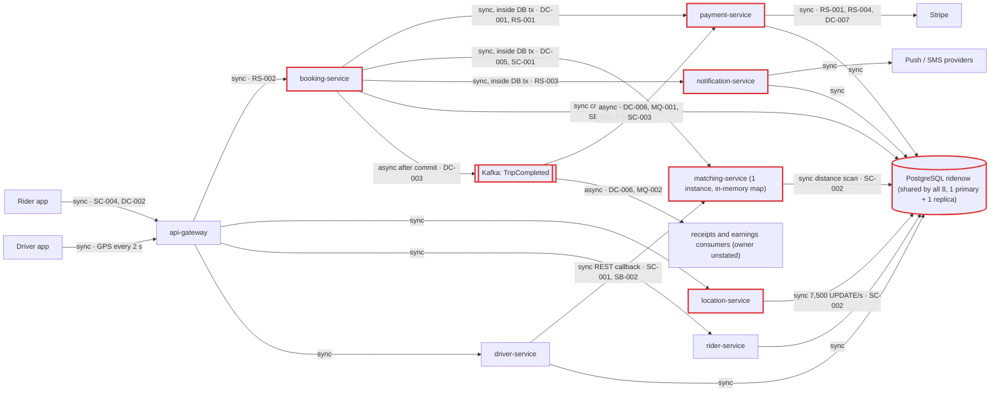
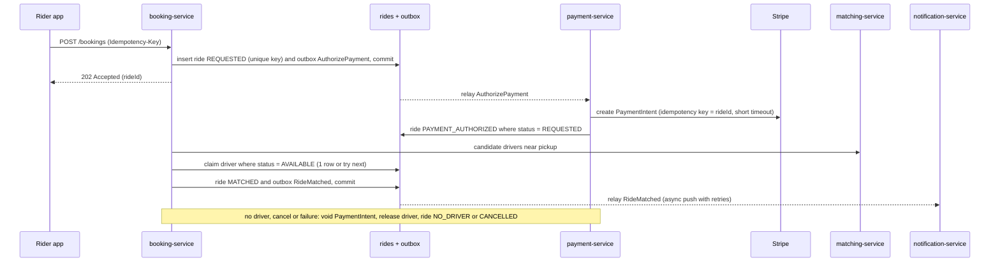
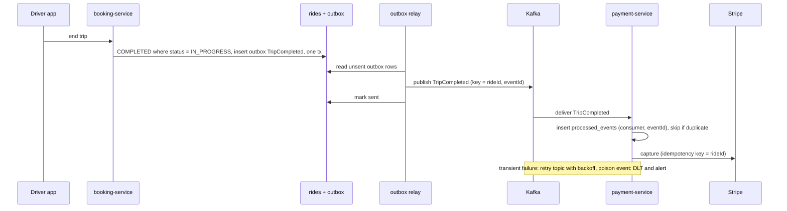

# Architecture review: RideNow

- **Mode:** design (reviewed `project-brief.md`, draft v0.3; there is no code yet)
- **Date:** 2026-10-25
- **Lenses run:** scalability, persistence, operability, data-consistency, resilience, service-boundaries, messaging. None were skipped. Operability ran because the brief names a likely platform ("probably Kubernetes").
- **Execution:** 3 parallel lens agents: data-consistency + messaging, resilience + service-boundaries, and scalability + persistence + operability. The parent ran no lens itself.
- **Triage:** 28 candidates came in and 25 findings came out. 3 were merged, 2 were re-graded and none were dropped (details under [Not reviewed](#not-reviewed)).
- **Headless run:** nobody was available to answer intake questions, so the gaps were filled with the conservative assumptions listed in the profile.

## Summary

RideNow is a planned 8-service ride-hailing platform for three cities. It aims for 15k peak drivers and 120k rides/day at launch, 4x that in year two, and a 99.95% target for requesting a ride. The biggest risk is the booking flow. It runs a Stripe pre-auth, matching and push/SMS synchronously **inside one database transaction**, on the belief that "if anything fails the booking is rolled back cleanly". Postgres can roll back its own row, but not a Stripe authorization, a matched driver or a sent push (DC-001). The same design chains five hops in series, so the ride-request target is out of reach (RS-002, RS-003). The change that buys the most is to commit the ride as `REQUESTED` first, return 202, and drive pre-auth, matching and notification asynchronously from persisted state through an outbox. That fixes DC-001, RS-001, RS-002, RS-003 and DC-002 together and sets up the saga (DC-004). Close behind are making matching-service stateless (SC-001) and moving live location off the shared Postgres primary (SC-002), because launch peak already means 7,500 GPS UPDATEs/s on the database every other service uses.

| Severity | Count |
|---|---|
| Critical | 2 |
| High | 13 |
| Medium | 10 |
| Low | 0 |
| Info | 0 |

## Architecture profile

| Field | Value |
|---|---|
| Architecture | microservices (planned): 8 independently shipped services, but all of them share one PostgreSQL schema |
| Summary | Riders request a ride, are matched to a nearby driver, track the trip live, and are charged through Stripe when the trip ends |
| Stack | Not stated. Java 17 / Spring Boot 3.x assumed, plus PostgreSQL (1 primary, 1 replica), Kafka, Stripe and unnamed push/SMS providers |
| Datastores | One PostgreSQL cluster with one `ridenow` schema, **shared by all 8 services**, with cross-service joins allowed |
| Messaging | Kafka: `TripCompleted`, consumed by payment capture, receipts and driver earnings |
| Background work | TripCompleted consumers (capture in payment-service; the owner of receipts and earnings is not stated) |
| Runtime | Not decided ("probably Kubernetes"). Observability not decided. matching-service runs 1 instance at launch |
| Stated intent | Launch: 15,000 peak drivers, 120,000 rides/day. Year two: 50,000 drivers, 400,000 rides/day, plus 2 cities. Peak is 4x the daily average. 99.95% availability for requesting a ride. 4 squads of about 6 engineers, each owning 2 services and shipping independently |

**Deployables (all planned):** api-gateway (routing, auth); rider-service (profiles, payment methods); driver-service (profiles, documents, availability, REST callback to matching); location-service (GPS pings, writes `drivers` lat/lng); matching-service (in-memory available-driver map, SQL distance query, 1 instance); booking-service (ride lifecycle, synchronous calls to payment, matching and notification inside one transaction, publishes TripCompleted); payment-service (Stripe pre-auth and capture, consumes TripCompleted); notification-service (push and SMS).

**Derived load**

- GPS writes: 15,000 / 2 s = **7,500 UPDATE/s** on the shared primary at launch peak, and 25,000/s in year two.
- Ride requests: 1.4/s average, about **5.6/s at peak** at launch; about 18.5/s at peak in year two.
- Concurrent trips at peak (20-minute trips): about 6,700 at launch, so about **6,700 location polls/s**; about 22,000/s in year two.
- Matching geo queries: at least 5.6/s at launch peak and 18.5/s in year two, each one an `ORDER BY` distance over `drivers`.
- TripCompleted: about 5.6 events/s at launch peak and 18.5/s in year two, each one a blocking Stripe capture.

**Key flows**

- Book: rider app -> api-gateway -> booking-service [tx open: insert ride] -> payment-service -> Stripe -> matching-service -> notification-service -> push/SMS -> ride MATCHED -> commit -> rider app
- Complete: driver app -> booking-service (COMPLETED, commit) -> Kafka TripCompleted -> payment capture (Stripe), receipts, earnings
- Location: driver app -> location-service -> `UPDATE drivers` <- rider app polls every 1 s; matching runs its distance query on the same table

**Assumptions (made in place of asking)**

- Headless run, so the intake questions went unanswered and the gaps were filled as conservatively as the brief allows.
- Payment pre-auth and capture, driver earnings and bookings must never be lost or doubled. Location may lag by a few seconds.
- The average trip is about 20 minutes (not stated in the brief).
- Java 17 / Spring Boot 3.x is assumed, and framework defaults are cited from memory.
- Kubernetes with several replicas per service is assumed, except where the brief says one instance.
- Mobile clients retry on timeout or network error, and no idempotency key exists.



## Findings

### Critical

#### DC-001 · Stripe pre-auth, matching and notifications run inside booking-service's DB transaction, so a rollback leaves their side effects behind

Severity: critical · Confidence: high · Lens: data-consistency · Effort: medium

**Where:** project-brief.md, section "Booking flow"

**Evidence**

```
booking-service calls payment-service synchronously, which calls Stripe to pre-authorize
the estimated fare. If Stripe is slow, the request waits; we will set a generous timeout
so we don't lose bookings.
...
booking-service calls notification-service synchronously to push "driver on the way" ...
All of steps 2–6 run inside one database transaction in booking-service, so if anything
fails the booking is rolled back cleanly.
```

**What goes wrong:** Friday peak. booking-service opens a transaction and inserts the ride (uncommitted), and Stripe places a pre-auth hold. Then matching finds no driver (routine at peak), notification times out, or the commit fails. The ride row rolls back, but the Stripe authorization survives. No row references it, so nothing ever voids it, and it sits on the card for about 7 days. The rider taps again and a second hold stacks up. If the rollback happens after step 5, the driver has already been told "driver on the way" for a ride that does not exist. Meanwhile every slow booking holds an open transaction and a connection on the primary that all 8 services share.

**Fix** (`move-call-outside-transaction`)
- Commit the ride as `REQUESTED` in a short local transaction.
- Drive each remote step from persisted state (`PAYMENT_AUTHORIZED`, `MATCHED`), with a conditional update for each transition.
- Store the Stripe PaymentIntent id on the ride, created with idempotency key = rideId, so every hold can be found and voided.
- Send notifications after commit, never inside the transaction.

```sql
-- each step advances only from the state it expects
UPDATE rides SET status = 'PAYMENT_AUTHORIZED', payment_intent_id = :pi
WHERE id = :ride AND status = 'REQUESTED';
```

**Why it's worth it here:** Payment pre-auth has an external money side effect that no Postgres rollback can undo, and bookings must never be lost or doubled.

The fixed booking flow below also covers DC-002, DC-004, DC-005, RS-001, RS-002 and RS-003:



#### SC-001 · matching-service keeps available drivers in a single-instance in-memory map fed by a REST callback; every restart empties it and scale-out splits it

Severity: critical · Confidence: high · Lens: scalability · Effort: medium · Also reported by: data-consistency

**Where:** project-brief.md, sections "Booking flow" and "Targets"

**Evidence**

```
matching-service keeps the list of available drivers in an in-memory map that
driver-service updates through a REST callback whenever a driver goes online or offline.
We'll run one matching-service instance at launch and add more later.

Availability target for requesting a ride: 99.95%.
```

**What goes wrong**
1. On every deploy or crash, the single pod restarts with an empty map. Drivers who are already online send no new callback, so every booking finds no driver until each driver toggles offline and back online. One instance cannot roll, so every matching release is a booking outage, and 99.95% allows about 22 minutes a month.
2. A callback lost during a restart or network blip leaves the DB and the map disagreeing. The map either offers a driver who has gone home or never offers one who came online, and nothing reconciles them.
3. With "add more later", each callback reaches only one replica, so each replica sees a different subset of drivers.

**Fix** (`stateless-service`)
- Keep available drivers and their positions in a shared, authoritative store: Redis GEO keyed by city, written by location-service and driver-service. Alternatively, use an outbox-fed, log-compacted `driver-availability` topic that every replica rebuilds from.
- Remove the REST callback.
- Gate readiness on the state being loaded.
- Run at least 2 replicas with a PDB from launch.

**Why it's worth it here:** Ride requests carry a 99.95% target, and year-two load (50k drivers, about 18.5 matches/s at peak, 2 more cities) needs more than one matching instance.

### High

#### DC-002 · `POST /bookings` has no idempotency key; a client retry during a slow Stripe call creates a second ride and a second pre-auth

Severity: high · Confidence: medium · Lens: data-consistency · Effort: small

**Where:** project-brief.md, section "Booking flow"

**Evidence**

```
The rider app calls `POST /bookings`.
If Stripe is slow, the request waits; we will set a generous timeout so we don't lose bookings.
(no idempotency key or request id is mentioned)
```

**What goes wrong:** Stripe slows down or the rider's network drops. The server-side "generous timeout" outlasts the app's HTTP timeout, so the app retries while the first request is still running. The retry inserts a second ride, places a second hold and matches a second driver.

**Fix** (`idempotency-key`): the app sends a UUID `Idempotency-Key` per booking attempt, unchanged on every retry. Store it on `rides` under a unique constraint, and return the existing ride when the key is a duplicate. Reuse it, or the rideId, as Stripe's idempotency key.

**Why it's worth it here:** Mobile clients retry on timeout, and booking has a money side effect.

#### DC-003 · `TripCompleted` is published after commit with no outbox, so a crash or Kafka error loses the capture, receipt and driver earnings

Severity: high · Confidence: high · Lens: data-consistency · Effort: medium

**Where:** project-brief.md, section "Trip completion"

**Evidence**

```
booking-service sets the ride to `COMPLETED`, then publishes a `TripCompleted` event to
Kafka right after the database commit. payment-service consumes it and captures the final
fare. Receipts and driver earnings are computed by consumers of the same event.
```

**What goes wrong:** The ride commits as COMPLETED, and then a rolling deploy, an OOM or a Kafka blip prevents the send. The card is never captured and the pre-auth lapses, no receipt goes out and the driver is never paid. Nothing records which rides were missed.

**Fix** (`transactional-outbox`)
- Insert the event into an `outbox` table in the same transaction that sets COMPLETED.
- Publish it with a polling relay or Debezium, keyed by rideId and carrying an `eventId`.
- Add a reconciliation check for COMPLETED rides with no capture.

**Why it's worth it here:** Payment capture and driver pay depend only on this event, and booking-service runs as rolling-deployed replicas.



This diagram also covers DC-006 and MQ-001.

#### DC-004 · Ride lifecycle has no failure or cancel states and no compensation: pre-auths are never voided and claimed drivers never released

Severity: high · Confidence: high · Lens: data-consistency · Effort: large

**Where:** project-brief.md, sections "Services" and "Booking flow"

**Evidence**

```
booking-service: owns the ride lifecycle (requested → matched → in progress → completed).
(no CANCELLED / NO_DRIVER / PAYMENT_FAILED state; no void or release step)
```

**What goes wrong:** Once the flow commits step by step (DC-001), routine events leave it half-applied: the rider cancels after matching, the driver no-shows, no driver is found, or capture fails. The hold stays on the card, the driver stays claimed, and support fixes each ride by hand.

**Fix** (`saga-orchestration`)
- booking-service orchestrates persisted states REQUESTED -> PAYMENT_AUTHORIZED -> MATCHED -> IN_PROGRESS -> COMPLETED -> CAPTURED, plus NO_DRIVER, CANCELLED and PAYMENT_FAILED.
- Each step has a compensation: void the PaymentIntent, release the driver, notify the rider.
- The steps run from outbox commands with idempotent handlers.
- A sweeper handles rides stuck in an intermediate state.

**Why it's worth it here:** Stripe and the driver claim sit outside any DB transaction, and cancellations happen daily. DB-only steps keep using plain local transactions.

#### DC-005 · Driver assignment is not an atomic claim, so two concurrent bookings can match the same nearest driver

Severity: high · Confidence: medium · Lens: data-consistency · Effort: small

**Where:** project-brief.md, section "Booking flow"

**Evidence**

```
booking-service calls matching-service synchronously to get a driver.
booking-service updates the ride to `MATCHED` and returns the result to the rider app.
(nothing marks a matched driver unavailable before the long transaction commits)
```

**What goes wrong:** Two riders outside a venue get the same nearest driver. Both lookups see the driver as available, and both rides become MATCHED. One rider is stranded.

**Fix** (`atomic-conditional-update`)

```sql
UPDATE drivers SET status = 'ASSIGNED', current_ride_id = :ride
WHERE id = :driver AND status = 'AVAILABLE';   -- 0 rows: try next candidate
CREATE UNIQUE INDEX one_active_ride_per_driver
  ON rides (driver_id) WHERE status IN ('MATCHED', 'IN_PROGRESS');
```

The equivalent compare-and-set works in the SC-001 geo store. Release the claim in DC-004's compensations.

**Why it's worth it here:** Peak demand clusters around the same drivers, and matching will run on more than one instance.

#### DC-006 · `TripCompleted` consumers and the end-trip transition are not idempotent, so a redelivery or a retried end-trip doubles earnings and receipts

Severity: high · Confidence: medium · Lens: data-consistency · Effort: small

**Where:** project-brief.md, section "Trip completion"

**Evidence**

```
When the driver ends the trip, booking-service sets the ride to `COMPLETED`, then publishes
a `TripCompleted` event to Kafka ... Receipts and driver earnings are computed by consumers
of the same event.
(no event id, processed-events table or status guard)
```

**What goes wrong:** A rebalance redelivers the event and the driver is credited twice. Or the driver app retries "end trip", booking-service re-sets COMPLETED and publishes a second event.

**Fix** (`idempotent-consumer`)
- Insert `(consumer, eventId)` into a processed-events table with a unique constraint, in the same transaction as the side effect.
- Use rideId as the Stripe capture idempotency key.
- Guard end-trip with `WHERE status = 'IN_PROGRESS'`, and publish only when one row changed. See the diagram under DC-003.

**Why it's worth it here:** Kafka delivers at least once, and these consumers move money.

#### DC-007 · No defined path for capturing a final fare above the pre-authorized estimate

Severity: high · Confidence: medium · Lens: data-consistency · Effort: medium

**Where:** project-brief.md, sections "Trip completion" and "Booking flow"

**Evidence**

```
calls Stripe to pre-authorize the estimated fare
...
payment-service consumes it and captures the final fare.
(nothing on a final fare above the authorized amount)
```

**What goes wrong:** A detour or waiting time pushes the fare above the estimate. Stripe captures at most the authorized amount, except with overcapture on eligible cards (from memory). Either the capture fails and, with no DLT, is skipped, or the difference is never charged.

**Fix** (`compensating-action`): pick a fare policy and make it a saga step. Options are to authorize the estimate plus a buffer, to use fixed upfront pricing, or to capture up to the authorization and charge the remainder as a separate off-session PaymentIntent (idempotency key rideId + "-delta") with a PAYMENT_FAILED/collections path. Record the authorized and captured amounts on the ride.

**Why it's worth it here:** The brief separates estimated from final fare, so they will differ on many trips.

#### RS-001 · Stripe pre-auth waits on a 'generous timeout' while holding booking-service threads, a DB connection and an open transaction

Severity: high · Confidence: high · Lens: resilience · Effort: small

**Where:** project-brief.md, sections "Booking flow" and "Live location"

**Evidence**

```
If Stripe is slow, the request waits; we will set a generous timeout so we don't lose bookings.
All of steps 2–6 run inside one database transaction in booking-service
The rider app polls `GET /bookings/{id}/driver-location` every second during a trip
```

**What goes wrong:** At 5.6 bookings/s and a 60 s Stripe stall, about 340 requests are in flight, each holding a thread and a DB connection. A default-size pool is exhausted in about 2 s. Trip completion and the driver-location poll, apparently on the same pods, then queue and fail, so drivers cannot end trips and riders lose tracking. A Stripe slowdown becomes an outage of trips already in progress.

**Fix** (`timeouts`)
- Stripe: about 1 s connect, and a read timeout of p99 plus headroom (seconds, not tens of seconds).
- Internal calls: timeouts from the callee's p99, under an overall request deadline that is propagated downstream.
- A Resilience4j semaphore bulkhead on the call to payment-service.
- Serve driver-location from location-service rather than booking-service.
- After DC-001, a timeout leaves the ride REQUESTED instead of losing it.

**Why it's worth it here:** Every synchronous hop sits on a 99.95% path that depends on an external PSP.

#### RS-002 · Ride request is a five-hop blocking chain ending in Stripe and push/SMS, so the availabilities multiply below the 99.95% target

Severity: high · Confidence: high · Lens: resilience · Effort: medium

**Where:** project-brief.md, sections "Booking flow" and "Targets"

**Evidence**

```
booking-service calls payment-service synchronously, which calls Stripe ...
booking-service calls matching-service synchronously to get a driver.
booking-service updates the ride to `MATCHED` and returns the result to the rider app.
Availability target for requesting a ride: 99.95%.
```

**What goes wrong:** Seven links at 99.99% each compound to about 99.93%, below the target before any incident. With one matching instance, every matching deploy is an outage. The latencies also add up, so riders time out and retry.

**Fix** (`async-decoupling`): POST /bookings writes REQUESTED and returns 202. Pre-auth, matching and notification progress through the DC-004 saga, and the app follows the status by push or poll. If the product needs a synchronous "card OK", keep only the pre-auth synchronous, under a tight deadline. See the diagram under DC-001.

**Why it's worth it here:** The chain is more than 3 services deep, ends in third parties and carries a 99.95% target.

#### RS-003 · A notification outage fails and rolls back bookings that were already matched

Severity: high · Confidence: high · Lens: resilience · Effort: small

**Where:** project-brief.md, section "Booking flow"

**Evidence**

```
booking-service calls notification-service synchronously to push "driver on the way" to
the rider and the driver.
All of steps 2–6 run inside one database transaction in booking-service, so if anything
fails the booking is rolled back cleanly.
```

**What goes wrong:** An APNs/FCM or SMS-provider outage makes notification-service fail, and every booking during the outage rolls back, although they were already authorized and matched.

**Fix** (`async-decoupling`): after MATCHED commits, emit `RideMatched` through the outbox (DC-003's relay). notification-service consumes it and retries delivery on its own. The driver offer is delivered asynchronously, with an accept/timeout step.

**Why it's worth it here:** Booking does not need the push to answer the rider correctly.

#### SB-001 · All 8 services share one `ridenow` schema with cross-service joins, although 4 squads ship independently

Severity: high · Confidence: high · Lens: service-boundaries · Effort: medium · Also reported by: persistence

**Where:** project-brief.md, sections "Data" and "Targets"

**Evidence**

```
all eight services connect to one shared PostgreSQL cluster (one primary, one read replica)
with a single `ridenow` schema. Services can join across each other's tables when they need
data, for example booking-service joins `drivers` and `riders` directly to build the trip receipt.

Team: 4 squads of about 6 engineers, each owning two services and shipping independently.
```

**What goes wrong**
1. One squad renames a `drivers` column and ships. Another squad's receipt join, UPDATE or distance query breaks at runtime, and the owning squad's CI never sees it. Independent shipping, the stated reason for microservices, is lost.
2. GPS write load shares the primary with bookings and payments.
3. No service owns the "available and not on a trip" invariant.

**Fix** (`database-per-service`)
- Give each service its own schema and DB role with no cross-schema grants, on the same cluster at launch.
- Ownership: rider-service owns riders, driver-service owns profiles, dispatch/location owns position and availability, booking owns rides.
- Build the receipt by API composition or from an event-fed read model.
- Until the split is complete, one owning service migrates each table, using PS-002's discipline.

**Why it's worth it here:** Four squads deploy independently, and the load profiles differ by three orders of magnitude. It is cheapest to fix now, before any code exists.

#### SC-002 · Live location runs on the shared Postgres primary: 7,500 UPDATE/s (25,000/s in year two), 1 Hz rider polls and unindexed distance scans on one `drivers` table

Severity: high · Confidence: medium · Lens: scalability · Effort: large · Also reported by: persistence

**Where:** project-brief.md, sections "Live location" and "Data"

**Evidence**

```
Drivers' apps send a GPS ping every 2 seconds while online. location-service writes each
ping as an `UPDATE drivers SET lat = ?, lng = ? WHERE id = ?` on the shared Postgres. The
rider app polls `GET /bookings/{id}/driver-location` every second during a trip, which reads
the same row. matching-service also queries this table to find nearby drivers (`ORDER BY`
distance computed in SQL).
```

**What goes wrong:** 7,500 single-row transactions/s rewrite every `drivers` tuple every 2 s, leaving about 7,500 dead tuples/s. That means heavy WAL, autovacuum falling behind, bloat and replica lag, and HOT updates are lost if lat/lng are indexed. Add about 6,700 polls/s, plus a distance `ORDER BY` that no btree index can serve, so every match seq-scans and sorts the bloated table. All of it shares one primary with bookings and payments. Year two (25,000 writes/s, about 22,000 polls/s) is beyond one shared OLTP primary.

**Fix** (`partitioning` of ephemeral location data into its own store)
- location-service owns an in-memory geo store (Redis GEO keyed by city, shared with SC-001).
- Matching uses GEOSEARCH with a radius and COUNT.
- Persist only sampled breadcrumbs, asynchronously.
- Push rider location over WebSocket/SSE instead of 1 Hz polling.
- Interim, if the query must stay in Postgres: PostGIS with a GiST index and `ST_DWithin(...) ORDER BY geom <-> :p LIMIT k`, scoped by city.

**Why it's worth it here:** These are the stated launch numbers, not a future scenario.

#### PS-001 · No connection budget for 8 services x replicas on one primary

Severity: high · Confidence: medium · Lens: persistence · Effort: small

**Where:** project-brief.md, section "Data"

**Evidence**

```
all eight services connect to one shared PostgreSQL cluster (one primary, one read replica)
(no pool sizes, max_connections or pooler)
```

**What goes wrong:** Hikari's default of 10 connections per pod across 8 services x 3 replicas needs 240 connections against Postgres's default max_connections of 100 (both from memory). A Friday scale-out leaves new pods unable to connect, and long booking transactions while Stripe is slow (DC-001, RS-001) drain the limit for every service.

**Fix** (`connection-pool-sizing`): put PgBouncer (transaction pooling) in front of the primary. Give each service and replica count an explicit budget that sums below max_connections, set Hikari `maximum-pool-size` and `connection-timeout` from it, and send reads to the replica.

**Why it's worth it here:** One primary serves every service, each expected to run several replicas.

#### MQ-001 · `TripCompleted` consumers have no retry topic or DLT, so a Stripe outage or a poison event silently drops captures

Severity: high · Confidence: medium · Lens: messaging · Effort: small

**Where:** project-brief.md, section "Trip completion"

**Evidence**

```
payment-service consumes it and captures the final fare. Receipts and driver earnings are
computed by consumers of the same event.
(no retry, backoff or dead-letter handling)
```

**What goes wrong:** Stripe returns 5xx for two minutes. Spring Kafka's DefaultErrorHandler (about 10 attempts with no backoff, then skip; from memory) drops every capture from that window, leaving only a log line. If it is configured to retry forever instead, a poison event blocks the partition.

**Fix** (`retry-topic`): add a retry topic with exponential backoff (`@RetryableTopic`) and a `trip-completed-<consumer>-dlt` for each consumer, plus a replay tool. Classify declines into PAYMENT_FAILED instead of retrying them, and alert on DLT depth (OP-003). See the diagram under DC-003.

**Why it's worth it here:** Captures and driver pay depend only on this event.

### Medium

#### RS-004 · No circuit breaker or fast-fail around Stripe, payment, matching or notification on the booking path

Severity: medium · Confidence: medium · Lens: resilience · Effort: small

**Where:** project-brief.md, section "Booking flow"

**Evidence**

```
booking-service calls matching-service synchronously to get a driver.
We'll run one matching-service instance at launch and add more later.
(no breaker, fallback or degraded mode described)
```

**What goes wrong:** During a Stripe brownout or a matching restart, every booking waits out the full timeout, hammers the struggling dependency, and invites mobile retries. Recovery is slower than it needs to be.

**Fix** (`circuit-breaker`): Resilience4j breakers on each downstream, or mesh outlier detection once a runtime is chosen. When a breaker is open, fail fast or accept the ride as REQUESTED and re-drive it later. Agree with the business what a Stripe outage should do to ride requests.

**Why it's worth it here:** There are several independently failing dependencies on a 99.95% path.

#### SB-002 · Driver supply state is split across driver-, location- and matching-service (distributed-monolith seam)

Severity: medium · Confidence: medium · Lens: service-boundaries · Effort: medium

**Where:** project-brief.md, sections "Services" and "Live location"

**Evidence**

```
driver-service: driver profiles, documents, availability status.
location-service: receives driver GPS pings and answers "where is driver X".
matching-service: finds the best nearby available driver for a ride request.
matching-service also queries this table to find nearby drivers
```

**What goes wrong:** One concept, "available drivers and where they are", has three owners. Every dispatch-rule change needs coordinated releases across up to three services and two squads, and every match depends on all three staying consistent.

**Fix** (`bounded-context`): a dispatch context, owned by one squad over one store, that owns availability, position and matching and consumes driver and trip lifecycle events. driver-service keeps profiles and documents. Add consumer-driven contracts on the remaining seams.

**Why it's worth it here:** The squads are meant to ship independently, and matching needs availability and position together at low latency.

#### MQ-002 · `TripCompleted` contract has no schema or versioning, although three consumers ship independently

Severity: medium · Confidence: medium · Lens: messaging · Effort: small

**Where:** project-brief.md, section "Trip completion"

**Evidence**

```
Receipts and driver earnings are computed by consumers of the same event.
... each owning two services and shipping independently.
(no schema, version field or registry)
```

**What goes wrong:** The booking squad renames a field and deploys. Three other squads' consumers fail to deserialize, and with no DLT the events are skipped.

**Fix** (`event-versioning`): a public event contract separate from the entities, with `schemaVersion` and tolerant readers, or a schema registry with compatibility checks in CI. It carries rideId, eventId, the authorized and final amounts, and currency.

**Why it's worth it here:** The producer and its consumers belong to different squads.

#### PS-002 · No migration ownership or lock-safe migration process for the shared schema and its very hot `drivers` table

Severity: medium · Confidence: medium · Lens: persistence · Effort: small

**Where:** project-brief.md, section "Data"

**Evidence**

```
with a single `ridenow` schema. Services can join across each other's tables when they need data
(no migration owner or compatibility process)
```

**What goes wrong:** An `ALTER TABLE drivers` waits for an ACCESS EXCLUSIVE lock and, while it waits, blocks 7,500 UPDATEs/s and every matching query, so ride requests stall for as long as the migration runs. Several Flyway histories on one schema leave migration ordering undefined.

**Fix** (`expand-contract-migration`): one owning service migrates each table. Use expand/contract for renames and drops, `lock_timeout` and `statement_timeout` on migration sessions, `CREATE INDEX CONCURRENTLY`, and `ddl-auto=validate`.

**Why it's worth it here:** Independent deploys share one schema, and it has a table with thousands of writes per second.

#### PS-003 · `rides` and the payment and notification records grow forever, with no retention or partitioning

Severity: medium · Confidence: medium · Lens: persistence · Effort: medium

**Where:** project-brief.md, sections "Data" and "Targets"

**Evidence**

```
Launch: 15,000 active drivers at peak, 120,000 rides per day.
Year two: 50,000 active drivers, 400,000 rides per day, plus two more cities.
(no retention, archival or partitioning)
```

**What goes wrong:** That is about 44M rides in year one and about 146M a year at year-two volume. Hot queries, indexes, vacuum and backup/restore all slow down month by month on the shared primary.

**Fix** (`data-retention`): partition by time, add partial indexes for active statuses, archive completed trips to a warehouse after N months, and drop old partitions on a schedule.

**Why it's worth it here:** Every ride, payment and notification adds rows at 120k to 400k rides per day.

#### SC-003 · TripCompleted capture consumer blocks on Stripe, and no partition count or consumer concurrency is declared

Severity: medium · Confidence: medium · Lens: scalability · Effort: small

**Where:** project-brief.md, section "Trip completion"

**Evidence**

```
publishes a `TripCompleted` event to Kafka right after the database commit. payment-service
consumes it and captures the final fare.
(no partitions, replicas or threads declared)
```

**What goes wrong:** An auto-created topic gets 1 partition (default, from memory), so one thread handles 2 to 3 captures/s against 5.6/s at launch peak. Lag grows through every Friday, and slow batches trigger rebalance loops.

**Fix** (`consumer-concurrency`): create the topic explicitly with 24 or more partitions keyed by rideId. Keep replicas x threads at or below the partition count, lower `max.poll.records`, and alert on lag.

**Why it's worth it here:** This critical consumer makes a blocking Stripe call at 5.6 to 18.5 events/s.

#### SC-004 · No rate limiting or load shedding at the edge for peak surges, retries and GPS ingest

Severity: medium · Confidence: medium · Lens: scalability · Effort: small

**Where:** project-brief.md, sections "Services" and "Targets"

**Evidence**

```
api-gateway: routing and auth.
Peak hour (Friday night) is about 4× the daily average.
```

**What goes wrong:** Bookings, retries, 7,500 pings/s and about 6,700 polls/s all arrive unthrottled. When booking-service slows down, its queues grow until it collapses, instead of shedding polls and pings first.

**Fix** (`rate-limiting`): per-client, per-route limits at the gateway, with priority classes (bookings above polls above pings), bounded queues returning 429/503 with Retry-After, and client backoff with jitter.

**Why it's worth it here:** Public mobile traffic with a 4x peak and a 99.95% target.

#### OP-001 · Runtime undecided: no probes, graceful shutdown, resource requests or disruption budgets against a 99.95% target

Severity: medium · Confidence: medium · Lens: operability · Effort: medium

**Where:** project-brief.md, section "Not decided yet"

**Evidence**

```
How we deploy (probably Kubernetes).
```

**What goes wrong:** A restarted matching pod takes traffic before its state is loaded. Pods killed mid-booking cut requests after the pre-auth. A single node drain takes every replica of a service down. Routine deploys by four squads burn the 22-minute monthly budget.

**Fix** (`health-probes`): a process-only liveness probe, a readiness probe that checks what the service needs to serve, `server.shutdown=graceful` with preStop, resource requests and limits, at least 2 replicas with a PDB, and zone spread.

**Why it's worth it here:** Eight independently deployed services under a 99.95% target.

#### OP-002 · No distributed tracing across a 5-service synchronous booking chain plus Kafka fan-out

Severity: medium · Confidence: high · Lens: operability · Effort: medium

**Where:** project-brief.md, section "Not decided yet"

**Evidence**

```
Observability tooling.   (listed as not decided)
```

**What goes wrong:** A booking times out, and nobody can tell whether Stripe, matching, notification or a DB lock was the cause. A missing capture cannot be traced back to its event.

**Fix** (`distributed-tracing`): OpenTelemetry in every service, W3C trace context in HTTP and Kafka headers, and structured logs carrying trace id and ride id.

**Why it's worth it here:** Every key flow crosses several services and a broker.

#### OP-003 · No metrics, alerts or SLO measurement for the 99.95% target, consumer lag, Stripe latency or DB health

Severity: medium · Confidence: high · Lens: operability · Effort: medium

**Where:** project-brief.md, sections "Not decided yet" and "Targets"

**Evidence**

```
Availability target for requesting a ride: 99.95%.
Observability tooling.   (not decided)
```

**What goes wrong:** Missed SLOs, consumer lag, Stripe p99 creep, `drivers` bloat, replica lag and DLT growth all reach riders before they reach an alert.

**Fix** (`metrics-and-alerts`): RED metrics per endpoint and per dependency; USE metrics for pools and consumers; Postgres replication lag and dead tuples; business metrics (match rate, time-to-match, captures pending); SLO burn-rate alerts on POST /bookings; DLT depth alerts.

**Why it's worth it here:** An explicit SLO, and money that moves through async consumers.

## Roadmap

**Now**

1. DC-001: commit the ride as REQUESTED first, and run Stripe, matching and notification after commit from persisted state. Unblocks DC-004, RS-002.
2. SC-001: make matching stateless over a shared geo store, remove the REST callback, run at least 2 replicas. Unblocks nothing.
3. DC-003: add a transactional outbox and relay, starting with TripCompleted. Unblocks DC-004, DC-006, RS-003.
4. DC-004: booking saga with failure and cancel states and compensations (large effort; it is here because RS-002 depends on it). Unblocks RS-002.
5. DC-002: `Idempotency-Key` on POST /bookings, also passed to Stripe. Unblocks nothing.
6. RS-001: tight, propagated timeouts on every hop, plus a bulkhead around payment-service. Unblocks nothing.
7. RS-002: POST /bookings returns 202, and the rest of the flow continues asynchronously. Unblocks nothing.
8. RS-003: notifications via an outbox `RideMatched` event, off the critical path. Unblocks nothing.
9. DC-005: atomic conditional claim of the driver, plus a partial unique index. Unblocks nothing.
10. DC-006: processed-events dedup in consumers and a guarded end-trip transition. Unblocks nothing.
11. DC-007: decide the fare-above-estimate policy and add it as a saga step. Unblocks nothing.
12. MQ-001: retry topics with backoff and per-consumer DLTs for TripCompleted. Unblocks nothing.
13. SB-001: schema and DB role per service, no cross-service joins. Unblocks nothing.
14. PS-001: PgBouncer and an explicit per-service connection budget. Unblocks nothing.

**Next**

1. SC-002: move live location and the geo query to a location-owned geo store, and push rider location. Unblocks nothing.
2. PS-002: single migration owner per table, expand/contract, lock_timeout. Unblocks nothing.
3. RS-004: circuit breakers on Stripe, payment, matching and notification. Unblocks nothing.
4. SB-002: consolidate availability, position and matching into a dispatch context. Unblocks nothing.
5. MQ-002: versioned TripCompleted contract with compatibility checks. Unblocks nothing.
6. PS-003: time-partition `rides`, payments and notifications, with retention. Unblocks nothing.
7. SC-003: explicit partition count and consumer concurrency for TripCompleted. Unblocks nothing.
8. SC-004: gateway rate limiting with priority classes, and load shedding. Unblocks nothing.
9. OP-001: probes, graceful shutdown, resources, PDBs, zone spread. Unblocks nothing.
10. OP-002: OpenTelemetry tracing across HTTP and Kafka. Unblocks nothing.
11. OP-003: RED/USE/business metrics, SLO burn-rate, lag and DLT alerts. Unblocks nothing.

**Later**

- Nothing (no low or info findings).

## What's already sound

- **Pre-authorize at booking, capture at trip end.** This is the right card model for variable fares. DC-007 only needs the over-estimate case defined.
- **One owner for the ride lifecycle.** booking-service owns an explicit status machine, which is the natural saga orchestrator (DC-004).
- **TripCompleted is published after commit, not inside the transaction.** Consumers never act on a rollback that never happened. Only the crash window remains (DC-003).
- **Post-trip work fans out from one event** (capture, receipts, earnings) to independent consumers, keeping it off the driver's end-trip request.
- **The split is backed by real forces:** 24 engineers in 4 squads with an independent-shipping goal, and workloads three orders of magnitude apart (7,500 GPS writes/s against about 5.6 bookings/s). Microservices are not premature here. The problem is the shared database (SB-001), not the split.
- **The targets are quantified** (drivers, rides/day, peak factor, 99.95% SLO, team shape), so every finding could be graded against real numbers.
- **Auth is centralized at api-gateway,** which gives one edge where rate limiting (SC-004) can go.

## Not reviewed

- **Security in depth:** auth design at the gateway, PCI scope of the "saved payment methods" in rider-service, PII retention for location history, and secrets handling. Run a dedicated security review.
- **Choices the brief leaves open:** deployment platform, observability stack, push and SMS providers, mobile client behaviour. These were graded against the assumptions in the profile.
- **Pricing, surge, dispatch-quality and multi-city tenancy logic:** the brief doesn't describe them.
- **Triage of lens candidates:**
  - Merged: *resilience: Stripe slowness in booking creation can starve trip completion and live-location polling sharing booking-service's pools*, folded into RS-001 (same trigger and failure; the bulkhead and endpoint move are in RS-001's fix).
  - Merged: *data-consistency: Driver availability is written to the DB and pushed to matching-service by REST callback*, folded into SC-001 (closed by the same shared-store fix).
  - Merged: *persistence: Matching sorts by a distance computed in SQL*, folded into SC-002 (same geo-store fix; PostGIS kept as the interim option).
  - Re-graded critical to high: *data-consistency: POST /bookings has no idempotency key* (DC-002). It needs a Stripe slowdown or a network drop plus a client retry, which is not the normal path.
  - Re-graded high to medium: *persistence: Shared ridenow schema migrated by 8 independently shipped services* (PS-002). The cross-squad breakage is folded into SB-001. The remaining lock-queue risk lasts only for a migration and mostly goes away with SC-002.
  - Dropped: none.
