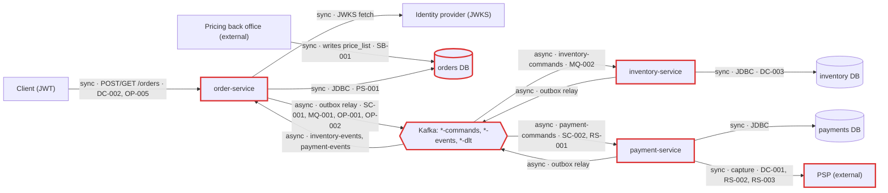
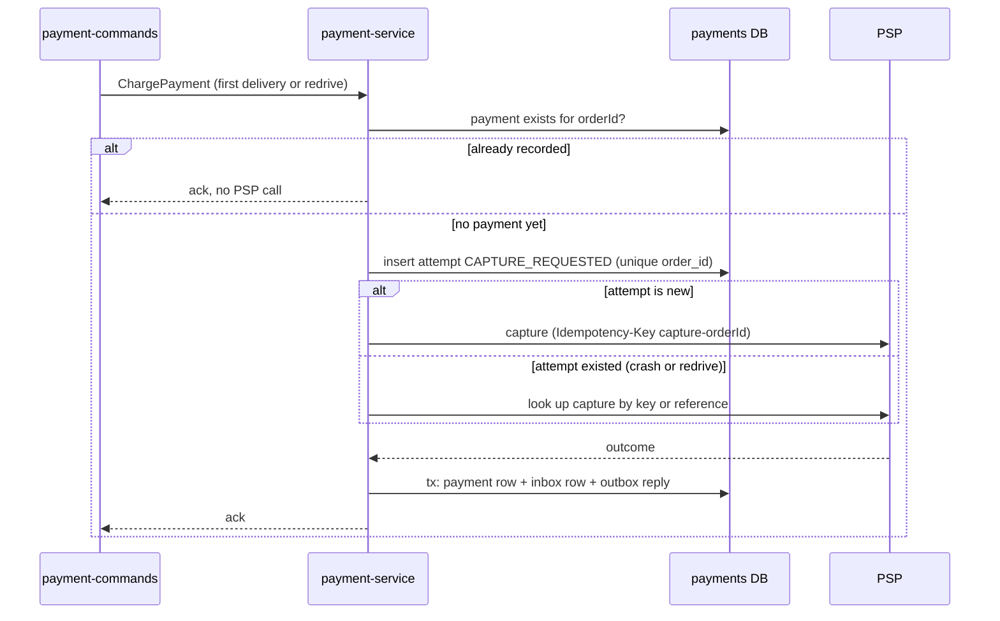

# Architecture review: order platform (v2)

Mode: hybrid (code, plus the scale and flow the README states). Date: 2026-10-25. Lenses run: scalability, persistence, operability, data-consistency, resilience, service-boundaries and messaging. None were skipped: there are datastores, writes, network calls, several deployables and a broker. The codebase is small (66 Java files), so the lenses ran as three grouped agents (data-consistency + messaging, resilience + service-boundaries, scalability + persistence + operability), and the parent ran none itself. Triage: 23 candidates. One was merged whole, two were merged in part, none were re-graded and none were dropped, leaving 22 findings.

## Summary

The system is three Spring Boot services (order, inventory, payment), each with its own Postgres database, running an orchestrated place-order saga over Kafka. It is built on the right patterns throughout: transactional outboxes, inbox deduplication, a PSP call outside any transaction with an idempotency key, complete compensation, ShedLock'd schedulers and dead-lettering. The review found no critical or high findings. The biggest risk is in the payment path. If PSP responses are misclassified (RS-002), orders are cancelled silently. A late DLT redrive can re-capture once the PSP's idempotency key has expired (DC-001). Long PSP outages turn into a pile of paged dead letters (RS-001). The change that buys the most is a small one: explicit PSP outcome mapping, plus a "payment already recorded or attempted?" check before every capture. The system can meet its stated intent (3x, ~15 orders/s next year) with headroom, provided PSP capture latency stays under ~0.8 s (SC-002). Batching the outbox relay (SC-001) would widen today's 1.5-2x margin on publish rate.

| Severity | Count |
|---|---|
| Critical | 0 |
| High | 0 |
| Medium | 11 |
| Low | 11 |
| Info | 0 |

## Architecture profile

- **Architecture**: microservices. Three independently deployed services, each owning a database and a business capability, coordinating over Kafka.
- **Summary**: order-service takes orders over HTTP and orchestrates reserve stock, then charge payment, then confirm, compensating with ReleaseStock. All hops go through per-service transactional outboxes and Kafka.
- **Stack**: Java 17, Spring Boot 3.3.4, Spring Data JPA, Spring Kafka, Flyway, ShedLock 5.16.0, Resilience4j 2.2.0 (payment), Spring Security OAuth2 resource server (order), Micrometer tracing (OTel/OTLP) and Prometheus, PostgreSQL 16, Kafka 3.7.
- **Deployables**:
  - `order-service/`: REST `/orders` (JWT, `Idempotency-Key`), saga orchestrator, saga watchdog. db = orders. Publishes inventory-commands, payment-commands and order-events. Consumes inventory-events and payment-events.
  - `inventory-service/`: stock and all-or-nothing reservations. db = inventory. Consumes inventory-commands and publishes inventory-events.
  - `payment-service/`: PSP captures with timeouts, retry, circuit breaker and `Idempotency-Key`. db = payments. Consumes payment-commands (concurrency 4) and publishes payment-events.
- **Datastores**: one Postgres database per service (a single server in docker-compose). The `price_list` table in the orders DB is written by an external pricing back office.
- **Messaging**: Kafka. Every topic has 12 partitions, replication 3, key = orderId, and a `<topic>-dlt`. Producers use `acks=all` with idempotence. Consumers ack per record after processing. DefaultErrorHandler retries for ~3 min, then dead-letters. The inbox dedupes by `message-id`.
- **Background work**: an outbox relay every 500 ms in each service, daily outbox and inbox purges, and an order-service watchdog every 60 s. All are ShedLock'd. Each service also runs a `.*-dlt` monitor.
- **Runtime**: k8s with 3 replicas each, liveness and readiness probes, graceful shutdown (30 s inside a 45 s grace period). No resource requests, startupProbe, PDB, HPA or ingress are in the repo. Tracing is sampled at 10%. Prometheus. DLT records page on-call.
- **Stated intent**: peak ~300 orders/min, tripling next year. One team per service.
- **Derived load**: ~5 orders/s now and ~15/s next year. ~20-25 Kafka messages/s now and ~75/s next year. The order-service outbox carries ~15 events/s now and ~45/s next year. PSP captures run ~5/s now and ~15/s next year.
- **Key flows**:
  - client -> order-service (order + outbox ReserveStock) -> inventory-service -> order-service saga
  - saga ChargePayment -> payment-service (PSP outside tx) -> order-service (confirm, or cancel + ReleaseStock)
  - watchdog: PENDING > 15 min -> cancel + ReleaseStock
- **Assumptions**:
  - Hybrid mode, taken from the README, because nobody was available to confirm.
  - No targets beyond the README's numbers.
  - The pricing back office and the identity provider are outside the repo.
  - Production Kafka settings (min.insync.replicas, retention) and the production Postgres topology are unknown. docker-compose is treated as local only.
  - PSP idempotency semantics are taken from the PspClient comment. The PSP's key retention is unknown.



## Findings

### Medium

#### DC-001 · Payment re-captures at the PSP before checking for an existing payment, so a late DLT redrive can double-charge once the PSP `Idempotency-Key` expires

Severity: medium · Confidence: medium · Lens: data-consistency · Effort: medium

**Where**: `payment-service/src/main/java/com/example/platform/payment/messaging/PaymentCommandListener.java:39`, `payment-service/src/main/java/com/example/platform/payment/messaging/PaymentCommandListener.java:45`, `payment-service/src/main/java/com/example/platform/payment/messaging/PaymentRecorder.java:30`

**Evidence**:

```text
PaymentCommandListener: `if (inbox.alreadyProcessed(messageId) || !"ChargePayment".equals(Headers.messageType(record))) { return; }` then `response = psp.capture("capture-" + command.orderId(), command.customerId(), command.amount());`. The order-level guard runs only afterwards, in PaymentRecorder: `if (!inbox.firstDelivery(messageId) || payments.findByOrderId(command.orderId()).isPresent()) { return; }`. PspClient comment: "Captures are idempotent at the PSP by {@code Idempotency-Key}, so the retry and a redelivered ChargePayment never double-charge." DeadLetterMonitor: "ops replays them with the dlt-redrive runbook once the cause is fixed."
```

**What goes wrong**: (a) The PSP approves `capture-<orderId>`, then `PaymentRecorder.record` keeps failing for more than ~3 minutes (payments DB failover or outage), so ChargePayment is dead-lettered with no payments row and no inbox row. On-call redrives it after the fix. If that happens later than the PSP's key retention (often 24h; not stated here), the PSP treats the key as new and captures a second time. (b) An operator replays a DLT range containing a ChargePayment that was already redriven, more than 7 days later. The inbox row has been purged, so `alreadyProcessed` is false and the PSP is called again. `record()` then finds the existing payment and returns, so the second charge is recorded nowhere.

**Fix** (`idempotency-key`): Check `payments.findByOrderId` before calling the PSP. Before the call, persist a payment-attempt row (status `CAPTURE_REQUESTED`, unique `order_id`) in its own short transaction. On redelivery, if an attempt row exists with no outcome, look the capture up at the PSP by idempotency key or reference instead of capturing again. Confirm the PSP's key retention and write it into the dlt-redrive runbook as the deadline for redriving `payment-commands-dlt`.

```java
// PaymentCommandListener.onCommand, before any PSP call
if (payments.findByOrderId(command.orderId()).isPresent()) { return; }      // outcome already recorded
PaymentAttempt attempt = attempts.startOrGet(command.orderId());            // own short tx, unique order_id
CaptureResponse response = attempt.isNew()
        ? psp.capture("capture-" + command.orderId(), command.customerId(), command.amount())
        : psp.lookup("capture-" + command.orderId());                       // never re-capture blind
recorder.record(messageId, command, response);
```



**Why it's worth it here**: PSP idempotency keys expire, and the README's DLT redrive process can replay ChargePayment hours or days after the first attempt.

#### RS-001 · Payment listener keeps consuming while the `psp` circuit is open, so a PSP outage longer than ~3 min dead-letters `ChargePayment` commands

Severity: medium · Confidence: high · Lens: resilience · Effort: small

**Where**: `payment-service/src/main/java/com/example/platform/payment/messaging/PaymentCommandListener.java:36`, `payment-service/src/main/java/com/example/platform/payment/config/KafkaConfig.java:19`, `payment-service/src/main/resources/application.yml:75`

**Evidence**:

```text
KafkaConfig: "// ~3 minutes in total: longer than a circuit-breaker open window or a DB failover." `ExponentialBackOffWithMaxRetries(8)` with initial 1s, x2, max 60s (1+2+4+8+16+32+60+60 = 183 s), then `DeadLetterPublishingRecoverer`. application.yml: `wait-duration-in-open-state: 30s`. The listener calls `psp.capture(...)` on every record, and nothing pauses the container while the breaker is open.
```

**What goes wrong**: The PSP has a 30-minute outage. The breaker opens and every capture fails fast with CallNotPermittedException, which propagates to the DefaultErrorHandler. Each partition's head command burns through 9 deliveries in about 3 minutes and is then dead-lettered: with 12 partitions, about 4 DLT records a minute and about 120 over the outage. Each one pages on-call through `kafka_dlt_records_total` and needs a manual redrive. Until then those orders sit in STOCK_RESERVED holding stock, which the watchdog deliberately does not cancel. The breaker absorbs the outage, but the consumer turns it into DLT traffic and manual work.

**Fix** (`circuit-breaker`): Register a CircuitBreaker state-transition listener that pauses the `payment-commands` listener container while `psp` is OPEN and resumes it on HALF_OPEN or CLOSED, so commands wait in Kafka instead of exhausting retries. Alternatively, classify CallNotPermittedException so the error handler backs off without a retry limit and never dead-letters it, keeping the DLT for poison messages.

**Why it's worth it here**: Payments depend on a single external PSP whose incidents can outlast the ~3-minute retry budget, and every DLT record pages a human.

#### RS-002 · PSP responses default to decline: HTTP 400 and any 2xx `outcome` other than `approved` become a final `PaymentFailed` that cancels the order

Severity: medium · Confidence: medium · Lens: resilience · Effort: small

**Where**: `payment-service/src/main/java/com/example/platform/payment/messaging/PaymentCommandListener.java:22`, `payment-service/src/main/java/com/example/platform/payment/psp/PspClient.java:40`, `payment-service/src/main/java/com/example/platform/payment/messaging/PaymentRecorder.java:38`, `payment-service/src/main/resources/application.yml:77`

**Evidence**:

```text
`/** PSP statuses that are the final answer for this charge: invalid request, card declined, unprocessable. */ private static final Set<Integer> FINAL_DECLINES = Set.of(400, 402, 422);` ... `response = new PspClient.CaptureResponse(null, "declined_" + rejected.getStatusCode().value());`. PspClient: `public boolean approved() { return "approved".equals(outcome); }`, and PaymentRecorder publishes `PaymentFailed` in the `else` branch. The breaker ignores `HttpClientErrorException$BadRequest`.
```

**What goes wrong**: (1) A payment-service deploy or a PSP API change makes every capture request malformed (a new required field, an amount-scale rule, a renamed property), and the PSP answers 400. Each command is recorded as DECLINED and `PaymentFailed("declined_400")` is published. order-service cancels the order and releases stock. The breaker ignores 400s, nothing is dead-lettered, and nobody is paged, so every order placed until someone notices is permanently cancelled. (2) If the PSP can answer 2xx with a non-final outcome (`pending`, `requires_action`) or omit `outcome`, the order is cancelled and its stock released while the PSP may still complete the capture under the same key, charging the customer for a cancelled order. The PSP's outcome vocabulary is not in the repo.

**Fix** (`error-classification`): Map PSP results explicitly on both sides: known approval outcomes to CAPTURED, documented customer-caused declines (402, and 422 or decline codes the PSP documents) to DECLINED. Throw on everything else, including 400 and unknown outcomes, so the command is retried, parked on the DLT and paged, and redriven after the fix. Count 400 toward the breaker. Alert on the decline rate by reason as a backstop.

```java
CaptureResponse r = psp.capture(...);
switch (PspOutcome.of(r.outcome())) {        // explicit mapping, no default-to-decline
    case APPROVED -> recordCaptured(r);
    case CUSTOMER_DECLINE -> recordDeclined(r);
    default -> throw new UnexpectedPspResponse(r);   // retried, then DLT + page
}
// HTTP: only 402 (and documented decline codes) are final; 400 propagates
```

**Why it's worth it here**: A decline immediately triggers compensation (cancel and ReleaseStock), so a misclassified error cancels orders that could have been recovered.

#### SB-001 · `price_list` lives in order-service's database but is written directly by the external pricing back office (a table shared across a team boundary)

Severity: medium · Confidence: medium · Lens: service-boundaries · Effort: medium

**Where**: `order-service/src/main/java/com/example/platform/order/domain/PriceList.java:11`, `order-service/src/main/resources/db/migration/V4__price_list.sql:1`

**Evidence**:

```text
PriceList.java: "Current selling prices. The pricing back office writes {@code price_list}; order-service only reads it." V4__price_list.sql: `create table price_list ( sku varchar(64) primary key, unit_price numeric(12, 2) not null check (unit_price > 0), active boolean not null default true, updated_at timestamptz not null default now() );`. Nothing in the repo writes the table.
```

**What goes wrong**: The Checkout team ships a Flyway migration on `price_list`, for example a NOT NULL `currency` column or a renamed `active`. The pricing back office, deployed separately and outside this repo, starts failing its writes at runtime. Price changes silently stop landing, and orders are priced and charged at stale prices until someone notices. In the other direction, the back office needs credentials and network access to the orders database, so its bulk updates and locks compete with the order write path, and neither side can change the table without a coordinated release.

**Fix** (`data-replication-via-events`): Give pricing ownership of its data. The back office publishes `PriceChanged` events and order-service maintains its own local `price_list` read model from them, or the back office calls a small API instead of writing the table. At minimum, document the table as a versioned contract with additive-only migrations, and give the back office a DB role limited to that table.

**Why it's worth it here**: The pricing back office is owned and deployed outside the Checkout team, and prices feed straight into the amount charged.

#### MQ-001 · Topics are declared without `min.insync.replicas`, so `acks=all` may be satisfied by the leader alone and a broker loss can drop a saga message the outbox already marked sent

Severity: medium · Confidence: medium · Lens: messaging · Effort: small

**Where**: `order-service/src/main/java/com/example/platform/order/config/TopicsConfig.java:17`, `inventory-service/src/main/java/com/example/platform/inventory/config/TopicsConfig.java:17`, `payment-service/src/main/java/com/example/platform/payment/config/TopicsConfig.java:17`, `order-service/src/main/resources/application.yml:19`

**Evidence**:

```text
`TopicBuilder.name("inventory-commands").partitions(12).replicas(3).build()` (same shape for every topic, no `.config(...)`), with `producer: acks: all`. OutboxRelay marks a row sent as soon as the send is acked: `kafka.send(record).get(10, TimeUnit.SECONDS); event.markSent(); events.save(event);`
```

**What goes wrong**: Kafka's default `min.insync.replicas` is 1. During a rolling broker restart a follower falls out of the ISR. The leader acks a PaymentCaptured (or ChargePayment, or ReleaseStock), and the relay sets `sent_at`. The leader is then lost before the followers catch up, and the new leader does not have the record. The outbox never resends it, so the saga step is gone: the customer is charged while the order stays STOCK_RESERVED, or reserved stock is never released. Production broker defaults are not in the repo; a broker-wide `min.insync.replicas=2` would prevent this.

**Fix** (`min-insync-replicas`): Add `.config(TopicConfig.MIN_IN_SYNC_REPLICAS_CONFIG, "2")` to every topic and DLT in the three TopicsConfig classes, or confirm the production broker default is at least 2. Keep `unclean.leader.election.enable=false`.

```java
TopicBuilder.name("inventory-commands").partitions(12).replicas(3)
        .config(TopicConfig.MIN_IN_SYNC_REPLICAS_CONFIG, "2").build()
```

**Why it's worth it here**: Replication factor is 3 and correctness relies on every acked outbox message surviving; the production broker settings are unknown.

#### SC-001 · Each service's single ShedLock'd `OutboxRelay` sends rows one at a time with a blocking `get()` and a per-row save, capping publish rate at roughly 60-100 events/s per service

Severity: medium · Confidence: medium · Lens: scalability · Effort: small

**Where**: `order-service/src/main/java/com/example/platform/order/outbox/OutboxRelay.java:33`, `order-service/src/main/java/com/example/platform/order/outbox/OutboxRelay.java:40`, `order-service/src/main/resources/application.yml:68`, `inventory-service/src/main/java/com/example/platform/inventory/outbox/OutboxRelay.java:40`, `payment-service/src/main/java/com/example/platform/payment/outbox/OutboxRelay.java:40`

**Evidence**:

```text
`@Scheduled(fixedDelayString = "${outbox.relay-interval-ms}") @SchedulerLock(name = "outbox-relay", lockAtMostFor = "PT30S")` ... `for (OutboxEvent event : events.findUnsent(PageRequest.of(0, batchSize))) { ... kafka.send(record).get(10, TimeUnit.SECONDS); event.markSent(); events.save(event); }` with `relay-interval-ms: 500` and `batch-size: 100`. relay() is not @Transactional, so each save() merges a detached entity in its own transaction.
```

**What goes wrong**: Only one pod per service relays at a time, whatever the replica count. Each event costs one acks=all round trip to a replication-3 topic plus about three DB round trips (roughly 5-15 ms), so a full batch takes 0.5-1.5 s, followed by a fixed 500 ms pause: about 60-100 events/s per service. order-service emits about 3 events per order, about 15/s now and 45/s at next year's 15 orders/s, leaving only 1.5-2x headroom then (it breaks at roughly 6-12x today). Past the cap the backlog grows, saga hops slow, and orders cross the 15-minute watchdog timeout and are cancelled; adding replicas does not help. Even at low load each hop waits up to 500 ms, adding 1.5-2 s to every saga. A slow-Kafka batch can also outlive `lockAtMostFor = PT30S`, letting a second pod relay the same rows (duplicates the inbox absorbs).

**Fix** (`batch-publish`): Send the whole batch asynchronously and wait for all futures once (or `kafka.flush()`), then mark the batch sent with one `update outbox set sent_at = now() where id in (...)`. Run the next batch immediately when the batch was full instead of waiting `fixedDelay`. If more is needed later, split the relay by `hash(aggregate_key) % N` with one lock per slice (keeps per-key order), or move to CDC (Debezium outbox router).

```java
List<OutboxEvent> batch = events.findUnsent(PageRequest.of(0, batchSize));
List<CompletableFuture<?>> sends = batch.stream().map(e -> kafka.send(toRecord(e))).toList();
CompletableFuture.allOf(sends.toArray(CompletableFuture[]::new)).get(10, TimeUnit.SECONDS);
events.markSent(batch.stream().map(OutboxEvent::getId).toList());   // one UPDATE ... WHERE id IN (...)
```

**Why it's worth it here**: The README expects ~3x growth next year (~45 order-service outbox events/s); the batch-and-flush change is small and keeps per-key ordering.

#### SC-002 · `payment-commands` consumer capacity is capped at 12 blocking PSP calls in flight (`concurrency = "4"` x 3 pods = 12 partitions)

Severity: medium · Confidence: medium · Lens: scalability · Effort: small

**Where**: `payment-service/src/main/java/com/example/platform/payment/messaging/PaymentCommandListener.java:36`, `order-service/src/main/java/com/example/platform/order/config/TopicsConfig.java:19`, `payment-service/src/main/resources/application.yml:66`

**Evidence**:

```text
`@KafkaListener(topics = "payment-commands", concurrency = "4")` ... `response = psp.capture(...)` and `TopicBuilder.name("payment-commands").partitions(12)` with the comment "12 partitions leave room for 3 replicas x 4 consumer threads"; `read-timeout: 3s`, `slow-call-duration-threshold: 2s`, retry `max-attempts: 3`.
```

**What goes wrong**: Each handler thread blocks for the whole PSP capture, so throughput is 12 / PSP latency. At next year's ~15 captures/s the mean capture must stay under 0.8 s. If the PSP slows to 1-2 s without failing (under the 3 s read timeout, and the slow-call rate threshold defaults to 100%, so the breaker stays closed), capacity falls to 6-12/s. Lag on `payment-commands` then grows through every peak and orders sit in STOCK_RESERVED holding stock. More pods do not help because all 12 partitions are already assigned, and raising the partition count later reshuffles keys while commands are in flight.

**Fix** (`consumer-concurrency`): Measure PSP p50/p99 capture latency and size for 15/s with margin. Declare `payment-commands` with more partitions now (for example 36-48) while traffic is small, and make listener concurrency configurable so a pod can run more than 4 threads.

**Why it's worth it here**: Stated growth to ~15 captures/s next year, with a blocking external PSP call per message.

#### PS-001 · Fixed Hikari pools (10 x 3 pods x 3 services = 90) against one Postgres server leave no room for a deploy surge or the planned scale-out

Severity: medium · Confidence: medium · Lens: persistence · Effort: small

**Where**: `order-service/src/main/resources/application.yml:9`, `inventory-service/src/main/resources/application.yml:9`, `payment-service/src/main/resources/application.yml:9`, `docker-compose.yml` (missing max_connections / connection pooler on postgres)

**Evidence**:

```text
`hikari: maximum-pool-size: 10` in all three services (`minimum-idle` unset, so the pool is fixed at the max); k8s `replicas: 3` each; docker-compose runs one `postgres:16` hosting the orders, inventory and payments databases with no `max_connections` override (default 100).
```

**What goes wrong**: Steady state already holds 90 of the ~97 usable connections. A rolling update surges one extra pod per Deployment, needing 10 more and going past the limit. Flyway and Hikari on the new pod fail with 'too many clients' and the rollout stalls; deploying two services at once, or adding replicas for next year's 3x load (5 pods each is 150), makes it worse. This applies only if production shares one Postgres server as compose does; with a server per service each has ~30-40 connections and this is fine.

**Fix** (`connection-pool-sizing`): Size `maximum-pool-size` from per-pod concurrency (order-service: hot HTTP path plus relay and watchdog; inventory: one listener plus relay; payment: four listeners plus relay), roughly 5-8 each. Budget (replicas + surge) x pool x services against `max_connections`, set `max_connections` explicitly, or put PgBouncer in front if production shares one server.

**Why it's worth it here**: Production Postgres topology matches compose (one server for all three databases), or replicas will be raised for next year's load.

#### OP-001 · Traces stop at each service: the outbox stores no trace context and Kafka observation is not enabled, so one saga cannot be followed across services

Severity: medium · Confidence: high · Lens: operability · Effort: medium

**Where**: `order-service/src/main/java/com/example/platform/order/outbox/OutboxRelay.java:38`, `order-service/src/main/resources/db/migration/V1__outbox_inbox_shedlock.sql:1`, `order-service/src/main/resources/application.yml` (missing spring.kafka.template.observation-enabled / spring.kafka.listener.observation-enabled)

**Evidence**:

```text
`record.headers().add("message-id", ...); record.headers().add("message-type", ...);` (no traceparent); the outbox table has only id, topic, aggregate_key, type, payload, created_at and sent_at; application.yml sets `management.tracing.sampling.probability: 0.1` but no `spring.kafka.*.observation-enabled` (Boot 3.3 default false, from memory). Handlers log nothing except DeadLetterMonitor, and no MDC carries orderId.
```

**What goes wrong**: A customer's order sits PENDING or is cancelled. The HTTP trace ends at the order-service commit. The relay later publishes from a scheduler thread with no parent span, and the inventory and payment listeners start new, unrelated traces (or none, at 10% sampling). On-call cannot see which hop stalled and must correlate the orderId by hand across three services' tables, because the handlers do not log it.

**Fix** (`distributed-tracing`): Store `traceparent` in an outbox column when the event is written, have the relay add it as a Kafka header, and enable `spring.kafka.listener.observation-enabled` and `template.observation-enabled` so consumers continue the trace. Put `orderId` in MDC in each listener and log one line per saga step. Use parent-based sampling so a sampled order is sampled end to end.

**Why it's worth it here**: Every order flows through three deployables over Kafka.

#### OP-002 · No metric or alert on outbox backlog, consumer lag or watchdog timeouts, so a stalled relay or consumer silently turns into mass cancellations

Severity: medium · Confidence: high · Lens: operability · Effort: small · also reported by: scalability

**Where**: `order-service/src/main/java/com/example/platform/order/outbox/OutboxRelay.java:35`, `order-service/src/main/java/com/example/platform/order/saga/SagaWatchdog.java:35`

**Evidence**:

```text
`public void relay() throws Exception { ... kafka.send(record).get(10, TimeUnit.SECONDS); ... }` (exceptions from a @Scheduled method are only logged); the only custom metrics are Counter `kafka.dlt.records` and Gauge `orders.saga.stuck_awaiting_payment` (STOCK_RESERVED older than 30 min).
```

**What goes wrong**: order-service's relay fails on every run, for example after a Kafka ACL or credential change for the producer, or because one row always fails at the head of the `order by created_at` batch. Nothing is dead-lettered (the DLT only covers consumers) and the stuck-payment gauge counts only STOCK_RESERVED. ReserveStock is never sent; after 15 minutes the watchdog cancels every new order, and its own OrderCancelled and ReleaseStock rows queue in the same stuck outbox. Customers see 'timed out waiting for stock reservation' and nobody is paged. The same blind spot covers the inventory and payment relays, and a slow `payment-commands` consumer (SC-002) is only noticed after 30 minutes.

**Fix** (`metrics-and-alerts`): In each service, export a gauge for the oldest unsent outbox `created_at` and the unsent count, and alert when the age passes about 1 minute. Count relay failures. Add a counter of watchdog timeouts and alert on its rate. Alert on consumer lag per group (for example `kafka_consumer_fetch_manager_records_lag_max`), starting with the payment-service group.

**Why it's worth it here**: The whole saga depends on three polling relays and four consumer groups, and the README's paging is DLT-only.

#### OP-003 · Deployments have no resource requests or limits, no PodDisruptionBudget or spread, and no startupProbe even though Flyway migrates at boot

Severity: medium · Confidence: medium · Lens: operability · Effort: small

**Where**: `k8s/order-service.yaml` (missing resources, startupProbe, PodDisruptionBudget, topologySpreadConstraints), `k8s/inventory-service.yaml` (missing resources, startupProbe, PodDisruptionBudget, topologySpreadConstraints), `k8s/payment-service.yaml` (missing resources, startupProbe, PodDisruptionBudget, topologySpreadConstraints)

**Evidence**:

```text
`containers: - name: order-service ... livenessProbe: httpGet: path: /actuator/health/liveness ... readinessProbe: ...` with no `resources:`, no `startupProbe` and no `initialDelaySeconds`; there is no PDB manifest in k8s/. `spring.flyway.enabled: true` runs migrations in-process at startup.
```

**What goes wrong**: (1) With no requests, the scheduler may place all 3 replicas of a service on one node; a node drain during a cluster upgrade, with no PDB, evicts them together and the place-order flow is down until they reschedule. (2) The liveness defaults allow about 30 s (period 10 s x failureThreshold 3) before a restart. A JVM start with JPA, Kafka and Flyway on a CPU-starved pod, or a slower migration (such as V3's non-concurrent index build on a large `orders` table), runs past that; the pod is killed mid-migration and crash-loops, and the rollout stalls. (3) With no memory limit or JVM sizing a pod can be OOM-killed by the node. A cluster LimitRange or default PDB policy outside the repo would mitigate parts of this.

**Fix** (`resource-requests-and-disruption-budget`): Set CPU and memory requests (and a memory limit) per container, with `-XX:MaxRAMPercentage`. Add a `startupProbe` on `/actuator/health/liveness` with a generous failureThreshold, a PDB with `minAvailable: 2` per service, and `topologySpreadConstraints` across nodes or zones. Run long migrations as a separate Job, or with `CREATE INDEX CONCURRENTLY` in a non-transactional Flyway migration.

**Why it's worth it here**: k8s with 3 replicas per service and migrations run at application startup.

### Low

#### DC-002 · `POST /orders` returns 500 for a concurrent retry with the same `Idempotency-Key`, and silently accepts key reuse with a different body

Severity: low · Confidence: high · Lens: data-consistency · Effort: small

**Where**: `order-service/src/main/java/com/example/platform/order/api/OrderService.java:39`, `order-service/src/main/resources/db/migration/V2__orders.sql:3`

**Evidence**:

```text
`return orders.findByRequestKey(scopedKey).orElseGet(() -> { Order order = new Order(scopedKey, customerId); ... orders.save(order); saga.start(order); return order; });` with `request_key varchar(200) not null unique` in V2__orders.sql. No request fingerprint is stored.
```

**What goes wrong**: A gateway or client retries while the first attempt is still in flight. Both requests miss `findByRequestKey`, and the second commit hits the unique constraint, which surfaces as a DataIntegrityViolationException (500). A client that gives up on the 500 believes the order failed while the first attempt goes on to reserve and charge. A retry with a fresh key then places a second, real order. Separately, a client bug that reuses a key with different lines gets the first order back with no error.

**Fix** (`idempotency-key`): Catch the unique-key violation on `request_key`, re-read the existing order in a new transaction and return it with 202. Store a hash of the request body with the key, and reject reuse of a key with a different body with 422.

**Why it's worth it here**: Clients or gateways retry POST /orders on timeout, which is the reason the Idempotency-Key exists.

#### DC-003 · Stock rows are locked in request line order, so concurrent multi-line reservations can deadlock

Severity: low · Confidence: high · Lens: data-consistency · Effort: small

**Where**: `inventory-service/src/main/java/com/example/platform/inventory/messaging/StockService.java:33`, `inventory-service/src/main/java/com/example/platform/inventory/messaging/StockService.java:48`

**Evidence**:

```text
`for (Messages.Line line : command.lines()) { if (stock.tryReserve(line.sku(), line.quantity()) == 0) {` with lines in client order (OrderService keeps request order). `release` iterates `reservations.findByOrderId(command.orderId())` in no defined order.
```

**What goes wrong**: Two ReserveStock commands for different orders sit on different partitions and are handled at the same time, with lines [A, B] and [B, A]. Each transaction locks one stock_items row and waits for the other. Postgres aborts one after `deadlock_timeout` and the error handler retries it after 1 s. Nothing is corrupted, but latency and retries grow with hot SKUs during sales and at the expected 3x load.

**Fix** (`consistent-lock-ordering`): Sort lines by SKU before `tryReserve` in `reserve`, and sort reservations by SKU in `release`, so every transaction locks stock rows in the same order.

```java
command.lines().stream().sorted(Comparator.comparing(Messages.Line::sku)).forEach(...);
```

**Why it's worth it here**: Orders contain several SKUs and popular SKUs are shared across concurrent orders.

#### RS-003 · PSP retries are stacked: Resilience4j `psp` retry (3 attempts) inside the Kafka error handler (9 deliveries), and 429 and `CallNotPermittedException` are retried within ~600 ms

Severity: low · Confidence: high · Lens: resilience · Effort: small

**Where**: `payment-service/src/main/resources/application.yml:80`, `payment-service/src/main/java/com/example/platform/payment/config/KafkaConfig.java:20`

**Evidence**:

```text
`retry: instances: psp: max-attempts: 3 wait-duration: 200ms enable-exponential-backoff: true ... ignore-exceptions: [...BadRequest, PaymentRequired, UnprocessableEntity, Unauthorized, Forbidden]`, with no entry for `CallNotPermittedException` or 429. KafkaConfig: `new ExponentialBackOffWithMaxRetries(8)`. Retry is the outer aspect by Resilience4j's default aspect order (framework default, resilience4j-spring-boot3 2.2.0, from memory).
```

**What goes wrong**: During a PSP brownout or rate limiting, each command makes up to 27 capture attempts. A 429 is retried after about 200 and 400 ms, ignoring any Retry-After. While the breaker is open, each delivery still spends three quick attempts on CallNotPermittedException. The Idempotency-Key prevents double charges and 12 consumer threads cap concurrency, so the cost is extra PSP load and noise, not damage.

**Fix** (`retry-with-backoff`): Keep the Kafka error handler as the one layer for long waits. Reduce the in-process Resilience4j retry to timeouts and 5xx with one extra attempt, add `CallNotPermittedException` to `ignore-exceptions`, and honor Retry-After on 429 or leave it to the Kafka backoff.

**Why it's worth it here**: PSP load is expected to triple to ~15 captures/s next year, and PSPs commonly rate-limit merchants.

#### SB-002 · Raw PSP outcome codes (`declined_402`, PSP `outcome` strings) leak unmapped into `PaymentFailed.reason`, `order-events` and the customer-facing order view

Severity: low · Confidence: high · Lens: service-boundaries · Effort: small

**Where**: `payment-service/src/main/java/com/example/platform/payment/messaging/PaymentRecorder.java:41`, `order-service/src/main/java/com/example/platform/order/saga/OrderSaga.java:82`, `order-service/src/main/java/com/example/platform/order/api/OrderController.java:43`

**Evidence**:

```text
PaymentCommandListener: `new PspClient.CaptureResponse(null, "declined_" + rejected.getStatusCode().value())`. PaymentRecorder: `new Messages.PaymentFailed(command.orderId(), response.outcome())`. OrderSaga: `order.cancel("payment failed: " + reason)`, then `new OrderCancelled(orderId, order.getCancelReason())`. OrderController returns `cancelReason` in `OrderView`.
```

**What goes wrong**: Payments switches PSP, or the PSP changes its outcome strings. The `reason` vocabulary that order-service, every `order-events` consumer and API clients see changes with no contract change. Any consumer that branches on the reason (customer messaging, retry-with-another-card UX, analytics) breaks, and internal PSP and HTTP details reach customers.

**Fix** (`anti-corruption-layer`): Map PSP results in payment-service to a small, documented enum of decline reasons (for example `CARD_DECLINED`, `INSUFFICIENT_FUNDS`, `INVALID_PAYMENT_DETAILS`) at the PspClient boundary, publish that enum in `PaymentFailed`, and keep the raw PSP code only in the payments DB for support.

**Why it's worth it here**: Payment failure reasons cross two team boundaries (Payments to Checkout to API clients and `order-events` consumers).

#### MQ-002 · Deterministic failures (unknown `message-type`, missing header) are retried in place for ~3 minutes, stalling every partition on that consumer thread

Severity: low · Confidence: high · Lens: messaging · Effort: small

**Where**: `inventory-service/src/main/java/com/example/platform/inventory/messaging/InventoryCommandListener.java:32`, `order-service/src/main/java/com/example/platform/order/messaging/Headers.java:24`, `order-service/src/main/java/com/example/platform/order/config/KafkaConfig.java:28`

**Evidence**:

```text
`default -> throw new IllegalArgumentException("Unknown command " + Headers.messageType(record));` and `throw new IllegalArgumentException("Missing header " + name + ...)`, while only JSON errors are non-retryable: `handler.addNotRetryableExceptions(com.fasterxml.jackson.core.JsonProcessingException.class);` with `new ExponentialBackOffWithMaxRetries(8)`.
```

**What goes wrong**: During a rolling deploy a newer order-service emits a command type inventory does not know yet, or a record arrives without a `message-id` header. It fails identically 9 times over ~183 s, retried in place, so the consumer thread does nothing else. With default concurrency 1 and 3 replicas, that thread owns 4 of the 12 `inventory-commands` partitions, so about a third of reservations wait ~3 minutes before the record reaches the DLT.

**Fix** (`dead-letter-queue`): Throw a dedicated poison-message exception for unknown types and missing headers, register it with `addNotRetryableExceptions` in all three KafkaConfig classes, and send those records to the DLT on the first failure.

**Why it's worth it here**: Producers and consumers deploy independently, so new message types and malformed records can arrive.

#### MQ-003 · `<topic>-dlt` topics use the broker's default retention, so dead letters not redriven in time are deleted and their saga step is lost

Severity: low · Confidence: medium · Lens: messaging · Effort: small

**Where**: `order-service/src/main/java/com/example/platform/order/config/TopicsConfig.java:18`, `order-service/src/main/java/com/example/platform/order/messaging/DeadLetterMonitor.java:17`

**Evidence**:

```text
`TopicBuilder.name("inventory-commands-dlt").partitions(12).replicas(3).build()` (no retention config on any DLT); DeadLetterMonitor: "Records stay on the DLT; ops replays them with the dlt-redrive runbook once the cause is fixed."
```

**What goes wrong**: A ChargePayment or ReleaseStock is dead-lettered during a long incident, and the redrive is postponed past the broker's retention (Kafka default 7 days). The DLT record is deleted. The source outbox row is already marked sent and is purged after 7 days, so no copy remains. The order stays STOCK_RESERVED with its stock held indefinitely, or a cancelled order's stock never returns.

**Fix** (`dead-letter-queue`): Set long retention on every `-dlt` topic (for example `retention.ms` of 30 days, or -1), or copy dead letters into a database table that the redrive runbook works from.

**Why it's worth it here**: DLT records are the only remaining copy of a saga command or reply, and they are redriven by hand.

#### SC-003 · `SagaWatchdog` times out at most 100 orders per minute, below peak order arrival, so the 15-minute timeout slips during a long inventory stall

Severity: low · Confidence: high · Lens: scalability · Effort: small

**Where**: `order-service/src/main/java/com/example/platform/order/saga/SagaWatchdog.java:40`, `order-service/src/main/java/com/example/platform/order/saga/SagaWatchdog.java:44`

**Evidence**:

```text
`@Scheduled(fixedDelay = 60_000)` ... `orders.findByStatusAndCreatedAtBefore(Order.Status.PENDING, cutoff, PageRequest.of(0, 100))`
```

**What goes wrong**: Inventory stops replying for 30 minutes at peak, while orders arrive at ~300/min now and ~900/min next year. The watchdog cancels only 100 per run, once a minute, so the past-cutoff PENDING backlog grows by 200-800 a minute. Customers wait far longer than the documented 15 minutes for a cancellation, and the backlog takes hours to drain.

**Fix** (`work-queue`): Loop over pages inside one run until none are left or a time budget (for example 20 s) runs out, keeping one transaction per order as now and `lockAtMostFor` above the budget.

**Why it's worth it here**: Peak order rate already exceeds 100/min (~300/min).

#### PS-002 · Daily outbox purge deletes a whole day of rows in one statement and transaction, unlike the chunked inbox purge

Severity: low · Confidence: high · Lens: persistence · Effort: small

**Where**: `order-service/src/main/java/com/example/platform/order/outbox/OutboxRepository.java:18`, `order-service/src/main/java/com/example/platform/order/outbox/OutboxRelay.java:46`, `inventory-service/src/main/java/com/example/platform/inventory/outbox/OutboxRepository.java:18`, `payment-service/src/main/java/com/example/platform/payment/outbox/OutboxRepository.java:18`

**Evidence**:

```text
`@Modifying @Transactional @Query("delete from OutboxEvent e where e.sentAt < :cutoff") int deleteSentBefore(Instant cutoff);` versus Inbox.purgeOld: "Deleted in chunks to keep locks short" ... `limit 5000`.
```

**What goes wrong**: order-service writes about 3 outbox rows per order, up to ~1.3M rows a day at sustained peak and ~4M next year. Each 03:15 run deletes a day's worth in a single transaction: a long transaction that holds back vacuum on the busiest table, a WAL burst (and replica lag, if replicas exist), and index bloat on `outbox_sent_at_idx`. If a statement timeout ever cancels it, the next run has twice as much to delete.

**Fix** (`data-retention`): Chunk it like the inbox purge: loop `delete from outbox where id in (select id from outbox where sent_at < ? limit 5000)` until it returns 0, or partition `outbox` by day and drop old partitions.

```java
int deleted;
do { deleted = jdbc.update("delete from outbox where id in (select id from outbox where sent_at < ? limit 5000)", cutoff); }
while (deleted > 0);
```

**Why it's worth it here**: The outbox receives a row per saga step, already up to ~1M rows a day at peak rate.

#### OP-004 · Every DLT record is counted three times: all three services run a `.*-dlt` monitor in their own consumer group

Severity: low · Confidence: high · Lens: operability · Effort: small

**Where**: `order-service/src/main/java/com/example/platform/order/messaging/DeadLetterMonitor.java:30`, `inventory-service/src/main/java/com/example/platform/inventory/messaging/DeadLetterMonitor.java:30`, `payment-service/src/main/java/com/example/platform/payment/messaging/DeadLetterMonitor.java:30`

**Evidence**:

```text
`@KafkaListener(topicPattern = ".*-dlt", groupId = "order-service-dlt-monitor")` (and `inventory-service-dlt-monitor`, `payment-service-dlt-monitor`); each does `Counter.builder("kafka.dlt.records").tag("topic", record.topic()).register(meters).increment()`.
```

**What goes wrong**: One ChargePayment lands on `payment-commands-dlt`. `kafka_dlt_records_total{topic="payment-commands-dlt"}` increments in all three services. A summed alert reports 3 records and a per-job alert pages three times, routed to three teams for a problem only Payments owns, and the error is logged three times.

**Fix** (`metrics-and-alerts`): Have each service monitor only the DLTs of the topics it consumes (payment-service: `payment-commands-dlt`, and so on), or keep one monitor and add an `owner` tag, and write the alert rule on the deduplicated series.

**Why it's worth it here**: DLT records page on-call and each team owns one service.

#### OP-005 · No `preStop` delay on order-service, so requests are refused while k8s removes the pod from endpoints

Severity: low · Confidence: medium · Lens: operability · Effort: small

**Where**: `k8s/order-service.yaml:15`

**Evidence**:

```text
`terminationGracePeriodSeconds: 45` with no `lifecycle.preStop`; application.yml has `server.shutdown: graceful` and `spring.lifecycle.timeout-per-shutdown-phase: 30s`.
```

**What goes wrong**: On every deploy or scale-in, SIGTERM arrives at the same time as endpoint removal. Tomcat stops accepting connections immediately, but kube-proxy and the ingress keep routing to the pod for a few seconds, so POST /orders calls in that window get connection refused or 502. Clients that retry with the same Idempotency-Key recover; others see an error.

**Fix** (`graceful-shutdown`): Add `lifecycle.preStop` with a 5-10 s sleep (keeping the total under the 45 s grace period), so the readiness drop propagates before the graceful drain starts.

```yaml
lifecycle:
  preStop:
    exec:
      command: ["sh", "-c", "sleep 10"]
```

**Why it's worth it here**: Rolling deploys of the HTTP-facing order-service.

#### OP-006 · The committed docker-compose stack cannot start: required placeholders are unset and the topics demand 3 replicas on a single broker

Severity: low · Confidence: high · Lens: operability · Effort: small

**Where**: `docker-compose.yml:19`, `order-service/src/main/resources/application.yml:6`

**Evidence**:

```text
compose sets only `SPRING_DATASOURCE_URL`, `SPRING_KAFKA_BOOTSTRAP_SERVERS` (and `PSP_BASE_URL`), while application.yml requires `username: ${DB_USER}`, `password: ${DB_PASSWORD}`, `issuer-uri: ${AUTH_ISSUER_URI}`, `jwk-set-uri: ${AUTH_JWK_SET_URI}` and `api-key: ${PSP_API_KEY}` with no defaults; TopicsConfig uses `.replicas(3)` against a one-node `bitnami/kafka:3.7`.
```

**What goes wrong**: A developer runs `docker compose up`. Every service fails at startup with 'Could not resolve placeholder DB_USER'. Once that is fixed, topic creation with replication factor 3 fails on the single broker, so topics are missing or auto-created with broker defaults, and the DLT recoverer's same-partition routing can break. The saga cannot be reproduced locally, which slows debugging.

**Fix** (`externalized-config`): Add the missing env vars to compose (local values, or an `.env.example`), and make the topic replication factor configurable (for example `${kafka.replication-factor:3}`, set to 1 in compose).

**Why it's worth it here**: The compose file is the documented local environment.

## Roadmap

**Now**
- Nothing is urgent: there are no critical or high findings.

**Next**
- DC-001: before calling the PSP, check for a recorded payment and persist a capture attempt. Put the PSP key-retention deadline in the dlt-redrive runbook.
- RS-002: map PSP outcomes explicitly. Only documented customer declines become `PaymentFailed`. 400 and unknown outcomes go to the DLT and page.
- MQ-001: set `min.insync.replicas=2` on every topic and DLT, or confirm the broker default.
- RS-001: pause the `payment-commands` container while the `psp` breaker is open.
- OP-002: add gauges and alerts for outbox age, relay failures, watchdog timeouts and consumer lag.
- SC-002: measure PSP latency, raise `payment-commands` partitions to 36-48, and make listener concurrency configurable.
- SC-001: batch the outbox relay (async sends, one flush, one `UPDATE`) and loop while batches are full.
- SB-001: move `price_list` writes behind events or an API owned by pricing, or at least an additive-only contract and a limited DB role.
- PS-001: size the Hikari pools from per-pod concurrency and budget them against `max_connections`.
- OP-003: add resource requests and limits, a startupProbe, a PDB and topology spread.
- OP-001: propagate `traceparent` through the outbox and enable Kafka observation. Put orderId in MDC.

**Later**
- DC-002: return the existing order on a unique-key race, and reject key reuse with a different body.
- DC-003: lock stock rows in SKU order.
- RS-003: collapse the stacked PSP retries and stop retrying `CallNotPermittedException` in-process.
- SB-002: publish a decline-reason enum instead of raw PSP codes.
- MQ-002: send unknown message types and missing headers straight to the DLT.
- MQ-003: set long retention on the `-dlt` topics.
- SC-003: drain the watchdog backlog within a time budget per run.
- PS-002: chunk the daily outbox purge.
- OP-004: monitor each DLT from its owning service only.
- OP-005: add a `preStop` sleep to order-service.
- OP-006: make docker-compose start (env vars, configurable replication factor).

## What's already sound

- Transactional outbox in all three services: every state change and its message are written in one local transaction (`Outbox.publish` is `Propagation.MANDATORY`), and a relay publishes them. There are no dual writes.
- Idempotent consumers: order-service and inventory-service insert the message-id into `processed_messages` in the same transaction as the handler's effects. Saga transitions are also state-guarded and `@Version`-checked.
- The PSP call runs outside any DB transaction (PaymentCommandListener is deliberately non-transactional), carries an `Idempotency-Key` per order, and `payments.order_id` is unique.
- An orchestrated saga with complete compensation: ReleaseStock on payment failure and on watchdog timeout, plus release when a StockReserved reply arrives after the order was timed out. The watchdog deliberately never cancels STOCK_RESERVED orders, so a late capture never lands on a cancelled order.
- Inventory reserves stock with an atomic conditional `UPDATE ... WHERE available >= :qty`, backed by a `check (available >= 0)` constraint, and reserves all-or-nothing in one transaction.
- Every scheduled job is guarded by ShedLock with DB time, so the 3 replicas never double-run the relay, purges or watchdog.
- Dead-lettering is in place: about 3 minutes of exponential backoff, then the same partition of `<topic>-dlt`, with a counter that pages on-call. Producers use `acks=all` with idempotence, and consumers commit offsets only after processing.
- Timeouts are bounded everywhere: PSP 1 s/3 s, JWKS 1 s/2 s, relay sends 10 s. The PSP circuit breaker and retry both ignore final declines.
- There are no synchronous calls between services. POST /orders returns 202 and clients poll, so no request waits on another service or the broker.
- Input and pricing are handled on the server: 1-50 distinct lines, quantities from 1 to 100, prices from `price_list`, the customer taken from the JWT subject, an ownership check on GET, and a page size capped at 50.
- Each service has its own database and its own copy of the message records (no shared library). Messages are versioned by type name with additive-only fields, and Boot's ObjectMapper ignores unknown properties.
- Persistence hygiene: `open-in-view: false`, Flyway with `ddl-auto: validate`, indexes covering every query (including a partial index on unsent outbox rows), and 7-day retention for the outbox and inbox.
- Operational basics: actuator liveness and readiness probes, graceful shutdown inside the termination grace period, secrets through `secretRef`, and Prometheus plus OTLP wiring.

## Not reviewed

- **Security in depth**: authorization beyond the JWT and ownership checks, the unauthenticated `/actuator/prometheus` on order-service, the handling of PSP and DB secrets, and TLS. Run a dedicated security review.
- **Systems outside the repo**: the pricing back office that writes `price_list`, the identity provider, the PSP's API contract (outcome vocabulary, idempotency-key retention), consumers of `order-events`, the dlt-redrive runbook, and Prometheus alert rules.
- **Infrastructure config not in the repo**: production Kafka broker settings, the production Postgres topology and `max_connections`, ingress or gateway, cluster LimitRange and PDB policies, and CI/CD.
- **Tests**: the repo contains no test sources, so test coverage was not assessed.
- **Triage**: 23 candidates in total, none dropped.
  - Merged whole into RS-002: the "non-`approved` 2xx outcome is a decline" candidate (same root cause and fix as the HTTP 400 misclassification).
  - Merged in part into OP-002: the outbox-age gauge suggestion from the relay-throughput candidate (which stays as SC-001), and the consumer-lag alert from the payment-capacity candidate (which stays as SC-002).
